<p align="center">
  
</p>

# Hodor

**Identity, authentication and authorization for many tenants, written in Rust.**

Hodor is one server that knows who people are and lets them in. A company runs it once and gives each customer, product or environment a **tenant** of its own: its own users, its own sign-in page, its own identity providers, its own audit log, and nothing shared with any other tenant.

The goal is a complete identity platform: identity provider, OAuth 2.x authorization server, OpenID Provider, federation broker and policy decision point. It is built in phases. This page says what exists today, explains the ideas the code is built on, and draws the flows that run through it. Every section links to the page in [`docs/`](docs/README.md) that specifies it; when this page and `docs/` disagree, `docs/` is right.

<p align="center">
  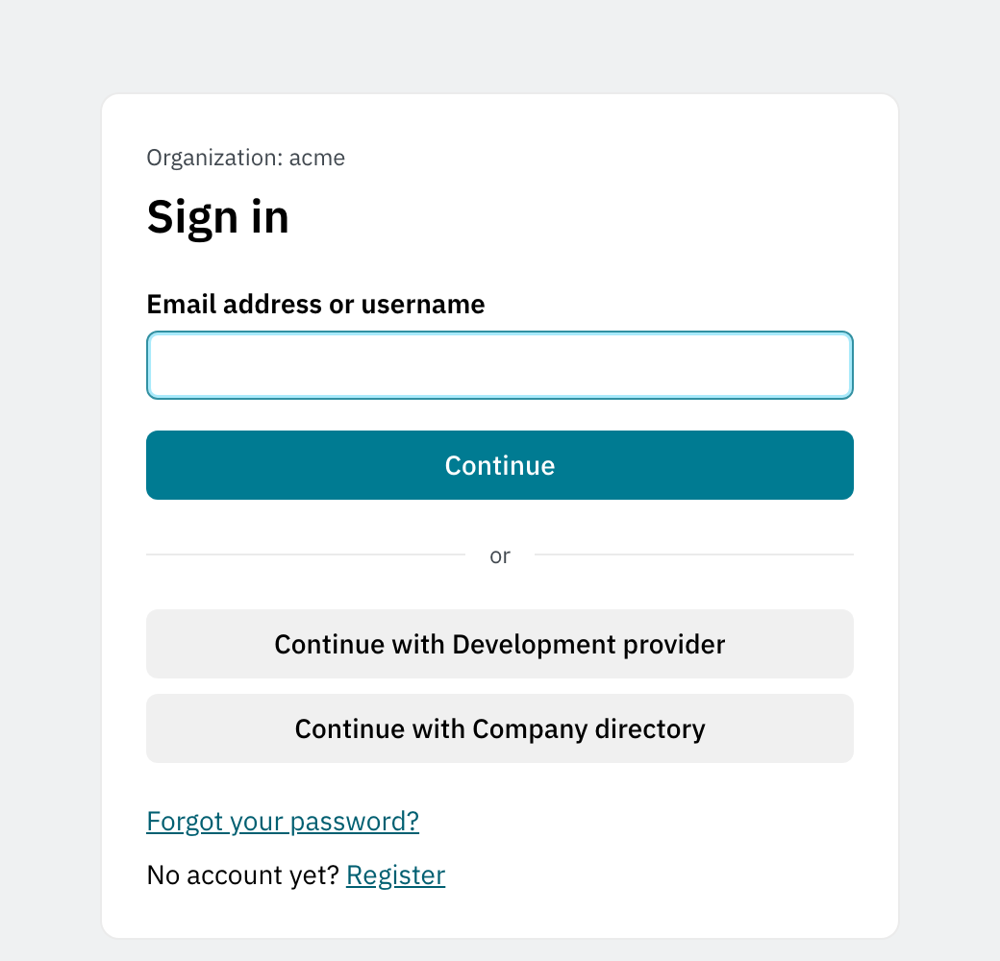
</p>
<p align="center"><sub>The sign-in page of the tenant <code>acme</code> on the development stack, offering a password, an OpenID Connect provider and a directory.</sub></p>

## Contents

- [Where it stands](#where-it-stands)
- [Hodor at a glance](#hodor-at-a-glance)
- [Concepts](#concepts)
- [How it is built](#how-it-is-built)
- [How tenants are kept apart](#how-tenants-are-kept-apart)
- [Flows](#flows)
  - [Signing in with a password](#signing-in-with-a-password)
  - [Registering through the mailbox](#registering-through-the-mailbox)
  - [Signing in through an OpenID Connect provider](#signing-in-through-an-openid-connect-provider)
  - [Deciding who the person is](#deciding-who-the-person-is)
  - [Signing in through a SAML identity provider](#signing-in-through-a-saml-identity-provider)
  - [Signing in through a directory](#signing-in-through-a-directory)
  - [The life of a session](#the-life-of-a-session)
  - [From a change to the audit log](#from-a-change-to-the-audit-log)
  - [Planned: Hodor as an OpenID Provider](#planned-hodor-as-an-openid-provider)
- [Try it](#try-it)
- [Repository layout](#repository-layout)
- [Documentation map](#documentation-map)
- [Development](#development)
- [Contributing](#contributing)

## Where it stands

Hodor lets people **into** a tenant. It does not yet let applications **ask** Hodor who someone is: the OAuth authorization server and the OpenID Provider are the next phase. [Progress](docs/product/progress.md) tracks every issue.

| Capability | Status |
|---|---|
| Tenants, each isolated in the database by row-level security | Built ([Milestone 1](docs/product/epics.md#milestone-1-walking-skeleton)) |
| Registration and password recovery, decided by who reads the mailbox | Built |
| Sign-in with an email address and a password, with lockout on repeated failures | Built |
| Sessions, sign-out, ending one's other sessions | Built |
| Sign-in through an OpenID Connect provider: Google, Microsoft Entra ID, Keycloak, any compliant provider | Built ([Milestone 2](docs/product/epics.md#milestone-2-signing-in-with-external-identities)). Hodor is the relying party |
| Sign-in through GitHub | Built |
| Sign-in through an LDAP directory: OpenLDAP, Active Directory | Built. Tried against OpenLDAP only |
| Sign-in through a SAML identity provider: Entra ID, Okta, Active Directory Federation Services, Keycloak, Shibboleth | Built. Needs a review from outside the project before production ([Decision 0019](docs/decisions/0019-saml-signature-verification.md)) |
| Administration interface (HTTP, with an OpenAPI document) and the command-line tool | Built: users, sessions, identity providers, audit log |
| Admin console in the browser | Built: users, audit records, identity providers |
| Audit log, chained with SHA-256 so that a changed record is found | Built |
| Email in English and Brazilian Portuguese, logs, metrics and traces over OpenTelemetry | Built |
| OAuth 2.x authorization server and OpenID Provider: clients, authorization code with PKCE, tokens, discovery, consent, logout | Planned: Phase 2 |
| Multi-factor authentication, passkeys, step-up | Planned: Phase 4 |
| Authorization engine with policies, Open Policy Agent | Planned: Phase 5 |
| SCIM provisioning, Hodor as a SAML identity provider | Planned: Phase 6 |

The [roadmap](docs/product/roadmap.md) has the phases and the order they are built in.

<p align="center">
  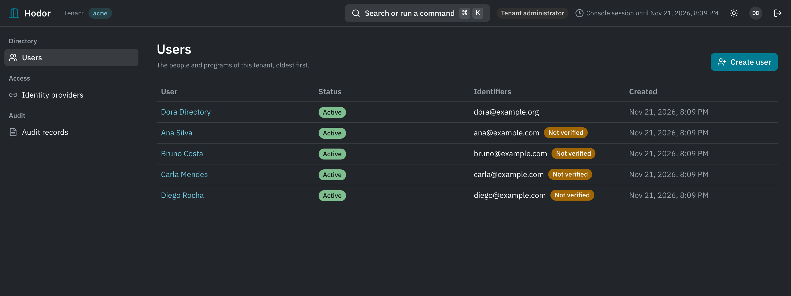
</p>
<p align="center"><sub>The admin console: a tenant administrator's view of the tenant's users. It has no sign-in of its own; it recognizes the session from the hosted pages.</sub></p>

## Hodor at a glance

Solid lines exist today; dashed lines are planned.

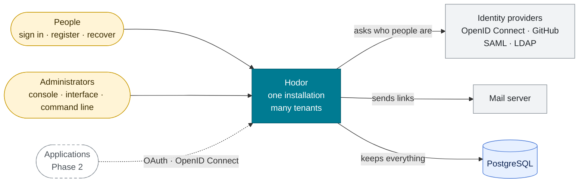

## Concepts

These are the words the code and the documentation use. Each has one meaning. The full vocabulary is in the [domain model](docs/architecture/domain-model.md#ubiquitous-language).

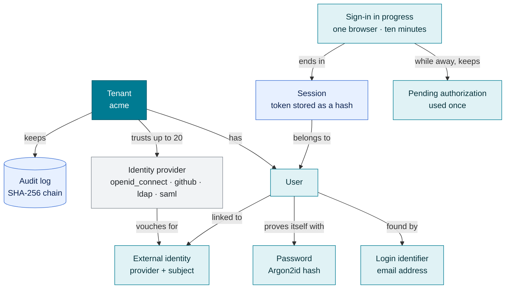

| Concept | What it is |
|---|---|
| **Tenant** | The boundary of isolation. Its own users, sessions, identity providers, settings and audit log; nothing crosses to another tenant. Addressed by a slug in the path: `/t/acme`. A special **system** tenant holds the operators of the installation |
| **User** | A person known to one tenant. The same email address in two tenants is two unrelated users |
| **Login identifier** | What a user is found by when signing in: an email address today. Normalized and unique in the tenant |
| **Credential** | What a user proves who they are with. Today a password, hashed with Argon2id, never stored or logged in the clear |
| **Identity provider** | Something outside Hodor that knows people and can vouch for them. Four kinds: `openid_connect`, `github`, `ldap`, `saml`. Each tenant configures its own; its client secret is encrypted and never read back |
| **External identity** | One person as one identity provider knows them: the provider and its own unchanging identifier for the person, the **subject**. Linked to at most one user, and found by provider and subject only, **never by email address** |
| **Flow** | The steps a sign-in goes through, stored as data and run by one engine. The built-in flow is an identifier, then a password. A flow may also list **alternatives**, such as an identity provider, that complete the sign-in in one step |
| **Authenticator** | What performs one step: `identifier`, `password`, or an identity provider of the federation context |
| **Sign-in in progress** | One run of a flow, tied to the one browser that started it by a cookie only that browser holds. Lives ten minutes |
| **Pending authorization** | What Hodor keeps while the person is away at an identity provider, to recognize the answer when they come back. Belongs to one sign-in and is used once |
| **Session** | The record that a user signed in from a browser, with when and how. Ends on an idle timeout, on an absolute expiry that never moves, or when revoked. The browser holds a random token; Hodor stores only its hash |
| **Event** | The record that something changed, written in the same transaction as the change. Events carry no personal data |
| **Audit record** | One event, as kept forever in the tenant's audit log. Each record holds the hash of the one before it |
| **Role** | What an administrator may do through the administration interface and the console. Two fixed roles today; policies come in Phase 5 |

## How it is built

Hodor is a **modular monolith**: one Rust workspace in which each bounded context is a crate with its own rules, and anything outside the process (the database, cryptography, mail, HTTP, LDAP) is reached through a port that an adapter crate implements. Three binaries are assembled from the same crates. The [architecture overview](docs/architecture/overview.md) and [the crates](docs/architecture/crates.md) say more; [Decision 0001](docs/decisions/0001-modular-monolith-clean-architecture.md) says why.

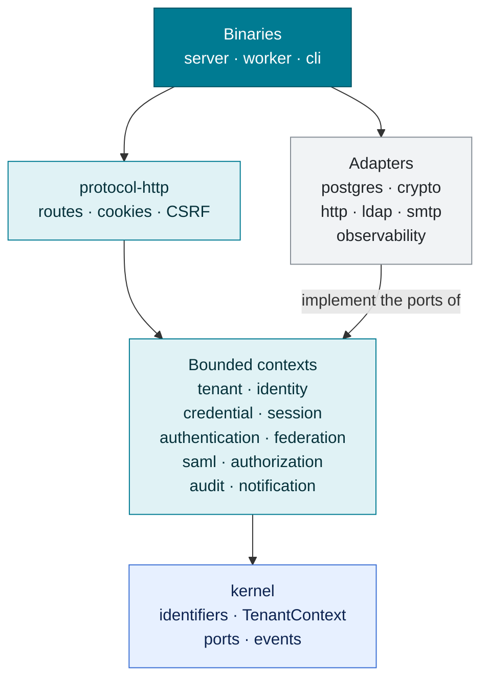

The rules that hold everywhere:

- **A context sees another only through its public facade**, and the allowed edges between crates form a fixed graph. An architecture test fails the build when a crate reaches for something it may not.
- **Every port that touches tenant data takes a `TenantContext`.** There is no way to ask for "all users"; only for the users of one tenant.
- **A change and its events are stored in one transaction**, through an outbox. The worker delivers them afterwards: to the audit log, to email. Nothing is lost and nothing is done twice ([Decision 0003](docs/decisions/0003-context-communication.md)).
- **Secrets never reach a log, a trace, an error message or an event.** Tokens are stored as hashes; client secrets are sealed with AES-256-GCM, bound to their tenant and purpose ([secrets at rest](docs/security/secrets-at-rest.md)).
- **Every request Hodor makes to the outside goes through one guarded client**: HTTPS only, public addresses only, no redirects, bounded in time and size ([outbound HTTP](docs/security/outbound-http.md)).

What runs in the development stack:

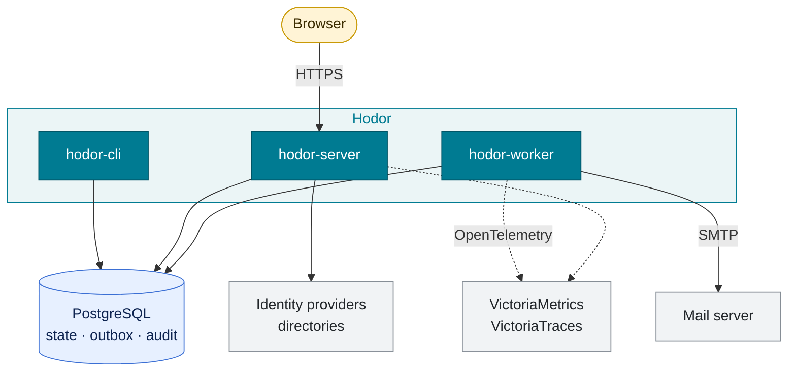

## How tenants are kept apart

A tenant is decided **once per request, from the address and nothing else**. A tenant identifier in a body, a header or a query parameter is never believed. Every credential presented afterwards, whether a session cookie, a sign-in cookie, an access token or a link from a message, is looked up inside that tenant; if it belongs to another, it is not found. Underneath, PostgreSQL enforces the same thing with row-level security, so a query that forgot the tenant returns nothing rather than another tenant's rows. Details: [multi-tenancy](docs/architecture/multi-tenancy.md) and [Decision 0006](docs/decisions/0006-tenant-isolation.md).

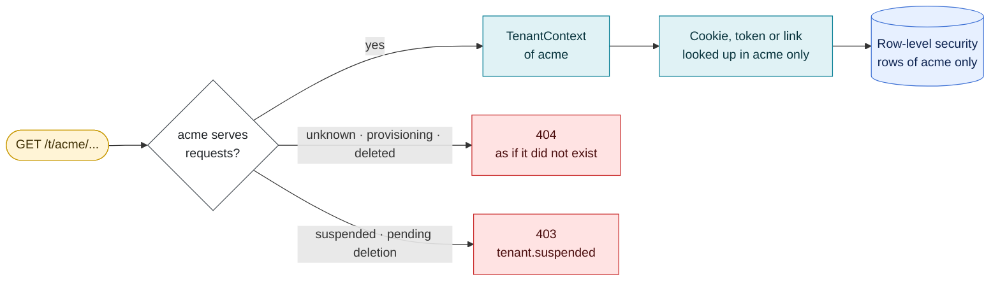

A suite of tests on the real server creates two tenants that share a person's email address and password, and shows that cookies, sign-ins, access tokens, links and identifiers of one are each refused by the other ([the cross-tenant suite](docs/architecture/multi-tenancy.md#the-cross-tenant-suite)).

## Flows

Every diagram below matches what the server does today, except the last one, which is planned. Paths are relative to the tenant, `/t/{slug}`. The detailed rules for each flow are on the page linked under it.

### Signing in with a password

The hosted pages never decide anything. They ask the [interaction interface](docs/api/interaction-api.md) which step comes next, show the form for it, and submit what the person typed.

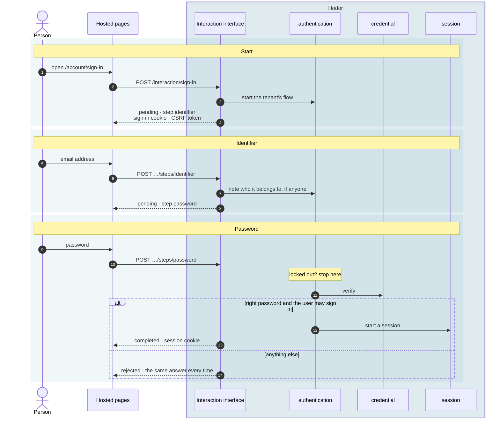

What protects it:

- The sign-in belongs to the browser that started it: the cookie holds a secret only that browser has, and is `HttpOnly`, `Secure`, `SameSite=Strict` and scoped to the tenant's interaction paths.
- Every request that changes something carries a CSRF token derived from that secret, and a request naming another origin is refused.
- After five wrong passwords in fifteen minutes the identifier is locked out for a minute, and each further lockout doubles, up to an hour. The lockout applies whether or not the identifier belongs to anyone, so it reveals nothing; while it lasts no password is checked. Attempts are also counted per address.

The answers a sign-in gives move through four states:

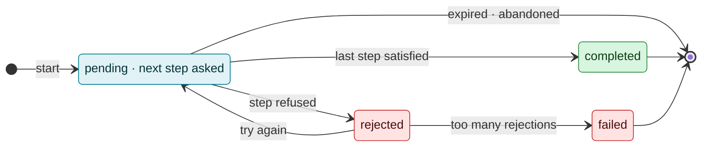

Specified in [the authentication context](docs/architecture/contexts/authentication.md) and [the interaction interface](docs/api/interaction-api.md#signing-in).

### Registering through the mailbox

**Only the mailbox decides.** Asking to register answers the same whoever the address belongs to; the message that arrives is what differs, and only the owner of the mailbox reads it. The password is chosen at the end, by whoever holds the link. Password recovery follows the same shape, and a recovery ends every session of the user.

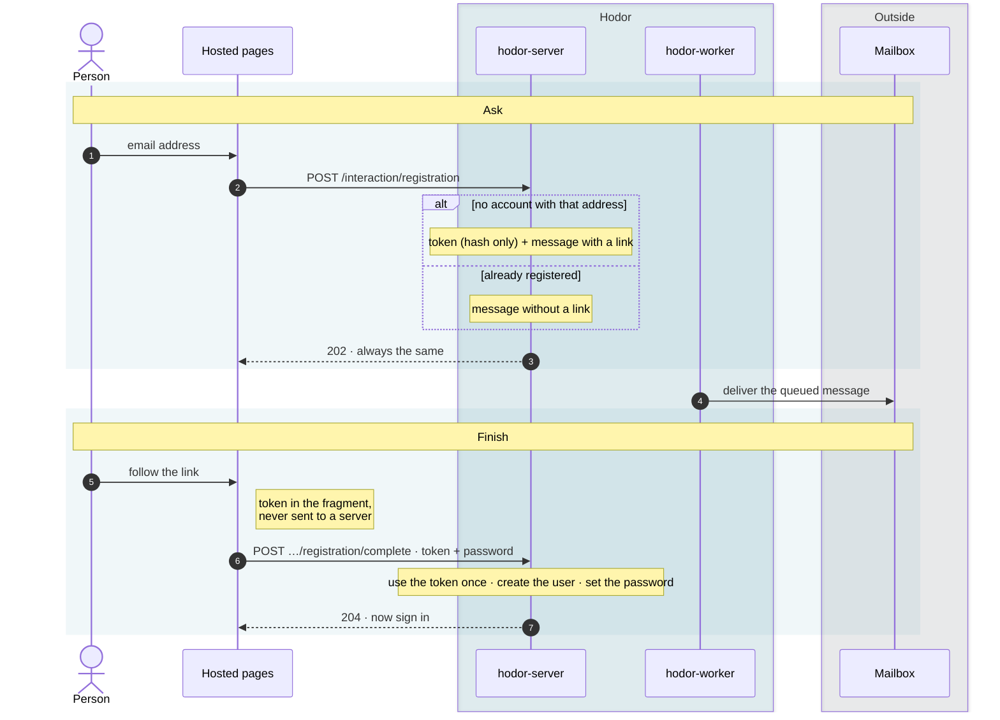

Specified in [registration and password recovery](docs/architecture/contexts/authentication.md#registration-and-password-recovery).

### Signing in through an OpenID Connect provider

For a provider of the kind `openid_connect`, **Hodor is the relying party**: it sends the person to the provider and, when they come back, asks the provider who they are. Signing in this way is an alternative of the tenant's flow, and ends in the same session as a password.

Hodor makes three values of 256 random bits for each attempt: `state`, which lets it recognize the answer it is waiting for; `nonce`, which the provider puts inside the ID token to tie it to this request; and a PKCE verifier, whose SHA-256 hash is sent so that only Hodor can exchange the code.

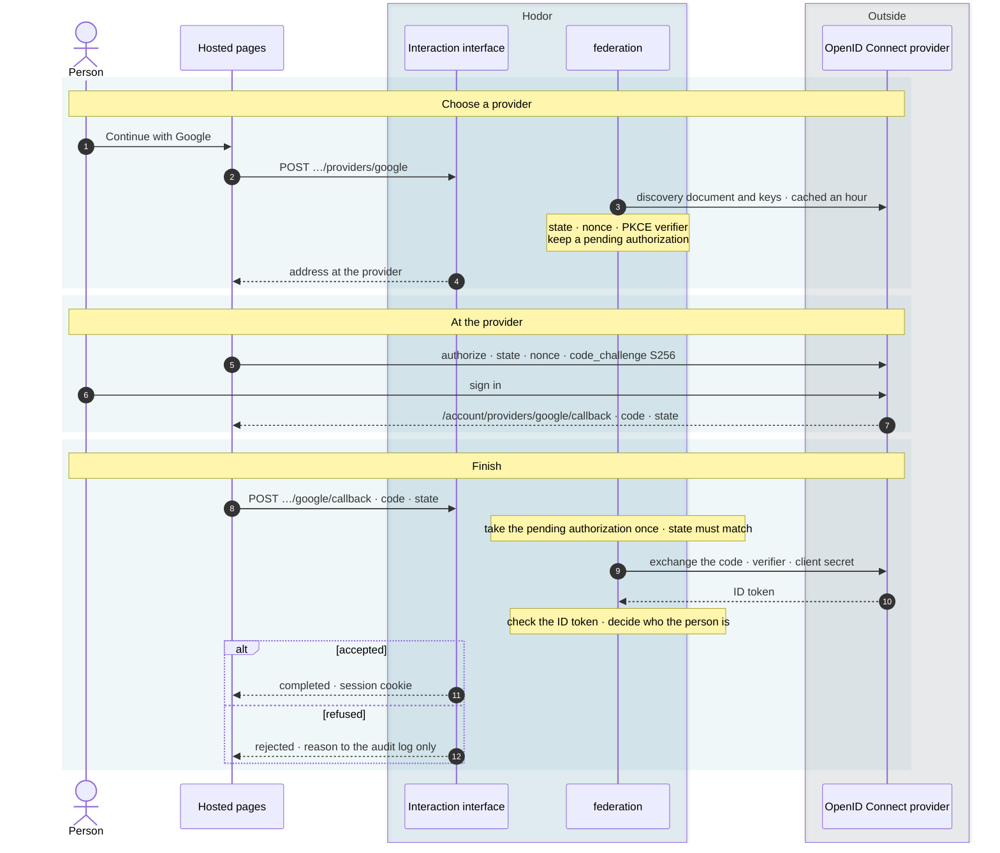

The ID token is believed only after every check passes. The algorithms accepted are `RS256`, `PS256` and `ES256`; `none` and the `HS` family are refused, RSA keys under 2048 bits are refused, and the issuer is compared character by character. Microsoft Entra ID must be configured with the organization's own tenant identifier, never `common`. GitHub issues no ID token, so for the kind `github` Hodor asks GitHub's interface for the person by number and for an address that is both primary and verified.

Specified in [the federation context](docs/architecture/contexts/federation.md#asking-an-openid-connect-provider-who-somebody-is), with [recipes](docs/architecture/contexts/federation.md#recipes) for each provider.

A tenant administrator adds providers through the administration interface, the command-line tool or the console. The answer gives the callback address to register at the provider; the client secret is written once and never shown again.

<p align="center">
  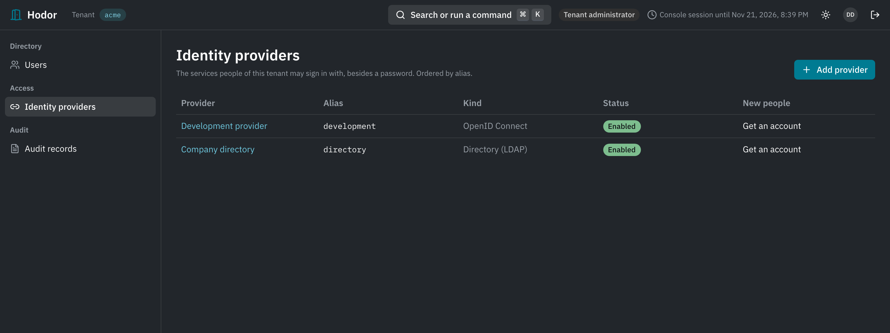
</p>

### Deciding who the person is

Whatever the kind of provider, the answer ends in the same decision. The rule that matters most is the last branch: **an external identity is never let into an existing account because of an email address**. An address at a provider proves control of a mailbox at best; letting it in would make every provider a tenant adds a way into every account of the tenant.

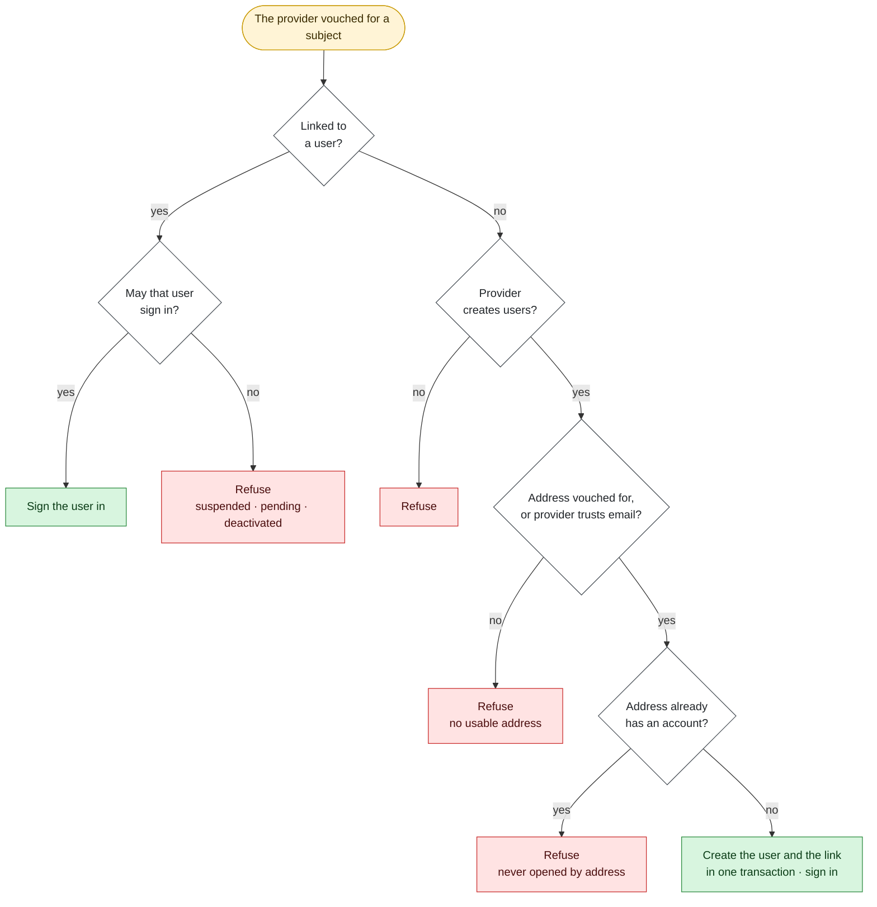

Connecting an external identity to an existing account needs proof of both, which comes with the account console. Specified in [who the person is](docs/architecture/contexts/federation.md#who-the-person-is).

### Signing in through a SAML identity provider

For a provider of the kind `saml`, **Hodor is the service provider**. The identity provider's site makes the browser post a signed response to Hodor. Because that request comes from another site, it does not carry the sign-in cookie, so the response is only kept there; it is read and checked when Hodor's own page finishes the sign-in. A **receipt**, given only to the browser that posted the response, stops an attacker from finishing their own sign-in with a victim's response.

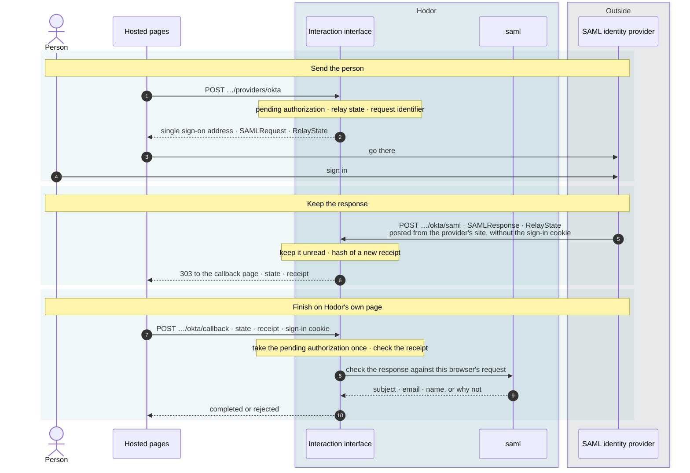

Signatures are verified with `xml-sec` behind a narrow profile of Hodor's own ([Decision 0019](docs/decisions/0019-saml-signature-verification.md)). Every case of the [SAML attack corpus](docs/security/saml-attack-corpus.md) is a test. Specified in [signing in through a SAML identity provider](docs/architecture/contexts/federation.md#signing-in-through-a-saml-identity-provider).

### Signing in through a directory

For a provider of the kind `ldap`, nobody leaves Hodor's page. The person types what the directory knows them by and their password; Hodor asks the directory. Only directories on the operator's list, `HODOR_DIRECTORY_HOSTS`, can ever be reached.

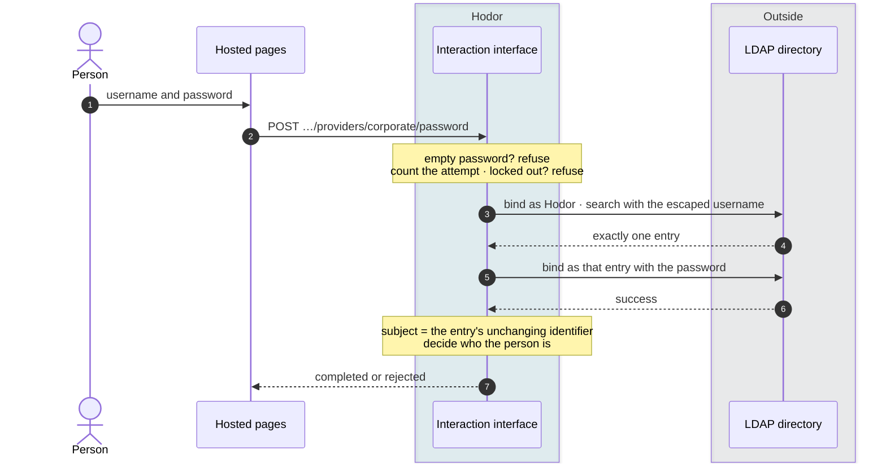

Specified in [signing in through a directory](docs/architecture/contexts/federation.md#signing-in-through-a-directory).

### The life of a session

A session is decided on the server every time it is presented; the cookie holds nothing but a random token. Expiry needs nothing to run: it is computed from the stored times.

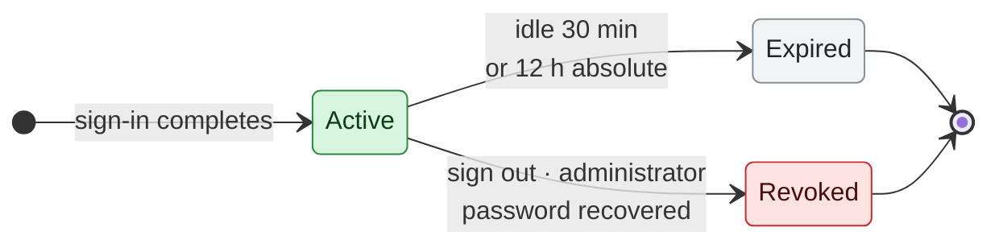

Specified in [the session context](docs/architecture/contexts/session.md).

### From a change to the audit log

Every change is stored with its event in one transaction. The worker turns each event into one audit record in the transaction that marks the event delivered, so an event is recorded exactly once. Each record holds the hash of the record before it, so a changed, removed or inserted record breaks the chain, and `hodor-cli audit verify` finds it.

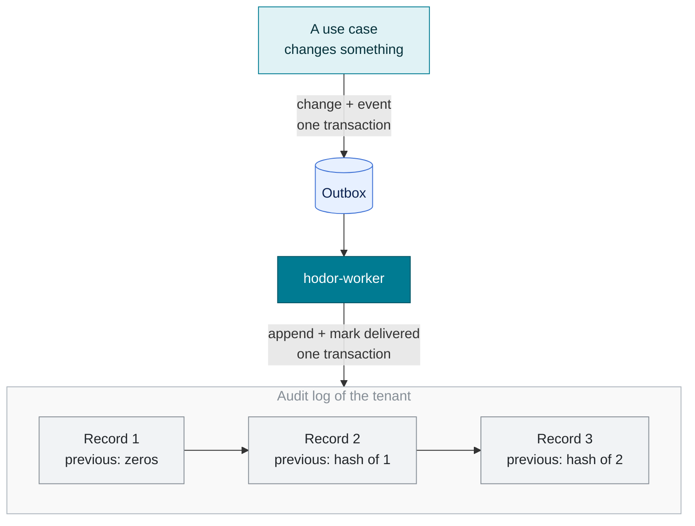

Specified in [the audit context](docs/architecture/contexts/audit.md).

### Planned: Hodor as an OpenID Provider

> **Not built.** This is the design for Phase 2, when applications sign people in through Hodor. It is kept here so the direction is visible; the full sequences, the token lifecycle and the logout flows are in [protocol sequences](docs/protocols/sequences.md#2-oauth-20-authorization-code-with-pkce).

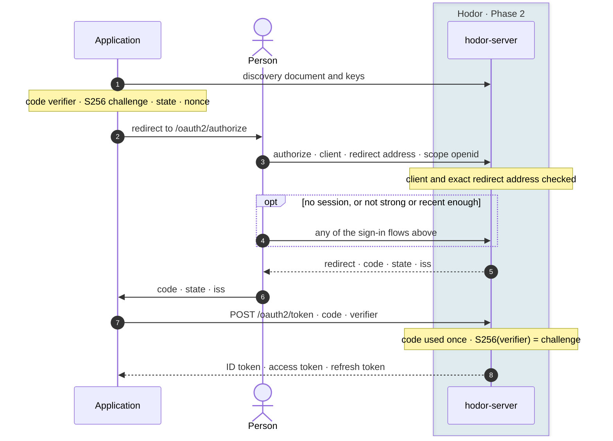

The rules already decided for it: PKCE with `S256` only, exact comparison of redirect addresses, `iss` in every authorization response, codes good for one use whose second use revokes everything issued from them, and refresh tokens that rotate. See [token formats](docs/decisions/0004-token-formats.md) and the [roadmap](docs/product/roadmap.md).

## Try it

The [quick-start](docs/operations/quick-start.md) goes from a clean checkout to a tenant people sign in to, with Docker and nothing else:

```bash
docker compose -f deploy/docker/compose.yaml up --build --wait
```

```bash
python3 deploy/demo/demo.py
```

```bash
python3 deploy/demo/external_identities.py
```

The first command starts Hodor with PostgreSQL, a development mail server, development identity providers for OpenID Connect and SAML, a development directory, VictoriaMetrics and VictoriaTraces. The second is the [demonstration of Milestone 1](docs/operations/quick-start.md#the-demonstration): it creates two tenants and shows, checking every answer, that they are kept apart. The third is the [demonstration of Milestone 2](docs/operations/quick-start.md#the-demonstration-of-milestone-2): signing in through an OpenID Connect provider, a directory and a SAML identity provider, no account taken over by its address, and a tampered SAML response refused. Both run in continuous integration.

| What | Where |
|---|---|
| A tenant's pages, once [created](docs/operations/quick-start.md#2-create-a-tenant) | <http://localhost:8080/t/acme/account> |
| The messages Hodor sends | <http://localhost:8025> |
| Metrics | <http://localhost:8428/vmui> |
| Traces | <http://localhost:10428/select/vmui> |

This is a development stack: its passwords are in the repository and it speaks plain HTTP. The quick-start lists [what must change before anything real](docs/operations/quick-start.md#before-anything-real).

## Repository layout

| Path | Contents |
|---|---|
| `apps/` | The three binaries: `hodor-server`, `hodor-worker`, `hodor-cli` |
| `crates/` | One crate per bounded context, `protocol-http`, the `kernel`, and the adapters |
| `frontend/` | `auth-ui`, the hosted pages; `admin-console`; and the showcase of the design system. React, built on Astryx with the Hodor theme |
| `migrations/` | The database schema |
| `deploy/` | The container image, the development stack, its development identity providers and directory, the demonstrations, and the two installation packages: Docker Compose and a Helm chart |
| `docs/` | Product, architecture, protocols, interfaces, security, operations and the decision records. The design lives there |

## Documentation map

Start with the [index](docs/README.md). The pages most readers want first:

| To learn | Read |
|---|---|
| Why Hodor exists and what it must do | [Product requirements](docs/product/product-requirements.md), [requirements](docs/product/requirements.md) |
| What is built and what is not | [Progress](docs/product/progress.md), [roadmap](docs/product/roadmap.md) |
| How it is structured | [Architecture overview](docs/architecture/overview.md), [domain model](docs/architecture/domain-model.md), [crates](docs/architecture/crates.md), [database](docs/architecture/database.md) |
| The rules of each part | [tenant](docs/architecture/contexts/tenant.md), [identity](docs/architecture/contexts/identity.md), [credential](docs/architecture/contexts/credential.md), [session](docs/architecture/contexts/session.md), [authentication](docs/architecture/contexts/authentication.md), [federation](docs/architecture/contexts/federation.md), [notification](docs/architecture/contexts/notification.md), [audit](docs/architecture/contexts/audit.md), [authorization](docs/architecture/contexts/authorization.md) |
| The HTTP interfaces | [Conventions](docs/api/api-spec.md), [interaction interface](docs/api/interaction-api.md), [administration interface](docs/api/admin-api.md), [console interface](docs/api/console-interface.md) |
| What could go wrong and what stops it | [Threat model](docs/security/threat-model.md), [SAML attack corpus](docs/security/saml-attack-corpus.md) |
| Why it was built this way | [Decision records](docs/decisions/README.md) |
| How it looks | [Design system](docs/design/design-system.md), [hosted pages](docs/architecture/hosted-pages.md), [admin console](docs/architecture/admin-console.md) |
| How to run it | [Quick-start](docs/operations/quick-start.md), [installing with Docker](docs/operations/install-with-docker.md), [installing on Kubernetes](docs/operations/install-on-kubernetes.md), [deployment](docs/operations/deployment.md) |

## Development

[Local setup](docs/development/local-setup.md) says how to build Hodor, run its checks and work on it; the [conventions](docs/development/conventions.md) say how changes are made. A change is done when, among other things, its documentation was updated **before** the code, and these pass:

```bash
cargo fmt --check && cargo clippy --workspace --all-targets --all-features -- -D warnings && cargo test --workspace
```

## Contributing

- The documentation comes first: a change to behavior starts with the page in `docs/` that specifies it.
- Commits follow [Conventional Commits](https://www.conventionalcommits.org/), with no co-author trailers.
- Branching follows Gitflow: feature branches are cut from `develop` and merged back through pull requests; `main` holds releases.
- A pull request is merged only when continuous integration is green.
