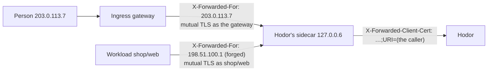

# API specification

This document is the contract outline: the conventions and the map of surfaces. What is built of each surface has a page of its own: [the interaction interface](interaction-api.md) and [the administration interface](admin-api.md).

The administration interface also has a machine-readable OpenAPI 3.1 document, written by hand, kept next to the code that serves it and served by it. A test holds the document and the routes together.

## Surfaces

All paths are relative to the tenant base: `https://{host}/t/{tenant}` or the tenant's own domain.

| Surface | Base path | Audience | Authentication |
|---|---|---|---|
| OAuth / OpenID Connect | `/oauth2`, `/.well-known` | Clients, relying parties | Per protocol |
| Interaction API | `/interaction` | `auth-ui` only | Interaction cookie + CSRF token |
| Federation callbacks | `/federation` | External identity providers via the browser | `state` |
| Account API | `/api/v1/account` | `account-console`, first-party apps | Session (backend-for-frontend) or access token with `account:*` scopes |
| Admin API | `/api/v1/admin` | `admin-console`, automation, Terraform | A person's access token, or a workload's API key whose scopes are permissions; role-based access control on every route |
| Authorization API | `/api/v1/authorization` | Applications (policy enforcement points) | Access token or a workload's API key, with `authz:*` scopes |
| SCIM | `/scim/v2` | Provisioning clients | Access token with the audience `urn:hodor:scim` and the scope `scim` |
| SAML | `/saml` | SAML peers | Per protocol |
| Open Policy Agent service API | `/opa` | Open Policy Agent instances | Per-instance bearer token or mTLS |
| Platform API | `https://{host}/platform/v1` | Platform operators | Token from the `system` tenant with `platform:*` scopes |
| Operations | `/livez`, `/readyz`, `/startupz`, `/metrics` | Infrastructure | Separate listener, not internet-facing |

## Conventions for the JSON APIs

| Topic | Rule |
|---|---|
| Versioning | Major version in the path (`/api/v1`). Additive changes do not bump it. A breaking change ships as `/api/v2` with an overlap period |
| Media type | `application/json`; UTF-8; `snake_case` field names |
| Identifiers | UUID strings; type is implied by the path, not a prefix |
| Timestamps | RFC 3339, UTC |
| Errors | RFC 9457 `application/problem+json` with `type`, `title`, `status`, `detail`, `instance`, plus `code` (stable machine code), `request_id` and `errors[]` for field validation |
| Pagination | Cursor based: `?limit=` (default 50, max 200) and `?cursor=`; response has `items` and `next_cursor`. No offset pagination |
| Filtering and sorting | `?filter[field]=value`, `?sort=field,-other`; only documented fields |
| Concurrency | `ETag` on resources; `If-Match` required on `PUT`, `PATCH` and `DELETE` of mutable aggregates; `412` on mismatch |
| Idempotency | `Idempotency-Key` header accepted on every `POST` that creates; same key and body returns the stored response for 24 h |
| Partial update | `PATCH` with JSON Merge Patch (RFC 7396) |
| Secrets | Write-only. Generated secrets are returned once, at creation; never readable afterwards |
| Rate limiting | `429` with `Retry-After`; `RateLimit-*` headers |
| Tracing | `traceparent` honored and returned; `X-Request-Id` on every response |
| Long operations | `202 Accepted` with a `Location` to an operation resource (tenant deletion, imports, bundle builds) |

OAuth endpoints follow their RFCs instead: form-encoded requests and the `error` / `error_description` JSON format.

## Where a request comes from

Every surface records the address a request came from and limits by it. Sign-in attempts are counted per address. Sessions and sign-ins keep it, and the audit log names it. This section says which address that is.

### The client address

The **client address** is the address of the connection, unless that connection comes from a **trusted proxy**. A trusted proxy is a load balancer or web server the operator names by its address range in `HODOR_TRUSTED_PROXIES`, such as `10.0.0.0/8` or `2001:db8::/32`. A bare address names that address alone. The setting is empty by default, so by default the client address is the connection's and every forwarded header is ignored.

When the connection comes from a trusted proxy, Hodor reads the **forwarded header** the operator names in `HODOR_FORWARDED_HEADER`: `x-forwarded-for` (the default) or `forwarded` (RFC 7239). Only that one header is read. A proxy writes one of them, and a client can send the other. If Hodor read both, a client could choose the one its proxy leaves alone.

The header lists the addresses the request passed through, the client first and each proxy after it. Every proxy adds the address it received the request from at the end. Hodor reads the list from the end, nearest first:

1. The connection's address is a trusted proxy, so the address it added at the end is looked at next.
2. An address that is a trusted proxy is passed over, and the one before it is looked at.
3. The first address that is not a trusted proxy is the client address.
4. When every address in the list is a trusted proxy, the client address is the first in the list.

The addresses at the start of the list were written by whoever sent the request, so they are never believed on their own. A client that writes a false address at the start of its header is still known by the address its first trusted proxy saw.


With `HODOR_TRUSTED_PROXIES=10.0.0.0/16`, Hodor sees a connection from 10.0.1.9, which is trusted. It reads the list from the end, passes over 10.0.0.5, which is trusted, and takes 203.0.113.7. The forged 198.51.100.1 is never reached.

### What is read and what is refused

| Case | Client address |
|---|---|
| The connection is not from a trusted proxy | The connection's address. The forwarded header is ignored, whatever it says |
| The header is absent | The connection's address |
| An address is written with a port, such as `203.0.113.7:4711` or `[2001:db8::7]:4711` | The address without the port |
| An IPv6 address that holds an IPv4 address, such as `::ffff:203.0.113.7` | The IPv4 address, for the connection and the header alike, so that one client is never counted as two |
| The header is sent more than once | The lists are read as one, in the order they arrived, as HTTP says they must be |
| An entry that is not an address is reached before the client address: `unknown`, an obfuscated identifier of RFC 7239 such as `_hidden`, or text that does not read | The connection's address, and the counter `hodor.http.forwarded_address.unreadable` counts it with `reason` `unreadable` |
| More than 32 trusted proxies are passed over before the client address is found | The connection's address, counted with `reason` `too_long`. Only the entries read from the end count, so a long list a client writes at the start of its header is never reached |

Falling back to the connection's address is the safe way to fail. Every client behind that proxy then shares one limit. A client cannot choose an address by sending something Hodor cannot read.

The client address is set once, as the request arrives, before the tenant is resolved. Everything after it uses the same value: the attempt guard, sessions, sign-ins in progress, the audit log and the record of decisions.

### Configuring it

| Variable | Default | Meaning |
|---|---|---|
| `HODOR_TRUSTED_PROXIES` | empty | Address ranges of trusted proxies, such as `10.0.0.0/8,fd00::/8`, separated by commas. Empty: forwarded headers are never read |
| `HODOR_FORWARDED_HEADER` | `x-forwarded-for` | Which header a trusted proxy writes: `x-forwarded-for` or `forwarded`; or `none`, when trusted proxies are named only for [the caller's identity](#the-callers-identity-from-a-proxy) and no address they forward is read |
| `HODOR_GATEWAY_IDENTITIES` | empty | The identities of the ingress gateways of a service mesh, separated by commas: SPIFFE identifiers or Linkerd identities. When set, the forwarded header is read only from a request whose caller is one of them: [behind the proxy of a service mesh](#behind-the-proxy-of-a-service-mesh) |

The server refuses to start if a range cannot be read. It also refuses a range that holds every address, `0.0.0.0/0` or `::/0`, because that range would let every client choose its own address.

Name only the proxies that add the address they received the request from and that cannot be reached any other way. A range that also holds machines that are not proxies lets those machines choose their address. [Installing with Docker](../operations/install-with-docker.md) and [installing on Kubernetes](../operations/install-on-kubernetes.md) say what to name in each.

### Behind the proxy of a service mesh

A service mesh that puts a proxy beside Hodor, in its own pod, changes what Hodor sees. Every connection comes from that proxy: from `127.0.0.6` with Istio's sidecar, from the pod's own address with Linkerd's proxy. The proxy passes `X-Forwarded-For` on as the caller wrote it. Naming the proxy's address as a trusted proxy would then let every workload of the mesh choose its own address.

What tells the callers apart is their identity in the mesh, which the proxy forwards in [the header of the caller's identity](#the-callers-identity-from-a-proxy). The operator names the identities of the ingress gateways in `HODOR_GATEWAY_IDENTITIES` ([Decision 0061](../decisions/0061-gateway-identities.md)):

- a SPIFFE identifier, such as `spiffe://cluster.local/ns/istio-system/sa/istio-ingressgateway-service-account`, matches a URI of the forwarded certificate, or a URI the proxy forwarded without the certificate, as Istio does;
- a Linkerd identity, such as `gateway.edge.serviceaccount.identity.linkerd.cluster.local` for the service account `gateway` of the namespace `edge`, matches `l5d-client-id`, or a DNS name of the forwarded certificate.

Each is read by the rule of a client's identity, and matched exactly: no prefix, no wildcard. With gateways named, the client address of a request from a trusted proxy is:

| The caller's identity | Client address |
|---|---|
| One of the gateways | Read from the forwarded header, as above |
| Another workload | The connection's address. The forwarded header is ignored, whatever it says |
| None: no identity header, or one that does not read | The connection's address. The forwarded header is ignored |

Every workload that reaches Hodor without a gateway, to get a token with its own identity for instance, is then known by the proxy's address, and they share one limit. The counter `hodor.http.forwarded_address.ignored` counts, by `reason`, `not_a_gateway` or `no_identity`, the requests whose forwarded header was there and was ignored for that reason.



With `HODOR_TRUSTED_PROXIES=127.0.0.6`, `HODOR_CLIENT_IDENTITY_HEADER=x-forwarded-client-cert` and `HODOR_GATEWAY_IDENTITIES=spiffe://cluster.local/ns/istio-system/sa/istio-ingressgateway-service-account`, the person is known as 203.0.113.7, and the workload as 127.0.0.6, whatever it wrote.

The server refuses to start when the gateways can never be recognized: an identity that does not read, or gateways named with no trusted proxy, with no `HODOR_CLIENT_IDENTITY_HEADER`, or with `HODOR_FORWARDED_HEADER=none`. When it starts, it says which gateways it reads the forwarded address from.

A load balancer in front of the gateway is named in `HODOR_TRUSTED_PROXIES` by its address range, as outside a mesh, so that the address it adds is passed over. Behind a waypoint of Istio's ambient mode, no identity reaches Hodor and every caller arrives from the waypoint: a waypoint is never a trusted proxy. [Installing on Kubernetes](../operations/install-on-kubernetes.md#inside-a-service-mesh) gives the settings for each mesh.

### The caller's identity from a proxy

A workload in a service mesh proves who it is to the proxy in front of Hodor, over mutual TLS. The proxy ends that connection and can forward what it learned in a header. Hodor reads that header to authenticate a client with `tls_client_auth`, `spiffe_x509` or `linkerd_identity` ([the OAuth context](../architecture/contexts/oauth.md#an-identity-forwarded-by-a-proxy), [Decision 0056](../decisions/0056-forwarded-client-identity.md)).

The operator names the one header Hodor reads in `HODOR_CLIENT_IDENTITY_HEADER`:

| Value | Written by | What it holds |
|---|---|---|
| `client-cert` | A proxy that follows [RFC 9440](https://www.rfc-editor.org/rfc/rfc9440) | `Client-Cert`: the caller's certificate, its DER encoding in base64 between colons. `Client-Cert-Chain`, when present: the certificates between it and its authority, each the same way, separated by commas |
| `x-forwarded-client-cert` | Envoy, and the meshes built on it: Istio and Consul | `X-Forwarded-Client-Cert`: elements separated by commas, each of pairs `key=value` separated by semicolons. Hodor reads `Cert`, the certificate in PEM, percent-encoded; `Chain`, the chain the same way; `URI` and `DNS`, the names of the certificate, each given once per name; and, without `Cert`, `Hash`, the SHA-256 of the certificate in hexadecimal, for [certificate-bound access tokens](../architecture/contexts/oauth.md#certificate-bound-access-tokens); values may be in double quotes. Other keys, `By` and `Subject` among them, are not used |
| `l5d-client-id` | Linkerd's proxy | The caller's Linkerd identity, such as `web.shop.serviceaccount.identity.linkerd.cluster.local` |

The rules:

- **No header is read unless one is named.** The setting is empty by default. A header a client invents is then never believed, whatever it is called.
- **Only the named header is read.** A proxy writes one of them, and a client can send the others.
- **Only from a trusted proxy.** The header is read only when the connection comes from an address in `HODOR_TRUSTED_PROXIES`, the same proxies as for the client address. From any other connection it is ignored, whatever it says.
- **Only its nearest element.** When the header holds several elements, or arrives in several lines, only the last is read: the one the proxy Hodor is connected to added. Envoy and Istio add their element after whatever the caller sent, so an element a caller wrote is always before it and never read. For `client-cert` the nearest element of `Client-Cert` is the certificate; every element of `Client-Cert-Chain` may be used to build a path, since a path must still end at an authority of the trust domain, whoever wrote the certificates in between.
- **What cannot be read is no identity.** A nearest element that does not read, a certificate larger than 16 kibibytes, or a chain of more than 10 certificates, leaves the request with no forwarded identity, and the client is then refused if its method needs one. A certificate that is not one is refused when it is checked. The counter `hodor.http.forwarded_identity.unreadable` counts such headers by `header`.
- **The identity is found once**, as the request arrives, with the client address. The token, revocation and introspection endpoints use it to authenticate a client; the token endpoint, UserInfo, the Authorization API and the SCIM server use the certificate's thumbprint to issue and to check [certificate-bound access tokens](../architecture/contexts/oauth.md#certificate-bound-access-tokens).


With `HODOR_TRUSTED_PROXIES=127.0.0.6`, `HODOR_FORWARDED_HEADER=none` and `HODOR_CLIENT_IDENTITY_HEADER=x-forwarded-client-cert`, Hodor reads the last element, which the sidecar wrote, and never the forged one before it. It reads no forwarded address: a sidecar passes `X-Forwarded-For` as the caller wrote it, so every caller is known by the sidecar's address ([Threat-Mesh-08](../security/threat-model.md#service-meshes-and-certificates)). To read the forwarded address of the ingress gateway alone, name the gateway's identity instead of `none`: [behind the proxy of a service mesh](#behind-the-proxy-of-a-service-mesh).

| Variable | Default | Meaning |
|---|---|---|
| `HODOR_CLIENT_IDENTITY_HEADER` | empty | The header a trusted proxy writes the caller's identity into: `client-cert`, `x-forwarded-client-cert` or `l5d-client-id`. Empty: no identity is read |

The server refuses to start with another value. It also says, when it starts, which header it reads and from which proxies; a header named with no trusted proxy is never read, and the server says so.

Name the proxy that ends the caller's mutual TLS and removes or replaces the header a caller sends, and nothing else: Linkerd's proxy removes any `l5d-client-id` a caller sent; Envoy does the same for `X-Forwarded-Client-Cert` with `forward_client_cert_details` set to `SANITIZE_SET`, and adds its element after the caller's with `APPEND_FORWARD`, which Istio's sidecars use. A proxy that passes the header through unchanged must not be named.

## OAuth 2.x and OpenID Connect

The paths are relative to the tenant, `https://{host}/t/{slug}`, whose issuer is `{HODOR_PUBLIC_URL}/t/{slug}`. The authorization endpoint, the token endpoint and the OpenID Provider are specified in [the OAuth context](../architecture/contexts/oauth.md#authorization-endpoint).

| Method and path | Purpose | Standard |
|---|---|---|
| `GET /.well-known/openid-configuration` | Provider metadata (built: [discovery](../architecture/contexts/oauth.md#discovery)) | OpenID Connect Discovery |
| `GET /.well-known/oauth-authorization-server` | Authorization server metadata, the same document (built) | RFC 8414 |
| `GET /oauth2/jwks` | Public signing keys (built: [the published key set](../architecture/contexts/keys.md#the-published-key-set)) | RFC 7517 |
| `GET /certificate-authority/bundle` | The bundle of the tenant's certificate authority, served only when the installation turns the authority on (built: [its bundle](../architecture/contexts/keys.md#its-bundle)) | SPIFFE Federation, `https_web` profile |
| `GET, POST /oauth2/authorize` | Authorization endpoint, with [request objects](../architecture/contexts/oauth.md#request-objects) by value and [at a client's address](../architecture/contexts/oauth.md#request-objects-at-a-clients-address), answering in the [response modes](../architecture/contexts/oauth.md#response-modes) `query` and `form_post` | RFC 6749, OpenID Connect Core, RFC 9101, OAuth 2.0 Form Post Response Mode |
| `GET /oauth2/authorize/resume` | Where the hosted pages send the browser after a sign-in, to go on with the pending authorization request ([the OAuth context](../architecture/contexts/oauth.md#signing-in-and-coming-back)) | — |
| `POST /oauth2/par` | Pushed authorization requests (built: [pushed authorization requests](../architecture/contexts/oauth.md#pushed-authorization-requests)); the authorization endpoint takes their references as `request_uri` | RFC 9126 |
| `POST /oauth2/token` | Token endpoint: `authorization_code`, `refresh_token` and `client_credentials` (built: [the token endpoint](../architecture/contexts/oauth.md#token-endpoint-and-client-authentication)), `urn:ietf:params:oauth:grant-type:device_code`, `…:token-exchange`, `…:jwt-bearer` | RFC 6749, 8628, 8693, 7523 |
| `POST /oauth2/revoke` | Revocation (built: [revocation](../architecture/contexts/oauth.md#revocation)) | RFC 7009 |
| `POST /oauth2/introspect` | Introspection (built: [introspection](../architecture/contexts/oauth.md#introspection)) | RFC 7662 |
| `GET, POST /oauth2/userinfo` | UserInfo, in JSON or [signed](../architecture/contexts/oauth.md#signed-userinfo-answers) as the client chose (built: [UserInfo](../architecture/contexts/oauth.md#userinfo)) | OpenID Connect Core |
| `POST /oauth2/device_authorization` | Device authorization | RFC 8628 |
| `GET /oauth2/device` | User code entry page | RFC 8628 |
| `GET, POST /oauth2/logout` | Logout initiated by the relying party (built: [logout](../architecture/contexts/oauth.md#logout-initiated-by-the-relying-party)) | OpenID Connect RP-Initiated Logout |
| `GET /oauth2/logout/finish` | Where a logout that asked the person ends ([finishing](../architecture/contexts/oauth.md#finishing)) | — |
| `POST /oauth2/register`, `GET, PUT, DELETE /oauth2/register/{client_id}` | Dynamic client registration and management | RFC 7591, 7592 |

Advertised in metadata and enforced: `response_types_supported: ["code"]`, `code_challenge_methods_supported: ["S256"]`, `authorization_response_iss_parameter_supported: true`, `id_token_signing_alg_values_supported` and `userinfo_signing_alg_values_supported`: `["ES256", "RS256", "PS256", "EdDSA"]`, `request_parameter_supported: true`, `request_uri_parameter_supported: true`, `require_request_uri_registration: true`, `request_object_signing_alg_values_supported: ["ES256", "RS256", "PS256", "none"]`, `pushed_authorization_request_endpoint`, and `require_pushed_authorization_requests` as the tenant sets it.

## Interaction API

Used only by the hosted login user interface. It exposes the flow engine as a step machine, so the user interface never encodes flow logic.

The part that is built, signing in with an identifier and a password, is specified in full in [the interaction interface](interaction-api.md). The table below is the outline of everything this interface will cover.

| Method and path | Purpose |
|---|---|
| `GET /interaction/{id}` | Current state: step to render, options, branding, locale, client display data |
| `POST /interaction/{id}/steps/{step}` | Submit the current step (`identifier`, `password`, `totp`, `webauthn`, `otp`, `recovery_code`, `idp`, `terms`) |
| `POST /interaction/{id}/webauthn/options` | Challenge for a WebAuthn ceremony |
| `POST /interaction/{id}/consent` | Grant or deny scopes |
| `POST /interaction/{id}/cancel` | Abort; returns the client an `access_denied` error |
| `POST /interaction/registration`, `POST /interaction/recovery` | Start registration or recovery flows |
| `GET /federation/callback/{provider}` (also `POST` for form-post providers) | Return from an external identity provider |

Every response has the same shape: `{ "status": "pending" | "completed" | "failed", "step": {...}, "redirect": "..." }`. Errors do not reveal whether an account exists.

## Account API

| Resource | Operations |
|---|---|
| `/account/profile` | `GET`, `PATCH` |
| `/account/identifiers` | List, add, verify, set primary, remove |
| `/account/password` | `PUT` (requires current password or recent authentication) |
| `/account/credentials` | List; enroll and remove TOTP, passkeys, recovery codes |
| `/account/sessions` | List, revoke one, revoke all others |
| `/account/devices` | List and remove trusted devices |
| `/account/identities` | List linked external identities; start link; unlink (not the last sign-in method) |
| `/account/consents` | List and revoke |
| `/account/login-history` | List |
| `/account/export` | Request and download a personal data export |
| `/account` | `DELETE`: request account deletion |

Sensitive operations require recent authentication; a stale session gets `401` with a `step_up_required` problem carrying the `acr` and `max_age` to request.

## Admin API

Standard collection and item routes (`GET` list, `POST`, `GET`, `PATCH`, `DELETE`) unless noted.

| Area | Resources | Notable actions |
|---|---|---|
| Tenant | `/admin/tenant`, `/admin/tenant/settings`, `/admin/tenant/domains`, `/admin/tenant/branding` | `POST /domains/{id}/verify` |
| Users | `/admin/users`, `/users/{id}/identifiers`, `/users/{id}/credentials`, `/users/{id}/sessions`, `/users/{id}/identities`, `/users/{id}/roles`, `/users/{id}/groups` | `POST /users/{id}:suspend`, `:reactivate`, `:reset-password`, `:revoke-sessions`; `POST /users:import`, `:export` |
| Groups | `/admin/groups`, `/groups/{id}/members` | — |
| Organizations | `/admin/organizations`, `/organizations/{id}/units`, `/members`, `/invitations` | `POST /invitations/{id}:resend` |
| Applications | `/admin/applications`, `/applications/{id}/clients`, `/clients/{id}/secrets`, `/clients/{id}/claim-mappers`, `/resource-servers`, `/resource-servers/{id}/scopes` | `POST /clients/{id}/secrets` returns the secret once; `POST /secrets/{id}:revoke` |
| Service accounts and agents | `/admin/service-accounts`, `/admin/agents`, `/service-accounts/{id}/api-keys` | `:disable`, `:enable` (built: [the administration interface](admin-api.md#service-accounts-and-agents)); their clients are the applications' clients with a `principal`; API keys with rotation come with Issue-94 |
| Identity providers | `/admin/identity-providers`, `/admin/routing-rules` | `POST /identity-providers/{id}:test`, `:deactivate` |
| Authentication | `/admin/auth-flows`, `/auth-flows/{id}/versions` | `POST /versions/{v}:validate`, `:simulate`, `:publish` |
| Authorization | `/admin/roles`, `/permissions`, `/role-assignments`, `/resource-servers/{id}/access-entries`, `/access-entries`, `/relation-tuples`, `/policies`, `/policies/{id}/versions`, `/bundles`, `/engine-bindings`, `/decision-logs` | `POST /versions/{v}:validate`, `:test`, `:simulate`, `:publish`; `POST /policies/{id}:rollback` |
| Keys | `/admin/keys/{set}` | `POST /keys/{set}:rotate`, `POST /keys/{set}/versions/{kid}:revoke` (built: [the administration interface](admin-api.md#keys)) |
| Sessions | `/admin/sessions` | `DELETE`, `POST /sessions:revoke-all` |
| Audit | `/admin/audit-records` (read-only) | `POST /audit-records:export` |
| Security posture | `/admin/posture` (read-only summary), `/admin/posture/findings`, `/findings/{id}/acceptances` | `POST /posture:evaluate`; an acceptance carries a reason and an expiry ([control plane](../design/control-plane.md#security-posture)) |
| Integrations | `/admin/webhooks`, `/admin/plugins` | `POST /webhooks/{id}:test`. SCIM has no resource of its own here: a tenant opens it by registering a resource server ([who may call](../architecture/contexts/provisioning.md#who-may-call)) |

Custom actions use the `:verb` suffix so that they never collide with resource identifiers.

## Authorization API

Applications ask Hodor whether a subject may do an action to one of their resources. Specified in [the authorization context](../architecture/contexts/authorization.md#the-authorization-api); [the reference](authorization-reference.md) shows every operation.

| Method and path, under `/t/{slug}/api/v1/authorization` | Purpose | Scope |
|---|---|---|
| `POST /evaluate` | One decision | `authz:evaluate` |
| `POST /batch` | Up to 100 decisions, one per request, in order | `authz:evaluate` |
| `POST /simulate` | What would be decided against chosen policies; never recorded as a real decision | `authz:simulate` |
| `GET /openapi.json` | The OpenAPI document of this API, without authentication | |

The caller sends `Authorization: Bearer` with an access token of the tenant whose audience includes `urn:hodor:authorization`, or with the [API key](../architecture/contexts/credential.md#api-keys) of a service account or an agent. The resource server asked about is the one of the token client's application, or of the application the key names; the body never names it, and never names a tenant.

```http
POST /t/acme/api/v1/authorization/evaluate
Authorization: Bearer <token with authz:evaluate>
Content-Type: application/json

{
  "subject": { "type": "user", "id": "0193f1c2-..." },
  "asserted": { "roles": ["finance-manager"] },
  "resource": {
    "type": "invoice",
    "id": "invoice-456",
    "attributes": { "amount": 5000, "owner_id": "0193f1c2-..." }
  },
  "action": "approve",
  "context": { "environment": "production" }
}
```

```json
{
  "decision": "ALLOW",
  "decision_id": "0193f1c9-...",
  "evaluated_at": "2026-11-20T14:03:11Z",
  "engine": "native",
  "policy_version": null,
  "reason": "matching_role"
}
```

- `subject.type` is `user` or `client`; `asserted`, `resource.id`, `resource.attributes` and `context` may be left out.
- `subject.type` may also be `workload_identity`, with a SPIFFE identifier or a Linkerd identity as `id` ([Decision 0058](../decisions/0058-hodor-ext-authz.md)). Hodor resolves it, in the tenant, to the service account whose enabled clients are bound to that identity, and the request is about that user as if `{"type": "user"}` had named it. An identity that no enabled client binds is a subject Hodor does not know: a user whose identifier is the identity itself, with no attributes. An identity that reads as neither is `422` `authorization.workload_identity_invalid`. It is how [`hodor-ext-authz`](../operations/hodor-ext-authz.md) names a caller that sent no token, and how an application behind Linkerd names the caller in `l5d-client-id`.
- `organization`, at the top of the body, names the [organization](../architecture/contexts/identity.md#organizations) the request is made in, by its identifier, as the `org_id` of the person's token says. Roles scoped to that organization then count, if the person is still a member of it. Left out, only roles that are not scoped to an organization count.
- `decision` is `ALLOW`, `DENY` or `INDETERMINATE`; only `ALLOW` permits, and `INDETERMINATE` means the engine could not decide.
- With `authz:explain` the answer also holds `matched_policies`, and a simulation holds `trace`.
- `/batch` takes `{ "requests": [...] }` and answers `{ "results": [...] }` in the same order. A request that cannot be read is answered by a problem object in its place; the others are decided.
- `/simulate` takes the request's fields and `"against"`: `{ "published": true }`, `{ "revision": "rev-42" }` or `{ "draft": "policy-reference" }`. The engines that cannot simulate that selection answer `authorization.simulation_unsupported`.

Differences from the example in the specification: there is no `tenant_id` in the body (the tenant is the URL's), roles sent by the caller go under `asserted` so that policy can distinguish them from roles Hodor resolved, and the resource server is the caller's own.

| Answer | When |
|---|---|
| `401` with `WWW-Authenticate: Bearer` | No token, or a token or key that is not good here: another tenant's, expired, revoked, without the API's audience, bound to a certificate the request did not come with, or a key whose holder may not act |
| `403` with `error="insufficient_scope"` | The token lacks the route's scope |
| `403` `authorization.no_resource_server` | The token client's application has no resource server |
| `422` | The body cannot be read; the problem's `code` says why |

## SCIM 2.0

Other systems provision a tenant's users and groups, per RFC 7643 and RFC 7644. Specified in [the provisioning context](../architecture/contexts/provisioning.md), with its attributes, filters, lists and errors.

| Method and path, under `/t/{slug}/scim/v2` | Purpose |
|---|---|
| `GET /ServiceProviderConfig`, `GET /ResourceTypes[/{name}]`, `GET /Schemas[/{uri}]` | Discovery |
| `GET /Users`, `POST /Users`, `GET /Users/{id}`, `PUT /Users/{id}`, `PATCH /Users/{id}`, `DELETE /Users/{id}` | Users, with the core schema and the enterprise extension; lists filtered, sorted and in pages; `DELETE` follows the tenant's deprovisioning policy |
| `GET /Groups`, `POST /Groups`, `GET /Groups/{id}`, `PUT /Groups/{id}`, `PATCH /Groups/{id}`, `DELETE /Groups/{id}` | Groups and their members |
| `POST /Bulk` | Up to 100 of those operations, each on its own, with references between them by `bulkId` |

- The caller sends `Authorization: Bearer` with an access token of the tenant whose audience includes `urn:hodor:scim` and which holds the scope `scim`. Without a good token the answer is `401` with `WWW-Authenticate: Bearer`, another tenant's token included; without the scope it is `403` with `insufficient_scope`.
- The media type is `application/scim+json`; `application/json` is accepted in requests. Errors use the SCIM error schema, `urn:ietf:params:scim:api:messages:2.0:Error`, not problem documents.
- Lists take `filter`, `sortBy`, `sortOrder`, `startIndex` (from 1) and `count` (100 by default, at most 200), not the cursors of the JSON APIs.
- A resource of another tenant is answered as one that does not exist: `404`.
- Every resource has a version, `meta.version` and the `ETag` header. `If-Match` on `PUT`, `PATCH` and `DELETE` is answered `412` when the version is stale; `If-None-Match` on a `GET` gives `304`.
- Deprovisioning, `DELETE` of a user or `active: false`, deactivates or deletes the person as the tenant's policy says, and ends their sessions and grants at once.
- Searching with `POST /.search` is answered `501`.

## SAML 2.0

| Path | Purpose |
|---|---|
| `GET /saml/idp/metadata` | Identity provider metadata |
| `GET, POST /saml/idp/sso` | Single sign-on (Redirect and POST bindings) |
| `GET, POST /saml/idp/slo` | Single logout |
| `GET /saml/sp/{provider}/metadata` | Service provider metadata for a brokered identity provider |
| `POST /saml/sp/{provider}/acs` | Assertion consumer service |
| `GET, POST /saml/sp/{provider}/slo` | Single logout |

## Open Policy Agent service API

| Path | Called by Open Policy Agent to |
|---|---|
| `GET /opa/bundles/{name}` | Download the bundle (`ETag` / `If-None-Match`) |
| `POST /opa/logs` | Upload decision log batches |
| `POST /opa/status` | Report bundle activation and health |

Every request carries the credential of the instance as a bearer token, issued when the instance is registered. What an instance may pull, and what is kept of its reports, is in [the authorization context](../architecture/contexts/authorization.md#bundles).

## Platform API

`/platform/v1/tenants` (create, list, suspend, reactivate, delete), `/platform/v1/operations/{id}`, `/platform/v1/support-grants`, `/platform/v1/system/health`, `/platform/v1/system/config`.

## Webhooks (outbound)

Events are delivered as `POST` with a JSON envelope `{ id, type, tenant_id, occurred_at, data }`, signed with HMAC-SHA-256 over timestamp and body in a `Hodor-Signature` header, retried with exponential backoff, and moved to a dead-letter list after the last attempt. Receivers deduplicate on `id`.
