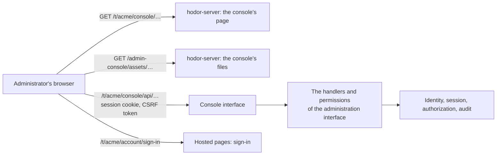

# The admin console

The admin console is where the people who run a tenant do it from a browser: see its users, create and suspend them, end their sessions, connect the identity providers people sign in with, and read the audit log. It is the first part of [the control plane](../design/control-plane.md), built on what the server can answer today ([Decision 0020](../decisions/0020-console-on-the-hodor-session.md)).

It is an application of static files, `admin-console`, served by `hodor-server` on the tenant's origin, built from the components of the [design system](../design/design-system.md). It talks only to the [console interface](../api/console-interface.md).



## Signing in

The console has no sign-in of its own. A person signs in on the [hosted pages](hosted-pages.md) of the tenant; the session that leaves is what the console interface recognizes.

1. The console opens and asks `GET /me`.
2. With no session, or one older than 12 hours, the answer is `401` and the console sends the browser to `/t/{slug}/account/sign-in`. After signing in, the person opens the console again.
3. With a session whose user holds no role, the console says that this account has no access to the console of this tenant, and offers the way back to the account page.
4. Otherwise the console shows what the person's permissions allow.

Signing out is the sign-out of the session, `DELETE /interaction/session`, after which the console sends the browser to the sign-in page.

The first administrator of a tenant is made with `hodor-cli admin bootstrap` ([administration interface](../api/admin-api.md#the-first-administrator)). That user has no password until they recover one on the hosted pages, which is also how they first sign in.

## The frame

Every screen has the frame of [the control plane, section 3](../design/control-plane.md#3-page-anatomy), as far as it applies today:

- **Scope bar**: Hodor's mark, the tenant's slug, the person's roles, when the console session ends, the command palette, the light or dark mode, and the person's menu with sign-out. The tenant is always the one in the address ([Requirement-Console-10](../product/requirements.md#admin-console-admin-console)); there is no tenant switcher, because a person belongs to one tenant.
- **Navigation**: only the screens the person may open. Screens whose resources the server does not have are absent, not disabled.
- **Command palette** (`Ctrl+K` or `⌘K`): jumps to a screen, and opens a user when a user identifier is pasted.

The console opens in the dark mode and remembers the person's choice in the browser.

## Screens

| Address under `/t/{slug}/console` | Screen | Needs |
|---|---|---|
| `/` | Sends to the first screen the person may open | — |
| `/users` | Users: a table, oldest first, with status and identifiers, loaded a page at a time; create a user | `users:read`; `users:write` to create |
| `/users/{user_id}` | One user: profile, identifiers with their verification, active sessions; suspend the user; end a session | `users:read`; `sessions:read` for the sessions; `users:write` and `sessions:revoke` for the actions |
| `/audit` | Audit records: a table, a page at a time, with a panel showing the whole record and its hashes | `audit:read` |
| `/identity-providers` | Identity providers: a table ordered by alias, with status and whether each creates users; add a provider | `identity-providers:read`; `identity-providers:write` to add |
| `/identity-providers/{provider_id}` | One provider: the callback address to register at the provider, its settings; change them, replace the client secret, disable or enable it | `identity-providers:read`; `identity-providers:write` for the actions |

The console adds OpenID Connect providers, and changes their settings and secrets. Providers of the other kinds, GitHub and directories, are listed and shown, and are disabled and enabled from the console; adding them, and changing their settings or secret, is done through the [administration interface](../api/admin-api.md#identity-providers) for now, because the fields of the form mean other things for them. A directory has no callback address, and its screen shows where it searches instead.

An action the person may not take is not offered. The server checks every request regardless.

### The dangerous action ladder

Each action has one level, written once in the console's action catalog (`src/actions.ts`), and its confirmation follows from the level ([design system, section 6.2](../design/design-system.md#62-the-dangerous-action-ladder)).

| Action | Level | Confirmation |
|---|---|---|
| Create a user | 0 | None: a form |
| End one session | 1 | A dialog that names the consequence |
| Suspend a user | 2 | The reason, which the server requires, and the user's address typed in full |
| Add an identity provider | 1 | The form says who will be able to sign in, and whether they get an account, before its button |
| Change an identity provider's settings | 1 | The form, with the same sentence when people it lets in will be created |
| Replace an identity provider's client secret | 1 | A dialog that says sign-ins use the new secret at once |
| Enable an identity provider | 1 | A dialog that says it will be offered on the sign-in page |
| Disable an identity provider | 2 | The alias typed in full: nobody signs in through it until it is enabled again |

The dialog says what will happen in words the reader can check, never puts the destructive button first or focused, and does not act on Enter. After the action a toast confirms it; the audit record it produced is on the audit screen.

### What the console never does

- It never shows or sets a password. A new user chooses one by recovering it.
- It never shows a client secret. A secret is typed into a field that hides it, sent once, and forgotten by the page; the provider's screen says only that one is set.
- It never holds a token: there is none to hold.
- It never shows data it did not get from the server.

## Language

English and Brazilian Portuguese, chosen as on the hosted pages. All copy lives in one file per language, and a test fails if one has a message the other lacks.

## How it is served

As the hosted pages are: one `index.html` answers for every screen of every tenant, with the same Content Security Policy, and the other files are served outside any tenant, at `/admin-console/assets`, with names that carry a hash of their content.

One thing differs from the hosted pages. Astryx places a menu, a tooltip or a toast with rules it writes into the page as a style element, which the policy refuses. The build writes those rules into the console's compiled style sheet instead (`src/layer-rules.css`, filled by `vite.config.ts`), and `index.html` carries the mark that tells Astryx they are in place. A change of Astryx's version is followed by a look at the browser's console for a refused style.

`hodor-server` is told where the built console is with `HODOR_CONSOLE_DIRECTORY`. Without it the server serves no console page; the console interface is still answered. The image builds the console and sets the variable.

## Where the code is

| Path | What it holds |
|---|---|
| `frontend/admin-console/src/` | The application: the frame, the screens, the client of the console interface, the action catalog, the copy in both languages |
| `frontend/admin-console/src/parts/` | Hodor's own components the console needs: the confirmation dialogs of the ladder, the identifier |
| `crates/protocol-http/src/admin.rs` | The handlers shared by the administration interface and the console interface, and how each knows who is asking |
| `crates/protocol-http/src/pages.rs` | Serving an application of static files: the hosted pages and the console |

The console reads the compiled Hodor theme from `frontend/auth-ui/src/themes/hodor/`, as the showcase does.

## Working on it

```bash
cd frontend/admin-console
npm ci
npm run lint && npm run typecheck && npm test && npm run build
```

`npm run dev` serves the console at `http://localhost:4175/t/acme/console/` and passes `/t/…/console/api`, `/t/…/interaction` and `/t/…/account` on to a server at `http://localhost:8080`, so that the console in development works against the [development stack](../development/local-setup.md#running-the-development-stack).

## What is not built yet

The console is used in production with these known gaps. Each is a requirement of [the console](../product/requirements.md#admin-console-admin-console) or a screen of [the control plane](../design/control-plane.md).

| Missing | Why | Arrives with |
|---|---|---|
| Sign-in by OpenID Connect, with the tokens kept by the server | Hodor issues no tokens yet ([Decision 0020](../decisions/0020-console-on-the-hodor-session.md)) | Phase 2 |
| An idle timeout of 15 minutes for administrators (Requirement-Console-01). The 12-hour limit is built; the idle limit is the tenant's | Activity on the account pages and in the console is one session's activity today | Phase 2 |
| Recent authentication for sensitive actions (Requirement-Console-03) | There is no step-up yet | Phase 2 |
| Phishing-resistant sign-in for administrators (Requirement-Console-05) | Passkeys are Phase 4. Until then an administrator signs in with a password | Phase 4 |
| Adding GitHub providers and directories, and changing their settings or secret, from the console | The form is the one of OpenID Connect providers | Next |
| Security posture, live activity, applications, signing keys, policies | The server has no such resources yet | The phase of each |
| Reactivating, changing or removing a user; filtering and searching the tables | The administration interface does not have them | Phase 2 |
| Giving and taking roles | No route exists; roles are given with `hodor-cli` | Phase 2 |
| Conflict detection between two administrators (Requirement-Console-09) | No `ETag` yet | Phase 2 |
| Browser tests against a running stack | The console is covered by unit tests and by the tests of the console interface | Next |
