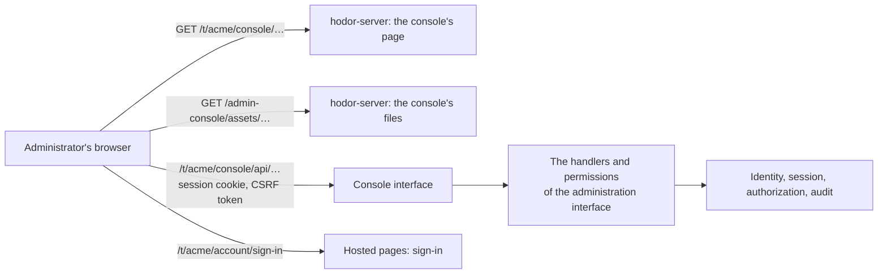

# The admin console

The admin console is where the people who run a tenant do it from a browser: see its users, create and suspend them, end their sessions, gather them into groups, keep the organizations of its business customers with their units, members and invitations, connect the identity providers people sign in with, register the applications that ask Hodor who someone is, and read the audit log. It is the first part of [the control plane](../design/control-plane.md), built on what the server can answer today ([Decision 0020](../decisions/0020-console-on-the-hodor-session.md)).

It is an application of static files, `admin-console`, served by `hodor-server` on the tenant's origin, built from the components of the [design system](../design/design-system.md). It talks only to the [console interface](../api/console-interface.md).



## Signing in

The console has no sign-in of its own. A person signs in on the [hosted pages](hosted-pages.md) of the tenant; the session that leaves is what the console interface recognizes.

1. The console opens and asks `GET /me`.
2. With no session, or one older than 12 hours, the answer is `401` and the console sends the browser to `/t/{slug}/account/sign-in`. After signing in, the person opens the console again.
3. With a session whose user holds no role, the console says that this account has no access to the console of this tenant, and offers the way back to the account page.
4. Otherwise the console shows what the person's permissions allow.

Signing out is the sign-out of the session, `DELETE /interaction/session`, after which the console sends the browser to the sign-in page.

The first administrator of a tenant is made with `hodor-cli admin bootstrap` ([administration interface](../api/admin-api.md#the-first-administrator)). That user has no password until they recover one on the hosted pages, which is also how they first sign in.

## The frame

Every screen has the frame of [the control plane, section 3](../design/control-plane.md#3-page-anatomy), as far as it applies today:

- **Scope bar**: Hodor's mark, the tenant's slug, the person's roles, when the console session ends, the command palette, the light or dark mode, and the person's menu with sign-out. The tenant is always the one in the address ([Requirement-Console-10](../product/requirements.md#admin-console-admin-console)); there is no tenant switcher, because a person belongs to one tenant.
- **Navigation**: only the screens the person may open. Users, groups and organizations are under Directory; identity providers, applications and authorization under Access; the audit records under Audit. Screens whose resources the server does not have are absent, not disabled.
- **Command palette** (`Ctrl+K` or `⌘K`): jumps to a screen, and opens a user when a user identifier is pasted.

The console opens in the dark mode and remembers the person's choice in the browser.

## Screens

| Address under `/t/{slug}/console` | Screen | Needs |
|---|---|---|
| `/` | Sends to the first screen the person may open | — |
| `/users` | Users: a table, oldest first, with status and identifiers, loaded a page at a time; create a user | `users:read`; `users:write` to create |
| `/users/{user_id}` | One user: profile, identifiers with their verification, active sessions, second factors and how many recovery codes are left, the roles they hold, the groups they are in, each marked as direct or through another group, and the organizations they are a member of with their units; suspend the user; end a session; remove the authenticator application, a key or the recovery codes; take a role away | `users:read`; `sessions:read` for the sessions; `credentials:read` for the factors; `roles:read` for the roles; `groups:read` for the groups; `organizations:read` for the organizations; `users:write`, `sessions:revoke`, `credentials:write` and `roles:write` for the actions |
| `/groups` | Groups: a table, oldest first, with each group's description and when it was created, loaded a page at a time; create a group with a name and an optional description | `groups:read`; `groups:write` to create |
| `/groups/{group_id}` | One group: its name and description, and its direct members, users first, then groups, loaded a page at a time; change the name and description, delete the group, add a user or a group by its identifier, take a member out | `groups:read`; `groups:write` for every change |
| `/organizations` | Organizations: a table, oldest first, with each organization's description and when it was created, loaded a page at a time; create an organization with a name and an optional description | `organizations:read`; `organizations:write` to create |
| `/organizations/{organization_id}` | One organization: its name and description; its units as a tree, each indented under its parent, with its kind, unit or department; its members with their units, loaded a page at a time; its pending invitations with the address, the units and when each expires. Change the name and description, delete the organization; create a unit, rename it, change its kind or move it under another parent, delete a unit with no unit below it; put a member, by user identifier, with their units, or change a member's units; take a member out; invite an email address with units and the language of the message, and withdraw a pending invitation | `organizations:read`; `organizations:write` for every change |
| `/audit` | Audit records: a table, a page at a time, with a panel showing the whole record and its hashes | `audit:read` |
| `/identity-providers` | Identity providers: a table ordered by alias, with status and whether each creates users; add a provider | `identity-providers:read`; `identity-providers:write` to add |
| `/identity-providers/{provider_id}` | One provider: the callback address to register at the provider, its settings; change them, replace the client secret, disable or enable it | `identity-providers:read`; `identity-providers:write` for the actions |
| `/applications` | Applications: a table, oldest first, with whether each is first party and its status; register an application | `applications:read`; `applications:write` to register |
| `/applications/{application_id}` | One application: its settings, its clients, its resource server with the scopes it defines; change the application, disable or enable it, create a client, register or change its resource server | `applications:read`; `applications:write` for every change |
| `/clients/{client_id}` | One client: its `client_id`, type, authentication method, grants, redirect addresses, post-logout redirect addresses, scopes and token lifetimes, its secrets by expiry and its keys; change it, give it a new secret, end a secret, add or remove a key, disable or enable it; the roles it holds, each of which can be taken away | `applications:read`; `applications:write` for every change; `roles:read` for its roles and `roles:write` to take one away |
| `/authorization` | Authorization: the tenant's roles with their permissions, conditions and inclusions, each of which can be changed, its conditions written as text and checked by the server; the engine of each resource server, what it does when the engine fails, and removing a binding; what is published for Open Policy Agent and whether every instance runs it; the latest decisions, filtered by effect | `roles:read`; `roles:write` to change a role; `bindings:read` and `bindings:write`; `policies:read`; `decisions:read` |

Publishing and rolling back a policy, giving a role, binding a resource server and registering Open Policy Agent instances are not in the console: publishing needs the key that signs bundles, which only `hodor-cli` holds, and the others are done through the [administration interface](../api/admin-api.md#roles-and-their-permissions) and `hodor-cli authorization` for now.

A member of a group, or of an organization, is added by the identifier of the user or the group, as shown on its page and copied from there: the console has no search by name yet. A user who is a member is shown by name when the person may read users, and by identifier otherwise; a group inside a group is always shown by name. The groups of a user say whether the user is in each directly or only through another group inside it.

A unit's parent is chosen among the organization's units; choosing none puts it at the top. Moving a unit carries the units below it. The server refuses a unit put under itself or below one of its own units, a tree deeper than ten levels, and the deletion of a unit that still has units below it, and the console says each in words, as it says a group that would end up inside itself, or nested deeper than the tenant allows.

The console adds OpenID Connect providers, and changes their settings and secrets. Providers of the other kinds, GitHub and directories, are listed and shown, and are disabled and enabled from the console; adding them, and changing their settings or secret, is done through the [administration interface](../api/admin-api.md#identity-providers) for now, because the fields of the form mean other things for them. A directory has no callback address, and its screen shows where it searches instead.

An action the person may not take is not offered. The server checks every request regardless.

### The dangerous action ladder

Each action has one level, written once in the console's action catalog (`src/actions.ts`), and its confirmation follows from the level ([design system, section 6.2](../design/design-system.md#62-the-dangerous-action-ladder)).

| Action | Level | Confirmation |
|---|---|---|
| Create a user | 0 | None: a form |
| End one session | 1 | A dialog that names the consequence |
| Remove a user's authenticator application, a key, or their recovery codes | 2 | The user's address typed in full: the person can no longer use it, and when it is the last second factor the recovery codes go too and, under a policy that requires one, the person cannot sign in until one is enrolled for them |
| Suspend a user | 2 | The reason, which the server requires, and the user's address typed in full |
| Add an identity provider | 1 | The form says who will be able to sign in, and whether they get an account, before its button |
| Change an identity provider's settings | 1 | The form, with the same sentence when people it lets in will be created |
| Replace an identity provider's client secret | 1 | A dialog that says sign-ins use the new secret at once |
| Enable an identity provider | 1 | A dialog that says it will be offered on the sign-in page |
| Disable an identity provider | 2 | The alias typed in full: nobody signs in through it until it is enabled again |
| Register an application | 1 | The form says, before its button, whether people will be asked for consent: a first-party application is not asked |
| Change an application | 1 | The form, with the same sentence |
| Enable an application or a client | 1 | A dialog that says its clients, or it, get tokens again |
| Disable an application | 2 | The application's name typed in full: none of its clients gets a token until it is enabled again |
| Create a client | 1 | The form; a client with a secret gets its first secret, shown once |
| Change a client | 1 | The form, checked by the server against every rule of a client |
| Register or change a resource server | 1 | The form, which says that the audience can never be changed |
| Give a client a new secret | 2 | The client's name typed in full: every older secret but the newest stops at once, and the new one is shown once |
| End one secret of a client | 2 | The client's name typed in full: whatever still uses it stops getting tokens at once |
| Add a key to a client | 1 | The form, which refuses a key with a private part |
| Remove a key of a client | 1 | A dialog that names the `kid`: assertions signed with it are refused from now on |
| Disable a client | 2 | The client's name typed in full: it gets no token until it is enabled again |
| Change a role | 1 | The form; the server checks every permission and condition, and its refusal is shown in the form |
| Take a role away from a person or a client | 2 | The role's name typed in full: what it allowed is denied from the next decision |
| Remove a resource server's binding | 2 | The resource server's audience typed in full: every decision about it is denied until it is bound again |
| Create a group or an organization | 0 | None: a form |
| Change a group or an organization | 1 | The form, which says that whatever was given to it stays given, since its identifier does not change |
| Delete a group | 2 | The group's name typed in full: every member is taken out of it, and it is taken out of every group it was in |
| Add a member to a group | 1 | The form says that, when the member is a group, its members are in this group too, through it |
| Take a member out of a group | 1 | A dialog that says the member, and whoever is in the group through it, are no longer in this group |
| Delete an organization | 2 | The organization's name typed in full: its units, members and pending invitations are deleted with it |
| Create a unit | 0 | None: a form |
| Change a unit | 1 | The form, which says that moving a unit carries every unit below it |
| Delete a unit | 2 | The unit's name typed in full: its members are taken out of it, and stay in the organization |
| Put a member in an organization, or change their units | 1 | The form, with the units the member will be in |
| Take a member out of an organization | 1 | A dialog that says the person is no longer a member, nor in any of its units |
| Invite an email address | 1 | The form says that a message with a link goes to the address, good for seven days, and that an earlier invitation of this organization to the same address stops working |
| Withdraw an invitation | 1 | A dialog that names the address: the link in the message stops working |

The dialog says what will happen in words the reader can check, never puts the destructive button first or focused, and does not act on Enter. After the action a toast confirms it; the audit record it produced is on the audit screen.

### What the console never does

- It never shows or sets a password. A new user chooses one by recovering it.
- It never shows an identity provider's client secret. A secret is typed into a field that hides it, sent once, and forgotten by the page; the provider's screen says only that one is set.
- It shows a client's new secret once, in the answer that made it, and forgets it when that dialog closes. The dialog says so and offers to copy it; no screen shows it again, because the server cannot.
- It never shows the link of an invitation, nor anything of its secret. The server sends the link in the message and keeps only a hash of the secret; the console shows the address, the units and when the invitation expires.
- It never holds a token: there is none to hold.
- It never shows data it did not get from the server.

## Language

English and Brazilian Portuguese, chosen as on the hosted pages. All copy lives in one file per language, and a test fails if one has a message the other lacks.

## How it is served

As the hosted pages are: one `index.html` answers for every screen of every tenant, with the same Content Security Policy, and the other files are served outside any tenant, at `/admin-console/assets`, with names that carry a hash of their content.

One thing differs from the hosted pages. Astryx places a menu, a tooltip or a toast with rules it writes into the page as a style element, which the policy refuses. The build writes those rules into the console's compiled style sheet instead (`src/layer-rules.css`, filled by `vite.config.ts`), and `index.html` carries the mark that tells Astryx they are in place. A change of Astryx's version is followed by a look at the browser's console for a refused style.

`hodor-server` is told where the built console is with `HODOR_CONSOLE_DIRECTORY`. Without it the server serves no console page; the console interface is still answered. The image builds the console and sets the variable.

## Where the code is

| Path | What it holds |
|---|---|
| `frontend/admin-console/src/` | The application: the frame, the screens, the client of the console interface, the action catalog, the copy in both languages |
| `frontend/admin-console/src/parts/` | Hodor's own components the console needs: the confirmation dialogs of the ladder, the identifier |
| `crates/protocol-http/src/admin.rs` | The handlers shared by the administration interface and the console interface, and how each knows who is asking |
| `crates/protocol-http/src/pages.rs` | Serving an application of static files: the hosted pages and the console |

The console reads the compiled Hodor theme from `frontend/auth-ui/src/themes/hodor/`, as the showcase does.

## Working on it

```bash
cd frontend/admin-console
npm ci
npm run lint && npm run typecheck && npm test && npm run build
```

`npm run dev` serves the console at `http://localhost:4175/t/acme/console/` and passes `/t/…/console/api`, `/t/…/interaction` and `/t/…/account` on to a server at `http://localhost:8080`, so that the console in development works against the [development stack](../development/local-setup.md#running-the-development-stack).

## What is not built yet

The console is used in production with these known gaps. Each is a requirement of [the console](../product/requirements.md#admin-console-admin-console) or a screen of [the control plane](../design/control-plane.md).

| Missing | Why | Arrives with |
|---|---|---|
| Sign-in by OpenID Connect, with the tokens kept by the server | Hodor issues no tokens yet ([Decision 0020](../decisions/0020-console-on-the-hodor-session.md)) | Phase 2 |
| An idle timeout of 15 minutes for administrators (Requirement-Console-01). The 12-hour limit is built; the idle limit is the tenant's | Activity on the account pages and in the console is one session's activity today | Phase 2 |
| Recent authentication for sensitive actions (Requirement-Console-03) | There is no step-up yet | Phase 2 |
| Phishing-resistant sign-in for administrators (Requirement-Console-05) | Passkeys are Phase 4. Until then an administrator signs in with a password | Phase 4 |
| Adding GitHub providers and directories, and changing their settings or secret, from the console | The form is the one of OpenID Connect providers | Next |
| Security posture, live activity, signing keys | The server has no such resources yet | The phase of each |
| Giving a role, binding a resource server, drafting and simulating a policy version from the console | The routes exist; the forms do not | Next |
| Changing a client's token lifetimes from the console | The form keeps to what most clients change; the administration interface changes them | Next |
| Reactivating, changing or removing a user; filtering and searching the tables | The administration interface does not have them | Phase 2 |
| Choosing a member of a group or an organization by name, rather than pasting an identifier | There is no search of users or groups yet | Phase 2, with searching |
| Conflict detection between two administrators (Requirement-Console-09) | No `ETag` yet | Phase 2 |
| Browser tests against a running stack | The console is covered by unit tests and by the tests of the console interface | Next |
