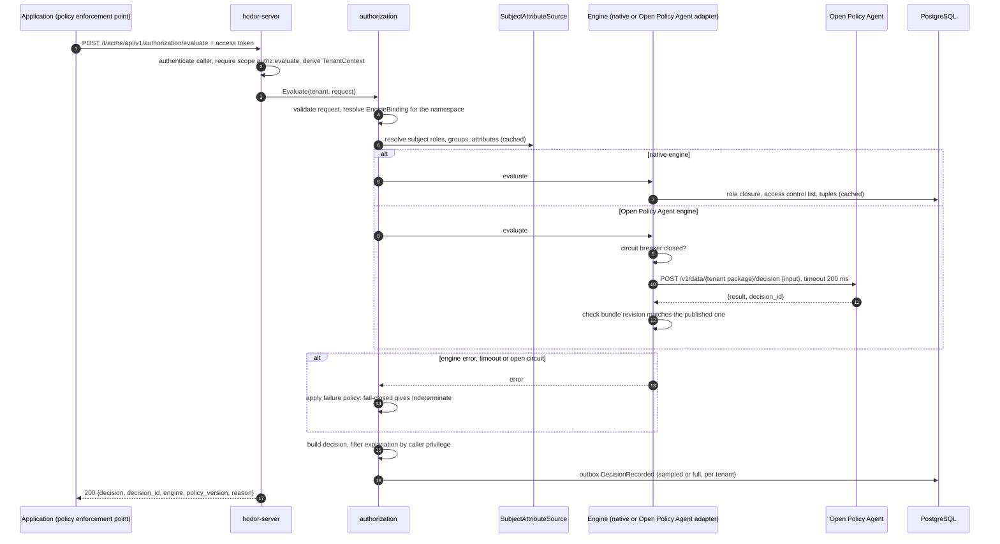
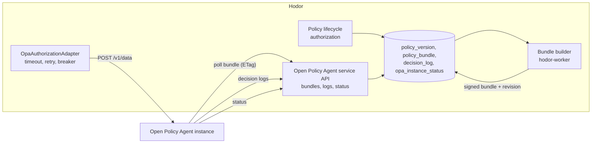
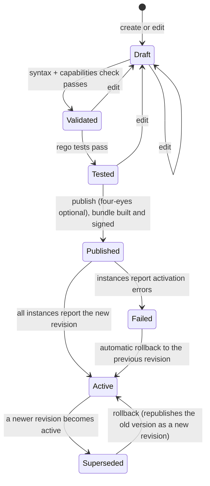

# Authorization engine and Open Policy Agent

`authorization` is an independent bounded context. It owns the authorization model, the engine contract, the policy lifecycle and the decision log. Engines are adapters: `authorization-native` and `authorization-opa` now, OpenFGA or others later.

## Roles in XACML terms

| Role | Who |
|---|---|
| Policy enforcement point (enforcement) | The calling application, or Hodor's own admin API middleware |
| Policy decision point (decision) | `authorization` use cases + the selected engine |
| Policy administration point (administration) | Policy lifecycle use cases and the admin console |
| Policy information point (information) | `SubjectAttributeSource` and `ResourceAttributeSource` ports |

## Engine contract

The trait in the specification is conceptual. The consolidated contract changes four things:

1. **The tenant comes from the caller's credential**, never from the request body. `tenant_id` inside `subject` in the example payload would let a caller evaluate against another tenant.
2. **Caller-asserted attributes are marked as asserted.** Roles and attributes sent by the policy enforcement point are kept apart from those Hodor resolves itself, and a policy can choose to trust only resolved ones.
3. **Simulation and explanation are a separate capability**, because not every engine supports them.
4. **Batch returns one result per request**, so a single failing item does not fail the batch.

```rust
pub struct AuthorizationRequest {
    pub subject: Subject,            // id + kind; attributes resolved by the PDP
    pub asserted: AssertedAttributes, // what the caller claims; untrusted by default
    pub resource: Resource,          // type, id, attributes
    pub action: Action,
    pub context: EvaluationContext,  // environment, time, ip, request id
}

pub struct AuthorizationDecision {
    pub decision_id: DecisionId,
    pub effect: Effect,              // Allow | Deny | Indeterminate
    pub evaluated_at: Timestamp,
    pub engine: EngineId,
    pub policy_version: PolicyRevision,
    pub reason: ReasonCode,          // stable, safe to expose
    pub matched_policies: Vec<PolicyRef>, // filtered by caller privilege
    pub metadata: DecisionMetadata,  // duration, cache hit, obligations
}

#[async_trait]
pub trait AuthorizationEngine: Send + Sync {
    fn id(&self) -> EngineId;
    fn capabilities(&self) -> EngineCapabilities;

    async fn evaluate(
        &self,
        tenant: &TenantContext,
        request: &AuthorizationRequest,
    ) -> Result<AuthorizationDecision, AuthorizationError>;

    async fn evaluate_batch(
        &self,
        tenant: &TenantContext,
        requests: &[AuthorizationRequest],
    ) -> Vec<Result<AuthorizationDecision, AuthorizationError>>;
}

#[async_trait]
pub trait PolicySimulator: Send + Sync {
    async fn simulate(
        &self,
        tenant: &TenantContext,
        request: &AuthorizationRequest,
        against: PolicySelection,    // draft, a specific version, or published
    ) -> Result<SimulationResult, AuthorizationError>;
}
```

`async_trait` is used because engines are selected at run time behind `Arc<dyn AuthorizationEngine>`; native `async fn` in traits is not dyn-compatible. The Open Policy Agent adapter overrides `evaluate_batch` to send one request.

The contract as built (Issue-72) differs from the sketch above in four details, specified in [the authorization context](contexts/authorization.md#the-engine-contract):

- **An engine returns only its part of the answer**: the effect, the reason, the policy revision and the matched policies. The context adds the decision identifier, the time, the engine's name and the duration, so an engine cannot claim another's name or another moment.
- **The engine receives the request with the time limit of its binding and the subject's resolved attributes.** The asserted attributes are left out unless the binding trusts them. Errors are the kernel's `DomainError`.
- **The default `evaluate_batch` answers one request after the other.** Domain crates do not depend on an asynchronous runtime, so concurrency belongs to engines that need it.
- **The request names its namespace**, the resource server's audience or `hodor:admin`, so that the binding can be found.

`Effect::Indeterminate` means the engine could not decide (error, missing data, no applicable policy when the binding requires one). **A policy enforcement point must treat it as deny.** It exists so that logs and metrics distinguish "denied by policy" from "could not evaluate".

## Engine selection

An `EngineBinding` maps a *namespace* (a resource server) in a tenant to one engine and its failure policy. One request is answered by exactly one engine. v1 does not combine decisions across engines: combining algorithms add a class of bugs and nobody has asked for them yet.

Hodor's own administrative authorization (`hodor:admin` namespace) is always bound to the native engine. An Open Policy Agent outage must never lock administrators out of the system that fixes Open Policy Agent.

## Native engine

Evaluation order, first decisive step wins:

1. **Explicit deny** in an access control list entry or attribute-based access control policy → `Deny`.
2. **Access control list**: an entry for this resource, subject (or one of its groups) and action → `Allow`.
3. **Role-based access control**: expand the subject's role assignments (direct, through groups, through role hierarchy and composite roles) within the request scope (tenant, organization, application); a role holding the permission `resource_type:action` → candidate allow.
4. **Attribute-based access control conditions** attached to the matching permission or to policies targeting this resource type; all must hold.
5. **Relationship-based access control**: if the resource type has a relation model, check `resource#relation@subject` by bounded graph traversal.
6. No rule matched → `Deny` with reason `no_matching_policy`.

What is built (Issue-73) is step 3, without groups and organizations: assignments to users and clients, scoped to the tenant or to one application, roles with hierarchy and composites, and `no_matching_role` as the reason of a deny. Step 4 is built (Issue-74) for the conditions a role's permission carries; conditions on policies that target a resource kind are not. Step 2 is built (Issue-102) with entries that only allow, read before roles at every decision that names a resource ([Decision 0035](../decisions/0035-access-control-lists.md)); a deny still says `no_matching_role`. Steps 1 and 5 are not built ([Decision 0023](../decisions/0023-what-0.2.0-holds.md)). The exact rules are in [the authorization context](contexts/authorization.md#native-role-based-access-control).

| Model | Implementation notes |
|---|---|
| Role-based access control | The role closure per (tenant, principal, scope) is cached and invalidated by `RoleAssigned`/`RoleRevoked`/group events |
| Access control list | Indexed by `(tenant, namespace, resource_type, resource_id)` and read at every decision that names a resource, never cached ([access control lists](contexts/authorization.md#access-control-lists)) |
| Attribute-based access control | Conditions in Common Expression Language, checked and compiled when a role is defined; no input or output, bounded cost. The interpreter is `cel`, in `hodor-authorization-native` ([Decision 0025](../decisions/0025-condition-language.md)) |
| Relationship-based access control | Zanzibar-style tuples; depth and fan-out limits; no consistency tokens in v1 |

Native relationship-based access control is optional. A full Zanzibar implementation is a product on its own; if the need outgrows bounded checks, the path is `OpenFgaAuthorizationAdapter`, not a larger native engine.

## Evaluation sequence



## Open Policy Agent integration

### Mechanisms used

Only Open Policy Agent's official integration surfaces are used. Hodor does not embed or reimplement Rego.

| Purpose | Direction | Mechanism |
|---|---|---|
| Decision | Hodor → Open Policy Agent | Data API: `POST /v1/data/<path>` with `input` |
| Policy and data distribution | Open Policy Agent → Hodor | Bundle service: Open Policy Agent polls `GET /opa/bundles/{name}` with `If-None-Match`; Hodor serves a signed `.tar.gz` |
| Decision logs | Open Policy Agent → Hodor | Decision log service: Open Policy Agent uploads gzip JSON batches to `POST /opa/logs` |
| Status | Open Policy Agent → Hodor | Status service: Open Policy Agent reports the active bundle revision and errors to `POST /opa/status` |
| Health | Hodor → Open Policy Agent | `GET /health?bundles` |
| Validation and tests | Worker | `opa check`, `opa test` and `opa build` run in a sandboxed job, or a compile request to a staging Open Policy Agent; chosen by spike |



### Deployment modes

| Mode | Topology | When |
|---|---|---|
| Sidecar | One Open Policy Agent per `hodor-server` pod, localhost | Default; lowest latency; platform-authored policy |
| Remote | Open Policy Agent as its own service, mTLS | Open Policy Agent shared with other systems, or scaled apart |
| Cluster | Several Open Policy Agent instances behind a service; all pull the same bundle | High volume; Hodor tracks the revision each instance reports |

The mode is set per installation; a tenant can override it by pointing its `EngineBinding` at a registered Open Policy Agent endpoint.

### Tenant isolation in Open Policy Agent

Rego can read any document under `data`. Namespacing packages by tenant is therefore *not* isolation when tenants write their own Rego: a policy in one tenant's package could read another tenant's data in the same Open Policy Agent. The rules:

- **Platform-authored policy** (written by the operator, parameterized by tenant data) may run in a shared Open Policy Agent. Bundles are scoped by `roots` to `tenants/<id>`, and the decision path is fixed by Hodor, never taken from the request.
- **Tenant-authored Rego** runs only in an Open Policy Agent instance dedicated to that tenant, which pulls only that tenant's bundle with a per-instance credential.
- Open Policy Agent is started with a **capabilities file** that removes `http.send`, `net.lookup_ip_addr`, `opa.runtime` and other built-ins with side effects or information leaks. `opa check --capabilities` enforces the same list at validation time.
- Open Policy Agent's own API is authenticated (bearer token or mTLS) and reachable only from Hodor.

See [Decision 0010](../decisions/0010-opa-integration.md).

### Failure handling

| Mechanism | Default |
|---|---|
| Timeout | 200 ms per decision (configurable per binding) |
| Retry | One retry, only on connection errors, never on timeout, with jitter |
| Circuit breaker | Opens after 5 consecutive failures or 50% failures in 10 s; half-open probe after 5 s |
| Health check | Every 5 s; an unhealthy instance leaves rotation |
| Revision tracking | A decision carries the bundle revision; a decision from an instance behind the published revision by more than the allowed lag is `Indeterminate` |
| Decision cache | Off by default. Enabled per binding only when the policy is declared deterministic over its input (no time, no external data); key is a hash of tenant, revision and input; time to live at most 60 s; flushed on publish |
| Failure policy | Per binding **and** per action: `fail_closed` (default) or `fail_open`. `fail_open` must be set explicitly, is rejected for namespaces flagged sensitive, and produces `Allow` with reason `fail_open` and an audit event |

A failure in Open Policy Agent never produces an `Allow` unless an administrator configured `fail_open` for that specific action.

What is built (Issue-77) is specified in [the authorization context](contexts/authorization.md#open-policy-agent-as-an-engine). It departs from this table in two places:

- The retry is made at once, without jitter, because the engine's crate has no timer.
- There is no health check yet. An instance's health is known from the decisions it answers, through its circuit.

Revision tracking is built as the table says: a decision from an instance that runs an older revision than the published one for longer than the allowed lag is `indeterminate` ([a lagging instance](contexts/authorization.md#a-lagging-instance)).

The bundles, their signatures and the service interface are specified in [the authorization context](contexts/authorization.md#bundles). Bundles are built and signed by the command-line tool, from a version the worker checked and tested: see [the policy lifecycle](contexts/authorization.md#the-policy-lifecycle).

Open Policy Agent cannot limit the built-ins of a running instance, so the capabilities file is enforced when policies are checked and built.

## Rego policy lifecycle



| Step | What happens | Stored |
|---|---|---|
| 1. Create / 2. Edit | A draft `PolicyVersion` with Rego modules and optional data documents | `policy_version` (draft, mutable) |
| 3. Validate | Parse and compile against the capabilities file; package must be inside the tenant root | Diagnostics |
| 4. Test | Run `*_test.rego` in the sandboxed job | Test report |
| 5. Simulate | Evaluate a request, or replay recorded decisions, against the draft and diff against the active revision | Simulation result |
| 6. Publish | Freeze the version (immutable, checksummed), record author and approver | `policy_version` (published) |
| 7. Distribute | Worker builds the bundle, sets the revision in `.manifest`, signs it; Open Policy Agent picks it up on the next poll | `policy_bundle` |
| 8. Observe | Status reports confirm activation; decision logs reference the revision | `opa_instance_status`, `decision_log` |
| 9. Roll back | Publish a previous version as a new revision; history is never rewritten | New `policy_bundle` |

Native policies follow the same lifecycle minus distribution: publishing swaps the active revision in the database and invalidates caches.

What is built (Issue-79) is specified in [the authorization context](contexts/authorization.md#the-policy-lifecycle). It departs from this design in four places:

- A version never changes: editing is drafting a new version, so there is no way back from `validated` or `tested` to `draft`.
- A version that does not compile or fails a test is `rejected`, a state of its own, and a simulation is not a step of the state machine: it may be run on any validated or tested version.
- There is no approval by a second person before publishing, and no automatic rollback when instances report an error. The status shows the error; rolling back is done by the operator.
- Simulation replays requests given by whoever runs it, not recorded decisions, because recorded decisions keep no input.

## Authorization API

| Endpoint | Purpose | Required scope |
|---|---|---|
| `POST /t/{slug}/api/v1/authorization/evaluate` | One decision | `authz:evaluate` |
| `POST /t/{slug}/api/v1/authorization/batch` | Up to 100 decisions | `authz:evaluate` |
| `POST /t/{slug}/api/v1/authorization/simulate` | Evaluate against a draft or a chosen version; never logged as a real decision | `authz:simulate` |

The response contains `decision`, `decision_id`, `evaluated_at`, `engine`, `policy_version` and `reason`. `matched_policies` and trace detail are returned only to callers holding `authz:explain`; everyone else gets the stable reason code. Sensitive attributes are never echoed back. The caller, the resource server asked about and the subject's attributes are specified in [the authorization context](contexts/authorization.md#the-authorization-api).

## Decision log

Decisions are written to `decision_log` (partitioned by day) from both engines in one format. Per tenant: full, sampled or deny-only logging; input attributes can be masked by path before storage. Retention is per tenant.

As built ([the record of decisions](contexts/authorization.md#the-record-of-decisions)), Hodor writes the record of both engines itself, since it holds the request of every decision, and applies the masks there. An Open Policy Agent instance erases the whole input of the decisions it uploads, with one fixed mask policy given when it starts: a mask from a tenant's bundle cannot reach `system.log.mask`, which lies outside the tenant's tree.
