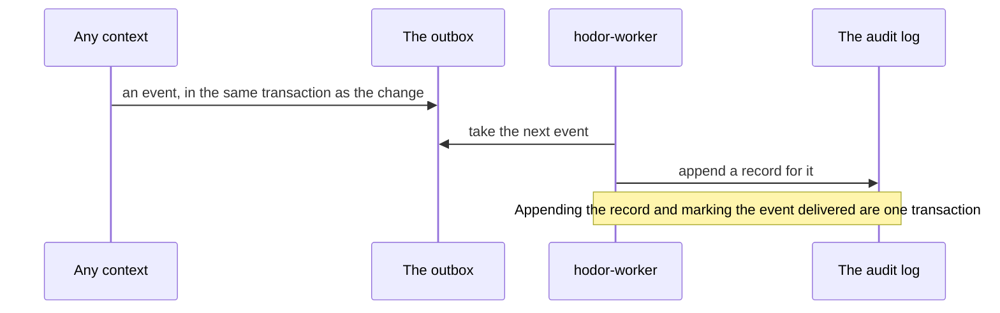
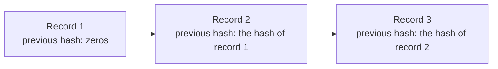

# The audit context

The `audit` context keeps the record of what happened: who did what, in which tenant, and when. Every event that any context announces becomes one audit record. The record is written once and never changed, and the records of a tenant are chained so that changing or removing one of them can be noticed.

No context depends on `audit`, and `audit` knows nothing about the others. It hears their events, which is all it needs.

This page specifies the part built in Milestone 1: recording, the chain, and verifying it. Searching, retention, export and delivery to other systems are added by later phases.

## How a record comes to exist



- **Nothing happens without an event, and no event is lost.** A context stores a change and its event together ([Decision 0003](../../decisions/0003-context-communication.md)). The worker turns each event into a record in the same transaction that marks the event delivered, so an event is recorded once: never zero times, never twice.
- **A record appears shortly after the change, not in the same instant.** The delay is the worker's, normally well under a second. While the worker is stopped, events wait and nothing is lost.
- **Every event is recorded.** The audit handler does not choose. An event type added by any context tomorrow is recorded without a change here.

## What a record is

| Field | Meaning |
|---|---|
| Sequence | The record's position in its tenant's chain: 1, 2, 3 and so on, with no gaps |
| Event | The identifier of the event the record was made from |
| Action | The event's type, for example `authentication.succeeded` |
| Occurred at | When the change happened |
| Recorded at | When the record was appended |
| Actor | Who caused it: a user; a client of OAuth acting for itself, as a [SCIM client](provisioning.md#who-may-call) does; Hodor itself; or someone not signed in. Written `{ "kind": "user", "id": "…" }`, `{ "kind": "client", "id": "…" }`, `{ "kind": "system" }` or `{ "kind": "anonymous" }` |
| Correlation | The request or job that caused it, shared by every event of one request |
| Details | What the event carried |
| Previous hash | The hash of the record before it; 32 zero bytes for the first |
| Hash | The hash of this record |

### No secrets, by construction

A record's details are the event's contents and nothing else. Events never carry a password, a token, a link, a typed identifier or an email address: that is a rule of every context, stated on each context's page and checked by its tests. The audit context adds nothing to an event, so it cannot add a secret either.

A test signs a person up, in and out with a password and tokens it knows, and searches every record for them.

## The chain

Each record's hash covers the record itself and the hash of the record before it:



The hash is the SHA-256 of these fields, each preceded by its length so that no two different records can produce the same bytes:

1. The text `hodor.audit.v1`
2. The tenant's identifier
3. The sequence
4. The event's identifier
5. The action
6. When it occurred, in microseconds since 1970, which is as fine as the database keeps time
7. The actor, as `user:<identifier>`, `client:<identifier>`, `system` or `anonymous`
8. The correlation identifier
9. The details, as JSON with the keys of every object in alphabetical order
10. The previous hash

"Recorded at" is not covered: it says when the worker ran, not what happened.

What the chain shows:

- **A changed record is noticed**: its hash no longer matches its contents.
- **A removed or inserted record is noticed**: the sequence has a gap or a repeat, and the next record's previous hash no longer matches.
- **Records cannot be reordered**: the sequence is covered by the hash.

What it does not show:

- **Records removed from the end.** A chain cut short is still a valid chain. Noticing that needs the latest hash to be kept somewhere the database cannot reach; exporting it regularly is planned and not built.
- **A chain rewritten whole by someone who can write to the table and recompute every hash.** The same exported hash is the answer to that too.

The chain is per tenant. One tenant's records say nothing about another's, and a tenant's chain can be verified, exported or removed on its own.

### Appending

To append, the worker locks the tenant's chain head, which holds the last sequence and hash, computes the new record from it, inserts the record and moves the head. Two workers appending for the same tenant take turns; workers appending for different tenants do not wait for each other.

### Verifying

Verifying reads a tenant's records in order and recomputes every hash. It reports how many records were checked and, if the chain is broken, the sequence of the first record that does not fit and why: its contents do not match its hash, its previous hash does not match the record before it, or its sequence is not the next one. It reads every record the tenant has, not only those up to the chain head, and then checks that the head agrees with the last one: a head moved back to hide the newest records is found, as is a head pointing past them.

```
hodor-cli audit verify --tenant acme
```

prints `intact: 42 records`, or says at which record the chain is broken and how, and exits with a non-zero status. It needs `HODOR_DATABASE_URL`, like the tenant commands.

## Append-only

Three independent things keep a record from being changed:

1. **The application's database roles may only insert and read.** `hodor_app` and `hodor_platform` have no permission to update or delete a record.
2. **A trigger refuses every update and delete** of a record, whoever asks, so that a mistake in a migration or by an operator fails loudly instead of quietly rewriting history.
3. **The chain** shows what the first two did not prevent.

Removing a tenant's records when the tenant is deleted or when retention ends is done by the owner of the schema, deliberately, with the trigger disabled for that one operation. That is not built yet.

## Operations

| Use case | What it does |
|---|---|
| Record event | Appends a record for an event. Run by the worker for every event |
| List records | Returns a tenant's records in order, a page at a time. Served to administrators by [the administration interface](../../api/admin-api.md#the-audit-log) |
| Verify chain | Checks a tenant's whole chain and reports the first break |

### Ports

| Port | Purpose |
|---|---|
| `AuditLog` | Lock a tenant's chain head; append a record and move the head; read records in order |

## Storage

### `audit.record`

| Column | Type | Notes |
|---|---|---|
| `tenant_id`, `sequence` | `uuid`, `bigint` | Primary key |
| `event_id` | `uuid` | Unique within the tenant: an event is recorded once |
| `action` | `text` | The event's type |
| `occurred_at`, `recorded_at` | `timestamptz` | |
| `actor` | `jsonb` | |
| `correlation_id` | `uuid` | |
| `details` | `jsonb` | |
| `previous_hash`, `hash` | `bytea` | 32 bytes each |

### `audit.chain_head`

| Column | Type | Notes |
|---|---|---|
| `tenant_id` | `uuid` | Primary key |
| `sequence` | `bigint` | The last record's sequence; 0 before the first |
| `hash` | `bytea` | The last record's hash; zeros before the first |

Both are tenant tables under row-level security. `audit.record` is append-only as described above; `audit.chain_head` is updated with every record.

## Not built yet

| Item | Planned in |
|---|---|
| The address a request came from, and the application that made it, on every record | When events carry them: with OAuth clients in Phase 2 |
| Exporting the latest hash regularly, so that a chain cut short or rewritten is noticed | Later in Phase 1 |
| Search and filters, retention, export | Phase 2 |
| Delivery to other systems | Phase 5 |
| Partitioning records by month | When the volume calls for it |
