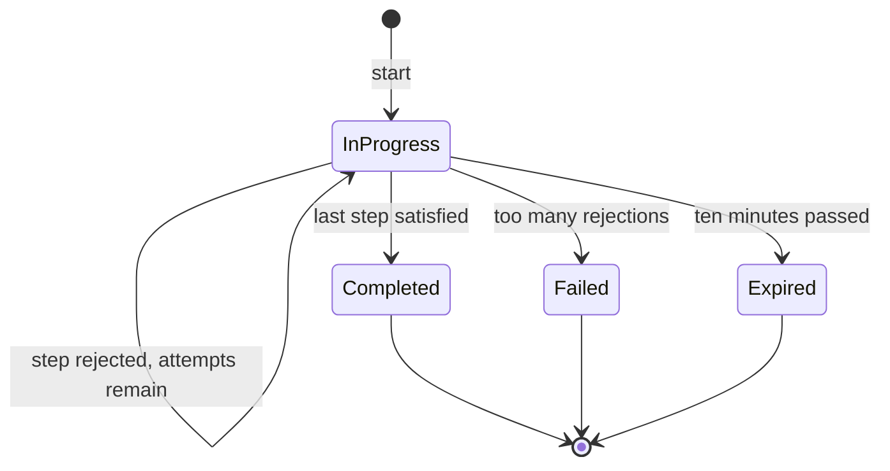

# The authentication context

The `authentication` context decides whether someone has proved who they are. It runs a sign-in from the first screen to the moment a session starts, and it is the only place that decides a sign-in succeeded.

It owns no users, credentials or sessions. It asks the `identity` context who a login identifier belongs to, asks the `credential` context whether a secret is right, and asks the `session` context to start a session. What it owns is the procedure: which steps, in which order, with which protections.

This page specifies the part built in Milestone 1: signing in with a login identifier and a password. The same mechanism carries every later method.

## Flows

A sign-in is the execution of a **flow**: an ordered list of steps, stored as data and interpreted by one engine. There is no hand-written sign-in procedure anywhere; the built-in flow and every future one run through the same code ([Decision 0013](../../decisions/0013-auth-flow-as-data.md)).

| Part of a flow | Meaning |
|---|---|
| Name and version | Which flow this is. A published version never changes; a running sign-in finishes on the version it started with |
| Steps | An ordered list. Each step names the authenticator that performs it and how it is required |
| Minimum assurance | How strongly the user must have proved their identity for the flow to complete |

### Steps and authenticators

An **authenticator** performs one step. It receives what the person submitted and answers whether the step is satisfied.

| Authenticator | What it does | Establishes | Built in |
|---|---|---|---|
| `identifier` | Takes what the person typed as their login identifier and remembers who, if anyone, it belongs to | Who is trying to sign in | Milestone 1 |
| `password` | Checks the password of the person named by the identifier step | One factor: something the person knows | Milestone 1 |
| One-time password, passkey, external identity provider, and others | — | — | Later phases |

Each step has a requirement. Milestone 1 has one kind:

| Requirement | Meaning |
|---|---|
| Required | The step must be satisfied for the flow to continue |

Alternative, conditional and optional steps are added in Phase 4 as further kinds of requirement on the same list; the engine and the stored form do not change shape.

### The built-in flow

| Step | Authenticator | Requirement |
|---|---|---|
| 1 | `identifier` | Required |
| 2 | `password` | Required |

Minimum assurance: single factor.

### What makes a flow valid

A flow is checked before it can be used. It is valid when:

- it has at least one step, and no step key appears twice;
- every step names an authenticator the engine knows;
- a step that establishes who is signing in comes before every step that proves it;
- the factors established by its required steps reach its minimum assurance.

An invalid flow is rejected as a whole. The engine never runs one.

## A sign-in in progress

Each execution of a flow is a **transaction**: the server-side record of how far one sign-in has got. The browser holds only a reference to it.

| Field | Meaning |
|---|---|
| Identifier | Refers to the transaction; unguessable, and useless once the transaction ends |
| Flow name and version | What is being executed |
| Current step | The next step to be satisfied |
| Candidate | Who is trying to sign in, once the identifier step has run. Empty when the identifier belongs to nobody, which the person signing in must not be able to tell |
| Identifier key | A digest of the normalized identifier typed, used to count attempts. The identifier itself is not kept |
| Satisfied methods | Which methods have been satisfied so far |
| Rejections | How many times a step was rejected in this transaction |
| Expires at | Ten minutes after the start |
| Client | The address and browser description, passed on to the session |

Rules:

- A transaction advances only through its current step. Input for any other step is refused.
- A rejected step does not advance the transaction. After five rejections the transaction fails and a new one must be started.
- A transaction expires ten minutes after it starts, whatever its progress.
- A transaction completes exactly once. Completion is what starts the session; if two requests try to complete the same transaction, one wins and the other is refused.
- A completed, failed or expired transaction accepts nothing.

## What the person signing in can and cannot learn

A sign-in form is the most probed surface of the system. The rules below hold for every flow.

- **The identifier step always succeeds.** Whether the identifier belongs to a user, to a user who may not sign in, or to nobody, the answer is the same and the flow moves on to the password step.
- **A rejected password looks the same in every case**: wrong password, no such user, a user without a password, or a user who is suspended, pending or closed. The answer is one generic rejection, and the same amount of hashing work is done ([credential context](credential.md#checking-a-password-without-revealing-anything)).
- **A user who may not sign in is never told why at this stage.** The password is still checked, and the answer is the generic rejection even when the password is right.
- **Being limited is not a secret.** "Too many attempts, try again later" may be shown, because the limit applies to an identifier whether or not it belongs to anyone.

## Protection against guessing

Failed password attempts are counted, per tenant, against two things: the identifier that was typed and the address the attempt came from.

| Count | Limit | Effect when reached |
|---|---|---|
| Failures for one identifier within the tenant's window | The tenant's [lockout policy](tenant.md#lockout-policy): 5 failures in 15 minutes by default | The identifier is locked out |
| Failures from one address within the same window | Ten times the identifier limit | The address is locked out |

- **Lockouts grow.** The first lasts the policy's first lockout duration, one minute by default. Each further lockout of the same identifier doubles it, up to the policy's longest duration, one hour by default.
- **A lockout is on the identifier, not on the account.** It applies equally to an identifier that belongs to nobody, so it reveals nothing, and an attacker cannot use it to learn which accounts exist.
- **While locked out, no password is checked.** The attempt is refused with "too many attempts" and the time to wait. Not checking is the point: guesses made during a lockout teach the attacker nothing.
- **A successful sign-in clears the identifier's count and its lockout history.**
- **Counting is by a digest of the normalized identifier.** The identifier itself is not stored with the counts.
- **An attempt is counted when it is admitted, before the password is checked**, and the identifier's count is cleared if the attempt succeeds. Counting first is what makes the limit exact: when many attempts arrive at the same moment, only as many as the limit reach the password check. The price is that an attempt cut short by an outage still counts.
- **Addresses keep their count after a success.** Signing in to one's own account does not buy an address more guesses.

A lockout can be used to keep a real user out by failing on purpose. That is the cost of this protection; the short, growing durations limit it, and stronger answers such as recognizing the user's own device belong to Phase 4.

## Completing a sign-in

When the last step is satisfied:

1. The candidate is loaded again and must be allowed to sign in. This is the last check, made at the moment of completion.
2. The transaction is marked completed. Only one request can do this.
3. A session is started for the user, with the methods that were satisfied, the assurance they amount to, the tenant's session timeouts and the client details.
4. `authentication.succeeded` is recorded.

The session token is returned to the caller, which hands it to the browser. Nothing else about the session leaves the server.

### Events

| Event type | When |
|---|---|
| `authentication.succeeded` | A sign-in completed; carries the user, the session and the methods |
| `authentication.failed` | A step was rejected; carries the step and, when known, the user. Never the identifier typed or anything about the password |
| `authentication.locked_out` | An identifier or an address reached its limit; carries which kind and until when |

## Operations

| Use case | What it does |
|---|---|
| Start sign-in | Creates a transaction for the tenant's flow and returns its identifier and the first step |
| Submit step | Runs the current step's authenticator with what was submitted. Returns the next step, a rejection, or completion with a session token |
| Describe sign-in | Returns the current step of a transaction, so that a page can be shown again after a reload |
| Cancel sign-in | Ends a transaction |

### Ports

| Port | Purpose |
|---|---|
| `TransactionStore` | Store and load transactions; complete one exactly once |
| `AttemptStore` | Keep the counts and lockouts for identifiers and addresses |
| `Authenticator` | Perform one step. The built-in ones live in this context; other contexts and plugins add theirs |

This context calls the `identity`, `credential`, `session` and `tenant` contexts through their public interfaces.

## Storage

### `authentication.transaction`

| Column | Type | Notes |
|---|---|---|
| `tenant_id`, `id` | `uuid` | Primary key |
| `flow_name`, `flow_version` | `text`, `integer` | |
| `current_step` | `integer` | Position in the flow |
| `candidate_user_id` | `uuid` | Null until the identifier step, and when the identifier belongs to nobody |
| `identifier_key` | `bytea` | SHA-256 of the normalized identifier typed |
| `satisfied_methods` | `text[]` | |
| `rejections` | `integer` | |
| `status` | `text` | `in_progress`, `completed`, `failed`, `cancelled` |
| `started_at`, `expires_at` | `timestamptz` | |
| `client_address`, `client_description` | `text` | |
| `version` | `integer` | A stale update is rejected, which is what makes completion happen once |

### `authentication.attempt_counter`

| Column | Type | Notes |
|---|---|---|
| `tenant_id` | `uuid` | |
| `subject_kind` | `text` | `identifier` or `address` |
| `subject_key` | `bytea` | SHA-256 of the normalized identifier or of the address |
| `failures` | `integer` | Failures in the current window |
| `window_started_at` | `timestamptz` | |
| `lockouts` | `integer` | Lockouts so far, which sets the next duration |
| `locked_until` | `timestamptz` | Null when not locked out |

Primary key: `tenant_id`, `subject_kind`, `subject_key`. Both are tenant tables under row-level security.

## Not built yet

| Item | Planned in |
|---|---|
| The pages and the HTTP interface of a sign-in | Issue-24 |
| Registration, email verification, password recovery | Issue-25 |
| Signing out | Issue-26 |
| Editing flows; alternative, conditional and optional steps; simulation | Phase 4 |
| Further authenticators, risk signals, recognizing a user's own device | Phases 3 and 4 |
| Making a user choose a new password when the current one is marked as temporary. The mark is stored and returned by the credential context, but sign-in does not act on it yet | Issue-25 |
| Removing old transactions and counters | Later in Phase 1 |
