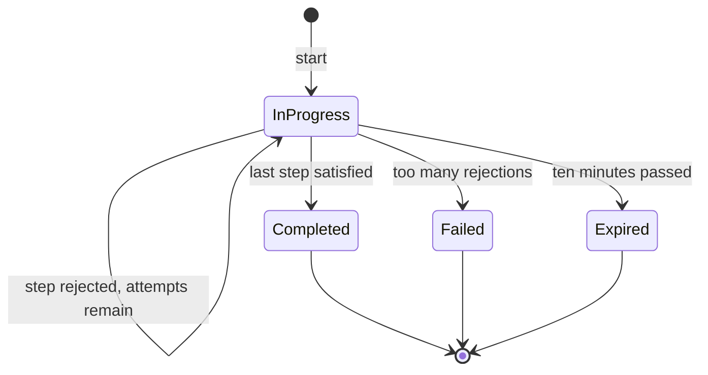
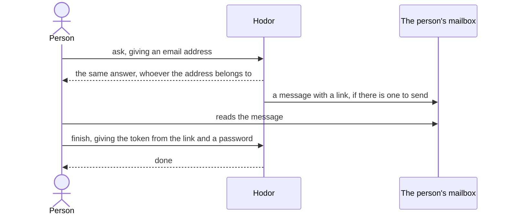

# The authentication context

The `authentication` context decides whether someone has proved who they are. It runs a sign-in from the first screen to the moment a session starts, and it is the only place that decides a sign-in succeeded.

It owns no users, credentials or sessions. It asks the `identity` context who a login identifier belongs to, asks the `credential` context whether a secret is right, and asks the `session` context to start a session. What it owns is the procedure: which steps, in which order, with which protections.

This page specifies signing in with a login identifier and a password (Milestone 1), with an external identity (Milestone 2), and the steps a flow may require only sometimes, which carry the second factors of Milestone 4. The same mechanism carries every later method.

## Flows

A sign-in is the execution of a **flow**: an ordered list of steps, stored as data and interpreted by one engine. There is no hand-written sign-in procedure anywhere; the built-in flow and every future one run through the same code ([Decision 0013](../../decisions/0013-auth-flow-as-data.md)).

| Part of a flow | Meaning |
|---|---|
| Name and version | Which flow this is. A published version never changes; a running sign-in finishes on the version it started with |
| Steps | An ordered list. Each step names the authenticator that performs it and how it is required |
| Minimum assurance | How strongly the user must have proved their identity for the flow to complete |

### Steps and authenticators

An **authenticator** performs one step. It receives what the person submitted and answers whether the step is satisfied.

| Authenticator | What it does | Establishes | Built in |
|---|---|---|---|
| `identifier` | Takes what the person typed as their login identifier and remembers who, if anyone, it belongs to | Who is trying to sign in | Milestone 1 |
| `password` | Checks the password of the person named by the identifier step | One factor: something the person knows | Milestone 1 |
| An external identity provider, a directory | Takes what came back from somewhere else that knows the person, checks it, and answers who the person is | Who is signing in and one factor, in a single step | Milestone 2, in the federation context |
| `totp` | Checks a code of the candidate's [authenticator application](credential.md#authenticator-applications). The person has the means for it when they have an application in use | One factor: something the person has | Milestone 4 |
| Passkey and others | — | — | Later issues |

Each step has a requirement:

| Requirement | Meaning |
|---|---|
| Required | The step must be satisfied for the flow to continue |
| Optional | The step is performed when the person has the means for it, such as an authenticator application they enrolled, and passed over when they do not |
| Conditional | The step is performed when its condition holds at the moment the sign-in reaches it, and passed over when it does not. A conditional step whose condition holds is also passed over when the person has no means for it |

A step that is performed is satisfied in the same way whatever its requirement: it must be satisfied for the flow to continue, and a rejection counts like any other.

Conditions are a small closed set, not a language ([Decision 0013](../../decisions/0013-auth-flow-as-data.md)):

| Condition | Holds when |
|---|---|
| Assurance not reached | The methods satisfied so far do not reach the assurance the sign-in must reach (see [what a sign-in must reach](#what-a-sign-in-must-reach)) |

Rules for the steps that are not required:

| Rule | Why |
|---|---|
| A person never declines a step that is performed. There is no way to skip it from the pages or the interaction interface | Whoever holds a stolen password would decline the second factor |
| Whether a step is passed over is decided by the server, when the sign-in reaches the step, from what is known then | The browser never decides what is asked |
| Every step that is not required comes after every required step | A step that may be passed over happens once the person is identified and has proved a first factor, so asking whether they have the means for it reveals nothing to someone who has not |
| Whether the person has the means for a step is asked of the step's authenticator. An authenticator that has nothing to enroll, such as the password, always has the means | Only the authenticator knows what the person enrolled |

Further conditions, such as the assurance an application asks for and risk signals, are added to the same set by later issues.

### What a sign-in must reach

A sign-in must reach an **assurance**: single factor or multi-factor. Two factors of the same kind, such as two passwords, are still one.

| Source | Assurance it requires |
|---|---|
| The flow's minimum assurance | Whatever the flow says; single factor for the built-in flow |
| The tenant's [second factor policy](tenant.md#authentication-policy), when it requires a second factor | Multi-factor |

The highest of them is what the sign-in must reach. It is checked when the sign-in completes, whatever steps were performed or passed over: a sign-in whose satisfied methods do not reach it fails, and no session starts. With the policy on, no sign-in completes with one factor, including a sign-in through an alternative.

The tenant's policy is read again on every step and at completion, so a change to it applies to sign-ins already in progress.

### Alternatives

A flow may also list **alternatives**: steps that, satisfied at the very start of a sign-in, take the place of all its required steps. The optional and conditional steps after them still apply. This is how a person signs in with an external identity instead of an identifier and a password, and how a second factor can still be asked of them.

| Rule | Why |
|---|---|
| An alternative is performed by an authenticator that establishes who is signing in **and** proves it, in one step | There is no earlier step to have named the person, and none after it to prove anything |
| An alternative is accepted only while no step of the flow has been satisfied | The required steps are satisfied by themselves or by one alternative, never by part of each. A person who typed an identifier and then wants an external identity starts a new sign-in |
| A rejected alternative counts as a rejection of the sign-in, like a rejected step | The same tolerance applies whichever way is tried |
| After a rejected alternative the sign-in is waiting for the step it was waiting for before | The alternative was a way around the steps, not one of them; the person is back where they were |
| An authenticator answers only in the way its kind allows: a step never answers as an alternative, an alternative never as a step | An authenticator that breaks this is a defect, and the sign-in does not advance |

What a person submits to an alternative is a set of named values that only its authenticator understands, every one of them treated as a secret: the code an identity provider sent back, a password for a directory.

### The built-in flow

| Step | Authenticator | Requirement |
|---|---|---|
| 1 | `identifier` | Required |
| 2 | `password` | Required |
| 3 | `totp` | Optional |

Minimum assurance: single factor.

A person who put an authenticator application in use is always asked for a code after the password, whether or not the tenant requires a second factor: they chose a second factor, and a stolen password alone must not let anyone in. A person without one signs in with the password, unless the tenant requires a second factor, in which case the sign-in fails at completion.

The third step needs a place to keep secrets. An installation without `HODOR_SECRET_KEYS` runs the flow without it, and nobody there can have an authenticator application.

### The authenticator application step

| Rule | Why |
|---|---|
| The code is checked only once an attempt has been admitted, with the same counts and lockouts as the password, against the identifier typed and the address | Six digits are guessed by repetition; the lockout stops that. A lockout reached on the code also stops the password, and the other way round |
| An accepted code clears the identifier's count, as a right password does | The person proved both factors |
| A rejected code looks the same whatever the reason: a wrong code, a code already used, something that is not six digits | Nothing in the answer helps someone guessing |
| Five rejections end the sign-in, as for every step | Whoever holds the password starts again, and their attempts keep counting towards the lockout |

### What makes a flow valid

A flow is checked before it can be used. It is valid when:

- it has at least one step, and no step key appears twice;
- every step names an authenticator the engine knows;
- a step that establishes who is signing in comes before every step that proves it;
- the factors established by its required steps reach its minimum assurance;
- every step that establishes who is signing in is required;
- every step that is not required comes after every required step, and proves a factor;
- every alternative has a key no step or other alternative has, names an authenticator the engine knows that both establishes who is signing in and proves it, and reaches the minimum assurance by itself.

An invalid flow is rejected as a whole. The engine never runs one.

## A sign-in in progress

Each execution of a flow is a **transaction**: the server-side record of how far one sign-in has got. The browser holds only a reference to it.

| Field | Meaning |
|---|---|
| Identifier | Refers to the transaction |
| Binding | The hash of a secret given only to the browser that started the sign-in. Every later operation must present the secret; without it the transaction is treated as if it did not exist |
| Flow name and version | What is being executed |
| Current step | The next step to be satisfied. Steps passed over are behind it |
| Candidate | Who is trying to sign in, once the identifier step has run. Empty when the identifier belongs to nobody, which the person signing in must not be able to tell |
| Identifier key | A digest of the normalized identifier typed, used to count attempts. The identifier itself is not kept |
| Satisfied methods | Which methods have been satisfied so far. They are passed on to the session, which is where the `amr` of a token will come from |
| Rejections | How many times a step was rejected in this transaction |
| Expires at | Ten minutes after the start |
| Client | The address and browser description, passed on to the session |

Rules:

- A transaction advances only through its current step. Input for any other step is refused.
- When a step is satisfied, the steps after it that are to be passed over are passed over at once, so the current step is always one that is performed.
- A rejected step does not advance the transaction. After five rejections the transaction fails and a new one must be started.
- A transaction expires ten minutes after it starts, whatever its progress.
- A transaction completes exactly once. Completion is what starts the session; if two requests try to complete the same transaction, one wins and the other is refused.
- A completed, failed or expired transaction accepts nothing.
- A transaction can be continued only by whoever holds its secret. The secret has 256 bits of randomness, is returned once when the sign-in starts, and is stored only as its SHA-256 hash. How it reaches the browser is described in [the interaction interface](../../api/interaction-api.md#how-a-sign-in-is-tied-to-one-browser).

## What the person signing in can and cannot learn

A sign-in form is the most probed surface of the system. The rules below hold for every flow.

- **The identifier step always succeeds.** Whether the identifier belongs to a user, to a user who may not sign in, or to nobody, the answer is the same and the flow moves on to the password step.
- **A rejected password looks the same in every case**: wrong password, no such user, a user without a password, or a user who is suspended, pending or closed. The answer is one generic rejection, and the same amount of hashing work is done ([credential context](credential.md#checking-a-password-without-revealing-anything)).
- **A user who may not sign in is never told why at this stage.** The password is still checked, and the answer is the generic rejection even when the password is right.
- **Being limited is not a secret.** "Too many attempts, try again later" may be shown, because the limit applies to an identifier whether or not it belongs to anyone.

## Protection against guessing

Failed password attempts are counted, per tenant, against two things: the identifier that was typed and the address the attempt came from.

| Count | Limit | Effect when reached |
|---|---|---|
| Failures for one identifier within the tenant's window | The tenant's [lockout policy](tenant.md#lockout-policy): 5 failures in 15 minutes by default | The identifier is locked out |
| Failures from one address within the same window | Ten times the identifier limit | The address is locked out |

- **Lockouts grow.** The first lasts the policy's first lockout duration, one minute by default. Each further lockout of the same identifier doubles it, up to the policy's longest duration, one hour by default.
- **A lockout is on the identifier, not on the account.** It applies equally to an identifier that belongs to nobody, so it reveals nothing, and an attacker cannot use it to learn which accounts exist.
- **While locked out, no password is checked.** The attempt is refused with "too many attempts" and the time to wait. Not checking is the point: guesses made during a lockout teach the attacker nothing.
- **A successful sign-in clears the identifier's count and its lockout history.**
- **Counting is by a digest of the normalized identifier.** The identifier itself is not stored with the counts.
- **An attempt is counted when it is admitted, before the password is checked**, and the identifier's count is cleared if the attempt succeeds. Counting first is what makes the limit exact: when many attempts arrive at the same moment, only as many as the limit reach the password check. The price is that an attempt cut short by an outage still counts.
- **The same sign-in submitted many times at once** counts once per submission until one of them succeeds. If more arrive together than the limit allows, the surplus is answered with "too many attempts"; one submission completes the sign-in, exactly one session starts, and the success clears the count, so nothing remains locked.
- **Addresses keep their count after a success.** Signing in to one's own account does not buy an address more guesses.

A lockout can be used to keep a real user out by failing on purpose. That is the cost of this protection; the short, growing durations limit it, and stronger answers such as recognizing the user's own device belong to Phase 4.

## Completing a sign-in

When the last step is satisfied:

1. The candidate is loaded again and must be allowed to sign in. This is the last check, made at the moment of completion.
2. The satisfied methods must reach [what the sign-in must reach](#what-a-sign-in-must-reach), with the tenant's policy as it is now. If they do not, the sign-in fails as in step 1: `authentication.failed` is recorded and no session starts.
3. The transaction is marked completed. Only one request can do this.
4. A session is started for the user, with the methods that were satisfied, the assurance they amount to, the tenant's session timeouts and the client details.
5. `authentication.succeeded` is recorded.

The session token is returned to the caller, which hands it to the browser. Nothing else about the session leaves the server.

Marking the transaction completed and starting the session are two separate writes. If the second fails, the transaction is already spent and the person signs in again; the failure can never leave a session without a completed sign-in behind it.

### Events

| Event type | When |
|---|---|
| `authentication.succeeded` | A sign-in completed; carries the user, the session and the methods |
| `authentication.failed` | A step was rejected; carries the step and, when known, the user. Never the identifier typed or anything about the password |
| `authentication.locked_out` | An identifier or an address reached its limit; carries which kind and until when |
| `authentication.registration_completed` | A person finished registering; carries the user |
| `authentication.recovery_requested` | A recovery link was sent; carries the user. Not recorded when the address belongs to nobody |
| `authentication.password_reset` | A person chose a new password with a recovery link; carries the user |

No event carries an email address, a token or a link.

## Registration and password recovery

Two things a person does without being signed in, both proved through their mailbox: creating an account, and choosing a new password after forgetting the old one. Both follow the same shape: ask, receive a link by email, finish with the link.

### The rule both follow: only the mailbox decides

- **The answer to "ask" never depends on the address.** Whether the address has an account, has none, or is not even well formed, the response is the same. What differs is the message that arrives in the mailbox, which only its owner reads.
- **The password is chosen at the end, by whoever holds the link**, never at the start. Someone who types another person's address when asking gains nothing: no account exists yet, no password was set, and the link goes to the owner.
- **A token works once.** Of any number of requests that present it at the same moment, one succeeds.
- **Asking again makes earlier links stop working.** Only the newest link for an address is good.

### Verification tokens

A verification token is what a link carries. It is 32 random bytes written as 64 hexadecimal characters, made and stored exactly like a [session token](session.md): Hodor keeps only its SHA-256, so a copy of the database yields no usable link.

| Purpose | Lives for | Belongs to |
|---|---|---|
| `registration` | 24 hours | An email address that has no account yet |
| `password_recovery` | 1 hour | A user |

A token is good while it is unused, unexpired and not replaced by a newer one of the same purpose for the same address or user.

The link in the message has the form `{public address}/t/{slug}/account/{page}#token={token}`, where the page is `complete-registration` or `reset-password`. The token is in the fragment, the part after `#`, which a browser never sends to a server and never includes in a `Referer` header: it does not reach access logs. The page reads it and sends it in the body of the request that finishes. The pages are described in [the hosted pages](../hosted-pages.md).

The public address is the installation's `HODOR_PUBLIC_URL` setting.

### Registration

Registration creates an account for a person. It is offered only when the tenant's [registration policy](tenant.md#registration-policy) is open; otherwise asking is refused, and saying so reveals nothing about anyone.

**Asking.** The person gives an email address and, optionally, the language they read.

| The address | What happens | Message sent |
|---|---|---|
| Has no account | A `registration` token is made for it | `email_verification`, with the link |
| Has an account | Nothing changes | `already_registered`, with no link |
| Is not a well-formed address | Nothing | None |

No user is created at this point. An address that is never confirmed leaves nothing behind but an expired token.

**Finishing.** The person presents the token and chooses a password, and may give a display name.

1. The token is looked up. An unknown, used, replaced or expired token is refused, all four in the same way.
2. The password is checked against the tenant's [password policy](tenant.md#password-policy). A password that is not acceptable is refused and the token stays good, so the person can choose another.
3. The token is used up. Only one request gets past this point.
4. The user is created, already active, with the address as a verified login identifier, and the password is set.

If the address acquired an account between asking and finishing, step 4 is refused and the token is spent. The person is told the link no longer works.

If setting the password fails after the user was created, which happens only when the server is too busy to hash it, the account exists without a password. The person is told to try later, and gets in by recovering the password: the address is already verified.

Finishing does not sign the person in. They sign in next, with the password they just chose.

### Password recovery

**Asking.** The person gives an email address.

| The address | What happens | Message sent |
|---|---|---|
| Belongs to a user who may sign in | A `password_recovery` token is made for the user | `password_recovery`, with the link, in the user's language |
| Anything else | Nothing | None |

**Finishing.** The person presents the token and chooses a new password.

1. The token is looked up; refused as above if it is not good.
2. The user is loaded and must still be allowed to sign in.
3. The password is checked against the tenant's policy, including the user's own names and their previous passwords. A password that is not acceptable is refused and the token stays good.
4. The token is used up. Only one request gets past this point.
5. The password is set.
6. Every session of the user is ended. Whoever had access with the old password loses it.
7. The address the link was sent to is marked verified, since the person just proved they read it; the count of failed attempts for it is cleared, so that the person is not kept out by a lockout their own forgetting caused.
8. `password_changed` is sent to the address, so that the owner hears of a change they did not make.

Finishing does not sign the person in.

### Limits

Asking is limited in the same way as password attempts, with the tenant's [lockout policy](tenant.md#lockout-policy): by the address asked about and by the address the request comes from. This keeps anyone from filling a mailbox with messages. The counts are kept apart from those of sign-in, so asking for recovery never locks a person out of signing in. Being limited is answered with "too many attempts" and reveals nothing, since the limit applies to any address. Finishing clears the count for the address, as a successful sign-in does: a person who asked several times and then finished starts again from nothing.

Finishing is not limited. A token cannot be guessed, and no password is hashed unless the token is good.

### What is stored together

Making a token and putting its message in the [message queue](notification.md) happen in one transaction: there is never a token nobody was told about, nor a message whose link was never good.

Finishing spans several contexts, each of which commits on its own. The order above is chosen so that a failure part-way never leaves a hole: once the token is used up, anything that fails afterwards costs the person a new request, never a second use of the token or an account without a password that anyone can reach.

## Operations

| Use case | What it does |
|---|---|
| Start sign-in | Creates a transaction for the tenant's flow and returns its identifier, its secret and the first step |
| Submit step | Runs the current step's authenticator with what was submitted. Returns the next step, a rejection, or completion with a session token |
| Describe sign-in | Returns the current step of a transaction, so that a page can be shown again after a reload |
| Cancel sign-in | Ends a transaction |
| Request registration | Sends a registration link, or a note that the address already has an account |
| Complete registration | Uses a registration token: creates the user and sets the password |
| Request recovery | Sends a recovery link if the address belongs to a user who may sign in |
| Reset password | Uses a recovery token: sets the password and ends the user's sessions |

### Ports

| Port | Purpose |
|---|---|
| `TransactionStore` | Store and load transactions; complete one exactly once |
| `AttemptStore` | Keep the counts and lockouts for identifiers and addresses |
| `VerificationTokenStore` | Store tokens; replace the earlier ones of an address or user; find a good one; use one up exactly once |
| `Authenticator` | Perform one step. The built-in ones live in this context; other contexts and plugins add theirs |

This context calls the `identity`, `credential`, `session`, `tenant` and `notification` contexts through their public interfaces.

## Storage

### `authentication.transaction`

| Column | Type | Notes |
|---|---|---|
| `tenant_id`, `id` | `uuid` | Primary key |
| `flow_name`, `flow_version` | `text`, `integer` | |
| `current_step` | `integer` | Position in the flow |
| `identified` | `boolean` | Whether the identifier step has run |
| `candidate_user_id` | `uuid` | Null until the identifier step, and when the identifier belongs to nobody |
| `identifier_key` | `bytea` | SHA-256 of the normalized identifier typed |
| `satisfied_methods` | `text[]` | |
| `rejections` | `integer` | |
| `status` | `text` | `in_progress`, `completed`, `failed`, `cancelled` |
| `started_at`, `expires_at` | `timestamptz` | |
| `client_address`, `client_description` | `text` | |
| `binding` | `bytea` | SHA-256 of the secret held by the browser |
| `version` | `integer` | A stale update is rejected, which is what makes completion happen once |

### `authentication.attempt_counter`

| Column | Type | Notes |
|---|---|---|
| `tenant_id` | `uuid` | |
| `subject_kind` | `text` | `identifier` or `address` |
| `subject_key` | `bytea` | SHA-256 of the normalized identifier or of the address |
| `failures` | `integer` | Failures in the current window |
| `window_started_at` | `timestamptz` | |
| `lockouts` | `integer` | Lockouts so far, which sets the next duration |
| `locked_until` | `timestamptz` | Null when not locked out |

Primary key: `tenant_id`, `subject_kind`, `subject_key`.

### `authentication.verification_token`

| Column | Type | Notes |
|---|---|---|
| `tenant_id`, `id` | `uuid` | Primary key |
| `purpose` | `text` | `registration` or `password_recovery` |
| `token_hash` | `bytea` | SHA-256 of the token; unique within the tenant |
| `email` | `text` | The normalized address the link was sent to |
| `user_id` | `uuid` | The user, for `password_recovery`; null for `registration` |
| `locale` | `text` | The language asked for, used for later messages |
| `created_at`, `expires_at` | `timestamptz` | |
| `used_at` | `timestamptz` | Null until the token is used up |
| `replaced_at` | `timestamptz` | Null until a newer token takes its place |

All three are tenant tables under row-level security.

## Not built yet

| Item | Planned in |
|---|---|
| Editing flows and simulating them | Phase 4 |
| Setting the tenant's second factor policy from the administration interface or the console. Today the command-line tool sets it | Issue-70 |
| Enrolling a second factor during a sign-in, for a person whose tenant requires one and who has none. Today their sign-in fails at completion | Issue-70 |
| Offering a choice between several second factors at one step. Today each is its own step, and a person enrolled in two would be asked for both, unless they are conditional on the assurance not being reached | Issue-67, WebAuthn |
| A reason in `authentication.failed` that tells a missing second factor from a rejected step | With the step-up of Issue-69 |
| Further authenticators, risk signals, recognizing a user's own device | Phases 3 and 4 |
| Making a user choose a new password when the current one is marked as temporary. The mark is stored and returned by the credential context, but sign-in does not act on it yet | With the administration interface, Issue-29, which is what sets the mark |
| Signing the person in at the end of registration or recovery. Today the person signs in with the password just chosen | With the account console, Phase 2 |
| Changing or adding an email address on an existing account, with verification | Phase 2, account self-service |
| Removing old transactions, counters and verification tokens | Later in Phase 1 |
