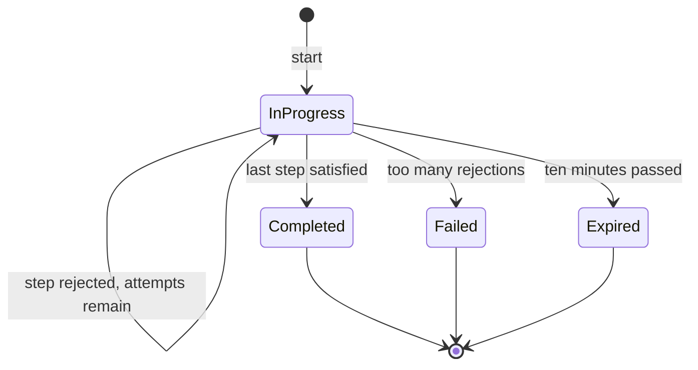
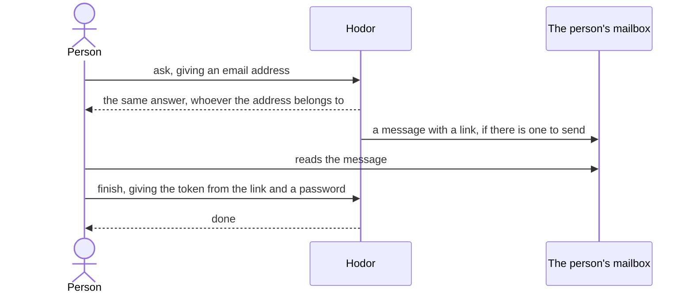

# The authentication context

The `authentication` context decides whether someone has proved who they are. It runs a sign-in from the first screen to the moment a session starts, and it is the only place that decides a sign-in succeeded.

It owns no users, credentials or sessions. It asks the `identity` context who a login identifier belongs to, asks the `credential` context whether a secret is right, and asks the `session` context to start a session. What it owns is the procedure: which steps, in which order, with which protections.

This page specifies signing in with a login identifier and a password (Milestone 1), with an external identity (Milestone 2), the steps a flow may require only sometimes, which carry the second factors of Milestone 4, and signing in with a passkey alone. The same mechanism carries every later method.

## Flows

A sign-in is the execution of a **flow**: an ordered list of steps, stored as data and interpreted by one engine. There is no hand-written sign-in procedure anywhere; the built-in flow and every future one run through the same code ([Decision 0013](../../decisions/0013-auth-flow-as-data.md)).

| Part of a flow | Meaning |
|---|---|
| Name and version | Which flow this is. A published version never changes; a running sign-in finishes on the version it started with |
| Steps | An ordered list. Each step names the authenticator that performs it and how it is required |
| Minimum assurance | How strongly the user must have proved their identity for the flow to complete |

### Steps and authenticators

An **authenticator** performs one step. It receives what the person submitted and answers whether the step is satisfied.

| Authenticator | What it does | Establishes | Built in |
|---|---|---|---|
| `identifier` | Takes what the person typed as their login identifier and remembers who, if anyone, it belongs to | Who is trying to sign in | Milestone 1 |
| `password` | Checks the password of the person named by the identifier step | One factor: something the person knows | Milestone 1 |
| An external identity provider, a directory | Takes what came back from somewhere else that knows the person, checks it, and answers who the person is | Who is signing in and one factor, in a single step | Milestone 2, in the federation context |
| `totp` | Checks a code of the candidate's [authenticator application](credential.md#authenticator-applications). The person has the means for it when they have an application in use | One factor: something the person has | Milestone 4 |
| `webauthn` | Checks the answer of a security key or a platform authenticator to a challenge, with the [credential context](credential.md#checking-a-credential). The person has the means when they registered at least one credential | One factor: something the person has, and one that resists phishing | Milestone 4 |
| `recovery_code` | Checks one of the candidate's [recovery codes](credential.md#recovery-codes). Used only as a [substitute](#substitutes) for a second factor | One factor: something the person has, written down | Milestone 4 |
| `passkey` | Checks the answer of a [passkey](credential.md#passkeys) to a challenge that names no credential, and answers who the person is from the credential that answered. Used as an alternative | Who is signing in, and two factors in one step: something the person has, unlocked by something they know or are. It resists phishing | Milestone 4 |
| Others | — | — | Later issues |

Each step has a requirement:

| Requirement | Meaning |
|---|---|
| Required | The step must be satisfied for the flow to continue |
| Optional | The step is performed when the person has the means for it, such as an authenticator application they enrolled, and passed over when they do not |
| Conditional | The step is performed when its condition holds at the moment the sign-in reaches it, and passed over when it does not. A conditional step whose condition holds is also passed over when the person has no means for it |

A step that is performed is satisfied in the same way whatever its requirement: it must be satisfied for the flow to continue, and a rejection counts like any other.

Conditions are a small closed set, not a language ([Decision 0013](../../decisions/0013-auth-flow-as-data.md)):

| Condition | Holds when |
|---|---|
| Assurance not reached | The methods satisfied so far do not reach the assurance the sign-in must reach (see [what a sign-in must reach](#what-a-sign-in-must-reach)) |
| Multi-factor not reached | The methods satisfied so far are not yet multi-factor. A further factor adds nothing to a sign-in that already is |
| Stronger assurance needed | The methods satisfied so far are not yet multi-factor, or do not reach the assurance the sign-in must reach. This is the condition of a step that can make a sign-in phishing-resistant: it is asked for whenever a second factor is, and also when an application asked for more than multi-factor |

Rules for the steps that are not required:

| Rule | Why |
|---|---|
| A person never declines a step that is performed. There is no way to skip it from the pages or the interaction interface | Whoever holds a stolen password would decline the second factor |
| Whether a step is passed over is decided by the server, when the sign-in reaches the step, from what is known then | The browser never decides what is asked |
| Every step that is not required comes after every required step | A step that may be passed over happens once the person is identified and has proved a first factor, so asking whether they have the means for it reveals nothing to someone who has not |
| Whether the person has the means for a step is asked of the step's authenticator. An authenticator that has nothing to enroll, such as the password, always has the means | Only the authenticator knows what the person enrolled |

Further conditions, such as risk signals, are added to the same set by later issues.

### What a sign-in must reach

A sign-in must reach an **assurance**. There are three, each stronger than the one before:

| Assurance | Reached when the satisfied methods |
|---|---|
| Single factor | Prove one kind of factor |
| Multi-factor | Prove two kinds of factor |
| Phishing-resistant | Prove two kinds of factor, and one of the steps resists phishing: a key held by the person answered a challenge bound to this tenant's address. The `webauthn` step and the `passkey` alternative resist phishing; a password, a code of an application and a recovery code do not, since whoever tricked the person into typing them can type them too |

Two factors of the same kind, such as two passwords, are still one. One step may prove two kinds at once: a passkey is something the person has, and the authenticator verified something they know or are before it answered. Hodor cannot tell a PIN from a fingerprint, and counts the verification as the second kind either way. A passkey alone is therefore phishing-resistant, and so are a password and a security key together.

| Source | Assurance it requires |
|---|---|
| The flow's minimum assurance | Whatever the flow says; single factor for the built-in flow |
| The tenant's [second factor policy](tenant.md#authentication-policy), when it requires a second factor | Multi-factor |
| An application's request, for a [step-up](#step-up) | The requirement of the level it asked for |

The highest of them is what the sign-in must reach. It is checked when the sign-in completes, whatever steps were performed or passed over: a sign-in whose satisfied methods do not reach it fails, and no session starts. With the policy on, no sign-in completes with one factor, including a sign-in through an alternative.

Which assurance a list of methods amounts to is asked of this context by the others: the OAuth context names the `acr` of a token from it ([assurance levels](tenant.md#assurance-levels)), so there is one table of methods and factors, here.

The tenant's policy is read again on every step and at completion, so a change to it applies to sign-ins already in progress.

### Substitutes

A step that is not required may list **substitutes**: authenticators that satisfy the step in its place. This is how a person who lost their phone signs in with a recovery code where the code of their authenticator application is asked for.

| Rule | Why |
|---|---|
| Whether the step is performed is decided by the step's own authenticator, as for any step. A substitute only offers another way to satisfy a step that is performed | The step exists for what the person enrolled; a substitute does not make the server ask for more than that |
| A substitute is submitted under its own key, which is the kind of its authenticator, while the sign-in waits for the step it stands in for | The pages show the step, and offer the substitute as another way through it |
| What a satisfied substitute records is its own method, not the step's | The session, the audit log and later the `amr` claim say that a recovery code was used, not a code of the application |
| A rejected substitute counts as a rejection of the step, and the sign-in still waits for the step | The same tolerance applies whichever way is tried |
| A substitute stands only for a step that is not required, proves a factor, and does not establish who is signing in | It replaces a second factor, never the identifier or the first factor, and the flow's minimum assurance is reached by the required steps alone |
| A substitute's key is no step's and no alternative's key. The same substitute may stand for several steps | Recovery codes stand for every second factor, one step at a time |

### Alternatives

A flow may also list **alternatives**: steps that, satisfied at the very start of a sign-in, take the place of all its required steps. The optional and conditional steps after them still apply. This is how a person signs in with an external identity instead of an identifier and a password, and how a second factor can still be asked of them.

| Rule | Why |
|---|---|
| An alternative is performed by an authenticator that establishes who is signing in **and** proves it, in one step | There is no earlier step to have named the person, and none after it to prove anything |
| An alternative is accepted only while no step of the flow has been satisfied | The required steps are satisfied by themselves or by one alternative, never by part of each. A person who typed an identifier and then wants an external identity starts a new sign-in |
| A rejected alternative counts as a rejection of the sign-in, like a rejected step | The same tolerance applies whichever way is tried |
| After a rejected alternative the sign-in is waiting for the step it was waiting for before | The alternative was a way around the steps, not one of them; the person is back where they were |
| An authenticator answers only in the way its kind allows: a step never answers as an alternative, an alternative never as a step | An authenticator that breaks this is a defect, and the sign-in does not advance |

What a person submits to an alternative is a set of named values that only its authenticator understands, every one of them treated as a secret: the code an identity provider sent back, a password for a directory.

### Steps that need a challenge

Some authenticators can check an answer only to a question they asked: a WebAuthn authenticator signs a challenge Hodor chose. Such a step takes two requests.

1. **Asking for the challenge.** The current step's authenticator makes a challenge and the options the browser needs. The challenge is kept in the transaction; asking again replaces it.
2. **Submitting.** The answer is checked against the challenge kept in the transaction.

| Rule | Why |
|---|---|
| A challenge is asked for only for the current step, or for an alternative while no step has been satisfied | Like any input, a question for another step is refused |
| A challenge is used once. Submitting the step removes it from the transaction, whether the answer is accepted or rejected | An answer that was seen once cannot be sent again |
| A challenge belongs to one transaction, so to one browser and one tenant | It is stored with the transaction, under its binding |
| Submitting with no challenge asked for is a rejection, counted like any other | There is nothing the answer can be checked against |

What a person submits to such a step is a set of named values, like the input of an alternative: only the step's authenticator understands them.

### The built-in flow

| Step | Authenticator | Requirement |
|---|---|---|
| 1 | `identifier` | Required |
| 2 | `password` | Required |
| 3 | `webauthn` | Conditional: stronger assurance needed, with the substitute `recovery_code` |
| 4 | `totp` | Conditional: multi-factor not reached, with the substitute `recovery_code` |

| Alternative | Authenticator |
|---|---|
| `passkey` | `passkey` |
| `external`, when the installation has identity providers | The federation context's |

Minimum assurance: single factor.

A person who registered a security key is always asked for it after the password, and a person who put an authenticator application in use for a code, whether or not the tenant requires a second factor: they chose a second factor, and a stolen password alone must not let anyone in. A person with both is asked for the first one only: once the key has answered, the sign-in is multi-factor and phishing-resistant, and the code would add nothing. In a [step-up](#step-up) that asks for a phishing-resistant sign-in, a person who proved a code earlier is asked for their key, and never for the code again. A person without one signs in with the password, unless the tenant requires a second factor, in which case the sign-in fails at completion.

A person who signs in with a passkey is asked for nothing more: the passkey alone is multi-factor, so the third and fourth steps are passed over, and it satisfies a tenant's policy that requires a second factor. A person who signs in through an identity provider has one factor, and is asked for their second factor after it.

The fourth step needs a place to keep secrets. An installation without `HODOR_SECRET_KEYS` runs the flow without it, and nobody there can have an authenticator application.

A person asked for their security key or for the code of their application can give one of their recovery codes instead. Without a security key or an application in use the third and fourth steps are passed over, so recovery codes alone never let anyone in and are never asked for. Recovery codes need no place to keep secrets: they stand in for the security key in an installation without `HODOR_SECRET_KEYS` too.

### The passkey alternative

| Rule | Why |
|---|---|
| A passkey is accepted only at the very start of a sign-in, like every alternative | A person who typed an identifier goes on with the steps |
| Its challenge is asked for before anything else, and names no credential | Nobody is identified yet, so there is no list to give; any passkey the browser holds may answer |
| The person it signs in is the user the answering credential belongs to, found in the tenant of the sign-in only | A passkey of another tenant is unknown here, and its answer is a rejection |
| Every answer, right or wrong, is counted against the address it comes from, before it is checked, with the tenant's lockout rules: the address's limit, [ten times the identifier's](#protection-against-guessing) | There is no identifier to count against. Guessing a signature is hopeless, but each answer costs a lookup and a check |
| A user who may not sign in is rejected like a wrong answer | The answer tells nothing about the account |
| The method recorded is `passkey` | The `amr` of a token will say a key held by the person was used, the person was verified, and that this is multi-factor: `pop`, `user` and `mfa` of RFC 8176, once tokens carry it (Issue-69) |

### The authenticator application step

| Rule | Why |
|---|---|
| The code is checked only once an attempt has been admitted, with the same counts and lockouts as the password, against the identifier typed and the address | Six digits are guessed by repetition; the lockout stops that. A lockout reached on the code also stops the password, and the other way round |
| An accepted code clears the identifier's count, as a right password does | The person proved both factors |
| A rejected code looks the same whatever the reason: a wrong code, a code already used, something that is not six digits | Nothing in the answer helps someone guessing |
| Five rejections end the sign-in, as for every step | Whoever holds the password starts again, and their attempts keep counting towards the lockout |

The recovery code substitute follows the same rules: it is checked only once the attempt is admitted, against the same counts; an accepted code clears the identifier's count; a wrong code, a used code, a code of an earlier set and something that is not a code are rejected alike.

### What makes a flow valid

A flow is checked before it can be used. It is valid when:

- it has at least one step, and no step key appears twice;
- every step names an authenticator the engine knows;
- a step that establishes who is signing in comes before every step that proves it;
- the factors established by its required steps reach its minimum assurance;
- every step that establishes who is signing in is required;
- every step that is not required comes after every required step, and proves a factor;
- every alternative has a key no step or other alternative has, names an authenticator the engine knows that both establishes who is signing in and proves it, and reaches the minimum assurance by itself;
- every substitute stands for a step that is not required, names an authenticator the engine knows that proves a factor and does not establish who is signing in, and has a key no step and no alternative has.

An invalid flow is rejected as a whole. The engine never runs one.

## A sign-in in progress

Each execution of a flow is a **transaction**: the server-side record of how far one sign-in has got. The browser holds only a reference to it.

| Field | Meaning |
|---|---|
| Identifier | Refers to the transaction |
| Binding | The hash of a secret given only to the browser that started the sign-in. Every later operation must present the secret; without it the transaction is treated as if it did not exist |
| Flow name and version | What is being executed |
| Current step | The next step to be satisfied. Steps passed over are behind it |
| Candidate | Who is trying to sign in, once the identifier step has run. Empty when the identifier belongs to nobody, which the person signing in must not be able to tell |
| Identifier key | A digest of the normalized identifier typed, used to count attempts. The identifier itself is not kept |
| Satisfied methods | Which methods have been satisfied so far in this transaction. They are passed on to the session, which is where the `amr` of a token comes from |
| Carried methods | For a [step-up](#step-up) only: the methods the session proved earlier that still count. Together with the satisfied methods they make the assurance of the sign-in |
| Demanded assurance | For a step-up only: what the application asked for. Empty for every other sign-in |
| Session raised | For a step-up only: the session the sign-in raises instead of starting one |
| Challenge | The challenge the current step asked for, if it needs one. Empty again once the step is submitted |
| Rejections | How many times a step was rejected in this transaction |
| Expires at | Ten minutes after the start |
| Client | The address and browser description, passed on to the session |



Rules:

- A transaction advances only through its current step. Input for any other step is refused.
- When a step is satisfied, the steps after it that are to be passed over are passed over at once, so the current step is always one that is performed.
- A rejected step does not advance the transaction. After five rejections the transaction fails and a new one must be started.
- A transaction expires ten minutes after it starts, whatever its progress.
- A transaction completes exactly once. Completion is what starts the session; if two requests try to complete the same transaction, one wins and the other is refused.
- A completed, failed or expired transaction accepts nothing.
- A transaction can be continued only by whoever holds its secret. The secret has 256 bits of randomness, is returned once when the sign-in starts, and is stored only as its SHA-256 hash. How it reaches the browser is described in [the interaction interface](../../api/interaction-api.md#how-a-sign-in-is-tied-to-one-browser).

## What the person signing in can and cannot learn

A sign-in form is the most probed surface of the system. The rules below hold for every flow.

- **The identifier step always succeeds.** Whether the identifier belongs to a user, to a user who may not sign in, or to nobody, the answer is the same and the flow moves on to the password step.
- **A rejected password looks the same in every case**: wrong password, no such user, a user without a password, or a user who is suspended, pending or closed. The answer is one generic rejection, and the same amount of hashing work is done ([credential context](credential.md#checking-a-password-without-revealing-anything)).
- **A user who may not sign in is never told why at this stage.** The password is still checked, and the answer is the generic rejection even when the password is right.
- **Being limited is not a secret.** "Too many attempts, try again later" may be shown, because the limit applies to an identifier whether or not it belongs to anyone.

## Protection against guessing

Failed password attempts are counted, per tenant, against two things: the identifier that was typed and the address the attempt came from.

| Count | Limit | Effect when reached |
|---|---|---|
| Failures for one identifier within the tenant's window | The tenant's [lockout policy](tenant.md#lockout-policy): 5 failures in 15 minutes by default | The identifier is locked out |
| Failures from one address within the same window | Ten times the identifier limit | The address is locked out |

- **Lockouts grow.** The first lasts the policy's first lockout duration, one minute by default. Each further lockout of the same identifier doubles it, up to the policy's longest duration, one hour by default.
- **A lockout is on the identifier, not on the account.** It applies equally to an identifier that belongs to nobody, so it reveals nothing, and an attacker cannot use it to learn which accounts exist.
- **While locked out, no password is checked.** The attempt is refused with "too many attempts" and the time to wait. Not checking is the point: guesses made during a lockout teach the attacker nothing.
- **A successful sign-in clears the identifier's count and its lockout history.**
- **Counting is by a digest of the normalized identifier.** The identifier itself is not stored with the counts.
- **After an alternative, counting is by the person.** A sign-in through an identity provider or a passkey types no identifier. When it goes on to a second factor, an authenticator application's code or a recovery code, those attempts are counted against a key made from the person's identifier in Hodor, with the same limits; without one, a second factor after an alternative could never be accepted.
- **An attempt is counted when it is admitted, before the password is checked**, and the identifier's count is cleared if the attempt succeeds. Counting first is what makes the limit exact: when many attempts arrive at the same moment, only as many as the limit reach the password check. The price is that an attempt cut short by an outage still counts.
- **The same sign-in submitted many times at once** counts once per submission until one of them succeeds. If more arrive together than the limit allows, the surplus is answered with "too many attempts"; one submission completes the sign-in, exactly one session starts, and the success clears the count, so nothing remains locked.
- **Addresses keep their count after a success.** Signing in to one's own account does not buy an address more guesses.

A lockout can be used to keep a real user out by failing on purpose. That is the cost of this protection; the short, growing durations limit it, and stronger answers such as recognizing the user's own device belong to Phase 4.

## Completing a sign-in

When the last step is satisfied:

1. The candidate is loaded again and must be allowed to sign in. This is the last check, made at the moment of completion. Only an Active person is: a [service account or an agent](identity.md#service-accounts-and-agents) is refused here even if a step was somehow satisfied for it, as it is by the password step, the passkey alternative, an external identity, a step-up and password recovery, which all ask the same rule.
2. The satisfied methods must reach [what the sign-in must reach](#what-a-sign-in-must-reach), with the tenant's policy as it is now. If they do not, the sign-in fails as in step 1: `authentication.failed` is recorded and no session starts.
3. The transaction is marked completed. Only one request can do this.
4. A session is started for the user, with the methods that were satisfied, the assurance they amount to, the tenant's session timeouts and the client details. A [step-up](#step-up) raises its session instead.
5. `authentication.succeeded` is recorded.

The session token is returned to the caller, which hands it to the browser. Nothing else about the session leaves the server.

Marking the transaction completed and starting the session are two separate writes. If the second fails, the transaction is already spent and the person signs in again; the failure can never leave a session without a completed sign-in behind it.

### Events

| Event type | When |
|---|---|
| `authentication.succeeded` | A sign-in completed; carries the user, the session and the methods |
| `authentication.failed` | A step was rejected; carries the step and, when known, the user. Never the identifier typed or anything about the password |
| `authentication.locked_out` | An identifier or an address reached its limit; carries which kind and until when |
| `authentication.registration_completed` | A person finished registering; carries the user |
| `authentication.recovery_requested` | A recovery link was sent; carries the user. Not recorded when the address belongs to nobody |
| `authentication.password_reset` | A person chose a new password with a recovery link; carries the user |

No event carries an email address, a token or a link.

## Step-up

A person who is signed in can be asked to prove more without signing in again from the start: a **step-up**. An application asks for it with `acr_values` or `max_age` ([the OAuth context](oauth.md#assurance-and-step-up)); the step-up asks only for what the session lacks, and then **raises** the session: the same session, with the new methods, a stronger assurance and a new token.

A step-up is a transaction like any other, through the same flow and the same engine, started in a state a sign-in could have reached by itself:

| Part of the transaction | At the start of a step-up |
|---|---|
| Candidate | The person the session belongs to. Nobody else can be signed in by it |
| Identifier key | The digest of the person's primary login identifier, made as the identifier step makes it, so that what they get wrong is counted together with what is typed for them |
| Carried methods | The methods of the session that still count: all of them, or, when the request gave `max_age`, those proven within it |
| Current step | The first required step whose method is not carried. The identifier step needs no method and is never asked again. When a carried method came from an alternative, such as an identity provider or a passkey, every required step is satisfied, as the alternative itself satisfied them |
| Demanded assurance | The requirement of the level the application asked for, or nothing when it asked only for a fresh sign-in |
| Session raised | The session |

From there the steps that are not required are performed or passed over by their conditions as in any sign-in, with what the sign-in must reach raised to the demanded assurance. A person with a password session who is asked for a multi-factor sign-in is asked for their security key or their code, and nothing else; asked for a phishing-resistant one, for their security key.

| Rule | Why |
|---|---|
| A step-up is started by the authorization endpoint, for the session the browser holds, never by the person | The browser cannot ask for a step-up of a session it does not hold, nor choose what is carried |
| An alternative is never accepted in a step-up: it is accepted only while no step of the flow has been satisfied | The person is already identified. A person who wants to sign in as someone else signs in again (`prompt=login`) |
| A step-up whose demanded assurance the person cannot reach is not started. It can be reached when the carried methods together with the methods of every remaining step the person has the means for amount to it | A person with no security key is not asked for a code that cannot help; the application is told at once (`unmet_authentication_requirements`) |
| A step-up whose carried methods already reach what it must reach is not started either | There would be nothing to ask |
| The completion of a step-up raises the session it was started for, only if that session is still active and still the person's | A session ended meanwhile is not brought back |
| Raising gives the session a new token, as [the session context](session.md#lifecycle) does whenever what a session may do increases | A token captured before the step-up does not ride along |
| `authentication.succeeded` is recorded for a step-up like for any sign-in, with the methods proven in it | The audit log shows each time the person proved something |

## Registration and password recovery

Two things a person does without being signed in, both proved through their mailbox: creating an account, and choosing a new password after forgetting the old one. Both follow the same shape: ask, receive a link by email, finish with the link.



### The rule both follow: only the mailbox decides

- **The answer to "ask" never depends on the address.** Whether the address has an account, has none, or is not even well formed, the response is the same. What differs is the message that arrives in the mailbox, which only its owner reads.
- **The password is chosen at the end, by whoever holds the link**, never at the start. Someone who types another person's address when asking gains nothing: no account exists yet, no password was set, and the link goes to the owner.
- **A token works once.** Of any number of requests that present it at the same moment, one succeeds.
- **Asking again makes earlier links stop working.** Only the newest link for an address is good.

### Verification tokens

A verification token is what a link carries. It is 32 random bytes written as 64 hexadecimal characters, made and stored exactly like a [session token](session.md): Hodor keeps only its SHA-256, so a copy of the database yields no usable link.

| Purpose | Lives for | Belongs to |
|---|---|---|
| `registration` | 24 hours | An email address that has no account yet |
| `password_recovery` | 1 hour | A user |

A token is good while it is unused, unexpired and not replaced by a newer one of the same purpose for the same address or user.

The link in the message has the form `{public address}/t/{slug}/account/{page}#token={token}`, where the page is `complete-registration` or `reset-password`. The token is in the fragment, the part after `#`, which a browser never sends to a server and never includes in a `Referer` header: it does not reach access logs. The page reads it and sends it in the body of the request that finishes. The pages are described in [the hosted pages](../hosted-pages.md).

The public address is the installation's `HODOR_PUBLIC_URL` setting.

### Registration

Registration creates an account for a person. It is offered only when the tenant's [registration policy](tenant.md#registration-policy) is open; otherwise asking is refused, and saying so reveals nothing about anyone.

**Asking.** The person gives an email address and, optionally, the language they read.

| The address | What happens | Message sent |
|---|---|---|
| Has no account | A `registration` token is made for it | `email_verification`, with the link |
| Has an account | Nothing changes | `already_registered`, with no link |
| Is not a well-formed address | Nothing | None |

No user is created at this point. An address that is never confirmed leaves nothing behind but an expired token.

**Finishing.** The person presents the token and chooses a password, and may give a display name.

1. The token is looked up. An unknown, used, replaced or expired token is refused, all four in the same way.
2. The password is checked against the tenant's [password policy](tenant.md#password-policy). A password that is not acceptable is refused and the token stays good, so the person can choose another.
3. The token is used up. Only one request gets past this point.
4. The user is created, already active, with the address as a verified login identifier, and the password is set.

If the address acquired an account between asking and finishing, step 4 is refused and the token is spent. The person is told the link no longer works.

If setting the password fails after the user was created, which happens only when the server is too busy to hash it, the account exists without a password. The person is told to try later, and gets in by recovering the password: the address is already verified.

Finishing does not sign the person in. They sign in next, with the password they just chose.

### Password recovery

**Asking.** The person gives an email address.

| The address | What happens | Message sent |
|---|---|---|
| Belongs to a user who may sign in | A `password_recovery` token is made for the user | `password_recovery`, with the link, in the user's language |
| Anything else | Nothing | None |

**Finishing.** The person presents the token and chooses a new password.

1. The token is looked up; refused as above if it is not good.
2. The user is loaded and must still be allowed to sign in.
3. The password is checked against the tenant's policy, including the user's own names and their previous passwords. A password that is not acceptable is refused and the token stays good.
4. The token is used up. Only one request gets past this point.
5. The password is set.
6. Every session of the user is ended. Whoever had access with the old password loses it.
7. The address the link was sent to is marked verified, since the person just proved they read it; the count of failed attempts for it is cleared, so that the person is not kept out by a lockout their own forgetting caused.
8. `password_changed` is sent to the address, so that the owner hears of a change they did not make.

Finishing does not sign the person in.

### Limits

Asking is limited in the same way as password attempts, with the tenant's [lockout policy](tenant.md#lockout-policy): by the address asked about and by the address the request comes from. This keeps anyone from filling a mailbox with messages. The counts are kept apart from those of sign-in, so asking for recovery never locks a person out of signing in. Being limited is answered with "too many attempts" and reveals nothing, since the limit applies to any address. Finishing clears the count for the address, as a successful sign-in does: a person who asked several times and then finished starts again from nothing.

Finishing is not limited. A token cannot be guessed, and no password is hashed unless the token is good.

### What is stored together

Making a token and putting its message in the [message queue](notification.md) happen in one transaction: there is never a token nobody was told about, nor a message whose link was never good.

Finishing spans several contexts, each of which commits on its own. The order above is chosen so that a failure part-way never leaves a hole: once the token is used up, anything that fails afterwards costs the person a new request, never a second use of the token or an account without a password that anyone can reach.

## Invitations to an organization

An administrator invites a person to an organization by their email address ([invitations](identity.md#invitations)). The person accepts with the link that arrives in their mailbox, and becomes a member.

```mermaid
sequenceDiagram
    actor Administrator
    participant Hodor
    participant Mailbox as The person's mailbox
    actor Person

    Administrator->>Hodor: invite ana@example.com to Acme
    Hodor->>Mailbox: organization_invitation, with the link
    Person->>Mailbox: reads the message
    Person->>Hodor: describe the invitation, giving the token
    Hodor-->>Person: Acme; the address has an account, or not
    alt the address has no account
        Person->>Hodor: accept, giving the token and a password
        Hodor-->>Person: the account and the membership
    else the address has an account
        Person->>Hodor: signs in as that account
        Person->>Hodor: accept, giving the token
        Hodor-->>Person: the membership
    end
```

### Inviting

The secret of an invitation is made like a [verification token](#verification-tokens): 32 random bytes, written as 64 hexadecimal characters, of which Hodor keeps only the SHA-256. The invitation and the message `organization_invitation` are stored in one transaction. The link has the form `{public address}/t/{slug}/account/accept-invitation#token={token}`.

The message names the organization and the tenant, so that the person knows what they are asked to join. Whether the address has an account changes nothing at this point: the same message goes in both cases.

### Accepting

**Describing.** Whoever holds the link can ask what it is for, before deciding: the organization's name, the address it was sent to, and whether that address has an account in the tenant. The link went to that mailbox, so its holder learns nothing they could not learn by trying to register.

**When the address has no account**, accepting creates one:

1. The invitation is looked up by the hash of the token. An unknown, accepted, withdrawn or expired invitation is refused, all four in the same way.
2. The password is checked against the tenant's [password policy](tenant.md#password-policy). A password that is not acceptable is refused, and the invitation stays good.
3. In one transaction, the user is created, already active, with the address as a verified login identifier; the invitation is used up; and the membership is made with the invitation's units. Only one request gets past this point, and a request that loses leaves no account behind.
4. The password is set. If the server is too busy to hash it, the account exists without a password; the person gets in by recovering it, since the address is already verified.

If the address acquired an account between describing and accepting, step 3 is refused and the person is told to sign in and accept again. The tenant's registration policy does not apply: an administrator chose to let this person in.

**When the address has an account**, the person signs in as that account first, and accepts while signed in. The session's user must have the invited address among their login identifiers; another signed-in person is refused, and the invitation stays good. Accepting marks the address verified, since the person just proved they read it.

Accepting does not sign the person in. A person who accepted by creating an account signs in next, with the password they chose.

### Limits

Accepting is not limited, as finishing a registration is not: the token cannot be guessed. Inviting is done by administrators, whose requests are limited by the administration interface.

## A person's own factors

A signed-in person manages their second factors themselves: an authenticator application, security keys and passkeys, and their recovery codes. `FactorService` holds these use cases; it asks the [credential context](credential.md) to do each thing and decides the rules that span several kinds of factor. The person reaches it through [their own pages](../hosted-pages.md#a-persons-own-factors) and [the interaction interface](../../api/interaction-api.md#managing-ones-factors); an administrator reaches part of it through [the administration interface](../../api/admin-api.md#a-users-factors).

### What a second factor is

A **second factor** is an authenticator application in use or a WebAuthn credential, a security key or a passkey. Recovery codes are not a factor: they stand in for one, once each.

### Proving oneself again

Every change to a person's factors must come soon after they proved who they are. Someone who finds a browser left signed in must not be able to add their own key to the account, nor take away the owner's.

- **A change needs a recent sign-in**: the session's sign-in time, the moment the person last [proved who they are](session.md#what-a-session-is), at most **five minutes** before the change begins. Nothing new is stored for this: the session already records when it was signed in to.
- **A change that takes two requests needs it at its beginning only.** Confirming an authenticator application and finishing a WebAuthn registration finish what was begun with a recent sign-in, and what was begun lives ten and five minutes.
- **A change without a recent sign-in is refused**, `authentication.recent_sign_in_required`, before anything is read or changed.
- **Proving oneself again is a whole sign-in.** The pages send the person to the sign-in page, which asks for every step their factors call for, as any sign-in does, and brings them back. The browser then holds a new session whose sign-in time is now. Looking at one's factors needs no recent sign-in.

Five minutes is enough to make one change after signing in, and short enough that a browser left alone is soon of no use for this. It is the time a pending WebAuthn registration lives.

### Adding a factor

- **An authenticator application** is enrolled in two requests, [as the credential context describes](credential.md#enrolling): the secret is shown once, as a QR code and as text, with the tenant's name as the issuer and the person's primary login identifier as the account, and the person confirms with a code. An installation that cannot keep secrets (`HODOR_SECRET_KEYS`) offers no authenticator application.
- **A security key or a passkey** is registered in two requests, [as the credential context describes](credential.md#registering-a-credential), with a name the person chooses.
- **Recovery codes come with the first factor.** When adding a factor leaves the person with a second factor and no unused recovery code, a set is generated and returned with the answer, once. A person who already had codes keeps them.

### Changing and removing a factor

- A security key or a passkey can be renamed and removed. The authenticator application can be removed; replacing it is enrolling a new one, which takes the old one's place once confirmed.
- **A new set of recovery codes** can be generated on request, in place of the old one, and is shown once. A person without a second factor cannot generate one: the codes would stand in for nothing (`authentication.second_factor_missing`).

### The last second factor

- **Under a policy that requires a second factor**, the [tenant's](tenant.md#authentication-policy) `second_factor`, removing a person's last second factor is refused, `authentication.last_second_factor`: without it they could not sign in. They add another first and remove the old one after.
- **When the last second factor goes**, with the policy off, the person's recovery codes go with it: they would stand in for nothing, and a set left over would be mistaken for a way in. Adding a factor later makes a new set.
- Two removals of different factors at the same moment are not serialized against each other: each sees the other factor still there. Under the policy this can leave a person with no second factor; they then cannot sign in until an operator enrolls one for them. It locks them out; it lets nobody in.

### What an administrator may do

An administrator sees which factors a person has and removes them, for a person who lost their phone or their key ([the administration interface](../../api/admin-api.md#a-users-factors), the console's person screen). An administrator cannot add a factor for someone, see a secret, or generate recovery codes for them.

- **The policy does not hold an administrator back.** An administrator may remove a person's last second factor: that is what helping someone who lost it means. Under a policy that requires one, the person then cannot sign in until a factor is enrolled for them, today by an operator with `hodor-cli totp enroll`; enrolling one during the sign-in is [not built yet](#not-built-yet). The recovery codes go with the last factor, as above.
- **Removing a factor ends no session.** A factor that is gone cannot be used again; whether the sessions made with it should end is a separate decision, which the administrator makes by ending them.
- What an administrator removes is recorded with the administrator as the actor.

Every change, by the person or by an administrator, is recorded through the events of [the credential context](credential.md#events), which carry the user and never a secret, a code or a name.

## Operations

| Use case | What it does |
|---|---|
| Start sign-in | Creates a transaction for the tenant's flow and returns its identifier, its secret and the first step |
| Start step-up | For a session and the assurance an application asked for: creates a [step-up](#step-up) transaction, or answers that the assurance cannot be reached, or that the session already reaches it |
| Assurance of methods | Says which assurance a list of methods amounts to, for the OAuth context |
| Submit step | Runs the current step's authenticator with what was submitted. Returns the next step, a rejection, or completion with a session token |
| Describe sign-in | Returns the current step of a transaction, so that a page can be shown again after a reload |
| Challenge for a step | Asks the current step's authenticator for a challenge, keeps it in the transaction and returns the options for the browser |
| Begin WebAuthn registration | For a signed-in person: asks the credential context for a pending registration, naming the person by their primary login identifier and display name |
| Finish WebAuthn registration | For a signed-in person: hands what the authenticator answered to the credential context, and generates recovery codes with the first second factor |
| List factors | A person's authenticator application, security keys and passkeys, how many unused recovery codes they have, and whether their tenant requires a second factor |
| Begin and confirm authenticator application enrollment | For a signed-in person: enrolls an application in their name, and generates recovery codes with the first second factor |
| Rename and remove a WebAuthn credential | For a signed-in person, or an administrator for removing; refuses removing the last second factor under the policy, for the person only |
| Remove the authenticator application | The same |
| Generate recovery codes | For a signed-in person with a second factor: a new set in place of the old one |
| Remove recovery codes | For an administrator |
| Cancel sign-in | Ends a transaction |
| Request registration | Sends a registration link, or a note that the address already has an account |
| Complete registration | Uses a registration token: creates the user and sets the password |
| Request recovery | Sends a recovery link if the address belongs to a user who may sign in |
| Reset password | Uses a recovery token: sets the password and ends the user's sessions |

### Ports

| Port | Purpose |
|---|---|
| `TransactionStore` | Store and load transactions; complete one exactly once |
| `AttemptStore` | Keep the counts and lockouts for identifiers and addresses |
| `VerificationTokenStore` | Store tokens; replace the earlier ones of an address or user; find a good one; use one up exactly once |
| `Authenticator` | Perform one step, say whether the person has the means for it, and make a challenge when the step needs one. The built-in ones live in this context; other contexts and plugins add theirs |

This context calls the `identity`, `credential`, `session`, `tenant` and `notification` contexts through their public interfaces.

## Storage

### `authentication.transaction`

| Column | Type | Notes |
|---|---|---|
| `tenant_id`, `id` | `uuid` | Primary key |
| `flow_name`, `flow_version` | `text`, `integer` | |
| `current_step` | `integer` | Position in the flow |
| `identified` | `boolean` | Whether the identifier step has run |
| `candidate_user_id` | `uuid` | Null until the identifier step, and when the identifier belongs to nobody |
| `identifier_key` | `bytea` | SHA-256 of the normalized identifier typed, or, after an alternative identified the person, the key their attempts are counted by |
| `satisfied_methods` | `text[]` | |
| `carried_methods` | `text[]` | Empty unless the transaction is a step-up |
| `demanded_assurance` | `text` | Null unless the transaction is a step-up that an application asked an assurance of |
| `raised_session_id` | `uuid` | Null unless the transaction is a step-up. The session of the session context; not a database foreign key |
| `challenge` | `bytea` | Null unless the current step asked for one |
| `rejections` | `integer` | |
| `status` | `text` | `in_progress`, `completed`, `failed`, `cancelled` |
| `started_at`, `expires_at` | `timestamptz` | |
| `client_address`, `client_description` | `text` | |
| `binding` | `bytea` | SHA-256 of the secret held by the browser |
| `version` | `integer` | A stale update is rejected, which is what makes completion happen once |

### `authentication.attempt_counter`

| Column | Type | Notes |
|---|---|---|
| `tenant_id` | `uuid` | |
| `subject_kind` | `text` | `identifier` or `address` |
| `subject_key` | `bytea` | SHA-256 of the normalized identifier or of the address |
| `failures` | `integer` | Failures in the current window |
| `window_started_at` | `timestamptz` | |
| `lockouts` | `integer` | Lockouts so far, which sets the next duration |
| `locked_until` | `timestamptz` | Null when not locked out |

Primary key: `tenant_id`, `subject_kind`, `subject_key`.

### `authentication.verification_token`

| Column | Type | Notes |
|---|---|---|
| `tenant_id`, `id` | `uuid` | Primary key |
| `purpose` | `text` | `registration` or `password_recovery` |
| `token_hash` | `bytea` | SHA-256 of the token; unique within the tenant |
| `email` | `text` | The normalized address the link was sent to |
| `user_id` | `uuid` | The user, for `password_recovery`; null for `registration` |
| `locale` | `text` | The language asked for, used for later messages |
| `created_at`, `expires_at` | `timestamptz` | |
| `used_at` | `timestamptz` | Null until the token is used up |
| `replaced_at` | `timestamptz` | Null until a newer token takes its place |

All three are tenant tables under row-level security.

## Not built yet

| Item | Planned in |
|---|---|
| Editing flows and simulating them | Phase 4 |
| Setting the tenant's second factor policy from the administration interface or the console. Today the command-line tool sets it | With the tenant settings of the administration interface, after 0.2.0 |
| Enrolling a second factor during a sign-in, for a person whose tenant requires one and who has none. Today their sign-in fails at completion, and an operator enrolls an authenticator application for them with the command-line tool | Phase 4, outside the plan of 0.2.0 |
| Offering a choice between several second factors at one step. Today a person with both a security key and an authenticator application is asked for the key, which comes first, and cannot choose the code instead. A recovery code is a substitute, not a choice of factor | Phase 4, outside the plan of 0.2.0 |
| Serializing two removals of a person's factors at the same moment, so that the policy holds even then | When a person's factors share one store |
| Ending the session a browser held when it signs in again to prove the person again. Today the earlier session stays until it expires or the person ends it from their list of sessions | With the account console |
| A reason in `authentication.failed` that tells a missing second factor, or a step-up that did not reach what was asked, from a rejected step | With the audit views of Phase 5 |
| Further authenticators, risk signals, recognizing a user's own device | Phases 3 and 4 |
| Making a user choose a new password when the current one is marked as temporary. The mark is stored and returned by the credential context, but sign-in does not act on it yet | With the administration interface, Issue-29, which is what sets the mark |
| Signing the person in at the end of registration or recovery. Today the person signs in with the password just chosen | With the account console, Phase 2 |
| Changing or adding an email address on an existing account, with verification | Phase 2, account self-service |
| Removing old transactions, counters and verification tokens | Later in Phase 1 |
