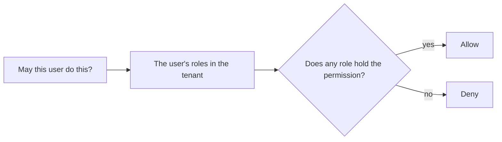

# The authorization context

The `authorization` context answers one question: may this user do this? Other parts of Hodor ask it and obey the answer; none of them decides for itself.

The whole design, with policies, several engines and Open Policy Agent, is in [authorization](../authorization.md). This page specifies the small part built in Milestone 1: fixed roles that protect Hodor's own administration interface.

## Permissions

A permission names something that can be done: a kind of resource and an action on it, written `resource:action`.

| Permission | Allows |
|---|---|
| `users:read` | Seeing users and their login identifiers |
| `users:write` | Creating users and suspending them |
| `sessions:read` | Seeing a user's sessions |
| `sessions:revoke` | Ending a session |
| `audit:read` | Reading the audit log |

## Roles

A role is a named set of permissions. In this version the roles are fixed: they are part of Hodor and cannot be changed or added to.

| Role | Permissions | Meant for |
|---|---|---|
| `tenant_administrator` | All of the above | The people who run a tenant |
| `tenant_auditor` | `users:read`, `sessions:read`, `audit:read` | People who must be able to see everything and change nothing |

A user holds a role in one tenant. Holding a role in one tenant means nothing in another: an assignment is a row of its tenant, like everything else.

## The check

- **Deny is the default.** A user with no role, a role that lacks the permission and a user that does not exist all get the same answer: deny, with the reason `no_matching_role`.
- **The tenant comes from the caller's credential and the address of the request**, never from anything the caller sends in a body.
- **Nothing is cached.** Every check reads the user's roles. Taking a role away takes effect on the next request.

The check says whether a user may do something. Whether the user is who they claim to be, and whether they may sign in at all, is decided before it is asked, by whoever asks.

## Operations

| Use case | What it does |
|---|---|
| Assign role | Gives a user a role in the tenant. Giving a role the user already holds changes nothing and announces nothing |
| Revoke role | Takes a role away. Taking away a role the user does not hold changes nothing |
| Roles of a user | Lists the roles a user holds in the tenant |
| Check | Answers allow or deny for a user and a permission |

### Events

| Event type | When |
|---|---|
| `authorization.role_assigned` | A user was given a role; carries the user and the role |
| `authorization.role_revoked` | A role was taken away; carries the user and the role |

### Port

| Port | Purpose |
|---|---|
| `RoleAssignmentStore` | Store, remove and list a user's role assignments |

## Storage

### `authorization.role_assignment`

| Column | Type | Notes |
|---|---|---|
| `tenant_id`, `user_id`, `role` | `uuid`, `uuid`, `text` | Primary key |
| `assigned_at` | `timestamptz` | |

A tenant table under row-level security. `user_id` refers to a user of the identity context but is deliberately not a foreign key: contexts do not reference each other's tables.

## Not built yet

| Item | Planned in |
|---|---|
| Roles and permissions that a tenant defines; roles through groups; role hierarchies | Phase 2 |
| Assigning and revoking roles through the administration interface. Today the only way is the bootstrap command of Issue-30 | Phase 2 |
| Access control lists, conditions on attributes, relationships | Phase 5 |
| The engine contract, Open Policy Agent, policy lifecycle, the record of decisions | Phase 5 |
| The authorization interface for applications | Phase 5 |
