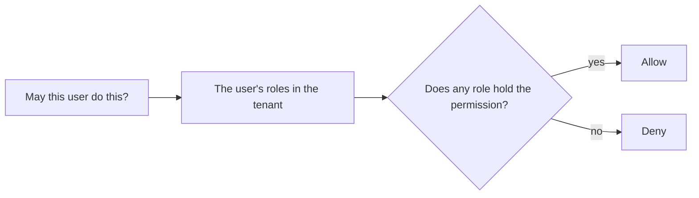
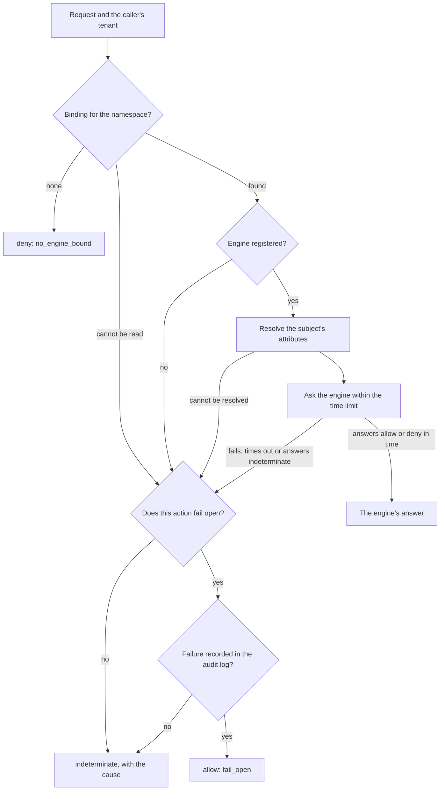

# The authorization context

The `authorization` context answers one question: may this user do this? Other parts of Hodor ask it and obey the answer; none of them decides for itself.

The whole design, with policies, several engines and Open Policy Agent, is in [authorization](../authorization.md). This page specifies what is built:

- the fixed roles that protect Hodor's own administration interface, from Milestone 1;
- the engine contract of [Decision 0009](../../decisions/0009-authorization-engine-contract.md), from Milestone 5 (Issue-72): the request, the decision, engines and the binding that says which engine answers for a resource server.

## Permissions

A permission names something that can be done: a kind of resource and an action on it, written `resource:action`.

| Permission | Allows |
|---|---|
| `users:read` | Seeing users and their login identifiers |
| `users:write` | Creating users and suspending them |
| `sessions:read` | Seeing a user's sessions |
| `sessions:revoke` | Ending a session |
| `audit:read` | Reading the audit log |
| `identity-providers:read` | Seeing the tenant's identity providers, without their secrets |
| `identity-providers:write` | Adding, changing, enabling and disabling identity providers, and replacing their secrets |
| `keys:read` | Listing a tenant's key versions |
| `keys:write` | Rotating a tenant's signing key and revoking key versions |

## Roles

A role is a named set of permissions. In this version the roles are fixed: they are part of Hodor and cannot be changed or added to.

| Role | Permissions | Meant for |
|---|---|---|
| `tenant_administrator` | All of the above | The people who run a tenant |
| `tenant_auditor` | `users:read`, `sessions:read`, `audit:read`, `identity-providers:read`, `keys:read` | People who must be able to see everything and change nothing |

A user holds a role in one tenant. Holding a role in one tenant means nothing in another: an assignment is a row of its tenant, like everything else.

## The check

- **Deny is the default.** A user with no role, a role that lacks the permission and a user that does not exist all get the same answer: deny, with the reason `no_matching_role`.
- **The tenant comes from the caller's credential and the address of the request**, never from anything the caller sends in a body.
- **Nothing is cached.** Every check reads the user's roles. Taking a role away takes effect on the next request.

The check says whether a user may do something. Whether the user is who they claim to be, and whether they may sign in at all, is decided before it is asked, by whoever asks.

## Operations

| Use case | What it does |
|---|---|
| Assign role | Gives a user a role in the tenant. Giving a role the user already holds changes nothing and announces nothing |
| Revoke role | Takes a role away. Taking away a role the user does not hold changes nothing |
| Roles of a user | Lists the roles a user holds in the tenant |
| Check | Answers allow or deny for a user and a permission |

### Events

| Event type | When |
|---|---|
| `authorization.role_assigned` | A user was given a role; carries the user and the role |
| `authorization.role_revoked` | A role was taken away; carries the user and the role |

### Port

| Port | Purpose |
|---|---|
| `RoleAssignmentStore` | Store, remove and list a user's role assignments |

## Storage

### `authorization.role_assignment`

| Column | Type | Notes |
|---|---|---|
| `tenant_id`, `user_id`, `role` | `uuid`, `uuid`, `text` | Primary key |
| `assigned_at` | `timestamptz` | |

A tenant table under row-level security. `user_id` refers to a user of the identity context but is deliberately not a foreign key: contexts do not reference each other's tables.

### `authorization.engine_binding`

| Column | Type | Notes |
|---|---|---|
| `tenant_id`, `namespace` | `uuid`, `text` | Primary key. The namespace is compared byte for byte; `hodor:admin` is refused |
| `engine` | `text` | The registered engine's name |
| `timeout_milliseconds` | `integer` | 1 to 5000 |
| `sensitive` | `boolean` | |
| `fail_open_actions` | `text[]` | Empty when `sensitive` |
| `trust_asserted` | `boolean` | |
| `created_at`, `updated_at` | `timestamptz` | |

A tenant table under row-level security. The namespace is a resource server's audience but not a foreign key, for the same reason as above.

## The engine contract

Applications ask about their own resources: whether a subject may do an action to a resource of one of their resource servers. The question goes to one **engine**, the one the tenant **bound** to that resource server. The context owns the question, the answer and the binding; an engine only decides.

### The request

| Part | What it is | Rules |
|---|---|---|
| Namespace | The resource server asked about, by its audience (`https://…` or `urn:…`, as in [the OAuth context](oauth.md#resource-servers)), or `hodor:admin` for Hodor's own administration | At most 255 characters, no fragment, no space |
| Subject | Who wants to act: a kind, `user` or `client`, and an identifier | The identifier has 1 to 255 characters and no control character |
| Asserted attributes | What the caller claims about the subject, such as roles it keeps itself | Kept apart from what Hodor resolves; **not given to the engine** unless the binding trusts them |
| Resource | A kind (`document`), an optional identifier and attributes | A kind is 1 to 64 characters of lower-case letters, digits, `-`, `_` and `.`, starting with a letter |
| Action | What is to be done (`read`) | Same characters as a kind |
| Context | Attributes of the moment, such as the address the request came from, and an optional correlation identifier | |

Attributes are names with JSON values. A set holds at most 64 names of at most 64 characters each.

**The request never names a tenant.** The tenant is the one of the caller's credential, passed beside the request as `TenantContext`; nothing in the request can point at another tenant.

### The answer

| Field | What it is |
|---|---|
| `decision_id` | A new identifier for every decision |
| `effect` | `allow`, `deny` or `indeterminate` |
| `evaluated_at` | When the decision was made, by Hodor's clock |
| `engine` | The engine that answered; absent when no engine was reached |
| `policy_version` | The revision of the policies the engine used, when it has one |
| `reason` | A stable code, safe to show to the caller, such as `no_matching_role` |
| `matched_policies` | The policies that decided. Only callers allowed to see explanations receive them ([the Authorization API](../../api/api-spec.md#authorization-api), Issue-75) |
| `metadata` | How long the evaluation took, whether it came from a cache, and whether asserted attributes were given to the engine |

**`indeterminate` means the engine could not decide**: it failed, timed out, was not available, or said so itself. Whoever enforces the answer treats it as deny: only `allow` permits. It exists so that logs and metrics tell "denied by policy" from "could not evaluate".

An engine does not write the whole answer. It returns its part (the effect, the reason, the revision and the matched policies), and the context adds the identifier, the time, the engine's name and the duration. No engine can claim another's name or another moment.

### Engines

An engine has a name (`native`, `open_policy_agent`, …), says what it can do beyond deciding (simulation, explanation), and answers one request or a batch, one answer per request in the same order. An engine that does not answer a batch in one call answers its requests one after the other.

Simulation is a separate ability of the engines that have it: the same request evaluated against a draft, a chosen revision or what is published. A simulated answer is never taken as a real decision.

Engines are registered when a binary starts. A binding names an engine; a binding cannot name an engine that is not registered.

### Bindings

A binding says which engine answers for one resource server in a tenant, and how failure is handled.

| Setting | Meaning | Default and bounds |
|---|---|---|
| Namespace | The resource server's audience | Unique in the tenant; never `hodor:admin` |
| Engine | The registered engine that answers | |
| Time limit | How long the engine may take | 200 milliseconds; 1 to 5000 |
| Sensitive | Whether a failure may ever allow | `false` |
| Actions that fail open | The actions for which a failure allows instead of being indeterminate | None. Must be empty when the namespace is sensitive. At most 50 |
| Trust asserted attributes | Whether the engine receives what the caller claims | `false` |

One request is answered by exactly one engine. Decisions of several engines are not combined.

**A resource server without a binding is denied everything**, with the reason `no_engine_bound`.

**Hodor's administration namespace, `hodor:admin`, is never bound and never rebound.** It is always answered by the fixed-role engine inside this context, from the roles above, with nothing outside the context involved: an outage of Open Policy Agent can never lock administrators out of the system that fixes it. Its binding is fixed: sensitive, nothing fails open, asserted attributes are never trusted.

### Evaluating

1. **The binding.** The administration namespace has its fixed one. Any other is read from storage; none means deny with `no_engine_bound`.
2. **The subject's attributes** are resolved by Hodor through a `SubjectAttributeSource`. A subject Hodor does not know has no attributes; it is not told apart from one that has none, so the answer does not reveal who exists.
3. **The engine decides.** The time limit is given to the engine, which stops waiting when it is reached (an engine that talks to another service sets it on its connection). If the answer arrives after the limit anyway, by Hodor's clock, it is not used.
4. **A failure is indeterminate, unless the binding lets that action fail open.** Then the answer is allow with the reason `fail_open`, and only if the event `authorization.failed_open` was stored with it; when it cannot be stored, the answer stays indeterminate.

The causes of failure have their own reasons:

| Reason | Cause |
|---|---|
| `binding_unavailable` | The binding could not be read |
| `engine_unavailable` | The binding names an engine that is not registered in this binary |
| `subject_unavailable` | The subject's attributes could not be resolved |
| `engine_failed` | The engine returned an error, or a batch answer of the wrong length |
| `engine_timed_out` | The engine answered after the time limit |

A batch holds at most 100 requests and gives one answer per request, in order; a failure of one does not fail the others. Requests bound to the same engine are sent to it together.

### Ports of the engine contract

| Port | Purpose |
|---|---|
| `AuthorizationEngine` | Decides one request or a batch |
| `PolicySimulator` | Evaluates a request against a chosen set of policies, for the engines that can |
| `EngineBindingStore` | Store, read, list and remove a tenant's bindings |
| `SubjectAttributeSource` | Resolve what Hodor knows about a user or a client |

### Events of the engine contract

| Event type | When |
|---|---|
| `authorization.engine_bound` | A binding was made or changed; carries the namespace and the engine |
| `authorization.engine_unbound` | A binding was removed; carries the namespace |
| `authorization.failed_open` | A failure allowed because the binding lets the action fail open; carries the namespace, the action, the engine and the cause |

## Not built yet

| Item | Planned in |
|---|---|
| Roles given through groups and organizations | When groups and organizations exist ([Decision 0023](../../decisions/0023-what-0.2.0-holds.md)) |
| Assigning and revoking roles through the administration interface. Today the only way to give a role is [the bootstrap command](../../api/admin-api.md#the-first-administrator), and there is no way to take one away | Phase 2 |
| Native role-based access control: roles that a tenant defines for its resource servers, with hierarchies and composites | Issue-73 |
| Conditions on attributes in Common Expression Language | Issue-74 |
| The authorization interface for applications, which calls the evaluation; and an implementation of `SubjectAttributeSource`. Until then no binary evaluates through the engine contract, and the administration interface still asks the check above | Issue-75 |
| The record of decisions | Issue-76 |
| Open Policy Agent, bundles and the policy lifecycle | Issue-77 to Issue-79 |
| Managing bindings through the administration interface, the command-line tool and the console | Issue-80 |
| Access control lists and relationships | Later phase ([Decision 0023](../../decisions/0023-what-0.2.0-holds.md)) |
