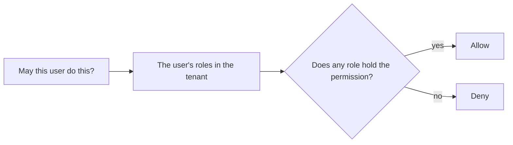
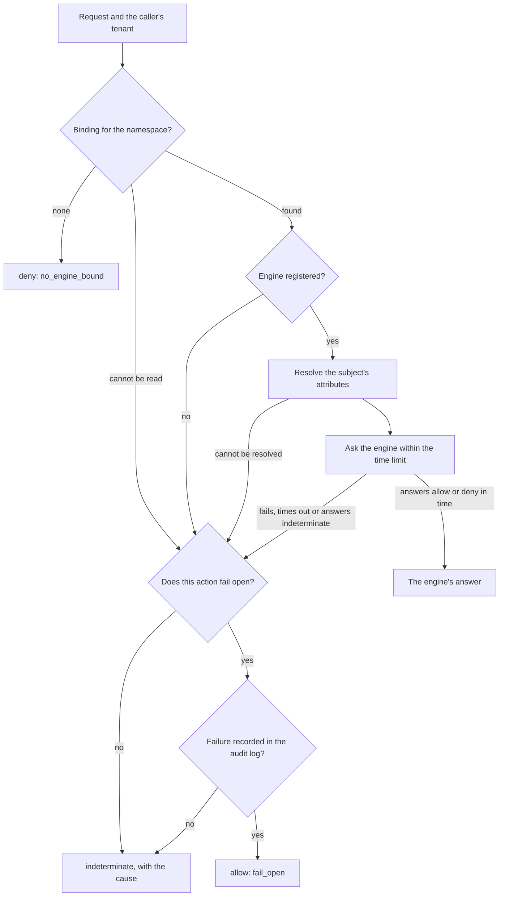
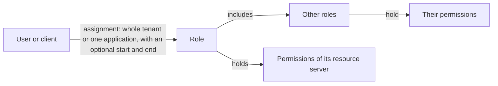
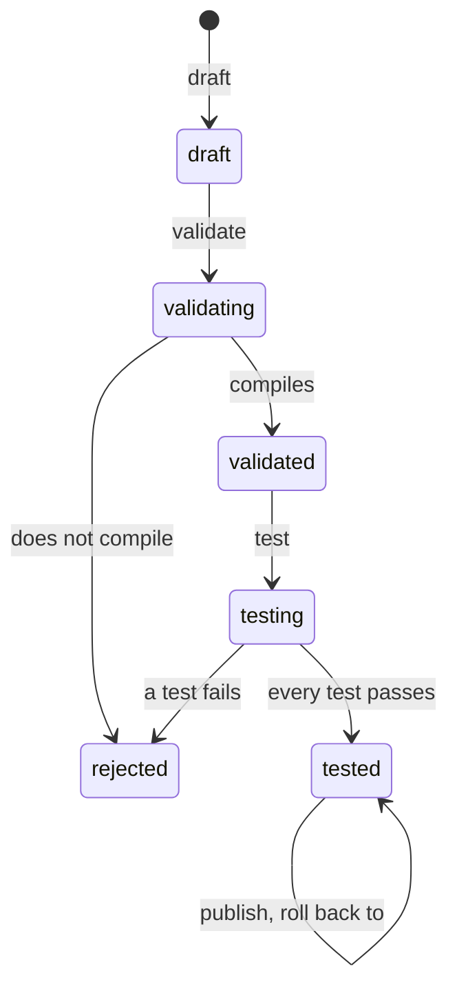

# The authorization context

The `authorization` context answers one question: may this user do this? Other parts of Hodor ask it and obey the answer; none of them decides for itself.

The whole design, with policies, several engines and Open Policy Agent, is in [authorization](../authorization.md). This page specifies what is built:

- the fixed roles that protect Hodor's own administration interface, from Milestone 1;
- the engine contract of [Decision 0009](../../decisions/0009-authorization-engine-contract.md), from Milestone 5 (Issue-72): the request, the decision, engines and the binding that says which engine answers for a resource server;
- native role-based access control, from Milestone 5 (Issue-73): permissions and roles a tenant defines for its resource servers, who holds them, and the native engine that answers from them. The fixed roles above are its built-in roles for Hodor's administration.

## Permissions

A permission names something that can be done: a kind of resource and an action on it, written `resource:action`.

| Permission | Allows |
|---|---|
| `users:read` | Seeing users and their login identifiers |
| `users:write` | Creating users and suspending them |
| `sessions:read` | Seeing a user's sessions |
| `sessions:revoke` | Ending a session |
| `audit:read` | Reading the audit log |
| `identity-providers:read` | Seeing the tenant's identity providers, without their secrets |
| `identity-providers:write` | Adding, changing, enabling and disabling identity providers, and replacing their secrets |
| `keys:read` | Listing a tenant's key versions |
| `keys:write` | Rotating a tenant's signing key and revoking key versions |
| `applications:read` | Seeing the tenant's applications, their clients and resource servers, without any secret |
| `applications:write` | Registering and changing applications, clients and resource servers, giving clients secrets and keys, and enabling and disabling them |
| `assurance-levels:read` | Seeing the tenant's assurance levels |
| `assurance-levels:write` | Replacing the tenant's assurance levels |
| `credentials:read` | Seeing which second factors a user has and how many recovery codes are left, never a secret or a code |
| `credentials:write` | Removing a user's authenticator application, security keys, passkeys and recovery codes |
| `roles:read` | Seeing the permissions of resource servers, the tenant's roles and who holds them |
| `roles:write` | Declaring and removing permissions, defining and removing roles, and giving and taking away roles |
| `bindings:read` | Seeing which engine answers for each resource server |
| `bindings:write` | Binding a resource server to an engine and removing the binding |
| `policies:read` | Seeing the tenant's policy versions, their reports and simulations, and what is published |
| `policies:write` | Drafting policy versions, asking for their checks and tests, and asking for simulations |
| `groups:read` | Seeing the tenant's groups, their members and the groups a user is in |
| `groups:write` | Creating, changing and deleting groups, and adding and taking out members |
| `organizations:read` | Seeing organizations, their units, their members and pending invitations, and the organizations a user is in |
| `organizations:write` | Creating, changing and deleting organizations and units, adding, changing and taking out members, and inviting and withdrawing invitations |

## Roles

A role is a named set of permissions. The roles of Hodor's administration are fixed: they are part of Hodor and cannot be changed or added to. They are the **built-in roles** of the namespace `hodor:admin` in [native role-based access control](#native-role-based-access-control); roles a tenant defines for its own resource servers are described there.

| Role | Permissions | Meant for |
|---|---|---|
| `tenant_administrator` | All of the above | The people who run a tenant |
| `tenant_auditor` | `users:read`, `sessions:read`, `audit:read`, `identity-providers:read`, `keys:read`, `applications:read`, `assurance-levels:read`, `credentials:read`, `groups:read`, `organizations:read` | People who must be able to see everything and change nothing |

A user holds a role in one tenant. Holding a role in one tenant means nothing in another: an assignment is a row of its tenant, like everything else.

## The check



- **Deny is the default.** A user with no role, a role that lacks the permission and a user that does not exist all get the same answer: deny, with the reason `no_matching_role`.
- **The tenant comes from the caller's credential and the address of the request**, never from anything the caller sends in a body.
- **Nothing is cached.** Every check reads the user's roles. Taking a role away takes effect on the next request.
- **It is the native engine's answer for `hodor:admin`.** The check and the native engine read the same assignments and the same built-in role definitions, and give the same reason: the first role, in the fixed order, that holds the permission.

The check says whether a user may do something. Whether the user is who they claim to be, and whether they may sign in at all, is decided before it is asked, by whoever asks.

## Operations

| Use case | What it does |
|---|---|
| Assign role | Gives a user a role in the tenant. Giving a role the user already holds changes nothing and announces nothing |
| Revoke role | Takes a role away. Taking away a role the user does not hold changes nothing |
| Roles of a user | Lists the roles a user holds in the tenant |
| Check | Answers allow or deny for a user and a permission |

### Events

| Event type | When |
|---|---|
| `authorization.role_assigned` | A user was given a role; carries the user and the role |
| `authorization.role_revoked` | A role was taken away; carries the user and the role |

### Port

| Port | Purpose |
|---|---|
| `RoleAssignmentStore` | Store, remove and list a user's role assignments |

## Storage

### `authorization.role_assignment`

Who holds which role, for the built-in roles and for the roles a tenant defines. Since Issue-73 it holds both; the rows written before it became assignments of the built-in roles of `hodor:admin` to users, for the whole tenant, without an end.

| Column | Type | Notes |
|---|---|---|
| `tenant_id`, `principal_kind`, `principal_id`, `namespace`, `role`, `application`, `organization` | `uuid`, `text`, `text`, `text`, `text`, `text`, `text` | Primary key. `principal_kind` is `user`, `client` or `group`. `application` and `organization` are both empty for an assignment to the whole tenant; at most one of them is set |
| `valid_from`, `valid_until` | `timestamptz` | Both optional; when both are given, the end comes after the start |
| `assigned_at` | `timestamptz` | |
| `role_namespace` | `text` | Generated: the namespace, or nothing for `hodor:admin`. It carries the reference to `authorization.role`, so that an assignment of a tenant's role names a role that exists and goes when the role goes |

A tenant table under row-level security. In `hodor:admin` the role is one of the built-in roles, the principal is a user, the assignment covers the whole tenant and has no start or end; the database refuses anything else there. `principal_id` refers to a user of the identity context or a client of the OAuth context but is deliberately not a foreign key: contexts do not reference each other's tables.

### `authorization.engine_binding`

| Column | Type | Notes |
|---|---|---|
| `tenant_id`, `namespace` | `uuid`, `text` | Primary key. The namespace is compared byte for byte; `hodor:admin` is refused |
| `engine` | `text` | The registered engine's name |
| `timeout_milliseconds` | `integer` | 1 to 5000 |
| `sensitive` | `boolean` | |
| `fail_open_actions` | `text[]` | Empty when `sensitive` |
| `trust_asserted` | `boolean` | |
| `created_at`, `updated_at` | `timestamptz` | |

A tenant table under row-level security. The namespace is a resource server's audience but not a foreign key, for the same reason as above.

## The engine contract

Applications ask about their own resources: whether a subject may do an action to a resource of one of their resource servers. The question goes to one **engine**, the one the tenant **bound** to that resource server. The context owns the question, the answer and the binding; an engine only decides.

### The request

| Part | What it is | Rules |
|---|---|---|
| Namespace | The resource server asked about, by its audience (`https://…` or `urn:…`, as in [the OAuth context](oauth.md#resource-servers)), or `hodor:admin` for Hodor's own administration | At most 255 characters, no fragment, no space |
| Subject | Who wants to act: a kind, `user` or `client`, and an identifier | The identifier has 1 to 255 characters and no control character |
| Asserted attributes | What the caller claims about the subject, such as roles it keeps itself | Kept apart from what Hodor resolves; **not given to the engine** unless the binding trusts them |
| Resource | A kind (`document`), an optional identifier and attributes | A kind is 1 to 64 characters of lower-case letters, digits, `-`, `_` and `.`, starting with a letter |
| Action | What is to be done (`read`) | Same characters as a kind |
| Context | Attributes of the moment, such as the address the request came from, an optional correlation identifier, the application the request is made for, and the organization it is made in, when there are | The application is an identifier of 1 to 255 characters without a control character. It is what an assignment scoped to an application is compared with. The organization is an organization's identifier, what an assignment scoped to an organization is compared with |

Attributes are names with JSON values. A set holds at most 64 names of at most 64 characters each.

**The request never names a tenant.** The tenant is the one of the caller's credential, passed beside the request as `TenantContext`; nothing in the request can point at another tenant.

### The answer

| Field | What it is |
|---|---|
| `decision_id` | A new identifier for every decision |
| `effect` | `allow`, `deny` or `indeterminate` |
| `evaluated_at` | When the decision was made, by Hodor's clock |
| `engine` | The engine that answered; absent when no engine was reached |
| `policy_version` | The revision of the policies the engine used, when it has one |
| `reason` | A stable code, safe to show to the caller, such as `no_matching_role` |
| `matched_policies` | The policies that decided. Only callers allowed to see explanations receive them ([the Authorization API](../../api/api-spec.md#authorization-api), Issue-75) |
| `metadata` | How long the evaluation took, whether it came from a cache, and whether asserted attributes were given to the engine |

**`indeterminate` means the engine could not decide**: it failed, timed out, was not available, or said so itself. Whoever enforces the answer treats it as deny: only `allow` permits. It exists so that logs and metrics tell "denied by policy" from "could not evaluate".

An engine does not write the whole answer. It returns its part (the effect, the reason, the revision and the matched policies), and the context adds the identifier, the time, the engine's name and the duration. No engine can claim another's name or another moment.

### Engines

An engine has a name (`native`, `open_policy_agent`, …), says what it can do beyond deciding (simulation, explanation), and answers one request or a batch, one answer per request in the same order. An engine that does not answer a batch in one call answers its requests one after the other.

Simulation is a separate ability of the engines that have it: the same request evaluated against a draft, a chosen revision or what is published. A simulated answer is never taken as a real decision.

Engines are registered when a binary starts. A binding names an engine; a binding cannot name an engine that is not registered.

### Bindings

A binding says which engine answers for one resource server in a tenant, and how failure is handled.

| Setting | Meaning | Default and bounds |
|---|---|---|
| Namespace | The resource server's audience | Unique in the tenant; never `hodor:admin` |
| Engine | The registered engine that answers | |
| Time limit | How long the engine may take | 200 milliseconds; 1 to 5000 |
| Sensitive | Whether a failure may ever allow | `false` |
| Actions that fail open | The actions for which a failure allows instead of being indeterminate | None. Must be empty when the namespace is sensitive. At most 50 |
| Trust asserted attributes | Whether the engine receives what the caller claims | `false` |

One request is answered by exactly one engine. Decisions of several engines are not combined.

**A resource server without a binding is denied everything**, with the reason `no_engine_bound`.

**Hodor's administration namespace, `hodor:admin`, is never bound and never rebound.** It is always answered by the native engine inside this context, from the built-in roles above, with nothing outside the context involved: an outage of Open Policy Agent can never lock administrators out of the system that fixes it. Its binding is fixed: sensitive, nothing fails open, asserted attributes are never trusted.

### Evaluating



1. **The binding.** The administration namespace has its fixed one. Any other is read from storage; none means deny with `no_engine_bound`.
2. **The subject's attributes** are resolved by Hodor through a `SubjectAttributeSource`. A subject Hodor does not know has no attributes; it is not told apart from one that has none, so the answer does not reveal who exists.
3. **The engine decides.** The time limit is given to the engine, which stops waiting when it is reached (an engine that talks to another service sets it on its connection). If the answer arrives after the limit anyway, by Hodor's clock, it is not used.
4. **A failure is indeterminate, unless the binding lets that action fail open.** Then the answer is allow with the reason `fail_open`, and only if the event `authorization.failed_open` was stored with it; when it cannot be stored, the answer stays indeterminate.

The causes of failure have their own reasons:

| Reason | Cause |
|---|---|
| `binding_unavailable` | The binding could not be read |
| `engine_unavailable` | The binding names an engine that is not registered in this binary |
| `subject_unavailable` | The subject's attributes could not be resolved |
| `engine_failed` | The engine returned an error, or a batch answer of the wrong length |
| `engine_timed_out` | The engine answered after the time limit |

A batch holds at most 100 requests and gives one answer per request, in order; a failure of one does not fail the others. Requests bound to the same engine are sent to it together.

### Ports of the engine contract

| Port | Purpose |
|---|---|
| `AuthorizationEngine` | Decides one request or a batch |
| `PolicySimulator` | Evaluates a request against a chosen set of policies, for the engines that can |
| `EngineBindingStore` | Store, read, list and remove a tenant's bindings |
| `SubjectAttributeSource` | Resolve what Hodor knows about a user or a client |

### Events of the engine contract

| Event type | When |
|---|---|
| `authorization.engine_bound` | A binding was made or changed; carries the namespace and the engine |
| `authorization.engine_unbound` | A binding was removed; carries the namespace |
| `authorization.failed_open` | A failure allowed because the binding lets the action fail open; carries the namespace, the action, the engine and the cause |

## The Authorization API

Applications ask through [the Authorization API](../../api/api-spec.md#authorization-api): `evaluate`, `batch` and `simulate` under `/t/{slug}/api/v1/authorization`. The context owns what is decided; the API only reads the caller's token, builds the request and writes the answer.

### Who may ask

The caller presents an **access token of the tenant**, issued by [Hodor's token endpoint](oauth.md#token-endpoint-and-client-authentication) and checked as UserInfo checks one: signed by a published key of the tenant, from the tenant's issuer, not expired, and still in force in [the register of access tokens](oauth.md#revocation-introspection-and-metadata), so a revoked token is refused at once.

- **Its audience must include `urn:hodor:authorization`**, the Authorization API's audience. A tenant opens the API by registering, once, a resource server with this audience and the scopes `authz:evaluate`, `authz:simulate` and `authz:explain`, on an application of its own (for example one named for the API), with [the administration interface](../../api/admin-api.md) or `hodor-cli resource-server add`. A client asks for a token with `resource=urn:hodor:authorization` and the scopes it needs; most callers use client credentials.
- **`authz:evaluate`** opens `evaluate` and `batch`; **`authz:simulate`** opens `simulate`.
- **`authz:explain`** adds the policies that decided, and a simulation's trace, to the answer. Without it the caller gets the stable reason code only.

A token of another tenant fails the signature and issuer checks, whatever its body says.

### What is asked about

**The resource server asked about is the one of the application the token's client belongs to.** An application has at most one resource server, so the caller never names a namespace: it asks about its own resources and no other application's. A client whose application has no resource server is refused with `authorization.no_resource_server`. Hodor's administration namespace is never reachable through the API.

**The application of the request is the token client's application.** It is what an assignment scoped to an application is compared with.

The body names the subject, the asserted attributes, the resource, the action and the context's attributes, as in [the request](#the-request). It never names a tenant.

### What Hodor knows about a subject

The binaries resolve a subject's attributes through the identity and OAuth contexts:

| Subject | Attributes |
|---|---|
| A user | `status` (`active`, `suspended`, …), `kind` (`human`, …), `groups`, the identifiers of every group the user is in, directly or through other groups, and `organizations`, the identifiers of the organizations the user is a member of |
| A client | `application` (its application's identifier), `client_type` (`confidential` or `public`) and `enabled` |

A subject Hodor does not know, including an identifier that is not one of its own, has no attributes, as for any engine. The attributes are given to the engine and never written back to the caller.

### Simulating

`simulate` takes the same request and the policies to evaluate against: what is published, one revision, or a draft. It answers at once. Nothing is recorded, and nothing fails open. The native engine simulates against what is published only, and says how it decided; a revision or a draft of the native engine, and any selection for an engine that cannot simulate, are refused with `authorization.simulation_unsupported`.

Open Policy Agent has no simulator behind this route yet. A version of a tenant's Rego is simulated through [the policy lifecycle](#the-policy-lifecycle) instead: `hodor-cli policy simulate` asks the worker to evaluate a validated or tested version against inputs the operator writes, and the answer comes back when the worker has run `opa eval`. The route answers `authorization.simulation_unsupported` for a resource server bound to Open Policy Agent.

## The record of decisions

Every decision an application asks for is recorded, whichever engine made it, in one format, so that a tenant can see who was allowed or refused what, and why.

### Who writes it

**Hodor records what it decided, at the moment it decided.** `EvaluationService` writes the record of each `evaluate` and of each request of a `batch`, for the native engine and for Open Policy Agent alike: Hodor holds the request, the subject's attributes and the answer, so one writer gives one format and one place where masking happens.

- **The record is written after the answer is decided, in its own short transaction**, one insert for an `evaluate` and one for a whole `batch`. The answer does not wait for anything else, and a record that cannot be written never changes the answer: the failure is counted and the answer is given as decided. A record is therefore lost only when its own write fails. Writing in the outbox would have doubled the writes of every decision for a record nobody acts on.
- **A simulation is never recorded**, and neither is a decision about `hodor:admin`, which the audit log of each action already covers.
- **What Open Policy Agent uploads stays a report of the instance.** Its uploaded decisions ([decision logs](#the-service-interface)) keep no input; they are not merged into the record, since every decision an instance makes for Hodor is already recorded by Hodor with its input masked. They are kept as long as the tenant's record and removed with it.
- **An instance erases the whole input before uploading.** The bundles of a tenant may write only under the tenant's own tree, so a mask in `system.log.mask` cannot come with them; a shared instance would need one mask for every tenant. Instances are started with `deploy/open-policy-agent/decision-log-mask.rego`, which erases `/input` from every decision before it leaves the instance.

### What a record holds

| Field | Holds |
|---|---|
| Decision | Its identifier, the one the answer carries |
| Resource server | The namespace asked about |
| Subject | Its kind and identifier |
| Action | The action |
| Resource | Its type, and its identifier when the request named one |
| Effect and reason | `allow`, `deny` or `indeterminate`, and the stable reason code |
| Engine and policy version | The engine that decided, and the revision or version it decided with |
| Time and duration | When it was decided, and how long it took in microseconds |
| Input | What the engine was given, with the tenant's masks applied: the subject's resolved attributes, the asserted attributes when the binding trusts them, the resource's attributes, the context's attributes and the application |
| Masked | The paths that were masked, never what they held |

### The tenant's settings

| Setting | Values | Default |
|---|---|---|
| Mode | `full` (every decision), `sampled` (every refusal and indeterminate decision, and a share of the allows), `deny_only` (refusals and indeterminate decisions), `off` | `full` |
| Share of allows kept | 1 to 99 percent, for `sampled` only | — |
| Masks | Up to 32 paths, each erased from the input before it is stored | none |
| Retention | 1 to 400 days | 30 days |

**A mask** names a path into the input: `subject.attributes.<name>`, `asserted.<name>`, `resource.attributes.<name>` or `context.attributes.<name>`, possibly deeper into an object, with `*` alone as the last segment for every member at that level, such as `resource.attributes.*`. A path is at most 200 characters. What a mask names is removed before the record is written, so it is never stored; the record lists the paths that removed something. The identifiers of the subject and of the resource are not masked: they are what a record is found by.

Sampling draws from the operating system's random source, so it does not follow any pattern of the requests. The settings change with `hodor-cli authorization decision-log` and [the administration interface](../../api/admin-api.md#the-record-of-decisions); a change is recorded as `authorization.decision_log_changed` and applies to decisions made after it.

### Reading it

The administration interface lists a tenant's records newest first, a page at a time, filtered by time range, effect, resource server and subject; `hodor-cli authorization decisions` prints the same. A tenant reads only its own records.

### Storage of the record

| Table | Kind | Holds |
|---|---|---|
| `"authorization".decision_log` | Tenant table, partitioned by day on the time of the decision | The records. Its primary key is the tenant, the time and the decision |
| `"authorization".decision_log_setting` | Tenant table | The tenant's settings; no row means the defaults |

**Partitioned by day, shared by every tenant, and emptied per tenant.** One partition per day holds every tenant's records of that day. A partition per tenant and day would let a tenant's old records be dropped at once, but it multiplies partitions by the number of tenants, which PostgreSQL plans poorly beyond a few thousand. So the worker does two things:

- **It prepares the partitions** of the next seven days and drops those older than the longest retention, 400 days, through `"authorization".maintain_decision_log_partitions`, a function owned by the schema's owner that only the platform role may call. A default partition catches a record whose day has no partition yet; preparing that day moves its rows out of the default first.
- **It deletes, tenant by tenant, the records older than the tenant's retention**, a bounded number per pass, as the application role, and with them the decisions the tenant's instances uploaded.

Row-level security applies to the partitioned table; the application role is granted the partitioned table only, never a partition, so records are reached only through it and its policy.

### Events of the record

| Event | When | Data |
|---|---|---|
| `authorization.decision_log_changed` | The tenant's settings changed | The mode, the share of allows, the number of masks and the retention, never the paths |

## Native role-based access control

The native engine answers for the resource servers a tenant binds to it, `native`, and always for `hodor:admin`. It answers from **permissions**, **roles** and **assignments** kept in this context, and needs nothing outside it.



### Permissions of a resource server

A tenant declares the permissions of each of its resource servers. A permission is written `resource:action`, the resource kind and the action of a [request](#the-request): `document:read` allows the action `read` on resources of the kind `document`. Both halves follow the rules of a kind and an action. A permission has a description of at most 500 characters.

Permissions cannot be declared for `hodor:admin`: its permissions are [the fixed ones](#permissions). Removing a permission removes it from every role that held it.

### Roles

A role belongs to one resource server, its namespace, and has a name, unique in that namespace: a lower-case letter followed by lower-case letters, digits, `-`, `_` and `.`, at most 64 characters. It holds permissions of its own namespace only, at most 200, and may **include** other roles, at most 50.

- **A role holds what the roles it includes hold.** A role that includes another of its own namespace is a **hierarchy**: a senior role (`editor`) includes a junior one (`viewer`) and holds everything the junior holds. A role that includes roles of other namespaces is a **composite role**: `support` may include `viewer` of the documents server and `reader` of the billing server, and holding it is holding both. Inclusion is followed as far as it goes.
- **Inclusion never makes a cycle.** A role that would include itself, directly or through other roles, is refused with `authorization.role_cycle`. Inclusion is at most 10 roles deep; a deeper chain is refused with `authorization.role_inclusion_too_deep`.
- **A role cannot include a built-in role**, and no role can be defined in `hodor:admin`: what a tenant defines never reaches Hodor's administration.
- **A role holds only permissions declared for its namespace.** An undeclared permission or an included role that does not exist is refused when the role is defined.
- **Defining a role again replaces it**: its description, its permissions, their conditions and what it includes. **A role that another role includes cannot be removed** (`authorization.role_in_use`); removing a role removes its assignments.

### Conditions

A permission a role holds may carry a **condition**: an expression in [Common Expression Language](https://cel.dev) that must also hold for the role to allow it. The condition belongs to the role's holding of the permission, not to the permission: `editor` may hold `document:write` only for documents of the subject's department, while `owner` holds it without a condition. A role that includes `editor` holds `document:write` with `editor`'s condition. The interpreter and its limits are in [Decision 0025](../../decisions/0025-condition-language.md).

A condition reads four variables:

| Variable | What it holds |
|---|---|
| `subject` | `kind` (`user` or `client`), `id`, `attributes` (what Hodor resolved), `asserted` (what the caller claims, empty unless the binding trusts it) |
| `resource` | `kind`, `id` (or `null`), `attributes` |
| `action` | The action, a string |
| `context` | `attributes` of the moment, `application` (or `null`), and `time`, the moment of the decision by Hodor's clock, as RFC 3339 text in UTC to the second (`2024-10-04T00:00:00Z`): comparing the text compares the moments |

```text
subject.attributes.department == resource.attributes.department
  && context.time < "2027-01-01T00:00:00Z"
```

**When a role is defined, every condition is checked**, and the role is refused if one fails:

| Refused with | When |
|---|---|
| `authorization.condition_invalid` | It is empty, longer than 1000 characters, holds a control character other than a line break or a tab, does not parse, names a variable other than the four above, or writes a message literal. The detail says what is wrong |
| `authorization.condition_too_costly` | It has more than 256 nodes, or comprehensions (`all`, `exists`, `exists_one`, `map`, `filter`) nested more than two deep |
| `authorization.condition_without_permission` | It is given for a permission the role does not hold |
| `authorization.conditions_unavailable` | The binary was started without the condition language |

**Every run of a condition is bounded**: at most 1000 iterations across its comprehensions, and a deadline of 10 milliseconds or what is left of the engine's time limit, whichever comes first. At most 32 conditions are run for one decision.

A condition holds only when it gives `true`. One that gives anything else, names an attribute the request does not carry, goes past its bounds or fails in any other way, **fails**: it never allows. Guard optional attributes with `has(resource.attributes.department)`.

### Assignments

An assignment gives a role to a **principal**: a user, a client (an application acting for itself), or a [group](identity.md#groups). A role given to a group is held by every user in it, directly or through other groups, for as long as they are.

| Part | Meaning |
|---|---|
| Principal | A user, by its identifier; a client, by its client identifier; or a group, by its identifier |
| Role | The role, by namespace and name. It must exist |
| Scope | The whole tenant, one application, or one [organization](identity.md#organizations). An assignment to an application applies only to requests made for that application, those whose context names it. An assignment to an organization applies only to requests made in that organization, those whose context names it, and only while the subject is a member of it |
| Start and end | Both optional. Before the start and from the end on, the assignment allows nothing. The end must come after the start |

Assigning the same role to the same principal with the same scope again replaces its start and end; with nothing changed, it changes nothing and announces nothing. Built-in roles are not given this way: they are given by [the bootstrap command](../../api/admin-api.md#the-first-administrator), as before.

### How the native engine decides

For a request about the resource server `namespace`, with the resource kind `kind` and the action `action`:

1. The principals are the request's subject and, for a user, every group in the user's resolved attribute `groups`. The assignments of each in the tenant are read.
2. An assignment counts when it is in force at the moment of the decision and its scope is the whole tenant, the application named by the request's context, or the organization named by the request's context when the user's resolved attribute `organizations` holds it.
3. From each assignment that counts, the role and every role it includes are followed. Every permission of `namespace` they hold is collected, each with the condition it is held with, if any.
4. If `kind:action` is held **without a condition** through any assignment, the answer is **allow** with the reason `matching_role`. It names the assigned roles that led there, written `namespace#role`, and reports the tenant's role revision.
5. Otherwise the conditions it is held with are run, at most 32. If one holds, the answer is **allow** with `matching_role`, naming the assigned roles whose condition held.
6. If none holds and at least one failed, the answer is **indeterminate** with the reason `condition_failed`: the engine could not tell. The evaluation treats it as any failure of an engine, so it denies unless the binding lets the action fail open.
7. If every condition ran and gave `false`, the answer is **deny** with the reason `condition_not_met`.
8. If `kind:action` is not held at all, the answer is **deny** with the reason `no_matching_role`. An undeclared permission, an unknown subject and a subject with no assignment get the same answer, so the answer does not reveal what exists.

An allow from one assignment is not undone by a condition that failed on another: each assignment is a reason to allow on its own.

For `hodor:admin` the built-in roles are used, the subject must be a user, and the answer is the one of [the check](#the-check): the reason is the name of the first role that allows, and the revision is `fixed_roles`. Built-in roles have no conditions.

### Caching and the role revision

Groups and organizations come with the subject, resolved at every decision, so **taking a person out of a group or an organization takes effect on the next decision** too, without the role revision changing.

The native engine keeps, per tenant and principal, what the principal's assignments come to: the permissions, with the role, the scope, the start and the end of each assignment that gives them, and each condition compiled. A stored condition that no longer compiles, after an upgrade of the interpreter, is kept as failing: the decisions it takes part in are indeterminate. Every change to a tenant's permissions, roles or assignments raises **the tenant's role revision** in the same transaction. Before using what it keeps, the engine reads the revision: when it has changed, it reads everything again. So **a change takes effect on the next decision**, whichever instance of Hodor answers it. The start and end of assignments are checked at every decision, so time passing needs no change. `hodor:admin` is not cached.

### Operations of native role-based access control

| Use case | What it does |
|---|---|
| Declare permission | Declares, or describes again, a permission of a resource server |
| Remove permission | Removes it, and removes it from every role |
| Permissions | Lists the permissions of a resource server |
| Define role | Creates a role or replaces it, after the checks above |
| Remove role | Removes a role no other role includes, with its assignments |
| Roles | Lists the tenant's roles, or one role |
| Assign | Gives a role to a principal, for the tenant or an application, with an optional start and end |
| Revoke | Takes it away |
| Assignments of a principal | Lists a principal's assignments |

They are not reachable through the administration interface, the command-line tool or the console yet; that is Issue-80.

### Events of native role-based access control

| Event type | When |
|---|---|
| `authorization.permission_declared` | A permission was declared or described again; carries the namespace and the permission |
| `authorization.permission_removed` | A permission was removed |
| `authorization.role_defined` | A role was created or replaced; carries the namespace and the name |
| `authorization.role_removed` | A role was removed |
| `authorization.principal_role_assigned` | A role was given to a principal, or its start and end changed; carries the principal, the role and the scope |
| `authorization.principal_role_revoked` | A role was taken away from a principal |

### Port of native role-based access control

| Port | Purpose |
|---|---|
| `NativeRoleStore` | Store, read and remove a tenant's permissions, roles and assignments, and read and raise its role revision |
| `ConditionLanguage` | Check and compile a condition; a compiled condition runs against one request. Implemented by `CelConditionLanguage` in `hodor-authorization-native` |

### Storage of native role-based access control

| Table | Primary key | What it holds |
|---|---|---|
| `authorization.permission` | `tenant_id`, `namespace`, `name` | The declared permissions, with a description |
| `authorization.role` | `tenant_id`, `namespace`, `name` | The roles, with a description |
| `authorization.role_permission` | `tenant_id`, `namespace`, `role`, `permission` | What each role holds, with the condition's text when it has one (1 to 1000 characters). Goes with its role and with its permission |
| `authorization.role_inclusion` | `tenant_id`, `namespace`, `role`, `included_namespace`, `included_role` | What each role includes. Goes with the including role; the included role cannot be removed while it is there |
| `authorization.role_revision` | `tenant_id` | The tenant's role revision |
| `authorization.role_assignment` | See [above](#authorizationrole_assignment) | Who holds which role |

All are tenant tables under row-level security. None of them may name `hodor:admin` except the assignments of the built-in roles.

## Open Policy Agent as an engine

The engine `open_policy_agent` asks an Open Policy Agent instance through its Data API. It lives in its own crate, `hodor-authorization-opa`, which depends on this context and the kernel only. Nothing in this context knows that Open Policy Agent exists ([Decision 0010](../../decisions/0010-opa-integration.md)). The integration as a whole, with bundles and the policy lifecycle, is in [the authorization architecture](../authorization.md#open-policy-agent-integration). This section is what the engine does with one request.

### Which instance answers

Instances are named by whoever operates the installation, in the server's configuration, never by a tenant, a binding or a request:

| Setting | Meaning |
|---|---|
| `HODOR_OPEN_POLICY_AGENT_ADDRESS` | The shared instance. It runs only policy written by the operator, parameterized by each tenant's data |
| `HODOR_OPEN_POLICY_AGENT_TENANT_ADDRESSES` | Instances dedicated to one tenant each, as `tenant-identifier=address` pairs separated by commas. Policy written by a tenant runs only in an instance of its own |
| `HODOR_OPEN_POLICY_AGENT_TOKEN` | The bearer token Hodor presents to every instance. Open Policy Agent's own interface must require it, and be reachable only from Hodor |

A tenant with an instance of its own is answered by it; any other tenant by the shared instance. With neither, the engine is still registered and answers `indeterminate` with `policy_engine_not_configured`, so that a binding to it fails closed instead of being refused.

An address is an origin, `http://` or `https://`, a host and an optional port, with no path, query, fragment, name or password. Plain HTTP is accepted because the default deployment is a sidecar on `localhost`; the server warns at startup about a plain HTTP address that is not on the machine itself.

### How the instance is reached

Not through the guarded client of [outbound HTTP](../../security/outbound-http.md): that client refuses private addresses, which is where Open Policy Agent lives. The engine has a client of its own, which **calls only the configured origins, exactly**, and refuses everything else, whatever the address resolves to. The addresses come from the operator, and the path is built by the engine, so no input of a tenant or a caller can steer a request anywhere else. The rules that are not about addresses stay: no redirects, no proxy, a limit on the size of the answer (64 kibibytes) and on time.

### The decision path

```text
POST /v1/data/hodor/tenants/t<tenant>/resource_servers/r<namespace>/decision
```

- `<tenant>` is the tenant's identifier, from the caller's credential, as 32 hexadecimal digits.
- `<namespace>` is the first 32 hexadecimal digits of the SHA-256 of the binding's namespace, the resource server's audience. An audience is an address or a name that cannot be a segment of a Rego package; its digest can.

Both come from the `TenantContext` and the binding. **Nothing in the request is part of the path**: an attribute, a resource kind or an identifier that names another tenant or another path is only input that the policy sees.

The policy that answers a tenant's resource server is therefore the rule `decision` of the package `hodor.tenants.t<tenant>.resource_servers.r<namespace>`. Whoever writes the policy declares that package; `hodor-cli policy-agent bundle-name --tenant … --namespace …` prints it, and publishing refuses a module whose package is outside the tenant's tree.

### The input

```json
{
  "input": {
    "namespace": "https://api.example.com",
    "subject": { "kind": "user", "id": "…", "attributes": { … } },
    "asserted": { … },
    "resource": { "kind": "document", "id": "…", "attributes": { … } },
    "action": "read",
    "context": { … }
  }
}
```

`subject.attributes` are those Hodor resolved. `asserted` is empty unless the binding trusts what the caller asserts.

### The answer

The only answer taken is a result that is an object with a boolean `allow`:

```json
{ "result": { "allow": true, "reason": "owner_may_read", "policies": ["documents/owner"] } }
```

| What came back | Effect | Reason |
|---|---|---|
| `allow` is `true` | `allow` | `reason` if given, otherwise `policy_allowed` |
| `allow` is `false` | `deny` | `reason` if given, otherwise `policy_denied` |
| No `result`: the rule is not defined for this input, or no policy exists at the path | `indeterminate` | `policy_undefined` |
| Anything else: `allow` missing or not a boolean, a `reason` that is not a code of lower-case letters, digits and `_`, `policies` that are not at most 64 strings, a body that is not JSON | `indeterminate` | `policy_answer_malformed` |

`policies` become the decision's matched policies. The revision comes from the answer's provenance: see [the revision of a decision](#the-revision-of-a-decision).

### Failures

Every failure is `indeterminate`, with its own reason. The evaluation then treats it like any other failure of an engine: it denies, unless the binding lets that action fail open.

| Reason | Cause |
|---|---|
| `policy_engine_timed_out` | No answer within the binding's time limit |
| `policy_engine_unreachable` | No connection, twice |
| `policy_engine_error` | An answer with a status other than 200 |
| `policy_engine_unavailable` | The instance's circuit is open |
| `policy_engine_not_configured` | No instance answers this tenant |

- **Time.** The binding's time limit is the whole budget. Each attempt is given what is left of it as its own limit on the connection.
- **One retry**, only when the first attempt could not connect and time is left. It is made at once: a context has no timer, so there is no wait and no jitter. There is never a retry after a time-out or an error status, which would only double the load on an instance that is already struggling.
- **A circuit breaker per instance.** It opens after 5 failures in a row, or when at least half of the last 10 seconds' requests failed and there were at least 10 of them. While it is open the instance is not called, and the answer is `policy_engine_unavailable` at once. After 5 seconds one request is let through as a probe: if it succeeds the circuit closes, if not it opens again for another 5 seconds. Only the instance's failures count (time-outs, connections, error statuses); an undefined or malformed answer is a fault of the policy, not of the instance.

### How policies reach an instance

In production, only as signed bundles that the instance pulls from Hodor: see [Bundles](#bundles). Hodor never sends a policy through Open Policy Agent's Policy API. The tests of the engine alone load policies into a container of their own as files; the tests of the bundles load them the production way.

### The revision of a decision

The engine asks with `?provenance=true`, and Open Policy Agent answers with the revision of every bundle it has activated. The revision of the tenant's bundle, named `t<tenant>`, is the decision's `policy_version`. An answer without it, from an instance that loaded its policies some other way, has no revision.

### The capabilities file

`deploy/open-policy-agent/capabilities.json` lists the built-in functions a policy may use. It is the list of Open Policy Agent 1.10.1 without:

| Built-in | Why it is removed |
|---|---|
| `http.send` | Calls any address from inside a decision |
| `net.lookup_ip_addr` | Resolves names: a lookup is a request, and its answer leaks what the network looks like |
| `opa.runtime` | Reads the instance's configuration and environment, where its credentials are |
| `providers.aws.sign_req` | Signs requests to a cloud with credentials of the instance |

Its `allow_net` is empty, so no built-in may reach the network even if one were added back. The functions that only compute on addresses (`net.cidr_contains` and the others of `net.cidr_*`) stay: they read nothing outside the policy.

Open Policy Agent has no setting that limits the built-ins of a running instance. The file is enforced when a policy version is checked, tested and simulated (`opa check`, `opa test` and `opa eval`, each with `--capabilities`; see [the policy lifecycle](#the-policy-lifecycle)), so no bundle using a removed built-in is ever published. An instance should run without a route out of its network as well.

## Bundles

An Open Policy Agent instance gets its policies and data from Hodor only, as signed bundles that it pulls. It reports which revision it runs, and uploads the decisions it made. This is the other direction from the engine: there Hodor calls the instance, here the instance calls Hodor. The two directions have their own credentials:

| Direction | Credential | Where it is set |
|---|---|---|
| Hodor asks an instance for a decision | `HODOR_OPEN_POLICY_AGENT_TOKEN`, the bearer token the instance's interface requires | The server's configuration and the instance's authorization policy |
| An instance pulls bundles, reports its status and uploads decisions | A credential of that instance alone, issued by Hodor when the instance is registered | Hodor keeps its hash; the instance's configuration holds the credential |

All of it lives in `hodor-authorization-opa`, which depends on this context and the kernel only. Nothing in this context knows about bundles.

### Instances

An instance is registered by whoever operates the installation, with `hodor-cli policy-agent instance add`:

- **Shared**, without a tenant. It may pull the bundle of any tenant, but only bundles written by the operator.
- **Of a tenant's own**, with `--tenant`. It may pull that tenant's bundle and no other, whoever wrote it.

That is the isolation rule of [Decision 0010](../../decisions/0010-opa-integration.md): Rego written by a tenant never reaches an instance that runs another tenant's policies, because Rego can read every document an instance holds.

Registering an instance prints its credential once: `hodor_pa_` followed by 43 characters, 32 random bytes in base64url. Hodor keeps only the SHA-256 of it. A high-entropy credential needs no slow hash ([Decision 0004](../../decisions/0004-token-formats.md)). An instance is never deleted. Disabling it refuses its credential at once, and the instance keeps running the last bundle it activated.

The instances are the installation's, not a tenant's, so they are a platform table: a shared instance is known before any tenant is. Registering and disabling them is not in a tenant's audit log; it is done by the operator from the command line. Managing them through the administration interface is Issue-80.

### What a bundle holds

A bundle is built for one tenant and holds:

- the tenant's policy modules (`.rego` files) and data documents (`data.json` files), at the paths they were given under the tenant's tree `hodor/tenants/t<tenant>/`;
- `.manifest`, with the revision and one root, `hodor/tenants/t<tenant>`;
- `.signatures.json`, Hodor's signature over every other file.

The root is what keeps tenants apart in a shared instance: Open Policy Agent refuses a bundle that writes outside its roots, and two bundles whose roots overlap. Before signing, Hodor checks every module: its `package` must be `hodor.tenants.t<tenant>` or a package below it, and a data document must sit under the tenant's tree. A file of any other kind is refused. Whether the modules compile, against [the capabilities file](#the-capabilities-file), is [the policy lifecycle](#the-policy-lifecycle)'s to check: a bundle is built only from a tested version.

Each bundle records **who wrote it**: the operator or the tenant. Only a bundle written by the operator is served to a shared instance. `hodor-cli policy draft` takes `--written-by operator` or `--written-by tenant`, and it is `tenant` unless the operator says otherwise, so that a mistake keeps a bundle off the shared instance rather than putting it there.

The revision is a number per tenant: 1, then 2, and so on, written as text in the manifest. A bundle is never changed or removed once it is published. Publishing a previous version again is a new revision; that is [the rollback](#publishing-and-rolling-back).

### Signing

Hodor signs bundles with **a key of the installation**, an ECDSA P-256 key (ES256). It is not a tenant's signing key: those rotate every 90 days and sign tokens, and every instance would need every tenant's key. The operator makes the key with `hodor-cli policy-agent signing-key`, which prints the private key and the public key. The public key goes into each instance's configuration. Only the command-line tool, which publishes, needs the private key: `HODOR_OPEN_POLICY_AGENT_SIGNING_KEY_FILE` names the file that holds it, and `HODOR_OPEN_POLICY_AGENT_SIGNING_KEY_ID` its name, `hodor` by default. The server serves the bundles as they were signed and never holds the key.

The signature is Open Policy Agent's own format. `.signatures.json` holds one JSON Web Signature in compact form. Its header names the algorithm and the key (`kid`). Its payload lists every other file of the bundle with the SHA-256 of its contents. Hodor writes JSON files in the canonical form Open Policy Agent hashes them in: keys sorted, no space, numbers as written. Their bytes and their hash therefore agree whichever way they are read.

To change the key, the operator adds the new public key to every instance under a new name, then publishes with the new key. Instances verify each bundle with the key its `kid` names.

### The service interface

| Route | Called by Open Policy Agent to |
|---|---|
| `GET /opa/bundles/t<tenant>` | Download the tenant's latest bundle |
| `POST /opa/status` | Report which revision of each bundle it runs |
| `POST /opa/logs` | Upload the decisions it made |

The routes belong to no tenant, since a shared instance serves several. Every request carries the instance's credential as a bearer token. A missing, unknown or disabled credential is answered `401`, with nothing else.

**Bundles.** A bundle the instance may not pull is answered `404`, exactly like a tenant with no bundle, so an instance cannot tell another tenant's bundle from no bundle at all. The answer carries an `ETag`, the SHA-256 of the archive. A request whose `If-None-Match` matches it is answered `304` without the archive. The archive is `application/gzip`.

**Status.** Open Policy Agent's status report names each bundle with its active revision, when it was last activated and its last error. For each bundle of a tenant the instance serves (its own tenant, or any tenant for a shared instance), Hodor keeps the latest report, one per instance and tenant. Bundles of other tenants are ignored. This is the record [the policy lifecycle](#activation) reads to know when a revision is active everywhere.

**Decision logs.** Open Policy Agent uploads its decisions as gzip-compressed JSON arrays. Hodor accepts at most 1 mebibyte compressed and 8 mebibytes once expanded, and at most 10,000 decisions per upload. For each decision under the tree of a tenant the instance serves, Hodor keeps:

- the decision's identifier;
- its path;
- the revision of the tenant's bundle;
- whether it allowed;
- when it was made.

The same decision uploaded twice is kept once. **Neither the input nor the whole result is kept**: they can hold personal data, and masking them belongs to the record of decisions (Issue-76). That issue joins these decisions to the ones Hodor records. Decisions outside a tenant's tree, or of a tenant the instance does not serve, are dropped. An upload whose body says `Content-Encoding: gzip` is expanded; a status report may come either way.

The status and log reports may be up to 1 mebibyte, larger than the 64 kibibytes of every other request.

### Configuring an instance

```yaml
services:
  hodor:
    url: https://hodor.example.com/opa
    credentials:
      bearer:
        token: hodor_pa_…
bundles:
  t0193a1…:
    service: hodor
    resource: bundles/t0193a1…
    signing:
      keyid: hodor
keys:
  hodor:
    algorithm: ES256
    key: |
      -----BEGIN PUBLIC KEY-----
      …
      -----END PUBLIC KEY-----
status:
  service: hodor
decision_logs:
  service: hodor
```

Every instance is started with the mask policy of the record of decisions next to its configuration, `opa run --server --config-file config.yaml deploy/open-policy-agent/decision-log-mask.rego`, so that no input leaves it ([who writes the record](#who-writes-it)).

An instance of a tenant's own lists that tenant's bundle. A shared instance lists one bundle for each tenant it answers. `hodor-cli policy-agent bundle-name --tenant` prints the name, and `--namespace` prints the package a resource server's `decision` rule belongs to.

### Storage of bundles

| Table | Kind | Holds |
|---|---|---|
| `platform.policy_agent_instance` | Platform table | Identifier, unique name, the tenant of an instance of a tenant's own, the SHA-256 of the credential, when it was registered and disabled |
| `"authorization".policy_bundle` | Tenant table | Revision (primary key with the tenant), who wrote it, the archive, its SHA-256, when it was published. Append only for the application role |
| `"authorization".policy_agent_status` | Tenant table | One row per instance: active revision, last activation, last error, when it was reported |
| `"authorization".policy_agent_decision` | Tenant table | One row per instance and decision identifier: path, revision, whether it allowed, when it was made and received |

The instance table is the second platform table after the tenant directory. It holds no secret, only a hash. It must be readable before a tenant is known, because a credential is checked first.

### Events of bundles

| Event | When | Data |
|---|---|---|
| `authorization.policy_bundle_published` | A bundle is published | Revision, who wrote it, the SHA-256 of the archive |

## The policy lifecycle

A bundle is published only from a **policy version that was checked and tested** with the `opa` binary. Between the files someone writes and the bundle an instance pulls there are four steps: a version is drafted, validated, tested and published. A simulation may be run on the way. A rollback publishes an earlier version again. The mechanism that runs `opa` is [Decision 0026](../../decisions/0026-policy-checks-in-a-sandbox.md). The whole lifecycle lives in `hodor-authorization-opa`, like the bundles; running the binary is the adapter `hodor-adapters-policy-check`.

### Versions

A tenant's policy is the set of files its bundle holds: Rego modules and data documents, at their paths under the tenant's tree. A **version** is one such set, numbered 1, 2 and so on per tenant. It records:

- who wrote it, the operator or the tenant, as for a bundle;
- its files, checked as a bundle's are when it is drafted (paths, kinds, the package of every module, size), with data documents in canonical form;
- its **digest**: the SHA-256 of the canonical JSON `{"files":[{"path":…,"sha256":…},…]}`, files by path, which names its contents whoever reads it;
- its state, and the report of its last check.

**A version never changes.** Editing a policy is drafting a new version. Files whose name ends in `_test.rego` are the version's tests. They are checked and run like the other modules, and left out of every bundle the version is published in.

### States



| State | Means |
|---|---|
| `draft` | Drafted, not checked |
| `validating` | Waiting for the worker to check it |
| `validated` | Compiles in strict mode against the capabilities file |
| `testing` | Waiting for the worker to run its tests |
| `tested` | Its tests pass. Only a tested version can be published |
| `rejected` | It did not compile, a test failed, or a run took too long. Final: the report says why, and the fix is a new version |

`validate` and `test` only ask: the worker does the work on its next pass and records the report. A version with no test file is tested with no test; the report says it holds none. Whoever publishes it sees that.

### What the worker runs

The worker looks for versions waiting in `validating` or `testing`, and simulations waiting, in every tenant. It works through them one tenant at a time, under an advisory lock so that two workers do not check the same version. For each run it writes the version's files into a new directory, under the tenant's tree as a bundle holds them, with Hodor's capabilities file, and runs:

| Step | Command | Refused when |
|---|---|---|
| Validate | `opa check --strict --capabilities capabilities.json policy` | Any error: a parse error, a type error, an unsafe variable, a removed built-in, anything strict mode refuses |
| Test | `opa test --capabilities capabilities.json --format json policy` | A test fails or errs, or the modules do not compile |
| Simulate | `opa eval --capabilities capabilities.json --data policy --data simulation …` | It is not refused; it reports |

A run that takes longer than its limit is killed and the version refused with `policy_check_timed_out`. A run that cannot start, because the binary is missing or the directory cannot be written, leaves the version waiting and is tried on a later pass. The report keeps, for each problem, the file and line within the tenant's tree, the code `opa` gave and its message; for each test, its name, its package and whether it passed.

### Simulation

A simulation evaluates a validated or tested version against **requests given by whoever runs it**, never against the decisions Hodor recorded. Those hold no input, so that no personal data is kept for them (see [Bundles](#the-service-interface)).

- It names a resource server and up to 100 inputs, each the `input` document the engine would send ([the input](#the-input)), 1 mebibyte in all.
- The worker evaluates the resource server's `decision` rule for every input with the version. It does the same with the version of the tenant's latest bundle, when that bundle was published from a version. Both run in one process each, through a module of Hodor's own that is never published.
- The result, for each input, is the version's answer, the published answer, and whether they differ. An input whose rule is not defined is reported as undefined.
- **The inputs are erased when the simulation is done**: only the results are kept, by position in the list. Whoever writes inputs should still write made-up subjects, as they would in a test.

### Publishing and rolling back

- **Publishing** takes a tested version, builds and signs its bundle as [Bundles](#bundles) say, without its test files, and records which version each revision was built from. Bundle and record are written in one transaction.
- **Rolling back** to revision `n` publishes the version revision `n` was built from **as a new revision**. History is never rewritten: after a rollback from 3 to 1, the latest revision is 4, with the files of 1. An instance runs it after its next pull, as it would any revision. A revision published before versions existed, or written into the store some other way, has no version and cannot be rolled back to.

Publishing directly from a directory of files, as `hodor-cli policy-agent publish` did, is no longer possible: every bundle comes from a tested version.

### Activation

A revision is published when it is stored; it is **active** when every instance that should run it says it does. The instances that should run a tenant's bundle are its enabled instances that may pull it:

- an instance of the tenant's own, always;
- a shared instance, when the bundle was written by the operator and the instance has reported this tenant's bundle at least once. A shared instance pulls only the tenants listed in its configuration, so it is not waited for until it shows it is one of them.

The status of a tenant's policy lists those instances with the revision each last reported, when, and its last error. It says **pending activation** while one of them runs an older revision or has never reported. With no such instance, nothing is waited for, and the status says that no instance runs it.

### A lagging instance

An instance that runs an older revision than the latest published one is lagging. A short lag is normal: an instance pulls on its own schedule, a minute or two by default. A long one means it cannot pull, or refuses the bundle. Its answers then come from a policy someone replaced, perhaps because it allowed too much.

So the engine compares the revision a decision was made with ([the revision of a decision](#the-revision-of-a-decision)) to the tenant's latest published revision. When the latest was published **more than the allowed lag ago**, five minutes by default (`HODOR_OPEN_POLICY_AGENT_REVISION_LAG_SECONDS`), and the decision was made with an older revision or with none, the answer is `indeterminate` with the reason `policy_revision_stale`, and the binding's failure policy applies. Within the lag, the older revision's answer stands.

The latest revision of each tenant is read from storage and kept for 10 seconds. If it cannot be read, the answer is `indeterminate` with `policy_revision_unknown`. A tenant with no published bundle has nothing to lag behind.

### Operations of the lifecycle

| Operation | Who | Does |
|---|---|---|
| `draft` | Operator, command line | Checks the files and stores a new version in `draft` |
| `validate` | Operator, command line | Moves a draft to `validating` |
| `test` | Operator, command line | Moves a validated version to `testing` |
| `simulate` | Operator, command line | Stores a simulation of a validated or tested version, waiting for the worker |
| `run_pending` | Worker | Checks, tests and simulates what waits in a tenant |
| `publish` | Operator, command line | Publishes a tested version as the next revision |
| `roll_back` | Operator, command line | Publishes the version of an earlier revision as the next revision |
| `status` | Operator, command line | The latest revisions, what each instance runs, whether activation is pending |

`hodor-cli policy draft|validate|test|simulate|publish|rollback|status|versions|show` call them. `validate`, `test` and `simulate` wait for the worker's report, a minute by default (`--wait`). The administration interface and the console are Issue-80.

### Events of the lifecycle

| Event | When | Data |
|---|---|---|
| `authorization.policy_version_drafted` | A version is drafted | Its number, who wrote it, its digest |
| `authorization.policy_version_checked` | The worker validated or tested a version | Its number and the state it reached |
| `authorization.policy_version_published` | A version is published | Its number, the revision, whether it was a rollback |

No event carries a file, an input or a result.

### Storage of the lifecycle

| Table | Holds |
|---|---|
| `"authorization".policy_version` | Number (primary key with the tenant), who wrote it, the files as JSON, the digest, the state, the last report as JSON, when it was drafted and last changed |
| `"authorization".policy_publication` | One row per revision built from a version: the revision and the version's number. Append only for the application role, like the bundles |
| `"authorization".policy_simulation` | Identifier, the version, the resource server, the inputs while it waits, the results once done, its state, when it was asked for and done |

All three are tenant tables under row-level security. The files and the reports are text: no column of them holds a secret.

## Not built yet

| Item | Planned in |
|---|---|
| Roles given through groups and organizations | When groups and organizations exist ([Decision 0023](../../decisions/0023-what-0.2.0-holds.md)) |
| Assigning and revoking roles through the administration interface. Today the only way to give a role is [the bootstrap command](../../api/admin-api.md#the-first-administrator), and there is no way to take one away | Phase 2 |
| Conditions on per-resource access control lists, on policies that target a resource kind, and static type checking of conditions | Not planned before 0.2.0 ([Decision 0023](../../decisions/0023-what-0.2.0-holds.md), [Decision 0025](../../decisions/0025-condition-language.md)) |
| The administration interface asking through the engine contract instead of the check above | With the management of Issue-80 |
| Limits on the number of requests to the Authorization API, per client | When the limits of the OAuth endpoints are built |
| The record of decisions | Issue-76 |
| Retention of the decisions instances upload, and joining them to the record of decisions | Issue-76 |
| A discovery bundle, so that a shared instance learns the tenants it answers without listing them in its configuration | When the number of tenants calls for it |
| A health check of each instance every 5 seconds. Today an instance's health is known from the decisions it answers, through its circuit, and from the status it reports | Issue-80 |
| Instances and their credentials managed through the administration interface, a query token of each instance's own for the Data API, and mutual TLS | Issue-80 |
| A cache of decisions | When a binding declares its policy deterministic |
| Managing bindings, permissions, roles and assignments through the administration interface, the command-line tool and the console | Issue-80 |
| Access control lists and relationships | Later phase ([Decision 0023](../../decisions/0023-what-0.2.0-holds.md)) |
