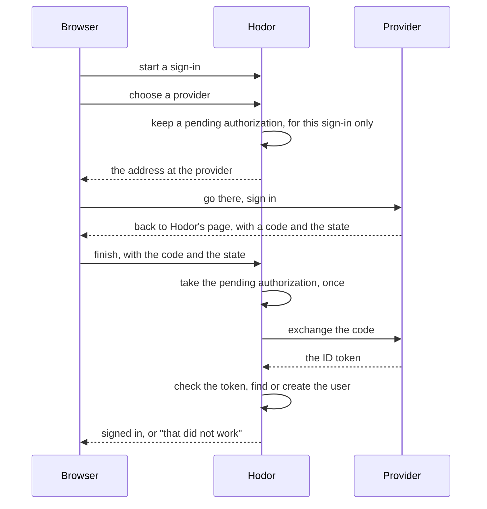

# The federation context

The federation context lets a person sign in to a tenant with an identity they already have somewhere else. It knows two things: the **identity providers** a tenant trusts, and which **external identity** belongs to which user.

It is built in steps ([Milestone 2](../../product/epics.md#milestone-2-signing-in-with-external-identities)). This page describes what exists and is extended with every issue; the last section says what does not exist yet.

## Words

| Word | Meaning |
|---|---|
| Identity provider | Something outside Hodor that knows people and can vouch for them: an OpenID Connect provider such as a social login, later a directory or a SAML identity provider |
| External identity | One person as one identity provider knows them: the provider and the provider's own, unchanging identifier for the person, its **subject** |
| Link | The record that an external identity belongs to a user of the tenant |

## Identity providers

A tenant has its own identity providers. Nothing about a provider is shared between tenants: two tenants that both use the same social login each configure it, each with their own client registered there.

| Part | Rules |
|---|---|
| Identifier | Generated; never changes |
| Alias | The name of the provider in addresses, such as `google`. 2 to 32 lowercase letters, digits and hyphens, starting with a letter or digit. Unique in the tenant. **Never changes**: it is part of the address registered at the provider, where answers are sent back |
| Kind | `openid_connect`. Further kinds come with their issues |
| Display name | What a person reads on the sign-in page, such as "Google". 1 to 64 characters |
| Issuer | The address that identifies the provider, such as `https://accounts.google.com`. HTTPS, no query and no fragment, at most 512 characters. Compared exactly, character by character, with what the provider says about itself |
| Client identifier | Who Hodor is to the provider. 1 to 255 characters |
| Client secret | What Hodor proves that with. [Kept encrypted](../../security/secrets-at-rest.md), for the purpose `federation.client_secret`. Written, never read back: no operation, interface or event returns it |
| Scopes | What Hodor asks the provider for. Always includes `openid`; `openid email profile` unless said otherwise. At most 16 |
| Creates users | Whether a person nobody knows yet is created on their first sign-in through this provider. Yes unless said otherwise |
| Status | Enabled or disabled. A disabled provider is not offered and signs nobody in; its links are kept |

A tenant has at most 20 identity providers.

The issuer, the client identifier and the scopes are not secret, and an administrator reads them back. They are still not shown to people signing in.

### Why the alias never changes

Every provider gets its own address for answers, built from its alias. An answer that arrives at the address of one provider is only ever checked against that provider. If two providers shared an address, an answer made for one could be presented as coming from the other. A changed alias would also silently break the registration at the provider.

### Operations on providers

| Operation | What it does |
|---|---|
| Create | Adds a provider, enabled. The secret is sealed before anything is stored |
| Change | Changes the display name, the issuer, the client identifier, the scopes and whether users are created. Not the alias, not the kind |
| Change the secret | Replaces the client secret |
| Disable, enable | Changes the status |
| Get, find by alias, list | Read providers, without their secrets |

A change is refused if the provider was changed by someone else in the meantime (`federation.provider_modified_concurrently`).

There is no operation that deletes a provider. Deleting one would delete the only record of how its users were let in; disabling it is what stops it.

## Links

A link says that one external identity belongs to one user.

| Part | Rules |
|---|---|
| Provider | The identity provider, by its identifier |
| Subject | The provider's own identifier for the person. 1 to 255 characters, compared exactly: no trimming, no change of case |
| User | The user of this tenant it belongs to |
| Linked at, last used at | When the link was made, and when it last signed the user in |

- **An external identity belongs to at most one user.** The pair of provider and subject is unique in the tenant.
- **A user may have several external identities**, at the same provider or at different ones.
- **A link is found by provider and subject, and by nothing else.** Never by an email address, a name or anything else the provider says about the person. An email address can be given to somebody else at the provider; the subject cannot (Threat-Federation-11).

### Operations on links

| Operation | What it does |
|---|---|
| Find the user | Answers whose a provider's subject is, if anyone's |
| Link | Records that an external identity belongs to a user. Refused if it already belongs to anyone (`federation.identity_already_linked`), the same user included |
| Mark as used | Records that the link just signed its user in |
| List | The external identities of a user |
| Unlink | Removes a link |

The federation context does not check that the user exists: users belong to the identity context, and whoever asks for a link has just read or created the user in the same unit of work.

## Asking an OpenID Connect provider who somebody is

For a provider of the kind `openid_connect`, Hodor is a relying party: it sends the person to the provider and, when they come back, asks the provider who they are. This section is what Hodor does on its side of that exchange. Keeping track of the pending authorization in between, and signing the person in, are described with Issue-40.

Every request to a provider goes through [the guarded outbound client](../../security/outbound-http.md).

### What Hodor learns about the provider

Hodor reads the provider's own description of itself at `{issuer}/.well-known/openid-configuration`.

| Rule | Why |
|---|---|
| The `issuer` in the description must be the configured issuer, character for character | A description served from the right address that names another issuer is a provider claiming to be someone else (Threat-Federation-04) |
| It must name where to send people, where to exchange a code, and where its keys are, each an HTTPS address | Nothing is guessed, and nothing is fetched in the clear |
| The description and the keys are kept in memory for an hour | A sign-in must not depend on two extra requests every time |
| When a token names a key Hodor does not have, the keys are fetched again, at most once a minute for one provider | Providers change keys; a flood of tokens naming keys that do not exist must not become a flood of requests |

### Sending the person to the provider

Hodor builds the address with the client identifier, the scopes, the address to come back to, and three values made for this one pending authorization:

| Value | What it is for |
|---|---|
| `state` | Returned by the provider untouched. Lets Hodor recognize the pending authorization it started, and refuse one it did not (Threat-Federation-03) |
| `nonce` | Put by the provider inside the token it issues. Ties the token to this request, so a token issued for another request, or for another client, cannot be used here (Threat-Federation-05) |
| PKCE code verifier | Kept by Hodor; only its SHA-256 hash is sent. The code that comes back can be exchanged only by whoever holds the verifier |

Each is 256 random bits. The method of the PKCE challenge is always `S256`.

### When the person comes back

The provider sends the person back with a code. Hodor exchanges it at the provider's token endpoint, proving who it is with the client secret, and gets an ID token: a statement signed by the provider about who the person is.

The client secret is sent in the `Authorization` header (`client_secret_basic`) unless the provider's description says it only accepts it in the body (`client_secret_post`).

**Everything about the ID token is checked before anything in it is believed:**

| Check | Refused when |
|---|---|
| Shape | It is not three parts of Base64 separated by dots, or is larger than 16 kibibytes |
| Algorithm | The header names anything but `RS256`, `PS256` or `ES256`. In particular `none` and the `HS` family, which would let anyone who knows a public value sign |
| Key | The header names a key the provider does not publish, or the key is not of the kind the algorithm needs, or is marked for something other than signatures. A token that names no key is accepted only if the provider publishes exactly one key that fits |
| Signature | It does not verify under that key. RSA keys shorter than 2048 bits are refused |
| Issuer | `iss` is not the configured issuer, character for character |
| Audience | `aud` does not contain this client. With several audiences, or whenever `azp` is present, `azp` must be this client |
| Time | `exp` has passed, `iat` is in the future, or `nbf` has not come, allowing one minute for clocks that disagree. `exp` and `iat` must be there |
| Nonce | `nonce` is not the one made for this request |
| Subject | `sub` is missing or is not a usable subject |

A token refused by any check signs nobody in, and the reason is recorded for the audit log, never shown to the person: all they learn is that it did not work.

### What Hodor takes from the token

| From the token | Becomes |
|---|---|
| `sub` | The subject of the external identity. The only thing a link is found by |
| `email`, and `email_verified` when it is exactly `true` | An email address, and whether the provider vouches for it. Anything but the JSON value `true` means it does not |
| `name`, `locale` | Suggestions for the profile of a user created on first sign-in |

Nothing else in the token is used. In particular no group, role or permission is ever taken from it (Threat-Federation-07).

## Signing in through a provider

Signing in through a provider is an [alternative](authentication.md#alternatives) of the tenant's sign-in flow, named `external`: one step that establishes who is signing in and proves it. It ends in the same Hodor session as a password does.

### The pending authorization

When a person chooses a provider, Hodor keeps one **pending authorization** for their sign-in: what it needs to recognize the answer when the person comes back.

| Part | Rules |
|---|---|
| The sign-in it belongs to | A pending authorization belongs to one sign-in in progress, which belongs to one browser. Choosing a provider again replaces the pending authorization |
| The provider | The answer is only ever checked against the provider the pending authorization was made for |
| The state | Only its SHA-256 hash is kept |
| The nonce and the PKCE verifier | The verifier is [kept encrypted](../../security/secrets-at-rest.md), for the purpose `federation.code_verifier` |
| The address to come back to | `{public address}/t/{slug}/account/providers/{alias}/callback`: a page of Hodor, one per provider. This is the address to register at the provider |
| Expiry | Ten minutes, like the sign-in |

**A pending authorization is used once.** Finishing takes the pending authorization away before anything is checked, so whatever the outcome, the same answer from a provider cannot be presented twice.

The person comes back to a page, not to an interface: the cookie that ties a sign-in to its browser is not sent when another site sends the browser to Hodor, so the page that opens is what presents the code, from Hodor's own origin.

### Finishing

Finishing is refused, in the same words as a wrong password, when:

- there is no pending authorization for this sign-in, or it has expired;
- the state is not the one of the pending authorization. This is what stops an answer obtained by someone else from being finished in a victim's browser (Threat-Federation-03);
- the provider named is not the pending authorization's, or is disabled;
- the provider refuses the code, or the ID token fails [a check](#when-the-person-comes-back);
- the person cannot be let in, by the rules below.

A refusal counts against the sign-in like a rejected step, and leaves the sign-in waiting for the step it was waiting for. The person is told nothing of the reason. It is recorded as the event `federation.sign_in_refused`, which reaches the audit log, so that an administrator can see why somebody could not get in.

### Who the person is

The link is looked up by the provider and the token's subject, and by nothing else.

| Situation | What happens |
|---|---|
| The external identity is linked to a user who may sign in | That user is signed in |
| It is linked to a user who may not sign in: suspended, deactivated, pending | Refused |
| It is not linked, and the provider does not create users | Refused |
| It is not linked, the provider creates users, and the provider vouches for an email address that no user of the tenant has | A user is created with that address, already verified, and the name and language the provider gave; the external identity is linked to it. Both in one unit of work: a user without its link, or a link without its user, is never stored |
| It is not linked, and the provider gives no email address or does not vouch for it | Refused. A user needs a login identifier, and an address nobody vouches for is not one |
| It is not linked, and a user of the tenant already has the email address | **Refused. The external identity is never let into an existing account because of an email address** (Threat-Federation-01). The existing account stays exactly as it was |

The last row is the rule that matters most. An email address at a provider proves control of a mailbox at best, at some time, according to that provider. Letting it into an account that already exists would make every provider a tenant adds a way into every account of the tenant. Connecting an external identity to an existing account needs proof of both, which comes with the account console.

It has a cost that is accepted for now: a person who registered with a password and later tries a social login with the same address is refused, and is told only that it did not work.

### What is recorded

A sign-in through a provider is recorded in the session with the method `external`, and counts as one factor: Hodor does not know how the provider convinced itself. The audit log holds `authentication.succeeded` with that method, and for a first sign-in `identity.user_created` and `federation.identity_linked`.

## Events

| Event | When | Carries |
|---|---|---|
| `federation.provider_created` | A provider was added | Its identifier, alias and kind |
| `federation.provider_changed` | Its settings were changed | Its identifier and alias |
| `federation.provider_secret_changed` | Its secret was replaced | Its identifier and alias |
| `federation.provider_disabled`, `federation.provider_enabled` | Its status changed | Its identifier and alias |
| `federation.identity_linked` | A link was made | The provider, the user. Not the subject |
| `federation.identity_unlinked` | A link was removed | The provider, the user |
| `federation.sign_in_refused` | A sign-in through a provider was refused | The provider, the reason as a fixed name such as `state_mismatch` or `email_belongs_to_a_user`, and what the check of the provider's answer said when that is the reason |

No event carries a secret. No event carries a subject either: it identifies a person at another organization, and events are kept for a long time and read by many.

## Errors

| Code | Kind | When |
|---|---|---|
| `federation.alias_invalid`, `federation.display_name_invalid`, `federation.issuer_invalid`, `federation.client_id_invalid`, `federation.client_secret_invalid`, `federation.scopes_invalid`, `federation.subject_invalid` | Invalid | A value breaks its rule above |
| `federation.alias_taken` | Conflict | The tenant already has a provider with this alias |
| `federation.too_many_providers` | Conflict | The tenant already has 20 |
| `federation.provider_not_found` | Not found | No provider has this identifier or alias in this tenant |
| `federation.provider_modified_concurrently` | Conflict | Someone else changed the provider first |
| `federation.identity_already_linked` | Conflict | The external identity already belongs to a user |
| `federation.link_not_found` | Not found | There is no such link |
| `federation.provider_unavailable` | Unavailable | The provider did not answer, or answered something that cannot be used: no description, a description for another issuer, no keys |
| `federation.identity_not_verified` | Unauthenticated | The provider's answer does not establish who the person is: the code was refused, or the ID token failed a check |

## Ports

| Port | What it is for |
|---|---|
| `ProviderStore` | Stores identity providers |
| `LinkStore` | Stores links |
| `PendingAuthorizationStore` | Stores the pending authorization of a sign-in in progress |
| `SecretBox`, from the kernel | Seals and opens client secrets and PKCE verifiers |
| `HttpClient`, from the kernel | Every request to a provider |
| `SignatureVerifier`, from the kernel | Checks the signature of an ID token. Hodor implements no cryptography of its own |

Each store has an implementation in memory, behind the crate's `testing` feature, and one on PostgreSQL. Both pass the same contract suite, which includes the tenant isolation cases.

## Storage

All tables are under [forced row-level security](../multi-tenancy.md#isolation-by-layer).

### `federation.identity_provider`

| Column | Type | Notes |
|---|---|---|
| `tenant_id`, `id` | `uuid` | Primary key |
| `alias` | `text` | Unique with `tenant_id` |
| `kind` | `text` | `openid_connect` |
| `display_name`, `issuer`, `client_id` | `text` | |
| `client_secret` | `bytea` | The sealed secret |
| `scopes` | `text[]` | |
| `creates_users` | `boolean` | |
| `status` | `text` | `enabled` or `disabled` |
| `created_at`, `updated_at` | `timestamptz` | |
| `version` | `integer` | For optimistic locking |

### `federation.external_identity`

| Column | Type | Notes |
|---|---|---|
| `tenant_id`, `provider_id`, `subject` | `uuid`, `uuid`, `text` | Primary key. The provider is a foreign key within the tenant |
| `user_id` | `uuid` | A user of the identity context; deliberately not a foreign key, since contexts do not reference each other's tables |
| `linked_at`, `last_used_at` | `timestamptz` | |

### `federation.pending_authorization`

| Column | Type | Notes |
|---|---|---|
| `tenant_id`, `transaction_id` | `uuid` | Primary key: one pending authorization per sign-in in progress. The sign-in belongs to the authentication context; deliberately not a foreign key |
| `provider_id` | `uuid` | Foreign key within the tenant |
| `state_hash` | `bytea` | SHA-256 of the state |
| `nonce`, `redirect_uri` | `text` | |
| `code_verifier` | `bytea` | The sealed PKCE verifier |
| `expires_at` | `timestamptz` | |

## Not built yet

| Item | Planned in |
|---|---|
| Managing providers through the administration interface and the command-line tool | Issue-41 |
| Providers that are not plain OpenID Connect: GitHub, Apple; directories; SAML | Issue-43, Issue-44, Issue-48 |
| Signature algorithms beyond `RS256`, `PS256` and `ES256`; encrypted ID tokens; the UserInfo endpoint | When a provider that needs them is to be supported |
| A cache of provider descriptions and keys shared between server instances. Each instance keeps its own | With Redis, when instances are many |
| What happens to the sessions of a provider's users when it is disabled (Threat-Federation-10). Today disabling stops new sign-ins only | With the consoles |
| Mapping what a provider says about a person to the user's profile, groups or roles | Issue-40 for the profile; groups and roles are not in Milestone 2 |
| Linking and unlinking by the person themself, routing by email domain | The account console |
| Letting a person who already has an account connect an external identity to it, with proof of both | The account console |
| Pending authorizations that were never finished are never removed | A cleanup job, later |
| Bringing the name and the language up to date on later sign-ins | With claim mapping |
| Protection against a local account made in advance with someone else's address (Threat-Federation-02). Such an account keeps the person's external identity out; it is not taken over | With linking, in the account console |
