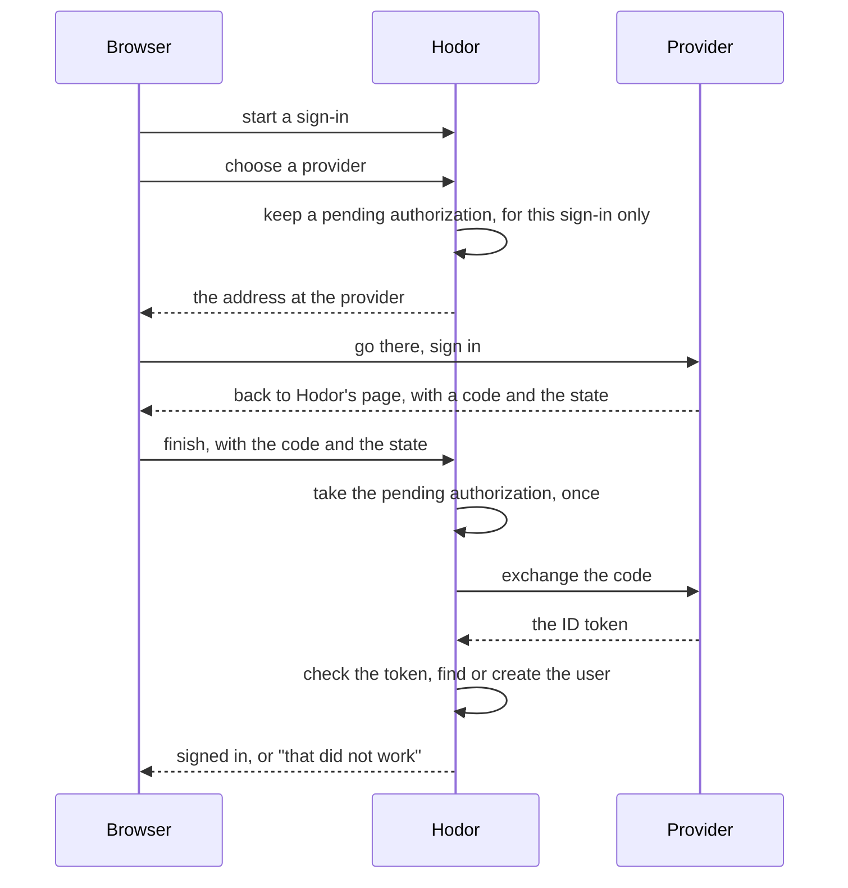

# The federation context

The federation context lets a person sign in to a tenant with an identity they already have somewhere else. It knows two things: the **identity providers** a tenant trusts, and which **external identity** belongs to which user.

It is built in steps ([Milestone 2](../../product/epics.md#milestone-2-signing-in-with-external-identities)). This page describes what exists and is extended with every issue; the last section says what does not exist yet.

## Words

| Word | Meaning |
|---|---|
| Identity provider | Something outside Hodor that knows people and can vouch for them: an OpenID Connect provider such as a social login, a directory or a SAML identity provider |
| External identity | One person as one identity provider knows them: the provider and the provider's own, unchanging identifier for the person, its **subject** |
| Link | The record that an external identity belongs to a user of the tenant |

## Identity providers

A tenant has its own identity providers. Nothing about a provider is shared between tenants: two tenants that both use the same social login each configure it, each with their own client registered there.

| Part | Rules |
|---|---|
| Identifier | Generated; never changes |
| Alias | The name of the provider in addresses, such as `google`. 2 to 32 lowercase letters, digits and hyphens, starting with a letter or digit. Unique in the tenant. **Never changes**: it is part of the address registered at the provider, where answers are sent back |
| Kind | `openid_connect`, `github`, `ldap` or `saml`. Never changes |
| Display name | What a person reads on the sign-in page, such as "Google". 1 to 64 characters |
| Issuer | The address that identifies the provider, such as `https://accounts.google.com`. HTTPS, no query and no fragment, at most 512 characters. Plain HTTP is accepted only for a host and port on the installation's list of [development hosts](../../security/outbound-http.md#the-exception-for-development), which is empty anywhere real. Compared exactly, character by character, with what the provider says about itself |
| Client identifier | Who Hodor is to the provider. 1 to 255 characters |
| Client secret | What Hodor proves that with. [Kept encrypted](../../security/secrets-at-rest.md), for the purpose `federation.client_secret`. Written, never read back: no operation, interface or event returns it |
| Scopes | What Hodor asks the provider for. At most 16. For `openid_connect`: always includes `openid`; `openid email profile` unless said otherwise. For `github`: `read:user user:email` unless said otherwise |
| Creates users | Whether a person nobody knows yet is created on their first sign-in through this provider. Yes unless said otherwise |
| Trusts email | Whether every email address this provider gives is taken as vouched for, even when the provider does not say so. No unless said otherwise. See [below](#when-a-provider-does-not-say-whether-it-vouches) |
| Status | Enabled or disabled. A disabled provider is not offered and signs nobody in; its links are kept |

A tenant has at most 20 identity providers.

The issuer, the client identifier and the scopes are not secret, and an administrator reads them back. They are still not shown to people signing in.

### Why the alias never changes

Every provider gets its own address for answers, built from its alias. An answer that arrives at the address of one provider is only ever checked against that provider. If two providers shared an address, an answer made for one could be presented as coming from the other. A changed alias would also silently break the registration at the provider.

### Operations on providers

| Operation | What it does |
|---|---|
| Create | Adds a provider, enabled. The secret is sealed before anything is stored |
| Change | Changes the display name, the issuer, the client identifier, the scopes and whether users are created. Not the alias, not the kind |
| Change the secret | Replaces the client secret |
| Disable, enable | Changes the status |
| Get, find by alias, list | Read providers, without their secrets |

A change is refused if the provider was changed by someone else in the meantime (`federation.provider_modified_concurrently`).

There is no operation that deletes a provider. Deleting one would delete the only record of how its users were let in; disabling it is what stops it.

## Links

A link says that one external identity belongs to one user.

| Part | Rules |
|---|---|
| Provider | The identity provider, by its identifier |
| Subject | The provider's own identifier for the person. 1 to 255 characters, compared exactly: no trimming, no change of case |
| User | The user of this tenant it belongs to |
| Linked at, last used at | When the link was made, and when it last signed the user in |

- **An external identity belongs to at most one user.** The pair of provider and subject is unique in the tenant.
- **A user may have several external identities**, at the same provider or at different ones.
- **A link is found by provider and subject, and by nothing else.** Never by an email address, a name or anything else the provider says about the person. An email address can be given to somebody else at the provider; the subject cannot (Threat-Federation-11).

### Operations on links

| Operation | What it does |
|---|---|
| Find the user | Answers whose a provider's subject is, if anyone's |
| Link | Records that an external identity belongs to a user. Refused if it already belongs to anyone (`federation.identity_already_linked`), the same user included |
| Mark as used | Records that the link just signed its user in |
| List | The external identities of a user |
| Unlink | Removes a link |

The federation context does not check that the user exists: users belong to the identity context, and whoever asks for a link has just read or created the user in the same unit of work.

## Asking an OpenID Connect provider who somebody is

For a provider of the kind `openid_connect`, Hodor is a relying party: it sends the person to the provider and, when they come back, asks the provider who they are. This section is what Hodor does on its side of that exchange. Keeping track of the pending authorization in between, and signing the person in, are described with Issue-40.

Every request to a provider goes through [the guarded outbound client](../../security/outbound-http.md).

### What Hodor learns about the provider

Hodor reads the provider's own description of itself at `{issuer}/.well-known/openid-configuration`.

| Rule | Why |
|---|---|
| The `issuer` in the description must be the configured issuer, character for character | A description served from the right address that names another issuer is a provider claiming to be someone else (Threat-Federation-04) |
| It must name where to send people, where to exchange a code, and where its keys are, each an HTTPS address, or a plain HTTP one at a development host | Nothing is guessed, and nothing is fetched in the clear outside a development stack |
| The description and the keys are kept in memory for an hour | A sign-in must not depend on two extra requests every time |
| When a token names a key Hodor does not have, the keys are fetched again, at most once a minute for one provider | Providers change keys; a flood of tokens naming keys that do not exist must not become a flood of requests |

### Sending the person to the provider

Hodor builds the address with the client identifier, the scopes, the address to come back to, and three values made for this one pending authorization:

| Value | What it is for |
|---|---|
| `state` | Returned by the provider untouched. Lets Hodor recognize the pending authorization it started, and refuse one it did not (Threat-Federation-03) |
| `nonce` | Put by the provider inside the token it issues. Ties the token to this request, so a token issued for another request, or for another client, cannot be used here (Threat-Federation-05) |
| PKCE code verifier | Kept by Hodor; only its SHA-256 hash is sent. The code that comes back can be exchanged only by whoever holds the verifier |

Each is 256 random bits. The method of the PKCE challenge is always `S256`.

### When the person comes back

The provider sends the person back with a code. Hodor exchanges it at the provider's token endpoint, proving who it is with the client secret, and gets an ID token: a statement signed by the provider about who the person is.

The client secret is sent in the `Authorization` header (`client_secret_basic`) unless the provider's description says it only accepts it in the body (`client_secret_post`).

**Everything about the ID token is checked before anything in it is believed:**

| Check | Refused when |
|---|---|
| Shape | It is not three parts of Base64 separated by dots, or is larger than 16 kibibytes |
| Algorithm | The header names anything but `RS256`, `PS256` or `ES256`. In particular `none` and the `HS` family, which would let anyone who knows a public value sign |
| Key | The header names a key the provider does not publish, or the key is not of the kind the algorithm needs, or is marked for something other than signatures. A token that names no key is accepted only if the provider publishes exactly one key that fits |
| Signature | It does not verify under that key. RSA keys shorter than 2048 bits are refused |
| Issuer | `iss` is not the configured issuer, character for character |
| Audience | `aud` does not contain this client. With several audiences, or whenever `azp` is present, `azp` must be this client |
| Time | `exp` has passed, `iat` is in the future, or `nbf` has not come, allowing one minute for clocks that disagree. `exp` and `iat` must be there |
| Nonce | `nonce` is not the one made for this request |
| Subject | `sub` is missing or is not a usable subject |

A token refused by any check signs nobody in, and the reason is recorded for the audit log, never shown to the person: all they learn is that it did not work.

### What Hodor takes from the token

| From the token | Becomes |
|---|---|
| `sub` | The subject of the external identity. The only thing a link is found by |
| `email`, and `email_verified` when it is exactly `true` | An email address, and whether the provider vouches for it. Anything but the JSON value `true` means it does not |
| `name`, `locale` | Suggestions for the profile of a user created on first sign-in |

Nothing else in the token is used. In particular no group, role or permission is ever taken from it (Threat-Federation-07).

### When a provider does not say whether it vouches

Some providers give an email address and never say whether they checked it. Microsoft Entra ID is one: its tokens carry no `email_verified`. By the rule above nobody could be created through such a provider.

**Trusts email** is the administrator's own statement that every address this provider gives belongs to the person. It is right for a provider whose addresses the organization itself hands out and takes away: its own Entra ID tenant, its own directory. It is wrong for any provider where a person can type in an address of their choice, and for a provider shared by many organizations.

It changes one thing: an address from this provider counts as vouched for when a person nobody knows is created. It never lets an external identity into an account that already exists; that rule has no exception.

## Signing in through GitHub

GitHub is not an OpenID Connect provider: it issues no ID token. A provider of the kind `github` asks GitHub's own interface who the person is, with an access token that is used for that and then forgotten.

| Step | What Hodor does |
|---|---|
| Sending the person | To `{issuer}/login/oauth/authorize`, with the client identifier, the address to come back to, the scopes and the `state` |
| Exchanging the code | At `{issuer}/login/oauth/access_token`, with the client secret. GitHub answers `200` even when it refuses; the answer's `error` is what says so |
| Asking who it is | `GET /user`: the numeric `id` is the subject, and never the login name, which a person can change and another can take afterwards (Threat-Federation-11) |
| Asking for the address | `GET /user/emails`: the address marked both primary and verified, or none |

The issuer is `https://github.com` unless another is given, for an installation of GitHub Enterprise Server. The interface is at `https://api.github.com` for the first and at `{issuer}/api/v3` for any other.

There is no nonce and no ID token to check: what stands in their place is that the answer comes from GitHub's interface over TLS, asked with a token GitHub issued for this code a moment ago. The state, the pending authorization and every rule about who the person is are the same as for OpenID Connect.

## Signing in through a directory

A provider of the kind `ldap` is a directory: the organization's own list of people, reached over LDAP. Nobody leaves for anywhere. The person types what the directory knows them by and their password there, on Hodor's page, and Hodor asks the directory.

A directory uses the parts of a provider this way, and adds its own:

| Part | For a directory |
|---|---|
| Issuer | The directory's address: `ldaps://host` or `ldaps://host:port`. Nothing after the host. Plain `ldap://` only at a [development host](../../security/outbound-http.md#the-exception-for-development) |
| Client identifier | The name Hodor itself binds with to search: a distinguished name such as `cn=hodor,ou=services,dc=example,dc=com` |
| Client secret | The password of that name. Sealed for the purpose `federation.client_secret`, like every other |
| Scopes | None |
| Base | Where people are searched for, such as `ou=people,dc=example,dc=com` |
| Filter | How a person is found, with `{identifier}` where what they typed goes: `(uid={identifier})`, or `(sAMAccountName={identifier})` for Active Directory. It must contain `{identifier}` exactly once and be a filter in parentheses |
| Subject attribute | The attribute that never changes for a person: `entryUUID` unless said otherwise; `objectGUID` for Active Directory. A value that is not text is written in hexadecimal |
| Email attribute, name attribute | `mail` and `cn` unless said otherwise |

### Which directories may be used

Directories live on private networks, so the rule that keeps [outbound HTTP](../../security/outbound-http.md) to public addresses cannot apply to them. Without another rule, an administrator of any tenant could make the server open connections to any host and port of the network it runs in.

The rule is a list kept by whoever operates the installation: `HODOR_DIRECTORY_HOSTS`, hosts with their ports, such as `ldap.example.com:636`. A directory provider can be added, and is only ever connected to, when its host and port are on the list. The list is empty unless set, and then no directory can be used.

### Asking the directory

1. **An empty password is refused before the directory is asked.** A directory treats a name with an empty password as an anonymous bind and answers that it succeeded. This is the oldest way into systems that use LDAP.
2. **The attempt is counted** against what the person typed and against their address, with the tenant's [lockout policy](authentication.md#protection-against-guessing), before the directory is asked. While a lockout is in force nothing is asked.
3. Hodor binds as itself and searches under the base with the filter. **What the person typed is escaped before it goes into the filter**, so that `*`, parentheses and backslashes are characters to look for and nothing else.
4. **Exactly one entry must be found.** None, or more than one, is a refusal.
5. Hodor binds as that entry with the password the person typed. The directory deciding that the password is right is the proof.
6. The entry's subject attribute is the subject of the external identity. From here on everything is [as for any provider](#who-the-person-is): the link is found by provider and subject, a person nobody knows is created if the provider creates users, and an existing account is never opened because of an email address.

An address from a directory counts as vouched for only if the provider is set to [trust email](#when-a-provider-does-not-say-whether-it-vouches): a directory does not say, and whether its `mail` attribute can be relied on is for the administrator to state.

Every refusal is answered in the same words: no such person, several, a wrong password, an empty one, an account the directory has disabled. The reason is recorded as `federation.sign_in_refused`.

The connection is made for one sign-in and closed. Its time is limited to ten seconds.

## Signing in through a SAML identity provider

> Built in steps. The checks of a response, the provider kind, the routes and the finishing exist. The pages, the administration interface and the command-line tool come with Issue-49.

A provider of the kind `saml` is an organization's SAML identity provider: Microsoft Entra ID, Okta, Active Directory Federation Services, Keycloak, Shibboleth. Hodor is the **service provider**: it sends the person there with a request, and receives a signed answer, a **response**, through the person's browser. How the signature is checked is [Decision 0019](../../decisions/0019-saml-signature-verification.md); what must be refused is the [attack corpus](../../security/saml-attack-corpus.md).

A SAML provider uses the parts of a provider this way, and adds its own:

| Part | For a SAML provider |
|---|---|
| Issuer | The identity provider's entity identifier, as its metadata gives it, such as `https://sts.windows.net/{tenant identifier}/` or `http://www.okta.com/{identifier}`. Any absolute address or `urn:` name, at most 512 characters. It names the provider and is never fetched, so plain `http:` is allowed here. Compared exactly with the `Issuer` of every response |
| Client identifier, client secret, scopes | None: the client identifier is empty, the secret is an empty one sealed |
| Single sign-on address | Where the person is sent with the request: the identity provider's `SingleSignOnService` for the HTTP-Redirect binding. HTTPS; plain HTTP only at a [development host](../../security/outbound-http.md#the-exception-for-development) |
| Certificate | The identity provider's signing certificate, in PEM, from its metadata. Its key is the only key a response is checked with. An RSA key of 2048 bits at least, or an elliptic curve key on P-256. The certificate's dates and issuer are not checked: it is a way of writing down a key, as SAML uses it |
| Email attribute, name attribute | The names of the attributes that carry the person's address and name. `email` and `name` unless said otherwise; the [recipes](#recipes) give the names each identity provider uses |

Hodor, for each SAML provider, has:

| What | Value |
|---|---|
| Entity identifier, which is also the address of the metadata | `{public address}/t/{slug}/interaction/sign-in/providers/{alias}/saml/metadata` |
| Assertion consumer address, where responses are received | `{public address}/t/{slug}/interaction/sign-in/providers/{alias}/saml`, HTTP-POST binding |

Both are built from the alias, which never changes, so that a response made for one provider is never checked against another (Threat-Federation-04). The metadata is what an administrator gives the identity provider.

### Sending the person

When the person chooses a SAML provider, Hodor keeps a [pending authorization](#the-pending-authorization) as for any provider: the hash of a random state, and in place of the nonce the identifier of the request. There is no PKCE verifier. The address returned is the single sign-on address with:

- `SAMLRequest`: an `AuthnRequest` with that identifier, Hodor's entity identifier as its `Issuer`, the assertion consumer address and the HTTP-POST binding, compressed and encoded as the HTTP-Redirect binding says. It is not signed: nothing in it needs protecting, and identity providers do not require it;
- `RelayState`: the state. An opaque random value, never an address (Threat-SAML-08).

### When the response arrives

The identity provider makes the person's browser post the response to the assertion consumer address, from the identity provider's site. The cookie that ties a sign-in to its browser is not sent on such a request, so this is not where the sign-in is finished:

1. The assertion consumer address accepts `SAMLResponse` and `RelayState`, form-encoded, a body of at most 768 kibibytes holding a response of at most 384. It is the one route of the interaction interface that accepts a request started by another site.
2. It makes a **receipt**: a new random value of 256 bits.
3. It finds the pending authorization of that provider whose state hashes to the `RelayState`, and **checks the response there and then**, against the request that pending authorization holds, as [below](#checking-the-response). It keeps only the **answer**, with the hash of the receipt: who the person is, by subject, address and name, or the reason the response was refused. The response itself is never stored. A second response for the same pending authorization is not checked and changes nothing: the first one wins. A response that is not base64, or that arrives for no pending authorization, is not checked at all.
4. Whatever it found, it answers `303 See Other` to `/t/{slug}/account/providers/{alias}/callback?binding=saml&state={RelayState}&receipt={receipt}`. It says nothing else: an unknown state and a known one look the same. A relay state that is not a plain token of at most 80 characters is not written into the address, and nothing is kept for it.

The page at that address finishes as it does for OpenID Connect, from Hodor's own origin with the cookie, presenting the state and the receipt: the pending authorization is taken once, and only then is its answer used, to sign the person in or to record why not. Checking on arrival lets nobody in by itself: only the browser that finishes does, and two things must hold, each of which stops one attack:

- **The response answers the request of this browser's sign-in.** A response obtained by someone else, posted with a victim's relay state, answers a request the victim's sign-in never made: it is checked against the victim's request, refused, and the victim's sign-in can only be refused too (Threat-Federation-03).
- **The browser that finishes is the one that carried the response.** Whoever starts a sign-in knows its relay state, and the address at the identity provider is a real address on the identity provider's own site. Without the receipt, an attacker could start a sign-in, send that address to a victim already signed in at the identity provider, and finish their own sign-in with the response the victim's browser posted: they would be signed in as the victim. The receipt goes only to the browser that posted the response, in the address it is sent to; the attacker never sees it, and a sign-in finished without it is refused.

Why check on arrival rather than when finishing: what a pending authorization holds is then a few hundred bytes whatever was posted, and only a response the identity provider signed for that very request leads to anything. Keeping the response itself until the sign-in finished let anyone who started a sign-in make Hodor store up to 384 kibibytes of anything for as long as the sign-in lasted.

### Checking the response

The checks are made by the crate `hodor-saml` when the response arrives, in this order. Each failed check is a refusal with its own reason, kept as the answer and recorded as `federation.sign_in_refused` when the sign-in is finished; the person is told only that it did not work. What is read before step 11 is only ever used to refuse, never to let anyone in.

| Order | Check | Reason |
|---|---|---|
| 1 | The response is valid base64 of UTF-8 text, at most 256 kibibytes | `size`, `malformed` |
| 2 | It is XML that both parsers of `xml-sec` read the same way, with no document type declaration, at most 64 elements deep, at most 4,096 nodes and at most 32 namespace prefixes in scope at once. Real responses have about a hundred nodes; without the last limit, the work of parsing grows with elements times prefixes and a response within the size costs seconds. Everything after this reads that one parsed tree | `malformed`, `document_type`, `depth`, `size` |
| 3 | No processing instruction and no comment anywhere | `processing_instruction`, `comment` |
| 4 | The root is a `Response` in the SAML protocol namespace, version 2.0; nothing in it is encrypted; its status is `Success`. The status is read before the signature is checked, only ever to refuse | `structure`, `encrypted`, `status` |
| 5 | **Exactly one `Assertion` in the whole document**, and it is a child of the response. None at all is `structure` | `wrapping`, `structure` |
| 6 | **Exactly one `Signature` in the whole document**, a child of the assertion or of the response, holding only `SignedInfo`, `SignatureValue` and `KeyInfo` | `unsigned`, `wrapping` |
| 7 | The element signed carries an `ID` that is a plain name (a letter or an underscore, then letters, digits, underscores, hyphens and periods), so that it means the same to Hodor and to `xml-sec`, which decodes percent escapes in a reference. No other element carries that value as an identifier, whatever the spelling or the namespace of the attribute | `reference`, `duplicate_identifier` |
| 8 | The signature has exactly one reference, and its `URI` is `#` and that `ID` | `reference` |
| 9 | Its transforms are the enveloped signature and exclusive canonicalization, the second optional, and nothing else; canonicalization is exclusive, without comments | `transform` |
| 10 | Its digest is SHA-256; its algorithm is `rsa-sha256`, `rsa-pss-sha256` with SHA-256 throughout, or `ecdsa-sha256`, and matches the certificate's key | `algorithm` |
| 11 | `xml-sec` verifies the signature with the certificate's key, and never with a key the response carries. The evidence it returns must say that the element of step 7 is covered by the reference, which names that element alone by step 7 and 8, and, when the response is what was signed, that the assertion is inside what it covers | `signature`, `digest` |
| 12 | The assertion holds, in the SAML assertion namespace, one `Issuer`, one `Subject` with one `NameID`, one `Conditions` and an `AuthnStatement`, and besides them only attribute statements and the signature | `structure` |
| 13 | The response's `Destination` is the assertion consumer address; its `InResponseTo` is the request's identifier. A response without `InResponseTo`, which nobody asked for, is refused (Threat-SAML-09) | `destination`, `request`, `unsolicited` |
| 14 | The `Issuer` of the assertion, and of the response when it has one, is the provider's | `issuer` |
| 15 | A `SubjectConfirmation` with the bearer method, whose data names the assertion consumer address as `Recipient`, the request as `InResponseTo`, and a `NotOnOrAfter` that has not passed | `confirmation`, `recipient`, `request`, `time` |
| 16 | `NotBefore` and `NotOnOrAfter` of the conditions respected when present, and an `AudienceRestriction` naming Hodor's entity identifier; every audience restriction present must name it | `time`, `audience` |
| 17 | The `NameID` has a value, in a format other than `transient` | `subject` |

Times are compared with one minute of tolerance for clocks that differ.

Everything Hodor uses afterwards is read from the assertion found in step 5, which is the element the signature was checked on or is inside it: the `NameID`, the attributes, the session index. Text is read as the parser read it, once.

### What Hodor takes from the response

| From | Becomes |
|---|---|
| `NameID` | The subject of the external identity. An identity provider should be set to send a persistent identifier: an email address changes, a `transient` one changes every time |
| The email attribute | The address, taken as vouched for only if the provider is set to [trust email](#when-a-provider-does-not-say-whether-it-vouches): SAML has no way of saying |
| The name attribute | The name |

From there everything is [as for any provider](#who-the-person-is).

A request is answered once: the pending authorization that holds its identifier is taken before the response is read. The same response presented again, in the same browser or another, finds no request to answer (Threat-SAML-03).

## Recipes

What to enter for the providers people ask for first. None of these is checked against the real provider in continuous integration; each was built from the provider's documentation.

| Provider | Kind | Issuer | Notes |
|---|---|---|---|
| Google | `openid_connect` | `https://accounts.google.com` | Says whether it vouches for an address |
| Microsoft Entra ID, one organization | `openid_connect` | `https://login.microsoftonline.com/{tenant identifier}/v2.0` | Use the organization's own tenant identifier, never `common` or `organizations`: with those any Microsoft account of any organization would be let in (Threat-Federation-06), and Hodor refuses them because the provider's description names another issuer. Does not say whether it vouches; set **trusts email** if the organization hands out the addresses |
| GitHub | `github` | leave empty | |
| Keycloak, one realm | `openid_connect` | `https://{host}/realms/{realm}` | |
| OpenLDAP | `ldap` | `ldaps://{host}` | Filter `(uid={identifier})`, subject attribute `entryUUID` |
| Active Directory | `ldap` | `ldaps://{host}` | Filter `(sAMAccountName={identifier})`, subject attribute `objectGUID` |
| Microsoft Entra ID, SAML | `saml` | `https://sts.windows.net/{tenant identifier}/` | Email attribute `http://schemas.xmlsoap.org/ws/2005/05/identity/claims/emailaddress`, name attribute `http://schemas.microsoft.com/identity/claims/displayname`. Set the name identifier to a persistent one, not the address |
| Okta, SAML | `saml` | `http://www.okta.com/{identifier}`, as Okta shows it | Add attribute statements named `email` and `name`. Okta signs both the response and the assertion unless told otherwise; set the response to unsigned, since Hodor accepts exactly one signature |
| Active Directory Federation Services | `saml` | `http://{host}/adfs/services/trust` | Email attribute `http://schemas.xmlsoap.org/ws/2005/05/identity/claims/emailaddress`, name attribute `http://schemas.xmlsoap.org/ws/2005/05/identity/claims/name` |
| Keycloak, SAML | `saml` | `https://{host}/realms/{realm}` | Turn on signed assertions; add mappers for `email` and `name` |
| Shibboleth | `saml` | The identity provider's entity identifier | Email attribute `urn:oid:0.9.2342.19200300.100.1.3`, name attribute `urn:oid:2.16.840.1.113730.3.1.241` |

In each, the address to register at the provider is the provider's callback address, which the administration interface and the command-line tool show. For a SAML provider it is Hodor's metadata address instead, which carries the assertion consumer address.

## Signing in through a provider

Signing in through a provider is an [alternative](authentication.md#alternatives) of the tenant's sign-in flow, named `external`: one step that establishes who is signing in and proves it. It ends in the same Hodor session as a password does.

### The pending authorization

When a person chooses a provider, Hodor keeps one **pending authorization** for their sign-in: what it needs to recognize the answer when the person comes back.

| Part | Rules |
|---|---|
| The sign-in it belongs to | A pending authorization belongs to one sign-in in progress, which belongs to one browser. Choosing a provider again replaces the pending authorization |
| The provider | The answer is only ever checked against the provider the pending authorization was made for |
| The state | Only its SHA-256 hash is kept |
| The nonce and the PKCE verifier | The verifier is [kept encrypted](../../security/secrets-at-rest.md), for the purpose `federation.code_verifier` |
| The address to come back to | `{public address}/t/{slug}/account/providers/{alias}/callback`: a page of Hodor, one per provider. This is the address to register at the provider |
| Expiry | Ten minutes, like the sign-in |

**A pending authorization is used once.** Finishing takes the pending authorization away before anything is checked, so whatever the outcome, the same answer from a provider cannot be presented twice.

**One that is never finished is removed once it has expired.** A person who leaves for a provider and never comes back leaves a pending authorization behind. `hodor-worker` removes expired pending authorizations every minute, as [a cleanup job](../multi-tenancy.md#cross-tenant-operations): its connection as a member of `hodor_platform` only finds the tenants that have some, and each tenant's are then removed inside that tenant, as the application role, a batch at a time. An expired pending authorization can no longer be finished anyway, so removing it changes nothing a person can see.

The person comes back to a page, not to an interface: the cookie that ties a sign-in to its browser is not sent when another site sends the browser to Hodor, so the page that opens is what presents the code, from Hodor's own origin.

### Finishing

Finishing is refused, in the same words as a wrong password, when:

- there is no pending authorization for this sign-in, or it has expired;
- the state is not the one of the pending authorization. This is what stops an answer obtained by someone else from being finished in a victim's browser (Threat-Federation-03);
- the provider named is not the pending authorization's, or is disabled;
- the provider refuses the code, or the ID token fails [a check](#when-the-person-comes-back);
- the person cannot be let in, by the rules below.

A refusal counts against the sign-in like a rejected step, and leaves the sign-in waiting for the step it was waiting for. The person is told nothing of the reason. It is recorded as the event `federation.sign_in_refused`, which reaches the audit log, so that an administrator can see why somebody could not get in.

### Who the person is

The link is looked up by the provider and the token's subject, and by nothing else.

| Situation | What happens |
|---|---|
| The external identity is linked to a user who may sign in | That user is signed in |
| It is linked to a user who may not sign in: suspended, deactivated, pending | Refused |
| It is not linked, and the provider does not create users | Refused |
| It is not linked, the provider creates users, and the provider vouches for an email address that no user of the tenant has (or gives one and the provider is set to trust email) | A user is created with that address, already verified, and the name and language the provider gave; the external identity is linked to it. Both in one unit of work: a user without its link, or a link without its user, is never stored |
| It is not linked, and the provider gives no email address or does not vouch for it | Refused. A user needs a login identifier, and an address nobody vouches for is not one |
| It is not linked, and a user of the tenant already has the email address | **Refused. The external identity is never let into an existing account because of an email address** (Threat-Federation-01). The existing account stays exactly as it was |

The last row is the rule that matters most. An email address at a provider proves control of a mailbox at best, at some time, according to that provider. Letting it into an account that already exists would make every provider a tenant adds a way into every account of the tenant. Connecting an external identity to an existing account needs proof of both, which comes with the account console.

It has a cost that is accepted for now: a person who registered with a password and later tries a social login with the same address is refused, and is told only that it did not work.

### What is recorded

A sign-in through a provider is recorded in the session with the method `external`, and counts as one factor: Hodor does not know how the provider convinced itself. The audit log holds `authentication.succeeded` with that method, and for a first sign-in `identity.user_created` and `federation.identity_linked`.

## Events

| Event | When | Carries |
|---|---|---|
| `federation.provider_created` | A provider was added | Its identifier, alias and kind |
| `federation.provider_changed` | Its settings were changed | Its identifier and alias |
| `federation.provider_secret_changed` | Its secret was replaced | Its identifier and alias |
| `federation.provider_disabled`, `federation.provider_enabled` | Its status changed | Its identifier and alias |
| `federation.identity_linked` | A link was made | The provider, the user. Not the subject |
| `federation.identity_unlinked` | A link was removed | The provider, the user |
| `federation.sign_in_refused` | A sign-in through a provider was refused | The provider, the reason as a fixed name such as `state_mismatch` or `email_belongs_to_a_user`, and what the check of the provider's answer said when that is the reason |

No event carries a secret. No event carries a subject either: it identifies a person at another organization, and events are kept for a long time and read by many.

## Errors

| Code | Kind | When |
|---|---|---|
| `federation.alias_invalid`, `federation.display_name_invalid`, `federation.issuer_invalid`, `federation.client_id_invalid`, `federation.client_secret_invalid`, `federation.scopes_invalid`, `federation.subject_invalid` | Invalid | A value breaks its rule above |
| `federation.alias_taken` | Conflict | The tenant already has a provider with this alias |
| `federation.too_many_providers` | Conflict | The tenant already has 20 |
| `federation.provider_not_found` | Not found | No provider has this identifier or alias in this tenant |
| `federation.provider_modified_concurrently` | Conflict | Someone else changed the provider first |
| `federation.identity_already_linked` | Conflict | The external identity already belongs to a user |
| `federation.link_not_found` | Not found | There is no such link |
| `federation.provider_unavailable` | Unavailable | The provider did not answer, or answered something that cannot be used: no description, a description for another issuer, no keys |
| `federation.directory_invalid` | Invalid | A directory's base, filter or attribute name breaks its rule |
| `federation.saml_invalid` | Invalid | A SAML provider's single sign-on address, certificate or attribute name breaks its rule; the certificate's reason, such as `key_too_short`, is in the detail |
| `federation.directory_not_allowed` | Forbidden | The directory's host and port are not on the installation's list |
| `federation.identity_not_verified` | Unauthenticated | The provider's answer does not establish who the person is: the code was refused, or the ID token failed a check |

## Ports

| Port | What it is for |
|---|---|
| `ProviderStore` | Stores identity providers |
| `LinkStore` | Stores links |
| `PendingAuthorizationStore` | Stores the pending authorization of a sign-in in progress |
| `SecretBox`, from the kernel | Seals and opens client secrets and PKCE verifiers |
| `HttpClient`, from the kernel | Every request to a provider |
| `SignatureVerifier`, from the kernel | Checks the signature of an ID token. Hodor implements no cryptography of its own |
| `DirectoryClient` | Searches a directory and binds to it. Implemented by `hodor-adapters-ldap` |
| `LockoutPolicy` | The tenant's rules for counting attempts, which belong to the tenant context |

The checks of a SAML response are not behind a port: they are computation on text, with no input or output, in the crate `hodor-saml`, the only crate allowed to depend on an XML library.

Each store has an implementation in memory, behind the crate's `testing` feature, and one on PostgreSQL. Both pass the same contract suite, which includes the tenant isolation cases.

## Storage

All tables are under [forced row-level security](../multi-tenancy.md#isolation-by-layer).

### `federation.identity_provider`

| Column | Type | Notes |
|---|---|---|
| `tenant_id`, `id` | `uuid` | Primary key |
| `alias` | `text` | Unique with `tenant_id` |
| `kind` | `text` | `openid_connect`, `github`, `ldap` or `saml` |
| `display_name`, `issuer`, `client_id` | `text` | The client identifier is empty for `saml` |
| `client_secret` | `bytea` | The sealed secret |
| `scopes` | `text[]` | |
| `creates_users` | `boolean` | |
| `status` | `text` | `enabled` or `disabled` |
| `created_at`, `updated_at` | `timestamptz` | |
| `version` | `integer` | For optimistic locking |
| `directory_base`, `directory_filter`, `directory_subject_attribute`, `directory_email_attribute`, `directory_name_attribute` | `text` | All present for `ldap`, all absent otherwise |
| `saml_single_sign_on_address`, `saml_certificate`, `saml_email_attribute`, `saml_name_attribute` | `text` | All present for `saml`, all absent otherwise. The certificate in PEM |

### `federation.external_identity`

| Column | Type | Notes |
|---|---|---|
| `tenant_id`, `provider_id`, `subject` | `uuid`, `uuid`, `text` | Primary key. The provider is a foreign key within the tenant |
| `user_id` | `uuid` | A user of the identity context; deliberately not a foreign key, since contexts do not reference each other's tables |
| `linked_at`, `last_used_at` | `timestamptz` | |

### `federation.pending_authorization`

| Column | Type | Notes |
|---|---|---|
| `tenant_id`, `transaction_id` | `uuid` | Primary key: one pending authorization per sign-in in progress. The sign-in belongs to the authentication context; deliberately not a foreign key |
| `provider_id` | `uuid` | Foreign key within the tenant |
| `state_hash` | `bytea` | SHA-256 of the state |
| `nonce`, `redirect_uri` | `text` | For SAML the nonce holds the identifier of the request |
| `code_verifier` | `bytea` | The sealed PKCE verifier. For SAML, which has none, an empty secret sealed |
| `expires_at` | `timestamptz` | |
| `saml_subject`, `saml_email`, `saml_name` | `text` | The answer of a SAML response that passed every check: who the person is. Set once |
| `saml_refusal` | `text` | Or the reason the response was refused, such as `signature`. Set once, in place of the three above |
| `saml_receipt_hash` | `bytea` | SHA-256 of the receipt given to the browser that posted the response. Set with the answer |

## Not built yet

| Item | Planned in |
|---|---|
| Apple. Its client secret is a token Hodor must sign with a private key, and its answer arrives as a form posted by another site. Both wait for keys that Hodor holds and signs with | With the key domain, Phase 2 |
| Microsoft accounts of any organization (`common`, `organizations`), which need the issuer checked against a list of allowed tenants | When asked for |
| Directories on the pages and in the administration interface | Issue-45 |
| A directory's own certificate authority. The connection trusts what the operating system trusts | When a directory with a private authority is to be used |
| Reusing connections to a directory between sign-ins | When the volume calls for it |
| Synchronizing people and groups from a directory | Phase 6 |
| SAML on the pages, in the administration interface and the command-line tool, in the demonstration | Issue-49 |
| Signed requests, encrypted assertions, single logout, responses nobody asked for, several certificates for one provider during a change of keys | When an identity provider that needs them is to be supported |
| Signature algorithms beyond `RS256`, `PS256` and `ES256`; encrypted ID tokens; the UserInfo endpoint | When a provider that needs them is to be supported |
| A cache of provider descriptions and keys shared between server instances. Each instance keeps its own | With Redis, when instances are many |
| What happens to the sessions of a provider's users when it is disabled (Threat-Federation-10). Today disabling stops new sign-ins only | With the consoles |
| Mapping what a provider says about a person to the user's profile, groups or roles | Issue-40 for the profile; groups and roles are not in Milestone 2 |
| Linking and unlinking by the person themself, routing by email domain | The account console |
| Letting a person who already has an account connect an external identity to it, with proof of both | The account console |
| Bringing the name and the language up to date on later sign-ins | With claim mapping |
| Protection against a local account made in advance with someone else's address (Threat-Federation-02). Such an account keeps the person's external identity out; it is not taken over | With linking, in the account console |
