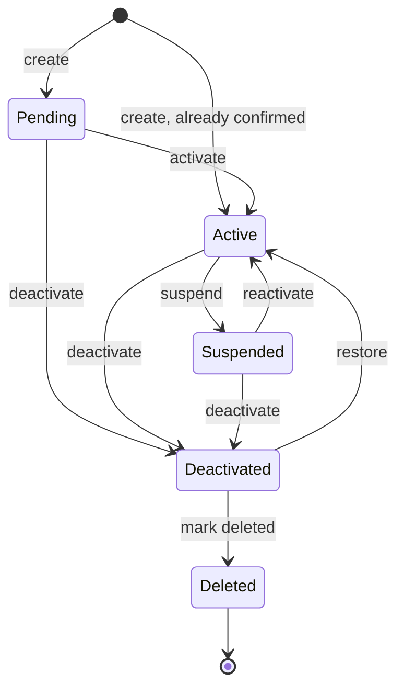

# The identity context

The `identity` context owns users: who exists inside a tenant, how they are found, and whether they may act. It does not know how a user proves who they are; that belongs to the `credential` and `authentication` contexts.

This page specifies the part built in Milestone 1: users and their login identifiers. Groups, organizations, memberships, invitations and linked external identities belong to this context too and are specified here when their turn comes.

## What a user is

| Field | Meaning |
|---|---|
| Identifier | A `UserId`, assigned at creation and never changed. It does not depend on the username, the email address or anything else that can change |
| Kind | `human`, `service_account` or `agent`. Workloads and artificial intelligence agents are users in their own right and never share a person's credentials |
| Status | Where the user is in their life; see [lifecycle](#lifecycle) |
| Display name | Optional, up to 200 characters |
| Locale | Optional language tag such as `en` or `pt-BR`, used for messages sent to the user |
| Login identifiers | The names the user can be found by; see [login identifiers](#login-identifiers) |

A user belongs to exactly one tenant. The same person in two tenants is two users.

## Lifecycle

| Status | May sign in | Meaning |
|---|---|---|
| Pending | No | Created, but not confirmed yet: for example, registered and waiting for email verification |
| Active | Yes | Normal |
| Suspended | No | Blocked by an administrator or a security rule; carries a reason |
| Deactivated | No | Closed, by the user or an administrator; can be restored |
| Deleted | No | Personal data has been erased; only the identifier remains so that references stay valid |

Rules:

- Every transition not drawn above is rejected.
- Suspending requires a reason.
- A user is created Pending unless the creator states that the user is already confirmed, as an administrator does when creating an account by hand.
- Marking a user Deleted removes their login identifiers and clears the display name and locale. This is the erasure step of a data subject's deletion request.
- Each successful change produces one event (see [events](#events)).

## Login identifiers

A login identifier is a name a user can be found by when signing in. A user can have several. Each has a kind, a value, and a record of whether the user proved control of it.

| Kind | Example | Needs verification |
|---|---|---|
| Username | `ana.silva` | No |
| Email | `ana@example.com` | Yes: the user proves control by following a link sent to the address |

Phone numbers are a third kind, added with the passwordless methods in Phase 4.

### Normalization

Two spellings of the same identifier must not become two accounts. Every identifier is therefore stored twice: as the user typed it, for display, and in a normalized form, for comparison and uniqueness.

**Username**

- 3 to 64 characters.
- Letters `a` to `z` in either case, digits, and the characters `.`, `_` and `-`.
- Starts with a letter or a digit.
- Never contains `@`, so a username can never be mistaken for an email address.
- Normalized by converting to lowercase.

**Email**

- Leading and trailing spaces are removed.
- Exactly one `@`, with something on both sides.
- The part before the `@` has 1 to 64 characters; the whole address has at most 254.
- The part after the `@` is a host name: labels of letters, digits and hyphens separated by dots, at least two labels, no label starting or ending with a hyphen.
- Only ASCII characters are accepted. An address with a non-ASCII host name must be given in its ASCII form.
- Normalized by converting the whole address to lowercase.
- Nothing else is changed. Dots and `+tags` in the part before the `@` are kept, because only some providers ignore them and guessing wrong would merge two different people.

Normalization is idempotent: normalizing an already normalized value changes nothing.

### Rules

- A normalized identifier of a given kind is unique within the tenant. Two tenants can each have a user with the same email address.
- A user has at most 10 identifiers.
- A user has at most one primary identifier of each kind. The first identifier of a kind becomes primary; another can be chosen later, and for an email address it must be verified first.
- A verified identifier stays verified. Verifying it again changes nothing and produces no event.
- An identifier can be removed, except the last one of a user who is not Deactivated or Deleted: such a user would have no way to sign in.
- Removing the primary identifier of a kind makes the oldest remaining identifier of that kind primary.

### Finding a user at sign-in

What a person types in a login form is matched like this: if it contains `@` it is treated as an email address, otherwise as a username. It is normalized by the rules above and looked up within the tenant. A value that is not a well-formed identifier of its kind matches nobody; it is not an error, so that a login form cannot be used to learn the rules of valid identifiers.

## Events

Events carry identifiers of users and of login identifiers, and the kind of a login identifier, but never its value. An email address is personal data and stays in the identity tables; the audit trail refers to it by identifier.

| Event type | When |
|---|---|
| `identity.user_created` | A user is created; carries the kind and the initial status |
| `identity.user_activated` | Pending to Active |
| `identity.user_suspended` | Suspended; carries the reason |
| `identity.user_reactivated` | Suspended to Active |
| `identity.user_deactivated` | Deactivated |
| `identity.user_restored` | Deactivated to Active |
| `identity.user_deleted` | Marked Deleted and erased |
| `identity.identifier_added` | A login identifier is added |
| `identity.identifier_verified` | A login identifier is verified for the first time |
| `identity.identifier_removed` | A login identifier is removed |
| `identity.primary_identifier_changed` | Another identifier of a kind becomes primary |
| `identity.profile_changed` | Display name or locale changed |

## Operations

| Use case | What it does |
|---|---|
| Create user | Creates a user with at least one login identifier, Pending or already Active |
| List users | Returns the tenant's users in the order they were created, a page at a time |
| Get user | Returns a user of the current tenant by identifier |
| Find user by login | Returns the user that a typed login identifier belongs to, if any |
| Activate, suspend, reactivate, deactivate, restore, mark deleted | Apply the transition |
| Add, verify, remove a login identifier; choose the primary | Apply the change |
| Change profile | Replace the display name and locale |

Every use case that changes a user loads it, applies the change, stores it and records its events in one unit of work. A change that produces no event, such as verifying an identifier that is already verified, changed nothing and stores nothing.

### Port

| Port | Purpose |
|---|---|
| `UserRepository` | Store and load users with their login identifiers, with optimistic locking on the user's version; find a user by a normalized login identifier |

Every method works inside the tenant of the unit of work it is given.

## Storage

### `identity.user`

| Column | Type | Notes |
|---|---|---|
| `tenant_id`, `id` | `uuid` | Primary key |
| `kind` | `text` | `human`, `service_account`, `agent` |
| `status` | `text` | `pending`, `active`, `suspended`, `deactivated`, `deleted` |
| `status_reason` | `text` | Why the user was last suspended |
| `display_name`, `locale` | `text` | Optional |
| `created_at`, `updated_at` | `timestamptz` | |
| `version` | `integer` | Incremented on every update; a stale update is rejected |

### `identity.user_identifier`

| Column | Type | Notes |
|---|---|---|
| `tenant_id`, `id` | `uuid` | Primary key |
| `user_id` | `uuid` | References the user, within the tenant |
| `kind` | `text` | `username`, `email` |
| `value_normalized` | `text` | Unique per tenant and kind |
| `value_display` | `text` | As the user typed it |
| `verified_at` | `timestamptz` | Null until verified |
| `is_primary` | `boolean` | At most one per user and kind |
| `created_at` | `timestamptz` | |

Both tables are tenant tables under row-level security. Uniqueness of login identifiers is enforced by the database, so two concurrent registrations of the same address cannot both succeed.

## Not built yet

| Item | Planned in |
|---|---|
| Custom attributes and the standard profile claims of OpenID Connect | Later in Phase 1 |
| Groups, organizations, memberships, invitations | Later in Phase 1 |
| Phone numbers as login identifiers | Phase 4 |
| Linked external identities | Phase 3 |
| Non-ASCII email addresses | Not scheduled |
| Purging the remaining row of a Deleted user | With the tenant purge job |
