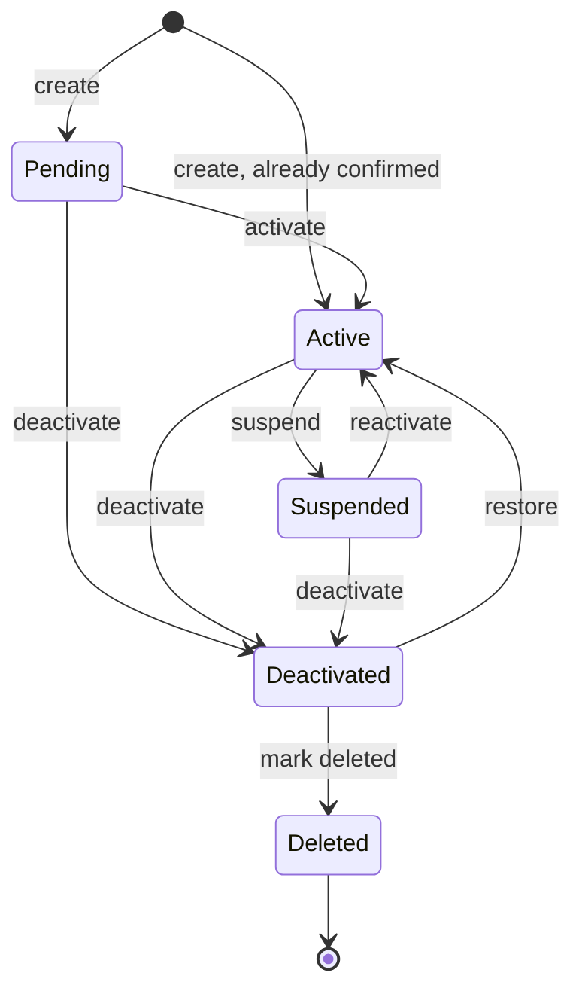
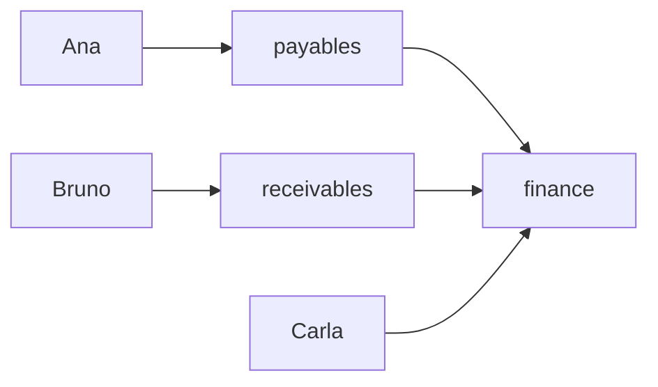
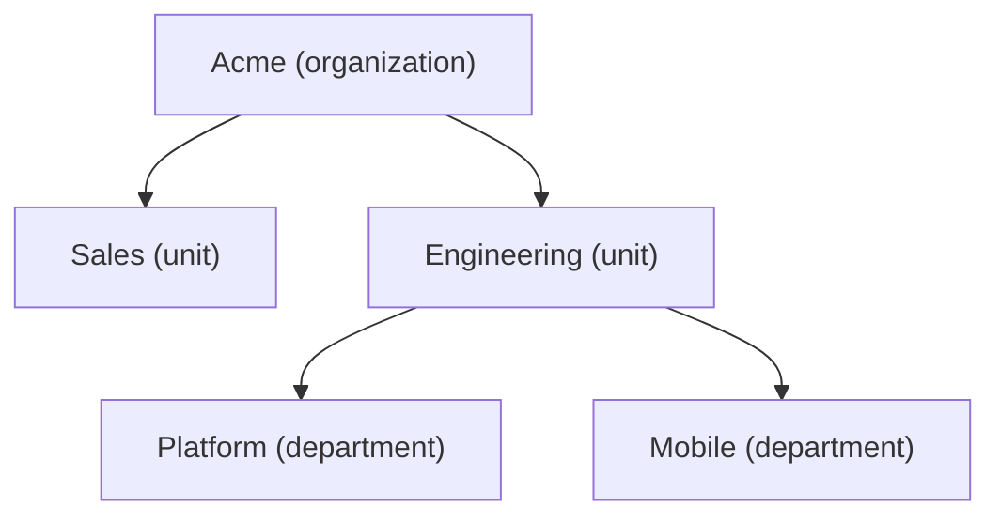

# The identity context

The `identity` context owns users: who exists inside a tenant, how they are found, and whether they may act. It does not know how a user proves who they are; that belongs to the `credential` and `authentication` contexts.

This page specifies users and their login identifiers, built in Milestone 1, and groups and organizations, built in Milestone 7. Invitations and linked external identities belong to this context too and are specified here when their turn comes.

## What a user is

| Field | Meaning |
|---|---|
| Identifier | A `UserId`, assigned at creation and never changed. It does not depend on the username, the email address or anything else that can change |
| Kind | `human`, `service_account` or `agent`. Workloads and artificial intelligence agents are users in their own right and never share a person's credentials |
| Status | Where the user is in their life; see [lifecycle](#lifecycle) |
| Display name | Optional, up to 200 characters |
| Locale | Optional language tag such as `en` or `pt-BR`, used for messages sent to the user |
| Login identifiers | The names the user can be found by; see [login identifiers](#login-identifiers) |

A user belongs to exactly one tenant. The same person in two tenants is two users.

## Lifecycle

| Status | May sign in | Meaning |
|---|---|---|
| Pending | No | Created, but not confirmed yet: for example, registered and waiting for email verification |
| Active | Yes | Normal |
| Suspended | No | Blocked by an administrator or a security rule; carries a reason |
| Deactivated | No | Closed, by the user or an administrator; can be restored |
| Deleted | No | Personal data has been erased; only the identifier remains so that references stay valid |

Rules:

- Every transition not drawn above is rejected.
- Suspending requires a reason.
- A user is created Pending unless the creator states that the user is already confirmed, as an administrator does when creating an account by hand.
- Marking a user Deleted removes their login identifiers and clears the display name and locale. This is the erasure step of a data subject's deletion request.
- Each successful change produces one event (see [events](#events)).
- Marking a user Deleted also takes them out of every group.

## Login identifiers

A login identifier is a name a user can be found by when signing in. A user can have several. Each has a kind, a value, and a record of whether the user proved control of it.

| Kind | Example | Needs verification |
|---|---|---|
| Username | `ana.silva` | No |
| Email | `ana@example.com` | Yes: the user proves control by following a link sent to the address |

Phone numbers are a third kind, added with the passwordless methods in Phase 4.

### Normalization

Two spellings of the same identifier must not become two accounts. Every identifier is therefore stored twice: as the user typed it, for display, and in a normalized form, for comparison and uniqueness.

**Username**

- 3 to 64 characters.
- Letters `a` to `z` in either case, digits, and the characters `.`, `_` and `-`.
- Starts with a letter or a digit.
- Never contains `@`, so a username can never be mistaken for an email address.
- Normalized by converting to lowercase.

**Email**

- Leading and trailing spaces are removed.
- Exactly one `@`, with something on both sides.
- The part before the `@` has 1 to 64 characters; the whole address has at most 254.
- The part after the `@` is a host name: labels of letters, digits and hyphens separated by dots, at least two labels, no label starting or ending with a hyphen.
- Only ASCII characters are accepted. An address with a non-ASCII host name must be given in its ASCII form.
- Normalized by converting the whole address to lowercase.
- Nothing else is changed. Dots and `+tags` in the part before the `@` are kept, because only some providers ignore them and guessing wrong would merge two different people.

Normalization is idempotent: normalizing an already normalized value changes nothing.

### Rules

- A normalized identifier of a given kind is unique within the tenant. Two tenants can each have a user with the same email address.
- A user has at most 10 identifiers.
- A user has at most one primary identifier of each kind. The first identifier of a kind becomes primary; another can be chosen later, and for an email address it must be verified first.
- A verified identifier stays verified. Verifying it again changes nothing and produces no event.
- An identifier can be removed, except the last one of a user who is not Deactivated or Deleted: such a user would have no way to sign in.
- Removing the primary identifier of a kind makes the oldest remaining identifier of that kind primary.

### Finding a user at sign-in

What a person types in a login form is matched like this: if it contains `@` it is treated as an email address, otherwise as a username. It is normalized by the rules above and looked up within the tenant. A value that is not a well-formed identifier of its kind matches nobody; it is not an error, so that a login form cannot be used to learn the rules of valid identifiers.

## Groups

A **group** gathers users of a tenant under one name, such as `finance` or `on-call`, so that something can be given to all of them at once: a role, a claim in a token, an entry of an access list. Groups belong to the tenant, not to an organization ([Decision 0005](../../decisions/0005-tenant-and-organization.md)).

| Field | Meaning |
|---|---|
| Identifier | A `GroupId`, assigned at creation and never changed |
| Name | 1 to 100 characters, with no control characters and no space at either end. Unique in the tenant without regard to case: `Finance` and `finance` cannot both exist |
| Description | Optional, up to 500 characters |
| Members | Users, and other groups |

### Groups inside groups

A group can be a member of another group. Its members are then members of the other group too, through it.

Here Ana, Bruno and Carla are all in `finance`: Carla directly, Ana through `payables` and Bruno through `receivables`. The groups a user is in, directly or through other groups, are the user's **effective groups**.

Two rules keep this from going wrong:

- **No cycles.** A group can never be inside itself, however many groups lie between. Adding `finance` to `payables` above is refused, because `payables` is already inside `finance`. The refusal is `identity.group_cycle`.
- **Bounded nesting.** The **depth** of a group is the longest chain of groups inside it, counting itself: a group with no group inside it has depth 1, and `finance` above has depth 2. A tenant's [group policy](tenant.md#group-policy) bounds the depth of every group, 5 by default. Adding a group to another is refused when any group would then be deeper than the bound, with `identity.group_nesting_too_deep`.

Both rules are checked against every group of the tenant at once, under a lock the tenant's changes to nesting take one after the other. Two requests that would make a cycle only together, adding `finance` to `payables` and `payables` to `finance` at the same moment, cannot both succeed.

Effective groups are worked out when they are asked for, from the memberships that are stored. Nothing is kept beside them, so a removed member is out of every group above at once, in the same transaction.

### What changes groups

| Rule | Why |
|---|---|
| A user is a direct member of a group once | Adding again changes nothing and records nothing |
| Only users and groups of the same tenant can be members | Tenants are kept apart |
| A user of any status can be a member, except a Deleted one | A suspended person is still in the groups they were in, and is back in them when reactivated; what a membership grants is the business of whoever reads it, and a suspended user cannot sign in anyway |
| Deleting a group takes it out of every group it was in, and takes every member out of it | Nothing refers to a group that does not exist |
| Renaming a group keeps its identifier | Whatever was given to the group stays given |

## Organizations

An **organization** is a business customer inside a tenant: a company that uses the tenant's applications, with its own people and its own structure. A software vendor runs one tenant and gives each customer an organization, while an operator hosting unrelated customers gives each a tenant of its own ([Decision 0005](../../decisions/0005-tenant-and-organization.md)).

| Field | Meaning |
|---|---|
| Identifier | An `OrganizationId`, assigned at creation and never changed. Tokens name the organization by it |
| Name | 1 to 100 characters, with no control characters and no space at either end. Unique in the tenant without regard to case |
| Description | Optional, up to 500 characters |
| Units | A tree of the organization's parts |
| Members | Users of the tenant |

A person can be a member of several organizations of their tenant, and of none. Belonging to an organization does not let anyone sign in, and does not by itself let them do anything: roles scoped to an organization and the organization a token carries do that ([Issue-89](../../product/epics.md#slice-w--groups-and-organizations-epic-2)).

### Units

An organization is divided into **units**, which can be divided again: a company into divisions, a division into departments.

| Field | Meaning |
|---|---|
| Identifier | A `UnitId`, assigned at creation and never changed |
| Parent | The unit it is part of, or none for a unit at the top of the organization |
| Name | As a group's name. Unique among the units that share a parent, without regard to case |
| Kind | `unit` or `department`. A department is a unit like any other; the kind only says what the organization calls it |

Rules of the tree:

- **A unit belongs to one organization**, and its parent is a unit of the same organization.
- **No unit is part of itself.** Moving a unit under one of the units inside it is refused with `identity.unit_cycle`.
- **At most ten levels.** A unit at the top is at level 1; a unit whose level would exceed 10, or that would carry units below it past level 10, is refused with `identity.unit_tree_too_deep`.
- **A unit with units below it cannot be deleted**: they are moved or deleted first, so that nothing is deleted by surprise. The refusal is `identity.unit_not_empty`.
- **Changes to an organization's tree take one lock per organization**, so that two moves cannot make a cycle together.

### Members of an organization

A **membership** puts a user in an organization, and optionally in some of its units.

| Rule | Why |
|---|---|
| A user is a member of an organization once | Adding again changes nothing |
| The units of a membership belong to the same organization | A person cannot be in a department of a company they are not in |
| A member can be in several units, or in none | A person who works in two departments is in both |
| Deleting a unit takes every member out of it, but not out of the organization | The person still works for the company |
| Deleting an organization deletes its units and its memberships | Nothing refers to an organization that does not exist |
| A user of any status can be a member, except a Deleted one; marking a user Deleted ends every membership | As for groups |

### Invitations

An **invitation** asks a person, by their email address, to join an organization. It is how an organization gains members who choose to come, rather than being put there by an administrator.

| Field | Meaning |
|---|---|
| Identifier | Assigned at creation |
| Organization | The organization the person is asked to join |
| Address | The normalized email address the invitation was sent to |
| Units | The units of the organization the person will be in |
| Token | The SHA-256 of the secret the link carries, never the secret |
| Status | `pending`, then `accepted` or `withdrawn` |
| Expires | Seven days after it was made |
| Accepted by | The user who accepted it, once accepted |

Rules:

- **One pending invitation per organization and address.** Inviting the same address again withdraws the earlier invitation, so only the newest link works. Invitations of different organizations to one address do not touch each other.
- **An invitation is accepted once.** Of any number of requests that present its token at the same moment, one succeeds.
- **Accepting makes the membership in the same transaction**, with the units the invitation names. A unit deleted since the invitation was made is left out.
- **An invitation is good while it is pending and unexpired.** A withdrawn, accepted or expired one is refused in one way, whichever it is.
- **Deleting the organization deletes its invitations.**

Making the secret, sending the message and the two ways of accepting are the authentication context's: [invitations to an organization](authentication.md#invitations-to-an-organization).

## Events

Events carry identifiers of users and of login identifiers, and the kind of a login identifier, but never its value. An email address is personal data and stays in the identity tables; the audit trail refers to it by identifier.

| Event type | When |
|---|---|
| `identity.user_created` | A user is created; carries the kind and the initial status |
| `identity.user_activated` | Pending to Active |
| `identity.user_suspended` | Suspended; carries the reason |
| `identity.user_reactivated` | Suspended to Active |
| `identity.user_deactivated` | Deactivated |
| `identity.user_restored` | Deactivated to Active |
| `identity.user_deleted` | Marked Deleted and erased |
| `identity.identifier_added` | A login identifier is added |
| `identity.identifier_verified` | A login identifier is verified for the first time |
| `identity.identifier_removed` | A login identifier is removed |
| `identity.primary_identifier_changed` | Another identifier of a kind becomes primary |
| `identity.profile_changed` | Display name or locale changed |
| `identity.group_created` | A group is created |
| `identity.group_changed` | A group's name or description changed |
| `identity.group_deleted` | A group is deleted; carries how many members it had |
| `identity.group_member_added` | A user or a group is added to a group; carries the kind of member and its identifier |
| `identity.group_member_removed` | A user or a group is taken out of a group, by hand or by marking the user Deleted; carries the kind of member and its identifier. Deleting a group records only `identity.group_deleted` |

| `identity.organization_created` | An organization is created |
| `identity.organization_changed` | Its name or description changed |
| `identity.organization_deleted` | It is deleted, with its units and memberships; carries how many members it had |
| `identity.unit_created` | A unit is created; carries its organization, parent and kind |
| `identity.unit_changed` | Its name, kind or parent changed |
| `identity.unit_deleted` | It is deleted; carries its organization |
| `identity.organization_member_added` | A user becomes a member of an organization |
| `identity.organization_member_changed` | The units of a membership changed; carries the units |
| `identity.organization_member_removed` | A user stops being a member, by hand or by being marked Deleted |
| `identity.invitation_created` | An invitation is made; carries the organization. Never the address |
| `identity.invitation_withdrawn` | An invitation is withdrawn, by hand or by a newer one to the same address |
| `identity.invitation_accepted` | An invitation is accepted; carries the organization and the user |

A group's name and description are not personal data, but they can say a great deal about people: they stay in the identity tables, and events carry the group's identifier only. The same holds for organizations and units.

## Operations

| Use case | What it does |
|---|---|
| Create user | Creates a user with at least one login identifier, Pending or already Active |
| List users | Returns the tenant's users in the order they were created, a page at a time |
| Get user | Returns a user of the current tenant by identifier |
| Find user by login | Returns the user that a typed login identifier belongs to, if any |
| Activate, suspend, reactivate, deactivate, restore, mark deleted | Apply the transition |
| Add, verify, remove a login identifier; choose the primary | Apply the change |
| Change profile | Replace the display name and locale |
| Create group | Creates a group with a name and a description |
| Get group, list groups | A group of the tenant, or a page of them in the order they were created |
| Change group | Replaces the name and the description |
| Delete group | Deletes the group and every membership it is part of |
| Add member, remove member | Adds a user or a group to a group, or takes it out; adding a group checks [the two rules](#groups-inside-groups) |
| List members | The direct members of a group, a page at a time, users and groups apart |
| Effective groups of a user | Every group the user is in, directly or through other groups |
| Create, get, list, change, delete organization | As for groups |
| Create, change, move, delete unit | Moving checks [the rules of the tree](#units) |
| List units | Every unit of an organization, each with its parent |
| Add member, change units, remove member | A user joins an organization, with units or none; the units can be replaced; the user leaves |
| List members of an organization | A page at a time, each with their units |
| Organizations of a user | Every organization the user is a member of, with their units |
| Invite, withdraw an invitation, list pending invitations | Used by the authentication context, which sends the link |
| Find an invitation by the hash of its token; accept it | Accepting uses it up and makes the membership in the caller's unit of work |

Every use case that changes a user loads it, applies the change, stores it and records its events in one unit of work. A change that produces no event, such as verifying an identifier that is already verified, changed nothing and stores nothing.

### Port

| Port | Purpose |
|---|---|
| `UserRepository` | Store and load users with their login identifiers, with optimistic locking on the user's version; find a user by a normalized login identifier |
| `GroupRepository` | Store, load, change and delete groups with optimistic locking on the group's version; add and remove members; list members; take the tenant's lock on nesting; read every link from a group to a group inside it, and the groups a user is directly in |
| `GroupPolicy` | The tenant's bound on the depth of groups, read in the unit of work of the change |
| `InvitationRepository` | Store invitations, withdraw the pending one of an organization and address, find one by the hash of its token, use one up at most once, list an organization's pending invitations |
| `OrganizationRepository` | Store, load, change and delete organizations with optimistic locking; store, change and delete units; take an organization's lock on its tree; add, change and remove memberships; list units, members and a user's organizations |

Every method works inside the tenant of the unit of work it is given.

## Storage

### `identity.user`

| Column | Type | Notes |
|---|---|---|
| `tenant_id`, `id` | `uuid` | Primary key |
| `kind` | `text` | `human`, `service_account`, `agent` |
| `status` | `text` | `pending`, `active`, `suspended`, `deactivated`, `deleted` |
| `status_reason` | `text` | Why the user was last suspended |
| `display_name`, `locale` | `text` | Optional |
| `created_at`, `updated_at` | `timestamptz` | |
| `version` | `integer` | Incremented on every update; a stale update is rejected |

### `identity.user_identifier`

| Column | Type | Notes |
|---|---|---|
| `tenant_id`, `id` | `uuid` | Primary key |
| `user_id` | `uuid` | References the user, within the tenant |
| `kind` | `text` | `username`, `email` |
| `value_normalized` | `text` | Unique per tenant and kind |
| `value_display` | `text` | As the user typed it |
| `verified_at` | `timestamptz` | Null until verified |
| `is_primary` | `boolean` | At most one per user and kind |
| `created_at` | `timestamptz` | |

Both tables are tenant tables under row-level security. Uniqueness of login identifiers is enforced by the database, so two concurrent registrations of the same address cannot both succeed.

### `identity.group`

| Column | Type | Notes |
|---|---|---|
| `tenant_id`, `id` | `uuid` | Primary key |
| `name` | `text` | As written |
| `name_normalized` | `text` | The name in lower case. Unique per tenant |
| `description` | `text` | Optional |
| `created_at`, `updated_at` | `timestamptz` | |
| `version` | `integer` | Incremented on every update; a stale update is rejected |

### `identity.group_member`

| Column | Type | Notes |
|---|---|---|
| `tenant_id`, `group_id` | `uuid` | The group the member is in; removed with it |
| `user_id` | `uuid` | The member, when it is a user; removed with the user's row |
| `member_group_id` | `uuid` | The member, when it is a group; removed with that group |
| `member_id` | `uuid` | Whichever of the two is set, made by the database. With the tenant and the group, the primary key |
| `added_at` | `timestamptz` | |

Exactly one of `user_id` and `member_group_id` is set, and a member is in a group once: a user and a group never share an identifier. A group is never its own member, which the database checks too. Both are tenant tables under row-level security, and the lock on nesting is a PostgreSQL advisory lock of the transaction, taken on a key made from the tenant.

### `identity.organization`

As `identity.group`: `tenant_id`, `id`, `name`, `name_normalized` unique per tenant, `description`, `created_at`, `updated_at`, `version`.

### `identity.organization_unit`

| Column | Type | Notes |
|---|---|---|
| `tenant_id`, `id` | `uuid` | Primary key |
| `organization_id` | `uuid` | The organization; removed with it |
| `parent_id` | `uuid` | The parent unit of the same organization, or null at the top. A unit with units below cannot be removed |
| `name`, `name_normalized` | `text` | `name_normalized` unique per organization and parent |
| `kind` | `text` | `unit` or `department` |
| `created_at`, `updated_at` | `timestamptz` | |

### `identity.organization_member` and `identity.organization_member_unit`

`identity.organization_member` holds one row per user and organization, with `added_at`, removed with either. `identity.organization_member_unit` holds one row per membership and unit, removed with the membership or the unit; the database checks that the unit is of the membership's organization. All are tenant tables under row-level security, and the lock on a tree is a PostgreSQL advisory lock of the transaction, on a key made from the organization.

### `identity.organization_invitation`

| Column | Type | Notes |
|---|---|---|
| `tenant_id`, `id` | `uuid` | Primary key |
| `organization_id` | `uuid` | Removed with the organization |
| `email` | `text` | The normalized address |
| `unit_ids` | `uuid[]` | The units the person will be in |
| `token_hash` | `bytea` | SHA-256 of the secret; unique within the tenant |
| `status` | `text` | `pending`, `accepted` or `withdrawn`; at most one `pending` per organization and address |
| `created_at`, `expires_at` | `timestamptz` | |
| `accepted_by`, `accepted_at`, `withdrawn_at` | | Set when it happens |

## Not built yet

| Item | Planned in |
|---|---|
| Custom attributes and the standard profile claims of OpenID Connect | Later in Phase 1 |
| Managing organizations through the administration interface, the command-line tool and the console | Milestone 7, Issue-88 |
| Managing groups through the administration interface, the command-line tool and the console | Milestone 7, Issue-88 |
| Roles given to groups, and groups in tokens | Milestone 7, Issue-89 |
| Phone numbers as login identifiers | Phase 4 |
| Linked external identities | Phase 3 |
| Non-ASCII email addresses | Not scheduled |
| Purging the remaining row of a Deleted user | With the tenant purge job |
