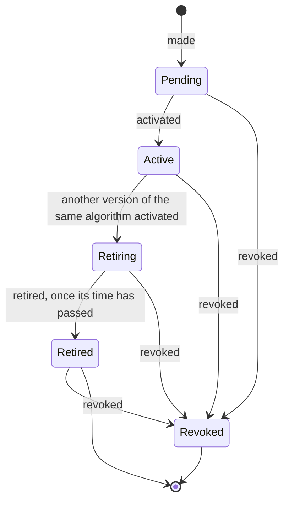

# The keys context

The `keys` context owns the keys a tenant's tokens are signed with and, later, the keys its secrets are encrypted under, and the keys of others a tenant trusts: the bundles of its [trust domains](#trust-domains). It answers two questions for the rest of the system: which key signs now, and which keys may a signature be checked against?

It holds no cryptography of its own. Keys are made, kept and used by a **key provider**, a port that `hodor-adapters-crypto` implements on `aws-lc-rs` ([Decision 0008](../../decisions/0008-cryptography.md)). This context decides which key is used when, and keeps what the provider hands back.

This page specifies what Issues 50, 51 and 52 build. Issue-50: key sets, key versions and their states, the key provider port, the local provider and the storage. Issue-51: rotation on a schedule, the published key set, and managing keys with the command-line tool and the administration interface. Issue-52: [secrets sealed under data keys](#secrets-under-data-keys), which moves the secrets of Milestone 2 under managed keys. Issue-105: [trust domains](#trust-domains) and their bundles, which [Decision 0042](../../decisions/0042-trust-domains.md) puts in this context.

## Key sets and key versions

A tenant has one **key set** per use. A key set holds **key versions**: one key each, made once and never changed.

| Use | Name | What its keys do | Algorithms offered |
|---|---|---|---|
| Signing | `sig` | Sign the tokens Hodor issues | ES256 (the default), RS256 and PS256 for interoperability |
| Encryption | `enc` | Decrypt what others encrypt for Hodor | None yet: offered when Hodor accepts encrypted requests or encrypts tokens |
| Data | `data` | Encrypt the tenant's secrets at rest | AES-256-GCM |

The key set is not stored as a row of its own: it is the versions of one tenant and one use. A key set with no version exists all the same, and has nothing to sign with.

### What a key version is

| Field | Meaning |
|---|---|
| Identifier | A `KeyVersionId`. Published as the key identifier, `kid`, of a signing key. Safe to show: it grants nothing |
| Use and algorithm | Fixed when the version is made. The algorithm decides the use |
| State | See the lifecycle below |
| Public key | For a signing key: its numbers, which anyone may know |
| Key material | What the provider handed back: the private key or the data key, sealed by the provider. This context never reads it and has no way to |
| Provider | Which provider made it, `local` for now |
| Times | When it was made, activated, set to retire, retired and revoked |
| Retire after | For a retiring version: the moment after which it may be retired |
| Revocation reason | Why it was revoked, if it was |

## Lifecycle

| State | Signs or encrypts | Checks or decrypts | How it is reached |
|---|---|---|---|
| Pending | No | No | Made, not yet in use. It is published before it signs, so that those who check signatures know it in advance |
| Active | Yes | Yes | Activated |
| Retiring | No | Yes | Replaced by a newer version of the same algorithm; stays until everything it signed has expired |
| Retired | No | No | Retired after its time |
| Revoked | No | No | Revoked: no longer trusted, whatever its state was |

Rules:

- **One active version per algorithm in a key set.** Activating a pending version sets the version it replaces to Retiring, in the same change. Nothing else makes a version active, so there is never a moment with two.
- **Only a pending version can be activated.** A version that was active once never becomes active again; a new version is made instead.
- **A retiring version stays until its time has passed.** Activation gives the replaced version a moment to retire after: the activation time plus an overlap the caller chooses, which for a signing key is the lifetime of the longest-lived token it may have signed. Retiring it earlier is refused.
- **Revoking is final.** Any version that is not revoked can be revoked, with a reason; revoking a revoked version changes nothing. Revoking the active version leaves the algorithm without an active version until another is activated: signing with it is refused, never done with a key that is no longer trusted.
- **A version's key never changes.** Rotation is making a new version and activating it, not changing a key in place.
- The algorithm decides the use. A signing algorithm cannot be put in the data key set, nor the reverse.

## Operations

| Use case | What it does |
|---|---|
| Make a version | Asks the provider for a new key of an algorithm, and stores it as a pending version |
| Activate | Makes a pending version the active one of its algorithm; the one it replaces starts retiring |
| Activate as the first | Activates a pending version only if its algorithm has no active version, and is refused otherwise; how the first data key is made |
| Retire | Retires a retiring version whose time has passed |
| Revoke | Revokes a version, with a reason |
| Read a key set | Returns the versions of one use, newest first |
| Rotate what is due | Runs one step of [rotation](#rotation) in a tenant: retires, makes and activates the versions whose time has come |
| Rotate now | Activates a new signing version of an algorithm at once, for an operator who will not wait for the schedule |
| Published keys | The signing versions that [the published key set](#the-published-key-set) holds |
| Sign | Signs a message with the active version of an algorithm, and answers the signature with the version's identifier. Refused when the algorithm has no active version |

Rotation, the published key set and the commands below call these, and nothing else changes a version.

### Events

| Event type | When |
|---|---|
| `keys.version_created` | A version was made; carries its use and algorithm |
| `keys.version_activated` | A version became active; carries the version it replaced, if any, and when that one may retire |
| `keys.version_retired` | A retiring version was retired |
| `keys.version_revoked` | A version was revoked; carries the reason |

Events carry identifiers, uses, algorithms and times. They never carry key material, and the public key stays in the version's row.

### Ports

| Port | Purpose |
|---|---|
| `KeyStore` | Store and load key versions; load the key set of one use |
| `KeyProvider` | Make a key; sign with a signing key; encrypt and decrypt with a data key. Asynchronous, because a provider of a key management service answers over the network |
| `Clock` | The times of the lifecycle |

## Rotation

A signing key is replaced on a schedule, so that a key that leaked without anyone knowing stops being trusted after a while, and so that replacing a key is something Hodor does every few months rather than for the first time during an incident.

### The rotation policy

One policy for the whole installation, read from the configuration of the worker, the server and the command-line tool. It is not a tenant setting: how often keys change, and how long a replaced key stays, protect those who check signatures, not the tenant's own choices.

| Setting | Variable | Default | Bounds |
|---|---|---|---|
| Period: how long a version is active before it is replaced | `HODOR_KEY_ROTATION_DAYS` | 90 days | 1 to 730 days |
| Publication: how long a new version is published before it signs | `HODOR_KEY_PUBLICATION_HOURS` | 24 hours | At least the 5 minutes the published key set may be kept by those who read it, and less than the period |
| Overlap: how long a replaced version stays published after it stopped signing | `HODOR_KEY_OVERLAP_HOURS` | 24 hours | At least the lifetime of the longest-lived token a key signs, one hour, plus five minutes for clocks that disagree |

**Why the overlap is enough.** The tokens Hodor signs are access tokens and ID tokens, and the `oauth` context caps both at one hour (`TokenPolicy`; refresh tokens are not signed). A version that stops signing at the moment its successor is activated has signed nothing that lives past that moment plus one hour, so a version retired after the overlap checks every token it signed. The policy refuses an overlap shorter than `RotationPolicy::LONGEST_SIGNED_LIFETIME` plus `RotationPolicy::CLOCK_ALLOWANCE`, so the rule cannot be configured away. Signing a token is Issue-56, which ties the two: it refuses to sign a token that lives longer than that constant, so a longer token lifetime would have to raise the constant, and with it the shortest overlap, first.

### One step of rotation

The worker runs a step for every tenant that has something due. A step looks at the tenant's signing key set and, in this order:

1. **Retires** every retiring version whose time to retire has passed.
2. **Makes sure the default algorithm signs.** When ES256 has no active version, a tenant's first key or one whose active key was revoked, a pending ES256 version is activated at once, or made and activated at once when there is none. Waiting for the publication time would leave the tenant signing nothing.
3. **Prepares the next version.** For each algorithm with an active version older than the period less the publication time, a pending version is made, unless one is pending already. It is published from that moment.
4. **Activates it when its time comes.** When the active version is older than the period and the pending one has been published for the publication time, the pending one is activated; the one it replaces starts retiring with the overlap.

Each change is its own transaction with its own event, as with every other use of the operations above. An algorithm other than the default rotates only while it has an active version.

**A first key is also made when something must sign and finds none.** The worker passes every ten minutes unless told otherwise (`HODOR_KEY_ROTATION_INTERVAL_MS`), so a tenant made a moment ago, or one whose active key was just revoked, may have nothing to sign with until it does. `KeyService::ensure_active` returns the active version of an algorithm, or makes one and activates it at once, as step 2 does for ES256. The `oauth` context calls it whenever it signs a token and the tenant has no active key of the algorithm: for ES256, which signs every access token, and for RS256, the first time a client whose ID tokens are signed with it asks for one. The OpenID Provider says it supports RS256, as OpenID Connect Discovery requires, and a tenant must not fail the first token a client asks for. A revoked key is never used again: the key made in its place is new. Two requests that make the first version at once both make one; the second to activate gets `keys.activation_conflict`, revokes its own version with the reason `lost the race to become the first key of its algorithm`, and signs with the winner. From then on the algorithm rotates like the default; a tenant stops signing with RS256 when no client asks for it, not by revoking the key.

The decision is made in the domain, by `KeySet::rotation_plan`, from the key set and the time alone; the step only carries it out.

**Rotation never touches the data key set.** It makes, activates and retires signing versions only. A data version must not be retired while secrets sealed with it remain, and only the context that seals them knows when none do; [Secrets under data keys](#secrets-under-data-keys) says how a data version is made; replacing and retiring one is not built yet, so a data version is retired by nothing.

### Two workers, one rotation

Several workers can run at once. A step that two of them took together would activate two new versions one after the other, and the first would be replaced seconds after it was published. A pass of the rotation job therefore holds a PostgreSQL advisory lock for its whole length, taken with `pg_try_advisory_xact_lock` in a transaction of its own: a worker that does not get it skips the pass. The lock is released when that transaction ends, whatever happens to the worker.

A pass finds the tenants that have something due through the platform connection, which sees every tenant's versions, and does each step inside the tenant as the application role, like the outbox and the cleanup jobs ([multi-tenancy](../multi-tenancy.md#cross-tenant-operations)). Only active tenants are rotated.

| Setting | Variable | Default |
|---|---|---|
| Pause between passes | `HODOR_KEY_ROTATION_INTERVAL_MS` | 600 000 (ten minutes) |

A worker started without `HODOR_SECRET_KEYS` cannot make keys: it does not rotate, and says so in its log when it starts.

### Rotating and revoking by hand

An operator can rotate a tenant's signing key at once, with `hodor-cli keys rotate` or `POST /keys/sig:rotate`. A pending version of the algorithm is activated if there is one, and otherwise a new version is made and activated. A version activated this way is not published in advance: those who check signatures see a key identifier they do not know and fetch the key set again, which every library that reads a key set does.

Revoking, with `hodor-cli keys revoke` or `POST /keys/sig/versions/{version_id}:revoke`, takes a reason and removes the version from the published key set at once. Tokens it signed stop being accepted by those who fetch the key set again. To replace a key that is no longer trusted, **rotate first, then revoke the version that was replaced**: revoking the active version first leaves the tenant without a signing key until the next pass of the rotation job makes one.

A manual rotation can meet a step of the job in the same moment. The database still allows one active version per algorithm; the worst outcome is two rotations in a row, and the version replaced by the second still stays for the overlap.

## The published key set

Those who check the signatures of a tenant read its signing keys at `GET /t/{tenant}/oauth2/jwks`, the address the OpenID Provider's Discovery document will name (Issue-59). The answer is a JSON Web Key Set (RFC 7517) with one key for each signing version that is **pending, active or retiring**. Retired and revoked versions are left out; a revoked version leaves the moment it is revoked.

| Member | Value |
|---|---|
| `kid` | The version's identifier |
| `kty` | `EC` for ES256, `RSA` for RS256 and PS256 |
| `use` | `sig` |
| `alg` | The version's algorithm |
| `crv`, `x`, `y` | For ES256: `P-256` and the point, base64url without padding |
| `n`, `e` | For RS256 and PS256: the modulus and the exponent, base64url without padding |

Nothing else of a version is published: not its state, its times, or anything of its key material. Keys are listed newest first.

**The set always names the key of the next token.** Before it answers, the address makes sure the tenant has an active version of every algorithm a token of the tenant may be signed with, ES256 and RS256 today, through `KeyService::ensure_active`. A relying party that reads the set of a tenant made a moment ago, before the worker gave it a key and before any token was signed, finds the key of the first token it then gets; the OpenID conformance suite reads the set once at the start of a test and fails a token whose key it does not find ([OpenID conformance](../../operations/conformance.md)). A revoked version is still left out at once, and the version made in its place is new.

The answer carries `Cache-Control: public, max-age=300`: someone who keeps it at most five minutes sees a new version well within its publication time, and a revoked version disappears for everyone within five minutes. The key set of one tenant names only that tenant's versions, as every read inside a tenant does. When the server has no `HODOR_SECRET_KEYS`, there is no keys context and the address is not served.

## The key provider

A provider makes a key and answers two things: the public key, for a signing key, and the **key material**, bytes that only that provider can turn back into the key. Every later use of the key goes back to the provider with the material: this context asks "sign this with that key", and gets a signature.

The material is opaque to this context. It is printed as its length only, has no way to be read as a key, and is stored as it came.

The provider is told the tenant, the version's identifier and the algorithm every time, and a provider must refuse to use material for any other tenant, version or algorithm than the one it was made for.

### The local provider

`LocalKeyProvider` in `hodor-adapters-crypto` is the provider of this issue: keys are made and used inside the server with `aws-lc-rs`, and kept wrapped under a root key. This is the envelope encryption of Decision 0008.

- **Making a key.** A P-256 key for ES256, an RSA key of 2048 bits for RS256 and PS256, 32 random bytes for AES-256-GCM, all from the library and the operating system's random source.
- **Wrapping it.** The private key, as a PKCS#8 document, or the data key is sealed with the keys of `HODOR_SECRET_KEYS`, the same root keys as [secrets at rest](../../security/secrets-at-rest.md). The purpose it is sealed for names the algorithm and the version, `keys.<algorithm>.<version>`, and the tenant is bound in too: material copied to another version's row, another algorithm or another tenant does not open.
- **Using it.** The material is opened for one operation and the key dropped after it. The private key in the clear lives only in the provider's memory, for the time of one signature.
- **Changing the root key** follows the rules of secrets at rest: the first root key wraps new material, every root key opens.

What the root key protects against is what it protects for secrets at rest: a copy of the database alone yields no private key. Someone holding both the database and the server's configuration holds the keys. Keeping the root key elsewhere is what the providers of key management services in Phase 9 are for.

## Secrets under data keys

The kernel's `SecretBox` port, which every context that keeps a secret uses, is implemented here by `TenantSecretBox`: each secret is sealed under the tenant's active data key, and names the version that sealed it. [Secrets at rest](../../security/secrets-at-rest.md) gives the format, the commands and what the root keys protect against; this section gives the rules this context holds.

- **The first data key is made on demand.** When a tenant seals a secret and has no active `A256GCM` version, a version is made and activated, with no overlap: there is nothing it replaces. The caller is the system. It is activated only as the first: an activation that finds an active version already is refused (`keys.already_active`) rather than replacing it, and two activations at the same moment are told apart by the unique index (`keys.activation_conflict`). Either way the sealing that lost revokes its own version, with the reason `lost the race to become the first data key`, and uses the one that won, so a tenant never ends with a second data version made by a race.
- **Only an active or retiring version opens.** A retiring data key opens what it sealed until everything is sealed again under the active one; then it may retire. A retired or revoked data key opens nothing, so retiring a data key that still seals something makes those secrets unreadable. Nothing in this issue retires a data key.
- **The first format.** Secrets sealed directly by the root keys, as 0.1.0 did, still open through the root keys until the tenant **refuses the first format**, which `hodor-cli secrets reseal` records once the tenant has none left. Refusing is final.

### Ports added

| Port | Purpose |
|---|---|
| `SealingStateStore` | Whether the tenant refuses the first format, and recording that it does |
| `FirstFormatSecrets` | Opens a secret of the first format, and says whether bytes are one. Implemented by `SecretKeys` in `hodor-adapters-crypto` over the root keys |

## Trust domains

A workload in a service mesh, or under SPIRE, is named by a SPIFFE identifier, `spiffe://<trust domain>/<path>`, and proves it with a certificate or a JWT-SVID that its trust domain's authorities signed. A tenant says which trust domains it trusts, and with which authorities, by giving each one a **trust bundle**: the certificates of its authorities for X.509-SVIDs and the public keys that sign its JWT-SVIDs ([Decision 0029](../../decisions/0029-hodor-in-a-service-mesh.md#a-workload-proves-who-it-is-in-one-of-three-ways)). This section specifies what a trust domain is, how its bundle is read and kept current, and who may change it; checking a workload's credential against it is Issue-106 and Issue-107, in [the OAuth context](oauth.md). Why the keys context holds them is [Decision 0042](../../decisions/0042-trust-domains.md).

### What a trust domain is

| Field | Meaning |
|---|---|
| Identifier | A `TrustDomainId` |
| Name | The trust domain's name, as it appears in a SPIFFE identifier: 1 to 255 characters, each a lowercase letter `a` to `z`, a digit, `.`, `-` or `_` (the SPIFFE identifier specification, section 2.1). Never changes |
| Source | Where its bundle comes from: `uploaded`, `bundle_endpoint` or `mesh` (below) |
| Bundle endpoint | For `bundle_endpoint`: the address of its SPIFFE bundle endpoint |
| Bundle | For `uploaded` and `bundle_endpoint`: the bundle in force, with its sequence number and refresh hint if it has them, and when it last changed. `mesh` has none |
| Refresh | For `bundle_endpoint`: when the bundle was last fetched, when it is fetched next, and, while fetching fails, since when and why |
| Created at, updated at | |
| Version | Incremented on every change, for optimistic locking |

**The three sources.**

| Source | The bundle | What trusting it means |
|---|---|---|
| `uploaded` | Given by an administrator, and replaced only by an administrator | The administrator keeps it current, by hand, when the trust domain's authorities change |
| `bundle_endpoint` | Fetched from the trust domain's SPIFFE bundle endpoint (the `https_web` profile of SPIFFE Federation) when the trust domain is saved, and fetched again by the worker | The bundle follows the authorities' rotation without anyone acting |
| `mesh` | None | The mesh in front of Hodor checked the workload's certificate itself. Only the identity a trusted proxy forwards can name such a trust domain (Issue-107); no JWT-SVID or certificate can be checked against it, since it has no bundle |

Rules:

- **A trust domain belongs to one tenant.** Its name is unique within the tenant, `keys.trust_domain_name_taken` otherwise, and two tenants may each have a trust domain of the same name: every Kubernetes cluster's default is `cluster.local`. Every read is inside one tenant, under row-level security, so a trust domain, a bundle and a refresh of one tenant are never read for another, whatever their names.
- **A tenant has at most 50 trust domains** (`keys.too_many_trust_domains`).
- **The name is fixed.** Changing a trust domain replaces its source and its bundle; a trust domain of another name is added, and the old one removed.
- **Saving checks the bundle first.** Adding or replacing an `uploaded` trust domain reads the bundle given; adding or replacing a `bundle_endpoint` one checks the address and fetches the bundle once. If the bundle does not read, or the address may not be called, or the fetch fails, the request is refused with its reason and nothing is stored: a replaced trust domain keeps the source and the bundle it had.
- **Removing a trust domain** removes its bundle. A workload of that trust domain is no longer trusted from the next request.

### Reading a bundle

A bundle is a JSON Web Key Set as the SPIFFE Trust Domain and Bundle specification writes it, with the rules of the X509-SVID and JWT-SVID specifications for their elements. Hodor reads it the same way whether an administrator gave it or an endpoint answered it.

| Part | Rule |
|---|---|
| The document | A JSON object in UTF-8, at most 64 kibibytes. Members other than the three below are not kept |
| `keys` | Required: an array of at most 100 elements. It may be empty: a trust domain with an empty bundle trusts nothing, as the specification says |
| `spiffe_sequence` | Optional: a whole number from 0 to 263 − 1 |
| `spiffe_refresh_hint` | Optional: a whole number of seconds from 1 to 263 − 1. It is bounded when it is used (see [refreshing](#keeping-a-fetched-bundle-current)) |

Each element of `keys` is **ignored** or **kept**, or the whole bundle is **refused**:

- **Ignored**, as the specification requires: an element without `use` or with a `use` other than `x509-svid` and `jwt-svid`, and an element whose key type Hodor does not know. The known types are `EC` on the curves `P-256`, `P-384` and `P-521`, and `RSA`; an `EC` element on another curve, or with none, is of an unknown type. An ignored element is not kept and trusts nothing.
- **Kept**, when it follows every rule of its kind:
  - it is a JSON object with no private part: none of `d`, `p`, `q`, `dp`, `dq`, `qi`, `oth` or `k`;
  - its key is whole: for `EC`, `x` and `y` in base64url of the curve's length (32, 48 or 66 bytes); for `RSA`, a modulus `n` of at least 2048 bits and an exponent `e` that is not empty;
  - its `alg`, when present, fits the key: `ES256`, `ES384` or `ES512` for its curve, or `RS256`, `RS384`, `RS512`, `PS256`, `PS384` or `PS512` for `RSA`;
  - an `x509-svid` element has `x5c` with exactly one certificate, in base64 of its DER encoding, at most 16 kibibytes, that begins as a DER sequence; and it has no `kid`, which the X509-SVID specification forbids;
  - a `jwt-svid` element has a `kid` of 1 to 128 printable ASCII characters, which no other `jwt-svid` element of the bundle has.
- **Refused**, with `keys.trust_bundle_invalid` and the first reason as its detail: a document that is not JSON, not an object, too large, without `keys` or with too many; a sequence or a refresh hint that is not such a number; an element that is not an object; and an element of a known `use` and type that breaks a rule above. A bundle is refused rather than kept in part, so that what an administrator reads back is what the trust domain trusts.

Whether the certificate of an `x509-svid` element is an authority, and whether it holds the key the element names, is checked when certificates are checked against the bundle (Issue-107): a certificate that is not such an authority then fails, and nothing else does.

A bundle is kept as it was read: the sequence, the refresh hint, and the kept elements in their order, each written as compact JSON with its members in order. Two bundles are the same when they are written the same. This is what the administration interface answers, and what the [events](#events-of-trust-domains) name by its SHA-256.

### Fetching a bundle

A bundle endpoint is called through the [guarded outbound client](../../security/outbound-http.md), like a webhook endpoint:

- **The address is checked when the trust domain is saved**, through the kernel's `DestinationCheck`: HTTPS, at most 1000 characters, no name and password, no fragment, and every address its name resolves to must be public. Then it is fetched once, and must answer a bundle that reads. Refusals: `keys.bundle_endpoint_invalid` (not such an address), `keys.bundle_endpoint_forbidden` (an address that may not be called), `keys.bundle_endpoint_unresolvable` (a name that resolves to nothing), `keys.bundle_endpoint_unreachable` (no answer in 10 seconds, a status other than 2xx, or more than 64 kibibytes), and `keys.trust_bundle_invalid`.
- **The address is checked again at every fetch**, by the guarded client, on the resolution it connects with, so that a name that later resolves to a private address is refused without any connection.
- **The request** is a `GET` of the address with `accept: application/json`. The server's certificate is checked against the public authorities the guarded client trusts, as the `https_web` profile asks.
- **Redirects are not followed**, though the `https_web` profile says a client should follow a temporary one: a public address could redirect Hodor to a private one. A redirect is a failed fetch; the administrator names the address it leads to instead.
- **The addresses of the development exception** (`HODOR_OUTBOUND_DEVELOPMENT_HOSTS`) are accepted over plain HTTP, as the guarded client accepts them. Nowhere real has any.

### Keeping a fetched bundle current

The worker fetches every `bundle_endpoint` trust domain's bundle again when its time comes.

- **When.** After a fetch that read, the next is due after the bundle's refresh hint, bounded between 1 minute and 1 day, or after 5 minutes when it has none, as SPIFFE Federation recommends. After a fetch that failed, the next is due after that same interval or 5 minutes, whichever is shorter.
- **A fetched bundle replaces the one in force only if it reads and does not go back.** When the bundle in force has a sequence number, the fetched one must have one too, and either a larger one, or the same one with the same contents. Otherwise it is refused with `keys.trust_bundle_sequence_invalid`: an old bundle replayed by the network or by the endpoint never replaces a newer one. A bundle an administrator gives or fetches when saving is not held to this rule.
- **A bundle that does not read, or a fetch that fails, keeps the bundle in force**, the one before, unchanged. The trust domain records the reason's code and since when fetching fails, until a fetch reads again.
- **A fetched bundle that is the same as the one in force** changes nothing but the time of the fetch, and records no event.

The worker never holds a transaction open while an endpoint answers. Like [webhook deliveries](webhooks.md#leases-and-one-slow-endpoint), a trust domain is fetched under a lease:

1. **Lease.** In the trust domain's tenant, it takes the trust domain if it is a `bundle_endpoint` one, due, and not leased past now, skipping one another worker holds. It is leased until the time limit of a fetch plus one minute, its version incremented, and the transaction commits.
2. **Fetch**, outside any transaction.
3. **Record.** In the tenant again, under a lock of the trust domain, it records what happened only if the trust domain still has the version it was leased at. If an administrator replaced or removed it meanwhile, the result is dropped.

A worker fetches up to 8 bundles at once. One that never answers holds only its own place for 10 seconds.

| Setting of `hodor-worker` | Default | Meaning |
|---|---|---|
| `HODOR_TRUST_BUNDLE_POLL_INTERVAL_MS` | 5000 | The pause when no bundle is due |

| Metric | Meaning |
|---|---|
| `hodor.keys.trust_bundle.fetches` | Fetches, by `outcome`: `changed`, `unchanged`, `failed` or `skipped` (the trust domain changed while it was fetched) |
| `hodor.keys.trust_bundle.passes` | Passes of the loop, by `outcome`: `ok` or `error` |

The worker fetches bundles whether or not it has `HODOR_SECRET_KEYS`: a bundle is public and nothing of it is sealed.

### Use cases of trust domains

`TrustDomainService`:

| Use case | What it does |
|---|---|
| Add | Checks the name, then the bundle or the address and its fetched bundle, and stores the trust domain |
| List and read | A page at a time in the order of their identifiers, and one by its identifier |
| Find by name | The tenant's trust domain of a name; what checking a workload's credential starts from |
| Replace | Gives a trust domain another source, bundle or address, checked as when it is added |
| Remove | Removes it with its bundle |
| Refresh what is due | The worker's loop: lease, fetch, record |

The administration interface offers adding, listing, reading, replacing and removing; see [trust domains](../../api/admin-api.md#trust-domains). They need the permissions `keys:read` and `keys:write`, which the auditor and the administrator hold as for key versions. Managing them from the command-line tool and the console is Issue-109.

### Events of trust domains

These go to the audit log. Every change of a trust domain or of the bundle it trusts is one.

| Event type | When | Fields |
|---|---|---|
| `keys.trust_domain_added` | A trust domain was added | `trust_domain_id`, `name`, `source`, and for a bundle its summary |
| `keys.trust_domain_replaced` | An administrator replaced its source or bundle | `trust_domain_id`, `name`, `source`, and for a bundle its summary |
| `keys.trust_bundle_refreshed` | The worker fetched a bundle that differs from the one in force, and it replaced it | `trust_domain_id`, `name`, the new bundle's summary, and the sequence it replaced |
| `keys.trust_bundle_refresh_failed` | A fetch failed, or its bundle was refused, after the last one had read | `trust_domain_id`, `name`, `reason`, the code of the refusal |
| `keys.trust_domain_removed` | A trust domain was removed | `trust_domain_id`, `name` |

A bundle's summary is `bundle_sha256`, the SHA-256 of the bundle as it is kept, in hexadecimal; `sequence`; and the number of `x509_authorities` and `jwt_authorities` it holds. No event carries the address of a bundle endpoint, which can hold a token in its query, or the keys themselves, which the trust domain's row holds.

### Ports of trust domains

| Port | Purpose |
|---|---|
| `TrustDomainStore` | Store a tenant's trust domains; find one by name; count them under a lock, so that two additions count one after the other; take one for a lease, skipping one another worker holds; lock one while a fetch is recorded |
| `DueRefreshes` | Find the trust domains whose bundle is due to be fetched, across tenants. Not bound to a tenant; only the worker is given it |
| `DestinationCheck` (kernel) | Whether a bundle endpoint could be called now |
| `HttpClient` (kernel) | Fetch a bundle; the guarded client |
| `Digest` (kernel) | The SHA-256 of a bundle, for events |

## Storage

### `keys.key_version`

| Column | Type | Notes |
|---|---|---|
| `tenant_id`, `id` | `uuid` | Primary key |
| `key_use` | `text` | `sig`, `enc` or `data` |
| `algorithm` | `text` | `ES256`, `RS256`, `PS256` or `A256GCM`; checked against the use |
| `state` | `text` | `pending`, `active`, `retiring`, `retired` or `revoked` |
| `provider` | `text` | `local` |
| `key_material` | `bytea` | As the provider handed it back |
| `public_rsa_modulus`, `public_rsa_exponent` | `bytea` | For an RSA signing key |
| `public_p256_x`, `public_p256_y` | `bytea` | For a P-256 signing key, 32 bytes each |
| `created_at`, `activated_at`, `retiring_at`, `retire_after`, `retired_at`, `revoked_at` | `timestamptz` | Null until reached |
| `revocation_reason` | `text` | |

A tenant table under row-level security. The database holds the rules too:

- a partial unique index allows one `active` row per tenant, use and algorithm, so two activations racing each other cannot both succeed;
- checks tie the algorithm to the use, the public key to the algorithm, and each state to the times it needs;
- the application role may not delete a version. A version is revoked, never removed, so that a signature can always be traced to the key that made it.

When an activation replaces a version, the replaced version is written first and the activated one after, so that the unique index holds after every statement.

### `keys.sealing_state`

| Column | Type | Notes |
|---|---|---|
| `tenant_id` | `uuid` | Primary key |
| `first_format_refused_at` | `timestamptz` | When the tenant started refusing secrets of the first format |

A tenant table under row-level security, with at most one row per tenant: no row means the first format still opens. The application role may insert the row and read it, never change or delete it, so refusing cannot be undone through the application.

### `keys.trust_domain`

| Column | Type | Notes |
|---|---|---|
| `tenant_id`, `id` | `uuid` | Primary key |
| `name` | `text` | 1 to 255 of `a`–`z`, `0`–`9`, `.`, `-` and `_`; unique per tenant, and only per tenant |
| `source` | `text` | `uploaded`, `bundle_endpoint` or `mesh` |
| `bundle_endpoint_url` | `text` | 1 to 1000 characters; set exactly for `bundle_endpoint` |
| `bundle` | `text` | The bundle as it is kept, at most 65536 bytes; null exactly for `mesh` |
| `bundle_sequence`, `bundle_refresh_hint_seconds` | `bigint` | The bundle's `spiffe_sequence` and `spiffe_refresh_hint`, if it has them; never negative |
| `bundle_changed_at` | `timestamptz` | When the bundle in force was given or fetched as new; null exactly for `mesh` |
| `fetched_at`, `next_refresh_at` | `timestamptz` | The last fetch that read, and when the next is due; `next_refresh_at` set exactly for `bundle_endpoint` |
| `leased_until` | `timestamptz` | While a worker fetches it; only for `bundle_endpoint` |
| `failing_since`, `last_error` | `timestamptz`, `text` | While fetching fails: since when, and the code of the last reason, at most 100 characters; both or neither |
| `created_at`, `updated_at` | `timestamptz` | |
| `version` | `integer` | |

A tenant table under row-level security. A partial index on `next_refresh_at` of the `bundle_endpoint` rows serves the worker's search across tenants, through its platform connection; each trust domain is then leased and recorded inside its tenant.

## Not built yet

| Item | Planned in |
|---|---|
| Rotating the data key set: a new data version, every secret sealed again under it, and the old version retired once nothing is sealed with it | Not scheduled. Sealing again exists (`hodor-cli secrets reseal`); a data version is retired by nothing yet |
| Signing tokens with these keys | Issue-56 |
| Naming the published key set in Discovery | Issue-59 |
| Algorithms for the encryption key set | When Hodor accepts encrypted requests or encrypts tokens |
| EdDSA | Optional, not scheduled |
| A rotation policy per tenant | When a tenant asks for one |
| Providers of key management services and vaults | Phase 9 |
| Managing trust domains from the command-line tool and the console | Issue-109 |
| Checking JWT-SVIDs and certificates against a trust domain's bundle | Issue-106 and Issue-107 |
| Following a temporary redirect of a bundle endpoint; the `https_spiffe` profile, where the endpoint proves itself with an SVID of its own trust domain | Not scheduled |
| Asking for a bundle to be fetched again at once | Not scheduled: replacing the trust domain with the same address fetches it |
