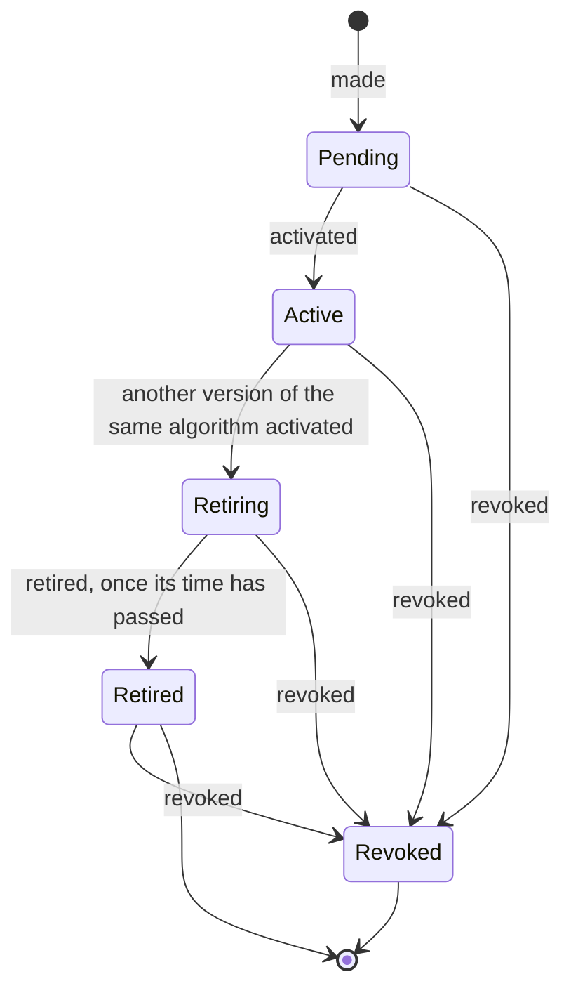

# The keys context

The `keys` context owns the keys a tenant's tokens are signed with and, later, the keys its secrets are encrypted under. It answers two questions for the rest of the system: which key signs now, and which keys may a signature be checked against?

It holds no cryptography of its own. Keys are made, kept and used by a **key provider**, a port that `hodor-adapters-crypto` implements on `aws-lc-rs` ([Decision 0008](../../decisions/0008-cryptography.md)). This context decides which key is used when, and keeps what the provider hands back.

This page specifies what Issues 50 and 51 build. Issue-50: key sets, key versions and their states, the key provider port, the local provider and the storage. Issue-51: rotation on a schedule, the published key set, and managing keys with the command-line tool and the administration interface. Moving the secrets of Milestone 2 under managed keys is Issue-52.

## Key sets and key versions

A tenant has one **key set** per use. A key set holds **key versions**: one key each, made once and never changed.

| Use | Name | What its keys do | Algorithms offered |
|---|---|---|---|
| Signing | `sig` | Sign the tokens Hodor issues | ES256 (the default), RS256 and PS256 for interoperability |
| Encryption | `enc` | Decrypt what others encrypt for Hodor | None yet: offered when Hodor accepts encrypted requests or encrypts tokens |
| Data | `data` | Encrypt the tenant's secrets at rest | AES-256-GCM |

The key set is not stored as a row of its own: it is the versions of one tenant and one use. A key set with no version exists all the same, and has nothing to sign with.

### What a key version is

| Field | Meaning |
|---|---|
| Identifier | A `KeyVersionId`. Published as the key identifier, `kid`, of a signing key. Safe to show: it grants nothing |
| Use and algorithm | Fixed when the version is made. The algorithm decides the use |
| State | See the lifecycle below |
| Public key | For a signing key: its numbers, which anyone may know |
| Key material | What the provider handed back: the private key or the data key, sealed by the provider. This context never reads it and has no way to |
| Provider | Which provider made it, `local` for now |
| Times | When it was made, activated, set to retire, retired and revoked |
| Retire after | For a retiring version: the moment after which it may be retired |
| Revocation reason | Why it was revoked, if it was |

## Lifecycle

| State | Signs or encrypts | Checks or decrypts | How it is reached |
|---|---|---|---|
| Pending | No | No | Made, not yet in use. It is published before it signs, so that those who check signatures know it in advance |
| Active | Yes | Yes | Activated |
| Retiring | No | Yes | Replaced by a newer version of the same algorithm; stays until everything it signed has expired |
| Retired | No | No | Retired after its time |
| Revoked | No | No | Revoked: no longer trusted, whatever its state was |

Rules:

- **One active version per algorithm in a key set.** Activating a pending version sets the version it replaces to Retiring, in the same change. Nothing else makes a version active, so there is never a moment with two.
- **Only a pending version can be activated.** A version that was active once never becomes active again; a new version is made instead.
- **A retiring version stays until its time has passed.** Activation gives the replaced version a moment to retire after: the activation time plus an overlap the caller chooses, which for a signing key is the lifetime of the longest-lived token it may have signed. Retiring it earlier is refused.
- **Revoking is final.** Any version that is not revoked can be revoked, with a reason; revoking a revoked version changes nothing. Revoking the active version leaves the algorithm without an active version until another is activated: signing with it is refused, never done with a key that is no longer trusted.
- **A version's key never changes.** Rotation is making a new version and activating it, not changing a key in place.
- The algorithm decides the use. A signing algorithm cannot be put in the data key set, nor the reverse.

## Operations

| Use case | What it does |
|---|---|
| Make a version | Asks the provider for a new key of an algorithm, and stores it as a pending version |
| Activate | Makes a pending version the active one of its algorithm; the one it replaces starts retiring |
| Retire | Retires a retiring version whose time has passed |
| Revoke | Revokes a version, with a reason |
| Read a key set | Returns the versions of one use, newest first |
| Rotate what is due | Runs one step of [rotation](#rotation) in a tenant: retires, makes and activates the versions whose time has come |
| Rotate now | Activates a new signing version of an algorithm at once, for an operator who will not wait for the schedule |
| Published keys | The signing versions that [the published key set](#the-published-key-set) holds |
| Sign | Signs a message with the active version of an algorithm, and answers the signature with the version's identifier. Refused when the algorithm has no active version |

Rotation, the published key set and the commands below call these, and nothing else changes a version.

### Events

| Event type | When |
|---|---|
| `keys.version_created` | A version was made; carries its use and algorithm |
| `keys.version_activated` | A version became active; carries the version it replaced, if any, and when that one may retire |
| `keys.version_retired` | A retiring version was retired |
| `keys.version_revoked` | A version was revoked; carries the reason |

Events carry identifiers, uses, algorithms and times. They never carry key material, and the public key stays in the version's row.

### Ports

| Port | Purpose |
|---|---|
| `KeyStore` | Store and load key versions; load the key set of one use |
| `KeyProvider` | Make a key; sign with a signing key; encrypt and decrypt with a data key. Asynchronous, because a provider of a key management service answers over the network |
| `Clock` | The times of the lifecycle |

## Rotation

A signing key is replaced on a schedule, so that a key that leaked without anyone knowing stops being trusted after a while, and so that replacing a key is something Hodor does every few months rather than for the first time during an incident.

### The rotation policy

One policy for the whole installation, read from the configuration of the worker, the server and the command-line tool. It is not a tenant setting: how often keys change, and how long a replaced key stays, protect those who check signatures, not the tenant's own choices.

| Setting | Variable | Default | Bounds |
|---|---|---|---|
| Period: how long a version is active before it is replaced | `HODOR_KEY_ROTATION_DAYS` | 90 days | 1 to 730 days |
| Publication: how long a new version is published before it signs | `HODOR_KEY_PUBLICATION_HOURS` | 24 hours | At least the 5 minutes the published key set may be kept by those who read it, and less than the period |
| Overlap: how long a replaced version stays published after it stopped signing | `HODOR_KEY_OVERLAP_HOURS` | 24 hours | At least the lifetime of the longest-lived token a key signs, one hour, plus five minutes for clocks that disagree |

**Why the overlap is enough.** The tokens Hodor signs are access tokens and ID tokens, and the `oauth` context caps both at one hour (`TokenPolicy`; refresh tokens are not signed). A version that stops signing at the moment its successor is activated has signed nothing that lives past that moment plus one hour, so a version retired after the overlap checks every token it signed. The policy refuses an overlap shorter than `RotationPolicy::LONGEST_SIGNED_LIFETIME` plus `RotationPolicy::CLOCK_ALLOWANCE`, so the rule cannot be configured away. Signing a token is Issue-56, which ties the two: it refuses to sign a token that lives longer than that constant, so a longer token lifetime would have to raise the constant, and with it the shortest overlap, first.

### One step of rotation

The worker runs a step for every tenant that has something due. A step looks at the tenant's signing key set and, in this order:

1. **Retires** every retiring version whose time to retire has passed.
2. **Makes sure the default algorithm signs.** When ES256 has no active version, a tenant's first key or one whose active key was revoked, a pending ES256 version is activated at once, or made and activated at once when there is none. Waiting for the publication time would leave the tenant signing nothing.
3. **Prepares the next version.** For each algorithm with an active version older than the period less the publication time, a pending version is made, unless one is pending already. It is published from that moment.
4. **Activates it when its time comes.** When the active version is older than the period and the pending one has been published for the publication time, the pending one is activated; the one it replaces starts retiring with the overlap.

Each change is its own transaction with its own event, as with every other use of the operations above. An algorithm other than the default rotates only while it has an active version: a tenant that revokes its RS256 key and makes no other has chosen to stop signing with RS256.

The decision is made in the domain, by `KeySet::rotation_plan`, from the key set and the time alone; the step only carries it out.

**Rotation never touches the data key set.** It makes, activates and retires signing versions only. A data version must not be retired while secrets sealed with it remain, and only the context that seals them knows when none do; Issue-52, which seals secrets under the tenant's data keys, decides when a data version may be replaced and retired. Until then a data version is retired by nothing.

### Two workers, one rotation

Several workers can run at once. A step that two of them took together would activate two new versions one after the other, and the first would be replaced seconds after it was published. A pass of the rotation job therefore holds a PostgreSQL advisory lock for its whole length, taken with `pg_try_advisory_xact_lock` in a transaction of its own: a worker that does not get it skips the pass. The lock is released when that transaction ends, whatever happens to the worker.

A pass finds the tenants that have something due through the platform connection, which sees every tenant's versions, and does each step inside the tenant as the application role, like the outbox and the cleanup jobs ([multi-tenancy](../multi-tenancy.md#cross-tenant-operations)). Only active tenants are rotated.

| Setting | Variable | Default |
|---|---|---|
| Pause between passes | `HODOR_KEY_ROTATION_INTERVAL_MS` | 600 000 (ten minutes) |

A worker started without `HODOR_SECRET_KEYS` cannot make keys: it does not rotate, and says so in its log when it starts.

### Rotating and revoking by hand

An operator can rotate a tenant's signing key at once, with `hodor-cli keys rotate` or `POST /keys/sig:rotate`. A pending version of the algorithm is activated if there is one, and otherwise a new version is made and activated. A version activated this way is not published in advance: those who check signatures see a key identifier they do not know and fetch the key set again, which every library that reads a key set does.

Revoking, with `hodor-cli keys revoke` or `POST /keys/sig/versions/{version_id}:revoke`, takes a reason and removes the version from the published key set at once. Tokens it signed stop being accepted by those who fetch the key set again. To replace a key that is no longer trusted, **rotate first, then revoke the version that was replaced**: revoking the active version first leaves the tenant without a signing key until the next pass of the rotation job makes one.

A manual rotation can meet a step of the job in the same moment. The database still allows one active version per algorithm; the worst outcome is two rotations in a row, and the version replaced by the second still stays for the overlap.

## The published key set

Those who check the signatures of a tenant read its signing keys at `GET /t/{tenant}/oauth2/jwks`, the address the OpenID Provider's Discovery document will name (Issue-59). The answer is a JSON Web Key Set (RFC 7517) with one key for each signing version that is **pending, active or retiring**. Retired and revoked versions are left out; a revoked version leaves the moment it is revoked.

| Member | Value |
|---|---|
| `kid` | The version's identifier |
| `kty` | `EC` for ES256, `RSA` for RS256 and PS256 |
| `use` | `sig` |
| `alg` | The version's algorithm |
| `crv`, `x`, `y` | For ES256: `P-256` and the point, base64url without padding |
| `n`, `e` | For RS256 and PS256: the modulus and the exponent, base64url without padding |

Nothing else of a version is published: not its state, its times, or anything of its key material. Keys are listed newest first.

The answer carries `Cache-Control: public, max-age=300`: someone who keeps it at most five minutes sees a new version well within its publication time, and a revoked version disappears for everyone within five minutes. The key set of one tenant names only that tenant's versions, as every read inside a tenant does. When the server has no `HODOR_SECRET_KEYS`, there is no keys context and the address is not served.

## The key provider

A provider makes a key and answers two things: the public key, for a signing key, and the **key material**, bytes that only that provider can turn back into the key. Every later use of the key goes back to the provider with the material: this context asks "sign this with that key", and gets a signature.

The material is opaque to this context. It is printed as its length only, has no way to be read as a key, and is stored as it came.

The provider is told the tenant, the version's identifier and the algorithm every time, and a provider must refuse to use material for any other tenant, version or algorithm than the one it was made for.

### The local provider

`LocalKeyProvider` in `hodor-adapters-crypto` is the provider of this issue: keys are made and used inside the server with `aws-lc-rs`, and kept wrapped under a root key. This is the envelope encryption of Decision 0008.

- **Making a key.** A P-256 key for ES256, an RSA key of 2048 bits for RS256 and PS256, 32 random bytes for AES-256-GCM, all from the library and the operating system's random source.
- **Wrapping it.** The private key, as a PKCS#8 document, or the data key is sealed with the keys of `HODOR_SECRET_KEYS`, the same root keys as [secrets at rest](../../security/secrets-at-rest.md). The purpose it is sealed for names the algorithm and the version, `keys.<algorithm>.<version>`, and the tenant is bound in too: material copied to another version's row, another algorithm or another tenant does not open.
- **Using it.** The material is opened for one operation and the key dropped after it. The private key in the clear lives only in the provider's memory, for the time of one signature.
- **Changing the root key** follows the rules of secrets at rest: the first root key wraps new material, every root key opens.

What the root key protects against is what it protects for secrets at rest: a copy of the database alone yields no private key. Someone holding both the database and the server's configuration holds the keys. Keeping the root key elsewhere is what the providers of key management services in Phase 9 are for.

## Storage

### `keys.key_version`

| Column | Type | Notes |
|---|---|---|
| `tenant_id`, `id` | `uuid` | Primary key |
| `key_use` | `text` | `sig`, `enc` or `data` |
| `algorithm` | `text` | `ES256`, `RS256`, `PS256` or `A256GCM`; checked against the use |
| `state` | `text` | `pending`, `active`, `retiring`, `retired` or `revoked` |
| `provider` | `text` | `local` |
| `key_material` | `bytea` | As the provider handed it back |
| `public_rsa_modulus`, `public_rsa_exponent` | `bytea` | For an RSA signing key |
| `public_p256_x`, `public_p256_y` | `bytea` | For a P-256 signing key, 32 bytes each |
| `created_at`, `activated_at`, `retiring_at`, `retire_after`, `retired_at`, `revoked_at` | `timestamptz` | Null until reached |
| `revocation_reason` | `text` | |

A tenant table under row-level security. The database holds the rules too:

- a partial unique index allows one `active` row per tenant, use and algorithm, so two activations racing each other cannot both succeed;
- checks tie the algorithm to the use, the public key to the algorithm, and each state to the times it needs;
- the application role may not delete a version. A version is revoked, never removed, so that a signature can always be traced to the key that made it.

When an activation replaces a version, the replaced version is written first and the activated one after, so that the unique index holds after every statement.

## Not built yet

| Item | Planned in |
|---|---|
| Secrets at rest under a data key of the tenant, and rotating the data key set | Issue-52 |
| Signing tokens with these keys | Issue-56 |
| Naming the published key set in Discovery | Issue-59 |
| Algorithms for the encryption key set | When Hodor accepts encrypted requests or encrypts tokens |
| EdDSA | Optional, not scheduled |
| A rotation policy per tenant | When a tenant asks for one |
| Providers of key management services and vaults | Phase 9 |
