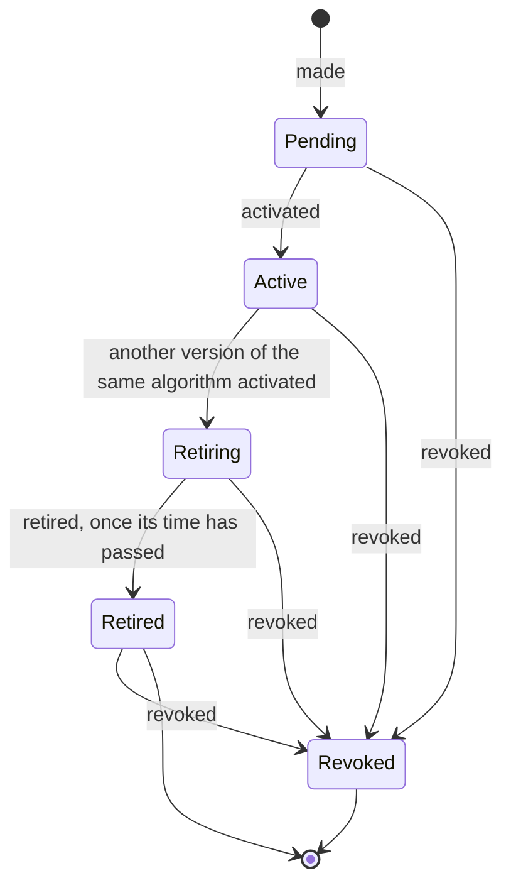

# The keys context

The `keys` context owns the keys a tenant's tokens are signed with and, later, the keys its secrets are encrypted under. It answers two questions for the rest of the system: which key signs now, and which keys may a signature be checked against?

It holds no cryptography of its own. Keys are made, kept and used by a **key provider**, a port that `hodor-adapters-crypto` implements on `aws-lc-rs` ([Decision 0008](../../decisions/0008-cryptography.md)). This context decides which key is used when, and keeps what the provider hands back.

This page specifies what Issue-50 builds: key sets, key versions and their states, the key provider port, the local provider and the storage. Scheduled rotation, publication of the key set, revocation commands and the administration interface are Issue-51. Moving the secrets of Milestone 2 under managed keys is Issue-52.

## Key sets and key versions

A tenant has one **key set** per use. A key set holds **key versions**: one key each, made once and never changed.

| Use | Name | What its keys do | Algorithms offered |
|---|---|---|---|
| Signing | `sig` | Sign the tokens Hodor issues | ES256 (the default), RS256 and PS256 for interoperability |
| Encryption | `enc` | Decrypt what others encrypt for Hodor | None yet: offered when Hodor accepts encrypted requests or encrypts tokens |
| Data | `data` | Encrypt the tenant's secrets at rest | AES-256-GCM |

The key set is not stored as a row of its own: it is the versions of one tenant and one use. A key set with no version exists all the same, and has nothing to sign with.

### What a key version is

| Field | Meaning |
|---|---|
| Identifier | A `KeyVersionId`. Published as the key identifier, `kid`, of a signing key. Safe to show: it grants nothing |
| Use and algorithm | Fixed when the version is made. The algorithm decides the use |
| State | See the lifecycle below |
| Public key | For a signing key: its numbers, which anyone may know |
| Key material | What the provider handed back: the private key or the data key, sealed by the provider. This context never reads it and has no way to |
| Provider | Which provider made it, `local` for now |
| Times | When it was made, activated, set to retire, retired and revoked |
| Retire after | For a retiring version: the moment after which it may be retired |
| Revocation reason | Why it was revoked, if it was |

## Lifecycle

| State | Signs or encrypts | Checks or decrypts | How it is reached |
|---|---|---|---|
| Pending | No | No | Made, not yet in use. A version can be published before it signs, so that those who check signatures know it in advance |
| Active | Yes | Yes | Activated |
| Retiring | No | Yes | Replaced by a newer version of the same algorithm; stays until everything it signed has expired |
| Retired | No | No | Retired after its time |
| Revoked | No | No | Revoked: no longer trusted, whatever its state was |

Rules:

- **One active version per algorithm in a key set.** Activating a pending version sets the version it replaces to Retiring, in the same change. Nothing else makes a version active, so there is never a moment with two.
- **Only a pending version can be activated.** A version that was active once never becomes active again; a new version is made instead.
- **A retiring version stays until its time has passed.** Activation gives the replaced version a moment to retire after: the activation time plus an overlap the caller chooses, which for a signing key is the lifetime of the longest-lived token it may have signed. Retiring it earlier is refused.
- **Revoking is final.** Any version that is not revoked can be revoked, with a reason; revoking a revoked version changes nothing. Revoking the active version leaves the algorithm without an active version until another is activated: signing with it is refused, never done with a key that is no longer trusted.
- **A version's key never changes.** Rotation is making a new version and activating it, not changing a key in place.
- The algorithm decides the use. A signing algorithm cannot be put in the data key set, nor the reverse.

## Operations

| Use case | What it does |
|---|---|
| Make a version | Asks the provider for a new key of an algorithm, and stores it as a pending version |
| Activate | Makes a pending version the active one of its algorithm; the one it replaces starts retiring |
| Retire | Retires a retiring version whose time has passed |
| Revoke | Revokes a version, with a reason |
| Read a key set | Returns the versions of one use, newest first |
| Sign | Signs a message with the active version of an algorithm, and answers the signature with the version's identifier. Refused when the algorithm has no active version |

Who calls them, and when, is Issue-51: rotation on a schedule, the command-line tool and the administration interface.

### Events

| Event type | When |
|---|---|
| `keys.version_created` | A version was made; carries its use and algorithm |
| `keys.version_activated` | A version became active; carries the version it replaced, if any, and when that one may retire |
| `keys.version_retired` | A retiring version was retired |
| `keys.version_revoked` | A version was revoked; carries the reason |

Events carry identifiers, uses, algorithms and times. They never carry key material, and the public key stays in the version's row.

### Ports

| Port | Purpose |
|---|---|
| `KeyStore` | Store and load key versions; load the key set of one use |
| `KeyProvider` | Make a key; sign with a signing key; encrypt and decrypt with a data key. Asynchronous, because a provider of a key management service answers over the network |
| `Clock` | The times of the lifecycle |

## The key provider

A provider makes a key and answers two things: the public key, for a signing key, and the **key material**, bytes that only that provider can turn back into the key. Every later use of the key goes back to the provider with the material: this context asks "sign this with that key", and gets a signature.

The material is opaque to this context. It is printed as its length only, has no way to be read as a key, and is stored as it came.

The provider is told the tenant, the version's identifier and the algorithm every time, and a provider must refuse to use material for any other tenant, version or algorithm than the one it was made for.

### The local provider

`LocalKeyProvider` in `hodor-adapters-crypto` is the provider of this issue: keys are made and used inside the server with `aws-lc-rs`, and kept wrapped under a root key. This is the envelope encryption of Decision 0008.

- **Making a key.** A P-256 key for ES256, an RSA key of 2048 bits for RS256 and PS256, 32 random bytes for AES-256-GCM, all from the library and the operating system's random source.
- **Wrapping it.** The private key, as a PKCS#8 document, or the data key is sealed with the keys of `HODOR_SECRET_KEYS`, the same root keys as [secrets at rest](../../security/secrets-at-rest.md). The purpose it is sealed for names the algorithm and the version, `keys.<algorithm>.<version>`, and the tenant is bound in too: material copied to another version's row, another algorithm or another tenant does not open.
- **Using it.** The material is opened for one operation and the key dropped after it. The private key in the clear lives only in the provider's memory, for the time of one signature.
- **Changing the root key** follows the rules of secrets at rest: the first root key wraps new material, every root key opens.

What the root key protects against is what it protects for secrets at rest: a copy of the database alone yields no private key. Someone holding both the database and the server's configuration holds the keys. Keeping the root key elsewhere is what the providers of key management services in Phase 9 are for.

## Storage

### `keys.key_version`

| Column | Type | Notes |
|---|---|---|
| `tenant_id`, `id` | `uuid` | Primary key |
| `key_use` | `text` | `sig`, `enc` or `data` |
| `algorithm` | `text` | `ES256`, `RS256`, `PS256` or `A256GCM`; checked against the use |
| `state` | `text` | `pending`, `active`, `retiring`, `retired` or `revoked` |
| `provider` | `text` | `local` |
| `key_material` | `bytea` | As the provider handed it back |
| `public_rsa_modulus`, `public_rsa_exponent` | `bytea` | For an RSA signing key |
| `public_p256_x`, `public_p256_y` | `bytea` | For a P-256 signing key, 32 bytes each |
| `created_at`, `activated_at`, `retiring_at`, `retire_after`, `retired_at`, `revoked_at` | `timestamptz` | Null until reached |
| `revocation_reason` | `text` | |

A tenant table under row-level security. The database holds the rules too:

- a partial unique index allows one `active` row per tenant, use and algorithm, so two activations racing each other cannot both succeed;
- checks tie the algorithm to the use, the public key to the algorithm, and each state to the times it needs;
- the application role may not delete a version. A version is revoked, never removed, so that a signature can always be traced to the key that made it.

When an activation replaces a version, the replaced version is written first and the activated one after, so that the unique index holds after every statement.

## Not built yet

| Item | Planned in |
|---|---|
| Rotation on a schedule, under an advisory lock, in the worker | Issue-51 |
| The key set published for those who check signatures, with retiring versions in it | Issue-51 |
| Revoking from the command-line tool and the administration interface | Issue-51 |
| Secrets at rest under a data key of the tenant | Issue-52 |
| Algorithms for the encryption key set | When Hodor accepts encrypted requests or encrypts tokens |
| EdDSA | Optional, not scheduled |
| Providers of key management services and vaults | Phase 9 |
