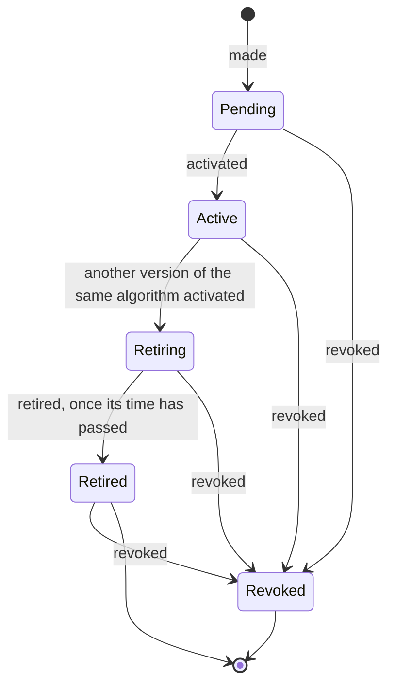

# The keys context

The `keys` context owns the keys a tenant's tokens are signed with and, later, the keys its secrets are encrypted under, and the keys of others a tenant trusts: the bundles of its [trust domains](#trust-domains). It answers two questions for the rest of the system: which key signs now, and which keys may a signature be checked against?

It holds no cryptography of its own. Keys are made, kept and used by a **key provider**, a port with two implementations: the local provider of `hodor-adapters-crypto`, on `aws-lc-rs` ([Decision 0008](../../decisions/0008-cryptography.md)), and the OpenBao provider of `hodor-adapters-kms`, where keys are made and used in OpenBao and never leave it ([Decision 0030](../../decisions/0030-optional-certificate-authority.md#what-protects-the-key)). This context decides which key is used when, and keeps what the provider hands back.

This page specifies what Issues 50, 51, 52, 105, 115, 116, 119 and 130 build. Issue-50: key sets, key versions and their states, the key provider port, the local provider and the storage. Issue-51: rotation on a schedule, the published key set, and managing keys with the command-line tool and the administration interface. Issue-52: [secrets sealed under data keys](#secrets-under-data-keys), which moves the secrets of Milestone 2 under managed keys. Issue-105: [trust domains](#trust-domains) and their bundles, which [Decision 0042](../../decisions/0042-trust-domains.md) puts in this context. Issue-115: [the OpenBao provider](#the-openbao-provider), signatures in two encodings, and [several providers at once](#choosing-the-provider). Issue-116: [the certificate authority of a tenant](#the-certificate-authority-of-a-tenant), which [Decision 0062](../../decisions/0062-the-certificate-authority-of-a-tenant.md) puts in this context; Issue-119 lets it leave URIs unconstrained and permit DNS names besides its trust domains ([Decision 0076](../../decisions/0076-names-an-authority-leaves-to-its-meshes.md)). Issue-130: EdDSA, with keys on the Ed25519 curve made by both providers, and a key in [the published key set](#the-published-key-set) for every algorithm a client may choose.

## Key sets and key versions

A tenant has one **key set** per use. A key set holds **key versions**: one key each, made once and never changed.

| Use | Name | What its keys do | Algorithms offered |
|---|---|---|---|
| Signing | `sig` | Sign the tokens Hodor issues | ES256 (the default), RS256 and PS256 for interoperability, EdDSA on Ed25519 ([RFC 8037](https://www.rfc-editor.org/rfc/rfc8037)) |
| Encryption | `enc` | Decrypt what others encrypt for Hodor | None yet: offered when Hodor accepts encrypted requests or encrypts tokens |
| Data | `data` | Encrypt the tenant's secrets at rest | AES-256-GCM |

The key set is not stored as a row of its own: it is the versions of one tenant and one use. A key set with no version exists all the same, and has nothing to sign with.

### What a key version is

| Field | Meaning |
|---|---|
| Identifier | A `KeyVersionId`. Published as the key identifier, `kid`, of a signing key. Safe to show: it grants nothing |
| Use and algorithm | Fixed when the version is made. The algorithm decides the use |
| State | See the lifecycle below |
| Public key | For a signing key: its numbers, which anyone may know |
| Key material | What the provider handed back: the private key or the data key, sealed by the provider. This context never reads it and has no way to |
| Provider | Which provider made it, `local` or `openbao`. Every later use of the version goes to that provider and to no other |
| Times | When it was made, activated, set to retire, retired and revoked |
| Retire after | For a retiring version: the moment after which it may be retired |
| Revocation reason | Why it was revoked, if it was |

## Lifecycle



| State | Signs or encrypts | Checks or decrypts | How it is reached |
|---|---|---|---|
| Pending | No | No | Made, not yet in use. It is published before it signs, so that those who check signatures know it in advance |
| Active | Yes | Yes | Activated |
| Retiring | No | Yes | Replaced by a newer version of the same algorithm; stays until everything it signed has expired |
| Retired | No | No | Retired after its time |
| Revoked | No | No | Revoked: no longer trusted, whatever its state was |

Rules:

- **One active version per algorithm in a key set.** Activating a pending version sets the version it replaces to Retiring, in the same change. Nothing else makes a version active, so there is never a moment with two.
- **Only a pending version can be activated.** A version that was active once never becomes active again; a new version is made instead.
- **A retiring version stays until its time has passed.** Activation gives the replaced version a moment to retire after: the activation time plus an overlap the caller chooses, which for a signing key is the lifetime of the longest-lived token it may have signed. Retiring it earlier is refused.
- **Revoking is final.** Any version that is not revoked can be revoked, with a reason; revoking a revoked version changes nothing. Revoking the active version leaves the algorithm without an active version until another is activated: signing with it is refused, never done with a key that is no longer trusted.
- **A version's key never changes.** Rotation is making a new version and activating it, not changing a key in place.
- The algorithm decides the use. A signing algorithm cannot be put in the data key set, nor the reverse.

## Operations

| Use case | What it does |
|---|---|
| Make a version | Asks the provider for a new key of an algorithm, and stores it as a pending version |
| Activate | Makes a pending version the active one of its algorithm; the one it replaces starts retiring |
| Activate as the first | Activates a pending version only if its algorithm has no active version, and is refused otherwise; how the first data key is made |
| Retire | Retires a retiring version whose time has passed |
| Revoke | Revokes a version, with a reason |
| Read a key set | Returns the versions of one use, newest first |
| Rotate what is due | Runs one step of [rotation](#rotation) in a tenant: retires, makes and activates the versions whose time has come |
| Rotate now | Activates a new signing version of an algorithm at once, for an operator who will not wait for the schedule |
| Published keys | The signing versions that [the published key set](#the-published-key-set) holds |
| Sign | Signs a message with the active version of an algorithm, and answers the signature with the version's identifier. Refused when the algorithm has no active version |

Rotation, the published key set and the commands below call these, and nothing else changes a version.

### Events

| Event type | When |
|---|---|
| `keys.version_created` | A version was made; carries its use and algorithm |
| `keys.version_activated` | A version became active; carries the version it replaced, if any, and when that one may retire |
| `keys.version_retired` | A retiring version was retired |
| `keys.version_revoked` | A version was revoked; carries the reason |

Events carry identifiers, uses, algorithms and times. They never carry key material, and the public key stays in the version's row.

### Ports

| Port | Purpose |
|---|---|
| `KeyStore` | Store and load key versions; load the key set of one use |
| `KeyProvider` | Make a key; sign with a signing key, in the JOSE or the DER encoding; encrypt and decrypt with a data key. Asynchronous, because a provider outside the server answers over the network |
| `Clock` | The times of the lifecycle |

## Rotation

A signing key is replaced on a schedule, so that a key that leaked without anyone knowing stops being trusted after a while, and so that replacing a key is something Hodor does every few months rather than for the first time during an incident.

### The rotation policy

One policy for the whole installation, read from the configuration of the worker, the server and the command-line tool. It is not a tenant setting: how often keys change, and how long a replaced key stays, protect those who check signatures, not the tenant's own choices.

| Setting | Variable | Default | Bounds |
|---|---|---|---|
| Period: how long a version is active before it is replaced | `HODOR_KEY_ROTATION_DAYS` | 90 days | 1 to 730 days |
| Publication: how long a new version is published before it signs | `HODOR_KEY_PUBLICATION_HOURS` | 24 hours | At least the 5 minutes the published key set may be kept by those who read it, and less than the period |
| Overlap: how long a replaced version stays published after it stopped signing | `HODOR_KEY_OVERLAP_HOURS` | 24 hours | At least the lifetime of the longest-lived token a key signs, one hour, plus five minutes for clocks that disagree |

**Why the overlap is enough.** The tokens Hodor signs are access tokens and ID tokens, and the `oauth` context caps both at one hour (`TokenPolicy`; refresh tokens are not signed). A version that stops signing at the moment its successor is activated has signed nothing that lives past that moment plus one hour, so a version retired after the overlap checks every token it signed. The policy refuses an overlap shorter than `RotationPolicy::LONGEST_SIGNED_LIFETIME` plus `RotationPolicy::CLOCK_ALLOWANCE`, so the rule cannot be configured away. Signing a token is Issue-56, which ties the two: it refuses to sign a token that lives longer than that constant, so a longer token lifetime would have to raise the constant, and with it the shortest overlap, first.

### One step of rotation

The worker runs a step for every tenant that has something due. A step looks at the tenant's signing key set and, in this order:

1. **Retires** every retiring version whose time to retire has passed.
2. **Makes sure the default algorithm signs.** When ES256 has no active version, a tenant's first key or one whose active key was revoked, a pending ES256 version is activated at once, or made and activated at once when there is none. Waiting for the publication time would leave the tenant signing nothing.
3. **Prepares the next version.** For each algorithm with an active version older than the period less the publication time, a pending version is made, unless one is pending already. It is published from that moment.
4. **Activates it when its time comes.** When the active version is older than the period and the pending one has been published for the publication time, the pending one is activated; the one it replaces starts retiring with the overlap.

Each change is its own transaction with its own event, as with every other use of the operations above. An algorithm other than the default rotates only while it has an active version.

**A first key is also made when something must sign and finds none.** The worker passes every ten minutes unless told otherwise (`HODOR_KEY_ROTATION_INTERVAL_MS`), so a tenant made a moment ago, or one whose active key was just revoked, may have nothing to sign with until it does. `KeyService::ensure_active` returns the active version of an algorithm, or makes one and activates it at once, as step 2 does for ES256. The `oauth` context calls it whenever it signs a token and the tenant has no active key of the algorithm: for ES256, which signs every access token, and for RS256, PS256 and EdDSA, the first time a client whose ID tokens or UserInfo answers are signed with one of them asks for one. The OpenID Provider says it supports all four, RS256 among them as OpenID Connect Discovery requires, and a tenant must not fail the first token a client asks for. A revoked key is never used again: the key made in its place is new. Two requests that make the first version at once both make one; the second to activate gets `keys.activation_conflict`, revokes its own version with the reason `lost the race to become the first key of its algorithm`, and signs with the winner. From then on the algorithm rotates like the default; a tenant stops signing with an algorithm when no client asks for it, not by revoking the key.

The decision is made in the domain, by `KeySet::rotation_plan`, from the key set and the time alone; the step only carries it out.

**Rotation never touches the data key set.** It makes, activates and retires signing versions only. A data version must not be retired while secrets sealed with it remain, and only the context that seals them knows when none do; [Secrets under data keys](#secrets-under-data-keys) says how a data version is made; replacing and retiring one is not built yet, so a data version is retired by nothing.

### Two workers, one rotation

Several workers can run at once. A step that two of them took together would activate two new versions one after the other, and the first would be replaced seconds after it was published. A pass of the rotation job therefore holds a PostgreSQL advisory lock for its whole length, taken with `pg_try_advisory_xact_lock` in a transaction of its own: a worker that does not get it skips the pass. The lock is released when that transaction ends, whatever happens to the worker.

A pass finds the tenants that have something due through the platform connection, which sees every tenant's versions, and does each step inside the tenant as the application role, like the outbox and the cleanup jobs ([multi-tenancy](../multi-tenancy.md#cross-tenant-operations)). Only active tenants are rotated.

| Setting | Variable | Default |
|---|---|---|
| Pause between passes | `HODOR_KEY_ROTATION_INTERVAL_MS` | 600 000 (ten minutes) |

A worker started without `HODOR_SECRET_KEYS` cannot make keys: it does not rotate, and says so in its log when it starts.

### Rotating and revoking by hand

An operator can rotate a tenant's signing key at once, with `hodor-cli keys rotate` or `POST /keys/sig:rotate`. A pending version of the algorithm is activated if there is one, and otherwise a new version is made and activated. A version activated this way is not published in advance: those who check signatures see a key identifier they do not know and fetch the key set again, which every library that reads a key set does.

Revoking, with `hodor-cli keys revoke` or `POST /keys/sig/versions/{version_id}:revoke`, takes a reason and removes the version from the published key set at once. Tokens it signed stop being accepted by those who fetch the key set again. To replace a key that is no longer trusted, **rotate first, then revoke the version that was replaced**: revoking the active version first leaves the tenant without a signing key until the next pass of the rotation job makes one.

A manual rotation can meet a step of the job in the same moment. The database still allows one active version per algorithm; the worst outcome is two rotations in a row, and the version replaced by the second still stays for the overlap.

## The published key set

Those who check the signatures of a tenant read its signing keys at `GET /t/{tenant}/oauth2/jwks`, the address the OpenID Provider's Discovery document will name (Issue-59). The answer is a JSON Web Key Set (RFC 7517) with one key for each signing version that is **pending, active or retiring**. Retired and revoked versions are left out; a revoked version leaves the moment it is revoked.

| Member | Value |
|---|---|
| `kid` | The version's identifier |
| `kty` | `EC` for ES256, `RSA` for RS256 and PS256, `OKP` for EdDSA |
| `use` | `sig` |
| `alg` | The version's algorithm |
| `crv`, `x`, `y` | For ES256: `P-256` and the point, base64url without padding |
| `n`, `e` | For RS256 and PS256: the modulus and the exponent, base64url without padding |
| `crv`, `x` | For EdDSA: `Ed25519` and the public key's 32 bytes, base64url without padding, as RFC 8037 writes an octet key pair |

Nothing else of a version is published: not its state, its times, or anything of its key material. Keys are listed newest first.

**The set always names the key of the next token.** Before it answers, the address makes sure the tenant has an active version of every algorithm a token or an answer of the tenant may be signed with, ES256, RS256, PS256 and EdDSA, through `KeyService::ensure_active`. A relying party that reads the set of a tenant made a moment ago, before the worker gave it a key and before any token was signed, finds the key of the first token it then gets; the OpenID conformance suite reads the set once at the start of a test and fails a token whose key it does not find ([OpenID conformance](../../operations/conformance.md)). A revoked version is still left out at once, and the version made in its place is new.

The answer carries `Cache-Control: public, max-age=300`: someone who keeps it at most five minutes sees a new version well within its publication time, and a revoked version disappears for everyone within five minutes. The key set of one tenant names only that tenant's versions, as every read inside a tenant does. Each algorithm has keys of its own: a PS256 version is never the RS256 version, though both are RSA keys, so that one key is never used with two paddings. When the server has no `HODOR_SECRET_KEYS`, there is no keys context and the address is not served.

## The key provider

A provider makes a key and answers two things: the public key, for a signing key, and the **key material**, bytes that only that provider can turn back into the key. Every later use of the key goes back to the provider with the material: this context asks "sign this with that key", and gets a signature.

The material is opaque to this context. It is printed as its length only, has no way to be read as a key, and is stored as it came.

The provider is told the tenant, the version's identifier and the algorithm every time, and a provider must refuse to use material for any other tenant, version or algorithm than the one it was made for, and a version another provider made. Every refusal is `keys.unusable`, whatever the reason; the reason goes to the log.

### Two encodings of a signature

A signature is asked for in one of two encodings, which differ for ECDSA only:

| Encoding | An ECDSA signature is | Used by |
|---|---|---|
| JOSE | Its two numbers, 32 bytes each for P-256, one after the other (RFC 7518, section 3.4) | Tokens: every signature the keys context makes today |
| DER | An ASN.1 sequence of its two integers, in DER (RFC 3279, section 2.2.3) | X.509 certificates, such as those of the [certificate authority of a tenant](../../decisions/0030-optional-certificate-authority.md) |

An RSA signature is the same bytes in both, and so is an EdDSA signature: 64 bytes, as RFC 8032 writes it, in a token and in a certificate alike.

### The contract of a provider

Every provider passes one suite, `run_provider_contract` in the context's `testing` module, run against the local provider and against OpenBao in a container:

- each signing algorithm it makes signs in both encodings, and the signature checks with the version's public key, independently of the provider, and with no other message; both providers are run with all four, ES256, RS256, PS256 and EdDSA, and an EdDSA signature is the same 64 bytes in both encodings;
- two keys are never the same;
- material is refused for another tenant, for another version of the same tenant, for a version of another tenant, for another algorithm, when any byte of it changed, and on a version another provider made;
- a signing key does not encrypt and a data key does not sign; a provider that makes no data keys refuses to make one.

### Choosing the provider

An installation may use both providers at once. `KeyProviders`, in this context, is a provider made of others:

- **new signing keys** are made by the provider the operator chose, `HODOR_KEY_PROVIDER`: `local` (the default) or `openbao`;
- **new data keys** are always made by the local provider: the policy Hodor holds in OpenBao allows signing and nothing else, and the root keys of [secrets at rest](../../security/secrets-at-rest.md) stay as they are ([Decision 0030](../../decisions/0030-optional-certificate-authority.md#what-protects-the-key));
- **the key of a [certificate authority](#the-certificate-authority-of-a-tenant)** is made by OpenBao whenever OpenBao is configured, whatever `HODOR_KEY_PROVIDER` says, and by the local provider otherwise, which only an installation of the authority for development accepts. Each provider says whether it **signs inside itself**: whether its keys are made and used where Hodor cannot read them. OpenBao does, the local provider does not;
- **every version is used by the provider whose name it was stored with**, and by no other. A version whose provider is not configured is refused with `keys.provider_not_configured`. Nothing ever falls back: when OpenBao does not answer, a version made there does not sign, `keys.provider_unavailable`, and no key is made elsewhere instead, so a tenant whose signing keys are in OpenBao issues no token until it answers again.

Changing `HODOR_KEY_PROVIDER` changes where new keys are made, never where a version is used. An installation that moves its signing keys into OpenBao sets it to `openbao` and [rotates](#rotating-and-revoking-by-hand) each tenant's keys, or waits for the schedule to replace them; one that moves them back sets it to `local` and keeps OpenBao's address while a version made there may sign. The server, the worker and the command-line tool must have the same settings: the worker makes keys the server signs with.

### The local provider

`LocalKeyProvider` in `hodor-adapters-crypto` is the provider of Issue-50: keys are made and used inside the server with `aws-lc-rs`, and kept wrapped under a root key. This is the envelope encryption of Decision 0008.

- **Making a key.** A P-256 key for ES256, an RSA key of 2048 bits for RS256 and PS256, an Ed25519 key for EdDSA, 32 random bytes for AES-256-GCM, all from the library and the operating system's random source.
- **Wrapping it.** The private key, as a PKCS#8 document, or the data key is sealed with the keys of `HODOR_SECRET_KEYS`, the same root keys as [secrets at rest](../../security/secrets-at-rest.md). The purpose it is sealed for names the algorithm and the version, `keys.<algorithm>.<version>`, and the tenant is bound in too: material copied to another version's row, another algorithm or another tenant does not open.
- **Using it.** The material is opened for one operation and the key dropped after it. The private key in the clear lives only in the provider's memory, for the time of one signature.
- **Changing the root key** follows the rules of secrets at rest: the first root key wraps new material, every root key opens.

What the root key protects against is what it protects for secrets at rest: a copy of the database alone yields no private key. Someone holding both the database and the server's configuration holds the keys. Keeping the key elsewhere is what the OpenBao provider is for.

### The OpenBao provider

`OpenBaoKeyProvider` in `hodor-adapters-kms`, named `openbao`, keeps the tenants' signing keys in OpenBao's Transit secrets engine, on a mount of Hodor's own (`HODOR_OPENBAO_TRANSIT_MOUNT`, `hodor-transit` by default). OpenBao makes each key and makes every signature; the private key is never sent to Hodor, never stored in Hodor's database, and cannot be read by Hodor at all. [Keys in OpenBao](../../operations/keys-in-openbao.md) says how an operator prepares OpenBao and what each setting means.

| Algorithm | Transit key type | How it signs |
|---|---|---|
| ES256 | `ecdsa-p256` | SHA-256; `marshaling_algorithm` `jws` for the JOSE encoding, `asn1` for DER |
| RS256 | `rsa-2048` | SHA-256, `signature_algorithm` `pkcs1v15` |
| PS256 | `rsa-2048` | SHA-256, `signature_algorithm` `pss`, a salt as long as the hash, as JSON Web Algorithms ask |
| EdDSA | `ed25519` | Ed25519 over the message itself, as RFC 8037 asks: no hash is named, and the message is not hashed first |
| A256GCM | None | Refused with `keys.algorithm_unsupported`: data keys stay local |

- **One key per tenant and version.** The Transit key of a version is named `tenant-<tenant>-version-<version>`, both identifiers as UUIDs. A rotation in Hodor makes a new version and so a new Transit key; a Transit key is never rotated, and Hodor signs with its first version only.
- **Making a key.** Hodor asks OpenBao to make the key with its type and nothing else, so that it is made not exportable and with no plaintext backup; Hodor's policy refuses any other parameter. It then reads the key back and keeps it only if it is of the type asked, not exportable, without plaintext backup, not imported, and at its first version: a key that someone made under that name beforehand is refused with `keys.provider_failed`. The public key it reads, a PEM document for ECDSA and RSA or the key's 32 bytes in base64 for Ed25519, as OpenBao answers each, becomes the version's public key.
- **The material** is `openbao:1:<name of the key>:<algorithm>`. Nothing in it is secret. Before anything is sent, the provider computes the name from the tenant and the version it is told and refuses the version, `keys.unusable`, unless the material is exactly what it made for them: material copied from another tenant's or another version's row signs nothing, and the name a request names always comes from the tenant and the version, never from the material.
- **Signing in.** Hodor signs in with Kubernetes authentication, presenting its service account's token, read again from its file at every sign-in since the cluster replaces it, or with an AppRole's role identifier and secret identifier. The token OpenBao gives is kept and replaced once two thirds of its life have passed. A token OpenBao refuses before then, revoked for example, is replaced by signing in again once, and the request is sent again once.
- **The way out.** Requests go through the kernel's `HttpClient` port, filled by `ServiceHttpClient`, which calls OpenBao's address and nothing else ([outbound HTTP](../../security/outbound-http.md#what-does-not-go-through-this-client)), with a time limit per request (`HODOR_OPENBAO_TIMEOUT_MS`, 5 seconds by default). When OpenBao's certificate comes from an authority of the operator's own, `HODOR_OPENBAO_CA_FILE` names it, and only that authority is trusted for OpenBao.
- **Failures.** OpenBao unreachable, slow past the time limit or answering with a server error, a sealed OpenBao among them, is `keys.provider_unavailable`. A sign-in refused is `keys.provider_sign_in_refused`; a request Hodor's policy refuses, after signing in again, `keys.provider_refused`; any other answer that is not what was asked, such as a key deleted in OpenBao, `keys.provider_failed`. Each is a failure to sign or to make a key, and nothing is signed instead.

**Hodor's policy.** `deploy/openbao/hodor-policy.hcl` is the policy Hodor's sign-in gives it. On Hodor's mount it allows making a key of type `ecdsa-p256`, `rsa-2048` or `ed25519` with no other parameter, reading a key, and signing, on paths of one segment below `keys/` and `sign/`, and nothing else: not exporting a key, backing one up, changing a key's settings, rotating, trimming or deleting a key, listing keys, encrypting or decrypting, nor any path outside the mount. Hodor therefore cannot read a key's private part, even of a key an administrator of OpenBao made exportable. The tests sign in with that file as Hodor does and try each of these.

## Secrets under data keys

The kernel's `SecretBox` port, which every context that keeps a secret uses, is implemented here by `TenantSecretBox`: each secret is sealed under the tenant's active data key, and names the version that sealed it. [Secrets at rest](../../security/secrets-at-rest.md) gives the format, the commands and what the root keys protect against; this section gives the rules this context holds.

- **The first data key is made on demand.** When a tenant seals a secret and has no active `A256GCM` version, a version is made and activated, with no overlap: there is nothing it replaces. The caller is the system. It is activated only as the first: an activation that finds an active version already is refused (`keys.already_active`) rather than replacing it, and two activations at the same moment are told apart by the unique index (`keys.activation_conflict`). Either way the sealing that lost revokes its own version, with the reason `lost the race to become the first data key`, and uses the one that won, so a tenant never ends with a second data version made by a race.
- **Only an active or retiring version opens.** A retiring data key opens what it sealed until everything is sealed again under the active one; then it may retire. A retired or revoked data key opens nothing, so retiring a data key that still seals something makes those secrets unreadable. Nothing in this issue retires a data key.
- **The first format.** Secrets sealed directly by the root keys, as 0.1.0 did, still open through the root keys until the tenant **refuses the first format**, which `hodor-cli secrets reseal` records once the tenant has none left. Refusing is final.

### Ports added

| Port | Purpose |
|---|---|
| `SealingStateStore` | Whether the tenant refuses the first format, and recording that it does |
| `FirstFormatSecrets` | Opens a secret of the first format, and says whether bytes are one. Implemented by `SecretKeys` in `hodor-adapters-crypto` over the root keys |

## Trust domains

A workload in a service mesh, or under SPIRE, is named by a SPIFFE identifier, `spiffe://<trust domain>/<path>`, and proves it with a certificate or a JWT-SVID that its trust domain's authorities signed. A tenant says which trust domains it trusts, and with which authorities, by giving each one a **trust bundle**: the certificates of its authorities for X.509-SVIDs and the public keys that sign its JWT-SVIDs ([Decision 0029](../../decisions/0029-hodor-in-a-service-mesh.md#a-workload-proves-who-it-is-in-one-of-three-ways)). This section specifies what a trust domain is, how its bundle is read and kept current, and who may change it. The OAuth context checks a workload's credential against it: a JWT-SVID as [checking a JWT-SVID](oauth.md#checking-a-jwt-svid) says (Issue-106), and a certificate as [an identity forwarded by a proxy](oauth.md#an-identity-forwarded-by-a-proxy) says (Issue-107). Why the keys context holds them is [Decision 0042](../../decisions/0042-trust-domains.md).

### What a trust domain is

| Field | Meaning |
|---|---|
| Identifier | A `TrustDomainId` |
| Name | The trust domain's name, as it appears in a SPIFFE identifier: 1 to 255 characters, each a lowercase letter `a` to `z`, a digit, `.`, `-` or `_` (the SPIFFE identifier specification, section 2.1). Never changes |
| Source | Where its bundle comes from: `uploaded`, `bundle_endpoint`, `mesh` or `authority` (below) |
| Bundle endpoint | For `bundle_endpoint`: the address of its SPIFFE bundle endpoint |
| Bundle | For `uploaded` and `bundle_endpoint`: the bundle in force, with its sequence number and refresh hint if it has them, and when it last changed. `mesh` has none |
| Refresh | For `bundle_endpoint`: when the bundle was last fetched, when it is fetched next, and, while fetching fails, since when and why |
| Created at, updated at | |
| Version | Incremented on every change, for optimistic locking |

**The four sources.**

| Source | The bundle | What trusting it means |
|---|---|---|
| `uploaded` | Given by an administrator, and replaced only by an administrator | The administrator keeps it current, by hand, when the trust domain's authorities change |
| `bundle_endpoint` | Fetched from the trust domain's SPIFFE bundle endpoint (the `https_web` profile of SPIFFE Federation) when the trust domain is saved, and fetched again by the worker | The bundle follows the authorities' rotation without anyone acting |
| `mesh` | None | The mesh in front of Hodor checked the workload's certificate itself. Only the identity a trusted proxy forwards can name such a trust domain ([an identity forwarded by a proxy](oauth.md#an-identity-forwarded-by-a-proxy)); no JWT-SVID or certificate can be checked against it, since it has no bundle, and a JWT-SVID of it is refused |
| `authority` | The bundle of the tenant's [certificate authority](#the-certificate-authority-of-a-tenant), added when the authority becomes active | Hodor trusts what the tenant's own authority signed, without anyone uploading its bundle |

Rules:

- **A trust domain belongs to one tenant.** Its name is unique within the tenant, `keys.trust_domain_name_taken` otherwise, and two tenants may each have a trust domain of the same name: every Kubernetes cluster's default is `cluster.local`. Every read is inside one tenant, under row-level security, so a trust domain, a bundle and a refresh of one tenant are never read for another, whatever their names.
- **A tenant has at most 50 trust domains** (`keys.too_many_trust_domains`).
- **The name is fixed.** Changing a trust domain replaces its source and its bundle; a trust domain of another name is added, and the old one removed.
- **Saving checks the bundle first.** Adding or replacing an `uploaded` trust domain reads the bundle given; adding or replacing a `bundle_endpoint` one checks the address and fetches the bundle once. If the bundle does not read, or the address may not be called, or the fetch fails, the request is refused with its reason and nothing is stored: a replaced trust domain keeps the source and the bundle it had.
- **Removing a trust domain** removes its bundle. A workload of that trust domain is no longer trusted from the next request.
- **A trust domain of source `authority`** is added and removed by the [certificate authority](#the-certificate-authority-of-a-tenant) alone. Adding one with that source, or replacing one that has it, is refused with `keys.trust_domain_source_invalid` and `keys.trust_domain_of_authority`; removing one is allowed, and stops Hodor trusting that trust domain. The worker never fetches it.

### Reading a bundle

A bundle is a JSON Web Key Set as the SPIFFE Trust Domain and Bundle specification writes it, with the rules of the X509-SVID and JWT-SVID specifications for their elements. Hodor reads it the same way whether an administrator gave it or an endpoint answered it.

| Part | Rule |
|---|---|
| The document | A JSON object in UTF-8, at most 64 kibibytes. Members other than the three below are not kept |
| `keys` | Required: an array of at most 100 elements. It may be empty: a trust domain with an empty bundle trusts nothing, as the specification says |
| `spiffe_sequence` | Optional: a whole number from 0 to 2<sup>63</sup> − 1 |
| `spiffe_refresh_hint` | Optional: a whole number of seconds from 1 to 2<sup>63</sup> − 1. It is bounded when it is used (see [refreshing](#keeping-a-fetched-bundle-current)) |

Each element of `keys` is **ignored** or **kept**, or the whole bundle is **refused**:

- **Ignored**, as the specification requires: an element without `use` or with a `use` other than `x509-svid` and `jwt-svid`, and an element whose key type Hodor does not know. The known types are `EC` on the curves `P-256`, `P-384` and `P-521`, and `RSA`; an `EC` element on another curve, or with none, is of an unknown type. An ignored element is not kept and trusts nothing.
- **Kept**, when it follows every rule of its kind:
  - it is a JSON object with no private part: none of `d`, `p`, `q`, `dp`, `dq`, `qi`, `oth` or `k`;
  - its key is whole: for `EC`, `x` and `y` in base64url of the curve's length (32, 48 or 66 bytes); for `RSA`, a modulus `n` of at least 2048 bits and an exponent `e` that is not empty;
  - its `alg`, when present, fits the key: `ES256`, `ES384` or `ES512` for its curve, or `RS256`, `RS384`, `RS512`, `PS256`, `PS384` or `PS512` for `RSA`;
  - an `x509-svid` element has `x5c` with exactly one certificate, in base64 of its DER encoding, at most 16 kibibytes, that begins as a DER sequence; and it has no `kid`, which the X509-SVID specification forbids;
  - a `jwt-svid` element has a `kid` of 1 to 128 printable ASCII characters, which no other `jwt-svid` element of the bundle has.
- **Refused**, with `keys.trust_bundle_invalid` and the first reason as its detail: a document that is not JSON, not an object, too large, without `keys` or with too many; a sequence or a refresh hint that is not such a number; an element that is not an object; and an element of a known `use` and type that breaks a rule above. A bundle is refused rather than kept in part, so that what an administrator reads back is what the trust domain trusts.

Whether the certificate of an `x509-svid` element is an authority, and whether it holds the key the element names, is checked when a forwarded certificate is checked against the bundle ([an identity forwarded by a proxy](oauth.md#an-identity-forwarded-by-a-proxy)): an element whose certificate is not such an authority is passed over and trusts nothing, and the rest of the bundle trusts what it did.

A bundle is kept as it was read: the sequence, the refresh hint, and the kept elements in their order, each written as compact JSON with its members in order. Two bundles are the same when they are written the same. This is what the administration interface answers, and what the [events](#events-of-trust-domains) name by its SHA-256.

### Fetching a bundle

A bundle endpoint is called through the [guarded outbound client](../../security/outbound-http.md), like a webhook endpoint:

- **The address is checked when the trust domain is saved**, through the kernel's `DestinationCheck`: HTTPS, at most 1000 characters, no name and password, no fragment, and every address its name resolves to must be public. Then it is fetched once, and must answer a bundle that reads. Refusals: `keys.bundle_endpoint_invalid` (not such an address), `keys.bundle_endpoint_forbidden` (an address that may not be called), `keys.bundle_endpoint_unresolvable` (a name that resolves to nothing), `keys.bundle_endpoint_unreachable` (no answer in 10 seconds, a status other than 2xx, or more than 64 kibibytes), and `keys.trust_bundle_invalid`.
- **The address is checked again at every fetch**, by the guarded client, on the resolution it connects with, so that a name that later resolves to a private address is refused without any connection.
- **The request** is a `GET` of the address with `accept: application/json`. The server's certificate is checked against the public authorities the guarded client trusts, as the `https_web` profile asks.
- **Redirects are not followed**, though the `https_web` profile says a client should follow a temporary one: a public address could redirect Hodor to a private one. A redirect is a failed fetch; the administrator names the address it leads to instead.
- **The addresses of the development exception** (`HODOR_OUTBOUND_DEVELOPMENT_HOSTS`) are accepted over plain HTTP, as the guarded client accepts them. Nowhere real has any.

### Keeping a fetched bundle current

The worker fetches every `bundle_endpoint` trust domain's bundle again when its time comes.

- **When.** After a fetch that read, the next is due after the bundle's refresh hint, bounded between 1 minute and 1 day, or after 5 minutes when it has none, as SPIFFE Federation recommends. After a fetch that failed, the next is due after that same interval or 5 minutes, whichever is shorter.
- **A fetched bundle replaces the one in force only if it reads and does not go back.** When the bundle in force has a sequence number, the fetched one must have one too, and either a larger one, or the same one with the same contents. Otherwise it is refused with `keys.trust_bundle_sequence_invalid`: an old bundle replayed by the network or by the endpoint never replaces a newer one. A bundle an administrator gives or fetches when saving is not held to this rule.
- **A bundle that does not read, or a fetch that fails, keeps the bundle in force**, the one before, unchanged. The trust domain records the reason's code and since when fetching fails, until a fetch reads again.
- **A fetched bundle that is the same as the one in force** changes nothing but the time of the fetch, and records no event.

The worker never holds a transaction open while an endpoint answers. Like [webhook deliveries](webhooks.md#leases-and-one-slow-endpoint), a trust domain is fetched under a lease:

1. **Lease.** In the trust domain's tenant, it takes the trust domain if it is a `bundle_endpoint` one, due, and not leased past now, skipping one another worker holds. It is leased until the time limit of a fetch plus one minute, its version incremented, and the transaction commits.
2. **Fetch**, outside any transaction.
3. **Record.** In the tenant again, under a lock of the trust domain, it records what happened only if the trust domain still has the version it was leased at. If an administrator replaced or removed it meanwhile, the result is dropped.

A worker fetches up to 8 bundles at once. One that never answers holds only its own place for 10 seconds.

| Setting of `hodor-worker` | Default | Meaning |
|---|---|---|
| `HODOR_TRUST_BUNDLE_POLL_INTERVAL_MS` | 5000 | The pause when no bundle is due |

| Metric | Meaning |
|---|---|
| `hodor.keys.trust_bundle.fetches` | Fetches, by `outcome`: `changed`, `unchanged`, `failed` or `skipped` (the trust domain changed while it was fetched) |
| `hodor.keys.trust_bundle.passes` | Passes of the loop, by `outcome`: `ok` or `error` |

The worker fetches bundles whether or not it has `HODOR_SECRET_KEYS`: a bundle is public and nothing of it is sealed.

### Use cases of trust domains

`TrustDomainService`:

| Use case | What it does |
|---|---|
| Add | Checks the name, then the bundle or the address and its fetched bundle, and stores the trust domain |
| List and read | A page at a time in the order of their identifiers, and one by its identifier |
| Find by name | The tenant's trust domain of a name; what checking a workload's credential starts from |
| Replace | Gives a trust domain another source, bundle or address, checked as when it is added |
| Remove | Removes it with its bundle |
| Refresh what is due | The worker's loop: lease, fetch, record |

The administration interface offers adding, listing, reading, replacing and removing; see [trust domains](../../api/admin-api.md#trust-domains). They need the permissions `keys:read` and `keys:write`, which the auditor and the administrator hold as for key versions. The [admin console](../admin-console.md#screens) offers them too, under Security, and so does the command-line tool.

### The command-line tool for trust domains

What an administrator does through the administration interface, an operator can do with `hodor-cli trust-domain`, against the database, naming the tenant by its slug and a trust domain by its name, which never changes. The use cases are the ones above, so a refusal is the same as through the administration interface, with the same code, and the command exits with a status that is not zero. Each change acts as the system in the audit log.

| Command | Does |
|---|---|
| `hodor-cli trust-domain add --tenant <slug> --name <name> --bundle-file <path>` | Adds a trust domain whose bundle is read from a file, or from the standard input when the path is `-` |
| `hodor-cli trust-domain add --tenant <slug> --name <name> --bundle-endpoint <address>` | Adds one whose bundle is fetched from its SPIFFE bundle endpoint now, and again by the worker |
| `hodor-cli trust-domain add --tenant <slug> --name <name> --mesh` | Adds one checked by the mesh in front of Hodor, with no bundle |
| `hodor-cli trust-domain list --tenant <slug>` | Prints `<id> <name> <source>` for every trust domain, in the order of their identifiers, followed for a bundle endpoint by `fetched <time>`, or by `failing-since <time> <code>` while fetching fails |
| `hodor-cli trust-domain show --tenant <slug> --name <name>` | Prints the trust domain, a fact a line, after `trust-domain <id>` |
| `hodor-cli trust-domain replace --tenant <slug> --name <name>` with one of `--bundle-file`, `--bundle-endpoint` or `--mesh` | Gives it another source, checked as when it is added; prints it after `replaced <id>` |
| `hodor-cli trust-domain remove --tenant <slug> --name <name>` | Removes it with its bundle, and prints `removed <id> <name>` |

`add` prints the trust domain after `added <id>`, as `show` does: `name`, `source`, `bundle-endpoint` for a bundle endpoint; for a bundle, `sequence` and `refresh-hint` when it has them, `x509-authorities` and `jwt-authorities`, the number of authorities of each kind, and `bundle-sha256`, the SHA-256 the audit log names it by, never its keys; then `bundle-changed`, and for a bundle endpoint `fetched`, `next-fetch` and, while fetching fails, `failing-since` and `last-error`. A bundle endpoint is checked and fetched through the guarded outbound client, with the development exception of `HODOR_OUTBOUND_DEVELOPMENT_HOSTS` when it is set, as the server has it, and with the authorities of the machine the command runs on ([outbound HTTP](../../security/outbound-http.md#the-authorities-it-trusts)).

### Events of trust domains

These go to the audit log. Every change of a trust domain or of the bundle it trusts is one.

| Event type | When | Fields |
|---|---|---|
| `keys.trust_domain_added` | A trust domain was added, by an administrator or by the certificate authority | `trust_domain_id`, `name`, `source`, and for a bundle its summary |
| `keys.trust_domain_replaced` | An administrator replaced its source or bundle | `trust_domain_id`, `name`, `source`, and for a bundle its summary |
| `keys.trust_bundle_refreshed` | The worker fetched a bundle that differs from the one in force, and it replaced it | `trust_domain_id`, `name`, the new bundle's summary, and the sequence it replaced |
| `keys.trust_bundle_refresh_failed` | A fetch failed, or its bundle was refused, after the last one had read | `trust_domain_id`, `name`, `reason`, the code of the refusal |
| `keys.trust_domain_removed` | A trust domain was removed, by an administrator or with the certificate authority | `trust_domain_id`, `name` |

A bundle's summary is `bundle_sha256`, the SHA-256 of the bundle as it is kept, in hexadecimal; `sequence`; and the number of `x509_authorities` and `jwt_authorities` it holds. No event carries the address of a bundle endpoint, which can hold a token in its query, or the keys themselves, which the trust domain's row holds.

### Ports of trust domains

| Port | Purpose |
|---|---|
| `TrustDomainStore` | Store a tenant's trust domains; find one by name; count them under a lock, so that two additions count one after the other; take one for a lease, skipping one another worker holds; lock one while a fetch is recorded |
| `DueRefreshes` | Find the trust domains whose bundle is due to be fetched, across tenants. Not bound to a tenant; only the worker is given it |
| `DestinationCheck` (kernel) | Whether a bundle endpoint could be called now |
| `HttpClient` (kernel) | Fetch a bundle; the guarded client |
| `Digest` (kernel) | The SHA-256 of a bundle, for events |

## The certificate authority of a tenant

A tenant may have a certificate authority of its own, which signs the intermediate certificates of its service meshes so that every mesh of the tenant trusts one root ([Decision 0030](../../decisions/0030-optional-certificate-authority.md)). This section specifies the authority itself: how it is turned on, its key, its certificate and name constraints, its published bundle and how Hodor trusts it, and the intermediates it signs and withdraws. Why it is built this way is [Decision 0062](../../decisions/0062-the-certificate-authority-of-a-tenant.md), and for its intermediates [Decision 0071](../../decisions/0071-signing-intermediates.md).

### Turning it on

| Setting of `hodor-server` | Default | Meaning |
|---|---|---|
| `HODOR_CERTIFICATE_AUTHORITY` | `off` | `off`: the authority does not exist. `on`: a tenant's administrator may create the tenant's authority, on a key provider that signs inside itself. `development`: the same, and the local key provider is accepted, for a machine of one's own |

- **Off is nothing.** With `off`, no operation of the authority is routed, the administration interface's OpenAPI document names none, no bundle endpoint is served, and the console does not list the authority's permissions among what a person may do. A tenant's discovery document never mentions the authority, on or off.
- **The keys context is needed.** With `on` or `development` and no `HODOR_SECRET_KEYS`, the server refuses to start.
- **A tenant turns it on by creating it**, and off by removing it. A tenant without an authority sees no change.

### What an authority is

| Field | Meaning |
|---|---|
| Identifier | An `AuthorityId` |
| Kind | `root`: its certificate is signed by its own key. `intermediate`: its certificate is signed by a root the tenant keeps outside Hodor |
| State | `awaiting_certificate`: an intermediate whose certificate has not been installed. `active`: it has its certificate |
| Trust domains | The trust domains it may sign for: 1 to 10 names, each a DNS name (below), no two the same |
| Common name | The common name of its certificate's subject: 1 to 64 characters, `Hodor certificate authority` unless given. Under `development`, ` (development)` is added to it |
| Lifetime | For a root: how long its certificate is valid, 1 to 3650 days, 1826 (five years) unless given |
| Intermediate lifetime | The longest an intermediate it signs may live ([signing intermediates](#signing-intermediates)): 1 to 365 days, 30 unless given, and shorter than the root's own lifetime |
| For development | Whether it was made under `development`. Every answer about the authority says so |
| URI constraints | Whether its name constraints hold its trust domains as URI hosts: `true` unless the administrator says otherwise. `false` leaves URIs unconstrained, for a tenant whose Linkerd meshes must accept the SPIFFE identities of its other meshes ([name constraints](#its-certificate)). Chosen when it is created, never changed |
| Additional DNS names | DNS names its name constraints permit besides its trust domains, with the names under them: 0 to 10, each a DNS name as a trust domain is, none twice and none a trust domain of the authority, such as `istio-system.svc`, where istiod serves under Istio's intermediate. Never a trust domain: Hodor trusts no SPIFFE identity under one. Chosen when it is created, never changed |
| Key | The identifier its key was made for, the provider that made it, the material that provider handed back, and its public key: ECDSA P-256 |
| Certificate signing request | For an intermediate: the request Hodor made, in DER |
| Certificate | Once active: its certificate in DER, its serial number, its validity, and its SHA-256 |
| Chain | For an intermediate: the certificates above it up to the tenant's root, as the administrator gave them, kept and answered as given |
| Created at, activated at, updated at | |
| Version | Incremented on every change |

Rules:

- **One authority per tenant** (`keys.authority_exists`).
- **A trust domain of an authority is a DNS name**: 1 to 253 characters, labels of 1 to 63 lowercase letters, digits and `-`, not beginning or ending with `-`, separated by single dots (`keys.authority_trust_domain_invalid`). The SPIFFE rule also allows `_`, which a DNS name constraint cannot hold.
- **No trust domain of the authority may be one the tenant already trusts** from another source (`keys.authority_trust_domain_taken`): it is checked when the authority is created and again when it becomes active.
- **The key signs inside its provider.** The key is made by OpenBao whenever OpenBao is configured ([choosing the provider](#choosing-the-provider)). When the provider that would make it does not sign inside itself, creating the authority is refused with `keys.authority_provider_unsuitable`, unless the installation is set to `development`.
- **The authority's key is not a version of a key set.** It is never published in the tenant's key set, never signs a token and is never rotated. In OpenBao it is named as a version is, `tenant-<tenant>-version-<key identifier>`, and the provider refuses its material for any other tenant or identifier, as it does for every version.

### Its certificate

Hodor writes the authority's certificate, or the request for it, and asks the key provider to sign the part to be signed, in the DER encoding. The key never leaves the provider.

| Part | Value |
|---|---|
| Subject | `O=Hodor, CN=<common name>`. A root's issuer is the same |
| Serial number | 16 random bytes, positive |
| Validity | From one minute before it is made, for its lifetime |
| Public key | The authority's ECDSA P-256 key |
| Signature | ECDSA with SHA-256 |
| Basic constraints | Critical: an authority, with a path length of one: it signs the intermediates of meshes, which sign workloads, and nothing deeper |
| Key usage | Critical: `keyCertSign` and `cRLSign` |
| Subject key identifier | Derived from the public key |
| Name constraints | Critical: below |

**Name constraints.** For each trust domain `T` of the authority, the permitted subtrees hold the URI host `T` and the DNS name `T`; the excluded subtrees hold every IPv4 and every IPv6 address, `0.0.0.0/0` and `::/0`. A certificate below the authority is then valid, for a verifier that honors name constraints, only when every URI it names has the host `T` of one of its trust domains, as `spiffe://T/…` does, every DNS name it names is `T` or ends in `.T`, as Linkerd's identities `….identity.linkerd.T` do, and it names no address.

**Additional DNS names.** An authority's additional DNS names are permitted as DNS names after its trust domains, in its certificate and in every intermediate it signs that does not narrow. istiod signs its own serving certificate with the mesh's intermediate, for `istiod.istio-system.svc` and `istio-pilot.istio-system.svc`, which no trust domain holds: the Kubernetes interface and Istio's sidecars refuse it under an authority that does not permit `istio-system.svc`.

**Without URI constraints.** An authority created with `uri_constraints` `false` writes the same constraints without the URI subtrees: its DNS names and the excluded addresses alone, so that any URI may be named below it. Linkerd's proxy, which checks a caller's certificate with `rustls-webpki`, refuses every URI below an authority that constrains URIs, and so every SPIFFE identity of the tenant's Istio meshes or SPIRE servers presented to a Linkerd workload; its own identities, DNS names, it accepts either way. Without them, a SPIFFE identity is still kept to the tenant's trust domains by what Hodor signs and by Hodor finding each identity's trust domain by its name ([Decision 0076](../../decisions/0076-names-an-authority-leaves-to-its-meshes.md)).

**A root** is made and signed at once, and is active from then on.

**An intermediate** starts awaiting its certificate. Its certificate signing request (PKCS#10) names the same subject, public key, basic constraints, key usage and name constraints, and is signed by the authority's key. The tenant's root signs it outside Hodor; an administrator then installs the certificate, with the chain above it if they wish. Hodor takes it only if it reads as a certificate, holds the authority's public key, is an authority whose key usage allows signing certificates, is valid now, and carries name constraints whose permitted URI subtrees are all trust domains of the authority, at least one, or none at all for an authority that leaves URIs unconstrained, whose permitted DNS subtrees are all trust domains of the authority, additional DNS names, or names under them, and that permit nothing of another kind (`keys.authority_certificate_unsuitable`, with the reason as its detail). The chain is read as certificates and kept as given; Hodor's trust starts at the authority's own certificate.

### Checking a path under the authority

Verifiers that honor URI constraints, such as Go's, which Istio, Linkerd and SPIRE use, and OpenSSL's, refuse a certificate below the authority for a name outside its trust domains. Go reads a URI constraint without a leading `.` as the host and its subdomains; OpenSSL and Hodor read it as the host alone.

`rustls-webpki`, which Hodor checks certificate paths with, refuses every certificate naming a URI below an authority that constrains URIs, since it does not read such constraints. So does every verifier built on it, Linkerd's proxy among them, which is why an authority may [leave URIs unconstrained](#its-certificate). Hodor's own chain checking, `check_path` in `hodor-adapters-crypto`, therefore checks a path in two parts:

1. **`rustls-webpki`** builds and checks the path up to one of the anchors given: every signature, every certificate's validity, that each certificate above the first is an authority within its path length, the client authentication usage of the first when it names usages, and the DNS and address constraints. An anchor's URI subtrees are left out of what it is given, and kept aside.
2. **`UriConstraints`** checks every URI of every certificate of the path below the anchor against the anchor's URI subtrees: each URI must have a host, a permitted subtree must allow it when there are any, and no excluded subtree may name it. A subtree that begins with `.` allows the subdomains of what follows; any other allows that host alone.

The check of a certificate a trusted proxy forwards, at the token, introspection and revocation endpoints, is `check_path` ([an identity forwarded by a proxy](oauth.md#an-identity-forwarded-by-a-proxy)): with the authorities of the identity's trust domain as anchors, a workload certificate under the tenant's authority is accepted for `spiffe_x509` and `tls_client_auth`, and one for a name outside its trust domains is refused.

A certificate below the anchor that constrains URIs itself is refused by the first part. Intermediates the authority signs therefore carry its DNS and address constraints, narrowed if asked, and no URI constraint: the authority's own bind every certificate below it ([signing intermediates](#signing-intermediates)).

`check_path` is also given the withdrawn keys of the tenant: a path whose intermediates hold one of them is refused, and `rustls-webpki` looks for another path through the certificates given before it gives up ([withdrawing an intermediate](#withdrawing-an-intermediate)).

### Its bundle

The authority's bundle is published at `GET /t/{tenant}/certificate-authority/bundle`, without authentication, as a SPIFFE bundle endpoint of the `https_web` profile:

```json
{
  "keys": [
    { "use": "x509-svid", "kty": "EC", "crv": "P-256", "x": "…", "y": "…", "x5c": ["MIIB…"] }
  ],
  "spiffe_sequence": 1795622400,
  "spiffe_refresh_hint": 300
}
```

- The one element is the authority's certificate, in base64 of its DER encoding, with its public key.
- `spiffe_sequence` is the moment the authority became active, in seconds since 1970, so that the bundle of an authority made after another one is removed never goes back.
- The answer carries `content-type: application/json` and `Cache-Control: public, max-age=300`. It is `404` when the installation is not set to `on` or `development`, and when the tenant has no active authority.
- The bundle is the same for each of the authority's trust domains: a mesh or a SPIRE server names this address for each of them.

**Hodor trusts it.** When the authority becomes active, a [trust domain](#trust-domains) of source `authority` is added for each of its trust domains, holding this bundle. Every check that reads a trust domain's bundle then trusts what the authority signed. Removing the authority removes those of its trust domains that still have the source `authority`.

### Signing intermediates

The authority signs the intermediate certificates of the tenant's meshes, and nothing else: an Istio cluster's `cacerts`, Linkerd's identity issuer, SPIRE's upstream authority. A mesh makes its own key and a certificate signing request for it; Hodor checks the request, signs a certificate for it with the authority's key, and keeps what it signed. A workload's own certificate always comes from its mesh. Why it is built this way is [Decision 0071](../../decisions/0071-signing-intermediates.md).

An administrator signs through [the administration interface](../../api/admin-api.md#intermediates) or `hodor-cli authority sign`; [`hodor-cert-manager-issuer`](../../operations/hodor-cert-manager-issuer.md) signs through the same operation for cert-manager, with an access token of its own client ([who may sign](#who-may-sign)).

#### What a request must be

A request is a PKCS#10 certificate signing request in PEM, at most 16 kibibytes, with the lifetime the administrator asks for, in days, if any. It is signed only when every rule below holds, checked in this order. Each refusal has its own code and says the reason as its detail, such as which name is outside the trust domains:

| Rule | Refused with |
|---|---|
| The tenant has an authority | `keys.authority_not_found` |
| The authority is active: an intermediate authority has its certificate installed | `keys.authority_not_active` |
| It reads as one certificate signing request in PEM; its signature checks with its own public key, so that whoever sends it holds the key; its subject is not empty | `keys.intermediate_request_invalid` |
| It asks for an authority: its requested basic constraints say `cA` | `keys.intermediate_not_an_authority` |
| It asks for no path length, or for zero | `keys.intermediate_path_length_invalid` |
| Every name of its subject alternative names is within the authority's trust domains: a URI whose host is one of them exactly, as `spiffe://T/…`; a DNS name that is one of them or ends in `.` and one of them, as Linkerd's `identity.linkerd.T`, or the same of one of the authority's additional DNS names. A name of another kind, such as an address or an email address, is refused. At most 20 names | `keys.intermediate_name_outside_trust_domains` |
| The name constraints it asks for, if any, only narrow: each permitted DNS name is a trust domain of the authority, one of its additional DNS names, or a name under one, and there are at most 20; no permitted subtree of another kind, such as an address range | `keys.intermediate_constraints_widened` |
| It asks for no URI constraint, permitted or excluded, and for no excluded subtree other than DNS names and addresses: an intermediate never carries a URI constraint ([Decision 0062](../../decisions/0062-the-certificate-authority-of-a-tenant.md)) | `keys.intermediate_constraints_unsupported` |
| Its key is ECDSA on P-256 or P-384, or RSA of 3072 to 8192 bits, and is not the authority's own key | `keys.intermediate_key_unsuitable` |
| Its key was never withdrawn in the tenant ([withdrawing an intermediate](#withdrawing-an-intermediate)) | `keys.intermediate_key_withdrawn` |
| Its lifetime is 1 day to the authority's bound on intermediates (30 days unless the authority says otherwise), and it ends no later than the authority's own certificate. Without one, it lives the bound | `keys.intermediate_lifetime_invalid` |

A request with no subject alternative names is accepted: an intermediate needs none, and Istio's has none.

#### The certificate Hodor writes

Of the request, Hodor copies the subject, the public key and the subject alternative names, as they were written. It writes everything else itself, whatever the request asked for:

| Part | Value |
|---|---|
| Issuer | The subject of the authority's certificate, as that certificate writes it |
| Serial number | 16 random bytes, positive |
| Validity | From one minute before it is signed, for its lifetime |
| Signature | ECDSA with SHA-256, by the authority's key in its provider |
| Basic constraints | Critical: an authority, with a path length of zero. It signs workloads and nothing deeper |
| Key usage | Critical: `keyCertSign` and `cRLSign` |
| Subject key identifier | The first 20 bytes of the SHA-256 of its subject public key info, as the authority's own is derived |
| Authority key identifier | The authority's subject key identifier, when its certificate has one |
| Subject alternative names | As the request wrote them, if it has any |
| Name constraints | Critical. Permitted: the DNS names the request narrowed to, or else each trust domain of the authority as a DNS name, then its additional DNS names. Excluded: the DNS names the request excluded, and every IPv4 and IPv6 address, `0.0.0.0/0` and `::/0`. No URI subtree |

Other extensions a request asks for, such as extended key usages, are not copied.

The answer holds the certificate in PEM and the chain above it: the authority's certificate and, for an intermediate authority, the certificates above it as the administrator gave them. Istio's `cacerts` takes them as `ca-cert.pem` and `cert-chain.pem`; Linkerd's identity issuer as `tls.crt` and `ca.crt`.

A workload certificate under the intermediate is accepted by Hodor, through a trust domain of source `authority`, when its path to the authority holds: the intermediate's DNS and address constraints are read by `rustls-webpki`, and the authority's URI constraints by Hodor ([checking a path under the authority](#checking-a-path-under-the-authority)).

#### Withdrawing an intermediate

An administrator withdraws an intermediate, with a reason of 1 to 200 characters, when its key may have leaked or its mesh is gone:

- **Withdrawal is of the key.** Every intermediate signed in the tenant for the same key, identified by the SHA-256 of its subject public key info, is withdrawn with it: a mesh may have had the same key signed again on renewal.
- **Hodor stops trusting it at once.** Every certificate path Hodor checks in the tenant, under any trust domain, is refused when one of its intermediates holds a withdrawn key that has not expired: the check of a certificate a trusted proxy forwards reads the tenant's withdrawn keys at every request ([an identity forwarded by a proxy](oauth.md#an-identity-forwarded-by-a-proxy)). A workload under a withdrawn intermediate is refused on its next request.
- **It cannot come back.** A request for a key that was ever withdrawn is refused with `keys.intermediate_key_withdrawn`. Withdrawing a withdrawn intermediate is refused with `keys.intermediate_withdrawn` and changes nothing.
- **The meshes keep it until it expires.** No revocation list is published and no certificate status is answered online, and the authority's bundle never named the intermediate: a mesh that holds it keeps issuing with it until it expires, which is why the bound is short.

Removing the authority keeps its intermediates and their withdrawals, so that a key withdrawn under one authority stays refused under the next.

#### Who may sign

| What | Needs |
|---|---|
| Signing an intermediate | `certificate-authority:sign` |
| Reading intermediates | `certificate-authority:read` |
| Withdrawing one | `certificate-authority:write` |

- **`certificate-authority:sign` is a permission of its own**, held by the tenant administrator and by the built-in role `certificate_signer`, which holds nothing else ([roles](authorization.md#roles)). The auditor does not hold it.
- **A workload signs with that role and that scope.** The service account that signs, such as the one of `hodor-cert-manager-issuer`, is given `certificate_signer` with `hodor-cli admin grant`, and an API key holding the one scope `certificate-authority:sign`: the key signs and does nothing else ([API keys](credential.md#api-keys)).
- **Through a client, with an access token** ([Decision 0074](../../decisions/0074-hodor-cert-manager-issuer.md)). A client acting as that service account, proving who it is with its mesh identity (`spiffe_x509`, `spiffe_jwt`, `tls_client_auth`, `linkerd_identity`) or a signed assertion (`private_key_jwt`), gets an access token with the client credentials grant for the audience `urn:hodor:certificate-authority` and the scope `certificate-authority:sign`. A tenant opens that audience by registering, once, a resource server with it and the one scope `certificate-authority:sign`, on an application of its own, as it does for [the Authorization API](authorization.md#who-may-ask). This is how `hodor-cert-manager-issuer` signs.

The signing operation takes such a token, and no other operation of the administration interface or of the console interface does. It is checked in this order:

| Check | Refused with |
|---|---|
| It is good: signed by a published key of the tenant, from the tenant's issuer, not expired, presented with its certificate when it is [bound to one](oauth.md#certificate-bound-access-tokens), in force in the register of access tokens, its client and the client's application enabled. A token of another tenant fails here | `401` `admin.not_authenticated` |
| Its audience includes `urn:hodor:certificate-authority` | `401` `admin.not_authenticated` |
| Its client acts as a service account: its `principal_kind` is `service_account`. A token about a person, an agent or the client itself is not good here | `401` `admin.not_authenticated` |
| It holds the scope `certificate-authority:sign` | `403` `admin.forbidden` |
| The service account holds `certificate-authority:sign` through its roles, as for any caller | `403` `admin.forbidden` |

What it signs is recorded with the service account as the actor. A token for that audience presented to any other operation is refused with `401`, as every access token of the token endpoint is there.
- **`hodor-cli authority sign`** signs as Hodor itself, as the tool's other commands act: whoever runs it can read the database and reach the key provider already. It needs `HODOR_CERTIFICATE_AUTHORITY` set as the server has it.

Every signature is recorded as `keys.authority_signed`, with who asked, the hash of the request and of the part signed, the serial number, the intermediate's identifier and the trust domains it was signed for ([events of the authority](#events-of-the-authority)).

#### From the command-line tool

`hodor-cli authority` signs, lists and withdraws intermediates against the database and the key provider, as the server would. It needs `HODOR_DATABASE_URL`, `HODOR_SECRET_KEYS`, the settings of the key provider as the server has them (OpenBao's address and sign-in, [keys in OpenBao](../../operations/keys-in-openbao.md)), and `HODOR_CERTIFICATE_AUTHORITY` set to `on` or `development` as the server has it; with `off` it refuses with `keys.authority_setting_invalid`.

```
hodor-cli authority sign --tenant acme --request linkerd-issuer.csr [--lifetime-days 2] > linkerd-issuer.pem
hodor-cli authority intermediates --tenant acme
hodor-cli authority withdraw --tenant acme --intermediate 0193f3b1-… --reason "the cluster was rebuilt"
```

- **`sign`** reads the request in PEM from the file named, or from standard input when it is `-`, and prints the certificate in PEM followed by the chain above it, nearest first, which is what Istio's `cert-chain.pem` and Linkerd's issuer take. A line naming the intermediate, its serial number and when it expires goes to standard error.
- **`intermediates`** prints one line per intermediate of the authority, newest first: its identifier, its state, its serial number, when it expires and its subject.
- **`withdraw`** withdraws an intermediate with every other of its key, and prints a line for each.

A refusal prints its code and its message, and the reason as its detail, and the command ends with a failure.

### Use cases of the authority

`AuthorityService`, given only when the installation turns the authority on:

| Use case | What it does |
|---|---|
| Create | Checks the request and the trust domains, has the key made, and for a root signs its certificate and adds its trust domains; for an intermediate signs its request |
| Read | The tenant's authority |
| Install the certificate | For an intermediate awaiting it: checks the certificate and the chain, makes the authority active and adds its trust domains |
| Remove | Removes the authority and the trust domains of source `authority` it added. Its key stays in the provider: Hodor's policy in OpenBao cannot delete a key |
| Bundle | The bundle of the tenant's active authority |
| Sign an intermediate | Checks a certificate signing request against every rule of [signing intermediates](#signing-intermediates), has the authority's key sign the certificate Hodor writes for it, and keeps it |
| List intermediates, read one | The intermediates of the tenant's authority, newest first, a page at a time; one by its identifier |
| Withdraw an intermediate | Withdraws it and every intermediate of the same key, at once |
| Withdrawn keys | The keys of the tenant's withdrawn intermediates that have not expired, for every check of a certificate path. Read through `TrustDomainService`, which every such check has |

The administration interface offers creating, reading, installing the certificate and removing; see [the certificate authority](../../api/admin-api.md#the-certificate-authority); and signing, listing, reading and withdrawing intermediates, see [intermediates](../../api/admin-api.md#intermediates). They need `certificate-authority:read`, `certificate-authority:write` and `certificate-authority:sign`, which only the authority's operations use: the tenant auditor holds the first, the administrator all three, and the role `certificate_signer` the last.

### Events of the authority

| Event type | When | Fields |
|---|---|---|
| `keys.authority_created` | An authority was created | `authority_id`, `kind`, `trust_domains`, `key_id`, `provider`, `for_development`, `uri_constraints`, `additional_dns_names` |
| `keys.authority_signed` | The authority's key signed something: its own certificate, its certificate signing request, or an intermediate's certificate | `authority_id`, `signed` (`certificate`, `certificate_signing_request` or `intermediate_certificate`), `signed_sha256`, the SHA-256 of the part signed, in hexadecimal; `serial_number` for a certificate; `trust_domains`, the authority's for its own and those an intermediate was signed for; for an intermediate, `intermediate_id` and `request_sha256`, the SHA-256 of the request in DER |
| `keys.intermediate_withdrawn` | An intermediate was withdrawn, alone or with another of the same key | `authority_id`, `intermediate_id`, `serial_number`, `public_key_sha256`, `reason` |
| `keys.authority_activated` | An authority got its certificate: a root when it was made, an intermediate when its certificate was installed | `authority_id`, `serial_number`, `certificate_sha256`, `not_after` |
| `keys.authority_removed` | An authority was removed | `authority_id`, `key_id` |

Every signature is recorded in the transaction that keeps what was signed. The actor is who asked: the administrator, the workload whose key or token signed, or Hodor itself for `hodor-cli`. The trust domains the authority adds and removes record their own events. No event carries a key, a certificate or a request.

### Ports of the authority

| Port | Purpose |
|---|---|
| `AuthorityStore` | Store the tenant's authority: insert it, read it and lock it while it changes, update it if it still has the version it was read at, remove it |
| `CertificateWriter` | Write the part to be signed of the authority's certificate, of its certificate signing request and of an intermediate's certificate, put a signature on it, read a certificate an administrator installs, and read a certificate signing request, checking its signature. Implemented by `X509Certificates` in `hodor-adapters-crypto`, which writes with `rcgen` and in DER of its own, and reads with `x509-parser` |
| `KeyProvider` | Make the authority's key, sign with it in the DER encoding, and say whether it signs inside itself |
| `TrustDomainStore` | Add and remove the trust domains of source `authority` |
| `IntermediateStore` | Store the intermediates it signs: insert one, read one, list them a page at a time, find those of a key, update one if it still has the version it was read at, say whether a key was ever withdrawn, and list the withdrawn keys that have not expired |
| `Digest` (kernel) | SHA-256 of what is signed, for events |
| `Clock` | The times of the authority |

## Storage

### `keys.key_version`

| Column | Type | Notes |
|---|---|---|
| `tenant_id`, `id` | `uuid` | Primary key |
| `key_use` | `text` | `sig`, `enc` or `data` |
| `algorithm` | `text` | `ES256`, `RS256`, `PS256`, `EdDSA` or `A256GCM`; checked against the use |
| `state` | `text` | `pending`, `active`, `retiring`, `retired` or `revoked` |
| `provider` | `text` | `local` or `openbao`; any name of lowercase letters, digits and `_` up to 32 characters is accepted, for the providers to come |
| `key_material` | `bytea` | As the provider handed it back |
| `public_rsa_modulus`, `public_rsa_exponent` | `bytea` | For an RSA signing key |
| `public_p256_x`, `public_p256_y` | `bytea` | For a P-256 signing key, 32 bytes each |
| `public_ed25519` | `bytea` | For an Ed25519 signing key, its 32 bytes (migration 0108) |
| `created_at`, `activated_at`, `retiring_at`, `retire_after`, `retired_at`, `revoked_at` | `timestamptz` | Null until reached |
| `revocation_reason` | `text` | |

A tenant table under row-level security. The database holds the rules too:

- a partial unique index allows one `active` row per tenant, use and algorithm, so two activations racing each other cannot both succeed;
- checks tie the algorithm to the use, the public key to the algorithm, and each state to the times it needs;
- the application role may not delete a version. A version is revoked, never removed, so that a signature can always be traced to the key that made it.

When an activation replaces a version, the replaced version is written first and the activated one after, so that the unique index holds after every statement.

### `keys.sealing_state`

| Column | Type | Notes |
|---|---|---|
| `tenant_id` | `uuid` | Primary key |
| `first_format_refused_at` | `timestamptz` | When the tenant started refusing secrets of the first format |

A tenant table under row-level security, with at most one row per tenant: no row means the first format still opens. The application role may insert the row and read it, never change or delete it, so refusing cannot be undone through the application.

### `keys.trust_domain`

| Column | Type | Notes |
|---|---|---|
| `tenant_id`, `id` | `uuid` | Primary key |
| `name` | `text` | 1 to 255 of `a`–`z`, `0`–`9`, `.`, `-` and `_`; unique per tenant, and only per tenant |
| `source` | `text` | `uploaded`, `bundle_endpoint`, `mesh` or `authority` |
| `bundle_endpoint_url` | `text` | 1 to 1000 characters; set exactly for `bundle_endpoint` |
| `bundle` | `text` | The bundle as it is kept, at most 65536 bytes; null exactly for `mesh` |
| `bundle_sequence`, `bundle_refresh_hint_seconds` | `bigint` | The bundle's `spiffe_sequence` and `spiffe_refresh_hint`, if it has them; never negative |
| `bundle_changed_at` | `timestamptz` | When the bundle in force was given or fetched as new; null exactly for `mesh` |
| `fetched_at`, `next_refresh_at` | `timestamptz` | The last fetch that read, and when the next is due; `next_refresh_at` set exactly for `bundle_endpoint` |
| `leased_until` | `timestamptz` | While a worker fetches it; only for `bundle_endpoint` |
| `failing_since`, `last_error` | `timestamptz`, `text` | While fetching fails: since when, and the code of the last reason, at most 100 characters; both or neither |
| `created_at`, `updated_at` | `timestamptz` | |
| `version` | `integer` | |

A tenant table under row-level security. A partial index on `next_refresh_at` of the `bundle_endpoint` rows serves the worker's search across tenants, through its platform connection; each trust domain is then leased and recorded inside its tenant.

### `keys.certificate_authority`

| Column | Type | Notes |
|---|---|---|
| `tenant_id` | `uuid` | Primary key: one authority per tenant |
| `id` | `uuid` | |
| `kind`, `state` | `text` | `root` or `intermediate`; `awaiting_certificate` or `active`. Only an intermediate awaits its certificate |
| `trust_domains` | `text[]` | 1 to 10 DNS names |
| `common_name` | `text` | 1 to 64 characters |
| `lifetime_days`, `intermediate_lifetime_days` | `integer` | 1 to 3650, set exactly for a root; 1 to 365 |
| `for_development` | `boolean` | |
| `uri_constraints` | `boolean` | `true` by default, the value of every authority made before the column |
| `additional_dns_names` | `text[]` | At most 10; empty by default |
| `key_id`, `provider`, `key_material` | `uuid`, `text`, `bytea` | The key, as for a key version |
| `public_p256_x`, `public_p256_y` | `bytea` | 32 bytes each |
| `certificate_signing_request` | `bytea` | Set exactly for an intermediate |
| `certificate`, `serial_number`, `not_before`, `not_after`, `certificate_sha256` | `bytea`, `text`, `timestamptz`, `timestamptz`, `text` | Set exactly when active |
| `chain` | `bytea[]` | The certificates above an intermediate, as given; empty for a root |
| `created_at`, `activated_at`, `updated_at` | `timestamptz` | `activated_at` set exactly when active |
| `version` | `integer` | |

A tenant table under row-level security. The application role may insert, read, update and delete its rows: removing the authority removes its row, and the audit log keeps what it signed.

### `keys.intermediate`

| Column | Type | Notes |
|---|---|---|
| `tenant_id`, `id` | `uuid` | Primary key |
| `authority_id` | `uuid` | The authority that signed it. Not a foreign key: removing the authority keeps its intermediates |
| `serial_number` | `text` | Lowercase hexadecimal, unique per tenant |
| `subject` | `text` | Its subject as text, for people to read, at most 1000 characters |
| `uris`, `dns_names` | `text[]` | Its subject alternative names, at most 20 in all |
| `permitted_dns_names`, `excluded_dns_names` | `text[]` | The name constraints written, 1 to 20 permitted and at most 20 excluded |
| `certificate` | `bytea` | The certificate, in DER |
| `certificate_sha256`, `public_key_sha256`, `request_sha256` | `text` | 64 lowercase hexadecimal characters each: of the certificate, of its subject public key info, and of the request it was signed from |
| `not_before`, `not_after`, `signed_at` | `timestamptz` | `not_after` after `not_before` |
| `state` | `text` | `active` or `withdrawn` |
| `withdrawn_at`, `withdrawal_reason` | `timestamptz`, `text` | Set exactly when withdrawn; the reason 1 to 200 characters |
| `version` | `integer` | |

A tenant table under row-level security. An index on `public_key_sha256` serves the withdrawn keys and the intermediates of a key, and one on `(authority_id, id)` the list. The application role may insert, read and update its rows, never delete them: an intermediate is withdrawn, never removed, so that a withdrawn key stays refused.

## Not built yet

| Item | Planned in |
|---|---|
| Rotating the data key set: a new data version, every secret sealed again under it, and the old version retired once nothing is sealed with it | Not scheduled. Sealing again exists (`hodor-cli secrets reseal`); a data version is retired by nothing yet |
| Signing tokens with these keys | Issue-56 |
| Naming the published key set in Discovery | Issue-59 |
| Algorithms for the encryption key set | When Hodor accepts encrypted requests or encrypts tokens |
| A rotation policy per tenant | When a tenant asks for one |
| Following a temporary redirect of a bundle endpoint; the `https_spiffe` profile, where the endpoint proves itself with an SVID of its own trust domain | Not scheduled |
| Asking for a bundle to be fetched again at once | Not scheduled: replacing the trust domain with the same address fetches it |
| The cloud's key management services: Amazon Web Services, Google Cloud, Azure Key Vault (Requirement-Key-03) | Phase 9, on the same port and the same contract |
| Data keys, and the root keys of secrets at rest, in OpenBao or a key management service | Not scheduled ([Decision 0030](../../decisions/0030-optional-certificate-authority.md#what-protects-the-key)) |
| Showing which provider holds a version, in the administration interface and `hodor-cli keys` | When someone asks |
| Removing intermediates long expired; one that was withdrawn must still refuse its key | Not scheduled |
| `spiffe_jwt` for `hodor-cert-manager-issuer`, and more than one replica of it | Not scheduled ([Decision 0074](../../decisions/0074-hodor-cert-manager-issuer.md)) |
| Managing the certificate authority from the command-line tool, beyond signing, listing and withdrawing intermediates, and from the console | Not scheduled |
