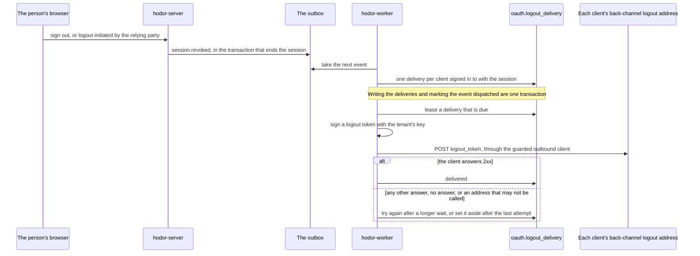

# The OAuth context

The `oauth` context makes Hodor an OAuth 2.x authorization server and an OpenID Provider. It owns the applications a tenant registers, the clients through which they ask for tokens, the resource servers those tokens are for, and, in later issues, the codes, grants, tokens and consents of [Milestone 3](../../product/epics.md#milestone-3-applications-ask-hodor-who-someone-is).

It does not sign anyone in. When a request needs a person, it hands the request to the `authentication` context and takes the session that comes back. The two contexts do not depend on each other: the HTTP layer joins them ([crates.md](../crates.md)).

This page specifies what Issue-53 builds: applications, clients and resource servers, and the rules they keep; what Issue-55 builds: the authorization endpoint, grants and authorization codes; what Issue-56 builds: the token endpoint, client authentication and access tokens; what Issue-59 builds: the OpenID Provider; what Issue-60 builds: logout initiated by the relying party; what Issue-62 builds: [consent](#consent); what Issue-93 builds: [clients that act as a workload](#clients-that-act-as-a-workload); what Issue-106 builds: [a JWT-SVID as a client's proof](#checking-a-jwt-svid); what Issue-107 builds: [an identity forwarded by a proxy](#an-identity-forwarded-by-a-proxy) as a client's proof; what Issue-95 builds: [token exchange](#token-exchange); what Issue-100 builds: [back-channel logout](#back-channel-logout); what Issue-98 builds: [pairwise subject identifiers](#pairwise-subject-identifiers); and what Issue-99 builds: [claim mappers](#claim-mappers); and what Issue-120 builds: [request objects](#request-objects). The other endpoints and tokens are added by Issue-57 and Issue-58, under the headings at the end of this page.

## Applications

An application is what a tenant's administrator registers: a web site, a mobile application, a service. It is the unit people recognize. It groups the clients that ask for tokens on its behalf, and it may expose one resource server.

| Field | Meaning |
|---|---|
| Identifier | An `ApplicationId` |
| Name | Shown to people, for example on the consent page. 1 to 100 characters, without control characters; spaces at either end are removed |
| First party | Whether the application belongs to whoever runs the tenant. A person is not asked for [consent](#consent) for a first-party application |
| Status | `enabled` or `disabled`. The clients of a disabled application get no tokens |

A tenant has at most 100 applications.

## Clients

A client is what talks to Hodor's endpoints. Its identifier is the `client_id` of OAuth.

| Field | Meaning |
|---|---|
| Identifier | A `ClientId`. Written as a UUID, it is the `client_id` the client sends. It is not a secret |
| Application | The application it belongs to. It never changes |
| Name | For administrators. Same rule as an application's name |
| Type | `confidential`: it runs where it can keep a secret, such as a server. `public`: it runs where it cannot, such as a browser or a mobile application. Chosen when the client is created and never changed |
| Authentication method | How it proves who it is at the token endpoint: `client_secret_basic`, `client_secret_post`, `private_key_jwt`, `spiffe_jwt`, `tls_client_auth`, `spiffe_x509`, `linkerd_identity` or `none` |
| Grants | What it may ask for: `authorization_code`, `refresh_token`, `client_credentials`, and `urn:ietf:params:oauth:grant-type:token-exchange` for [token exchange](#token-exchange) |
| Exchange rules | For a client with the token exchange grant: which tokens it may exchange for which audience. At most 20 |
| Redirect addresses | Where the authorization endpoint may send a person back to. At most 10 |
| Post-logout redirect addresses | Where [logout](#logout-initiated-by-the-relying-party) may send a person back to. At most 10 |
| Back-channel logout address | Optional: where Hodor sends a [logout token](#back-channel-logout) when a session the client signed a person in with ends, its `backchannel_logout_uri` of OpenID Connect Back-Channel Logout. See [the back-channel logout address](#the-back-channel-logout-address) |
| Back-channel logout session required | Whether the client needs `sid` in its logout tokens, its `backchannel_logout_session_required`. `false` unless chosen. Hodor puts `sid` in every logout token, so this only records what the client relies on |
| Scopes | The scopes it may ask for. At most 50 |
| PKCE | Whether it must send a code challenge. Always for a public client; on by default for a confidential one |
| ID token algorithm | How its [ID tokens](#the-id-token) are signed, its `id_token_signed_response_alg` of OpenID Connect Registration: `ES256` unless changed, or `RS256` |
| Request object algorithm | How it signs its [request objects](#request-objects), its `request_object_signing_alg` of OpenID Connect Registration: none chosen unless changed, which accepts `ES256`, `RS256` and `PS256`; one of the three, which accepts only it; or `none`, which accepts only unsigned request objects |
| Subject type | How it knows a person, its `subject_type` of OpenID Connect Registration: `public`, the person's user identifier, unless changed, or `pairwise`, an identifier of its sector alone. See [pairwise subject identifiers](#pairwise-subject-identifiers) |
| Sector identifier address | Optional, for a pairwise client: an address that lists its redirect addresses and whose host is its sector, its `sector_identifier_uri`. See [the sector identifier address](#the-sector-identifier-address) |
| Token policy | How long its tokens live |
| Principal | Optional: the [service account or agent](identity.md#service-accounts-and-agents) the client acts as. See [clients that act as a workload](#clients-that-act-as-a-workload) |
| SPIFFE identifier | For a client using `spiffe_jwt` or `spiffe_x509`, and for one using `tls_client_auth` without a Linkerd identity: the one SPIFFE identifier of the workload whose JWT-SVIDs or forwarded certificates prove who the client is, its `spiffe_id` of the draft. See [the SPIFFE identifier of a client](#the-spiffe-identifier-of-a-client) |
| Linkerd identity | For a client using `linkerd_identity`, and for one using `tls_client_auth` without a SPIFFE identifier: the workload's Linkerd identity, such as `web.shop.serviceaccount.identity.linkerd.cluster.local`. See [an identity forwarded by a proxy](#an-identity-forwarded-by-a-proxy) |
| Certificate-bound access tokens | Whether its access tokens are bound to the certificate its requests come with, its `tls_client_certificate_bound_access_tokens` of RFC 8705. `false` unless chosen. See [certificate-bound access tokens](#certificate-bound-access-tokens) |
| Secrets | Its secrets, kept only as hashes. Only with `client_secret_basic` or `client_secret_post` |
| Keys | Its public keys, for `private_key_jwt`. Only with that method |
| Status | `enabled` or `disabled`. A disabled client gets no tokens |

An application has at most 20 clients.

### What a client may be

Every change to a client is checked against all of these at once; a change that breaks one changes nothing.

- **A public client has no secret and cannot be given one.** Its authentication method is `none`, it has no keys, and it always uses PKCE.
- **A confidential client proves who it is.** Its method is `client_secret_basic`, `client_secret_post`, `private_key_jwt`, `spiffe_jwt`, `tls_client_auth`, `spiffe_x509` or `linkerd_identity`, never `none`.
- **`client_credentials` is for confidential clients only**, since that grant is the client acting as itself.
- **`refresh_token` comes with `authorization_code`.** A refresh token is only ever issued with tokens from a code.
- **A client with `authorization_code` has at least one redirect address, and one without it has none.**
- **Only a client with `authorization_code` has post-logout redirect addresses**, since only it gets ID tokens and signs people in. It may have none.
- **Only a client with `authorization_code` has a back-channel logout address**, for the same reason. It may have none. Back-channel logout session required is `true` only for a client with an address.
- **Only a client with `authorization_code` may be pairwise**, since only it signs people in; a client of client credentials alone, and so one with a principal, is public. **A pairwise client has a sector**: a sector identifier address, or redirect addresses that all name one host. **Only a pairwise client has a sector identifier address.**
- **A client has at least one grant.**
- **A client with a principal has the `client_credentials` grant**, and may have the token exchange grant besides; no other. It is the workload's credential.
- **The token exchange grant needs a principal, which must be an agent, and at least one exchange rule; exchange rules need the grant.** Only an agent acts on a person's behalf ([Decision 0031](../../decisions/0031-workloads-are-users.md)). Each rule is a pair of audiences, the one a subject token must hold and the one the new token is for, each at most 255 printable characters, each pair once.
- **A client using `spiffe_jwt` has a principal and a SPIFFE identifier** ([Decision 0055](../../decisions/0055-spiffe-jwt-client-authentication.md)), **and so does one using `spiffe_x509`; one using `linkerd_identity` has a principal and a Linkerd identity; one using `tls_client_auth` a principal and exactly one of the two** ([Decision 0056](../../decisions/0056-forwarded-client-identity.md)). A client of any other method has neither. Its principal must be a service account. Refused with `oauth.client_spiffe_id_invalid`, or `oauth.client_linkerd_identity_invalid` for a Linkerd identity that does not read or does not fit the method.
- **A client using `linkerd_identity` does not ask for certificate-bound access tokens**: Linkerd forwards no certificate to bind them to ([Decision 0057](../../decisions/0057-certificate-bound-access-tokens.md)). Any other client may, a public one included. Refused with `oauth.client_certificate_bound_access_tokens_invalid`.
- **Switching the authentication method drops what the old one used.** A client that moves away from a secret method loses its secrets, and one that moves away from `private_key_jwt` loses its keys. A client is given its identity in the change that moves it to a method that takes one, and the administration interface drops an identity the new method does not take.

### Redirect addresses

A redirect address is where a person's browser is sent with a code. Sending a code to the wrong place hands it to whoever is there, so the rules are strict:

- **Compared by exact equality only.** The address an authorization request names must be, character for character, one that is registered. No prefix, no pattern, no normalization, not even the port of a loopback address. [RFC 9700](https://www.rfc-editor.org/rfc/rfc9700) recommends this.
- **HTTPS**, with a host, without a name and password, a fragment or a `*`.
- **Plain HTTP only to a loopback address written as an address**, `127.0.0.1` or `[::1]`, for an application on the person's own machine ([RFC 8252](https://www.rfc-editor.org/rfc/rfc8252#section-7.3)). The name `localhost` is not accepted, since it can resolve elsewhere.
- **A private-use scheme only for a public client**, written as a reversed domain name that has a dot in it, such as `com.example.app:/callback` ([RFC 8252](https://www.rfc-editor.org/rfc/rfc8252#section-7.1)).
- At most 2000 characters, all of them printable ASCII without spaces.

An address is kept exactly as it was given.

**Post-logout redirect addresses** follow the same rules, checked the same way, and are a list of their own: an address where a person may be sent with a code is not, for that reason, one where they may be sent after signing out, and the reverse.

### The back-channel logout address

Issue-100. The back-channel logout address is not where a browser goes: Hodor's worker calls it, server to server, with a [logout token](#the-logout-token). An address that leads inside the network Hodor runs in would let a tenant's administrator make Hodor call it, so the address is checked as a [webhook endpoint](webhooks.md#endpoints) is:

- **One absolute HTTPS address**, with a host, without a name and password or a fragment, at most 2000 characters, all of them printable ASCII without spaces. A port, a path and a query are allowed ([Back-Channel Logout, section 2.2](https://openid.net/specs/openid-connect-backchannel-1_0.html#BCRegistration)). It is kept exactly as it was given.
- **Checked when it is set**, through the `DestinationCheck` port, which the guarded outbound client implements with the rules of [outbound HTTP](../../security/outbound-http.md): HTTPS only, and every address the name resolves to now must be public. An address that may not be called is refused with `oauth.client_backchannel_logout_uri_forbidden`, one that is not HTTPS or cannot be read with `oauth.client_backchannel_logout_uri_invalid`, a name that resolves to nothing with `oauth.client_backchannel_logout_uri_unresolvable`. The message never repeats what the name resolved to.
- **Only a new or changed address is checked.** Changing a client's other settings does not check its address again, so a name that resolves elsewhere since does not stop an administrator from changing the client's name.
- **Checked again at every delivery**, by the guarded client, on the resolution it connects with: a name can lead elsewhere later. An attempt to an address that may not be called fails like one the client did not answer.
- **The addresses of the development exception** (`HODOR_OUTBOUND_DEVELOPMENT_HOSTS`) are accepted over plain HTTP, when set and when called, as the guarded client accepts them. Nowhere real has any.

### Scopes a client may ask for

A scope is written as OAuth writes it: 1 to 128 characters, printable ASCII without spaces, double quotes or backslashes. The list is kept in the order given, without repeats. Whether a resource server or OpenID Connect defines it is checked when it is asked for (Issue-55 and Issue-59), not here.

### Secrets

A secret is what a confidential client using `client_secret_basic` or `client_secret_post` proves who it is with.

- **It is made by Hodor**: `hodor_cs_` followed by 64 hexadecimal characters, from 32 random bytes of the operating system. The beginning lets tools that look for leaked secrets recognize one.
- **It is shown once**, when it is made, and stored nowhere. Hodor keeps its SHA-256 hash ([Decision 0004](../../decisions/0004-token-formats.md)): with 256 bits of randomness there is nothing to guess, so a slow hash would add nothing.
- **Every secret expires**, after 1 to 730 days; 365 unless the administrator chooses.
- **Rotation keeps the newest previous secret for a while.** Making a new secret keeps the one made just before it working for 0 to 30 days more, so that the client can be changed over without stopping. Every older secret stops at once. A client therefore has at most two secrets that work.
- **A secret can be revoked**, and it stops at once.
- A client gets its first secret when it is created with a secret method.

A presented secret is checked by computing its hash and comparing it, in constant time, with each secret of the client that has not expired. A value that does not have the shape of a secret matches nothing and nothing is computed for it.

### Keys

A client using `private_key_jwt` proves who it is by signing an assertion with its own private key ([RFC 7523](https://www.rfc-editor.org/rfc/rfc7523)). Hodor keeps the public key as a JSON Web Key:

- `kid` is required, 1 to 128 printable characters, unique among the client's keys;
- `kty` is `EC` with `crv` `P-256` or `P-384`, `RSA` with a modulus of at least 2048 bits, or `OKP` with `crv` `Ed25519`;
- `use`, if present, is `sig`; `alg`, if present, fits the key: `ES256`, `ES384`, `RS256`, `PS256` or `EdDSA`;
- **no private part**: a key with `d`, `p`, `q`, `dp`, `dq`, `qi`, `oth` or `k` is refused, so that a private key pasted by mistake is never kept;
- at most 5 keys per client.

How an assertion is checked against these keys is in [checking a client assertion](#checking-a-client-assertion).

### Token policy

| Setting | Allowed | Default |
|---|---|---|
| Access token lifetime | 1 minute to 1 hour | 5 minutes ([Decision 0004](../../decisions/0004-token-formats.md)) |
| ID token lifetime | 1 minute to 1 hour | 5 minutes |
| Refresh token lifetime | 1 hour to 365 days; the most a refresh token family can live | 30 days |
| Refresh token idle time | 1 hour up to the refresh token lifetime; how long a refresh token lasts unused | 7 days |
| Consent lifetime | 1 to 730 days; how long a person's [consent](#consent) to the client lasts before they are asked again | 365 days |

### Clients that act as a workload

A confidential client of the client credentials grant may be bound to one **principal**: a [service account or an agent](identity.md#service-accounts-and-agents) of the tenant ([Decision 0031](../../decisions/0031-workloads-are-users.md)). The client is then the workload's credential: it proves who it is with its secret or its key, as any client does, or, for a service account's client, with the workload's JWT-SVID ([the SPIFFE identifier of a client](#the-spiffe-identifier-of-a-client)), and what it gets is about the workload.

- **Its access tokens are the workload's.** `sub` is the principal's identifier, and `principal_kind` says its kind, `service_account` or `agent`. `client_id` is still the client. The roles assigned to the principal are the ones a resource server finds when it asks [the Authorization API](authorization.md#the-authorization-api) about the token's `sub`, as a subject of kind `user`.
- **It gets tokens only while the workload may act**: while the principal is a service account or an agent of the tenant that is Active. Otherwise the token endpoint answers `invalid_client`, as for a disabled client.
- **Its tokens stay in force only while the workload may act.** [The register of access tokens](#the-register-of-access-tokens) keeps the principal in each record and asks again whenever the token is checked; disabling or deleting the workload also revokes its tokens ([the identity context](identity.md#its-lifecycle)).
- **Several clients may be bound to one workload**, for example one per place it runs, so that each has its own secret. Replacing a client keeps the workload's roles, which are the workload's and not the client's.
- **Changing or removing a client's principal** leaves the tokens already issued as they are: each names the principal it was issued for, and is in force while that one may act.
- **A client without a principal is answered as before**: its tokens are about itself and carry no `principal_kind`.

How a resource server that reads tokens by itself tells the subjects apart:

| The token | Its subject |
|---|---|
| Carries `principal_kind` | A workload of that kind, named by `sub` |
| `sub` is the same as `client_id` | The client, acting for itself |
| Otherwise | A person, named by `sub` |

The OAuth context keeps the principal as a user identifier and does not know what it is; whether it may act is asked of the `PersonStanding` port of [the token endpoint](#token-endpoint-and-client-authentication). The administration interface and the command-line tool check, through the identity context, that a principal is a service account or an agent of the tenant that is not deleted, and refuse anything else with `oauth.client_principal_invalid`.

### The SPIFFE identifier of a client

Issue-106. A client of a service account may prove who it is with a JWT-SVID, the token its service mesh or SPIRE gives the workload ([Decision 0029](../../decisions/0029-hodor-in-a-service-mesh.md#a-workload-proves-who-it-is-in-one-of-three-ways)), instead of a secret or a key of its own. It is then bound to the one SPIFFE identifier that names the workload, and uses the method `spiffe_jwt` ([Decision 0055](../../decisions/0055-spiffe-jwt-client-authentication.md)).

- **One identifier, written exactly** as the SPIFFE identifier specification writes it: `spiffe://`, the trust domain's name by [the rule of the keys context](keys.md#what-a-trust-domain-is), and a path of one or more segments, each `/` followed by 1 or more letters, digits, `.`, `-` and `_`, never `.` or `..` alone; no `/` at the end, no query, no fragment, no percent-encoding, at most 2048 characters. For example `spiffe://cluster.local/ns/payroll/sa/nightly-export`. It is compared byte for byte. **A prefix match is not accepted**: `*` is not a character of a path, so an identifier ending in `/*`, which the draft allows, is refused. Otherwise `oauth.client_spiffe_id_invalid`.
- **Always with `spiffe_jwt` and `spiffe_x509`, possibly with `tls_client_auth`, and with no other method** (Issue-107 added the last two); and only for a client with a principal. The administration interface checks that the principal is a service account of the tenant, `oauth.client_principal_invalid` otherwise: an agent proves who it is with its own credentials.
- **One service account per identifier in the tenant.** Several clients of one tenant may be bound to the same identifier only if they all act as the same service account, so that an identifier names one workload; a client of another principal is refused with `oauth.client_spiffe_id_taken` ([Decision 0058](../../decisions/0058-hodor-ext-authz.md#an-identity-binds-the-clients-of-one-service-account)). That lets one workload, such as [`hodor-ext-authz`](../../operations/hodor-ext-authz.md), hold a client in each of several applications with its one identity; each client is still named by its `client_id` when it proves who it is. Issue-106 kept an identifier to one client; Issue-110 widened it. Two tenants may each bind the same identifier: each trusts a trust domain of that name of its own, which the other never reads.
- **The trust domain is found when the client proves who it is**, in the client's tenant, by the name in the identifier. Binding a client does not need the tenant to trust that trust domain yet. Until it does, or while the trust domain is checked by the mesh and has no bundle, every JWT-SVID of the client is refused.
- **Changing the identifier** takes effect from the next request: a JWT-SVID of the former identifier is refused from then on. Tokens already issued stay in force, as for a change of principal.

How the JWT-SVID is checked is in [checking a JWT-SVID](#checking-a-jwt-svid), and a certificate a proxy forwards in [an identity forwarded by a proxy](#an-identity-forwarded-by-a-proxy).

**A Linkerd identity** (Issue-107) binds a client using `linkerd_identity`, or `tls_client_auth` without a SPIFFE identifier, by the same rules: one identity, written exactly, with a service account as principal, held by the clients of one service account only in the tenant (`oauth.client_linkerd_identity_taken`), its trust domain found when the client proves who it is. It is a DNS name in lowercase, at most 253 characters, of labels of letters, digits and `-`, holding `.serviceaccount.identity.` followed by the namespace of Linkerd's control plane and the trust domain, as Linkerd names a workload: `<service account>.<namespace>.serviceaccount.identity.<control plane namespace>.<trust domain>`. Its trust domain is what follows the control plane's namespace. Anything else is refused with `oauth.client_linkerd_identity_invalid`.

## Resource servers

A resource server is an interface that accepts Hodor's access tokens. Its identifier is the audience of those tokens and the `resource` a client names in a request ([RFC 8707](https://www.rfc-editor.org/rfc/rfc8707)).

| Field | Meaning |
|---|---|
| Identifier | A `ResourceServerId` |
| Application | The application that exposes it; an application has at most one resource server. Never changes |
| Audience | An absolute address, `https://…` or `urn:…`, without a fragment, at most 255 printable characters. Unique in the tenant and never changed, since tokens already issued name it |
| Name | For administrators and the consent page. Same rule as an application's name |
| Scopes | What it defines, each with a name and a description of up to 200 characters. At most 100 |

A scope name follows the rule of [scopes a client may ask for](#scopes-a-client-may-ask-for), is unique within the resource server and is none of the names OpenID Connect defines, `openid`, `profile`, `email`, `address`, `phone` and `offline_access`, nor `groups`, which Hodor answers itself ([the `groups` claim](#the-groups-claim)).

Three of Hodor's own interfaces are resource servers a tenant registers like any other, by their audience: [the Authorization API](authorization.md#who-may-ask), `urn:hodor:authorization`, [the SCIM server](provisioning.md#who-may-call), `urn:hodor:scim`, and the signing of intermediates by [the tenant's certificate authority](keys.md#who-may-sign), `urn:hodor:certificate-authority`. All three check the tokens presented to them in one way, through the resource access use case: the signature by a published key of the tenant, the tenant's issuer, the expiry, the certificate of a [bound token](#certificate-bound-access-tokens), the audience, the register of access tokens, and an enabled client of an enabled application. Which scope opens what is each interface's own rule.

## Operations

| Use case | What it does |
|---|---|
| Create, change, enable and disable an application | Name and first party; the status |
| Create a client | Checks the settings against [what a client may be](#what-a-client-may-be); a confidential client with a secret method gets its first secret, returned once |
| Change a client | Replaces its settings, all checked again |
| Rotate a client's secret | Makes a new secret, returned once, and shortens or ends the old ones as [the rules](#secrets) say |
| Revoke a client's secret | Ends one secret at once |
| Add and remove a client's key | Only for `private_key_jwt` |
| Enable and disable a client | |
| Create and change a resource server | Name and scopes; the audience is fixed |
| Read and list | An application, the tenant's applications, a client, an application's clients, a resource server by identifier or by audience, the tenant's resource servers |

Changes use optimistic locking: a change made from a copy someone else has changed since is refused with a conflict, and nothing is stored.

Administrators reach these use cases through [the administration interface](../../api/admin-api.md#applications-clients-and-resource-servers), the console's applications screens ([the admin console](../admin-console.md#screens)) and `hodor-cli application`, `hodor-cli client` and `hodor-cli resource-server` (Issue-54). They need the permissions `applications:read` and `applications:write` ([the authorization context](authorization.md#permissions)).

### The command-line tool

For an operator who can reach the database, as for tenants and identity providers. The commands need `HODOR_DATABASE_URL` and name the tenant by its slug; what they do is in the audit log with Hodor itself as the actor.

| Command | What it does |
|---|---|
| `hodor-cli application add --tenant acme --name Billing [--first-party]` | Registers an application, enabled; third party unless `--first-party` is given. Prints its identifier |
| `hodor-cli application list --tenant acme` | One line per application: identifier, status, first or third party, name |
| `hodor-cli application disable --tenant acme --id …`, `enable` | |
| `hodor-cli client add --tenant acme --application … --name … --type confidential --grant authorization_code --redirect-uri https://… --scope openid` | Creates a client. `--grant`, `--redirect-uri`, `--post-logout-redirect-uri` and `--scope` are given once per value; `--method` chooses the authentication method, `--secret-days` the lifetime of the first secret, `--without-pkce` lets a confidential client redeem a code without PKCE, `--id-token-algorithm` signs its ID tokens with `RS256` instead of `ES256`, `--request-object-signing-alg` chooses its [request object algorithm](#request-objects), `ES256`, `RS256`, `PS256` or `none`, `--backchannel-logout-uri` gives it a [back-channel logout address](#the-back-channel-logout-address), checked with the development exception of `HODOR_OUTBOUND_DEVELOPMENT_HOSTS` as the server has it, `--backchannel-logout-session-required` records that it needs `sid`, `--subject-type pairwise` makes it [pairwise](#pairwise-subject-identifiers), `--sector-identifier-uri` gives it a [sector identifier address](#the-sector-identifier-address), fetched through a guarded client with the same development exception, `--principal` binds it to a service account or an agent, `--exchange-rule '<subject audience>=><audience>'`, once per rule, gives an agent's client its exchange rules, `--spiffe-id` and `--linkerd-identity` bind a service account's client using `spiffe_jwt`, `spiffe_x509`, `tls_client_auth` or `linkerd_identity` to [its workload's identity](#an-identity-forwarded-by-a-proxy), and `--bound-tokens` asks for [certificate-bound access tokens](#certificate-bound-access-tokens). Prints the `client_id` and, for a client with a secret method, the secret, once |
| `hodor-cli client list --tenant acme --application …` | One line per client: `client_id`, status, type, authentication method, name |
| `hodor-cli client rotate-secret --tenant acme --id … [--lifetime-days 365] [--keep-previous-days 7]` | Gives a client a new secret and prints it, once |
| `hodor-cli client disable --tenant acme --id …`, `enable` | |
| `hodor-cli resource-server add --tenant acme --application … --audience https://api.example.com --name … --scope 'invoices:read=Read your invoices'` | Registers the resource server of an application; `--scope` is given once per scope, as its name, `=` and its description |
| `hodor-cli resource-server list --tenant acme` | One line per resource server: identifier, audience, name, scopes |

Changing a client's settings, ending one secret and managing keys are done through the administration interface or the console.

### Events

| Event type | When |
|---|---|
| `oauth.application_created`, `oauth.application_changed` | An application was registered or changed; carry its identifier and name |
| `oauth.application_enabled`, `oauth.application_disabled` | |
| `oauth.client_created`, `oauth.client_changed` | Carry the client, its application, its type and its principal, if it has one |
| `oauth.client_enabled`, `oauth.client_disabled` | |
| `oauth.client_secret_issued`, `oauth.client_secret_revoked` | Carry the client and the secret's identifier, and when it expires; never the secret or its hash |
| `oauth.client_key_added`, `oauth.client_key_removed` | Carry the client and the `kid` |
| `oauth.resource_server_created`, `oauth.resource_server_changed` | Carry the resource server and its audience |

### Ports

| Port | Purpose |
|---|---|
| `ApplicationStore` | Store, change and load applications |
| `ClientStore` | Store, change and load clients with their secrets and keys; find the clients bound to a workload's identity |
| `ResourceServerStore` | Store, change and load resource servers; find one by audience |
| `Digest` | SHA-256, from the kernel |
| `RandomSource` | The random bytes of a secret, from the kernel |
| `DestinationCheck` (kernel) | Checks a back-channel logout address and a sector identifier address when they are set; the guarded client |
| `HttpClient` (kernel) | Fetches a sector identifier address when it is set; the guarded client |

## Storage

Every table is a tenant table under row-level security, in the schema `oauth`. References between them include the tenant, so a row can only name a row of its own tenant.

### `oauth.application`

| Column | Type | Notes |
|---|---|---|
| `tenant_id`, `id` | `uuid` | Primary key |
| `name` | `text` | |
| `first_party` | `boolean` | |
| `status` | `text` | `enabled` or `disabled` |
| `created_at`, `updated_at` | `timestamptz` | |
| `version` | `integer` | For optimistic locking |

### `oauth.client`

| Column | Type | Notes |
|---|---|---|
| `tenant_id`, `id` | `uuid` | Primary key |
| `application_id` | `uuid` | References `oauth.application` |
| `name`, `client_type`, `authentication_method`, `status` | `text` | A check constraint keeps a public client on `none`, and another (`client_method_known`) the method among the eight |
| `grant_types`, `redirect_uris`, `post_logout_redirect_uris`, `allowed_scopes` | `text[]` | Redirect addresses of both kinds are compared byte for byte (`COLLATE "C"`) |
| `require_pkce` | `boolean` | A check constraint keeps it true for a public client |
| `principal_id` | `uuid` | The workload the client acts as, or null. Not a reference: contexts do not reference each other's tables. Check constraints allow it only with `client_credentials` and, besides, `urn:ietf:params:oauth:grant-type:token-exchange`, and require it with the latter |
| `spiffe_id` | `text` | The [SPIFFE identifier](#the-spiffe-identifier-of-a-client), or null, compared byte for byte (`COLLATE "C"`). Check constraints keep its shape (`client_spiffe_id_shape`), hold each method to its identity (`client_identity_of_its_method`, migration 0080: `spiffe_jwt` and `spiffe_x509` a SPIFFE identifier, `tls_client_auth` one of the two identities) and require a principal with it (`client_spiffe_id_needs_principal`). The partial index `client_spiffe_id_bound` (migration 0084, which replaced the unique index of migration 0078) finds its clients; the store keeps it to one principal per tenant, checking under a transaction-scoped advisory lock on the tenant and the identifier before it writes a bound client |
| `linkerd_identity` | `text` | The [Linkerd identity](#the-spiffe-identifier-of-a-client) of a client using `linkerd_identity` or `tls_client_auth`, or null, compared byte for byte (`COLLATE "C"`). Check constraints keep its shape (`client_linkerd_identity_shape`), its method (`client_identity_of_its_method`) and a principal with it (`client_linkerd_identity_needs_principal`). The partial index `client_linkerd_identity_bound` (migration 0084, which replaced the unique index of migration 0080) finds its clients, and the store keeps it to one principal per tenant as for `spiffe_id` |
| `certificate_bound_access_tokens` | `boolean` | Whether the client asks for [certificate-bound access tokens](#certificate-bound-access-tokens); `false` for a client made before it existed (migration 0082). A check constraint (`client_certificate_bound_not_linkerd`) refuses it with `linkerd_identity` |
| `exchange_rules` | `jsonb` | The exchange rules, a list of `{"subject_audience": …, "audience": …}`; empty unless the client has the token exchange grant |
| `id_token_algorithm` | `text` | `ES256` or `RS256`, by a check constraint; `ES256` for a client made before it existed |
| `request_object_signing_alg` | `text` | `ES256`, `RS256`, `PS256` or `none`, by a check constraint, or null when none is chosen, as for every client made before it existed |
| `backchannel_logout_uri` | `text` | The [back-channel logout address](#the-back-channel-logout-address), or null. At most 2000 characters, `https://` or `http://`, compared byte for byte (`COLLATE "C"`); a check constraint allows it only with the `authorization_code` grant |
| `backchannel_logout_session_required` | `boolean` | `false` for a client made before it existed; a check constraint allows `true` only with an address |
| `subject_type` | `text` | `public` or `pairwise`, by a check constraint; `public` for a client made before it existed. A check constraint allows `pairwise` only with the `authorization_code` grant |
| `sector_identifier_uri` | `text` | The [sector identifier address](#the-sector-identifier-address), or null. At most 2000 characters, `https://` or `http://`, compared byte for byte (`COLLATE "C"`); a check constraint allows it only for a pairwise client |
| `access_token_seconds`, `id_token_seconds`, `refresh_token_seconds`, `refresh_idle_seconds`, `consent_seconds` | `integer` | The token policy |
| `created_at`, `updated_at` | `timestamptz` | |
| `version` | `integer` | For optimistic locking; secrets and keys are stored with the client under the same version |

### `oauth.client_secret`

| Column | Type | Notes |
|---|---|---|
| `tenant_id`, `client_id`, `id` | `uuid` | Primary key; the client is referenced and its secrets go with it |
| `secret_hash` | `bytea` | SHA-256 of the secret; 32 bytes, unique in the tenant |
| `created_at`, `expires_at` | `timestamptz` | |

A revoked or replaced secret is deleted: there is nothing to keep about a secret that no longer works.

### `oauth.client_key`

| Column | Type | Notes |
|---|---|---|
| `tenant_id`, `client_id` | `uuid` | The client is referenced and its keys go with it |
| `key_id` | `text` | The `kid`; primary key with the tenant and the client |
| `jwk` | `jsonb` | The public key; a check constraint refuses one with a private part |
| `position` | `integer` | The order the keys were added in |
| `added_at` | `timestamptz` | |

### `oauth.resource_server` and `oauth.resource_server_scope`

| Column | Type | Notes |
|---|---|---|
| `tenant_id`, `id` | `uuid` | Primary key |
| `application_id` | `uuid` | References `oauth.application`; unique in the tenant |
| `audience` | `text` | Unique in the tenant, compared byte for byte |
| `name` | `text` | |
| `created_at`, `updated_at`, `version` | | As for applications |

`oauth.resource_server_scope` holds `tenant_id`, `resource_server_id`, `name` and `description`, with the tenant, the resource server and the name as primary key, in the order they were given (`position`).

## Authorization endpoint

Issue-55. The authorization endpoint is where a client sends a person's browser to ask for an authorization code ([RFC 6749](https://www.rfc-editor.org/rfc/rfc6749#section-4.1)). It is at `/t/{slug}/oauth2/authorize` and answers `GET` with the parameters in the query, and `POST` with them in a form (`application/x-www-form-urlencoded`); a `POST` with another body is answered with Hodor's own page, `oauth.authorization_form_expected`. A browser does not send the session cookie with a form another site posts (the cookie is `SameSite=Lax`), so a request by `POST` always has the person sign in. Its sequence is [sequence 2](../../protocols/sequences.md#2-oauth-20-authorization-code-with-pkce).

The **issuer** of the tenant is `{HODOR_PUBLIC_URL}/t/{slug}`, without a slash at the end. Every successful answer and every error sent back to a client carries it as `iss` ([RFC 9207](https://www.rfc-editor.org/rfc/rfc9207)), so that a client talking to several servers knows which one answered. Discovery (Issue-59) advertises the same value.

### Checking the request

Nothing is shown and nothing is stored until the request has been checked. The checks are made in this order, and the first that fails decides the answer.

**First, whether the request may be answered at its redirect address at all.** Until the client and its redirect address are known to be genuine, an error is never sent to the address the request names, because that address could be anyone's ([RFC 6749, section 4.1.2.1](https://www.rfc-editor.org/rfc/rfc6749#section-4.1.2.1)). These failures are answered with a page of Hodor's own, status `400`, that says the request cannot be answered and names the reason by its code:

| Failure | Code |
|---|---|
| `client_id` missing, given twice, or not the identifier of a client of this tenant | `oauth.authorization_client_unknown` |
| The client or its application is disabled | `oauth.authorization_client_unknown` |
| The client may not use the authorization code (it has no redirect address) | `oauth.authorization_client_unknown` |
| `redirect_uri` missing or given twice | `oauth.authorization_redirect_uri_missing` |
| `redirect_uri` is not, character for character, one of the client's redirect addresses | `oauth.authorization_redirect_uri_unregistered` |

`redirect_uri` is required even when the client has only one redirect address. OpenID Connect requires it, and requiring it always leaves one rule instead of two.

A client of another tenant is unknown here: the client is looked up only in the tenant the address names.

**Then, everything else, answered at the redirect address.** From here on, an error is sent back to the redirect address with `error`, `error_description`, `state` when the request had one, and `iss`, in the [response mode](#response-modes) the answer would have had:

| Failure | `error` |
|---|---|
| A parameter other than `resource` is given more than once | `invalid_request` |
| `request` is given: it is read as a [request object](#request-objects), whose checks come first | `invalid_request_object` |
| `request_uri` is given: references to a request object are not supported yet | `request_uri_not_supported` |
| `response_type` is missing | `invalid_request` |
| `response_type` is anything but `code` | `unsupported_response_type` |
| `response_mode` is given and is not a [response mode](#response-modes) Hodor offers, `query` or `form_post`, or is one the response type does not allow | `invalid_request` |
| `code_challenge` is missing for a client that requires PKCE (every public client, and a confidential one unless an administrator turned it off) | `invalid_request` |
| `code_challenge_method` is missing or is not `S256`. `plain` is refused: a challenge without a method means `plain` ([RFC 7636](https://www.rfc-editor.org/rfc/rfc7636#section-4.3)) | `invalid_request` |
| `code_challenge` is not 43 characters of base64url without padding, the length of a SHA-256 digest | `invalid_request` |
| `state` or `nonce` is longer than 1024 characters or holds characters outside printable ASCII | `invalid_request` |
| `prompt` holds a value other than `none`, `login`, `consent` and `select_account`, or `none` with another | `invalid_request` |
| `max_age` is not a whole number of seconds from 0 to 31 536 000 | `invalid_request` |
| `login_hint`, `ui_locales` or `acr_values` is longer than 255 characters | `invalid_request` |
| `organization` is not the identifier of an organization, a UUID | `invalid_request` |
| `scope` is missing or empty, holds a scope the client may not ask for, or a scope that neither OpenID Connect nor a resource server of the request defines | `invalid_scope` |
| More than 10 `resource` values; a `resource` that is not an absolute address without a fragment; or one that is not the audience of a resource server of this tenant ([RFC 8707](https://www.rfc-editor.org/rfc/rfc8707)) | `invalid_target` |

**The resource servers of a request.** When the request names resources, they are the resource servers whose audiences it names, and every scope that is not one of OpenID Connect's must be defined by one of them. When it names none, they are the resource servers of the tenant that define the scopes asked for. The resource servers become the audiences of the tokens issued from the code (Issue-56).

`nonce`, `login_hint` and `ui_locales` are kept with the request for the [ID token and the pages](#what-a-request-may-ask-of-the-sign-in); `acr_values` and `max_age` decide [the assurance and the step-up](#assurance-and-step-up); `organization` names [the organization of the sign-in](#the-organization-of-a-sign-in). Parameters the endpoint does not know are ignored, as RFC 6749 requires; `claims` is one of them, so an `acr` asked for through it asks for nothing.

### Request objects

Issue-120. A client may send its request as a **request object**: a JSON Web Token whose claims are the parameters of the request, given by value as `request` ([OpenID Connect Core, section 6](https://openid.net/specs/openid-connect-core-1_0.html#JWTRequests), and [RFC 9101](https://www.rfc-editor.org/rfc/rfc9101)). A request object signed by the client tells Hodor that the request is the client's, and nobody changed it in the browser on the way. How it is checked is [Decision 0045](../../decisions/0045-request-objects-and-pushed-requests.md). A reference to one, `request_uri`, is answered `request_uri_not_supported` until pushed authorization requests (Issue-121) and references at a client's address (Issue-122) are built.

**How a client signs.** Its request object algorithm, its `request_object_signing_alg` of OpenID Connect Registration, says which objects are accepted from it:

| The client's algorithm | Accepted |
|---|---|
| None chosen, the default | An object signed with `ES256`, `RS256` or `PS256` by one of the client's keys |
| `ES256`, `RS256` or `PS256` | An object signed with that algorithm by one of the client's keys; any other is refused |
| `none` | An unsigned object only: its header's `alg` is `none` and its signature is empty. A signed one is refused, as OpenID Connect Registration says of every algorithm a client names |

The keys are the client's own [keys](#keys), which only a client with `private_key_jwt` has; keys at the client's `jwks_uri` come with dynamic client registration ([Milestone 15](../../product/epics.md#milestone-15-clients-that-register-themselves)). A client that proves who it is with a secret can therefore send only unsigned objects, and only once an administrator chose `none` for it. **An unsigned object protects nothing**: anyone who can send a browser to Hodor could have written it, so every check of the endpoint applies to what it holds, exactly as to a request without one.

**Which client.** The object is checked for the client that `client_id` names outside it, looked up in the tenant the address names, as for every request. When `client_id` is not given outside, the object's own `client_id` is read first, only to know which client to check it for. A client of another tenant is unknown there, and its object is never checked: the answer is the page of an unknown client.

**The checks.** They are made in this order, nothing else the object says is used before its signature has been checked, and the first that fails decides the answer, `invalid_request_object`:

| Check | Refused when |
|---|---|
| Size and shape | It is larger than 16 kibibytes, is not three parts of base64url, or its header or claims are not JSON objects |
| Algorithm | The header's `alg` is not one the client's algorithm accepts. The shared-secret algorithms can never be named |
| Key and signature | For a signed object, as for [a client assertion](#checking-a-client-assertion): the header names by `kid` a key the client does not have, or names none while more than one of its keys fits the algorithm, or the signature does not verify over the first two parts exactly as they arrived. For an unsigned object, the third part is not empty |
| `iss` | A signed object has none, or any object has one that is not the client's identifier |
| `client_id` | It is given and is not the client's identifier |
| `aud` | It is given and does not hold the tenant's issuer |
| `exp` | It is given and is in the past, allowing 60 seconds for clocks, or is not a whole number of seconds |
| `nbf` | It is given and is in the future, allowing 60 seconds, or is not a whole number of seconds |
| Its parameters | It holds `request` or `request_uri`, or a parameter whose value is a list of anything but text |

`jti` is not remembered, and `exp` and `nbf` may be left out: an object may be sent again until it expires, as the same request could be. A client held to a [security profile](../../decisions/0052-security-profiles.md) will need them, in 0.6.0.

**The parameters inside win.** Once checked, the object's claims are the request. Text is read as it is; a number or a boolean as the text JSON writes it; an object, such as `claims`, as its JSON; a list as the parameter given once for each element, which only `resource` may be. `iss`, `aud`, `exp`, `nbf`, `iat` and `jti` are the object's own and not parameters. Of the parameters outside the object, only `client_id` is read, as RFC 9101 says: the others are ignored, a `redirect_uri` or a `state` included. OpenID Connect asks a client to repeat `response_type`, `client_id` and `scope` outside; when it does, they must have the values they have inside, the scopes in any order, or the answer is `invalid_request`. `request` and `request_uri` together are `invalid_request`.

**Then every check of the endpoint applies** to the parameters read from the object, in the order of [checking the request](#checking-the-request): a redirect address in the object that is not one of the client's is answered with Hodor's own page, whatever the one outside says, and PKCE, the scopes and the resources are checked as for any request. The object itself is never kept: what waits while the person signs in is the checked request, as for every request.

**Where a refused object is answered.** An error goes only to one of the client's redirect addresses: to the `redirect_uri` outside the object when it is one, otherwise to the object's own when it is one, read without trusting anything else it says, each with the `state` given beside it. When neither is, the answer is Hodor's own page, `oauth.authorization_request_object_invalid`. A redirect address of the client is where its answers go in any case, so an error sent there tells nobody else anything.

### Whether the person must sign in

A checked request needs a person signed in to the tenant. The session cookie of the browser is looked up as for every route of the tenant, and the request decides whether that session is enough:

| Situation | What happens |
|---|---|
| No valid session, or `prompt` holds `login` or `select_account` | The person signs in, then the request goes on. With `prompt=none`, error `login_required` instead |
| A valid session that is [enough](#assurance-and-step-up) for the request | [Consent](#when-a-person-is-asked) is decided; when nobody needs to be asked, a code is issued at once |
| A valid session that is not enough: too old for `max_age`, or below the level asked for | A [step-up](#assurance-and-step-up) asks the person for what the session lacks, then the request goes on. With `prompt=none`, error `login_required` instead |
| A valid session that is not enough, and the person cannot reach the level asked for with the factors they have | Error `unmet_authentication_requirements` at the redirect address ([OpenID Connect Unmet Authentication Requirements](https://openid.net/specs/openid-connect-unmet-authentication-requirements-1_0.html)) |

`select_account` is treated as `login`: a browser holds one session per tenant, so the only way to choose another account is to sign in as it. `consent` asks the person for [consent](#consent) again.

### Assurance and step-up

An application asks how strongly the person must have proved who they are with `acr_values`, a list of the [assurance levels](tenant.md#assurance-levels) of the tenant, separated by spaces, and how recently with `max_age`.

**The level asked for.** The names of `acr_values` that are not levels of this tenant are ignored; a request that names none of its levels asks for no level. Of the levels it names, the weakest is what the request asks for: OpenID Connect lists the values the client accepts in order of preference, and any of them is acceptable, so the weakest is enough and a stronger one is more than enough. Hodor treats the request as one that must be met: a session below it is stepped up, and a person who cannot reach it gets `unmet_authentication_requirements` rather than a token with less.

**The methods that count.** Without `max_age`, every method of the session counts. With it, only the methods proven within `max_age` seconds count ([the session context](session.md#the-facts-a-session-carries)): a method proven earlier is stale, as if it had not been proven. When the request was kept while the person signed in or stepped up, a method proven after the request arrived was proven for it and counts whatever `max_age` says, so that `max_age=0` is met by the sign-in it asks for.

**When a session is enough.** It is enough when at least one of its methods counts, and the [assurance](authentication.md#what-a-sign-in-must-reach) that the methods that count amount to reaches the requirement of the level asked for, if any. The authentication context says what the methods amount to.

**The step-up.** When the session is not enough, the authorization endpoint asks the authentication context to start a [step-up](authentication.md#step-up) of the session, carrying the methods that count and demanding the requirement of the level asked for. Only what is missing is asked:

| Session | Request | The person is asked for |
|---|---|---|
| A password | `acr_values` of a multi-factor level | Their security key, or the code of their application |
| A password and a code of the application | `acr_values` of a phishing-resistant level | Their security key, or a passkey through it |
| A password and a code of the application | `acr_values` of a phishing-resistant level, and they have no security key | Nothing: `unmet_authentication_requirements` |
| A password proven two hours ago and a security key a minute ago | `max_age=600` | Their password, since the key alone is one factor and the password is stale |
| A password proven two hours ago | `max_age=600` | Their password. The identifier is not asked again: to sign in as someone else, the application sends `prompt=login` |

The authorization endpoint starts the step-up itself, keeps the request pending as for a sign-in, gives the browser the sign-in cookie of the step-up, and sends it to the sign-in page, which shows the step the step-up waits for. When the step-up completes, the session is raised, with a new token, and the request goes on.

**What the code says.** A code issued for a session carries only the methods that count, the time of the latest of them as when the person signed in, and the name of the strongest level of the tenant they reach, the `acr` of its tokens. A sign-in that reaches no level of the tenant has no `acr`. A token never names a level the methods it carries did not reach.

### Signing in and coming back

When the person must sign in, the request is kept and the browser is sent to the hosted pages.

1. The checked request is stored as a **pending authorization request**, for ten minutes, the life of a sign-in. It is bound to the browser exactly as a sign-in is: Hodor makes a random secret of 256 bits, stores only its SHA-256 hash with the request, and gives the browser the request's identifier and the secret in a cookie.
2. The browser is redirected to `/t/{slug}/account/sign-in?continue=authorization`. That address tells the sign-in page to start a sign-in even when the browser is signed in already, since the request asked for a new one.
3. The person signs in with any way the tenant offers, an identity provider included. When the sign-in completes, the interaction interface sees the cookie and adds `"continue": "/t/{slug}/oauth2/authorize/resume"` to its answer ([the interaction interface](../../api/interaction-api.md#what-a-sign-in-response-looks-like)). The page goes there instead of to the account page.
4. `GET /t/{slug}/oauth2/authorize/resume` reads the cookie, takes the pending request, which can therefore be resumed once, and removes the cookie. Without the cookie, with a wrong secret or after ten minutes, it answers with Hodor's own error page, `oauth.authorization_request_not_found`.
5. The session is checked again against the request. A request that asked for a new sign-in (`prompt=login` or `select_account`) needs a session that signed in after the request arrived; otherwise the answer is `access_denied` at the redirect address, because the person did not sign in again. Then the session must be [enough](#assurance-and-step-up): when it is, [consent](#when-a-person-is-asked) is decided and, when nobody needs to be asked, a code is issued. When it is not, after a new sign-in that did not reach the level asked for, a step-up is started as when the request arrived, and the request is kept again; when the person cannot reach the level, the answer is `unmet_authentication_requirements`. A step-up demands the level, so its completion is always enough, and the request does not go round twice.

The cookie:

| Attribute | Value | Why |
|---|---|---|
| Name | `__Secure-hodor_authorization` | |
| Value | The pending request's identifier and its secret | |
| `HttpOnly`, `Secure` | Yes | As for the other cookies |
| `SameSite` | `Strict` | It is only ever needed by requests Hodor's own pages make |
| `Path` | `/t/{slug}` | Sent to the interaction interface, which adds `continue`, and to the resume address |
| `Max-Age` | 600 seconds | |

A browser has one pending authorization request per tenant at a time: a new one replaces the cookie of the one before, which then cannot be resumed.

### The organization of a sign-in

Issue-89. A client whose customers are [organizations](identity.md#organizations) of the tenant names the one a person signs in for with `organization`, the organization's identifier. The tokens then carry it as `org_id`, and a resource server, or the [Authorization API](../../api/api-spec.md), counts the roles the person holds in that organization ([Decision 0005](../../decisions/0005-tenant-and-organization.md)).

- **The person must be a member.** Whether they are is decided once they are signed in and the session is enough, before consent is asked and before any code is made. A person who is not a member, and an organization the tenant does not have, are answered alike, at the redirect address, with `access_denied` and the description `the person is not a member of the organization`, so that a request does not tell which organizations exist. With `prompt=none` the answer is the same.
- **The grant keeps it.** Every access token and ID token issued from the grant carries the same `org_id`, the refreshed ones included. A person who signs in for another organization makes another grant.
- **A person who leaves the organization stops getting tokens for it.** Each refresh checks the membership again, and is refused with `invalid_grant` once it has ended ([refresh tokens](#refresh-tokens)). An access token already issued lives on until it expires, as with every other change: its lifetime is short.
- **Without `organization`** the tokens carry no `org_id`, and only roles that are not scoped to an organization count.

Hodor does not ask the person which organization they mean: the client names it, from its own address or from what the person chose in it. A page where a person chooses among their organizations is [not built yet](#not-built-yet).

### The authorization code

When the person is signed in and the session is enough, a **grant** and an **authorization code** are made.

- **The grant** records that this person let this client act for them, with the scopes and audiences of the request, the session it was made in and the [organization](#the-organization-of-a-sign-in) the request named, if any. It is what the refresh tokens of Issue-57 belong to, and it can be revoked; revoking it ends whatever was issued from it.
- **The code** is 32 random bytes from the operating system, written as base64url without padding. Hodor keeps only its SHA-256 hash ([Decision 0004](../../decisions/0004-token-formats.md)), with the grant, the client, the redirect address, the code challenge, the scopes, the audiences, the `nonce`, the session, the user, when they signed in, with which methods and the `acr` they reached ([what the code says](#assurance-and-step-up)). It lives **60 seconds**.
- The answer goes to the redirect address with `code`, `state` when the request had one, and `iss`, in the request's [response mode](#response-modes): by default the browser is redirected with them added to the address's query, after its own.

Every answer of the endpoint, a redirect and the page of `form_post` included, carries `Cache-Control: no-store`, so that no code or error is kept by a cache.

### Response modes

Issue-129. The **response mode** says how the answer reaches the client's redirect address ([OAuth 2.0 Multiple Response Type Encoding Practices](https://openid.net/specs/oauth-v2-multiple-response-types-1_0.html#ResponseModes)). A request names it with `response_mode`; a request that names none is answered in the default mode of its response type, the query for `code`. A mode is not registered: every client may use every mode Hodor offers, and only the response type limits it ([Decision 0046](../../decisions/0046-responses-through-the-browser.md)).

| Mode | How the answer arrives |
|---|---|
| `query` | The browser is redirected, status `302`, to the redirect address with the parameters added to its query, after the address's own |
| `form_post` | The browser is given [a page of Hodor's](#the-page-of-form_post) that posts the parameters to the redirect address as a form ([OAuth 2.0 Form Post Response Mode](https://openid.net/specs/oauth-v2-form-post-response-mode-1_0.html)) |

- **The response type decides which modes it allows.** `code` allows both. The types that return a token, which Issue-127 and Issue-128 bring, will never be answered in the query, as Multiple Response Type Encoding Practices says, and will default to the fragment.
- **Any other mode is refused**, `invalid_request`: an unknown one, and those not built yet, `fragment` (Issue-127) and the four of JWT Secured Authorization Response Mode, `query.jwt`, `fragment.jwt`, `form_post.jwt` and `jwt` (Issue-148).
- **The mode is chosen once**, when the request is checked, and kept with it: a request kept while the person signs in, steps up or is asked for consent is answered in its mode when the browser comes back. A request kept before modes existed reads as the query.
- **An error comes in the mode the answer would have had**, as Form Post asks of a server that offers it: the mode the request names, when Hodor offers it and the response type allows it; otherwise the default of the response type; and the query when the response type cannot be read either. A refused [request object](#request-objects) is answered in the mode named beside the redirect address it is answered at, outside the object or inside it. An error answered with Hodor's own page, before the redirect address is trusted, is never sent to the client in any mode.
- **The parameters are the same in every mode**: `code`, `state` when the request had one, and `iss`; or `error`, `error_description`, `state` and `iss`.

#### The page of `form_post`

The page posts the answer to the redirect address and does nothing else:

- **One form**, `method="post"`, whose `action` is the redirect address of the checked request exactly as registered, its own query included, and one hidden field for each parameter of the answer, named and valued as the parameter. There is no other field: the parameters arrive at the client as the body of the post, `application/x-www-form-urlencoded`, and nothing else does.
- **Every name and value is escaped**: `&`, `<`, `>`, `"` and `'` are written as character references, the redirect address too, so that nothing in a value, `state` included, can end the attribute or add markup.
- **One script of one line**, `document.forms[0].submit();`, sends the form as the page loads. For a browser that runs no script, the form holds a sentence, "If you are not taken back to the application, continue.", and a **button** that sends the same form. They are not inside `noscript`, so that a person whose browser stopped the script for any reason can still go on; a browser that runs it leaves the page before they matter. The button has no name, so it adds nothing to what is posted.
- **It loads nothing**: no style, image, font or other script, and nothing of another origin. Its words are in English, as Hodor's other pages of the endpoint are.

It is answered with status `200`, `Content-Type: text/html; charset=utf-8`, and these headers:

| Header | Value | Why |
|---|---|---|
| `Content-Security-Policy` | `default-src 'none'; script-src 'sha256-…'; base-uri 'none'; frame-ancestors 'none'; require-trusted-types-for 'script'; trusted-types 'none'`, where `sha256-…` is the base64 of the SHA-256 of the script | Only that script runs, inline or not; nothing loads; the page cannot be framed, which would let another site make the person post it |
| `Cache-Control` | `no-store` | The answer is used once: neither a cache nor the browser's history may keep the code, as Form Post requires |
| `Pragma` | `no-cache` | The same, for caches of HTTP/1.0, as the specification's example shows |
| `Referrer-Policy` | `no-referrer` | The post carries no `Referer`, which would otherwise be the address of the authorization endpoint with the request in its query |

The other security headers of every answer of Hodor, `X-Frame-Options: DENY` and `X-Content-Type-Options: nosniff` among them, are added as for any page.

**Why the policy has no `form-action`.** `form-action` names where a form may post, but browsers check it again at every redirect that follows the post, so a client whose redirect address answers the post by sending the browser to another of its own origins would be refused. The form's only target is the checked redirect address, written by Hodor, and the page holds no markup but Hodor's own, so there is no other form to keep from posting.

**The client's cookies.** The post is a navigation from Hodor's origin to the client's, made by a form: a browser sends with it only the client's cookies marked `SameSite=None`. A client that keeps what it needs to finish the sign-in in a cookie marked `Lax` or `Strict` does not get it at its redirect address, and must keep it otherwise, as `state` lets it.

### Redeeming a code

The token endpoint (Issue-56) redeems a code. The rules are the context's, so that the token endpoint only translates them:

- the code is found by the hash of what was presented; an unknown code, a code of another tenant and a code past its 60 seconds are all refused alike;
- it must be presented by the client it was issued to, with the same redirect address;
- with a code challenge, the verifier must be 43 to 128 characters of `A`–`Z`, `a`–`z`, `0`–`9`, `-`, `.`, `_` and `~`, and the base64url of its SHA-256 must equal the challenge; without one, a verifier is refused, so that a client cannot be made to skip PKCE by an attacker who removed the challenge ([RFC 9700](https://www.rfc-editor.org/rfc/rfc9700#section-2.1.1));
- **a code is redeemed once.** Marking it redeemed is one conditional change in storage, so two redemptions at the same moment cannot both win. **A second redemption, by anyone, revokes the grant**, and with it everything issued from it ([RFC 6749, section 4.1.2](https://www.rfc-editor.org/rfc/rfc6749#section-4.1.2)).

A refusal of any kind is one answer to the client, `invalid_grant`; the reason is in Hodor's own logs and events only.

### Revoking every grant of a person

When a person is deprovisioned, every active grant of theirs, for every client, is revoked with the reason `deprovisioned`, in the caller's unit of work. Whatever was issued from them goes with them: a refresh of their families is refused, and their access tokens are no longer in force.

### Events

| Event type | When |
|---|---|
| `oauth.authorization_code_issued` | A code was issued; carries the client, the grant and the user, never the code or its hash |
| `oauth.grant_revoked` | A grant was revoked; carries the grant, the client and the reason, such as `code_reused`, `consent_withdrawn` or `deprovisioned` |

### Ports

| Port | Purpose |
|---|---|
| `AuthorizationRequestStore` | Store a pending authorization request; load one by its identifier; remove it only if it is still there, so that it is resumed once |
| `GrantStore` | Store a grant; load one; store its revocation; list a person's active grants, for one client or for all |
| `AuthorizationCodeStore` | Store a code; find one by its hash; mark it redeemed only if it was not |
| `PersonMemberships` | Whether the person is a member of an organization, and the person's effective groups. The server implements it over the identity context |
| `SignatureVerifier` | Checks the signature of a [request object](#request-objects), from the kernel |

### Storage

| Table | Holds |
|---|---|
| `oauth.authorization_request` | `tenant_id`, `id`, `secret_hash` (32 bytes), `client_id`, the checked request as `request` (`jsonb`), `received_at`, `expires_at` |
| `oauth.authorization_grant` | `tenant_id`, `id`, `client_id`, `user_id`, `session_id`, `scopes`, `audiences`, `organization` (null when the request named none), `status` (`active` or `revoked`), `created_at`, `revoked_at`, `revocation_reason` |
| `oauth.authorization_code` | `tenant_id`, `code_hash` (32 bytes, the key), `grant_id`, `client_id`, `redirect_uri`, `scopes`, `audiences`, `code_challenge`, `nonce`, `session_id`, `user_id`, `signed_in_at`, `methods`, `acr` (null when no level was reached), `issued_at`, `expires_at`, `redeemed_at` |

All three are tenant tables under row-level security. The request and the code reference their client, and the code its grant, with the tenant in the reference. A pending request and a code hold the hash of a secret, never the secret.

## Token endpoint and client authentication

Issue-56 builds the token endpoint, the four ways a client proves who it is there, and the access token issued for a code. Issue-57 adds [refresh tokens](#refresh-tokens) and [client credentials](#client-credentials); the ID token is Issue-59. The endpoint is at `/t/{slug}/oauth2/token` and answers `POST` with a form (`application/x-www-form-urlencoded`) only ([RFC 6749, section 3.2](https://www.rfc-editor.org/rfc/rfc6749#section-3.2)).

### The request

- Any other method is answered `405`; a body that is not a form is `invalid_request`.
- A body larger than 64 kibibytes is refused, as for every request.
- A parameter given more than once is `invalid_request`, since the specification forbids it.
- `grant_type` is required:
  - missing: `invalid_request`;
  - `authorization_code`, `refresh_token`, `client_credentials` and `urn:ietf:params:oauth:grant-type:token-exchange`: answered as the sections below say;
  - anything else: `unsupported_grant_type`.
- A client that is not allowed the grant it asks for is answered `unauthorized_client`.

### How a client proves who it is

A client proves who it is in exactly one of eight ways, and it must be the one it was registered with:

| Method | What the request carries |
|---|---|
| `client_secret_basic` | `Authorization: Basic` with the client identifier and the secret, each form-encoded before the pair is base64-encoded ([RFC 6749, section 2.3.1](https://www.rfc-editor.org/rfc/rfc6749#section-2.3.1)) |
| `client_secret_post` | `client_id` and `client_secret` in the form |
| `private_key_jwt` | `client_assertion_type` `urn:ietf:params:oauth:client-assertion-type:jwt-bearer` and `client_assertion`, a JSON Web Token the client signed with its private key ([RFC 7523](https://www.rfc-editor.org/rfc/rfc7523)); `client_id` may be added and must then name the same client |
| `spiffe_jwt` | `client_assertion_type` `urn:ietf:params:oauth:client-assertion-type:jwt-spiffe`, `client_assertion`, a JWT-SVID of the workload the client is bound to, and `client_id` (draft-ietf-oauth-spiffe-client-auth-03, section 3.2); see [checking a JWT-SVID](#checking-a-jwt-svid) |
| `tls_client_auth` | `client_id` alone; the proxy in front of Hodor forwards the certificate the client presented in mutual TLS ([RFC 8705, section 2.1](https://www.rfc-editor.org/rfc/rfc8705#section-2.1)), or the names it holds |
| `spiffe_x509` | `client_id` alone; the proxy forwards the client's X509-SVID, or its SPIFFE identifier (draft-ietf-oauth-spiffe-client-auth-03, section 3.3) |
| `linkerd_identity` | `client_id` alone; Linkerd's proxy forwards the client's Linkerd identity. Hodor's own method, registered nowhere |
| `none` | `client_id` alone, for a public client, which proves nothing and is held to PKCE instead |

The checks, in order:

1. **One method only.** A request that carries more than one is `invalid_request`: for example, both a `Basic` header and a `client_secret`, or both a secret and an assertion. A `client_assertion_type` other than the two above is `invalid_request`, and so is `Authorization` with a scheme other than `Basic`.
2. **The client exists and may get tokens.** It must be a client of this tenant, enabled, with its application enabled. Otherwise the answer is `invalid_client`.
3. **The method is the client's.** A client registered with `client_secret_basic` that sends its secret in the form is refused, and so is a confidential client that sends only its identifier. The answer is `invalid_client`.
4. **The proof holds.**
   - A secret is checked as [secrets](#secrets) says.
   - An assertion is checked as the next section says.
   - A JWT-SVID is checked as [checking a JWT-SVID](#checking-a-jwt-svid) says.
   - A forwarded identity is checked as [an identity forwarded by a proxy](#an-identity-forwarded-by-a-proxy) says.

An `invalid_client` is answered with status `401`. When the client used `Basic`, the answer also carries `WWW-Authenticate: Basic realm="{issuer}"`, as RFC 6749 requires. Every other error is answered with status `400`. The client is told only the error, never which check failed; the reason is in Hodor's logs.

### Checking a client assertion

An assertion is a compact JSON Web Signature of at most 8 kibibytes. When the form carries no `client_id`, the assertion's `iss` is read first, only to know whose keys to check it with. It is then checked as follows, and nothing else it says is used before its signature has been checked:

| Check | Refused when |
|---|---|
| Shape | It is not three base64url parts, or its header or claims are not JSON objects |
| Algorithm | The header's `alg` is not `ES256`, `RS256` or `PS256`. `none` and the shared-secret algorithms can never be named |
| Key | The header names a `kid` the client does not have, or names none while more than one of the client's keys fits the algorithm. The key must fit the algorithm: a P-256 key for `ES256`, an RSA key for `RS256` and `PS256`, and the key's own `alg` when it has one |
| Signature | It does not verify over the first two parts, exactly as they arrived |
| `iss` and `sub` | Either is not the client's identifier |
| `aud` | It does not hold the tenant's issuer or the address of the token endpoint, `{issuer}/oauth2/token`. Both are accepted: RFC 7523 names the token endpoint, and the revision of OAuth 2.1 recommends the issuer |
| `exp` | Missing, in the past (allowing 60 seconds for clocks), or more than 5 minutes ahead: an assertion is for one request, and a long one would have to be remembered long |
| `nbf`, `iat` | In the future, allowing 60 seconds |
| `jti` | Missing, longer than 255 characters, or seen before for this client |

**An assertion is used once.** As soon as it has been checked, and before anything else is done with the request, its `jti` is remembered with the client until the assertion expires. A second request with the same `jti` is refused, even when the first one failed afterwards, for example on a wrong code: an assertion that was sent once may have been seen by someone else.

A client key on P-384 or Ed25519 can be registered but cannot yet sign an assertion that Hodor accepts. Hodor's signature checking covers `ES256`, `RS256` and `PS256` today.

### Checking a JWT-SVID

Issue-106. A client using `spiffe_jwt` proves who it is with a JWT-SVID, as [draft-ietf-oauth-spiffe-client-auth-03](https://datatracker.ietf.org/doc/html/draft-ietf-oauth-spiffe-client-auth-03), section 3.2, writes it, with the choices of [Decision 0055](../../decisions/0055-spiffe-jwt-client-authentication.md). A JWT-SVID is a JSON Web Token that the workload's trust domain signed: SPIRE, or a mesh, gives it to the workload, and the client holds no secret and no key of its own.

**The client is the one `client_id` names.** The draft makes `client_id` optional and, without it, makes the SPIFFE identifier the client identifier; no client of Hodor has such an identifier, so a request without `client_id` is `invalid_client`. The client must use `spiffe_jwt`, as for every method.

**The keys are the bundle's of the client's trust domain**: the trust domain of the tenant named in the client's [SPIFFE identifier](#the-spiffe-identifier-of-a-client), found through the keys context, and its bundle's `jwt-svid` elements ([trust domains](keys.md#trust-domains)). A tenant that does not trust that trust domain, or trusts it through the mesh with no bundle, refuses every JWT-SVID of the client. Nothing the JWT-SVID says chooses where the keys come from: `iss` is not read.

It is then checked as follows, and nothing it says is used before its signature has been checked:

| Check | Refused when |
|---|---|
| Shape | It is larger than 8 kibibytes, is not three base64url parts, or its header or claims are not JSON objects |
| Header | `alg` is not `ES256`, `RS256` or `PS256`; `kid` is missing or not text, which the JWT-SVID specification requires; `typ`, when present, is neither `JWT` nor `JOSE` |
| Key | The bundle has no `jwt-svid` element of that `kid`, or the element does not fit the algorithm: a P-256 key for `ES256`, an RSA key for `RS256` and `PS256`, and the element's own `alg` when it has one |
| Signature | It does not verify over the first two parts, exactly as they arrived |
| `sub` | It is not, byte for byte, the client's SPIFFE identifier: a JWT-SVID of another workload, even of the same trust domain, is refused |
| `aud` | It is not exactly one value, the tenant's issuer, written as one text or as an array of one. The draft names the issuer as the sole value, so neither the address of an endpoint nor another tenant's issuer is accepted |
| `exp` | Missing, in the past (allowing 60 seconds for clocks), or more than 1 hour ahead, so that what is remembered of it is kept for an hour at most |
| `nbf`, `iat` | In the future, allowing 60 seconds |

`jti` is neither needed nor read: SPIFFE does not require it.

**A JWT-SVID is used once.** As soon as it has been checked, and before anything else is done with the request, the SHA-256 of its first two parts, as they arrived, is remembered with the client until it expires, in the register of client assertions, `oauth.client_assertion`, marked as a JWT-SVID's. A second request with the same JWT-SVID is refused, even when the first one failed afterwards. The signature is left out of the hash, so that a JWT-SVID whose ECDSA signature was rewritten into another that verifies is still the same JWT-SVID. A workload therefore sends a fresh JWT-SVID with each request; one that SPIRE's cache hands it a second time is refused, and keeping the access token until it expires avoids asking.

Every refusal is `invalid_client`, as for any other method; the reason is in Hodor's logs. The same checks hold at [the revocation and introspection endpoints](#the-requests).

### An identity forwarded by a proxy

Issue-107 lets a workload prove who it is with the identity its service mesh gave it, with no secret: the certificate it presented to the proxy in front of Hodor, or the identity Linkerd's proxy asserts ([Decision 0029](../../decisions/0029-hodor-in-a-service-mesh.md#a-workload-proves-who-it-is-in-one-of-three-ways), [Decision 0056](../../decisions/0056-forwarded-client-identity.md)). Which header the proxy writes, and when Hodor believes it, is [the caller's identity from a proxy](../../api/api-spec.md#the-callers-identity-from-a-proxy): only the header the operator names, only from a trusted proxy, only its nearest element. What reaches the OAuth context is one of three:

| Forwarded | From |
|---|---|
| A certificate, with the certificates the proxy gave as its chain | `Client-Cert` and `Client-Cert-Chain`; or `Cert` and `Chain` of `X-Forwarded-Client-Cert` |
| The names of a certificate, without the certificate | `URI` and `DNS` of `X-Forwarded-Client-Cert` when it has no `Cert`, as Istio forwards it by default |
| A Linkerd identity | `l5d-client-id` |

The request names its client with `client_id` in the form and carries no other credential. RFC 8705 requires `client_id`; the SPIFFE draft lets it be left out, and Hodor requires it, as for a JWT-SVID ([Decision 0055](../../decisions/0055-spiffe-jwt-client-authentication.md)). A request that also carries a secret or an assertion uses more than one method, and a client of these methods that sends them is refused as using another method. A client of `none` is answered as before, whatever a proxy forwards.

The checks, in order, after those of every method; each refusal is `invalid_client`, and Hodor's log says which one failed:

1. **An identity was forwarded.** None reaches Hodor when no header is named, when the connection is not from a trusted proxy, or when the nearest element does not read.
2. **It is of the kind the method takes.** A certificate or its names for `tls_client_auth` and `spiffe_x509`; a Linkerd identity for `linkerd_identity`.
3. **The trust domain of the client's identity is one of the tenant's.** It is found by its name, read from the client's identity, the host of a SPIFFE identifier or what follows the control plane's namespace in a Linkerd identity, in the tenant alone, through the keys context's `TrustDomainService`: a trust domain of another tenant is never read, even under the same name. One that was removed trusts nothing from the next request.
4. **The names match the client's identity, exactly.**
   - `spiffe_x509`: the certificate is an X509-SVID, with exactly one URI, which is the client's SPIFFE identifier. Forwarded names hold exactly one `URI`, the same.
   - `tls_client_auth`: one of the certificate's URIs is the client's SPIFFE identifier, or one of its DNS names is the client's Linkerd identity, as `tls_client_auth_san_uri` and `tls_client_auth_san_dns` of RFC 8705 match. Forwarded names the same way.
   - `linkerd_identity`: the forwarded identity is the client's Linkerd identity.
5. **The identity is trusted**, by the trust domain's source:

| Source of the trust domain | A certificate | Names or a Linkerd identity, without a certificate |
|---|---|---|
| `uploaded` or `bundle_endpoint` | Checked against the bundle, below | Refused: there is nothing to check against the bundle |
| `mesh` | Its names are believed: the mesh checked it, and the trust domain has no bundle | Believed, for the same reason |

**Checking a certificate against a bundle.** The certificate must have a path to an authority of the trust domain's bundle, checked as a TLS client's certificate is, by the cryptography adapter:

- **The authorities** are the bundle's `x509-svid` elements whose certificate is an authority, with the basic constraint `cA`, and holds the element's key: its public key is the element's, the same curve and point or the same modulus and exponent. An element that is not such an authority is passed over and trusts nothing. Only the bundle of the identity's own trust domain is used, never another trust domain's nor the system's, as the SPIFFE draft requires.
- **The path** runs from the certificate to an authority through any of the certificates of the forwarded chain, at most 10 of them, in whatever order they came; a certificate missing from the chain is never fetched. Every signature on it is checked: ECDSA on P-256, P-384 and P-521, RSA of 2048 bits or more with PKCS #1 v1.5 or PSS, and Ed25519.
- **Every certificate of the path** is within its validity at the time of the request. Each one between the certificate and the authority is an authority itself, and the name constraints of each are kept. The URI constraints of the authority the path ends at, such as those of the tenant's own [certificate authority](keys.md#the-certificate-authority-of-a-tenant), are read by Hodor itself: every URI of the certificate and of the path's intermediates must be within them ([checking a path under the authority](keys.md#checking-a-path-under-the-authority)). An intermediate that constrains URIs refuses every certificate below it, since the library does not read such constraints.
- **No intermediate of the path holds a withdrawn key.** The keys of the intermediates the tenant's authority signed and an administrator withdrew are read at every check, and a path through one of them is refused, under any trust domain of the tenant ([withdrawing an intermediate](keys.md#withdrawing-an-intermediate)).
- **The certificate itself** is not an authority and, when it names extended key usages, holds `clientAuth`.

A certificate the proxy forwards is never stored. Only its thumbprint goes into a token, when the client asks for [certificate-bound access tokens](#certificate-bound-access-tokens).

### Certificate-bound access tokens

Issue-108. A client may ask for access tokens bound to the certificate its requests come with, as [RFC 8705](https://www.rfc-editor.org/rfc/rfc8705), sections 3 and 4, writes it, with the choices of [Decision 0057](../../decisions/0057-certificate-bound-access-tokens.md). A bound token is worth nothing without the certificate: whoever accepts it checks that the request presenting it came with the same one.

**Which clients.** A client with `tls_client_certificate_bound_access_tokens` set, the client metadata of RFC 8705, section 3.4: any client but one using `linkerd_identity`, a public one included, whatever its method. The binding does not depend on how the client proved who it is.

**The certificate** is the one the proxy in front of Hodor forwarded with the request, read as [the caller's identity from a proxy](../../api/api-spec.md#the-callers-identity-from-a-proxy) says. Its **thumbprint** is the SHA-256 of its DER encoding, `x5t#S256` written in base64url without padding:

| Forwarded | Thumbprint |
|---|---|
| A certificate: `Client-Cert`, or `Cert` of `X-Forwarded-Client-Cert` | The SHA-256 of the certificate. `Hash` is then not read |
| The names of a certificate with Envoy's `Hash`, as Istio forwards them by default | `Hash`, the SHA-256 of the same certificate in hexadecimal. One that is not 64 hexadecimal digits gives none |
| The names alone, or a Linkerd identity | None |

**Issuing.** Every access token issued to such a client carries `cnf`, `{"x5t#S256": "<thumbprint>"}` (RFC 8705, section 3.1): with a code, at a refresh, with client credentials and by token exchange. A request of such a client that came with no thumbprint is refused with `invalid_request`, before the code is redeemed or the refresh token used: the client asked for its tokens to be bound, and a token that is not would be accepted without the certificate. A client that does not ask gets tokens without `cnf`, whatever its request came with. The answer's `token_type` stays `Bearer`.

**Refresh tokens of a public client** are bound too (RFC 8705, section 4). The family a code starts for a public client that asks for bound tokens keeps the thumbprint of the request that redeemed the code, and a refresh of that family must come with the same certificate. One that comes with none, or with another, is refused with `invalid_grant`, before anything else is done with the token, and the family is not revoked: whoever presents the token without the certificate may not end the client's family. A confidential client's refresh tokens are bound to its authentication already; its family keeps no thumbprint, so that a workload whose certificate is renewed goes on refreshing, and each access token is bound to the certificate of its own request.

**Where a bound token is checked.** Wherever Hodor accepts an access token as a credential, once the token's signature, issuer and expiry have been checked: a token with `cnf` must come with a certificate whose thumbprint is its `x5t#S256`, byte for byte. A token whose `cnf` holds no `x5t#S256` that reads is refused too.

| Where | Refused as |
|---|---|
| [UserInfo](#userinfo) | `401` with `invalid_token` |
| The Authorization API and the SCIM server, through the resource access use case ([resource servers](#resource-servers)) | `401` with `invalid_token` |
| The subject token and the actor token of a [token exchange](#token-exchange) | `invalid_request`, as any token it refuses. A subject token bound to the certificate of the person's client is refused, since the agent presenting it is not its holder |
| The signing of an intermediate, at the administration interface, through the resource access use case ([who may sign](keys.md#who-may-sign)) | `401` `admin.not_authenticated` |
| Every other operation of the administration interface | It accepts no OAuth access token, only the [credential context's](credential.md#access-tokens) access tokens and API keys ([who may call it](../../api/admin-api.md#who-may-call-it)): a bound token is refused there with or without its certificate |

**Introspection answers `cnf`** and does not compare it: its caller is a resource server asking about a token it was given, and the certificate of the introspection request is the resource server's own. The resource server compares the `cnf` it is answered with the certificate its own caller presented (RFC 8705, section 3.2). **Revocation** does not compare either: only the client the token was issued to may revoke it, after proving who it is. A resource server that checks tokens by itself must read `cnf` and compare it; one that ignores it accepts a bound token without its certificate.

### Redeeming a code for tokens

With `grant_type=authorization_code`, the request carries `code`, `redirect_uri` and, when the code was issued with a challenge, `code_verifier`.

- **Redemption:** the code is redeemed by the rules of [redeeming a code](#redeeming-a-code); any refusal is `invalid_grant`.
- **Grant:** the grant the code was issued under must still be active.
- **Client:** the client must be allowed the `authorization_code` grant; otherwise the answer is `unauthorized_client`.

### The access token

The access token is a JSON Web Token per [RFC 9068](https://www.rfc-editor.org/rfc/rfc9068), signed by the [keys context](keys.md) with the tenant's active `ES256` key.

| Part | Value |
|---|---|
| Header | `alg` `ES256`, `typ` `at+jwt`, `kid` the identifier of the key version that signed, as the [published key set](keys.md) names it |
| `iss` | The tenant's issuer |
| `sub` | The person, as the client knows them: their user identifier, or for a [pairwise client](#pairwise-subject-identifiers) the pairwise identifier of its sector, as in its ID token; for [client credentials](#client-credentials), the client's identifier, or its principal's for a [client that acts as a workload](#clients-that-act-as-a-workload) |
| `aud` | The audiences of the code: the resource servers of the request. When the scopes hold `openid`, the issuer is one of the audiences too, so that the same token reads [UserInfo](#userinfo); a request that named no resource server gets the issuer alone |
| `client_id` | The client |
| `scope` | The scopes of the code, separated by spaces |
| `iat`, `exp` | When it was issued, and that plus the client's access token lifetime |
| `jti` | 16 random bytes, base64url, unique to this token. It names the token's record in [the register of access tokens](#the-register-of-access-tokens) |
| `auth_time` | When the person signed in; absent for client credentials, where nobody signed in |
| `acr` | The level the sign-in reached, as the code says, and for a refreshed token as the code the refresh tokens came from says. Left out when it reached none, and for client credentials |
| `amr` | The methods of the sign-in, named as [methods and assurance](#methods-and-assurance) says. Left out when none of them has a name in RFC 8176, and for client credentials |
| `org_id` | The [organization of the sign-in](#the-organization-of-a-sign-in), by its identifier. Left out when the request named none, and for client credentials |
| `groups` | With the scope `groups`, the person's [effective groups](#the-groups-claim) when the token is issued. Left out without it, for a person in more than 100 groups, and for client credentials |
| `principal_kind` | `service_account` or `agent`, for the token of a [client that acts as a workload](#clients-that-act-as-a-workload). Left out otherwise |
| `act` | For a token made by [token exchange](#token-exchange): who acts for the subject, the newest actor outermost. Left out otherwise |
| `cnf` | `{"x5t#S256": "…"}`, the thumbprint of the certificate the request came with, for a client that asks for [certificate-bound access tokens](#certificate-bound-access-tokens). Left out otherwise |

A client's [claim mappers](#claim-mappers) that name the access token add their claims after these, never in place of one.

`acr`, `amr` and `auth_time` are the authentication claims of [RFC 9068, section 2.2.1](https://www.rfc-editor.org/rfc/rfc9068#section-2.2.1): a resource server that guards an operation behind a strong sign-in reads them from the token. `sid` is in the [ID token](#the-id-token) only.

**No signed token outlives the rotation overlap.** The keys context keeps a retiring key published for `RotationPolicy::LONGEST_SIGNED_LIFETIME`, one hour, after it stops signing. The token policy therefore refuses an access or ID token lifetime longer than that, and the token endpoint refuses to sign one: a token checked after its key left the key set would be refused by everyone.

A tenant without an active signing key cannot issue tokens. The worker makes the first key ([keys](keys.md)), and the answer is `500` with `server_error` until it has.

### Refresh tokens

A refresh token lets a client get new access tokens for a grant without the person, until the token, its grant or the person's standing ends ([Decision 0004](../../decisions/0004-token-formats.md), [RFC 9700, section 4.14](https://www.rfc-editor.org/rfc/rfc9700#section-4.14)).

**When one is issued.** A code is exchanged for a refresh token as well when the client is allowed the `refresh_token` grant. Every refresh token of a grant belongs to one **family**, which starts with the code and moves one **generation** at each use.

**Whether it outlives the session.** OpenID Connect gives `offline_access` for access that goes on after the person has left ([OpenID Connect Core, section 11](https://openid.net/specs/openid-connect-core-1_0.html#OfflineAccess)):

- **With `offline_access`** among the scopes of the code, the family does not depend on the session it was made in.
- **Without it**, the family lasts only as long as that session. A refresh after the session has ended, been revoked or expired is refused.

Either way the person must still be allowed to sign in: a suspended, deactivated or deleted user's families stop working.

**What a refresh token is.** 32 bytes, written as base64url without padding, 43 characters, like a code. Hodor keeps only the SHA-256 hash of each, with its family and generation.

- The first token of a family is 32 random bytes.
- Each next one is derived from the one before: the SHA-256 of the family's secret followed by the presented token. The family's secret is 32 random bytes, made when the family starts and kept sealed by the tenant's secret box ([secrets at rest](../../security/secrets-at-rest.md)). Without that secret, a stolen token tells nothing about the tokens after it, and without the token, the sealed secret tells nothing either.

**A refresh**, `grant_type=refresh_token` with `refresh_token` and, if the client wants fewer scopes, `scope`. The checks, in order:

1. The client must be allowed the `refresh_token` grant; otherwise `unauthorized_client`.
2. The token is found by the hash of what was presented. An unknown token, a token of another tenant and a malformed one are all `invalid_grant`.
3. **A family bound to a certificate** ([refresh tokens of a public client](#certificate-bound-access-tokens)) must be refreshed with that certificate. Otherwise `invalid_grant`, and nothing is revoked.
4. The family must still stand: not revoked, before its absolute lifetime and used within its idle time, both from the client's [token policy](#token-policy) when the family started. Otherwise `invalid_grant`.
5. **The client must be the one the family was issued to.** A token presented by another client has leaked: the family is revoked, and the answer is `invalid_grant`.
6. **A token that is not the newest of its family has been used before.** Within the retry window it may be [a retry](#a-retry-of-the-same-request). Otherwise this is reuse: the family and its grant are revoked, and everything issued from them with them, and the answer is `invalid_grant`.
7. The grant must still be active, the person allowed to sign in, a member of the grant's [organization](#the-organization-of-a-sign-in) if it has one and, without `offline_access`, the session still active; otherwise `invalid_grant`.
8. `scope`, when given, must hold only scopes of the family; otherwise `invalid_scope`. A refresh can narrow the scopes of its access token and never widen them. The family keeps its own scopes, so a later refresh can ask for all of them again ([RFC 6749, section 6](https://www.rfc-editor.org/rfc/rfc6749#section-6)).
9. `resource`, when given, must be one of the family's audiences; the access token is then for it alone. Otherwise `invalid_target`.

Then the family moves one generation, the presented token stops being the newest, and the answer carries a new access token and the next refresh token. It carries no ID token: nobody signed in again. With `openid` among the scopes the access token asks for, the issuer is one of its audiences, as with a code. Moving is one conditional change in storage that names the generation it moves from. Of two refreshes with the same token at the same moment, exactly one moves the family; the other finds the token one generation old and is answered as a retry.

#### A retry of the same request

A client whose answer was lost, by a network that failed after Hodor answered, presents the same token again. Treating that as reuse would end a family that nobody stole. So within the **retry window**, 10 seconds by default and 0 to 60 as configured with `HODOR_REFRESH_RETRY_SECONDS`, a token one generation old is answered again instead, when:

- it is presented by the same client, which has authenticated again;
- it asks for the same scopes and resource as the request that moved the family;
- the family has not moved again since.

The answer is a new access token, with a new `jti`, and **the same next refresh token** as before: Hodor derives it again from the presented token and the family's secret, and checks that its hash is the newest of the family. Nothing of an answer is ever stored, neither the access token nor the refresh token.

What the window allows: someone who stole the token one generation old and presents it within those seconds gets what the client got, a token of the same family. Without the window, that thief would end the family instead; with it, the thief and the client share the newest token, and the first time either uses it, the other's next use is reuse and ends the family. A window of 0 turns retries off.

#### What ends a family

| Event | How |
|---|---|
| Reuse of a token, or a token presented by another client | The family is revoked; on reuse its grant as well |
| The grant revoked, such as by a second use of its code | The family's next refresh is refused |
| The session ended, without `offline_access` | The family's next refresh is refused |
| The person may no longer sign in | The family's next refresh is refused |
| The person is no longer a member of the grant's organization | The family's next refresh is refused |
| The client or its application disabled, or the client no longer allowed the `refresh_token` grant | The family's next refresh is refused |
| The absolute lifetime or the idle time passed | The family's next refresh is refused |
| The client revoked a refresh token of the family at the [revocation endpoint](#revocation) | The family and its grant are revoked |
| The person was [deprovisioned through SCIM](provisioning.md#deprovisioning) | Every active grant of the person is revoked at once, so their families and the access tokens issued from them stop being in force |

### Client credentials

With `grant_type=client_credentials`, a confidential client gets an access token for itself, with nobody signed in ([RFC 6749, section 4.4](https://www.rfc-editor.org/rfc/rfc6749#section-4.4)).

- **The client** must be allowed the `client_credentials` grant, which only confidential clients can be. A public client is answered `unauthorized_client`.
- **`scope`** holds scopes the client is allowed, none of OpenID Connect's: those are about a person. Without `scope`, the token carries every scope the client is allowed that a resource server defines.
- **`resource`**, when given, names one resource server of the tenant, and every scope must be one it defines. Without it, the token is for every resource server that defines one of the scopes. A scope no resource server defines is `invalid_scope`, and an unknown resource is `invalid_target`.
- **The access token** has the client's identifier as `sub` and `client_id`, and no `auth_time`. **No refresh token** is issued: the client can always authenticate again.
- **A client bound to a principal** gets a token whose `sub` is the principal and which carries `principal_kind`, and only while the principal may act; otherwise the answer is `invalid_client` ([clients that act as a workload](#clients-that-act-as-a-workload)).

### Token exchange

Issue-95. With `grant_type=urn:ietf:params:oauth:grant-type:token-exchange`, an agent's client exchanges a token a person gave it for one it holds on the person's behalf ([RFC 8693](https://www.rfc-editor.org/rfc/rfc8693), [Decision 0034](../../decisions/0034-token-exchange.md)).

| Parameter | |
|---|---|
| `subject_token` | Required: the person's access token, or one an earlier exchange made for a person |
| `subject_token_type` | Required: `urn:ietf:params:oauth:token-type:access_token` |
| `actor_token` | Required: an access token of the agent, issued to the client asking, with client credentials |
| `actor_token_type` | Required with `actor_token`: `urn:ietf:params:oauth:token-type:access_token` |
| `audience` or `resource` | Required, one of them, once: the audience of a resource server of the tenant the new token is for |
| `scope` | Optional: the scopes asked for |
| `requested_token_type` | Optional: only `urn:ietf:params:oauth:token-type:access_token` |

The checks, in order:

1. **The client** must be allowed the grant: a confidential client bound to an agent ([clients that act as a workload](#clients-that-act-as-a-workload)). Otherwise `unauthorized_client`; a client whose agent may not act is `invalid_client`, as for client credentials.
2. **The request** must name the two tokens with their types, and one audience: otherwise `invalid_request`, or `invalid_target` without an audience. Another token type than an access token is `invalid_request`.
3. **The actor token** must pass the checks of [UserInfo](#userinfo) up to `exp`, come with its certificate when it is [bound to one](#certificate-bound-access-tokens), be [in force](#the-register-of-access-tokens), be issued to the client asking, name its agent in `sub` with `principal_kind` `agent`, and carry no `act`. Otherwise `invalid_request`.
4. **The subject token** must pass the same checks, its certificate included, be in force, and be about a person: no `principal_kind`, a `sub` that is not a client, a record in the register that names a grant, whose person may still sign in and, when the grant names an [organization](#the-organization-of-a-sign-in), is still a member of it. Otherwise `invalid_request`. The person is the grant's, never read from the `sub`, which for a token of a [pairwise client](#pairwise-subject-identifiers) is no user identifier.
5. **The chain**: the subject token's `act`, read as far as the bound and no further, holds at most two actors, so that the new chain holds at most three. Otherwise `invalid_request`.
6. **The policy**: one of the client's exchange rules pairs one of the subject token's audiences with the audience asked. Otherwise `invalid_target`, and so is an audience that is no resource server of the tenant.
7. **The scopes** asked must each be held by the subject token, allowed to the client and defined by the audience's resource server; without `scope`, the token carries every scope that meets all three. A scope that is not, or none left, is `invalid_scope`. OpenID Connect's scopes are never exchanged.

The new access token:

- `sub` is the subject token's `sub`, unchanged: the person as the client they gave the token to knows them, their user identifier or a [pairwise identifier](#where-a-pairwise-identifier-goes). `client_id` is the agent's client, `aud` the audience asked, `scope` the scopes above;
- `act` is `{"sub": "<agent>", "principal_kind": "agent"}`, with the subject token's own `act` inside it as `act`: the newest actor outermost ([RFC 8693, section 4.1](https://www.rfc-editor.org/rfc/rfc8693#section-4.1));
- `auth_time`, `acr` and `amr` are the subject token's, when it has them: they say how the person signed in;
- `org_id` is the organization of the subject token's grant, when it names one; `groups` never appears, since the `groups` scope is one of OpenID Connect's and is not exchanged, and neither does any [mapped claim](#what-mappers-apply-to);
- it lives the client's access token lifetime, or until the subject token expires if that comes first;
- it carries `cnf` when the agent's client asks for [certificate-bound access tokens](#certificate-bound-access-tokens), with the certificate of the exchange request;
- its record in the register names the subject token as its **parent**, the parent's grant and refresh token family, and the agent as its principal. It is in force only while all of them stand: revoking the person's token, ending their grant, deprovisioning them or disabling the agent stops it at once.

The answer is as for any token, with `issued_token_type` `urn:ietf:params:oauth:token-type:access_token`, and never a refresh token or an ID token.

### The answer

```json
{
  "access_token": "eyJ…",
  "token_type": "Bearer",
  "expires_in": 300,
  "scope": "openid orders:read",
  "refresh_token": "Vt3…"
}
```

- **Caching:** the answer carries `Cache-Control: no-store` and `Pragma: no-cache`.
- **Errors:** they are JSON with `error` and `error_description` ([RFC 6749, section 5.2](https://www.rfc-editor.org/rfc/rfc6749#section-5.2)).
- **Refresh token:** `refresh_token` is there when one was issued: with a code, for a client allowed the `refresh_token` grant, and at every refresh.
- **ID token:** `id_token` is added when the scopes hold `openid`, as [the ID token](#the-id-token) says.

### Events

| Event type | When |
|---|---|
| `oauth.access_token_issued` | An access token was issued for a person. It carries the client, the grant, the user, the token's `jti` and when it expires, never the token |
| `oauth.token_exchanged` | An agent exchanged a person's token. It carries the client, the person, every actor of the new token from the newest to the oldest, the audience, the new token's `jti` and when it expires. The agent is the actor of the record |
| `oauth.client_access_token_issued` | An access token was issued with client credentials. It carries the client, the principal it acts as when it is bound to one, the token's `jti` and when it expires |
| `oauth.refresh_token_family_started` | A family started with a code. It carries the family, the grant, the client, the user and whether it is for offline access |
| `oauth.refresh_token_rotated` | A family moved to the generation it carries |
| `oauth.refresh_token_family_revoked` | A family was revoked. It carries the family, the grant, the client and the reason: `refresh_token_reused` or `other_client` |

No event carries a token or its hash.

### Ports

| Port | Purpose |
|---|---|
| `ClientAssertionStore` | Remember a client assertion's `jti`, or the hash of a JWT-SVID, until it expires. It answers whether this was the first time, so that of two requests with the same assertion at the same moment exactly one goes on |
| `TrustDomainService` | Finds the tenant's trust domain of a name, with its bundle, to check a JWT-SVID or a forwarded identity; from the keys context |
| `CertificateCheck` | Reads the URIs and DNS names of a forwarded certificate, and says whether it has a path to an authority of a bundle at a given time, through no intermediate holding one of the withdrawn keys given. The cryptography adapter implements it with `rustls-webpki` and `x509-parser`, through `check_path`, which reads the URI constraints of the authority the path ends at itself |
| `RefreshTokenStore` | Start a family with its first token; find a token's family and generation by the token's hash; move a family one generation only from the generation named, with the next token; revoke a family |
| `PersonStanding` | Whether a session of the person is still active, whether the person may still sign in, and whether a principal is a service account or an agent that may act. The server implements it over the session and identity contexts |
| `SecretBox` | Seals and opens a family's secret, from the kernel |
| `SignatureVerifier` | Checks a client's assertion, from the kernel |
| `KeyService` | Signs the access token with the tenant's active key, from the keys context |

### Storage

`oauth.client_assertion` holds `tenant_id`, `client_id`, `jti` and `expires_at`, with the tenant, the client and the `jti` as primary key. For a JWT-SVID, `jti` holds `jwt-svid:` followed by the SHA-256 of its first two parts in base64url, so that it can never be taken for the `jti` of an assertion. It is a tenant table under row-level security, and its client is referenced with the tenant, so its rows go when the client goes.

| Table | Holds |
|---|---|
| `oauth.refresh_token_family` | `tenant_id`, `id`, `grant_id`, `client_id`, `user_id`, `session_id`, `scopes`, `audiences`, `offline`, `signed_in_at`, `methods`, the sealed family secret as `sealed_secret`, `generation`, `current_hash` (32 bytes), when the last move happened as `moved_at`, the scopes and resource that move asked for, `status` (`active` or `revoked`), `created_at`, `expires_at`, `idle_seconds`, `last_used_at`, `revoked_at`, `revocation_reason`, and `certificate_thumbprint` (32 bytes, or null), the certificate a [public client's family is bound to](#certificate-bound-access-tokens) (migration 0082) |
| `oauth.refresh_token` | `tenant_id`, `token_hash` (32 bytes, the key with the tenant), `family_id`, `generation`, `issued_at`: every token a family has had, so that any earlier one is known as reuse |

Both are tenant tables under row-level security. A family references its grant and its client with the tenant, and a token its family. They hold hashes and a sealed secret, never a token.

## Revocation, introspection and metadata

Issue-58 lets a client end a token before it expires, at the revocation endpoint ([RFC 7009](https://www.rfc-editor.org/rfc/rfc7009)), and lets a client ask whether a token is still good, at the introspection endpoint ([RFC 7662](https://www.rfc-editor.org/rfc/rfc7662)). The discovery document names both.

### The register of access tokens

An access token is a signed JSON Web Token that a resource server can check by itself, so Hodor cannot take one back from a resource server that never asks. What Hodor can do is keep, for every access token it issues, whether it is still **in force**. This is the deny-list of `jti` that [Decision 0004](../../decisions/0004-token-formats.md) names, kept the other way round: an access token is recorded when it is issued, and is in force only while its record says so.

**The record** holds the token's `jti`, the client it was issued to, the grant it was issued under (none for [client credentials](#client-credentials)), the refresh token family it came from (none for a code or client credentials), the principal it was issued for (only for a [client that acts as a workload](#clients-that-act-as-a-workload) and for [token exchange](#token-exchange)), the token it was exchanged from (its parent, only for token exchange), when it expires, and whether and why it was revoked. The token itself is never stored.

**An access token is in force** when:

- its record exists and is not revoked;
- the grant it was issued under, if any, is active;
- the refresh token family it came from, if any, is active;
- the principal it was issued for, if any, is a service account or an agent that may act, asked of `PersonStanding` each time;
- the token it was exchanged from, if any, is in force itself.

A token without a record is not in force. That holds for a record removed with its client or grant, and for one removed after the token expired.

**Who asks.** Introspection and UserInfo ask, and refuse a token that is not in force; so do the Authorization API and the SCIM server, through the resource access use case. A resource server that checks tokens by itself keeps accepting a revoked token until it expires, five minutes by default. Decision 0004 accepts that window, and a resource server that wants none introspects.

**Cleanup.** The worker removes records whose token has expired, with [the other cleanup jobs](../../operations/deployment.md#cleanup).

### The requests

Both endpoints answer `POST` with a form only, at `{issuer}/oauth2/revoke` and `{issuer}/oauth2/introspect`.

| Parameter | |
|---|---|
| `token` | Required: the token the request is about |
| `token_type_hint` | Optional: `access_token` or `refresh_token`. It is a hint and nothing more. A token not found as the hint says is looked for as the other kind ([RFC 7009, section 2.1](https://www.rfc-editor.org/rfc/rfc7009#section-2.1)), and any other value is ignored |

The rules of the request:

- **Reading the form:** a parameter given twice is `invalid_request`, and so is a body that is not a form.
- **The client:** it proves who it is exactly as at the token endpoint: one method only, its registered method, the same checks, and `invalid_client` with status `401`. An assertion's `aud` may also be the address of the endpoint it is sent to, besides the issuer and the token endpoint; a JWT-SVID's is the issuer alone, as at the token endpoint.
- **Errors:** they are JSON with `error` and `error_description`. No answer is kept by a cache: they carry `Cache-Control: no-store` and `Pragma: no-cache`.

### Revocation

**Who may revoke.** Any client of the tenant, a public one included with its `client_id` alone. RFC 7009 lets a public client revoke its own tokens, and a stolen `client_id` lets nobody revoke anything but that client's tokens.

**What a revocation does:**

| The token is | What is done |
|---|---|
| A refresh token issued to the client | Its family is revoked, with the reason `revoked_by_client`, and its grant with it. With the grant goes every access token issued under it, as RFC 7009 says a server should: a client that ends a refresh token ends what came of it |
| An access token issued to the client, with a good signature and not expired | Its record is revoked, with the reason `revoked_by_client`. The refresh token of its grant stays: RFC 7009 leaves this to the server, and a client that wants both revokes the refresh token |
| Unknown, malformed, expired, already revoked, of another client or of another tenant | Nothing |

**The answer** is `200` with an empty body, whatever was done. RFC 7009 would let Hodor refuse a token of another client, but such a refusal would tell the client that the token exists. A refresh token presented here by another client does not revoke its family either, unlike at the token endpoint. Otherwise any client could end the tokens of every other.

### Introspection

**Who may introspect.** A confidential client: one that proves who it is with a secret, an assertion or [an identity forwarded by a proxy](#an-identity-forwarded-by-a-proxy). A public client is answered `invalid_client` with status `401`. It proves nothing, and introspection tells about tokens.

**What a caller may learn about:**

- an access token issued to the caller itself;
- an access token whose audience holds the audience of the resource server of the caller's application. An application has at most one resource server, and its clients introspect the tokens meant for it;
- a refresh token issued to the caller itself.

Any other token is answered as not active.

**An access token is active** when:

- it passes the checks of [UserInfo](#userinfo) up to `exp`: shape, header, a key the tenant publishes, the signature, the issuer and the expiry. Audience and scope are not asked for: they are part of the answer;
- it is [in force](#the-register-of-access-tokens).

**A refresh token is active** when:

- it is found by its hash, and is the newest of its family. A token that was rotated is not active, even within the retry window;
- its family is active, before its absolute lifetime and used within its idle time;
- its grant is active;
- the person may still sign in, and, without `offline_access`, the session is still active.

**Introspection changes nothing.** It never revokes, not even for a refresh token presented by another client.

**The answer** to a token that is not active, or that the caller may not learn about, is exactly `{"active": false}`, never more. An active token is answered:

| Member | For an access token | For a refresh token |
|---|---|---|
| `active` | `true` | `true` |
| `scope` | Its scopes | The scopes of its family |
| `client_id` | The client it was issued to | The client it was issued to |
| `sub` | Its `sub` | The person, as the client knows them: their user identifier, or the [pairwise identifier](#pairwise-subject-identifiers) of the client's sector |
| `aud` | Its `aud` | The issuer, to whom a refresh token is presented |
| `iss` | The issuer | The issuer |
| `exp` | Its `exp` | The earlier of the end of its family's absolute lifetime and of its idle time |
| `iat` | Its `iat` | When this token was issued |
| `token_type` | `Bearer` | `refresh_token` |
| `principal_kind` | Its `principal_kind`, when it has one | Never |
| `act` | Its `act`, when it has one | Never |
| `cnf` | Its `cnf`, when it is [bound to a certificate](#certificate-bound-access-tokens), for the resource server to compare with the certificate its caller presented. Introspection does not compare it with the certificate of its own request | Never: only a public client's refresh tokens are bound, and a public client may not introspect |

No [mapped claim](#what-mappers-apply-to) is answered: a resource server that wants one reads it from the token.

### Limits

No limit on the number of requests is built for the token, revocation and introspection endpoints, per client or per address. The limits Hodor has today are the attempt counters of the [authentication context](authentication.md), and the OAuth context may not depend on it ([crates](../crates.md)). Limits per address wait for an address Hodor can trust behind a load balancer ([known gaps](../../product/progress.md#known-gaps-in-what-is-done)).

A limit would not be stopping guesses here. Secrets, codes and refresh tokens are 256 bits, and an assertion is signed and used once. What it would stop is load, and that is listed in [not built yet](#not-built-yet).

### Events

| Event type | When |
|---|---|
| `oauth.access_token_revoked` | An access token was revoked: by its client, with the reason `revoked_by_client`, or with its workload, `workload_disabled` or `workload_deleted`. It carries the client, the token's `jti` and the reason, never the token |

Revoking a refresh token records `oauth.refresh_token_family_revoked` and `oauth.grant_revoked` with the reason `revoked_by_client`.

### Ports

| Port | Purpose |
|---|---|
| `AccessTokenRecordStore` | Record an access token when it is issued; find a record by `jti`; revoke a record; revoke every record of a principal that is not revoked yet; remove the records of tokens that expired |
| `RefreshTokenStore` | Also finds a family by its identifier, to tell whether an access token that came from it is still in force |

### Storage

`oauth.access_token` holds `tenant_id`, `token_id` (the `jti`), `client_id`, `grant_id`, `family_id`, `principal_id`, `parent_token_id` (the token it was exchanged from, referenced with the tenant, so that a record goes with its parent), `expires_at`, `revoked_at` and `revocation_reason`, with the tenant and the `jti` as primary key, and an index on the tenant and the principal for revoking a workload's tokens. It is a tenant table under row-level security. It references its client, its grant and its family with the tenant, so a record goes when they go, and the token with it.

## OpenID Provider

Issue-59 makes Hodor an OpenID Provider ([OpenID Connect Core 1.0](https://openid.net/specs/openid-connect-core-1_0.html)): a client that asks for the scope `openid` learns who signed in from an ID token, reads the person's claims at UserInfo, and finds everything it needs in the tenant's discovery document. Logout initiated by the relying party is [its own section](#logout-initiated-by-the-relying-party). The sequence is [sequence 3](../../protocols/sequences.md#3-openid-provider).

### The ID token

When the scopes of a code hold `openid`, the token endpoint answers with an `id_token` beside the access token. It is a JSON Web Token signed by the [keys context](keys.md) with the tenant's active key of the client's ID token algorithm, and it lives the client's ID token lifetime (five minutes unless changed, never more than `TokenPolicy::LONGEST_SIGNED_LIFETIME`).

**Which algorithm.** A client's ID tokens are signed with `ES256`, the algorithm Hodor signs with unless told otherwise ([Decision 0004](../../decisions/0004-token-formats.md)), or with `RS256` when an administrator chose it for the client. OpenID Connect Discovery requires every OpenID Provider to offer `RS256` for ID tokens, and some relying parties understand nothing else; OpenID Connect Registration makes `RS256` the default for a client that names none, while Hodor keeps `ES256`, a choice the specification leaves to the provider ("SHOULD"). A tenant that has never signed with `RS256` has no such key: the first ID token a client asks for with it makes the key at once, through `KeyService::ensure_active` (see [the keys context](keys.md#rotation)), and from then on the key rotates like the default. The access token is always signed with `ES256`.

| Part | Value |
|---|---|
| Header | `alg` the client's ID token algorithm, `typ` `JWT`, `kid` the key version that signed |
| `iss` | The tenant's issuer |
| `sub` | The person's user identifier, the same for every public client of the tenant; for a [pairwise client](#pairwise-subject-identifiers), the pairwise identifier of its sector |
| `aud` | The client's identifier, alone |
| `iat`, `exp` | When it was issued, and that plus the client's ID token lifetime |
| `auth_time` | When the person signed in |
| `nonce` | The `nonce` of the authorization request, exactly as it was sent. Left out when the request had none |
| `acr` | The level the sign-in reached, as the code says ([assurance and step-up](#assurance-and-step-up)). Left out when it reached no level of the tenant |
| `amr` | The methods of the sign-in, as the next section says. Left out when none of them has a name in RFC 8176 |
| `at_hash` | The base64url of the left half of the SHA-256 of the access token, so that the client can tell the two belong together |
| `org_id` | The [organization of the sign-in](#the-organization-of-a-sign-in), as in the access token. Left out when the request named none |
| `sid` | The identifier of the session the person signed in with: a UUID that names the session, never its token, or for a [pairwise client](#pairwise-subject-identifiers) the pairwise identifier of the session for its sector. [Logout](#logout-initiated-by-the-relying-party) uses it to know whether an ID token names the browser's current session, and the [logout token](#the-logout-token) carries the same value when the session ends |

`azp` is not added: the audience is always the one client, and OpenID Connect asks for `azp` only when it is not.

**The person's claims are not in the ID token.** OpenID Connect returns the claims of the `profile` and `email` scopes from UserInfo whenever an access token is issued as well ([section 5.4](https://openid.net/specs/openid-connect-core-1_0.html#ScopeClaims)), and Hodor always issues one. A client that wants the person's name or address reads UserInfo with the access token. This keeps personal data out of a token that a browser may hold. An administrator may still put a claim into a client's ID tokens with a [claim mapper](#claim-mappers) that names the ID token; it is added after the claims above.

### Methods and assurance

A session records the methods of its sign-in by Hodor's own names, such as `password` and `totp`. The ID token names them as [RFC 8176](https://www.rfc-editor.org/rfc/rfc8176) does:

| Hodor's method | `amr` | Kind of factor |
|---|---|---|
| `password` | `pwd` | Something the person knows |
| `totp` | `otp` | Something the person has |
| `recovery_code` | `otp`: a code that is good once. RFC 8176 has no closer name | Something the person has |
| `webauthn` | `pop`: proof that the person holds a key. Whether the key is in hardware is not known, so neither `hwk` nor `swk` is claimed | Something the person has |
| `passkey` | `pop` and `user`: a key the person holds, unlocked by their fingerprint, face or code | Two factors in one gesture |
| `external` | Nothing: Hodor did not see how the identity provider signed the person in | Something the person knows, as [the authentication context](authentication.md#what-a-sign-in-must-reach) counts it |
| `email_code` | `otp`: a code that is good once, sent to the person's mailbox | Something the person knows, as [the authentication context](authentication.md#signing-in-with-a-code-or-a-link-by-email) counts the mailbox |
| `email_link` | Nothing: RFC 8176 has no name for a link | The same as `email_code` |
| `enrollment` | Nothing: RFC 8176 has no name for a factor put in use during the sign-in | Something the person has, as [the authentication context](authentication.md#enrolling-a-second-factor-during-a-sign-in) counts it |

`mfa` is added when the sign-in proved two kinds of factor: something known and something held, or a passkey. The kinds are those of the authentication context's one table, which also decides the `acr` below, so that `amr` and `acr` never disagree: a sign-in through an identity provider followed by a code of an authenticator application is `otp` and `mfa`, and reaches the multi-factor level. Each value appears once, in a fixed order.

`acr` names the strongest [assurance level](tenant.md#assurance-levels) of the tenant that the sign-in reached. Every tenant starts with two:

| `acr` | Requirement |
|---|---|
| `urn:hodor:acr:single-factor` | `single_factor` |
| `urn:hodor:acr:mfa` | `multi_factor` |

A tenant may rename them, leave out the first, and add a level for `phishing_resistant`. The `acr` is chosen when the code is issued, from the methods it carries, and the ID token and the access token say the same. A request's `acr_values` decides what the person is asked for ([assurance and step-up](#assurance-and-step-up)); the token says what was reached, which is never less than what was asked.

### UserInfo

UserInfo is at `/t/{slug}/oauth2/userinfo` and answers `GET` and `POST` ([section 5.3](https://openid.net/specs/openid-connect-core-1_0.html#UserInfo)). The access token comes in the `Authorization` header as `Bearer` ([RFC 6750, section 2.1](https://www.rfc-editor.org/rfc/rfc6750#section-2.1)); a token in the query or in a form is not read.

The token is checked before anything is read:

| Check | Refused when |
|---|---|
| Shape | It is not a compact JSON Web Signature, or its header or claims are not JSON objects |
| Header | `typ` is not `at+jwt`, or `alg` is not `ES256` |
| Key | `kid` is not a key version the tenant publishes, so a token of another tenant is refused here |
| Signature | It does not verify |
| `iss` | It is not this tenant's issuer |
| `aud` | It does not hold the issuer |
| `exp` | It has passed |
| Certificate | It carries `cnf`, and the request came with no certificate, or with one of another thumbprint ([certificate-bound access tokens](#certificate-bound-access-tokens)) |
| Scope | `scope` does not hold `openid` |
| Person | The token's record names no grant, or the grant's person does not exist, is not a person, or is not active. The person is the grant's, not read from `sub`, which for a [pairwise client](#pairwise-subject-identifiers) is no user identifier. A workload's token never reads UserInfo: client credentials never carry `openid` |

After these checks the token must still be [in force](#the-register-of-access-tokens): not revoked, and its grant and its refresh token family still active.

A token that fails any check but the scope is answered `401` with `WWW-Authenticate: Bearer error="invalid_token"`; a request without a token, `401` with `WWW-Authenticate: Bearer` and no error. A token without `openid` is answered `403` with `error="insufficient_scope"`. The answer names no reason; Hodor's logs do.

The answer is JSON with `sub`, the token's own, which is the `sub` of the ID token issued with it, and the claims of the token's scopes:

| Scope | Claims |
|---|---|
| `openid` | `sub`, as in the token |
| `profile` | `name`, the person's display name; `preferred_username`, their primary username; `locale`; `updated_at`. Each is left out when the person has none |
| `email` | `email`, the person's primary email address, and `email_verified`. Left out when they have no address |
| `groups` | `groups`, the identifiers of the person's [effective groups](#the-groups-claim), all of them. An empty list when they are in none |

The [claim mappers](#claim-mappers) of the token's client that name UserInfo add their claims after these.

The answer carries `Cache-Control: no-store`. A browser on another origin cannot call UserInfo yet: clients have no registered origins, so no cross-origin headers are sent.

### The `groups` claim

Issue-89. The scope `groups` asks for the [groups](identity.md#groups) the person is in. It is a scope of Hodor's, beside those of OpenID Connect: no resource server may define it, a client asks for it only if it may ask for it, as for any scope, and the consent page names it. Client credentials refuse it with `invalid_scope`, since nobody signed in.

- **Which groups.** The person's effective groups: those they are in directly and those that hold one of them, however deep. A resource server that gives something to a parent group need not know its children.
- **By identifier.** Each group is named by its `GroupId`, sorted, never by its name: a name can change, and a token issued before would then name another group, or none.
- **When.** The groups are read each time an access token is issued, the refreshed ones included. A person taken out of a group loses it from the next token.
- **Where.** In the access token and at UserInfo, not in the ID token: like the person's other claims, they stay out of a token that a browser may hold ([the ID token](#the-id-token)).
- **How many.** The access token carries at most 100. A person in more gets an access token without `groups`, so that a token never grows without bound, and UserInfo answers them all. A resource server that must decide for such a person asks the [Authorization API](../../api/api-spec.md), which reads every group.

### What a request may ask of the sign-in

The authorization endpoint already checks and keeps these parameters ([checking the request](#checking-the-request)). What each one does:

| Parameter | What happens |
|---|---|
| `prompt=none` | No page is shown. Without a session that is enough, the answer is `login_required` at the redirect address |
| `prompt=login`, `prompt=select_account` | The person signs in again, even with a session |
| `prompt=consent` | The person is asked for [consent](#consent), even for a first-party application and with a consent that stands |
| `max_age` | Only the methods proven within this many seconds count. A session with none, or whose recent methods are not enough, is [stepped up](#assurance-and-step-up), and `auth_time` in the tokens says when the person last proved something |
| `acr_values` | The weakest of the tenant's levels named here is what the person must reach; the session is [stepped up](#assurance-and-step-up) to it, or the answer is `unmet_authentication_requirements` |
| `login_hint` | The sign-in page starts with the identifier filled in. The person can change it; it is a hint, never a claim |
| `ui_locales` | The pages use the first of these languages they have, before the browser's own |

`login_hint` and `ui_locales` reach the pages in the address of the sign-in page, as `login_hint` and `ui_locales`.

### Discovery

The tenant describes itself at two addresses, with the same document:

- `/t/{slug}/.well-known/openid-configuration`, where [OpenID Connect Discovery](https://openid.net/specs/openid-connect-discovery-1_0.html) looks for it, the issuer followed by the well-known path;
- `/t/{slug}/.well-known/oauth-authorization-server`, for OAuth clients that look for [RFC 8414](https://www.rfc-editor.org/rfc/rfc8414) metadata after the issuer the same way.

It names only what is built:

| Member | Value |
|---|---|
| `issuer` | The tenant's issuer, exactly as every token and redirect carries it |
| `authorization_endpoint`, `token_endpoint`, `userinfo_endpoint`, `jwks_uri`, `revocation_endpoint`, `introspection_endpoint`, `end_session_endpoint` | The seven addresses under `{issuer}/oauth2`; the last is [logout](#logout-initiated-by-the-relying-party) |
| `response_types_supported` | `code` |
| `response_modes_supported` | `query`, `form_post`: the [response modes](#response-modes) the authorization endpoint answers in |
| `grant_types_supported` | The grants the token endpoint answers: `authorization_code`, `refresh_token`, `client_credentials` and `urn:ietf:params:oauth:grant-type:token-exchange` |
| `code_challenge_methods_supported` | `S256` |
| `token_endpoint_auth_methods_supported` | `client_secret_basic`, `client_secret_post`, `private_key_jwt`, `spiffe_jwt`, `none`; and, when the operator names [the header of a forwarded identity](../../api/api-spec.md#the-callers-identity-from-a-proxy), `tls_client_auth` and `spiffe_x509` for `client-cert` and `x-forwarded-client-cert`, or `linkerd_identity` for `l5d-client-id` |
| `token_endpoint_auth_signing_alg_values_supported` | `ES256`, `RS256`, `PS256` |
| `revocation_endpoint_auth_methods_supported` | Those of the token endpoint: a public client may revoke its own tokens |
| `introspection_endpoint_auth_methods_supported` | Those of the token endpoint but `none`: a public client may not introspect |
| `revocation_endpoint_auth_signing_alg_values_supported`, `introspection_endpoint_auth_signing_alg_values_supported` | `ES256`, `RS256`, `PS256` |
| `id_token_signing_alg_values_supported` | `ES256`, `RS256` |
| `subject_types_supported` | `public`, `pairwise` |
| `scopes_supported` | `openid`, `profile`, `email`, `groups`. A tenant's own scopes belong to its resource servers and are not listed |
| `claims_supported` | The claims of the ID token and of UserInfo, `org_id` and `groups` among them. Claims of [claim mappers](#claim-mappers) are a client's, and are not listed |
| `acr_values_supported` | The names of the tenant's [assurance levels](tenant.md#assurance-levels), weakest first |
| `prompt_values_supported` | `none`, `login`, `consent`, `select_account` |
| `ui_locales_supported` | `en`, `pt-BR` |
| `authorization_response_iss_parameter_supported` | `true` |
| `request_parameter_supported` | `true`: [request objects](#request-objects) by value are read |
| `request_object_signing_alg_values_supported` | `ES256`, `RS256`, `PS256` and `none`: `none` only for a client whose administrator chose it |
| `request_uri_parameter_supported`, `claims_parameter_supported` | `false` |
| `backchannel_logout_supported`, `backchannel_logout_session_supported` | `true`: [back-channel logout](#back-channel-logout) is offered, and every logout token carries `sid` |
| `tls_client_certificate_bound_access_tokens` | `true` when the operator names a header that forwards certificates, `client-cert` or `x-forwarded-client-cert`: [certificate-bound access tokens](#certificate-bound-access-tokens) are offered (RFC 8705, section 3.3). Left out otherwise |

**`spiffe_jwt` follows draft-ietf-oauth-spiffe-client-auth-03**, the version of the Internet-Draft Hodor implements ([checking a JWT-SVID](#checking-a-jwt-svid)). The draft is not yet a standard and may change; a change of the version Hodor follows is a change to Hodor, written in the changelog ([Decision 0029](../../decisions/0029-hodor-in-a-service-mesh.md#consequences)). `spiffe_x509` follows the same version, section 3.3 ([an identity forwarded by a proxy](#an-identity-forwarded-by-a-proxy)); the draft's `spiffe_wit` is not offered.

The document may be kept by caches for five minutes and carries `Access-Control-Allow-Origin: *`, as the key set does: it is public.

### Ports

| Port | Purpose |
|---|---|
| `KeyService` | Lists the tenant's published keys, to check an access token at UserInfo |
| `Digest` | The SHA-256 of a forwarded certificate, compared with a bound token's `cnf` at UserInfo, from the kernel |
| `SignatureVerifier` | Checks the access token's signature, from the kernel |
| `IdentityService` | Reads the person, for UserInfo, from the identity context |
| `PersonMemberships` | The person's effective groups, for the `groups` claim |

## Logout initiated by the relying party

Issue-60. An application that signed a person in through Hodor can send their browser to Hodor to sign out there too ([OpenID Connect RP-Initiated Logout 1.0](https://openid.net/specs/openid-connect-rpinitiated-1_0.html)). The **end-session endpoint** is at `/t/{slug}/oauth2/logout`, advertised in [discovery](#discovery) as `end_session_endpoint`. It answers `GET` with the parameters in the query and `POST` with them in a form.

### The parameters

| Parameter | Meaning |
|---|---|
| `id_token_hint` | An ID token Hodor issued to the application. It says who the application believes is signed in, with which session (`sid`), and for which client (`aud`) |
| `client_id` | The client, for an application that has no ID token at hand |
| `post_logout_redirect_uri` | Where to send the person back to afterwards. It must be one of the client's [post-logout redirect addresses](#redirect-addresses), character for character |
| `state` | Given back with the person at that address, as it came |
| `ui_locales` | The languages the question to the person is asked in, as at the authorization endpoint |

`logout_hint` and parameters the endpoint does not know are ignored.

### Checking the request

The request is checked before anything happens. A request that fails is answered with Hodor's own page, status `400`, that names the reason by its code, and **the browser is never sent to the address the request names**: until the request has been checked, that address could be anyone's.

| Failure | Code |
|---|---|
| A parameter is given more than once; `state` is longer than 1024 characters or holds characters outside printable ASCII; `ui_locales` is longer than 255 characters | `oauth.logout_request_invalid` |
| `id_token_hint` is not an ID token of this tenant: not three parts, a header that is not `typ` `JWT` and `alg` `ES256` or `RS256`, a `kid` the tenant does not publish, a signature that does not verify, or an `iss` that is not the tenant's issuer | `oauth.logout_id_token_hint_invalid` |
| `client_id` is not a client of this tenant, or the client or its application is disabled; or `post_logout_redirect_uri` is given and the request names no client, by `client_id` or by the hint's `aud` | `oauth.logout_client_unknown` |
| `client_id` and the hint's `aud` name different clients | `oauth.logout_client_mismatch` |
| `post_logout_redirect_uri` is not one of the client's post-logout redirect addresses | `oauth.logout_redirect_uri_unregistered` |

**The hint's `exp` is not checked.** The specification allows an expired ID token here: it is a hint of who is signed in, not a credential, and an ID token lives five minutes while a session lives hours. Its signature is checked, so that its `aud` can be trusted for the return address and its `sid` for skipping the question below.

### What happens

| The browser… | What happens |
|---|---|
| has no valid session of the tenant | There is nothing to end; the request [finishes](#finishing) |
| sent a `GET` with a valid session, and an `id_token_hint` whose `sub` is that person and whose `sid` is that session, as the hint's client knows them: the user and session identifiers, or for a [pairwise client](#where-a-pairwise-identifier-comes-back) their pairwise identifiers | The session ends at once and the request finishes |
| anything else: no hint, a hint for another session or another person, or a `POST` | The person is [asked](#asking-the-person) |

A `POST` always asks. A form that another site posts does not carry the session cookie (it is `SameSite=Lax`), so Hodor cannot see from such a request which session the browser holds; the question is asked from Hodor's own pages, which can.

The person is asked whenever the request does not prove that it comes from the session it ends, as the specification requires: otherwise any site could sign a person out of Hodor by sending their browser to this address.

**Ending the session** is what signing out does ([the interaction interface](../../api/interaction-api.md#routes-for-a-signed-in-person)): the session is revoked, with the reason `relying_party_logout` in its event and so in the audit log, and the browser is told to forget the session cookie. With it ends every refresh token family made in that session without `offline_access` (Issue-57). Access tokens already issued live out their few minutes; revoking them is Issue-58. Grants are not revoked: access the person gave with `offline_access` goes on. Every client the person signed in to with the session, the one that asked included, is then told through [back-channel logout](#back-channel-logout) if it has an address for it.

### Asking the person

1. The checked request is kept in the cookie `__Secure-hodor_logout`: the client, the return address and `state`. It holds nothing secret; it only says where to go afterwards, and it is checked again when it is used. It is `HttpOnly`, `Secure`, `SameSite=Strict`, with `Path=/t/{slug}` and a `Max-Age` of 600 seconds.
2. The browser is sent to the hosted pages, `/t/{slug}/account/sign-out`, with `ui_locales` when the request had it.
3. The page asks who is signed in. When nobody is, it goes on to the [finish](#finishing) at once. Otherwise it asks "Sign out of {tenant}?", with two buttons:
   - **Sign out** ends the session through the interaction interface, as the account page does, and goes on to the finish.
   - **Stay signed in** goes to the account page. The application is not told: the person stays signed in to Hodor and can sign in to the application again.

### Finishing

`GET /t/{slug}/oauth2/logout/finish` is where a request that was asked about ends; a request that was not asked about ends the same way without it.

- The cookie is read and removed. Its client must still be a client of the tenant, enabled, and its return address still one of the client's post-logout redirect addresses; otherwise the return address is dropped.
- When the browser still has a valid session, the person chose to stay or came here some other way: the browser is sent to the account page.
- Otherwise, with a return address, the browser is sent there, with `state` when the request had one. Without one, it is sent to the sign-in page, which says the person is signed out.

Every answer of the end-session endpoint carries `Cache-Control: no-store`.

### Ports

| Port | Purpose |
|---|---|
| `KeyService` | Lists the tenant's published keys, to check the `id_token_hint` |
| `SignatureVerifier` | Checks the hint's signature, from the kernel |
| `ClientStore` | Loads the client, to check the return address |

The session is looked up and ended by the HTTP layer through the session context, as the authorization endpoint looks it up.

## Back-channel logout

Issue-100. When a person's session at Hodor ends, every application they signed in to with it is told, server to server: Hodor's worker sends each of their clients a **logout token** at the client's [back-channel logout address](#the-back-channel-logout-address) ([OpenID Connect Back-Channel Logout 1.0](https://openid.net/specs/openid-connect-backchannel-1_0.html)). The application then ends its own session for that person. Nothing passes through the person's browser, so a browser that was closed, or an application in another tab, is told all the same. Why it is built this way is [Decision 0037](../../decisions/0037-back-channel-logout.md).



### Which sessions, which clients

**When.** Whenever a session is ended on purpose: its event `session.revoked` ([the session context](session.md)). That is the person signing out, or ending their other sessions, through [the interaction interface](../../api/interaction-api.md#routes-for-a-signed-in-person); [logout initiated by the relying party](#logout-initiated-by-the-relying-party); an administrator ending a session (`DELETE /sessions/{session_id}` of [the administration interface](../../api/admin-api.md)); a password reset, which ends every session of the person; and a SCIM directory [deprovisioning](provisioning.md) the person. A session that runs out by itself, idle or at its absolute end, has no event and sends nothing; nor does one that ends because its person was suspended, which happens at its next request.

**Which clients.** Every client that was issued a code in that session for a request with the scope `openid`, that is, every client with a [grant](#the-authorization-code) made in the session with `openid` among its scopes, whatever the grant's status since. Of those, the ones that, when the session ends:

- have a back-channel logout address;
- are enabled, and so is their application.

A client gets **one** logout token for a session, however many codes it got in it. A client that only used client credentials, or a request without `openid`, signed nobody in and gets none.

**Rules:**

- **A tenant's sessions only ever reach its own clients.** The handler runs in the session's tenant and reads that tenant's grants and clients only, under row-level security.
- **Deliveries are made once.** The outbox hands `session.revoked` to the OAuth context's handler, beside the audit log and the fan-out of webhooks; it writes one delivery per client inside the dispatcher's transaction, unique per client and session, so an event handled again makes none twice.
- **The address is the client's at the time of each attempt.** A client whose address was changed is sent to the new one; one that lost its address or was disabled before the attempt gets nothing, and its delivery is [set aside](#deliveries-and-retries) at once.

### The logout token

A JSON Web Token signed by the [keys context](keys.md) with the tenant's active key of the client's [ID token algorithm](#the-id-token), so that the client checks it with the key set it already reads for its ID tokens ([Back-Channel Logout, section 2.4](https://openid.net/specs/openid-connect-backchannel-1_0.html#LogoutToken)).

| Part | Value |
|---|---|
| Header | `alg` the client's ID token algorithm, `typ` `logout+jwt`, `kid` the key version that signed |
| `iss` | The tenant's issuer, as in the ID token |
| `sub` | The person, as in the ID token: their user identifier, or for a [pairwise client](#pairwise-subject-identifiers) the pairwise identifier of its sector, computed at each attempt |
| `aud` | The client's identifier, alone |
| `iat` | When it was signed |
| `exp` | Two minutes after `iat` |
| `jti` | 16 random bytes in base64url, new for every token |
| `events` | `{"http://schemas.openid.net/event/backchannel-logout": {}}`, which says that this is a logout token and nothing else |
| `sid` | The session that ended, as in the ID tokens issued in it: its identifier, or for a pairwise client its pairwise identifier |

There is no `nonce`: the specification forbids it, so that a logout token cannot pass for an ID token. Both `sub` and `sid` are always there, so a client that asked for `sid` with [back-channel logout session required](#clients) has it, and one that tracks people by `sub` has that.

**Each attempt is signed anew**, with its own `iat`, `exp` and `jti`. A logout token lives two minutes, and the attempts of a delivery last up to an hour: a token signed once would have expired by the third attempt, and a client that remembers the `jti` it saw, as the specification suggests, would refuse a token it had seen before but not acted upon. A client that receives two tokens for one session, which can happen (see [at least once](#deliveries-and-retries)), ends the session at the first and finds nothing to end at the second.

What a client does with it is the specification's section 2.6: it checks the signature against the tenant's key set (`jwks_uri`), the `iss`, the `aud`, the `iat`, the `typ` or the `events`, that there is no `nonce`, and, if it keeps them, that the `jti` is new; then it ends its session for `sid`, or every session of `sub`.

### How it is sent

| Part of the request | Value |
|---|---|
| Method and address | `POST` to the client's back-channel logout address |
| `content-type` | `application/x-www-form-urlencoded` |
| Body | `logout_token=` and the token, and nothing else |

- **No cookie and no redirect.** A redirect is not followed, since a public address could send Hodor to a private one; it is a failed attempt.
- **An attempt has 10 seconds**, from connecting to the end of the answer, and the answer may be at most 64 kibibytes; Hodor reads nothing of it but its status.
- **Delivered means a status from 200 to 299.** The specification asks for `200`, and allows that some frameworks answer `204`. Any other status is a failed attempt, `400` among them: the client refused the token, and a token signed anew may be taken.

### Deliveries and retries

| Field | Meaning |
|---|---|
| Identifier | A `LogoutDeliveryId` |
| Client | Where it goes; the address is read from the client at every attempt |
| Session, person | The session that ended, the `sid`, and whose it was, the `sub` |
| Status | `pending`, `delivered` or `set_aside` |
| Attempts | How many times sending was tried |
| Next attempt | When it is due |
| Leased until | While a worker is sending it, the moment its lease ends |
| Last response status | The status of the last answer, if there was one |
| Last error | Why the last attempt failed, for administrators |
| Created at, finished at | When it was made, and when it was delivered or set aside |

Sending follows the webhooks context, rule for rule ([leases, and one slow endpoint](webhooks.md#leases-and-one-slow-endpoint)):

- **Never inside a transaction.** A short transaction leases a due delivery after counting, under a lock of its client, how many of the client's deliveries are leased already; the token is signed and the request made with no transaction open; another short transaction records the result if the delivery is still as it was leased.
- **One slow client does not hold up the others.** A client never has more than 4 deliveries in flight, whichever worker sends them, and a worker sends up to 16 at once, each on its own. A lease lasts the time limit of an attempt and one minute more; a worker that stops in the middle of one loses nothing.
- **Waits grow.** After the first failed attempt the next waits 30 seconds, and each wait is twice the one before, up to one hour.
- **A delivery is set aside after its eighth failed attempt**, with the event `oauth.backchannel_logout_set_aside`, and stays so until the cleanup removes it. A delivery whose client no longer has an address, or is disabled, is set aside at once, with that reason, without a request.
- **At least once, not in order.** If a worker stops after the client took a token and before that was recorded, the delivery is sent again when its lease ends, with a new token.
- **Without `HODOR_SECRET_KEYS` or `HODOR_PUBLIC_URL`**, a worker sends nothing: it cannot sign, or cannot name the issuer. Deliveries are still made, and wait.

The issuer of a token is `{HODOR_PUBLIC_URL}/t/{slug}`, as the server names it: the worker is given the same public address as the server, and reads the tenant's slug through the tenant context.

### Bounds

| What | Bound |
|---|---|
| A client's back-channel logout address | 1, at most 2000 characters |
| Logout tokens for one client and one session | 1 delivery, sent again only if an attempt fails or a lease runs out |
| A logout token's life | 2 minutes |
| Attempts of a delivery | 8, from 1 to 20 with `HODOR_BACKCHANNEL_LOGOUT_MAX_ATTEMPTS` |
| Waits between attempts | From 30 seconds, doubling, up to 1 hour |
| The time an attempt may take | 10 seconds, from 1 to 30 with `HODOR_BACKCHANNEL_LOGOUT_TIME_LIMIT_SECONDS` |
| The answer of a client | 64 kibibytes, of which only the status is read |
| Redirects | None followed |
| Deliveries in flight to one client | 4 |
| Deliveries in flight from one worker | 16 |
| How long a finished delivery is kept | 30 days after it was delivered or set aside, by [the cleanup](../../operations/deployment.md#cleanup) (`logout_deliveries`) |

### Events

| Event type | When | Fields |
|---|---|---|
| `oauth.backchannel_logout_set_aside` | A delivery failed for the last time, or its client could no longer be sent to | `delivery_id`, `client_id`, `session_id`, `attempts` |

It goes to the audit log. It carries no address and no token, and it is not in [the catalog of webhooks](webhooks.md#which-events-are-published).

### Ports

| Port | Purpose |
|---|---|
| `SessionClients` | The clients issued a code with `openid` in a session, from the tenant's grants |
| `LogoutDeliveryStore` | Store a tenant's deliveries, unique per client and session; hold a client while its leases are counted; take a delivery for a lease, skipping one another worker holds; count a client's leased deliveries; record what an attempt did |
| `DueLogoutDeliveries` | Find the deliveries that are due, across tenants. Not bound to a tenant; only the worker is given it |
| `TenantIssuer` | The issuer of a tenant, for the worker, which has no request to read it from |
| `ClientStore`, `ApplicationStore` | Whether a client has an address, and whether it and its application are enabled |
| `KeyService` | Signs the logout token with the tenant's key, making the first key of an algorithm when there is none, as the token endpoint does |
| `HttpClient` (kernel) | Sends the token; the guarded client |
| `DestinationCheck` (kernel) | Checks an address when it is set; the guarded client again |
| `RandomSource` (kernel) | The `jti` |

### Storage

`oauth.logout_delivery` is a tenant table under row-level security.

| Column | Type | Notes |
|---|---|---|
| `tenant_id`, `id` | `uuid` | Primary key |
| `client_id` | `uuid` | References `oauth.client` with the tenant; removed with it |
| `session_id`, `user_id` | `uuid` | The session and the person. Not references: contexts do not reference each other's tables. Unique with the client |
| `status` | `text` | `pending`, `delivered`, `set_aside` |
| `attempts` | `integer` | |
| `next_attempt_at`, `leased_until` | `timestamptz` | |
| `last_response_status` | `integer` | |
| `last_error` | `text` | At most 500 characters |
| `created_at`, `finished_at` | `timestamptz` | `finished_at` is set exactly when the delivery is not pending |

A partial index on `next_attempt_at` of the pending deliveries serves the worker's search across tenants, through its platform connection; each delivery is then leased and recorded inside its tenant. `oauth.authorization_grant` gains an index by tenant and session, for finding a session's clients.

### Configuration

Settings of `hodor-worker`; see [local setup](../../development/local-setup.md#hodor-worker) for every setting of the worker.

| Setting | Default | Meaning |
|---|---|---|
| `HODOR_PUBLIC_URL` | — | The address people reach the installation at, as the server has it: the issuer of a logout token starts with it. Without it nothing is sent and deliveries wait |
| `HODOR_SECRET_KEYS` | — | The same root keys as the server's, to sign with the tenant's keys. Without them nothing is sent |
| `HODOR_BACKCHANNEL_LOGOUT_MAX_ATTEMPTS` | 8 | Attempts before a delivery is set aside, 1 to 20 |
| `HODOR_BACKCHANNEL_LOGOUT_FIRST_RETRY_MS` | 30000 | The wait after the first failed attempt, in milliseconds; each next wait is twice as long, up to one hour |
| `HODOR_BACKCHANNEL_LOGOUT_TIME_LIMIT_SECONDS` | 10 | The longest an attempt may take, 1 to 30 |
| `HODOR_BACKCHANNEL_LOGOUT_POLL_INTERVAL_MS` | 1000 | The pause when nothing is due |
| `HODOR_OUTBOUND_DEVELOPMENT_HOSTS` | — | The development exception of the guarded client, as for the server and for webhooks. Never set anywhere real |

### Metrics

| Metric | Meaning |
|---|---|
| `hodor.backchannel_logout.attempts` | Attempts, by `outcome`: `delivered`, `retrying`, `set_aside` or `skipped` |
| `hodor.backchannel_logout.passes` | Passes of the delivery loop, by `outcome`: `ok` or `error` |

## Pairwise subject identifiers

Issue-98. A **pairwise** client knows a person by an identifier of its own sector, so that applications of different sectors cannot tell, by comparing what Hodor told them, that they share a person ([OpenID Connect Core, section 8](https://openid.net/specs/openid-connect-core-1_0.html#SubjectIDTypes)). A **public** client, every client unless chosen otherwise, knows the person by their user identifier, the same at every public client of the tenant. Why it is built this way is [Decision 0040](../../decisions/0040-pairwise-subjects.md).

### Subject types

| Subject type | `sub` | `sid` |
|---|---|---|
| `public` | The person's user identifier | The session's identifier |
| `pairwise` | The pairwise identifier of the person for the client's sector | The pairwise identifier of the session for the client's sector |

- **Only a client with `authorization_code` may be pairwise.** A client of client credentials alone names itself or its workload, never a person; a client with a principal therefore stays public. Another subject type, or `pairwise` without that grant, is refused with `oauth.client_subject_type_invalid`. A client with both grants is pairwise in what it is told about people, and its client credentials tokens still name the client.
- **Changing a client's subject type, or its sector, changes every identifier it is given from then on.** Tokens issued before keep what they say. An application that moves to another host and wants to keep its identifiers names a sector identifier address on the old host before it moves.

### The sector

A pairwise client's sector is a host, compared in lowercase, without its port:

1. the host of its [sector identifier address](#the-sector-identifier-address), when it has one;
2. otherwise the one host all its redirect addresses name: `app.example.com` for `https://app.example.com/callback` and `https://app.example.com:8443/other`, and `127.0.0.1` for `http://127.0.0.1:4000/callback`.

A pairwise client whose redirect addresses name more than one host, or one without a host (a private-use scheme such as `com.example.app:/callback`), has no sector without an address, and is refused with `oauth.client_sector_identifier_uri_required` ([Core, section 8.1](https://openid.net/specs/openid-connect-core-1_0.html#PairwiseAlg)). Clients of one host are one sector and know a person by the same identifier, whichever application they belong to.

### The sector identifier address

A sector identifier address is an HTTPS address that answers a JSON array of addresses, the redirect addresses its host agrees to ([OpenID Connect Registration, section 5](https://openid.net/specs/openid-connect-registration-1_0.html#SectorIdentifierValidation)):

```json
["https://app.example.com/callback", "https://other.example.net/callback"]
```

Hodor calls it, so it is checked as a [back-channel logout address](#the-back-channel-logout-address) is, and then fetched:

- **Its form**: one absolute HTTPS address, with a host, without a name and password or a fragment, at most 2000 characters, all of them printable ASCII without spaces, kept exactly as it was given. Otherwise `oauth.client_sector_identifier_uri_invalid`, which is also the answer for an address on a public client.
- **Its destination**, through the `DestinationCheck` port: an address that may not be called is refused with `oauth.client_sector_identifier_uri_forbidden`, a name that resolves to nothing with `oauth.client_sector_identifier_uri_unresolvable`.
- **Its document**, fetched with `GET` through the guarded outbound client, with `accept: application/json`: 10 seconds at most, 64 kibibytes at most, no redirect followed. No answer, a status other than 200 to 299, or a longer answer is `oauth.client_sector_identifier_uri_unreachable`; an answer that is not a JSON array of strings is `oauth.client_sector_identifier_uri_document_invalid`; a redirect address of the client missing from it is `oauth.client_sector_identifier_uri_mismatch`, comparing character for character. No message repeats the address or what it answered.
- **When.** When a pairwise client is created with an address, and when a change gives it a new address, new redirect addresses or the pairwise subject type while it has one. A change of anything else fetches nothing. The document is never fetched again later, at a sign-in or otherwise: only the address's host is used.
- **The development exception** (`HODOR_OUTBOUND_DEVELOPMENT_HOSTS`) is accepted over plain HTTP, as the guarded client accepts it. Nowhere real has any.

### The identifier

```text
sub = base64url( HMAC-SHA-256( pairwise secret, "hodor.pairwise.sub" 0x00 tenant 0x00 sector 0x00 user ) )
sid = base64url( HMAC-SHA-256( pairwise secret, "hodor.pairwise.sid" 0x00 tenant 0x00 sector 0x00 session ) )
```

The tenant, the user and the session are their 16 bytes, the sector its text in lowercase, and base64url is written without padding: 43 characters. One person and one sector give the same `sub` every time; another sector, another person or another tenant gives another, and nothing about the person can be learned from it without the secret ([Core, section 8.1](https://openid.net/specs/openid-connect-core-1_0.html#PairwiseAlg) suggests a hash with a secret salt; an HMAC is that construction done as it should be).

**The pairwise secret.** One per tenant: 32 random bytes from the operating system, made the first time the tenant issues a token to a pairwise client, and kept in `oauth.pairwise_secret` sealed by the tenant's secret box with the purpose `oauth.pairwise_secret` ([secrets at rest](../../security/secrets-at-rest.md)). Two servers that make it at the same moment both keep the one stored first. It is sealed again with the other secrets by `hodor-cli secrets reseal`, and never replaced: a new secret would change every pairwise identifier of the tenant. A stored secret that does not open makes the request fail, `server_error` at the token endpoint and a failed attempt for a logout token, never a new secret.

### Where a pairwise identifier goes

Everything a pairwise client is given names the person by the pairwise identifier of its sector, so that nothing it reads gives the user identifier away:

| Where | What |
|---|---|
| [The ID token](#the-id-token) | `sub` and `sid` |
| [The access token](#the-access-token), from a code and from a refresh | `sub`: the client can read its access token, a JSON Web Token |
| [UserInfo](#userinfo) | `sub`, the token's own, which is the ID token's |
| [Introspection](#introspection) | `sub` of an access token, its own; of a refresh token, the pairwise identifier of the family's person for the client |
| [Token exchange](#token-exchange) | The new token keeps the subject token's `sub`, so an agent given a pairwise client's token, and the audience it exchanges it for, know the person by that client's identifier |
| [The logout token](#the-logout-token) | `sub` and `sid`, computed for the client at each attempt |

A resource server that receives a pairwise client's access token sees that identifier too. It is not a user identifier: the [Authorization API](authorization.md#the-authorization-api), roles and their assignments name people by their user identifier, and know nobody by a pairwise one. A tenant whose resource servers decide about people through the Authorization API keeps the clients whose tokens reach them public.

Pairwise identifiers stop `sub` and `sid` from being compared. The claims a person lets an application read, such as an email address or `groups`, still let two applications that read them tell they share a person.

### Where a pairwise identifier comes back

Hodor never reads a person from a pairwise identifier; there is no table of them to read one from.

- **An access token** presented at UserInfo or as the subject token of an exchange is read through its record in [the register](#the-register-of-access-tokens): the record names the grant, the grant names the person. A token made by exchange names the grant of the token it came from.
- **An `id_token_hint`** at [the end-session endpoint](#what-happens) is compared with the browser's session: its `sub` and `sid` with the identifiers of the session's person and of the session as the hint's client knows them, pairwise or public.

Inside Hodor nothing changes: grants, consents, refresh token families, logout deliveries, roles, the Authorization API, audit events and webhooks name the person by their user identifier, so an administrator follows a person whatever their applications see.

### Ports

| Port | Purpose |
|---|---|
| `PairwiseSecretStore` | Find the tenant's sealed pairwise secret; store one unless the tenant has one already |
| `HmacSha256` | HMAC-SHA-256, from the crypto adapter |
| `SecretBox` (kernel) | Seals and opens the pairwise secret |
| `RandomSource` (kernel) | The bytes of the pairwise secret |
| `DestinationCheck`, `HttpClient` (kernel) | Check and fetch a sector identifier address; the guarded client |

The `PairwiseSubjects` use case joins them and is given to the token endpoint, the end-session endpoint and the worker's sender of logout tokens. Without it, each refuses to name a person to a pairwise client rather than name them by their user identifier.

### Storage

`oauth.pairwise_secret` is a tenant table under row-level security.

| Column | Type | Notes |
|---|---|---|
| `tenant_id`, `id` | `uuid` | Primary key; the tenant is unique, so a tenant has one secret |
| `sealed_secret` | `bytea` | The sealed secret, listed among the columns that `hodor-cli secrets reseal` seals again |
| `created_at` | `timestamptz` | |

`oauth.client` gains `subject_type` and `sector_identifier_uri` ([storage of clients](#oauthclient)).

## Consent

Issue-62. A person is asked before a third-party application gets access to their account, and what they agreed to is remembered, can be withdrawn, and runs out ([Requirement-OAuth-09](../../product/requirements.md)). Clients of first-party applications are not asked: the tenant runs them, and its administrator decided that when the application was registered.

### What a consent is

A **consent** is what one person agreed to for one client: a set of scopes and the audiences of the resource servers they are for. A person has at most one consent per client.

| Field | Meaning |
|---|---|
| User, client | Whose and for which client. Together they identify the consent |
| Scopes | The scopes agreed to. `offline_access` is never kept: it is asked every time, as the next section says |
| Audiences | The audiences of the resource servers the scopes were agreed for |
| Given at | When the person last agreed |
| Expires at | Given at plus the client's consent lifetime |
| Withdrawn at, withdrawn by | When it was withdrawn, and whether by the `person` or an `administrator` |

**Agreeing again** to a consent that stands adds the new scopes and audiences to the old ones, and its expiry starts again from that moment. Agreeing after a consent expired or was withdrawn starts it over with only what was asked for.

**The consent lifetime** is part of the client's [token policy](#token-policy): 365 days unless an administrator changes it, from 1 to 730 days.

**Every change is kept in a history**: each time a person agrees, refuses, or a consent is withdrawn, one row records who, which client, what scopes and audiences, by whom and when. The history is never changed or removed by the application.

### When a person is asked

A checked request for a person who is signed in and whose session is enough then decides whether to ask:

| Situation | What happens |
|---|---|
| The client's application is first party, and `prompt` does not hold `consent` | No question: a code is issued |
| `prompt` holds `consent` | The person is asked, whatever they agreed to before |
| The scopes hold `offline_access`, for a third-party client | The person is asked, every time ([OpenID Connect Core, section 11](https://openid.net/specs/openid-connect-core-1_0.html#OfflineAccess)): letting an application go on without the person is decided each time it is asked for |
| The person's consent for the client stands, has not expired, and holds every scope and audience of the request | No question: a code is issued |
| Anything else | The person is asked |

A request that must ask, with `prompt=none`, is answered `consent_required` at the redirect address ([OpenID Connect Core, section 3.1.2.6](https://openid.net/specs/openid-connect-core-1_0.html#AuthError)).

### Asking

Asking uses the same pending request as signing in ([signing in and coming back](#signing-in-and-coming-back)), with the person it is for:

1. The checked request is stored as a pending authorization request that **waits for consent**, with the user and the session it is for, and the browser gets the `__Secure-hodor_authorization` cookie as for a sign-in.
2. The browser is sent to the consent page, `/t/{slug}/account/consent`, of [the hosted pages](../hosted-pages.md#asking-for-consent).
3. The page reads what to show from `GET /t/{slug}/interaction/consent` and sends the person's answer to `POST /t/{slug}/interaction/consent` ([the interaction interface](../../api/interaction-api.md#consent)). Both need the browser's cookie and its session to be the one the request waits for; the answer needs the session's CSRF token and passes the origin check.
4. The answer is recorded on the pending request, once: a second answer is refused. Agreeing records the consent at once. The interface answers `{"continue": "/t/{slug}/oauth2/authorize/resume"}` either way.
5. The resume address takes the pending request as for a sign-in. A request that waits for consent is answered by its answer: agreed, a code is issued; refused or never answered, `access_denied` at the redirect address. The person must still be signed in with the same session; another session, or none, is `access_denied` as well.

When the person must sign in first, they sign in, the request is resumed, and only then is the question decided: the request is kept again, waiting for consent, for the person who signed in.

### What the page shows

`GET /interaction/consent` gives the page:

- the name of the **application**, as its administrator registered it;
- each **scope** asked for: for a scope of OpenID Connect, or `groups`, its name, which the page words in the person's language; for a scope of a resource server, the description the resource server gives, as written by the tenant's administrator, with the resource server's name;
- whether the request asks for **offline access**, so that the page says the application will keep access when the person is not there.

It never shows the redirect address or anything else the client chose, so that a client cannot put words on Hodor's page.

### Withdrawing a consent

A consent is withdrawn by the person, at `DELETE /t/{slug}/interaction/consents/{client_id}`, or by an administrator of the tenant, at `DELETE /api/v1/admin/users/{user_id}/consents/{client_id}` ([the administration interface](../../api/admin-api.md#consents)).

Withdrawing a consent **revokes every active grant of the person for that client**, with the reason `consent_withdrawn`. A refresh token family stops working when its grant is revoked ([what ends a family](#what-ends-a-family)), so no refresh token of those grants is accepted again; and an access token whose grant is revoked is no longer in force, so introspection answers it inactive and UserInfo refuses it ([the register of access tokens](#revocation-introspection-and-metadata)). A resource server that checks tokens on its own, without introspection, accepts one until it expires, five minutes unless the client's policy says otherwise.

The next request of the client for that person asks again.

### Events

| Event type | When |
|---|---|
| `oauth.consent_given` | A person agreed. It carries the client, the user and the scopes agreed to |
| `oauth.consent_refused` | A person refused. It carries the client and the user |
| `oauth.consent_withdrawn` | A consent was withdrawn. It carries the client, the user and `by`: `person` or `administrator` |

Withdrawing also records `oauth.grant_revoked` for each grant it revokes. No event carries more of the person than their identifier.

### Ports

| Port | Purpose |
|---|---|
| `ConsentStore` | Load a person's consent for a client; store it; list a person's consents; append to the history |
| `AuthorizationRequestStore` | As for a sign-in, and record the answer to a request that waits for consent, only if it has none |
| `GrantStore` | As before, and list a person's active grants for a client |

### Storage

| Table | Holds |
|---|---|
| `oauth.consent` | `tenant_id`, `user_id`, `client_id` (the key, with the tenant), `scopes`, `audiences`, `given_at`, `expires_at`, `withdrawn_at`, `withdrawn_by` |
| `oauth.consent_history` | `tenant_id`, `id`, `user_id`, `client_id`, `action` (`given`, `refused` or `withdrawn`), `scopes`, `audiences`, `by_whom` (`person` or `administrator`), `at`. The application may add rows and read them, never change or remove them |

Both are tenant tables under row-level security, and reference their client with the tenant. `oauth.authorization_request` gains the user and the session a request waits for consent for, and the answer, `agreed` or `refused`. `oauth.client` gains `consent_seconds`, the consent lifetime.

## Claim mappers

Issue-99. A **claim mapper** adds one claim to the tokens of one client: taken from what Hodor knows of the person, from their groups, from the organization they signed in for, or written as a constant. Its rules are checked when it is saved, so that no token is ever refused or cut because of it ([Decision 0041](../../decisions/0041-claim-mappers.md)).

### What a mapper is

| Field | Meaning |
|---|---|
| Identifier | A `ClaimMapperId` |
| Client | The client whose tokens it writes into. It never changes |
| Claim | The name of the claim: 1 to 128 printable ASCII characters other than a space, a double quote and a backslash, as a scope is written. Not a [reserved name](#names-a-mapper-may-not-use), and unique among the client's mappers, both compared without regard to case |
| Targets | One or more of `id_token`, `access_token` and `userinfo`: which of the client's tokens get the claim |
| Scope | Optional. When given, the claim is added only when the scopes of the token hold this scope, which must be one the client may ask for |
| Source | Where the value comes from; see [sources](#sources) |

A client has at most 20 mappers. Mappers are kept with their client and go with it.

### Sources

| Source | Written as | The value | The largest value |
|---|---|---|---|
| An attribute of the person | `{"kind": "attribute", "attribute": "…"}` | `display_name`: the display name. `username`: the primary username. `email`: the primary email address. `email_verified`: whether the primary email address is verified, a boolean. `locale`: the language tag. The claim is left out when the person has no such value, and `email_verified` when they have no address | `display_name` 802 bytes, `username` 258, `email` 1018, `email_verified` 5, `locale` 142 |
| The person's groups | `{"kind": "groups"}` | The identifiers of the person's [effective groups](identity.md#groups-inside-groups), sorted, as the [`groups` claim](#the-groups-claim) names them. Left out for a person in more than 100 | 3901 bytes |
| Membership of one group | `{"kind": "group_member", "group_id": "…"}` | `true` when the group is one of the person's effective groups, `false` otherwise. The group must be one of the tenant's when the mapper is saved; a group deleted later makes it `false` | 5 bytes |
| The organization of the sign-in | `{"kind": "organization", "attribute": "id"}` or `"name"` | The identifier or the name of the [organization of the sign-in](#the-organization-of-a-sign-in). Left out when the sign-in named none, or the organization is gone | `id` 38 bytes, `name` 402 |
| A constant | `{"kind": "constant", "value": …}` | The value as given: any JSON value but `null`, at most 1024 bytes as Hodor writes it | Its own size |

The largest value of a text is four bytes for each character the identity context allows it, plus its two quotes: a display name has at most 200 characters, a username 64, an email address 254 and an organization's name 100. A locale has no length of its own in the identity context; a mapper writes one of at most 35 characters, the length [RFC 5646](https://www.rfc-editor.org/rfc/rfc5646#section-4.4.1) asks every implementation to hold. **A value is never written larger than its largest value**: one that would be, which only a locale longer than 35 characters or the escaping of unusual characters can make, leaves the claim out.

Every value is read when the token is issued, in the tenant of the token, from the person the token is about: the attributes through the `PersonClaimSources` port, the groups and the organization through `PersonMemberships` and `PersonClaimSources`. A person taken out of a group loses it from the next token.

### Names a mapper may not use

A mapper may not name a claim Hodor sets, nor one a specification Hodor follows gives a meaning to in these tokens, compared without regard to case:

`iss`, `sub`, `aud`, `exp`, `nbf`, `iat`, `jti`, `auth_time`, `nonce`, `acr`, `amr`, `azp`, `at_hash`, `c_hash`, `s_hash`, `sid`, `scope`, `client_id`, `cnf`, `act`, `may_act`, `events`, `org_id`, `groups`, `principal_kind`, `name`, `preferred_username`, `locale`, `updated_at`, `email`, `email_verified`, `_claim_names`, `_claim_sources`.

These are every claim of [the ID token](#the-id-token), [the access token](#the-access-token) and [UserInfo](#userinfo), and the registered claims of JSON Web Tokens, OpenID Connect, token exchange and proof of possession that a reader checks. A mapper that names one is refused with `oauth.claim_mapper_name_reserved`.

### The bound on a token

The claims the mappers of one client add to one target are at most **4096 bytes** as JSON writes them, in the worst case. Each mapper's worst case is the largest value of its source plus its name, its two quotes, the colon and the comma that separate it. When a mapper is created or changed, the worst cases of every mapper of the client that names a target, the new or changed one included, are added up for each target; if any target would pass 4096 bytes, the mapper is refused with `oauth.claim_mapper_token_too_large`, which says the target and the sum, and nothing is stored.

Since no value is written larger than its worst case, the bound holds for every token the mappers ever write into: a token is never refused or cut when it is issued. One mapper of the person's groups, 3901 bytes and its name, fits; two into the same target do not. Hodor's own claims are bounded by their own rules, such as the hundred groups of the `groups` claim.

### What mappers apply to

| Token | Mappers |
|---|---|
| The ID token of a code | Those that name `id_token` |
| The access token of a code, and of a refresh | Those that name `access_token`, read again at every refresh |
| The answer of UserInfo | Those of the client the access token was issued to that name `userinfo` |
| An access token of client credentials | None: nobody signed in |
| An access token made by [token exchange](#token-exchange) | None, of the person's client or of the agent's: it is issued to another client, for another audience |
| The answer of [introspection](#introspection) | None: it answers its own members only |

Each applies only when its scope, if it has one, is among the scopes of the token. A mapper adds its claim after Hodor's own and never replaces one: its name cannot be one Hodor writes. Two mappers of one client never write one claim, since their names differ, so the order they are applied in, by claim name, changes nothing.

### Operations

| Use case | What it does |
|---|---|
| Create a mapper | Checks it against every rule above, the bound with the client's other mappers included, under a lock of the client, and stores it |
| Replace a mapper | The same, for every field but the client |
| Delete a mapper | |
| Read and list | A mapper of a client, or every mapper of a client by claim name |

Administrators reach them through [the administration interface](../../api/admin-api.md#claim-mappers), under `/clients/{client_id}/claim-mappers`, with the permissions of clients, `applications:read` and `applications:write`, and through `hodor-cli client mapper`. Both check, through the identity context, that the group a `group_member` mapper names is one of the tenant's, and refuse any other with `oauth.claim_mapper_group_unknown`.

| Command | What it does |
|---|---|
| `hodor-cli client mapper add --tenant acme --client … --claim department --target id_token --target userinfo --source groups` | Creates a mapper and prints `mapper <id>`. `--target` is given once per target; `--source` is `attribute` with `--attribute`, `groups`, `group_member` with `--group`, `organization` with `--attribute id` or `name`, or `constant` with `--value`, written as JSON; `--scope` names its scope |
| `hodor-cli client mapper list --tenant acme --client …` | One line per mapper: identifier, claim, targets separated by commas, source (`attribute:display_name`, `groups`, `group_member:<group>`, `organization:name`, `constant`), and scope, or `-` |
| `hodor-cli client mapper remove --tenant acme --client … --id …` | Deletes a mapper and prints `removed <id>` |

| Refusal | Code |
|---|---|
| The claim is not written as a scope is | `oauth.claim_mapper_name_invalid` |
| The claim is a reserved name | `oauth.claim_mapper_name_reserved` |
| Another mapper of the client has the claim | `oauth.claim_mapper_name_taken` |
| No target, or a target given twice or unknown | `oauth.claim_mapper_targets_invalid` |
| An unknown source or attribute, or a constant that is `null` or larger than 1024 bytes | `oauth.claim_mapper_source_invalid` |
| A scope the client may not ask for | `oauth.claim_mapper_scope_not_allowed` |
| The group is not one of the tenant's | `oauth.claim_mapper_group_unknown` |
| The client would have more than 20 | `oauth.claim_mappers_too_many` |
| The bound of a target would be passed | `oauth.claim_mapper_token_too_large` |
| No such client, or no such mapper of it | `oauth.client_not_found`, `oauth.claim_mapper_not_found` |
| Someone else changed the mapper at the same moment | `oauth.claim_mapper_modified_concurrently` |

### Events

| Event type | When |
|---|---|
| `oauth.claim_mapper_created`, `oauth.claim_mapper_changed` | A mapper was created or replaced. They carry the mapper, its client, the claim, the targets and the kind of source, never a constant's value |
| `oauth.claim_mapper_deleted` | A mapper was deleted. It carries the mapper, its client and the claim |

### Ports

| Port | Purpose |
|---|---|
| `ClaimMapperStore` | Store, replace, delete and load a client's mappers; take the lock of a client in the unit of work of a change |
| `PersonClaimSources` | The attributes of a person, and the name of an organization, from the identity context. The server implements it |
| `PersonMemberships` | The person's effective groups, as for the `groups` claim |

### Storage

`oauth.claim_mapper` holds `tenant_id`, `id` (the key, with the tenant), `client_id`, referenced with the tenant so that mappers go with their client, `claim`, `claim_normalized` (its lowercase form, unique per client), `targets` (`text[]`), `scope`, `source` (`jsonb`), `created_at`, `updated_at` and `version`. Check constraints keep the claim's length, the targets to the three, the source an object with a known `kind`, and a constant to 2048 bytes as PostgreSQL writes it, which holds every constant of 1024 bytes as Hodor writes it. It is a tenant table under row-level security (migration 0072). The lock of a client is a `SELECT … FOR UPDATE` of its row of `oauth.client`.

## Not built yet

| Item | Planned in |
|---|---|
| Front-channel logout: telling the applications of a session that it ended through the person's browser | 0.5.0, [Milestone 16](../../product/epics.md#milestone-16-sign-out-and-session-state-through-the-browser-and-the-openid-connect-certification), with session management ([Decision 0050](../../decisions/0050-logout-and-session-state-in-the-browser.md)) |
| A logout token when a session runs out by itself, idle or at its absolute end: only a session that is ended on purpose is told | When an application needs it ([Decision 0037](../../decisions/0037-back-channel-logout.md)) |
| Listing logout deliveries and delivering a set-aside one again, from the administration interface | Not scheduled |
| The back-channel logout address in the console's client screens: it is set through the administration interface and the command-line tool | Not scheduled |
| Back-channel logout to a client that registers itself: there is no dynamic client registration | 0.5.0, [Milestone 15](../../product/epics.md#milestone-15-clients-that-register-themselves) |
| Sending the person back to the application when they choose to stay signed in at the logout question | When an application asks for it |
| `logout_hint`, which names who to sign out | Not used: a browser holds one session per tenant |
| An `id_token_hint` signed by a key that has left the tenant's key set: it is refused, and the application can send `client_id` instead, which asks the person | When it matters |
| Limits on the number of requests to the token, revocation and introspection endpoints, per client and per address ([limits](#limits)) | With the other limits per address, before any deployment behind a load balancer |
| The metadata at the address RFC 8414 prefers for an issuer with a path, `/.well-known/oauth-authorization-server/t/{slug}`: it is outside the tenant's addresses, so only the address after the issuer is served | When a client needs it |
| Calling UserInfo from a browser on another origin | With origins in the client settings |
| The person's claims in the ID token when asked for with the `claims` parameter | 0.5.0, [Milestone 13](../../product/epics.md#milestone-13-requests-that-say-what-they-need) ([Decision 0047](../../decisions/0047-claims-and-the-person-s-claims.md)) |
| More than one `resource` in a refresh or client credentials request: a parameter may be given once | With resource indicators given more than once at the token endpoint |
| Calling the token endpoint from a browser on another origin: clients have no registered origins yet, so no cross-origin headers are sent | With origins in the client settings |
| Client assertions signed with `ES384` or `EdDSA`, which client keys on P-384 and Ed25519 would need | `EdDSA` with 0.5.0, [Issue-130](../../product/epics.md#slice-signed-answers-epic-34); `ES384` when the kernel's signature checking covers it |
| Asking for an `acr` with the `claims` parameter. `acr_values` is the way to ask | 0.5.0, [Milestone 13](../../product/epics.md#milestone-13-requests-that-say-what-they-need) |
| A page where a person sees the history of their consents | The account console, Phase 2 |
| Limits on requests to the authorization endpoint per address | With the other limits per address, before any deployment behind a load balancer |
| Pushed authorization requests, and request objects by reference at a client's address (`request_uri`) | 0.5.0, [Milestone 13](../../product/epics.md#milestone-13-requests-that-say-what-they-need), Issue-121 and Issue-122 ([Decision 0045](../../decisions/0045-request-objects-and-pushed-requests.md)) |
| Request objects signed with a key at the client's `jwks_uri` | 0.5.0, [Milestone 15](../../product/epics.md#milestone-15-clients-that-register-themselves) |
| Encrypted request objects | 0.6.0, [Milestone 18](../../product/epics.md#milestone-18-fapi-20-message-signing-and-fapi-10-advanced) ([Decision 0048](../../decisions/0048-encryption.md)) |
| `exp`, `nbf` and `jti` required in a request object, and its `jti` remembered | 0.6.0, with [security profiles](../../decisions/0052-security-profiles.md) |
| Choosing a client's request object algorithm from the console | With the console pages of clients |
| Fetching a sector identifier address again after the client was saved | Not planned: only its host is used ([Decision 0040](../../decisions/0040-pairwise-subjects.md)) |
| Finding a person by a pairwise identifier outside a token's record, for the Authorization API or a resource server | Not planned: it would undo what the identifier hides ([Decision 0040](../../decisions/0040-pairwise-subjects.md)) |
| A pairwise client that registers itself, and the suite's pairwise tests, which need it: there is no dynamic client registration | 0.5.0, [Milestone 15](../../product/epics.md#milestone-15-clients-that-register-themselves) ([Decision 0049](../../decisions/0049-dynamic-client-registration.md)) |
| Claims mapped from custom attributes of a person, and from what SCIM keeps of them, such as the department | With custom attributes in the identity context |
| Managing claim mappers from the admin console | With the console pages of clients |
| Opaque access tokens chosen per client | Not planned for 0.2.0 |
| A page where a person chooses which of their organizations to sign in for, when the client names none | When a client needs it; the client names the organization |
| The organization's name on the consent page | With the organization's branding |
| Accepting any port for a loopback redirect address, which RFC 8252 suggests | Not planned: exact equality is kept |
| Prefix matches of SPIFFE identifiers, `spiffe://…/*`, which the draft allows | Not planned for 0.4.0 ([Decision 0029](../../decisions/0029-hodor-in-a-service-mesh.md#alternatives-considered)) |
| A JWT-SVID or a forwarded identity without `client_id`, its SPIFFE identifier taken as the client identifier | Not planned: Hodor's client identifiers are never SPIFFE identifiers ([Decision 0055](../../decisions/0055-spiffe-jwt-client-authentication.md)) |
| JWT-SVIDs signed with `ES384`, `ES512`, `RS384`, `RS512`, `PS384` or `PS512`, which a bundle may hold keys for | When the kernel's signature checking covers them |
| The client metadata `spiffe_id` and `spiffe_bundle_endpoint` of a client that registers itself or publishes a Client ID Metadata Document, and a bundle a client brings | With dynamic client registration |
| A client of an agent proving who it is with a JWT-SVID | When an agent needs it ([Decision 0055](../../decisions/0055-spiffe-jwt-client-authentication.md)) |
| `tls_client_auth` bound to a subject's distinguished name, an IP address or an email address, which RFC 8705 also names | When a client needs one |
| Intermediates that constrain URIs; an authority of the bundle that does is read ([Decision 0062](../../decisions/0062-the-certificate-authority-of-a-tenant.md)) | Not scheduled: the intermediates the tenant's authority signs carry none ([Decision 0071](../../decisions/0071-signing-intermediates.md)) |
| Binding a token to a certificate whose names Envoy forwards without `Hash`, or to a Linkerd identity: there is no certificate to bind it to | Not planned |
| `spiffe_wit`, the draft's workload identity tokens | Not scheduled |
| Every other response type than `code`, and the response modes `fragment`, `form_post` and JWT Secured Authorization Response Mode | 0.5.0, [Milestone 14](../../product/epics.md#milestone-14-answers-through-the-browser), and 0.6.0, [Milestone 18](../../product/epics.md#milestone-18-fapi-20-message-signing-and-fapi-10-advanced) ([Decision 0046](../../decisions/0046-responses-through-the-browser.md)) |
| DPoP, security profiles for FAPI, JWT introspection responses, encryption, and client-initiated backchannel authentication | 0.6.0, [Milestones 17 to 19](../../product/epics.md#milestone-17-fapi-20-security-profile) ([Decision 0044](../../decisions/0044-what-0.5.0-and-0.6.0-hold.md)) |
