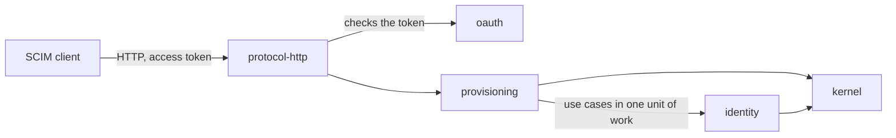

# The provisioning context

The `provisioning` context makes Hodor a SCIM 2.0 server ([RFC 7643](https://www.rfc-editor.org/rfc/rfc7643) and [RFC 7644](https://www.rfc-editor.org/rfc/rfc7644)). Another system that knows a tenant's people, such as a human resources system or an upstream identity provider like Entra ID or Okta, creates, reads, replaces and lists the tenant's users and groups through it, so that nobody types them in twice.

It owns no users and no groups: those are the [identity context's](identity.md). The provisioning context maps SCIM's resources to them and back, reads the filters SCIM clients send, and keeps what SCIM carries that the identity context has no place for, such as a user's `externalId` or department.

This page specifies what Issue-90 builds: Users and Groups with the core and enterprise schemas, the discovery endpoints, filters read by a bounded parser, sorting and pages. What Issue-91 adds, changing through `PATCH`, bulk requests, versions with entity tags, the deprovisioning policy and deleting users, is listed at the [end of the page](#not-built-yet).

## Where it sits



- **It depends on the kernel and the identity context, and nothing depends on it**, the way the authentication context depends on identity. It changes users and groups only through the identity context's use cases, so every rule of [users](identity.md#what-a-user-is) and [groups](identity.md#groups) holds for what SCIM writes, and every change produces the identity context's events.
- **It does not check tokens.** The HTTP layer checks the caller's token with the OAuth context, as it does for [the Authorization API](authorization.md#who-may-ask), and gives the use cases the calling client as the actor.
- **Its domain is computation on values**: the SCIM schemas and resources, the mapping to and from users and groups, and the filter parser. None of it reads storage, so it can be tested with any input.

## Who may call

A SCIM client presents an **access token of the tenant**, issued by [Hodor's token endpoint](oauth.md#token-endpoint-and-client-authentication) and checked exactly as the Authorization API checks one: signed by a published key of the tenant, from the tenant's issuer, not expired, still in force in [the register of access tokens](oauth.md#the-register-of-access-tokens) so that a revoked token is refused at once, issued to an enabled client of an enabled application.

- **Its audience must include `urn:hodor:scim`.**
- **It must hold the scope `scim`.** One scope opens every route: a SCIM client manages the tenant's users and groups or it does not.

A tenant opens SCIM by registering, once, a resource server with the audience `urn:hodor:scim` and the scope `scim`, on an application of its own (for example one named "SCIM"), with [the administration interface](../../api/admin-api.md) or the command-line tool:

```text
hodor-cli resource-server add --tenant acme --application … --audience urn:hodor:scim --name SCIM --scope 'scim=Manage users and groups through SCIM'
```

It then gives the SCIM client a client allowed the scope `scim`. Most SCIM clients use client credentials: they ask the token endpoint with `grant_type=client_credentials`, `resource=urn:hodor:scim` and `scope=scim`, and send the token as `Authorization: Bearer`.

| Answer | When |
|---|---|
| `401` with `WWW-Authenticate: Bearer` | No token, or a token that is not good here: another tenant's, expired, revoked, of a disabled client, or without the audience `urn:hodor:scim` |
| `403` with `WWW-Authenticate: Bearer error="insufficient_scope", scope="scim"` | The token is good but lacks the scope `scim` |

Both answers carry a [SCIM error](#errors) as their body. A token of another tenant fails the signature and issuer checks, whatever its body says.

**The actor is the calling client.** Every change made through SCIM is recorded with the token's client as its actor, `{ "kind": "client", "id": "<client identifier>" }`, in the events and so in [the audit log](audit.md#what-a-record-is).

## The surface

The routes are under the tenant, at `/t/{slug}/scim/v2`. Requests and answers are JSON with the media type `application/scim+json`; a request may also say `application/json`. A `POST` or `PUT` with any other content type, or with none, is refused with `415`.

| Method and path | Does | Success |
|---|---|---|
| `GET /ServiceProviderConfig` | What this server supports ([discovery](#discovery)) | `200` |
| `GET /ResourceTypes`, `GET /ResourceTypes/{name}` | The resource types, `User` and `Group` | `200` |
| `GET /Schemas`, `GET /Schemas/{uri}` | The schemas of the resources: core User, enterprise User and Group | `200` |
| `GET /Users` | A page of the tenant's users, filtered and sorted ([lists](#lists)) | `200` with a `ListResponse` |
| `POST /Users` | Creates a user | `201` with the user and its `Location` |
| `GET /Users/{id}` | One user | `200` |
| `PUT /Users/{id}` | Replaces what SCIM says of a user | `200` with the user |
| `GET /Groups` | A page of the tenant's groups | `200` with a `ListResponse` |
| `POST /Groups` | Creates a group, with its members | `201` with the group and its `Location` |
| `GET /Groups/{id}` | One group | `200` |
| `PUT /Groups/{id}` | Replaces a group's name, `externalId` and members | `200` with the group |
| `DELETE /Groups/{id}` | Deletes a group | `204` |

`PATCH` on a user or a group, `DELETE` on a user, `POST /Bulk` and searching with `POST /.search` are answered with `501` until [Issue-91](#not-built-yet) builds them. The discovery documents say so too.

Every route, the discovery documents included, needs the token. Every answer carries `Cache-Control: no-store`.

### Errors

An error is answered with the error schema of RFC 7644, section 3.12:

```json
{
  "schemas": ["urn:ietf:params:scim:api:messages:2.0:Error"],
  "status": "400",
  "scimType": "invalidFilter",
  "detail": "a filter holds at most 20 comparisons"
}
```

`status` is the HTTP status written as a string, as RFC 7644 asks. `scimType` is present only where RFC 7644 defines one for the case. `detail` is safe to show and never names anything of another tenant.

| Status | `scimType` | When |
|---|---|---|
| `400` | `invalidFilter` | The filter cannot be read, passes a [bound](#bounds), names an attribute that cannot be filtered on, or compares it in a way its type does not allow. The detail says which |
| `400` | `invalidSyntax` | The body is not a JSON object, or its `schemas` do not name the resource's core schema, or name a schema this server does not know |
| `400` | `invalidValue` | A value breaks a rule: a `userName` that is not a username or an email address, a display name too long, a member that is not a user or a group of the tenant, more than 1000 members, a `count` that is not a number, a `sortBy` that cannot be sorted on |
| `400` | `mutability` | The body sets a `password`: passwords are not set through SCIM |
| `401`, `403` | — | [Who may call](#who-may-call) |
| `404` | — | No such resource in the tenant. A resource of another tenant is answered exactly so |
| `409` | `uniqueness` | The `userName`, an email address or a group's `displayName` belongs to another user or group of the tenant |
| `409` | — | A change the identity context refuses for the state it is in, such as a group that would be inside itself |
| `413` | — | The body is larger than 64 kibibytes. This answer comes from the limit every surface shares and is a problem document, not a SCIM error |
| `415` | — | A body that is not `application/scim+json` or `application/json` |
| `501` | — | An operation this server does not support yet |

## Users

A SCIM User is a **human user** of the tenant. Service accounts and agents are users too ([kinds](identity.md#what-a-user-is)) but not people a directory provisions: SCIM never shows them, and answers `404` for their identifiers. A user marked Deleted is not shown either: only its identifier remains.

### What each attribute is

| SCIM attribute | Kept by | Rules |
|---|---|---|
| `id` | identity | The `UserId`. Read only |
| `userName` | identity | Required. The user's [userName identifier](#username): a username, or an email address. Unique in the tenant without regard to case |
| `name.formatted`, `name.givenName`, `name.familyName` | provisioning | Optional |
| `displayName` | identity | The user's display name, at most 200 characters. When the request has no `displayName`, `name.formatted` is the display name; with neither, the user has none |
| `emails` | identity | The user's email identifiers, each `{ "value": "…", "primary": true }`. Every address SCIM sets is [verified](#addresses-set-through-scim-are-verified) |
| `active` | identity | `true` when the user is Active; see [`active`](#active) |
| `externalId` | provisioning | Optional. The SCIM client's own identifier for the person. Compared exactly; not required to be unique |
| `groups` | identity | Read only: the groups the user is directly in, each `{ "value": "<group id>", "display": "<name>", "type": "direct", "$ref": "…" }`. Groups are changed through the Group resource |
| `meta` | both | Read only: `resourceType` `User`, `created`, `lastModified`, `location` |
| `employeeNumber`, `costCenter`, `organization`, `division`, `department` | provisioning | Of the enterprise extension, `urn:ietf:params:scim:schemas:extension:enterprise:2.0:User`. Optional |
| `manager.value` | provisioning | Of the enterprise extension: the SCIM client's identifier of the person's manager, kept as written |

- **Each attribute the provisioning context keeps is text of 1 to 256 characters** without control characters. An empty string is no value.
- **`created`** is when the user was created. **`lastModified`** is the later of when the identity context last changed the user and when the provisioning context last changed what it keeps.
- **`location`** is `{HODOR_PUBLIC_URL}/t/{slug}/scim/v2/Users/{id}`.
- **What a request sends that is not an attribute of the schemas is ignored**, and so are the read-only attributes. A `password` is refused with `mutability`.
- **What the user's identity has that SCIM does not name stays as it is**: the locale, credentials, sessions, roles, organizations.

### `userName`

The **userName identifier** of a user is its primary username when it has one, and otherwise its primary email address. That is what `userName` reads as.

When a request sets `userName`:

- **A value without `@` is a username**, with the [rules of usernames](identity.md#normalization). The user's usernames become that one.
- **A value with `@` is an email address**, with the rules of email addresses. The user then has no username, the address is among its email addresses, and it is the primary one.

Many SCIM clients send a person's work email address as `userName`; the second rule is for them.

### `emails`

- **A request's `emails` become the user's email addresses**: those it does not name are removed, and those it names that the user does not have are added. When `userName` is an address, it is one of them.
- **At most one is `primary`.** When `userName` is an address, it is the primary one, whatever the request marks. Otherwise the one marked `primary`, or with none marked the first, is.
- **`type` and `display` are not kept.** An email is answered with `value` and `primary` only.
- **A user has at most 10 login identifiers in all**, as always.

#### Addresses set through SCIM are verified

Every address SCIM sets counts as verified, as if the person had followed a link sent to it. The tenant's own system of record asserts it, and the SCIM client holds a token the tenant gave it for exactly that. The trust is the tenant's to give: [the threat model](../../security/threat-model.md#scim) says what it means.

### `active`

| The user is | `active` reads | A request with `active: true` | A request with `active: false` |
|---|---|---|---|
| Active | `true` | Nothing changes | Suspends the user, with the reason `suspended through SCIM` |
| Pending | `false` | Activates the user | Nothing changes |
| Suspended | `false` | Reactivates the user | Nothing changes |
| Deactivated | `false` | Restores the user | Nothing changes |

A request without `active` is read as `active: true`. Creating a user with `active: false` creates it Active and suspends it at once, in the same transaction: a person created by their directory is confirmed. Suspending ends no session by itself, but a suspended user cannot sign in, and their refresh tokens stop working. Deactivating and deleting through SCIM, and the tenant's choice between them, are [Issue-91](#not-built-yet).

### Creating and replacing

`POST /Users` creates the user with its identifiers, display name, status and what the provisioning context keeps, in one transaction: all of it, or nothing.

`PUT /Users/{id}` replaces what SCIM says of the user, in one transaction. What the request leaves out is removed: a `PUT` without `name.givenName` removes the given name. The identity context's rules still hold: a username that breaks the rules, or an email address another user has, refuses the whole request.

```json
{
  "schemas": [
    "urn:ietf:params:scim:schemas:core:2.0:User",
    "urn:ietf:params:scim:schemas:extension:enterprise:2.0:User"
  ],
  "id": "0193f1c2-6b1e-7c3a-9f00-6a1d2c3b4e5f",
  "externalId": "701984",
  "userName": "bjensen@example.com",
  "name": { "formatted": "Barbara Jensen", "givenName": "Barbara", "familyName": "Jensen" },
  "displayName": "Babs Jensen",
  "emails": [
    { "value": "bjensen@example.com", "primary": true },
    { "value": "babs@jensen.org", "primary": false }
  ],
  "active": true,
  "groups": [
    { "value": "0193f2a0-…", "display": "finance", "type": "direct", "$ref": "https://id.example.com/t/acme/scim/v2/Groups/0193f2a0-…" }
  ],
  "urn:ietf:params:scim:schemas:extension:enterprise:2.0:User": {
    "employeeNumber": "701984",
    "department": "Tour Operations",
    "manager": { "value": "26118915-6090-4610-87e4-49d8ca9f808d" }
  },
  "meta": {
    "resourceType": "User",
    "created": "2026-11-24T10:00:00Z",
    "lastModified": "2026-11-24T10:00:00Z",
    "location": "https://id.example.com/t/acme/scim/v2/Users/0193f1c2-6b1e-7c3a-9f00-6a1d2c3b4e5f"
  }
}
```

## Groups

A SCIM Group is a [group](identity.md#groups) of the tenant.

| SCIM attribute | Kept by | Rules |
|---|---|---|
| `id` | identity | The `GroupId`. Read only |
| `displayName` | identity | Required. The group's name, with its rules: 1 to 100 characters, unique in the tenant without regard to case |
| `externalId` | provisioning | Optional, as for users |
| `members` | identity | The group's direct members, each `{ "value": "<id>", "type": "User" \| "Group", "display": "…", "$ref": "…" }` |
| `meta` | both | Read only: `resourceType` `Group`, `created`, `lastModified`, `location` |

- **A member is named by its `value`**, the identifier of a user or a group of the tenant. `type` may be left out; when it is given it must be right. `display` and `$ref` are ignored in a request and written in an answer: a user's display name, or else its userName, and a group's name.
- **A member that is not a user or a group of the tenant is refused with `invalidValue`**, and so is a user SCIM does not show: a service account, an agent or a Deleted user. A member of another tenant is not a member of this one.
- **A group takes at most 1000 members in one request.** A request with more is refused with `invalidValue`: a group with more members is built by several requests to the administration interface, or by `PATCH` once [Issue-91](#not-built-yet) builds it. A group's members are answered in full, however many it has.
- **The rules of groups inside groups hold**: no cycle and no group deeper than the tenant allows, refused with `409`.
- **The group's description is not part of SCIM** and stays as it is.
- **`lastModified`** is the later of when the identity context last changed the group's name and when a SCIM request last changed its members or `externalId`. A member added through the administration interface does not move it.

`POST /Groups` creates the group, its `externalId` and its members in one transaction. `PUT /Groups/{id}` replaces the name, the `externalId` and the members in one transaction: members it does not name are taken out, and those it names are put in. `DELETE /Groups/{id}` deletes the group as the identity context does, taking every member out of it and it out of every group, and what the provisioning context keeps of it, in one transaction.

## Lists

`GET /Users` and `GET /Groups` take these query parameters:

| Parameter | Meaning |
|---|---|
| `filter` | Which resources; see [filters](#filters). Without one, every resource |
| `sortBy` | `userName`, `displayName`, `meta.created` or `meta.lastModified` for users; `displayName`, `meta.created` or `meta.lastModified` for groups. Without one, the order in which they were created |
| `sortOrder` | `ascending` (the default) or `descending` |
| `startIndex` | Where the page starts, counting the first resource as 1. A value below 1 counts as 1 |
| `count` | How many to answer: 100 when left out, at most 200, and a larger value counts as 200. `0` answers only how many there are. A negative value counts as 0 |

The answer is a `ListResponse`:

```json
{
  "schemas": ["urn:ietf:params:scim:api:messages:2.0:ListResponse"],
  "totalResults": 2,
  "startIndex": 1,
  "itemsPerPage": 2,
  "Resources": [{ "…": "…" }, { "…": "…" }]
}
```

- `totalResults` is how many match the filter, whatever the page. `itemsPerPage` is how many this page holds. `Resources` is always present, empty when nothing is on the page.
- **Text sorts the way it is [compared](#comparisons)**, without regard to case for `userName` and `displayName`, and otherwise by the characters' code points. A resource without a value sorts after every resource with one when ascending, and before them when descending. Resources that sort alike are in the order they were created.
- The parameters `attributes` and `excludedAttributes` are accepted and ignored: an answer always holds every attribute. Choosing them is [not built yet](#not-built-yet).

## Filters

A filter is read by a **parser that is a pure function** of the domain: text in, a tree of conditions or a refusal out. It reads nothing and its bounds hold before any work is done, so any text can be given to it, and the property tests do so.

### The grammar

The grammar is that of RFC 7644, section 3.4.2.2:

| Part | Written | Example |
|---|---|---|
| Comparison | attribute, operator, value | `userName eq "bjensen"` |
| Presence | attribute, `pr` | `externalId pr` |
| Operators | `eq` equal, `ne` not equal, `co` contains, `sw` starts with, `ew` ends with, `gt` greater than, `ge` greater or equal, `lt` less than, `le` less or equal | `meta.created gt "2026-01-01T00:00:00Z"` |
| Logic | `and`, `or`, `not ( … )`; `and` binds tighter than `or` | `active eq true and (name.familyName sw "J" or name.familyName sw "S")` |
| Grouping | `( … )` | `(userName eq "a") or (userName eq "b")` |
| Value path | attribute, `[` a filter on its sub-attributes `]`: one value of a multi-valued attribute must satisfy the whole of it | `emails[value ew "@example.com"]` |
| Values | a JSON string, `true`, `false`, `null`, or a JSON number | `"Jensen"` |

- Attribute names, operators and the words `and`, `or`, `not`, `true`, `false` and `null` are read without regard to case.
- An attribute may be written with the URI of its core schema before it, as `urn:ietf:params:scim:schemas:core:2.0:User:userName`.
- `emails` alone means `emails.value`, and `members` alone means `members.value`.
- `not` is always followed by parentheses.

### Bounds

| Bound | Refused with the detail |
|---|---|
| At most 1000 characters | `a filter holds at most 1000 characters` |
| At most 10 levels of nesting. Each pair of parentheses, with or without `not` before it, and each value path's brackets, is one level | `a filter nests at most 10 levels deep` |
| At most 20 comparisons, a presence test counting as one | `a filter holds at most 20 comparisons` |

Past a bound the answer is `400` with `invalidFilter`. The length is checked before anything else is read, and the other two while reading, so a filter past a bound costs no more than one at it.

### What can be filtered on

A fixed set of attributes can be filtered on. Any other, an attribute of the enterprise extension included, is refused with `invalidFilter` and the detail `<attribute> cannot be filtered on`.

| Resource | Attribute | Type | Compared |
|---|---|---|---|
| User | `id` | text | Exactly |
| User | `externalId` | text | Exactly |
| User | `userName` | text | Without regard to case |
| User | `displayName` | text | Without regard to case |
| User | `name.givenName`, `name.familyName` | text | Without regard to case |
| User | `emails.value` | text, multi-valued | Without regard to case |
| User | `active` | boolean | — |
| User | `meta.created`, `meta.lastModified` | date and time | — |
| Group | `id` | text | Exactly |
| Group | `externalId` | text | Exactly |
| Group | `displayName` | text | Without regard to case |
| Group | `members.value` | text, multi-valued | Exactly |

### Comparisons

| Type | Values it takes | Operators | Refused with `invalidFilter` |
|---|---|---|---|
| Text | A string | All | Any other value |
| Boolean | `true` or `false` | `eq`, `ne`, `pr` | Any other operator or value |
| Date and time | A string in the form of RFC 3339 | `eq`, `ne`, `gt`, `ge`, `lt`, `le`, `pr` | `co`, `sw`, `ew`, or a string that is not a date and time |

- **Without regard to case** means that the letters `A` to `Z` match `a` to `z`. Every other character is compared as it is written. Usernames and email addresses hold only those letters.
- **Text is ordered by the code points of its characters**, after the case is set aside when the attribute is compared without regard to it. `gt`, `ge`, `lt` and `le` follow that order.
- **A comparison with an attribute that has no value is false**, whatever the operator, `ne` included. `not ( … )` of it is therefore true.
- **`eq null` is true when the attribute has no value**, and `ne null` when it has one. Any other operator with `null` is refused.
- **A comparison with a multi-valued attribute is true when one of its values satisfies it.** `emails.value ne "a@example.com"` is true for a user with another address too.
- **A value path asks one value to satisfy the whole condition in its brackets**: `emails[value sw "ana" and value ew ".org"]` needs one address that does both.
- **No attribute is a number**, so a number is always refused.

The in-memory store evaluates the tree of conditions directly. The PostgreSQL store compiles it into SQL, in which every value is a bound parameter and every attribute is one of the fixed expressions of the table above: no part of a filter is ever written into the text of the statement.

## Discovery

`GET /ServiceProviderConfig` answers what this server supports:

| Feature | Answer |
|---|---|
| `patch` | Not supported |
| `bulk` | Not supported, with `maxOperations` and `maxPayloadSize` 0 |
| `filter` | Supported, with `maxResults` 200 |
| `changePassword` | Not supported |
| `sort` | Supported |
| `etag` | Not supported |
| `authenticationSchemes` | One: `oauthbearertoken`, the bearer token of RFC 6750 |

`GET /ResourceTypes` lists `User`, at `/Users` with the core User schema and the enterprise extension, which is not required, and `Group`, at `/Groups` with the Group schema. `GET /Schemas` lists the three schemas with the attributes this page names, each with its type, whether it is multi-valued, required, compared with regard to case, writable and returned, and unique. Each is also answered by its name or its URI, and an unknown one is `404`. These documents are the same for every tenant except for their `location`.

## Events

Changes to users and groups are the identity context's, and are recorded by its events: `identity.user_created`, `identity.identifier_added`, `identity.profile_changed`, `identity.user_suspended`, `identity.group_member_added` and the others of [its list](identity.md#events). What only the provisioning context keeps has events of its own:

| Event type | When |
|---|---|
| `provisioning.user_attributes_changed` | What the provisioning context keeps of a user was set or changed: its `externalId`, its name or its enterprise attributes. Carries the user's identifier |
| `provisioning.group_attributes_changed` | A group's `externalId` was set or changed. Carries the group's identifier |

Like the identity context's events, they carry identifiers and never values: a department or an employee number is personal data, and stays in the provisioning tables. A request that changes nothing records nothing. Every event of a request carries the calling client as its actor and the request's identifier as its correlation.

## Operations

| Use case | What it does |
|---|---|
| Create user | Creates the user with the identity context, and what the provisioning context keeps, in one unit of work |
| Get user | The user, what the provisioning context keeps of it, and the groups it is directly in |
| Replace user | Changes the identifiers, the display name, the status and what the provisioning context keeps, in one unit of work |
| List users | A filtered, sorted page of users, and how many match |
| Create, get, replace, delete group | As for users, with the members |
| List groups | A filtered, sorted page of groups, and how many match |

They use the identity context's use cases in their own unit of work: [the operations](identity.md#operations) whose names end in "in the caller's unit of work".

### Ports

| Port | Purpose |
|---|---|
| `ProvisionedUserRepository` | Store and load what the provisioning context keeps of a user; find the users that match a filter, in an order, a page at a time, with how many match |
| `ProvisionedGroupRepository` | Store, load and remove what the provisioning context keeps of a group; find the groups that match a filter, as for users |

Every method works inside the tenant of the unit of work it is given. Finding answers the identifiers of the users or groups on the page; the use case then loads them through the identity context.

## Limits

| Limit | Value | Why |
|---|---|---|
| Body of a request | 64 kibibytes, as every JSON surface | A request is a resource, not a batch |
| Members of a group in one request | 1000 | Each is checked and written in one transaction |
| Resources in one page | 200 | `count` is bounded |
| A filter | 1000 characters, 10 levels, 20 comparisons | [Bounds](#bounds) |
| Each text attribute the provisioning context keeps | 256 characters | They are names and identifiers |

## Storage

The schema `provisioning` holds two tenant tables under row-level security. Each is keyed by the identifier of the identity context's user or group, with the tenant first, as plain identifiers: a context never refers to another's tables with a foreign key ([the database model](../database.md#conventions)).

### `provisioning.user_attribute`

| Column | Type | Notes |
|---|---|---|
| `tenant_id`, `user_id` | `uuid` | Primary key. The user of the identity context |
| `external_id` | `text` | |
| `name_formatted`, `given_name`, `family_name` | `text` | |
| `employee_number`, `cost_center`, `organization`, `division`, `department`, `manager_id` | `text` | The enterprise attributes |
| `created_at`, `updated_at` | `timestamptz` | |

Every text column holds 1 to 256 characters or nothing, checked by the database.

### `provisioning.group_attribute`

| Column | Type | Notes |
|---|---|---|
| `tenant_id`, `group_id` | `uuid` | Primary key. The group of the identity context |
| `external_id` | `text` | |
| `created_at`, `updated_at` | `timestamptz` | `updated_at` also moves when a SCIM request changes the members |

A group deleted through SCIM takes its row with it, in the same transaction. A group deleted through the administration interface leaves its row behind: it is never shown, because every read starts from the identity context's group, and an identifier is never given out twice.

### Finding with a filter

The PostgreSQL store finds users and groups with one statement over the identity context's tables, `identity."user"`, `identity.user_identifier`, `identity."group"` and `identity.group_member`, and its own. A filter names attributes of both, and only one statement can filter, sort and count over both at once. The statement only reads them; the identity context remains the only one that writes its tables, and nothing refers to them with a foreign key.

## Not built yet

| Item | Planned in |
|---|---|
| `PATCH` of users and groups | Milestone 7, Issue-91 |
| Bulk requests, with a bounded number of operations and references between them | Milestone 7, Issue-91 |
| Versions of resources, entity tags and `If-Match` | Milestone 7, Issue-91 |
| The tenant's deprovisioning policy; deactivating and deleting users through SCIM, which ends their sessions and grants | Milestone 7, Issue-91 |
| Choosing the attributes of an answer with `attributes` and `excludedAttributes` | Later; they are ignored |
| Searching with `POST /.search` | Later |
| The `type` of an email address, phone numbers, addresses, photos, `locale`, `title`, roles and entitlements of the core schema | Later |
| Removing what the provisioning context keeps of a group deleted outside SCIM | Later; the row is never shown |
| Synchronizing users and groups from LDAP, the other half of this context in the plan | Not scheduled |
| SCIM as a client that provisions into other systems | Not scheduled |
