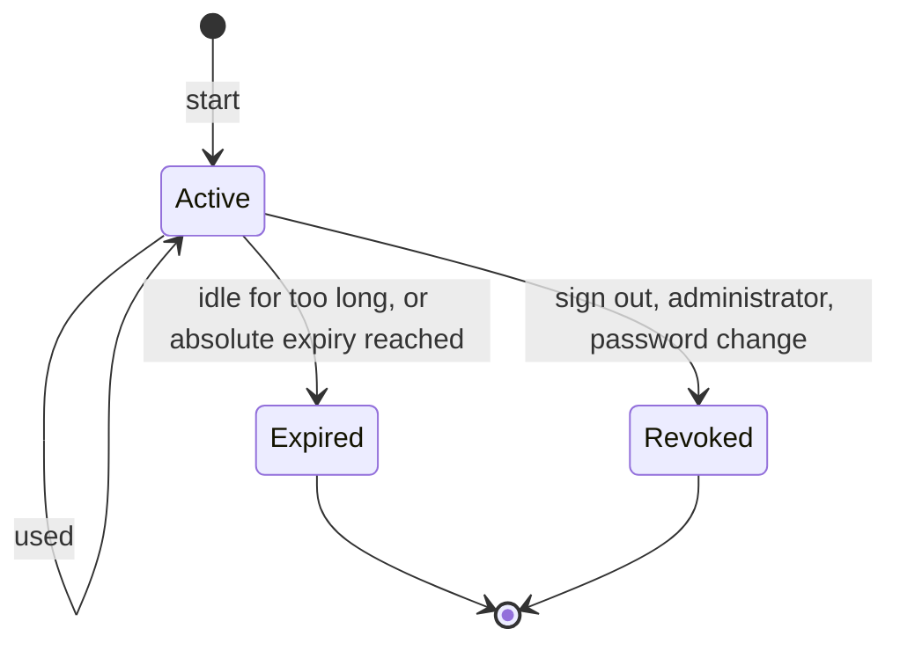

# The session context

The `session` context owns sessions: the record that a user signed in to a tenant from a browser, and for how long that remains true. It answers one question for the rest of the system: who, if anyone, is this request from?

It does not sign anyone in. The `authentication` context decides that a user proved who they are and asks this context to start a session. Everything after that, such as the session's expiry and its revocation, belongs here.

This page specifies the part built in Milestone 1. Sessions of individual applications inside a browser session, trusted devices and limits on concurrent sessions are added by later phases.

## What a session is

| Field | Meaning |
|---|---|
| Identifier | A `SessionId`. Safe to show and to log; it does not grant access |
| User | Whose session it is |
| Token | The secret the browser presents. Only its hash is stored |
| Signed in at | When the user last proved who they are: the latest of the times below |
| Assurance | How strongly: single factor, multi-factor or phishing-resistant ([what a sign-in must reach](authentication.md#what-a-sign-in-must-reach)) |
| Methods | Which methods were used, for example `password`, each with the time it was last proven |
| Last activity | When the session was last used, to the nearest minute |
| Idle timeout | How long the session survives without activity |
| Absolute expiry | The moment after which the session ends whatever happens |
| Where from | The address and the browser description seen when it started, for the user's own review |
| Revocation | When and why it was ended early, if it was |

### The token

- The token is 32 random bytes from the operating system, written as 64 hexadecimal characters.
- It is returned once, when the session starts or its token is replaced. Hodor stores only its SHA-256 hash, so a copy of the database contains no usable token.
- A plain hash is enough: the token has 256 bits of randomness, so there is nothing to guess and a slow hash would add nothing.
- The session identifier and the token are different things on purpose. The identifier appears in lists, events and logs; the token appears nowhere but the browser's cookie.

### The facts a session carries

A session records the facts of the sign-in: when, how strongly, and by which methods. Other contexts read these facts to decide whether the session is good enough for what is being asked, without knowing how sign-in works. An application that requires a recent or a stronger sign-in compares its requirement with these facts.

Each method keeps the time it was proven, so that a request that accepts only a recent sign-in (`max_age`) can tell which of them are recent: a person who signed in with a password in the morning and answered with a security key a minute ago has a recent key and an old password.

### Raising a session

A [step-up](authentication.md#step-up) does not start a new session: it **raises** the one the person has.

| Rule | Why |
|---|---|
| Only an active session is raised, and only for the user it belongs to | A session ended meanwhile is not brought back |
| The methods proven in the step-up are added, or their time is moved to now when the session had them already. The methods it did not prove keep their times | Each method says when it was last proven |
| The assurance becomes the higher of the session's and the step-up's | A step-up that carried only the recent methods does not lower what the older ones proved |
| Signed in at becomes now | The person proved who they are now |
| The token is replaced | What the session may do increased |
| The timeouts and the absolute expiry do not change | A step-up does not keep a session alive past its limit |

## Lifecycle

| State | Accepted | How it is reached |
|---|---|---|
| Active | Yes | Started and neither expired nor revoked |
| Expired | No | No activity for the idle timeout, or the absolute expiry has passed |
| Revoked | No | Ended on purpose; carries a reason |

Rules:

- A session is Expired from the moment either limit passes. Nothing has to run for that to take effect: the state is computed from the stored times whenever the session is presented.
- The absolute expiry is fixed when the session starts and can never be extended. No amount of activity keeps a session alive past it.
- Using a session moves its last activity forward, but at most once a minute, so that a busy session does not cause a write per request.
- The timeouts are copied into the session when it starts, from the tenant's [session policy](tenant.md#session-policy). Changing the policy affects new sessions, not existing ones.
- Revoking is final and can be repeated without effect. An expired session can still be revoked, which records why.
- Replacing the token gives the session a new secret and makes the old one useless at once. It is done whenever what the session is allowed to do increases, so that a token captured earlier cannot ride along.

## Operations

| Use case | What it does |
|---|---|
| Start session | Creates a session for a user with the sign-in facts and the tenant's timeouts, and returns the token once |
| Find by token | Returns the active session a token belongs to, and records the activity. A token that is malformed, unknown, expired or revoked finds nothing, and all four look the same to the caller |
| List a user's sessions | Returns the user's active sessions, newest first, for the account pages and for administrators |
| Revoke session | Ends one session, with a reason |
| Revoke one of a user's sessions | Ends a session only if it belongs to the given user and is active; otherwise it reports that there is no such session, without saying which was the case. This is what a person uses on their own sessions |
| Revoke a user's sessions | Ends all of a user's active sessions, optionally keeping one: used when a password changes, where the session that made the change survives. It can also run in the caller's unit of work, as [deprovisioning](provisioning.md#deprovisioning) does |
| Replace token | Gives a session a new token |
| Raise session | Adds the methods of a step-up to a session, raises its assurance and replaces its token, as [raising a session](#raising-a-session) says |

### Events

| Event type | When |
|---|---|
| `session.started` | A session started; carries the user, the assurance and the methods |
| `session.revoked` | A session was ended on purpose; carries the reason |
| `session.raised` | A step-up raised a session; carries the user, the new assurance and the methods proven |

Expiry produces no event, since nothing happens at that moment. Events carry identifiers and never a token or its hash. The address and browser description stay in the session row. The OAuth context hears `session.revoked`, with its `session_id` and `user_id`, to tell the applications signed in to with the session that it ended ([back-channel logout](oauth.md#back-channel-logout)); the session context does not know it does.

### Ports

| Port | Purpose |
|---|---|
| `SessionStore` | Store and load sessions; find one by the hash of its token; list and revoke a user's sessions |
| `Digest` | Compute SHA-256. Defined in the kernel because every context that stores tokens needs it |
| `RandomSource` | Produce the token's random bytes |

## Storage

### `session.session`

| Column | Type | Notes |
|---|---|---|
| `tenant_id`, `id` | `uuid` | Primary key |
| `user_id` | `uuid` | The user, of the identity context. Not a database foreign key |
| `token_hash` | `bytea` | SHA-256 of the token; unique within the tenant |
| `signed_in_at` | `timestamptz` | |
| `assurance` | `text` | `single_factor`, `multi_factor` or `phishing_resistant` |
| `methods` | `text[]` | |
| `method_proven_at` | `timestamptz[]` | When each of `methods` was last proven, in the same order. Null in rows stored before it existed, which read every method as proven at `signed_in_at` |
| `started_at`, `last_activity_at` | `timestamptz` | |
| `idle_timeout_seconds` | `integer` | Copied from the tenant's policy at the start |
| `absolute_expires_at` | `timestamptz` | Never changes |
| `client_address`, `client_description` | `text` | As seen at the start; the description is cut to 256 characters |
| `revoked_at` | `timestamptz` | Null unless revoked |
| `revocation_reason` | `text` | |

A tenant table under row-level security. A token is looked up by tenant and hash together, so a token presented to another tenant finds nothing.

Rows of expired and revoked sessions stay for seven days, then [the cleanup job](../../operations/deployment.md#cleanup) of the worker removes them.

## Not built yet

| Item | Planned in |
|---|---|
| Removing old rows | Later in Phase 1 |
| Sessions of individual applications, and signing them out | Phase 2 |
| Limits on concurrent sessions, trusted devices | Phase 4 |
