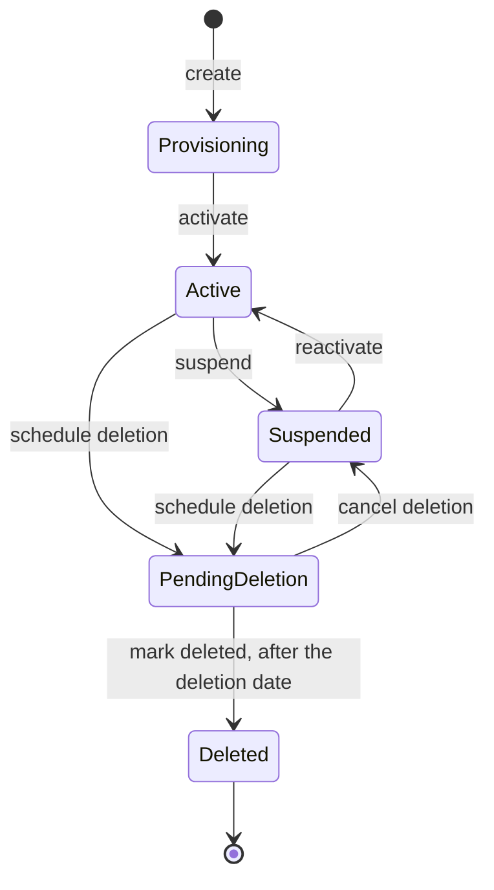

# The tenant context

The `tenant` context owns tenants: the hard isolation boundary of Hodor. It answers three questions for the rest of the system: which tenants exist, whether a tenant may serve requests, and which policies apply inside it.

How isolation is enforced in every layer is described in [multi-tenancy](../multi-tenancy.md). This page specifies the context itself: its rules, its data and its operations.

## What a tenant is

| Field | Meaning |
|---|---|
| Identifier | A `TenantId`, assigned at creation and never changed |
| Slug | The name used in addresses: `https://host/t/{slug}` |
| Display name | A human-readable name, 1 to 100 characters |
| Status | Where the tenant is in its life; see [lifecycle](#lifecycle) |
| Settings | The policies that apply inside the tenant; see [settings](#settings) |
| Deletion date | Set while deletion is pending: the moment after which the tenant's data may be purged |

### Slug rules

A slug:

- has 2 to 63 characters;
- contains only lowercase letters `a` to `z`, digits and hyphens;
- starts and ends with a letter or a digit;
- does not contain two hyphens in a row;
- is unique across the installation;
- never changes once the tenant exists. Addresses, issuer names and tokens are built from it, so renaming would break every integration.

Some slugs are reserved and cannot be chosen: `system`, `platform`, `admin`, `api`, `static`, `health`. The `system` slug belongs to the tenant of the platform administrators and is created only by the bootstrap command.

## Lifecycle

| Status | Serves requests | Meaning | What a request to `/t/{slug}` gets |
|---|---|---|---|
| Provisioning | No | Created, but its initial data is not complete yet | `404`, as if the tenant did not exist |
| Active | Yes | Normal operation | The requested resource |
| Suspended | No | Data is kept; every request is refused with a distinct error | `403` with code `tenant.suspended` |
| Pending deletion | No | Will be purged after the deletion date unless deletion is cancelled | `403` with code `tenant.suspended` |
| Deleted | No | Data has been purged; only the record that the tenant existed remains | `404`, as if the tenant did not exist |

Rules:

- Every transition not drawn above is rejected.
- Suspending records a reason.
- Scheduling deletion sets the deletion date to now plus the grace period, which is 30 days unless the caller gives another. A grace period shorter than one day is rejected.
- Cancelling deletion returns the tenant to Suspended, never straight to Active. Someone has to decide to reactivate it.
- A tenant can be marked Deleted only after its deletion date.
- Each successful transition produces one event (see [events](#events)).

The purge itself, removing the tenant's rows and destroying its keys, is a worker job that does not exist yet.

## Settings

Settings are the tenant's policies. Other contexts read them; only the tenant context changes them. A new tenant gets the defaults below.

### Password policy

| Setting | Default | Allowed |
|---|---|---|
| Minimum length | 12 | 8 to 128 |
| Maximum length | 128 | minimum length to 1024 |
| History depth: how many previous passwords cannot be reused | 5 | 0 to 24 |
| Reject passwords found in breach lists | Yes | Yes or no |

### Session policy

| Setting | Default | Allowed |
|---|---|---|
| Idle timeout | 30 minutes | 1 minute to the absolute timeout |
| Absolute timeout | 12 hours | idle timeout to 30 days |

### Lockout policy

| Setting | Default | Allowed |
|---|---|---|
| Failed attempts before lockout | 5 | 3 to 20 |
| Window in which attempts are counted | 15 minutes | 1 minute to 24 hours |
| First lockout duration | 1 minute | 10 seconds to the longest lockout |
| Longest lockout duration | 1 hour | first lockout duration to 24 hours |

### Registration policy

| Value | Meaning |
|---|---|
| Closed (default) | Only administrators and invitations create users |
| Open | Anyone can register |

### Authentication policy

| Setting | Default | Allowed |
|---|---|---|
| Second factor | Not required | Not required, or required |
| Assurance levels | Two levels | See [assurance levels](#assurance-levels) |

When a second factor is required, no sign-in to the tenant completes with one factor ([what a sign-in must reach](authentication.md#what-a-sign-in-must-reach)). Settings stored before this policy existed read as the default.

The policy is set with `hodor-cli tenant second-factor --slug <slug> --policy required` (or `not-required`). Turning it on refuses every sign-in of a person who has no second factor yet, since enrolling one during a sign-in is not built; people add one first from [their security page](../hosted-pages.md#a-persons-own-factors), or an operator enrolls one with `hodor-cli totp`.

### Group policy

| Setting | Default | Allowed |
|---|---|---|
| Depth of groups | 5 | 1 to 10 |

The [depth](identity.md#groups-inside-groups) of a group is the longest chain of groups inside it, counting itself. Lowering the bound changes no group that exists: it is checked only when a group is added to another, so a tenant whose groups are deeper than the new bound can take groups out but not put more in. Settings stored before this policy existed read as the default. The policy is set with `hodor-cli tenant group-depth --slug <slug> --depth <depth>`.

### SCIM deprovisioning policy

| Setting | Default | Allowed |
|---|---|---|
| Deprovisioning | `deactivate` | `deactivate` or `delete` |

What [deprovisioning](provisioning.md#deprovisioning) through SCIM does to a person: deactivate them, so that they can be restored, or delete them, which erases them. Either way their sessions and grants end at once. Settings stored before this policy existed read as the default. The policy is set with `hodor-cli tenant scim-deprovisioning --slug <slug> --policy <deactivate|delete>`, or with `PUT /scim-deprovisioning` of [the administration interface](../../api/admin-api.md#scim-deprovisioning), and applies to requests that arrive after it.

### Assurance levels

An application names how strongly it wants the person to have proved who they are with an `acr` value, and every token says which level the sign-in reached ([OpenID Connect Core, section 2](https://openid.net/specs/openid-connect-core-1_0.html#IDToken)). A tenant chooses the names of its levels. Each level names one **requirement** from a closed set:

| Requirement | Reached by |
|---|---|
| `single_factor` | Any sign-in: one factor |
| `multi_factor` | Two kinds of factor: something known and something held, or a passkey, which is both |
| `phishing_resistant` | Two kinds of factor, one of them a key held by the person that answered a challenge for this tenant's address: a security key, a platform authenticator or a passkey. A copied password or code cannot be replayed against it |

The requirements are ordered: a sign-in that reaches one reaches every requirement before it. Which methods amount to which requirement is said by [the authentication context](authentication.md#what-a-sign-in-must-reach).

| Setting | Default | Allowed |
|---|---|---|
| Levels | `urn:hodor:acr:single-factor` for `single_factor`, `urn:hodor:acr:mfa` for `multi_factor` | One to three levels. Each name is 1 to 255 characters of printable ASCII without spaces, the characters `acr_values` can carry; no two levels have the same name or the same requirement |

A tenant that wants applications to ask for a phishing-resistant sign-in adds a level for it, under a name of its choosing. A tenant may leave out the `single_factor` level: a sign-in that reaches no level of the tenant then carries no `acr`.

The levels are names inside one tenant only. A request that names a level another tenant defines asks this tenant for nothing.

The levels are set with `hodor-cli tenant assurance-levels --slug <slug> --level <name>=<requirement> …`, or through the [administration interface](../../api/admin-api.md#assurance-levels).

Settings outside the allowed ranges are rejected as a whole; a tenant never holds a partly valid policy. Branding and quotas are added by later phases.

## Events

| Event type | When |
|---|---|
| `tenant.created` | A tenant is created |
| `tenant.activated` | Provisioning finished |
| `tenant.suspended` | Suspended; carries the reason |
| `tenant.reactivated` | Returned to Active |
| `tenant.deletion_scheduled` | Deletion scheduled; carries the deletion date |
| `tenant.deletion_cancelled` | Deletion cancelled |
| `tenant.deleted` | Marked Deleted |
| `tenant.settings_changed` | Settings replaced |

## Operations

| Use case | What it does |
|---|---|
| Create tenant | Validates the slug and name, creates the tenant in Provisioning with default settings, activates it, and stores it with its events. The reserved `system` slug is accepted only when the caller asks for the system tenant |
| Get tenant | Returns the tenant of the current context |
| Suspend, reactivate | Apply the transition and store the event |
| Schedule and cancel deletion | Apply the transition and store the event |
| Change settings | Validates and replaces the settings |
| Find by slug | Returns the identifier and status for a slug; used to resolve requests |
| List tenants | Returns slug, identifier and status of every tenant; used by the command-line tool |

### Ports

| Port | Purpose | Scope |
|---|---|---|
| `TenantRepository` | Store and load the tenant aggregate, with optimistic locking on its version | One tenant: takes a unit of work |
| `TenantDirectory` | Find a tenant by slug; list tenants | Across tenants |

## Storage

### `tenant.tenant`

One row per tenant, under the same row-level security as every tenant table. Its `tenant_id` equals its own `id`, so a tenant can read and change only its own row.

| Column | Type | Notes |
|---|---|---|
| `tenant_id` | `uuid` | Primary key together with `id`; equal to `id` |
| `id` | `uuid` | |
| `slug` | `text` | Unique |
| `display_name` | `text` | |
| `status` | `text` | `provisioning`, `active`, `suspended`, `pending_deletion`, `deleted` |
| `status_reason` | `text` | Why the tenant was last suspended |
| `settings` | `jsonb` | Validated by the typed settings before it is written |
| `deletion_scheduled_for` | `timestamptz` | Set only while deletion is pending |
| `created_at`, `updated_at` | `timestamptz` | |
| `version` | `integer` | Incremented on every update; an update with a stale version is rejected |

### `platform.tenant_directory`

Resolving a request starts from a slug, before any tenant is known, so it cannot go through a table that row-level security hides. The directory is the answer: a small table that is deliberately **not** under row-level security and holds only what routing needs.

| Column | Type | Notes |
|---|---|---|
| `slug` | `text` | Primary key |
| `tenant_id` | `uuid` | Unique |
| `status` | `text` | Copied from the tenant |

- A trigger on `tenant.tenant` keeps the directory in step; nothing else writes to it. The application role can only read it.
- It holds no settings, names or any other tenant data.
- Because of it, `hodor-server` needs no cross-tenant database role: it reads the directory, then works inside the tenant it found.
- It is on the short list of tables the schema rules exempt from tenant isolation, with this page as the justification.

## Command-line tool

| Command | What it does | Prints |
|---|---|---|
| `hodor-cli tenant create --slug <slug> --name <name> [--open-registration]` | Creates and activates a tenant | The new tenant's slug and identifier |
| `hodor-cli tenant create-system` | Creates the `system` tenant. Does nothing if it already exists, so it is safe to run on every deployment | Whether it was created or already existed |
| `hodor-cli tenant list` | Lists every tenant, ordered by slug | One line per tenant: slug, identifier, status |
| `hodor-cli tenant suspend --slug <slug> --reason <text>` | Suspends a tenant | The tenant's new status |
| `hodor-cli tenant reactivate --slug <slug>` | Reactivates a suspended tenant | The tenant's new status |
| `hodor-cli tenant second-factor --slug <slug> --policy <required\|not-required>` | Sets the [authentication policy](#authentication-policy) | The policy now in force |
| `hodor-cli tenant group-depth --slug <slug> --depth <1 to 10>` | Sets the [group policy](#group-policy) | The depth now allowed |
| `hodor-cli tenant scim-deprovisioning --slug <slug> --policy <deactivate\|delete>` | Sets the [SCIM deprovisioning policy](#scim-deprovisioning-policy) | The policy now in force |
| `hodor-cli tenant assurance-levels --slug <slug> [--level <name>=<requirement> …]` | Replaces the [assurance levels](#assurance-levels); without `--level`, prints them | One line per level: its name and its requirement |

These commands connect with `HODOR_DATABASE_URL`, as a member of `hodor_app`. They need no cross-tenant role for the same reason the server does not. A command that fails prints the error's code and message and exits with a non-zero status.

The events these commands produce record the actor as the system, since no authenticated administrator exists yet at this stage.

## How the server resolves a tenant

For every request under `/t/{slug}`, `hodor-server` looks the slug up in the directory and answers according to the status table in [lifecycle](#lifecycle). The lookup is one indexed read of a three-column table and is not cached yet.

## Not built yet

| Item | Planned in |
|---|---|
| Verified domains and custom issuer hosts | Phase 3 |
| Branding and quotas | Phases 4 and 7 |
| The purge job that removes a deleted tenant's data and keys | Later in Phase 1 |
| Caching of the slug lookup in the server | When measurements call for it |
