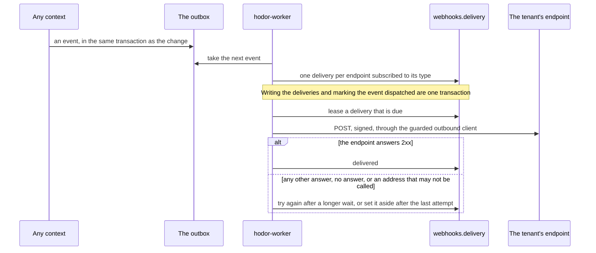
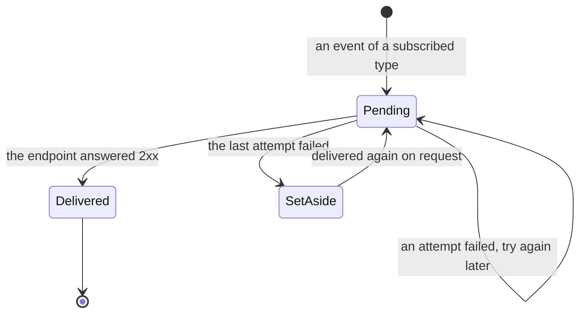

# The webhooks context

The `webhooks` context tells other systems what happened in a tenant. A tenant registers **endpoints**, addresses of its own systems, and **subscribes** each one to the types of event it wants. When such an event happens, Hodor sends it to the endpoint, signed, and keeps trying for a while if the endpoint does not take it. A delivery that keeps failing is **set aside**, and an administrator can ask for it to be **delivered again**.

The context is a base context: it depends on the kernel and on nothing else. Like the audit log, it hears the events of every other context from the outbox, and no context knows it exists ([Decision 0032](../../decisions/0032-webhooks.md)).

This page specifies Issue-96, and Issue-97 for [the command-line tool](#command-line-tool). The admin console manages endpoints from [its webhooks screens](../admin-console.md#screens).

## How an event reaches an endpoint



There are two steps, and they are apart on purpose.

1. **Fan-out.** The outbox dispatcher hands every event to the webhooks handler, as it hands it to the audit handler. The handler finds the tenant's endpoints subscribed to the event's type and writes one delivery for each, with the body that will be sent. It writes nothing outside the database, so it runs inside the dispatcher's transaction: an event leads to its deliveries exactly once.
2. **Delivery.** A separate loop of the worker sends the deliveries that are due. Talking to an endpoint can take seconds, so it never happens inside a transaction, and one slow endpoint never holds up the events of the others.

Rules of the fan-out:

- **A tenant only ever receives its own events.** The handler runs in the event's tenant, and reads only that tenant's endpoints, under row-level security. A delivery belongs to the tenant of its endpoint, which is the tenant of its event.
- **Only the types of [the catalog](#which-events-are-published) are published.** An event of any other type, the context's own events among them, leads to no delivery.
- **An endpoint receives an event only if it was subscribed to the event's type when the event happened.** An event is dispatched a little after it happened, sometimes after an endpoint was registered or given the type, so each subscription keeps the moment it began, `since`, and the handler skips an endpoint whose subscription began after the event. Replacing an endpoint's event types keeps the moment of the types it already had; a type added is subscribed from the moment of the change.
- **The same event never makes two deliveries to one endpoint.** A delivery is unique per endpoint and event.

## Which events are published

The events of the catalog below, and no other. The catalog is a list of fixed names in the context; an event type that is not in it cannot be subscribed to. A type is in it because something outside Hodor may need to react to it, and because its event carries identifiers, kinds and states, never a secret: what every context already promises of its events ([the audit context](audit.md#no-secrets-by-construction)).

| Context | Event types |
|---|---|
| Identity | `identity.user_created`, `identity.user_activated`, `identity.user_suspended`, `identity.user_reactivated`, `identity.user_deactivated`, `identity.user_restored`, `identity.user_deleted`, `identity.profile_changed`, `identity.identifier_added`, `identity.identifier_verified`, `identity.identifier_removed`, `identity.primary_identifier_changed` |
| Groups and organizations | `identity.group_created`, `identity.group_changed`, `identity.group_deleted`, `identity.group_member_added`, `identity.group_member_removed`, `identity.organization_created`, `identity.organization_changed`, `identity.organization_deleted`, `identity.organization_member_added`, `identity.organization_member_changed`, `identity.organization_member_removed`, `identity.invitation_accepted` |
| Sessions | `session.started`, `session.raised`, `session.revoked` |
| Sign-ins | `authentication.succeeded`, `authentication.failed`, `authentication.locked_out`, `authentication.registration_completed`, `authentication.password_reset` |
| Credentials | `credential.password_changed`, `credential.totp_enrolled`, `credential.totp_removed`, `credential.webauthn_registered`, `credential.webauthn_removed`, `credential.recovery_codes_generated` |
| External identities | `federation.identity_linked`, `federation.identity_unlinked` |
| Applications | `oauth.consent_given`, `oauth.consent_withdrawn`, `oauth.grant_revoked` |

Not in the catalog: the changes administrators make to configuration (identity providers, applications, keys, roles, policies, webhooks), which the audit log records; events about tokens being issued and refreshed, which are many and say little; and the events of this context.

### What is sent

The body is JSON, one object, at most 64 kibibytes:

```json
{
  "id": "0193f2c4-7d1e-7a3b-9c55-2f0e8a1b4c6d",
  "type": "identity.user_created",
  "timestamp": "2026-11-24T14:03:07.512Z",
  "tenant_id": "0193a0b1-0c2d-7e3f-8a4b-5c6d7e8f9a0b",
  "actor": { "kind": "user", "id": "0193a0b1-1111-7e3f-8a4b-5c6d7e8f9a0b" },
  "data": { "user_id": "0193f2c4-7d1e-7a3b-9c55-000000000001", "kind": "human", "status": "active" }
}
```

| Field | Meaning |
|---|---|
| `id` | The event's identifier. The same in every attempt and in a delivery asked for again, and the same as the `webhook-id` header: a receiver uses it to recognize an event it already handled |
| `type` | The event's type, from the catalog |
| `timestamp` | When the event happened, not when it was sent |
| `tenant_id` | The tenant it happened in: always the tenant that registered the endpoint |
| `actor` | Who caused it: `{ "kind": "user", "id": … }`, `{ "kind": "system" }` or `{ "kind": "anonymous" }` |
| `data` | The event's own fields, exactly as the outbox holds them. Each event type's fields are described on its context's page |

The body is written once, when the delivery is made, and every attempt sends the same bytes. It is the envelope of version 1: fields may be added to it, never removed or renamed, and a change that cannot keep that is a new version ([the plugin architecture](../plugins.md#compatibility) counts the envelope among the surfaces that must stay compatible).

Personal data is what the event already carries, and nothing more: identifiers of people, never an email address, a name or anything typed at a sign-in. The one free text in the catalog is the reason an administrator gives when suspending a user, written by that tenant's own administrator. An event whose body would pass 64 kibibytes is not sent: its delivery is set aside at once, with that reason.

### How it is signed

Hodor follows [Standard Webhooks](https://www.standardwebhooks.com/), so that a receiver can check a delivery with a library of its choice. Every request carries:

| Header | Value |
|---|---|
| `content-type` | `application/json` |
| `webhook-id` | The event's identifier |
| `webhook-timestamp` | When this attempt was signed, in whole seconds since 1970 |
| `webhook-signature` | `v1,` and the Base64 of the HMAC-SHA256 of `{webhook-id}.{webhook-timestamp}.{body}`, keyed with the endpoint's secret. During a rotation, two such values separated by a space, one for each secret in force |

A receiver recomputes the signature with its secret and compares it with every value of the header, in constant time; it also refuses a timestamp too far from its own clock, usually five minutes, which is what keeps a captured request from being replayed later. A test checks Hodor's signature with the `standardwebhooks` library, an implementation that shares no code with Hodor's.

## Endpoints

| Field | Meaning |
|---|---|
| Identifier | An `EndpointId` |
| Address | Where deliveries are sent: an HTTPS address, at most 1000 characters |
| Description | Optional, at most 200 characters, no control characters |
| Subscriptions | The event types it receives, each once, all from the catalog. An endpoint with none receives nothing |
| Created at, updated at | |
| Version | Incremented on every change, for optimistic locking |

Rules:

- **A tenant has at most 20 endpoints.** The twenty-first is refused with `webhooks.too_many_endpoints`.
- **The address is checked when the endpoint is registered**, through the `DestinationCheck` port, which the guarded outbound client implements with the rules of [outbound HTTP](../../security/outbound-http.md): HTTPS only, no name and password, and every address the name resolves to now must be public. An address written as numbers is checked as it is. An address that may not be called is refused with `webhooks.endpoint_address_forbidden`, one that is not HTTPS or cannot be read with `webhooks.endpoint_address_invalid`, a name that resolves to nothing with `webhooks.endpoint_address_unresolvable`. The message never repeats what the name resolved to.
- **The address is checked again at every delivery**, since a name can resolve to something else later. An attempt to an address that may not be called fails like an attempt the endpoint did not answer, with `http.destination_forbidden` recorded, and nothing is connected to.
- **The address cannot be changed.** An endpoint that moves is registered again and the old one removed, which also gives it a new secret.
- **Removing an endpoint removes its subscriptions, its secrets and its deliveries**, delivered, pending or set aside.
- **The addresses of the development exception** (`HODOR_OUTBOUND_DEVELOPMENT_HOSTS`) are accepted over plain HTTP, at registration and at delivery, exactly as the guarded client accepts them. Nowhere real has any.

### The secret

Each endpoint has a signing secret: 32 random bytes, given to people as `whsec_` followed by their Base64, the form Standard Webhooks libraries read.

- **It is shown once**: in the answer to registering the endpoint, and in the answer to rotating its secret. It is never shown again, and no operation reads it back.
- **It is kept sealed** with the [secret box](../../security/secrets-at-rest.md), purpose `webhooks.signing_secret`, because signing needs the secret itself, not a hash of it. Only the worker opens it, to sign.
- **Rotating gives a new secret, and the previous one keeps signing for an overlap**: 24 hours by default, from 0 to 168 hours, as asked. During the overlap every request carries both signatures, so the receiver can change its secret at any moment of that time. When the overlap ends, only the new secret signs.
- **At most two secrets are in force.** Rotating again during an overlap ends the oldest one at once; the one being replaced gets the new overlap.
- Without `HODOR_SECRET_KEYS` the installation cannot seal a secret: the server does not offer the operations of this context, and the worker delivers nothing.

## Deliveries

| Field | Meaning |
|---|---|
| Identifier | A `DeliveryId` |
| Endpoint | Where it goes |
| Event | The event's identifier and type |
| Body | What is sent, written once |
| Status | `pending`, `delivered` or `set_aside` |
| Attempts | How many times sending was tried |
| Next attempt | When it is due |
| Leased until | While a worker is sending it, the moment its lease ends |
| Last response status | The status of the last answer, if there was one |
| Last error | Why the last attempt failed, for administrators |
| Created at, finished at | When it was made, and when it was delivered or set aside |



Rules:

- **Delivered means the endpoint answered with a status from 200 to 299.** Any other status is a failed attempt, a redirect among them: redirects are not followed, since a public address could send Hodor to a private one.
- **An attempt has 10 seconds**, from connecting to the end of the answer, and the answer may be at most 64 kibibytes; Hodor reads nothing of it but its status. A longer answer is a failed attempt, so an endpoint should answer with an empty body.
- **Waits grow.** After the first failed attempt the next waits 30 seconds, and each wait is twice the one before, up to one hour: 30 seconds, 1, 2, 4, 8, 16 and 32 minutes.
- **A delivery is set aside after its eighth failed attempt**, with the event `webhooks.delivery_set_aside`. It stays set aside until someone asks for it again or the cleanup removes it.
- **Delivering again on request** puts a set-aside delivery back to pending, due at once, with no attempts, and records `webhooks.redelivery_requested`. Only a set-aside delivery can be asked for again; anything else is refused with `webhooks.delivery_not_set_aside`. It is sent with the same body and the same `webhook-id`, signed anew.
- **A delivery is at least once.** If the worker stops after the endpoint took a delivery and before that was recorded, the delivery is sent again when its lease ends. Receivers recognize a repeat by `webhook-id`.
- **Deliveries are not in order.** Each is tried on its own schedule, so a delivery that failed can arrive after a later one. The body's `timestamp` says when each event happened.

### Leases, and one slow endpoint

The worker never holds a transaction open while it talks to an endpoint. It takes a delivery in two short transactions around the request:

1. **Lease.** In the delivery's tenant, it locks the delivery if it is pending, due, and not leased by another worker, and locks its endpoint while it counts the endpoint's deliveries leased now. If there are as many as the endpoint may have in flight, 4 by default, the delivery is left for later. Otherwise it is leased until the time limit of an attempt plus one minute, and the transaction commits.
2. **Send**, outside any transaction.
3. **Record.** In the delivery's tenant again, it records what happened, only if the delivery is still the one it leased: pending, with the same number of attempts. Otherwise another worker already did, and nothing is written.

A worker sends many deliveries at once, 32 by default, each on its own. An endpoint that never answers therefore occupies at most its 4 leases for 10 seconds at a time, while the deliveries of every other endpoint keep flowing. A worker that stops in the middle of a request loses nothing: the lease runs out and the delivery is taken again.

### Bounds

| What | Bound |
|---|---|
| Endpoints of a tenant | 20 |
| Subscriptions of an endpoint | The types of the catalog, each once |
| An endpoint's address and description | 1000 and 200 characters |
| Secrets in force for an endpoint | 2, the overlap at most 168 hours |
| The body of a delivery | 64 kibibytes |
| Attempts of a delivery | 8, from 1 to 20 with `HODOR_WEBHOOK_MAX_ATTEMPTS` |
| Waits between attempts | From 30 seconds, doubling, up to 1 hour |
| The time an attempt may take | 10 seconds, from 1 to 30 with `HODOR_WEBHOOK_TIME_LIMIT_SECONDS` |
| The answer of an endpoint | 64 kibibytes, of which only the status is read |
| Redirects | None followed |
| Deliveries in flight to one endpoint | 4, from 1 to 32 with `HODOR_WEBHOOK_IN_FLIGHT_PER_ENDPOINT` |
| Deliveries in flight from one worker | 32, from 1 to 256 with `HODOR_WEBHOOK_CONCURRENCY` |
| How long a finished delivery is kept | 30 days after it was delivered or set aside, by [the cleanup](../../operations/deployment.md#cleanup) (`webhook_deliveries`) |

## Operations

| Use case | What it does |
|---|---|
| Register an endpoint | Checks the address and the subscriptions, makes and seals a secret, stores both, and answers the endpoint with the secret, once |
| List and read endpoints | A page at a time, without any secret |
| Replace the subscriptions | Replaces the event types of an endpoint |
| Rotate the secret | Makes a new secret and gives the current one an overlap; answers the new secret, once |
| Remove an endpoint | With its subscriptions, secrets and deliveries |
| List deliveries | A page at a time, newest first, of one endpoint or of all, of one status or of all; without the body |
| Deliver again | Puts a set-aside delivery back to pending |
| Fan out an event | The outbox handler: one delivery per subscribed endpoint, inside the dispatcher's transaction |
| Deliver what is due | The worker's loop: lease, sign, send, record |

The administration interface offers the first seven; see [webhooks](../../api/admin-api.md#webhooks). They need the permissions `webhooks:read` and `webhooks:write`, and the auditor holds `webhooks:read`. The admin console and the command-line tool offer them too.

### Command-line tool

What an administrator does through the administration interface, an operator can do with `hodor-cli webhook`, against the database, naming the tenant by its slug. Each command prints one line per thing it made or found, and acts as the system in the audit log.

| Command | Does |
|---|---|
| `hodor-cli webhook event-types` | Prints the catalog, one event type a line |
| `hodor-cli webhook add --tenant <slug> --url <address> --event <type> [--event <type> ...] [--description <text>]` | Registers an endpoint, and prints `created <id> <address>` and then `secret <whsec_…>`, once |
| `hodor-cli webhook list --tenant <slug>` | Prints `<id> <address> <event type>,<event type>…` for every endpoint, oldest first |
| `hodor-cli webhook subscribe --tenant <slug> --id <id> --event <type> [--event <type> ...]` | Replaces the event types an endpoint receives, and prints `subscribed <id> <event type>,<event type>…` |
| `hodor-cli webhook rotate-secret --tenant <slug> --id <id> [--overlap-hours <hours>]` | Rotates an endpoint's secret, the previous one signing for 24 hours unless given, and prints `secret <whsec_…>`, once, and `previous-until <time>` |
| `hodor-cli webhook remove --tenant <slug> --id <id>` | Removes an endpoint with its secrets and deliveries, and prints `removed <id>` |
| `hodor-cli webhook deliveries --tenant <slug> [--endpoint <id>] [--status pending\|delivered\|set_aside]` | Prints `<delivery id> <status> <attempts> <event type> <event id>` for the latest 100 deliveries, newest first |
| `hodor-cli webhook redeliver --tenant <slug> --delivery <id>` | Delivers a set-aside delivery again, and prints `pending <delivery id>` |

`add` and `rotate-secret` need `HODOR_SECRET_KEYS`, as the server has them, to seal the secret; the other commands do not. `add` checks the address as the server does, with the development exception of `HODOR_OUTBOUND_DEVELOPMENT_HOSTS` when it is set. A refusal is the same as through the administration interface, with the same code, and the command exits with a status that is not zero.

### Events

These go to the audit log. None of them is in the catalog, so a webhook never announces a change to webhooks.

| Event type | When | Fields |
|---|---|---|
| `webhooks.endpoint_registered` | An endpoint was registered | `endpoint_id`, `event_types` |
| `webhooks.subscriptions_changed` | Its subscriptions were replaced | `endpoint_id`, `event_types` |
| `webhooks.secret_rotated` | Its secret was rotated | `endpoint_id`, `previous_expires_at` |
| `webhooks.endpoint_removed` | It was removed | `endpoint_id` |
| `webhooks.delivery_set_aside` | A delivery was set aside | `delivery_id`, `endpoint_id`, `event_id`, `attempts` |
| `webhooks.redelivery_requested` | A set-aside delivery was asked for again | `delivery_id`, `endpoint_id`, `event_id` |

No event carries an address or a secret: an address can hold a token of the receiver's in its query.

### Ports

| Port | Purpose |
|---|---|
| `EndpointStore` | Store a tenant's endpoints with their subscriptions and sealed secrets; find the endpoints subscribed to a type at the moment an event happened; lock an endpoint while its leases are counted |
| `DeliveryStore` | Store a tenant's deliveries, unique per endpoint and event; take one for a lease, skipping one another worker holds; count an endpoint's leased deliveries; record what an attempt did if the delivery is still as it was leased |
| `DueDeliveries` | Find the deliveries that are due, across tenants. The one port not bound to a tenant; only the worker is given it |
| `HmacSha256` | The HMAC-SHA256 of a message under a key, implemented by `hodor-adapters-crypto` |
| `DestinationCheck` (kernel) | Whether an address could be called now, without calling it; implemented by the guarded client of `hodor-adapters-http` |
| `HttpClient` (kernel) | Send a request; the guarded client again |
| `SecretBox` (kernel) | Seal and open the signing secrets |

## Storage

Four tables of the schema `webhooks`, each under row-level security with `tenant_id` first in its primary key, and foreign keys that hold the tenant.

### `webhooks.endpoint`

| Column | Type | Notes |
|---|---|---|
| `tenant_id`, `id` | `uuid` | Primary key |
| `url` | `text` | 1 to 1000 characters |
| `description` | `text` | At most 200 characters |
| `created_at`, `updated_at` | `timestamptz` | |
| `version` | `integer` | |

### `webhooks.subscription`

| Column | Type | Notes |
|---|---|---|
| `tenant_id`, `endpoint_id`, `event_type` | `uuid`, `uuid`, `text` | Primary key; removed with the endpoint. Indexed by tenant and type, for the fan-out |
| `since` | `timestamptz` | When the endpoint began to receive this type: when it was registered with it, or when it was given it. Kept when the endpoint's types are replaced and this one stays (migration 0077) |

### `webhooks.signing_secret`

| Column | Type | Notes |
|---|---|---|
| `tenant_id`, `id` | `uuid` | Primary key |
| `endpoint_id` | `uuid` | Removed with the endpoint |
| `sealed_secret` | `bytea` | Sealed for `webhooks.signing_secret`; listed among [the columns of sealed secrets](../../security/secrets-at-rest.md#sealing-everything-again) |
| `created_at` | `timestamptz` | |
| `expires_at` | `timestamptz` | `NULL` for the current secret; the end of the overlap for the previous one |

### `webhooks.delivery`

| Column | Type | Notes |
|---|---|---|
| `tenant_id`, `id` | `uuid` | Primary key |
| `endpoint_id` | `uuid` | Removed with the endpoint |
| `event_id`, `event_type` | `uuid`, `text` | Unique with the endpoint |
| `payload` | `text` | The body, at most 65536 bytes |
| `status` | `text` | `pending`, `delivered`, `set_aside` |
| `attempts` | `integer` | |
| `next_attempt_at`, `leased_until` | `timestamptz` | |
| `last_response_status` | `integer` | |
| `last_error` | `text` | At most 500 characters |
| `created_at`, `finished_at` | `timestamptz` | `finished_at` is set exactly when the delivery is not pending |

A partial index on `next_attempt_at` of the pending deliveries serves the worker's search across tenants, through its platform connection; each delivery is then leased and recorded inside its tenant, as outbox events and messages are.

## Configuration

Settings of `hodor-worker`; see [local setup](../../development/local-setup.md#hodor-worker) for every setting of the worker.

| Setting | Default | Meaning |
|---|---|---|
| `HODOR_SECRET_KEYS` | — | The same root keys as the server's. Without them nothing is delivered and deliveries wait |
| `HODOR_WEBHOOK_MAX_ATTEMPTS` | 8 | Attempts before a delivery is set aside, 1 to 20 |
| `HODOR_WEBHOOK_FIRST_RETRY_MS` | 30000 | The wait after the first failed attempt, in milliseconds; each next wait is twice as long, up to one hour |
| `HODOR_WEBHOOK_TIME_LIMIT_SECONDS` | 10 | The longest an attempt may take, 1 to 30 |
| `HODOR_WEBHOOK_IN_FLIGHT_PER_ENDPOINT` | 4 | Deliveries leased at once to one endpoint, across every worker, 1 to 32 |
| `HODOR_WEBHOOK_CONCURRENCY` | 32 | Deliveries one worker sends at once, 1 to 256 |
| `HODOR_WEBHOOK_POLL_INTERVAL_MS` | 1000 | The pause when nothing is due |
| `HODOR_OUTBOUND_DEVELOPMENT_HOSTS` | — | The development exception of the guarded client, as for the server. Never set anywhere real |

### Metrics

| Metric | Meaning |
|---|---|
| `hodor.webhooks.attempts` | Attempts, by `outcome`: `delivered`, `retrying`, `set_aside` or `skipped` |
| `hodor.webhooks.passes` | Passes of the delivery loop, by `outcome`: `ok` or `error` |

## Not built yet

| Item | Planned in |
|---|---|
| Turning an endpoint off without removing it, and turning it off by itself after it keeps failing | Not scheduled |
| A test request sent on demand (`POST /webhooks/{id}:test` in [the outline](../../api/api-spec.md)) | Not scheduled |
| Every event type in the catalog; subscribing to every type at once | When a receiver needs them |
| Delivery to a security event management system | Phase 5, with the rest of Requirement-Audit-04 |
| Mutual TLS or a client certificate towards endpoints | Not scheduled |
