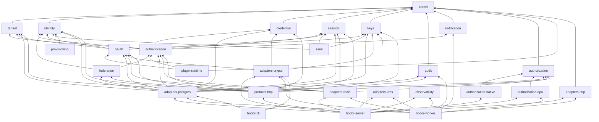

# Workspace and dependency graph

## Consolidated structure

The specification proposes 26 crates. This design has 24: four merges and two additions, justified in [Decision 0002](../decisions/0002-crate-consolidation.md).

| Specification | Here | Reason |
|---|---|---|
| `kernel` + `shared` | `kernel` | Two "common" crates become a dumping ground; one small, reviewed crate instead |
| `oauth2` + `oidc` | `oauth` | OpenID Connect is a layer over the same endpoints; splitting forces shared types and a circular dependency |
| `federation` + `social-login` | `federation` | Social connectors are configuration plus small quirks over the same relying party mechanism |
| `consent` | module of `oauth` | Small aggregate with no other consumer |
| — | `keys` (new) | Rotation and JWKS are domain rules; `adapters-kms` only implements the port |
| — | `adapters-http` (new) | The single SSRF-protected outbound HTTP client, used by federation, Open Policy Agent, webhooks and JWKS fetching |

```text
hodor/
├── Cargo.toml                  # workspace, centralized dependencies and lints
├── rust-toolchain.toml
├── deny.toml                   # cargo-deny: licenses, advisories, sources
├── apps/
│   ├── hodor-server/          # HTTP composition root
│   ├── hodor-worker/          # jobs composition root
│   └── hodor-cli/
├── crates/
│   ├── kernel/
│   ├── tenant/
│   ├── identity/
│   ├── credential/
│   ├── session/
│   ├── keys/
│   ├── authentication/
│   ├── federation/
│   ├── oauth/
│   ├── saml/                   # Phase 6
│   ├── provisioning/           # Phase 6: SCIM, LDAP sync
│   ├── authorization/
│   ├── authorization-native/
│   ├── authorization-opa/
│   ├── audit/
│   ├── notification/
│   ├── plugin-runtime/         # Phase 8
│   ├── protocol-http/
│   ├── adapters-postgres/
│   ├── adapters-redis/
│   ├── adapters-crypto/
│   ├── adapters-kms/
│   ├── adapters-http/          # Phase 3
│   └── observability/
├── frontend/{admin-console,account-console,auth-ui}/
├── migrations/
├── deploy/{docker,kubernetes,helm}/
├── docs/
└── tests/{architecture,integration,security,conformance,performance}/
```

A crate is created only when the phase that uses it starts. Milestone 1 creates `kernel`, `tenant`, `identity`, `credential`, `session`, `authentication`, `audit`, `notification`, `protocol-http`, `adapters-postgres`, `adapters-crypto`, `observability` and the three apps.

## Dependency graph

Arrows point from the dependent crate to the crate it uses.



## Layers and allowed edges

| Layer | Crates | May depend on |
|---|---|---|
| 0 — Kernel | `kernel` | Base libraries only (`uuid`, `time`, `thiserror`, `serde`) |
| 1 — Base contexts | `tenant`, `identity`, `credential`, `session`, `keys`, `audit`, `notification`, `authorization` | Layer 0 |
| 2 — Orchestrating contexts | `authentication`, `oauth`, `provisioning`, `saml` | Layers 0 and 1 (edges listed in the graph) |
| 3 — Context extensions | `federation`, `authorization-native`, `authorization-opa`, `plugin-runtime` | Layers 0 to 2 (edges listed) |
| 4 — Adapters | `adapters-*`, `protocol-http`, `observability` | Layers 0 to 3; **never** another adapter |
| 5 — Apps | `apps/*` | Everything |

Explicit prohibitions:

- No crate in layers 0 to 3 depends on `axum`, `sqlx`, `redis`, `reqwest` or the Tokio runtime.
- `oauth` does not depend on `authentication`, nor the reverse.
- `authorization` does not depend on `identity`.
- No context depends on `audit`.
- `protocol-http` does not depend on `adapters-*`.

`federation` and `authorization-opa` need outbound HTTP. They use the `HttpClient` port defined in `kernel`; `adapters-http` is its only implementation and enforces SSRF protection, timeouts and response size limits in one place.

## Automated checks

| Rule | Tool |
|---|---|
| Allowed edges between crates | A test in `tests/architecture` that reads `cargo metadata` and compares it to the allow-list |
| Forbidden dependencies per layer | Same test, over direct dependencies |
| Domain not exposed | `domain` is `pub(crate)`; `unreachable_pub` lint |
| No `unsafe` | `#![forbid(unsafe_code)]` through `[workspace.lints]` |
| Licenses and advisories | `cargo deny check` |
| Unused dependencies | `cargo machete` |

## Candidate external dependencies

Each one is evaluated (maintenance, audits, open advisories, license) before it enters; the cryptography choice is in [Decision 0008](../decisions/0008-cryptography.md). Versions and advisory status must be re-checked at adoption time.

| Need | Candidate | Note |
|---|---|---|
| HTTP | `axum`, `tower`, `tower-http` | — |
| Database | `sqlx` (Postgres, compile-time checks with offline mode) | — |
| Password hashing | `argon2` (RustCrypto) | — |
| JWS signing, authenticated encryption, TLS | `aws-lc-rs` through `rustls` | Avoids the pure-Rust RSA implementation; see Decision 0008 |
| JOSE | A thin in-house layer over the primitive, or `jsonwebtoken` | Decide by spike in Phase 2 |
| WebAuthn | `webauthn-rs` | Has an external audit |
| OpenAPI | `utoipa` | Generated from code |
| Observability | `tracing`, `opentelemetry`, `tracing-opentelemetry` | — |
| LDAP | `ldap3` | Phase 6 |
| SAML | To be decided by spike | High risk; see the critical review |
| WebAssembly | `wasmtime` (component model) | Phase 8 |
