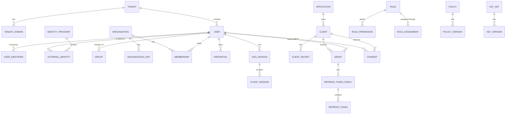

# Database model

PostgreSQL 16 or newer. One database, one schema per bounded context, so ownership is visible and a context can be extracted later without untangling tables.

## Conventions

| Topic | Rule |
|---|---|
| Schemas | `tenant`, `identity`, `credential`, `session`, `authn`, `federation`, `oauth`, `provisioning`, `keys`, `authz`, `audit`, `platform` |
| Keys | `id uuid` (UUIDv7, generated by the application). Primary key `(tenant_id, id)` on tenant tables |
| Tenant column | `tenant_id uuid not null`, first in the primary key and in every index; forced row-level security ([multi-tenancy.md](multi-tenancy.md)) |
| Foreign keys | Composite `(tenant_id, x_id)`; **never across schemas of different contexts**. Cross-context references are plain identifiers, kept consistent by events |
| Reading across contexts | A context writes only its own schema. A statement of one context's adapter may read another's tables only when it must filter, sort and count over both at once, as the SCIM lists do ([the provisioning context](contexts/provisioning.md#finding-with-a-filter)); the page of the context that reads says which tables |
| Time | `timestamptz`, always UTC; `created_at`, `updated_at` |
| Concurrency | `version integer` for optimistic locking on aggregates |
| Enumerations | `text` with a `CHECK` constraint (easier to migrate than enum types) |
| Secrets | Columns named `*_hash` (SHA-256 of a high-entropy token, or PHC string for passwords) or `*_enc` (authenticated encryption ciphertext + key version); no plaintext secret column exists |
| Deletion | Hard delete for ephemeral rows; `status` + `deleted_at` for principals, followed by purge after retention |
| JSON | `jsonb` only for open-ended data (custom attributes, claim mappings, flow definitions), never for fields that rules or indexes depend on |
| Migrations | SQLx migrations, forward-only, expand/contract across two releases; applied by `hodor-cli migrate`, never automatically at server start |
| Roles | `hodor_owner` (migrations, owns tables), `hodor_app` (row-level security enforced), `hodor_platform` (cross-tenant jobs), `hodor_readonly` |

## Core entity-relationship diagram

Lines between tables of different contexts (for example `USER` to `SSO_SESSION`) are logical references, not database foreign keys.

## Tables by schema

All tables below have `tenant_id`, `created_at` and, where they are aggregates, `updated_at` and `version`; these are omitted from the column lists.

### `tenant`

| Table | Key columns | Notes |
|---|---|---|
| `tenant` | `id`, `slug` (unique), `display_name`, `status`, `status_reason`, `settings jsonb`, `deletion_scheduled_for`, `version` | `tenant_id = id`. Settings live in this row as validated JSON, not in a separate table |
| `tenant_domain` | `id`, `hostname` (globally unique when verified), `purpose`, `verification_token`, `verified_at` | Phase 3 |

Slug lookup goes through `platform.tenant_directory`, a routing table outside row-level security. Both tables are specified in [the tenant context](contexts/tenant.md#storage).

### `identity`

| Table | Key columns | Constraints and indexes |
|---|---|---|
| `user` | `id`, `kind`, `status`, `status_reason`, `profile` (typed columns for standard claims), `attributes jsonb`, `deleted_at` | — |
| `user_identifier` | `id`, `user_id`, `kind`, `value_normalized`, `value_display`, `verified_at`, `is_primary` | `UNIQUE (tenant_id, kind, value_normalized)` |
| `external_identity` | `id`, `user_id`, `provider_id`, `external_subject`, `link_method`, `profile_snapshot jsonb`, `last_login_at` | `UNIQUE (tenant_id, provider_id, external_subject)` |
| `group` | `id`, `name`, `parent_id`, `path` | `UNIQUE (tenant_id, parent_id, name)` |
| `group_member` | `group_id`, `user_id` | Primary key on all three |
| `organization` | `id`, `name`, `slug`, `status` | `UNIQUE (tenant_id, slug)` |
| `organization_unit` | `id`, `organization_id`, `parent_id`, `kind`, `name` | `kind` covers department, team, … |
| `membership` | `id`, `organization_id`, `unit_id`, `user_id`, `status` | `UNIQUE (tenant_id, organization_id, user_id)` |
| `invitation` | `id`, `organization_id`, `email`, `token_hash`, `roles`, `expires_at`, `accepted_at` | — |
| `attribute_schema` | `name`, `type`, `required`, `visibility`, `validation` | Custom attribute definitions |

### `credential`

| Table | Key columns | Notes |
|---|---|---|
| `password` | `user_id`, `password_hash`, `must_change`, `changed_at`, `version` | One per user. Built in Milestone 1; specified in [the credential context](contexts/credential.md#storage) |
| `password_history` | `id`, `user_id`, `password_hash`, `replaced_at` | Trimmed to the policy's depth |
| `credential` | `id`, `principal_id`, `type`, `status`, `label`, `last_used_at`, `revoked_at` | One row per credential of any kind. Introduced with the second kind of credential, in Phase 4 |
| `totp` | `credential_id`, `secret_enc`, `algorithm`, `digits`, `period`, `last_step` | — |
| `webauthn` | `credential_id`, `webauthn_id` (unique per tenant), `public_key`, `sign_count`, `aaguid`, `transports`, `backup_eligible`, `backup_state`, `user_handle` | — |
| `recovery_code` | `credential_id`, `code_hash`, `used_at` | — |
| `api_key` | `credential_id`, `prefix` (indexed), `key_hash`, `scopes`, `expires_at` | — |
| `certificate` | `credential_id`, `fingerprint_sha256`, `subject_dn`, `not_after` | — |

### `session`

| Table | Key columns | Notes |
|---|---|---|
| `sso_session` | `id`, `id_hash` (unique), `user_id`, `auth_time`, `acr`, `amr text[]`, `last_activity_at`, `idle_expires_at`, `absolute_expires_at`, `ip`, `user_agent`, `device_id`, `revoked_at`, `revoke_reason` | Index on `(tenant_id, user_id)`; expired rows purged by the worker |
| `client_session` | `session_id`, `client_id`, `sid`, `started_at` | — |
| `trusted_device` | `id`, `user_id`, `token_hash`, `label`, `expires_at` | — |

### `authn`

| Table | Key columns | Notes |
|---|---|---|
| `auth_flow` | `id`, `name`, `kind` (browser, step-up, registration, recovery) | — |
| `auth_flow_version` | `flow_id`, `version`, `definition jsonb`, `status`, `published_by` | Immutable once published |
| `auth_transaction` | `id`, `flow_id`, `flow_version`, `state jsonb`, `candidate_user_id`, `return_ref`, `expires_at` | Short-lived; unlogged-table candidate |
| `login_attempt` | `id`, `identifier_hash`, `user_id`, `ip`, `outcome`, `reason`, `occurred_at` | Partitioned by day; drives lockout |
| `account_lock` | `user_id`, `locked_until`, `failure_count` | — |
| `verification_token` | `id`, `purpose` (email verify, recovery, magic link), `subject_id`, `token_hash`, `expires_at`, `used_at` | — |

### `federation`

| Table | Key columns | Notes |
|---|---|---|
| `identity_provider` | `id`, `alias` (unique per tenant), `connector`, `protocol`, `config jsonb`, `client_id`, `client_secret_enc`, `claim_mapping jsonb`, `jit_policy`, `link_policy`, `status` | — |
| `routing_rule` | `id`, `priority`, `condition jsonb`, `provider_id` | — |
| `federation_state` | `state_hash`, `transaction_id`, `provider_id`, `nonce`, `code_verifier_enc`, `purpose`, `expires_at` | Single use |
| `link_request` | `id`, `user_id`, `provider_id`, `external_subject`, `status`, `expires_at` | — |

### `oauth`

| Table | Key columns | Notes |
|---|---|---|
| `application` | `id`, `name`, `type`, `branding` | — |
| `client` | `id`, `application_id`, `client_id` (public identifier, unique per tenant), `client_type`, `auth_method`, `grant_types text[]`, `subject_type`, `sector_identifier`, `token_policy jsonb`, `require_par`, `require_dpop`, `first_party`, `status` | — |
| `client_redirect_uri` | `client_id`, `uri`, `kind` (redirect, post-logout) | Exact-match lookup |
| `client_secret` | `id`, `client_id`, `secret_hash`, `expires_at`, `revoked_at` | Several can be valid during rotation |
| `client_key` | `client_id`, `jwks jsonb` or `jwks_uri` | For `private_key_jwt` |
| `resource_server` | `id`, `application_id`, `identifier` (audience) | — |
| `scope` | `id`, `resource_server_id`, `name`, `description`, `consent_required` | — |
| `claim_mapper` | `id`, `client_id`, `kind`, `config jsonb`, `order` | — |
| `consent` | `id`, `user_id`, `client_id`, `scopes text[]`, `granted_at`, `expires_at`, `revoked_at` | History kept; one active row per pair |
| `grant` | `id`, `subject_id`, `client_id`, `session_id`, `scopes`, `audience`, `authorization_details jsonb`, `status`, `revoked_at` | — |
| `authorization_code` | `code_hash`, `grant_id`, `redirect_uri`, `code_challenge`, `nonce`, `expires_at`, `consumed_at` | — |
| `refresh_token_family` | `id`, `grant_id`, `generation`, `absolute_expires_at`, `revoked_at`, `revoke_reason` | — |
| `refresh_token` | `token_hash`, `family_id`, `generation`, `issued_at`, `idle_expires_at`, `consumed_at`, `cnf_jkt` | Lookup by `(tenant_id, token_hash)` |
| `pushed_request` | `request_uri_hash`, `client_id`, `params jsonb`, `expires_at` | — |
| `device_code` | `device_code_hash`, `user_code_hash`, `client_id`, `status`, `expires_at` | — |
| `revoked_jti` | `jti`, `expires_at` | Deny-list for JWT access tokens; mirrored in Redis when present |

### `keys`

| Table | Key columns | Notes |
|---|---|---|
| `key_set` | `id`, `use` (sig, enc, data), `rotation_period`, `provider` | — |
| `key_version` | `id`, `key_set_id`, `kid`, `algorithm`, `status`, `public_jwk`, `private_enc` (null for keys held in a key management service), `provider_ref`, `activated_at`, `retire_at` | One `active` per `(key_set, algorithm)`, enforced by a partial unique index |

### `authz`

| Table | Key columns | Notes |
|---|---|---|
| `permission` | `id`, `namespace`, `resource_type`, `action` | — |
| `role` | `id`, `name`, `scope_kind`, `scope_id`, `composite` | — |
| `role_permission` | `role_id`, `permission_id` | — |
| `role_parent` | `role_id`, `parent_role_id` | Cycle check in the domain |
| `role_assignment` | `id`, `role_id`, `principal_kind`, `principal_id`, `scope_kind`, `scope_id`, `valid_until` | Index on principal |
| `acl_entry` | `resource_type`, `resource_id`, `principal_kind`, `principal_id`, `actions text[]`, `effect` | — |
| `relation_tuple` | `object_type`, `object_id`, `relation`, `subject_type`, `subject_id`, `subject_relation` | Indexed both directions |
| `policy` | `id`, `namespace`, `name`, `engine` | — |
| `policy_version` | `policy_id`, `version`, `content`, `checksum`, `status`, `author`, `approver`, `published_at` | Immutable once published |
| `policy_bundle` | `id`, `namespace`, `revision`, `artifact bytea` or object reference, `signature`, `built_at` | — |
| `engine_binding` | `namespace`, `engine`, `endpoint_ref`, `failure_policy jsonb`, `timeout_ms`, `cache_policy` | — |
| `opa_instance_status` | `instance_id`, `bundle_revision`, `healthy`, `reported_at` | — |
| `decision_log` | `decided_at`, `decision_id`, `namespace`, `subject_kind`, `subject_id`, `action`, `resource_type`, `resource_id`, `effect`, `reason`, `engine`, `policy_version`, `duration_us`, `input jsonb` (masked), `masked` | Partitioned by day; see [the record of decisions](contexts/authorization.md#storage-of-the-record) |

### `provisioning`

| Table | Key columns | Notes |
|---|---|---|
| `user_attribute` | `user_id`, `external_id`, the name's parts, the enterprise attributes | What SCIM carries of a user that the identity context has no place for. Specified in [the provisioning context](contexts/provisioning.md#storage) |
| `group_attribute` | `group_id`, `external_id` | The same, of a group |
### `webhooks`

| Table | Key columns | Notes |
|---|---|---|
| `webhooks.endpoint`, `webhooks.subscription`, `webhooks.signing_secret`, `webhooks.delivery` | See [the webhooks context](contexts/webhooks.md#storage) | The secret is sealed; deliveries are found across tenants and leased in their tenant |

### `audit` and `platform`

| Table | Key columns | Notes |
|---|---|---|
| `audit.record`, `audit.chain_head` | See [the audit context](contexts/audit.md#storage) | `hodor_app` has `INSERT` and `SELECT` only on `audit.record`; a trigger refuses every update and delete |
| `platform.outbox` | `id`, `tenant_id`, `event_type`, `payload jsonb`, `occurred_at`, `dispatched_at`, `attempts` | Polled with `FOR UPDATE SKIP LOCKED` |
| `platform.job` | `id`, `tenant_id`, `kind`, `payload`, `run_at`, `locked_by`, `attempts`, `last_error` | Same locking pattern |
| `platform.idempotency_key` | `tenant_id`, `key`, `request_hash`, `response`, `expires_at` | — |

## Data volume and retention

| Data | Growth driver | Strategy |
|---|---|---|
| `login_attempt`, `decision_log`, `audit.record` | Traffic | Time partitioning; drop or archive old partitions per tenant retention |
| `refresh_token`, `authorization_code`, `auth_transaction`, `federation_state` | Traffic, short-lived | Periodic purge of expired rows in small batches |
| `sso_session` | Active users | Purge after expiry plus a retention window for the user's login history |
| `outbox` | Events | Delete after dispatch; alert on lag |

## Use of Redis

Redis holds nothing that cannot be rebuilt from PostgreSQL: rate-limit counters, role-closure and tenant-settings caches, session read cache, `jti` and DPoP replay caches, JWKS and discovery caches for external identity providers. See [Decision 0007](../decisions/0007-postgres-required-redis-optional.md).
