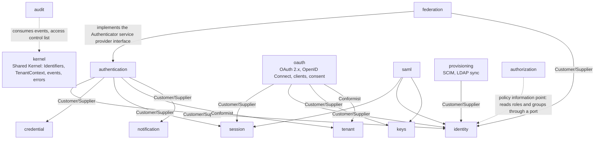
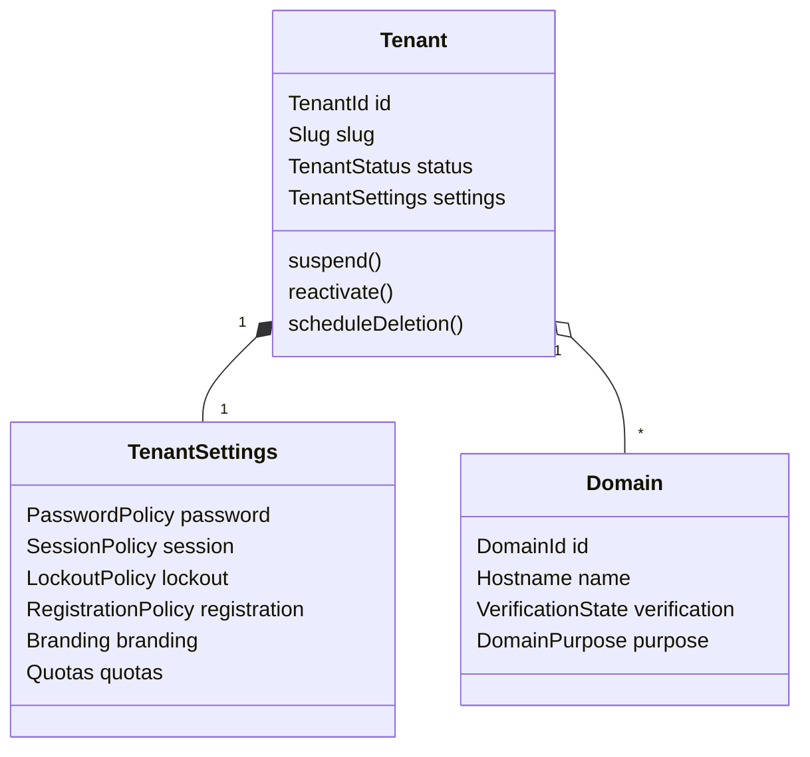
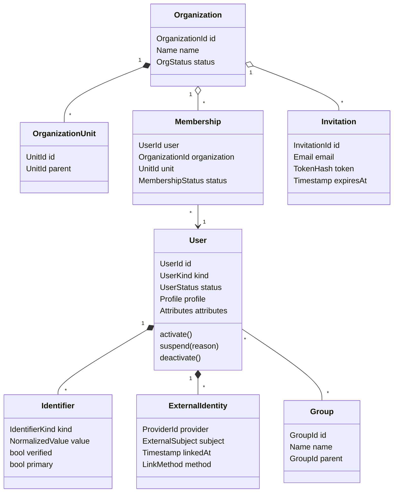
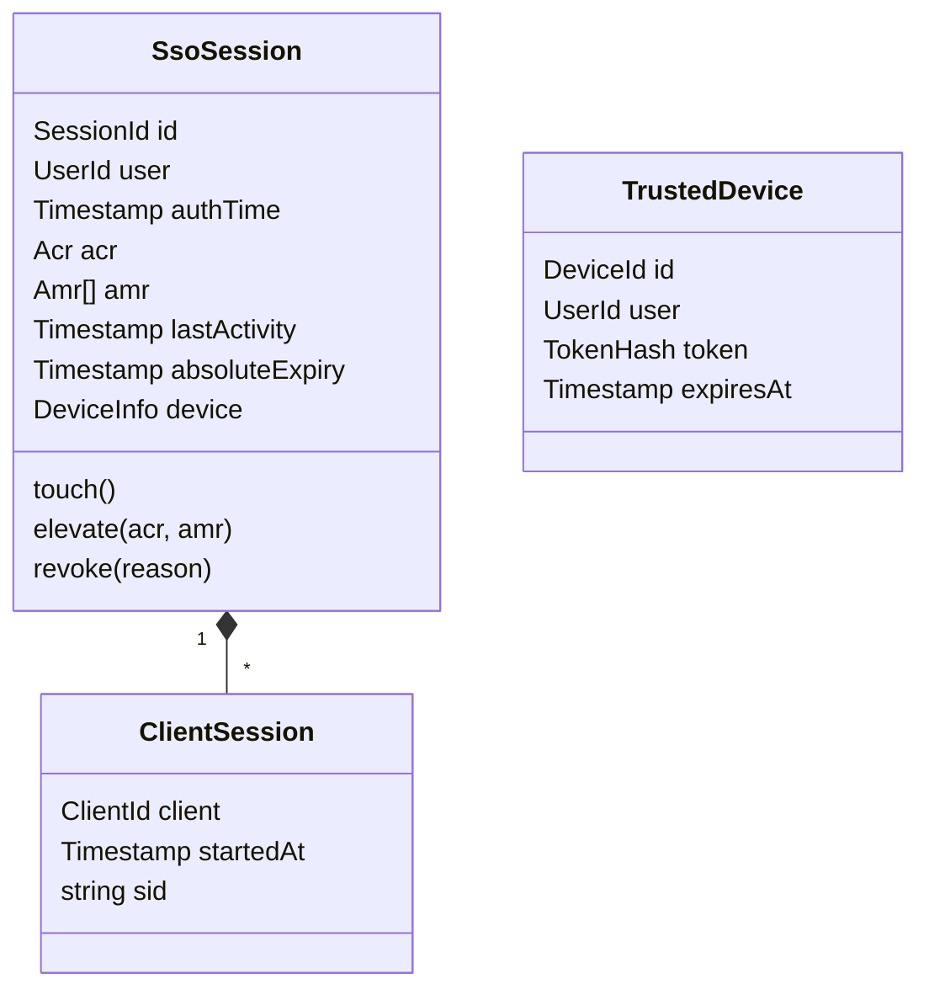
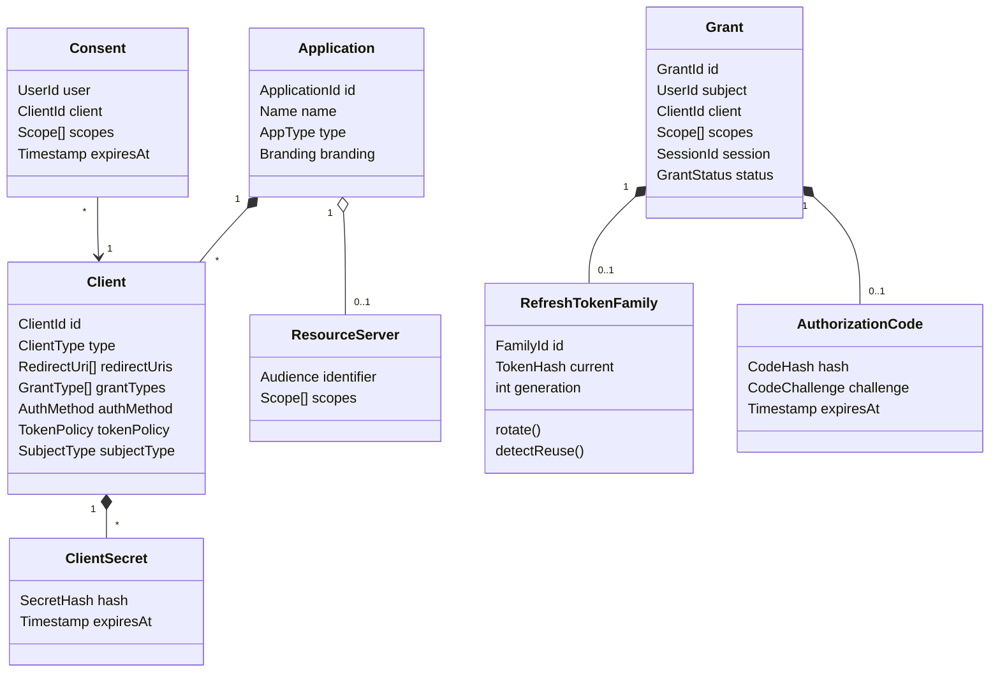

# Domain model

## Bounded context map

Relevant relationships:

| Upstream → Downstream | Type | Note |
|---|---|---|
| `kernel` → all | Shared Kernel | Kept minimal; changes require review |
| `identity` → `authentication`, `oauth`, `federation` | Customer/Supplier | Downstream uses the `identity::api` facade |
| `authentication` → `federation` | Open Host (`Authenticator` service provider interface) | Inverts the dependency: federation is a flow step |
| `oauth` ↔ `authentication` | No code dependency | Joined over HTTP: `oauth` requires a session with certain facts; the interaction is orchestrated in `protocol-http` |
| External identity providers → `federation` | Anti-Corruption Layer | Each connector translates the provider into `ExternalIdentity` |
| Open Policy Agent → `authorization` | Anti-Corruption Layer | `OpaAuthorizationAdapter` |
| all → `audit` | Published Language (events) | No context depends on `audit` |

`authorization` needs the subject's roles and groups. It defines the `SubjectAttributeSource` port (a policy information point); the implementation that queries `identity` is wired in the composition root, so `authorization` stays independent of `identity`.

## Ubiquitous language

| Term | Definition |
|---|---|
| **Tenant** | Hard isolation boundary with its own issuer, keys, policies and data. Equivalent to a *realm*. |
| **Organization** | B2B structure *inside* a tenant (a customer or partner company). Not an isolation boundary. |
| **User** | Person or account with an immutable identifier, belonging to exactly one tenant. |
| **Identifier** | Username, email or phone used to locate a user. |
| **External Identity** | A (`provider`, `subject`) pair from an external identity provider linked to a user. |
| **Principal** | The subject of an action: user, service account or agent. |
| **Credential** | Proof of authentication owned by a principal. |
| **Authentication Transaction** | One execution of an authentication flow, from start to session. |
| **Single sign-on Session** | The browser's authenticated state in the tenant. |
| **Client Session** | A client's participation in a single sign-on session. |
| **Application** | A registered system; owns one or more clients and may be a resource server. |
| **Grant** | Authorization given to a client for a subject and a set of scopes. |
| **Token Family** | The chain of refresh tokens that descends from one grant. |
| **Policy** | A versioned authorization rule (native or Rego). |
| **Decision** | The result of an authorization evaluation. |

## Aggregates by context

### `tenant`

Invariants: `slug` is unique and never changes; a verified domain belongs to one tenant; a suspended tenant issues no tokens and creates no sessions.

The full specification of this context, with slug rules, lifecycle, settings and storage, is in [the tenant context](contexts/tenant.md).

### `identity`

`UserKind` covers `human`, `service_account` and `agent`: workloads and agents are first-class principals with their own lifecycle and audit trail, and never receive human credentials.

Invariants: `(tenant, kind, value)` of an `Identifier` is unique; `(tenant, provider, subject)` of an `ExternalIdentity` is unique; an active `human` user has at least one identifier or one external identity; groups form no cycles.

Users and their login identifiers, the part built in Milestone 1, are specified in full in [the identity context](contexts/identity.md).

"Department" is not an aggregate: it is an `OrganizationUnit` with a type. See the [critical review](critical-review.md).

### `credential`

| Aggregate | Stored state | Operations |
|---|---|---|
| `PasswordCredential` | Argon2id hash in PHC format, parameter version, hash history | `verify`, `change`, `needs_rehash` |
| `TotpCredential` | Encrypted secret, algorithm, digits, period, last accepted step | `verify` (rejects replay of the same step) |
| `WebAuthnCredential` | Credential identifier, COSE public key, counter, authenticator model identifier, backup flags, transports | `verify_assertion` |
| `RecoveryCodeSet` | Code hashes, used markers | `consume` |
| `ApiKey` | Prefix, hash, scopes, expiry | `verify`, `revoke` |
| `Certificate` | SHA-256 fingerprint, subject distinguished name, validity | `matches` |

Passwords, the part built in Milestone 1, are specified in full in [the credential context](contexts/credential.md).

Every credential has a `CredentialId`, an `owner: PrincipalId`, a `status` and created, last-used and revoked timestamps. Client secrets belong to the `oauth` context.

### `session`

Browser sessions, the part built in Milestone 1, are specified in full in [the session context](contexts/session.md).

The session carries the *authentication facts* (`auth_time`, `acr`, `amr`). That is what lets `oauth` decide whether a new login is needed without knowing the `authentication` context.

### `authentication`

| Aggregate | Role |
|---|---|
| `AuthFlow` | Versioned definition: a graph of steps with a type (`required`, `alternative`, `conditional`, `optional`), conditions, and the authenticator of each step |
| `AuthTransaction` | Execution: flow and version, current step, candidate principal, accumulated facts (`amr`), risk signals, expiry, opaque return context |
| `LoginAttempt` | Attempt record (hashed normalized identifier, IP, outcome); the basis for lockout and credential-stuffing detection |

Invariants: a transaction only advances through its current step; it expires in minutes; on completion it is consumed exactly once.

### `federation`

| Aggregate | Role |
|---|---|
| `IdentityProvider` | Connector type, protocol, endpoints or discovery, client identifier, encrypted secret, scopes, claim mapping, just-in-time and linking policies, branding, status |
| `RoutingRule` | Condition (email domain, application, organization) → provider; ordered by priority |
| `PendingAuthorization` | What Hodor keeps while a person is away at an external identity provider: the hash of the `state`, the `nonce` and the sealed `code_verifier` of the request it made; single use, short time to live, bound to the `AuthTransaction` |
| `LinkRequest` | A link request pending proof of control |

### `oauth`

Invariants: redirect URIs are compared by exact equality; a public client has no secret and requires PKCE; an authorization code is redeemed at most once, and a second attempt revokes the grant; presenting an already rotated refresh token revokes the whole family.

### `keys`

A `KeySet` (per tenant and use: `sig`, `enc`, `data`) contains `KeyVersion`s with states `pending → active → retiring → retired → revoked`. Only one version is `active` per algorithm; a `retiring` version stays in the JWKS until the longest-lived token it signed has expired.

### `authorization`

| Aggregate | Role |
|---|---|
| `Role` | Name, scope (tenant, organization, application), permissions, inherited roles |
| `Permission` | `resource_type` + `action`, owned by a resource server |
| `RoleAssignment` | Principal or group → role, with scope and validity |
| `AclEntry` | Specific resource → principal → actions |
| `RelationTuple` | `object#relation@subject` (relationship-based access control) |
| `Policy` / `PolicyVersion` | Native rule (attribute-based access control condition) or Rego module; immutable version with checksum |
| `PolicyBundle` | Published set of versions with a revision; the unit distributed to Open Policy Agent |
| `EngineBinding` | Which engine answers for which *namespace* (resource server) in a tenant, with its failure policy |
| `DecisionRecord` | Recorded decision, with input reduced according to the retention policy |

### `audit`

`AuditRecord`: Identifier, tenant, timestamp, actor (principal, client, IP), action, target, outcome, secret-free metadata, `prev_hash` and `hash`. Immutable.

## Domain events (sample)

| Context | Events |
|---|---|
| `tenant` | `TenantCreated`, `TenantSuspended`, `DomainVerified` |
| `identity` | `UserCreated`, `UserSuspended`, `IdentifierVerified`, `ExternalIdentityLinked`, `ExternalIdentityUnlinked`, `MembershipAdded` |
| `credential` | `PasswordChanged`, `CredentialEnrolled`, `CredentialRevoked` |
| `authentication` | `AuthenticationSucceeded`, `AuthenticationFailed`, `AccountLocked` |
| `session` | `SessionStarted`, `SessionElevated`, `SessionRevoked` |
| `oauth` | `ConsentGranted`, `ConsentRevoked`, `TokenIssued`, `TokenRevoked`, `RefreshTokenReuseDetected`, `ClientSecretRotated` |
| `keys` | `KeyRotated`, `KeyRevoked` |
| `authorization` | `PolicyPublished`, `PolicyRolledBack`, `RoleAssigned`, `RoleRevoked` |

Every event carries `event_id`, `tenant_id`, `occurred_at`, `actor` and `correlation_id`. Reactions across contexts (for example `SessionRevoked` → revoke grants) are event handlers run by the worker, idempotent on `event_id`.
