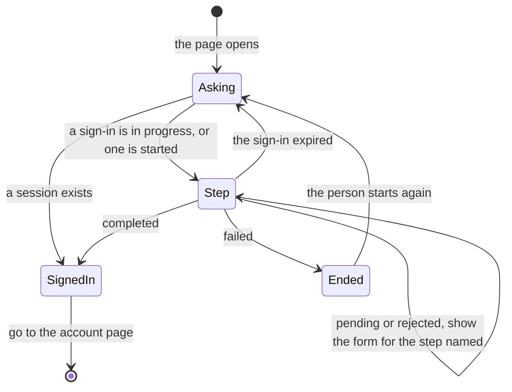

# The hosted pages

The hosted pages are what a person sees when they register, sign in, sign out or recover a password. They are one React application, `auth-ui`, served by `hodor-server` on the same origin as [the interaction interface](../api/interaction-api.md), which is the only thing they talk to ([Decision 0011](../decisions/0011-frontends-bff.md)).

The pages decide nothing. They ask the server which step comes next, show the form for it and send back what the person typed. Every rule — who may sign in, how many attempts, which password is acceptable — lives on the server and is tested there.

## The pages

All paths are relative to the tenant: `https://{host}/t/{slug}`.

| Path | What the person does there | Requests it makes |
|---|---|---|
| `/account/sign-in` | Signs in, one step at a time | The [sign-in routes](../api/interaction-api.md#signing-in) |
| `/account/register` | Asks to register by giving an email address | `POST /interaction/registration` |
| `/account/complete-registration` | Arrives from the link in the message, chooses a password | `POST /interaction/registration/complete` |
| `/account/recover` | Asks for a link to choose a new password | `POST /interaction/recovery` |
| `/account/reset-password` | Arrives from the link in the message, chooses a new password | `POST /interaction/recovery/complete` |
| `/account` | Sees that they are signed in and which applications they agreed to, withdraws an agreement, goes to their profile or their factors, and signs out | `GET` and `DELETE /interaction/session`, [`GET` and `DELETE /interaction/consents`](../api/interaction-api.md#the-persons-consents) |
| `/account/sign-out` | Is asked whether to sign out, when an application asked Hodor to sign them out | `GET` and `DELETE /interaction/session` |
| `/account/signed-out` | Waits, at most five seconds, while the applications they signed in to are told through hidden frames that they signed out | [`GET /interaction/signed-out`](../api/interaction-api.md#the-frames-of-a-sign-out) |
| `/account/security` | Manages their second factors and recovery codes | [The factor routes](../api/interaction-api.md#managing-ones-factors) and the WebAuthn registration routes |
| `/account/profile` | Sees and changes their name and their [standard claims](contexts/identity.md#standard-claims): names, nickname, addresses of pages and picture, gender, birth date, time zone, telephone number and postal address | [`GET` and `PUT /interaction/profile`](../api/interaction-api.md#the-persons-profile) |
| `/account/consent` | Is asked whether an application may have the access it asks for | [`GET` and `POST /interaction/consent`](../api/interaction-api.md#consent) |
| `/account/accept-invitation` | Arrives from the link of an invitation, and joins the organization | [`POST /interaction/invitations/describe` and `/accept`](../api/interaction-api.md#accepting-an-invitation), and `GET /interaction/session` |
| `/account/providers/{alias}/callback` | Arrives back from an identity provider | The sign-in routes, to [finish](../api/interaction-api.md#signing-in-through-an-identity-provider) |
| `/account/sign-in-link` | Arrives from the link of a message to sign in, in the browser that asked for it | `GET /interaction/sign-in` and [`POST /interaction/sign-in/steps/email_link`](../api/interaction-api.md#signing-in-with-a-code-or-a-link-by-email) |

`/account`, `/account/profile` and `/account/security` send a person who is not signed in to `/account/sign-in`, and `/account/sign-in` sends a person who is already signed in to `/account`.

**Signing in for an application.** When an application sends a person to Hodor's [authorization endpoint](contexts/oauth.md#signing-in-and-coming-back) and they must sign in, the server sends them to `/account/sign-in?continue=authorization`. With `continue=authorization` in its address the sign-in page does not stop at the session it finds: it goes on with the sign-in in progress, or starts one, even when someone is signed in already, since the application asked for one. A [step-up](contexts/authentication.md#step-up) that the authorization endpoint started is such a sign-in in progress: the page shows the step it names, the second factor or the password, without asking for the identifier. When a sign-in completes, by any way, the identity providers' page that the person comes back to included, and the answer carries `continue`, the page goes there instead of to the account page. The page goes only to an address that starts with `/t/{slug}/oauth2/` of its own tenant; anything else is ignored and the account page is shown. When the application sent `login_hint`, the address carries it too and the sign-in page starts with that identifier filled in; when it sent `ui_locales`, the address carries them and the pages use the first of those languages they have ([the OpenID Provider](contexts/oauth.md#what-a-request-may-ask-of-the-sign-in)).

**Registering for an application.** When an application sends `prompt=create` to a tenant open to registration, the [authorization endpoint](contexts/oauth.md#registering-for-an-application) keeps the request as for a sign-in and sends the browser to `/account/register?continue=authorization`, with `ui_locales` when the application sent them. With `continue=authorization` in its address the registration page says, under its lead, that once the person has chosen a password and signed in, they go back to the application, and its link to sign in carries `continue=authorization`, so that a person who has an account signs in for the application from there. The message and the page that finishes are those of every registration, and the sign-in that follows them goes back to the application as every sign-in does while the request's cookie lives, ten minutes from the request. Without `continue=authorization` the page is the registration page as it was.

**Signing out for an application.** When an application asks Hodor to sign a person out and the request does not prove that it comes from the browser's own session, the [end-session endpoint](contexts/oauth.md#asking-the-person) sends the browser to `/account/sign-out`. The page asks who is signed in. When nobody is, it goes on at once to `/t/{slug}/oauth2/logout/finish`. Otherwise it asks "Sign out of {tenant}?" with two buttons: "Sign out" ends the session as the account page does and goes on to the same address, through `/account/signed-out?continue=logout` when the server kept frames for the sign-out; "Stay signed in" goes to the account page. A session that ended in the meantime counts as signed out. The page never learns where the application wants the person back: that stays with the server, which sends the browser there from the finish.

**Telling the applications.** After the person signs out, on the account page or the sign-out page, the page asks `GET /interaction/signed-out` whether the server kept frames for the sign-out. When it did, the browser goes to `/account/signed-out`, as it does when the end-session endpoint ends a session at once while some application of it has a front-channel logout address; when it did not, the page goes on at once, as it did before, without that page. The page asks the server for the addresses of its frames, which the server made when the session ended and keeps for that page alone ([front-channel logout](contexts/oauth.md#front-channel-logout)); it never reads them from its own address or from anything the browser could change. It loads each in a hidden, sandboxed frame and says that the person's applications are being told. When every frame has loaded or five seconds have passed, it goes on: with `continue=logout` in its address to `/t/{slug}/oauth2/logout/finish`, otherwise to the sign-in page, which says the person is signed out. Without frames it goes on at once.

**Coming back from a provider to a second factor.** When the provider is accepted and the sign-in asks for a second factor next, the page the provider sends the person back to goes to `/account/sign-in`, which asks for it, with nothing said against the provider.

**Signing in again.** `/account/sign-in?continue=security` starts a sign-in even when someone is signed in already, as `continue=authorization` does, and goes back to `/account/security` when it completes. The security page sends the person there when a change needs [a recent sign-in](contexts/authentication.md#proving-oneself-again).

Any other path under `/account` is answered with `404` by the server.

### Signing in



The page is a renderer for the answer of the interaction interface:

- On opening, it asks who is signed in. If nobody is, it asks where the current sign-in stands, and starts one if there is none. A reloaded page therefore continues where it was.
- It shows the form for the `step` in the answer: `identifier`, `password`, `webauthn`, `totp` or `enrollment`. A step the page does not know is shown as "this page cannot continue this sign-in", never guessed at.
- The `totp` form asks for the code the person's authenticator application shows, in one field with `autocomplete="one-time-code"` and a numeric keyboard on phones, and offers to start again with another identifier.
- The `identifier` step also offers a passkey, in a browser that can use one: a button, "sign in with a passkey", and, where the browser supports conditional requests, the passkeys it holds offered in the identifier field itself (`autocomplete="username webauthn"`). Either asks the server for [the passkey challenge](../api/interaction-api.md#signing-in-with-a-passkey); a passkey that answers signs the person in with nothing more. The conditional request is abandoned as soon as the person types an identifier, presses the button or leaves the step. Asking for the challenge changes the sign-in, so an identifier sent at that same moment can be answered `authentication.transaction_modified_concurrently`; the page then sends the identifier once more, since the first was not taken. Only the identifier is sent again: it counts no attempt.
- The `webauthn` step is one button, "use the security key". Pressing it asks the server for [the challenge](../api/interaction-api.md#the-webauthn-step), then the person's authenticator through the browser, and sends the answer. When the authenticator gives none, because the person cancelled or it timed out, nothing is sent and the page says the key did not answer; a browser that cannot use security keys is told so.
- The `totp` form and the `webauthn` step also offer "use a recovery code instead". It changes the form, in place, to one field for a recovery code, with no numeric keyboard and no automatic capitals or corrections, submitted to the `recovery_code` substitute; a way back to the code of the application, or to the security key, is offered too. A rejected recovery code shows the generic "that did not work" message on the recovery code form.
- A `rejected` answer shows the same form again with one message, "that did not work", whatever the reason. The page has no way of knowing the reason and does not try.
- "Use another address" on the password step abandons the sign-in and starts a new one.
- The `identifier` step also offers a code or a link by email when the tenant [offers them](../api/interaction-api.md#signing-in-with-a-code-or-a-link-by-email), as [the next section](#signing-in-with-a-code-or-a-link-by-email) says.
- The `enrollment` step, for a person whose tenant requires a second factor and who has none, sets one up, as [its own section](#enrolling-a-second-factor-during-a-sign-in) says.
- A sign-in that expired while the person was typing is started again, and the page says so.

### Signing in with a code or a link by email

When the tenant offers them, read from `GET /interaction/sign-in/alternatives` when the page opens, the `identifier` step shows two more buttons under the identifier field, "Email me a code" and "Email me a link". They are shown only while the sign-in is at its first step, like the identity providers. Each uses the address typed in the identifier field; with nothing typed, the page asks for the address first and sends nothing.

- **A code.** The page asks for it, then shows one field for the code, with `autocomplete="one-time-code"` and a numeric keyboard on phones, and one message whatever the address: "if this address has an account here, we sent it a code". The person can ask for another code, which replaces the first, or use another address, which starts a new sign-in. A rejected code shows "that did not work" on the same form.
- **A link.** The page asks for it and says, whatever the address: "if this address has an account here, we sent it a link; open it in this browser within ten minutes". It offers to send another link, or to use another address.

The page sends the language it is being shown in as `locale`, so the message arrives in that language when the person has none of their own.

`/account/sign-in-link`, the page the link opens:

- reads the token from after `#` once and takes it out of the address at the same moment, so that it does not stay in the browser's history;
- asks where the sign-in of this browser stands. When this browser has no sign-in in progress, it says the link works only in the browser where it was asked for, within ten minutes, and offers to sign in; it sends nothing;
- otherwise presents the token, and goes on as a sign-in does: to `continue` or the account page when the person is signed in, and to `/account/sign-in` when a second factor is asked for next, which shows it;
- says "that link did not work", with a way to sign in, when the token is rejected or the sign-in has moved on, in the same words whatever the reason.

### Enrolling a second factor during a sign-in

When the answer names the `enrollment` step, the sign-in page says that the organization requires a second factor and that the person has none yet, and offers what [the server lists](../api/interaction-api.md#enrolling-a-second-factor-during-a-sign-in): "set up an authenticator application", "add a security key" and "add a passkey", the last two only in a browser that can use one. It offers to start again with another identifier too; it never offers to go on without a factor, since there is no way to.

- **An authenticator application.** The page begins the enrollment and shows the QR code, drawn in the page from the `otpauth://` address as [the security page](#a-persons-own-factors) draws it, the secret as text in groups of four, and one field for the code the application shows, with `autocomplete="one-time-code"` and a numeric keyboard on phones. A rejected code shows "that did not work" on the same form, the QR code still shown, and the person types the code again. "Choose another way" goes back to the choice.
- **A security key or a passkey.** The page asks for a name, as the security page does, then begins the registration and asks the authenticator through the browser. When the authenticator gives no answer, nothing is sent and the page says the key did not answer; a rejected answer shows "that did not work", and pressing the button again begins a new registration.
- **The recovery codes.** When the answer that completes the sign-in holds recovery codes, the page shows them once, in a list the person can copy, as the security page does, with a button the person presses once they have kept them. Only then does it go on, to `continue` or the account page. Leaving the page forgets them; the person can make a new set from the security page.
- `authentication.enrollment_not_needed` means the person has a factor by now: the page says so and starts the sign-in again, which asks for it.

### Signing in through an identity provider

When the tenant [offers identity providers](contexts/federation.md#signing-in-through-a-provider), the sign-in page lists them under the first form, each as a button, "Continue with" and the provider's name. They are shown only while the sign-in is at its first step: a provider is chosen at the start or not at all.

Choosing one asks the server for the address at the provider and sends the browser there. The page refuses to go anywhere that is not an HTTP or HTTPS address.

A [directory](contexts/federation.md#signing-in-through-a-directory) is different: nobody leaves for it. Choosing one shows a form on the same page, "Username at" and the directory's name, and a password, with a way back to the other ways of signing in. What it answers is shown like the answer to a password of Hodor's own: "that did not work", or how long to wait after too many attempts.

The provider sends the person back to `/account/providers/{alias}/callback`. That page:

- reads the code and the state from its address once and takes them out of the address at the same moment, so that the code does not stay in the browser's history;
- presents them to the server, from Hodor's own origin, and goes on to the account page when the person is signed in;
- sends the person back to the sign-in page otherwise, with one message, "that did not work", or "the sign-in was not finished at the provider" when the provider sent no code. It asks the server nothing in that second case.

A SAML identity provider does not send the person back with a code: it posts its response to Hodor's [assertion consumer](contexts/federation.md#when-the-response-arrives), which checks it, keeps its answer and sends the browser to the same page with `binding=saml`, the state and a receipt in the address. The page then takes the state and the receipt out of the address in the same way and presents those two. An address with `binding=saml` and no receipt is one the assertion consumer could not use, and the page says "that did not work" without asking the server anything.

The page decides nothing and shows nothing of what the provider sent.

### Asking for consent

When a third-party application asks for access the person has not agreed to, the [authorization endpoint](contexts/oauth.md#asking) sends the browser to `/account/consent`. The page:

- reads what the request asks for. Without a request waiting for this browser, it says there is nothing to answer and offers the account page;
- names the application, in the heading: "Billing wants to access your account";
- for an application that [registered itself](contexts/oauth.md#a-registered-client), names it by the name it gave itself, shows its logo beside the heading, says below it that the application named itself and the tenant has not checked who it is, and links to its home page, privacy policy and terms of service when it named them. The logo is an image of the application's choosing at an HTTPS address, loaded without a referrer, and the links open in a new tab without one. The pages' content security policy lets images come from any HTTPS address for this;
- lists what it asks for, one line per scope. The scopes of OpenID Connect are worded by the page in the person's language: `openid` "know who you are", `profile` "see your name and username", `email` "see your email address", `address` and `phone` likewise. A scope of a resource server shows the description its administrator wrote, with the resource server's name; that text is shown as text, never as markup;
- says so plainly when the application asks for offline access: "keep this access when you are not using it";
- offers two buttons, "allow" and "deny". Neither is chosen for the person: nothing is answered until one is pressed;
- sends the answer, then goes where the answer says, which is only ever an address of the tenant's own authorization endpoint, as after a sign-in.

The account page lists the applications the person agreed to, each with what it may do and until when, and a button, "withdraw", that asks nothing more: a withdrawn agreement only means the application asks again.

### Registering and recovering

Asking shows the same message whatever the address: "if this address can be used, a message is on its way". The page sends the language it is being shown in as `locale`, so the message arrives in that language.

The link in the message carries its token after `#`, which a browser never sends to a server. The page that finishes reads it from there and sends it in the body of its one request. The token never goes into storage, into another address or into a log.

After finishing, the person is sent to sign in, with a message saying the account is ready or the password was changed. Neither page signs the person in.

### Accepting an invitation

`/account/accept-invitation`, the page the link of an [invitation](../architecture/contexts/authentication.md#invitations-to-an-organization) opens, reads the token from after `#` and asks what it is for. It shows the organization and the address, then one of three things:

- the address has no account: a form to choose a password and, optionally, a name, which creates the account and the membership, then sends the person to sign in;
- the address has an account and the person is signed in as it: one button, "join", which makes the membership and sends them to their account page;
- the address has an account and nobody is signed in: a way to sign in, and the advice to open the link in the message again once signed in; the token is never kept anywhere, so the page cannot come back to it by itself;
- another account is signed in: what to do, and a way to sign out.

A link that no longer works says so, in the same words whatever the reason.

### A person's own factors

`/account/security` shows the person's second factors and lets them change them, by the rules of [the authentication context](contexts/authentication.md#a-persons-own-factors). The account page links to it.

| Part | What the person sees and does |
|---|---|
| Authenticator application | Whether one is in use. Setting one up shows a QR code and the secret as text, in groups of four, then asks for a code; removing one asks to confirm first. Not shown when the installation offers none |
| Security keys and passkeys | Each key with its name, whether it is a passkey, when it was added and last used. Adding a security key or a passkey asks for a name and then for the key; a key can be renamed and removed, removing after confirming |
| Recovery codes | How many unused codes are left. Generating a new set, after confirming, shows it once |
| A recent sign-in | When changes need the person to sign in again, a notice says so, with a button to the sign-in page; the change buttons appear when the sign-in is recent |

Recovery codes made with the first factor, or on request, are shown once in a list the person can copy, with a button the person presses once they have kept them. Leaving the page forgets them.

The QR code is drawn in the page from the `otpauth://` address as an SVG of squares, with the `qrcode-generator` library (MIT, no dependencies): no image is fetched, no markup is made from text, so the [Content Security Policy](#content-security-policy) is unchanged. The address never leaves the page.

### What a person is told when something goes wrong

The pages show their own words, chosen by the `code` of the [problem document](../api/api-spec.md#conventions-for-the-json-apis), never the server's `detail`. A code the pages have no words for is shown as "something went wrong", with the request identifier to quote.

| Code | What the page says |
|---|---|
| `authentication.too_many_attempts` | Too many attempts; when to try again, from `Retry-After` |
| `authentication.registration_closed` | This organization does not accept registrations |
| `authentication.verification_token_invalid` | The link was already used or has expired; how to ask for a new one |
| `authentication.method_not_offered` | This way of signing in is not offered here |
| `authentication.enrollment_not_needed` | The person has a second factor now and is to sign in again to use it; the page starts the sign-in again, which asks for it |
| `credential.password_too_short`, `credential.password_too_long`, `credential.password_is_own_name`, `credential.password_reused` | What is wrong with the password, next to the field |
| `identity.display_name_invalid` | The name cannot be used, next to the field |
| `credential.hashing_overloaded` | The server is busy; try again in a moment |
| `authentication.recent_sign_in_required` | Sign in again to make this change, with a button to do it |
| `authentication.last_second_factor` | This is the last second factor and the organization requires one; add another first |
| `credential.totp_code_wrong` | That is not the code the application shows |
| `credential.totp_enrollment_not_found` | Setting up took too long; start again |
| `credential.webauthn_name_invalid` | The name cannot be used, next to the field |
| `credential.webauthn_registration_refused`, `credential.webauthn_credential_exists` | The key could not be added, or is added already |
| No answer at all | The server could not be reached |

## Language

The pages exist in English (`en`) and Brazilian Portuguese (`pt-BR`). The language is the first of the languages an application asked for with `ui_locales` that the pages have, then the first of the browser's preferred languages that they have; anything else falls back to English. All copy lives in one file per language, and a test fails if one language has a message the other lacks.

## Appearance

The pages are built from the components of the [design system](../design/design-system.md): Astryx components under the Hodor theme, in the light mode. Nine of them are used: `Card`, `Heading`, `Text`, `VStack`, `TextInput`, `CheckboxInput`, `Banner`, `Button` and `Link`. The pages reach them through a few parts of their own (`Frame`, `Form`, `Field`, `Notice`, `Submit`, `Words`), so that a page says what it shows and each Astryx component is configured in one place.

The styles are compiled files: Astryx's two style sheets, the compiled Hodor theme, and one small style sheet of the pages for the layout of a page. The pages' own code writes no inline style, and no theme is defined in the browser ([design system, section 10](../design/design-system.md#10-how-it-is-built)).

The fonts are IBM Plex Sans, bundled with the application and served by `hodor-server`. Nothing is loaded from another origin.

Astryx made the pages heavier, because it ships one style sheet for all of its components and its components bring their shared machinery with them:

| File | Before Astryx | With Astryx |
|---|---|---|
| Style sheet | 29 kilobytes (6 compressed) | 495 kilobytes (55 compressed) |
| Script | 242 kilobytes (75 compressed) | 701 kilobytes (222 compressed) |

Both are files with the content in their name, kept by the browser for good after the first visit. Making them smaller (a style sheet holding only the components in use, built with `@astryxdesign/build`) is not done yet.

## Accessibility

- Every page can be used with the keyboard alone, in the order a person reads it.
- When a page opens or shows something else, focus moves to its heading, so that a screen reader announces it. When a form asks for something to be typed first, focus moves to that field instead: a person types the address, presses Enter, types the password and presses Enter.
- Every field has a visible label. An error about a field is tied to the field; an error about the whole form is announced as an alert.
- Fields carry the `autocomplete` values password managers rely on: `username`, `current-password`, `new-password`, `email`, `name`, `one-time-code`.
- The pages are checked by an automated accessibility checker in the browser tests, against Web Content Accessibility Guidelines 2.2 level AA.

## How the pages are served

The application is built into a directory of static files: one `index.html` and files whose names carry a hash of their contents. `hodor-server` is told where that directory is with `HODOR_PAGES_DIRECTORY`.

| Request | Answer |
|---|---|
| `GET /t/{slug}/account` and the pages listed above, the one a provider sends people back to included, whatever its alias | `index.html`, the same for every tenant and every page. The application reads the tenant and the page from the address |
| `GET /auth-ui/assets/{file}` | A file of the application: a script, a style sheet, a font or an image |

- The tenant is resolved as for every route under `/t/{slug}`: a tenant that does not exist or is suspended gets the same answer as on any other route, not a page.
- `index.html` is read once, when the server starts. A directory without it stops the server at startup with a message naming the directory.
- `index.html` is sent with `Cache-Control: no-cache`, so a browser always asks whether it changed. The other files are sent with `Cache-Control: public, max-age=31536000, immutable`: a changed file has another name.
- Without `HODOR_PAGES_DIRECTORY` the server serves no pages and both kinds of request are answered with `404`. The container image sets it; a server run from source serves pages only when the application was built and the setting points at the result.

The files of the application are the same for all tenants and contain nothing secret, so they are served outside `/t/{slug}`.

### Content Security Policy

`index.html` is sent with this policy, which replaces the stricter one every other response carries:

| Directive | Value | Why |
|---|---|---|
| `default-src` | `'none'` | Nothing is allowed unless a line below allows it |
| `script-src` | `'self'` | Scripts come from files served by this server only. No inline script, no `eval` |
| `style-src` | `'self'` | Style sheets come from files served by this server only. No inline style |
| `font-src`, `img-src` | `'self'` | Same for fonts and images |
| `connect-src` | `'self'` | The pages may call this server only |
| `form-action` | `'none'` | No form is ever submitted by the browser itself: the pages send JSON. A form that escaped the scripts cannot put a password into an address |
| `base-uri` | `'none'` | The address that relative links start from cannot be changed |
| `frame-ancestors` | `'none'` | The pages cannot be shown inside another page |
| `require-trusted-types-for` | `'script'` | Text can never be turned into markup or script by assigning it to the page |
| `trusted-types` | `'none'` | No exception to the line above can be created |

**The signed-out page** is sent with this policy and one directive more, for that answer only: `frame-src`, naming the site (scheme, host and port) of each frame the server kept for it. Without frames there is no `frame-src`, and no frame can be loaded ([the policy of the signed-out page](contexts/oauth.md#the-policy-of-the-signed-out-page)). Being made for one browser's sign-out, it is sent with `Cache-Control: no-store` instead of `no-cache`.

The other headers every response carries stay as they are: `X-Content-Type-Options`, `X-Frame-Options`, `Referrer-Policy: no-referrer` and `Strict-Transport-Security`.

The browser tests fail if a page reports a violation of this policy.

## Where the code is

| Path | What it holds |
|---|---|
| `frontend/auth-ui/src/` | The application: pages, the client for the interaction interface, the copy in both languages |
| `frontend/auth-ui/src/parts/` | The few parts every page is made of, each one an Astryx component configured for these pages |
| `frontend/auth-ui/src/themes/hodor/` | The Hodor theme: its source and, compiled from it by `npm run theme`, the style sheet and module the pages load |
| `frontend/auth-ui/browser-tests/` | The tests that drive a real browser against a running stack |
| `crates/protocol-http/src/pages.rs` | Serving `index.html` and the files, and the Content Security Policy |

The application is built with Vite and written in TypeScript. It has no router library and no state library: six pages and one request at a time do not need them. Going from one page to another is an ordinary navigation of the browser, so every page starts from nothing and holds nothing over from the page before.

### Working on the pages

```bash
cd frontend/auth-ui
```

```bash
npm ci
```

```bash
npm run lint && npm run typecheck && npm test
```

```bash
npm run build
```

The build writes `frontend/auth-ui/dist`. A server run from source serves it when `HODOR_PAGES_DIRECTORY` points there; since `index.html` is read when the server starts, the server is restarted after a build. The Compose stack builds the pages into the image by itself.

The browser tests run against a stack that is already up, with a tenant that accepts registrations ([local setup](../development/local-setup.md#running-the-browser-tests)):

```bash
npm run browser-tests
```

## How the pages are tested

| Layer | What it shows | Where it runs |
|---|---|---|
| Unit tests of the application | The client turns answers and problem documents into what the pages show; both languages have the same messages; each page renders the step it is given; the registration page an application opened says it goes back to the application, in both languages, and links to sign in for the application | `npm test` in `frontend/auth-ui`, with no server |
| Tests of the HTTP layer | The listed pages get `index.html` with the policy above, other paths get `404`, files get the right caching, and a path cannot climb out of the directory | `cargo test`, with a directory made by the test; Node.js is not needed |
| Tests of the server binary | The real `hodor-server` serves the pages of the directory it is given, serves none without the setting, and refuses to start with a directory that has no application | `cargo test`, with a directory made by the test |
| Browser tests | A person registers, reads the message, chooses a password, signs in and signs out; recovers a password; is refused with a wrong password; signs in with the keyboard alone; registers a security key and signs in with it, and registers a passkey and signs in with it alone, through virtual authenticators of Chromium; on the security page, as a person made through the development identity provider, sets up an authenticator application with a code computed by the test and keeps the recovery codes, is asked for its code at the next sign-in, is offered a new sign-in by `continue=security`, adds a passkey, generates new codes, renames and removes the passkey, and does all of it with the keyboard alone; signs in with a code sent by email, which a new sign-in rejects, and with a link sent by email, which signs nothing in when opened in another browser and is refused the second time; and, under a tenant's second factor policy, sets up an authenticator application from the secret beside its QR code, or a security key, while signing in, keeps the recovery codes, and is asked for it at the next sign-in. No page reports a Content Security Policy violation, a script error or an accessibility violation | Playwright with Chromium against the Compose stack, in continuous integration |

The browser tests read the messages from the development mail server of the Compose stack, as a person would read their mailbox, and sign in through [the development identity provider](../development/local-setup.md#the-development-identity-provider) of the same stack: created on the first visit, recognized on the second, refused when the address belongs to an account that exists, and told so when the person cancels.

## Not built yet

| Item | Planned in |
|---|---|
| The tenant's name, logo and colors on the pages. The pages show the tenant's slug | With tenant branding, Phase 3 |
| Hiding the link to register when the tenant does not accept registrations. The page says so after the person asks | With a public description of the tenant, Phase 2 |
| The person's sessions on the account page | The account console, Phase 2 |
| A choice of language on the page, and a remembered theme | The account console, Phase 2 |
| Browsers other than Chromium in the browser tests | Hardening pass |
| Enrolling a second factor during a sign-in in the browser tests. Today the pages are checked by their unit tests, and the whole sign-in against the real server by the tests of the server binary | Issue-104 |
| The person's sessions on the security page, and ending them | The account console, Phase 2 |
| Coming back to the security page after signing in again through an identity provider. `continue=security` is not carried through the provider, so the person comes back to the account page and opens the security page again | With the account console, Phase 2 |
