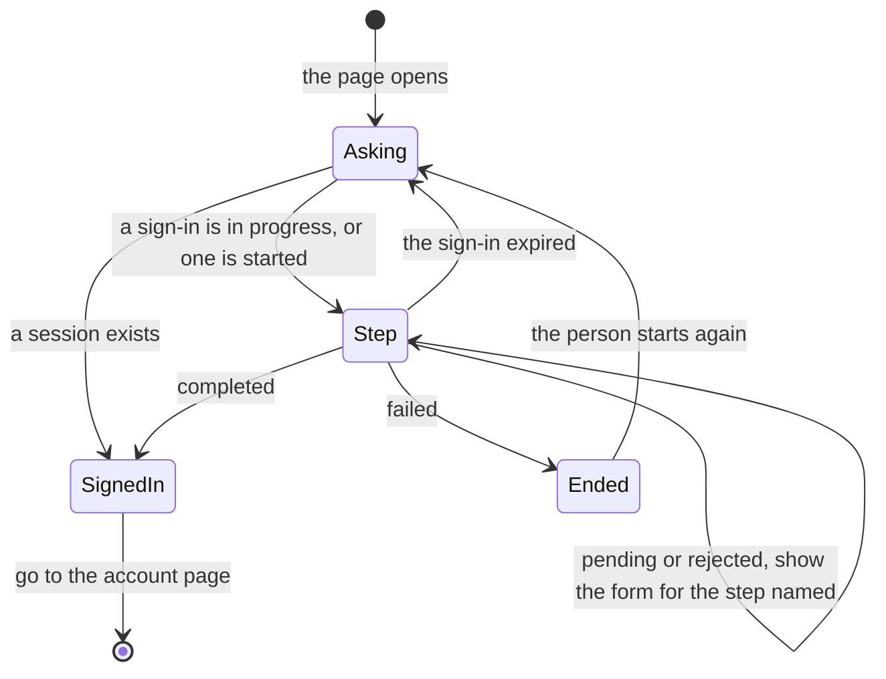

# The hosted pages

The hosted pages are what a person sees when they register, sign in, sign out or recover a password. They are one React application, `auth-ui`, served by `hodor-server` on the same origin as [the interaction interface](../api/interaction-api.md), which is the only thing they talk to ([Decision 0011](../decisions/0011-frontends-bff.md)).

The pages decide nothing. They ask the server which step comes next, show the form for it and send back what the person typed. Every rule — who may sign in, how many attempts, which password is acceptable — lives on the server and is tested there.

## The pages

All paths are relative to the tenant: `https://{host}/t/{slug}`.

| Path | What the person does there | Requests it makes |
|---|---|---|
| `/account/sign-in` | Signs in, one step at a time | The [sign-in routes](../api/interaction-api.md#signing-in) |
| `/account/register` | Asks to register by giving an email address | `POST /interaction/registration` |
| `/account/complete-registration` | Arrives from the link in the message, chooses a password | `POST /interaction/registration/complete` |
| `/account/recover` | Asks for a link to choose a new password | `POST /interaction/recovery` |
| `/account/reset-password` | Arrives from the link in the message, chooses a new password | `POST /interaction/recovery/complete` |
| `/account` | Sees that they are signed in, and signs out | `GET` and `DELETE /interaction/session` |

`/account` sends a person who is not signed in to `/account/sign-in`, and `/account/sign-in` sends a person who is already signed in to `/account`.

Any other path under `/account` is answered with `404` by the server.

### Signing in



The page is a renderer for the answer of the interaction interface:

- On opening, it asks who is signed in. If nobody is, it asks where the current sign-in stands, and starts one if there is none. A reloaded page therefore continues where it was.
- It shows the form for the `step` in the answer: `identifier` or `password`. A step the page does not know is shown as "this page cannot continue this sign-in", never guessed at.
- A `rejected` answer shows the same form again with one message, "that did not work", whatever the reason. The page has no way of knowing the reason and does not try.
- "Use another address" on the password step abandons the sign-in and starts a new one.
- A sign-in that expired while the person was typing is started again, and the page says so.

### Registering and recovering

Asking shows the same message whatever the address: "if this address can be used, a message is on its way". The page sends the language it is being shown in as `locale`, so the message arrives in that language.

The link in the message carries its token after `#`, which a browser never sends to a server. The page that finishes reads it from there and sends it in the body of its one request. The token never goes into storage, into another address or into a log.

After finishing, the person is sent to sign in, with a message saying the account is ready or the password was changed. Neither page signs the person in.

### What a person is told when something goes wrong

The pages show their own words, chosen by the `code` of the [problem document](../api/api-spec.md#conventions-for-the-json-apis), never the server's `detail`. A code the pages have no words for is shown as "something went wrong", with the request identifier to quote.

| Code | What the page says |
|---|---|
| `authentication.too_many_attempts` | Too many attempts; when to try again, from `Retry-After` |
| `authentication.registration_closed` | This organization does not accept registrations |
| `authentication.verification_token_invalid` | The link was already used or has expired; how to ask for a new one |
| `credential.password_too_short`, `credential.password_too_long`, `credential.password_is_own_name`, `credential.password_reused` | What is wrong with the password, next to the field |
| `identity.display_name_invalid` | The name cannot be used, next to the field |
| `credential.hashing_overloaded` | The server is busy; try again in a moment |
| No answer at all | The server could not be reached |

## Language

The pages exist in English (`en`) and Brazilian Portuguese (`pt-BR`). The language is the first of the browser's preferred languages that the pages have; anything else falls back to English. All copy lives in one file per language, and a test fails if one language has a message the other lacks.

## Appearance

The pages use the [design system](../design/design-system.md)'s tokens and components as static style sheets, in the light theme, and add one small style sheet of their own for the layout of a page. There are no inline styles and no styles written by scripts.

The fonts are IBM Plex Sans, bundled with the application and served by `hodor-server`. Nothing is loaded from another origin.

## Accessibility

- Every page can be used with the keyboard alone, in the order a person reads it.
- When a page opens or shows something else, focus moves to its heading, so that a screen reader announces it. When a form asks for something to be typed first, focus moves to that field instead: a person types the address, presses Enter, types the password and presses Enter.
- Every field has a visible label. An error about a field is tied to the field; an error about the whole form is announced as an alert.
- Fields carry the `autocomplete` values password managers rely on: `username`, `current-password`, `new-password`, `email`, `name`.
- The pages are checked by an automated accessibility checker in the browser tests, against Web Content Accessibility Guidelines 2.2 level AA.

## How the pages are served

The application is built into a directory of static files: one `index.html` and files whose names carry a hash of their contents. `hodor-server` is told where that directory is with `HODOR_PAGES_DIRECTORY`.

| Request | Answer |
|---|---|
| `GET /t/{slug}/account` and the pages listed above | `index.html`, the same for every tenant and every page. The application reads the tenant and the page from the address |
| `GET /auth-ui/assets/{file}` | A file of the application: a script, a style sheet, a font or an image |

- The tenant is resolved as for every route under `/t/{slug}`: a tenant that does not exist or is suspended gets the same answer as on any other route, not a page.
- `index.html` is read once, when the server starts. A directory without it stops the server at startup with a message naming the directory.
- `index.html` is sent with `Cache-Control: no-cache`, so a browser always asks whether it changed. The other files are sent with `Cache-Control: public, max-age=31536000, immutable`: a changed file has another name.
- Without `HODOR_PAGES_DIRECTORY` the server serves no pages and both kinds of request are answered with `404`. The container image sets it; a server run from source serves pages only when the application was built and the setting points at the result.

The files of the application are the same for all tenants and contain nothing secret, so they are served outside `/t/{slug}`.

### Content Security Policy

`index.html` is sent with this policy, which replaces the stricter one every other response carries:

| Directive | Value | Why |
|---|---|---|
| `default-src` | `'none'` | Nothing is allowed unless a line below allows it |
| `script-src` | `'self'` | Scripts come from files served by this server only. No inline script, no `eval` |
| `style-src` | `'self'` | Style sheets come from files served by this server only. No inline style |
| `font-src`, `img-src` | `'self'` | Same for fonts and images |
| `connect-src` | `'self'` | The pages may call this server only |
| `form-action` | `'none'` | No form is ever submitted by the browser itself: the pages send JSON. A form that escaped the scripts cannot put a password into an address |
| `base-uri` | `'none'` | The address that relative links start from cannot be changed |
| `frame-ancestors` | `'none'` | The pages cannot be shown inside another page |
| `require-trusted-types-for` | `'script'` | Text can never be turned into markup or script by assigning it to the page |
| `trusted-types` | `'none'` | No exception to the line above can be created |

The other headers every response carries stay as they are: `X-Content-Type-Options`, `X-Frame-Options`, `Referrer-Policy: no-referrer` and `Strict-Transport-Security`.

The browser tests fail if a page reports a violation of this policy.

## Where the code is

| Path | What it holds |
|---|---|
| `frontend/design-system/` | Tokens and component styles, shared with the consoles to come |
| `frontend/auth-ui/src/` | The application: pages, the client for the interaction interface, the copy in both languages |
| `frontend/auth-ui/browser-tests/` | The tests that drive a real browser against a running stack |
| `crates/protocol-http/src/pages.rs` | Serving `index.html` and the files, and the Content Security Policy |

The application is built with Vite and written in TypeScript. It has no router library and no state library: six pages and one request at a time do not need them. Going from one page to another is an ordinary navigation of the browser, so every page starts from nothing and holds nothing over from the page before.

### Working on the pages

```bash
cd frontend/auth-ui
```

```bash
npm ci
```

```bash
npm run lint && npm run typecheck && npm test
```

```bash
npm run build
```

The build writes `frontend/auth-ui/dist`. A server run from source serves it when `HODOR_PAGES_DIRECTORY` points there; since `index.html` is read when the server starts, the server is restarted after a build. The Compose stack builds the pages into the image by itself.

The browser tests run against a stack that is already up, with a tenant that accepts registrations ([local setup](../development/local-setup.md#running-the-browser-tests)):

```bash
npm run browser-tests
```

## How the pages are tested

| Layer | What it shows | Where it runs |
|---|---|---|
| Unit tests of the application | The client turns answers and problem documents into what the pages show; both languages have the same messages; each page renders the step it is given | `npm test` in `frontend/auth-ui`, with no server |
| Tests of the HTTP layer | The listed pages get `index.html` with the policy above, other paths get `404`, files get the right caching, and a path cannot climb out of the directory | `cargo test`, with a directory made by the test; Node.js is not needed |
| Tests of the server binary | The real `hodor-server` serves the pages of the directory it is given, serves none without the setting, and refuses to start with a directory that has no application | `cargo test`, with a directory made by the test |
| Browser tests | A person registers, reads the message, chooses a password, signs in and signs out; recovers a password; is refused with a wrong password; signs in with the keyboard alone. No page reports a Content Security Policy violation, a script error or an accessibility violation | Playwright with Chromium against the Compose stack, in continuous integration |

The browser tests read the messages from the development mail server of the Compose stack, as a person would read their mailbox.

## Not built yet

| Item | Planned in |
|---|---|
| The tenant's name, logo and colors on the pages. The pages show the tenant's slug | With tenant branding, Phase 3 |
| Hiding the link to register when the tenant does not accept registrations. The page says so after the person asks | With a public description of the tenant, Phase 2 |
| Returning to the application that sent the person to sign in | With OAuth, Phase 2 |
| The person's sessions on the account page | The account console, Phase 2 |
| A choice of language on the page, and a remembered theme | The account console, Phase 2 |
| Browsers other than Chromium in the browser tests | Hardening pass |
