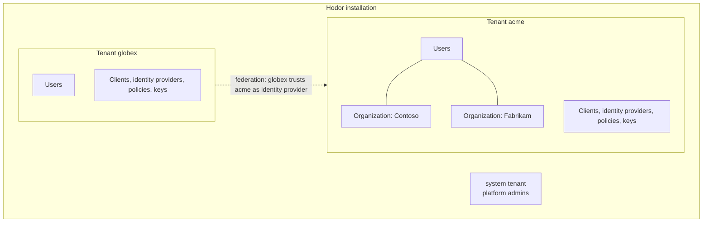
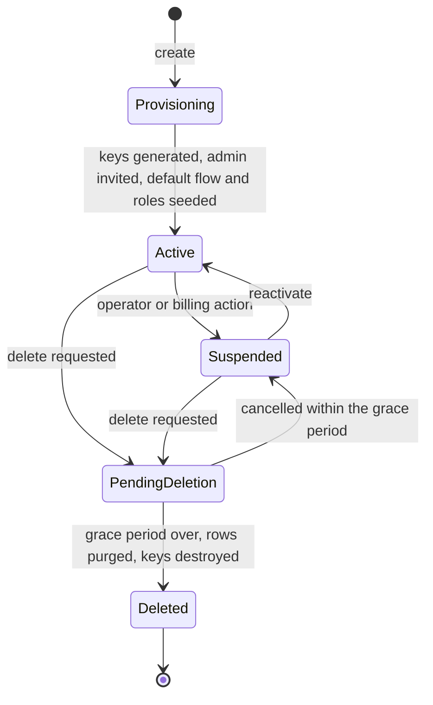

# Multi-tenant isolation strategy

## Model

The specification uses *tenant* and *organization* in overlapping ways and also asks for "global users with memberships in multiple organizations". This design fixes the meaning ([Decision 0005](../decisions/0005-tenant-and-organization.md)):

- A **tenant** is the hard isolation boundary: its own issuer, signing keys, users, clients, identity providers, policies, sessions and audit trail. A user belongs to exactly one tenant.
- An **organization** lives inside a tenant and models a B2B customer. A user of the tenant may be a member of many organizations. This is what "global users with multiple memberships" maps to: global *within the tenant*.
- **Cross-tenant access** is federation: tenant A registers tenant B as an OpenID Connect identity provider. No row is ever shared across tenants.
- The **`system` tenant** holds platform administrators. Platform operations (create tenant, suspend tenant, platform health) are a separate API with separate permissions; a platform administrator has no standing access to a tenant's data and gains it only through an audited, time-boxed support grant issued by that tenant or by break-glass.

## Tenant resolution

A request's tenant is resolved once, in the first middleware, from the URL and nothing else:

1. A verified custom domain (`login.acme.com`) → tenant.
2. Otherwise the path prefix `/t/{slug}`.

The resolved `TenantContext` (tenant identifier, status, settings snapshot) is placed in the request extensions. Every credential presented later in the request (session cookie, access token, client credentials, API key) is looked up *within that tenant* and rejected if it belongs to another. A tenant identifier in a body, header or query parameter is never trusted.

### Shared host caveat

Tenants addressed by path on one host share a browser origin. Cookie `Path` and URL prefixes do not isolate them from each other in the browser: a script running under one tenant's pages could issue requests to another tenant's paths. Hodor therefore never serves tenant-supplied HTML or JavaScript, and themes are restricted to declarative tokens and vetted assets. Tenants that need custom scripts, or whose administrators are mutually untrusted at the browser level, must use a dedicated host (custom domain or `{slug}.` subdomain), which is the recommended production setup.

## Isolation by layer

| Layer | Mechanism |
|---|---|
| **Types** | `TenantContext` is a required argument of every port method on tenant data. It cannot be constructed outside the resolver middleware, the worker's job loader and tests. Aggregates carry `tenant_id`; loading one under another tenant's context is `NotFound` |
| **Database** | Every tenant table has `tenant_id uuid not null` as the leading column of its primary key and indexes. **Row-Level Security** is enabled and forced: `USING (tenant_id = current_setting('app.tenant_id')::uuid)`. The adapter runs `SET LOCAL app.tenant_id` at the start of each transaction. The application role does not own the tables and has no `BYPASSRLS` |
| **Foreign keys** | Composite, `(tenant_id, id)`, so a row cannot reference another tenant's row even by mistake |
| **Uniqueness** | Scoped by tenant: `(tenant_id, kind, value)` for identifiers, `(tenant_id, slug)` for clients |
| **Cache** | Keys are built by one function that requires a `TenantContext`: `t:{tenant_id}:{kind}:{key}`. No raw key API is exposed to contexts |
| **Sessions and cookies** | Session lookup is `(tenant_id, hash)`. On the shared host, cookies are scoped by `Path=/t/{slug}`; on custom domains, by host |
| **Tokens** | `iss` is the tenant issuer; validation rejects a token whose `iss` is not the request's tenant. Signing keys are per tenant |
| **Keys and secrets** | One data-encryption key per tenant, wrapped by the `KeyProvider`. Deleting the tenant's key makes its secrets unrecoverable (crypto-shredding) |
| **Policies** | Native policies are rows under row-level security. Open Policy Agent: per-tenant bundles; tenant-authored Rego only in a dedicated Open Policy Agent ([authorization.md](authorization.md#tenant-isolation-in-open-policy-agent)) |
| **Events and jobs** | Every outbox row and job carries `tenant_id`; the worker rebuilds a `TenantContext` before running a handler. Webhook endpoints belong to a tenant and only receive its events |
| **Audit** | Per-tenant hash chain; queries are tenant-scoped; platform-level events go to the `system` tenant |
| **Rate limits and quotas** | Counters keyed by tenant first, so one tenant cannot exhaust another's budget; global limits protect the platform |
| **Observability** | `tenant_id` is a span and log attribute, not a metric label by default (cardinality); per-tenant metrics are opt-in for a bounded set |
| **Frontends** | Branding assets are served per tenant; user-supplied HTML is not allowed in themes; Content Security Policy is per tenant origin |

Row-level security is defence in depth, not the primary control: queries always filter by `tenant_id` explicitly. The combination means a missing `WHERE` clause returns nothing instead of another tenant's data.

### Cross-tenant operations

A few operations legitimately span tenants. They are kept few and each has its own narrow mechanism:

| Operation | Mechanism |
|---|---|
| Resolving a slug to a tenant, listing tenants | `platform.tenant_directory`, a routing table outside row-level security that holds only slug, identifier and status. The application role can read it and nothing else. See [the tenant context](contexts/tenant.md#storage) |
| Finding pending outbox events | The worker's connection as a member of `hodor_platform`, used only to find work; each event is then handled inside its tenant as the application role |
| Cleanup jobs | Same as the outbox |
| Migrations | The schema owner, through `hodor-cli migrate` |

`hodor-server` holds no cross-tenant database role at all.

## Why shared schema with row-level security

| Option | Isolation | Operations at 10k tenants | Decision |
|---|---|---|---|
| Shared schema + `tenant_id` + row-level security | Strong with discipline, enforced by the database | One migration, one pool | **Chosen** |
| Schema per tenant | Stronger by default | Migrations × tenants; catalog bloat; pool per search path | Rejected |
| Database per tenant | Strongest | Not viable as a default at this scale | Possible later as a dedicated-deployment tier |

Large or regulated customers who need physical isolation get a dedicated Hodor deployment, which the single-binary design makes cheap. See [Decision 0006](../decisions/0006-tenant-isolation.md).

## Tenant lifecycle

The exact rules of each transition are in [the tenant context](contexts/tenant.md#lifecycle). A suspended tenant keeps its data but refuses authentication, token issuance and API calls with a distinct error. Deletion is a worker job that purges table by table, destroys the tenant's keys and leaves a tombstone audit record in the `system` tenant.

## Validation

Tenant isolation is part of the definition of done, so it is tested mechanically:

- **Generic repository test**: for every repository, create a row under tenant A and assert that every read and write under tenant B fails as not found.
- **Row-level security test**: connect as the application role without setting `app.tenant_id` and assert every tenant table returns zero rows and rejects inserts.
- **Schema lint**: a test inspects the catalog and fails if a table lacks `tenant_id`, row-level security or a composite foreign key, unless it is on the short platform allow-list.
- **API fuzz**: replay each authenticated request of tenant A against tenant B's URL prefix and assert rejection.
- **Token cross-use**: tokens, codes, sessions and refresh tokens issued by A are rejected at B.

### The cross-tenant suite

The last two are one suite, run against the real server and a real database with every other test, in `apps/hodor-server/tests/cross_tenant.rs`. It sets up two tenants that are as alike as two tenants can be: a person with the same email address and the same password in each, and an administrator in each.

Every case has the same shape. First something is shown to work in the tenant it belongs to, so that a refusal later cannot be a mistake in the request. Then the very same thing is presented to the other tenant, which must refuse it. Last, both tenants are checked to be as they were.

| What is presented to the other tenant | Its answer |
|---|---|
| A session cookie, on every route for a signed-in person | Not authenticated |
| A sign-in in progress: its cookie and CSRF token, on every step | No such sign-in; it continues where it belongs |
| An administrator's access token, on every operation in the OpenAPI document | Not authenticated |
| A registration link's token and a recovery link's token | The link does not work; it still works where it belongs |
| The identifier of a user or of a session, asked for by the other tenant's own administrator | No such user, no such session |

It also checks what must not be shared: one tenant's list of users and audit log name nothing of the other's, and locking a person out by failed attempts in one tenant does not lock out the person with the same address in the other.

In a browser, a cookie of one tenant is not even sent to another: cookies are limited to the tenant's path. The suite sends them anyway, because the server must not rely on the browser.

What the suite cannot cover yet is listed with the progress of the work: OAuth tokens and codes do not exist yet, and the pages are not built.
