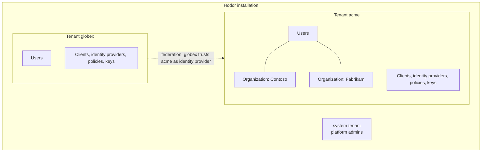
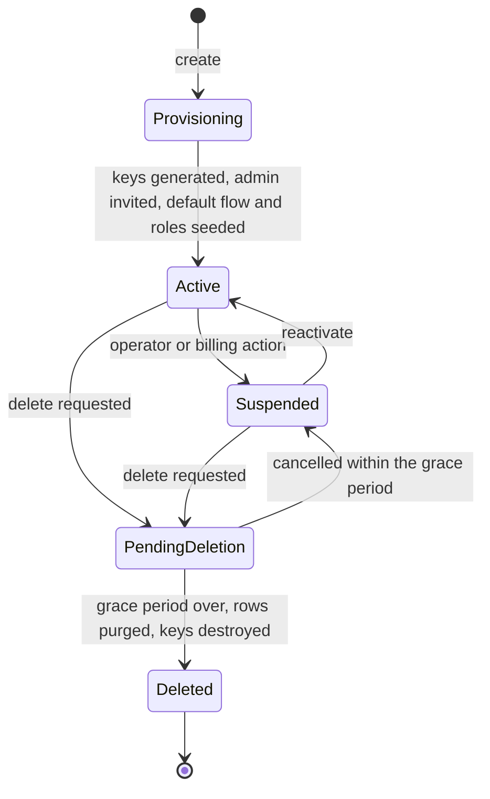

# Multi-tenant isolation strategy

## Model

The specification uses *tenant* and *organization* in overlapping ways and also asks for "global users with memberships in multiple organizations". This design fixes the meaning ([Decision 0005](../decisions/0005-tenant-and-organization.md)):

- A **tenant** is the hard isolation boundary: its own issuer, signing keys, users, clients, identity providers, policies, sessions and audit trail. A user belongs to exactly one tenant.
- An **organization** lives inside a tenant and models a B2B customer. A user of the tenant may be a member of many organizations. This is what "global users with multiple memberships" maps to: global *within the tenant*.
- **Cross-tenant access** is federation: tenant A registers tenant B as an OpenID Connect identity provider. No row is ever shared across tenants.
- The **`system` tenant** holds platform administrators. Platform operations (create tenant, suspend tenant, platform health) are a separate API with separate permissions; a platform administrator has no standing access to a tenant's data and gains it only through an audited, time-boxed support grant issued by that tenant or by break-glass.

## Tenant resolution

A request's tenant is resolved once, in the first middleware, from the URL and nothing else:

1. A verified custom domain (`login.acme.com`) → tenant.
2. Otherwise the path prefix `/t/{slug}`.

The resolved `TenantContext` (tenant identifier, status, settings snapshot) is placed in the request extensions. Every credential presented later in the request (session cookie, access token, client credentials, API key) is looked up *within that tenant* and rejected if it belongs to another. A tenant identifier in a body, header or query parameter is never trusted.

### Shared host caveat

Tenants addressed by path on one host share a browser origin. Cookie `Path` and URL prefixes do not isolate them from each other in the browser: a script running under one tenant's pages could issue requests to another tenant's paths. Hodor therefore never serves tenant-supplied HTML or JavaScript, and themes are restricted to declarative tokens and vetted assets. Tenants that need custom scripts, or whose administrators are mutually untrusted at the browser level, must use a dedicated host (custom domain or `{slug}.` subdomain), which is the recommended production setup.

## Isolation by layer

| Layer | Mechanism |
|---|---|
| **Types** | `TenantContext` is a required argument of every port method on tenant data. It cannot be constructed outside the resolver middleware, the worker's job loader and tests. Aggregates carry `tenant_id`; loading one under another tenant's context is `NotFound` |
| **Database** | Every tenant table has `tenant_id uuid not null` as the leading column of its primary key and indexes. **Row-Level Security** is enabled and forced: `USING (tenant_id = current_setting('app.tenant_id')::uuid)`. The adapter sets `app.tenant_id` for the transaction alone (`set_config` with `is_local`, as `SET LOCAL` does) at its start, sent with `BEGIN` in one round trip. The application role does not own the tables and has no `BYPASSRLS` |
| **Foreign keys** | Composite, `(tenant_id, id)`, so a row cannot reference another tenant's row even by mistake |
| **Uniqueness** | Scoped by tenant: `(tenant_id, kind, value)` for identifiers, `(tenant_id, slug)` for clients |
| **Cache** | Keys are built by one function that requires a `TenantContext`: `t:{tenant_id}:{kind}:{key}`. No raw key API is exposed to contexts |
| **Sessions and cookies** | Session lookup is `(tenant_id, hash)`. On the shared host, cookies are scoped by `Path=/t/{slug}`; on custom domains, by host |
| **Tokens** | `iss` is the tenant issuer; validation rejects a token whose `iss` is not the request's tenant. Signing keys are per tenant |
| **Keys and secrets** | One data-encryption key per tenant, wrapped by the `KeyProvider`. Deleting the tenant's key makes its secrets unrecoverable (crypto-shredding) |
| **Policies** | Native policies are rows under row-level security. Open Policy Agent: per-tenant bundles; tenant-authored Rego only in a dedicated Open Policy Agent ([authorization.md](authorization.md#tenant-isolation-in-open-policy-agent)) |
| **Events and jobs** | Every outbox row and job carries `tenant_id`; the worker rebuilds a `TenantContext` before running a handler. Webhook endpoints belong to a tenant and only receive its events |
| **Audit** | Per-tenant hash chain; queries are tenant-scoped; platform-level events go to the `system` tenant |
| **Rate limits and quotas** | Counters keyed by tenant first, so one tenant cannot exhaust another's budget; global limits protect the platform |
| **Observability** | `tenant_id` is a span and log attribute, not a metric label by default (cardinality); per-tenant metrics are opt-in for a bounded set |
| **Frontends** | Branding assets are served per tenant; user-supplied HTML is not allowed in themes; Content Security Policy is per tenant origin |

Row-level security is defence in depth, not the primary control: queries always filter by `tenant_id` explicitly. The combination means a missing `WHERE` clause returns nothing instead of another tenant's data.

### Cross-tenant operations

A few operations legitimately span tenants. They are kept few and each has its own narrow mechanism:

| Operation | Mechanism |
|---|---|
| Resolving a slug to a tenant, listing tenants | `platform.tenant_directory`, a routing table outside row-level security that holds only slug, identifier and status. The application role can read it and nothing else. See [the tenant context](contexts/tenant.md#storage) |
| Finding pending outbox events | The worker's connection as a member of `hodor_platform`, used only to find work; each event is then handled inside its tenant as the application role |
| Cleanup jobs | Same as the outbox |
| Migrations | The schema owner, through `hodor-cli migrate` |

`hodor-server` holds no cross-tenant database role at all.

## Why shared schema with row-level security

| Option | Isolation | Operations at 10k tenants | Decision |
|---|---|---|---|
| Shared schema + `tenant_id` + row-level security | Strong with discipline, enforced by the database | One migration, one pool | **Chosen** |
| Schema per tenant | Stronger by default | Migrations × tenants; catalog bloat; pool per search path | Rejected |
| Database per tenant | Strongest | Not viable as a default at this scale | Possible later as a dedicated-deployment tier |

Large or regulated customers who need physical isolation get a dedicated Hodor deployment, which the single-binary design makes cheap. See [Decision 0006](../decisions/0006-tenant-isolation.md).

## Tenant lifecycle

The exact rules of each transition are in [the tenant context](contexts/tenant.md#lifecycle). A suspended tenant keeps its data but refuses authentication, token issuance and API calls with a distinct error. Deletion is a worker job that purges table by table, destroys the tenant's keys and leaves a tombstone audit record in the `system` tenant.

## Validation

Tenant isolation is part of the definition of done, so it is tested mechanically:

- **Generic repository test**: for every repository, create a row under tenant A and assert that every read and write under tenant B fails as not found.
- **Row-level security test**: connect as the application role without setting `app.tenant_id` and assert every tenant table returns zero rows and rejects inserts.
- **Schema lint**: a test inspects the catalog and fails if a table lacks `tenant_id`, row-level security or a composite foreign key, unless it is on the short platform allow-list.
- **API fuzz**: replay each authenticated request of tenant A against tenant B's URL prefix and assert rejection.
- **Token cross-use**: tokens, codes, sessions and refresh tokens issued by A are rejected at B.

### The cross-tenant suite

The last two are one suite, run against the real server and a real database with every other test, in `apps/hodor-server/tests/cross_tenant.rs`. It sets up two tenants that are as alike as two tenants can be: a person with the same email address and the same password in each, and an administrator in each.

Every case has the same shape. First something is shown to work in the tenant it belongs to, so that a refusal later cannot be a mistake in the request. Then the very same thing is presented to the other tenant, which must refuse it. Last, both tenants are checked to be as they were.

| What is presented to the other tenant | Its answer |
|---|---|
| A session cookie, on every route for a signed-in person | Not authenticated |
| A sign-in in progress: its cookie and CSRF token, on every step | No such sign-in; it continues where it belongs |
| An administrator's access token, on every operation in the OpenAPI document | Not authenticated |
| A registration link's token and a recovery link's token | The link does not work; it still works where it belongs |
| A code and a link to sign in by email, presented to a sign-in of the other tenant that asked for one for the same address | Rejected, as any wrong code; both still sign in where they belong |
| A second factor begun at the enrollment step of one tenant's sign-in: the sign-in's cookie and CSRF token on the other tenant's enrollment step; the code of the authenticator application's secret, and a security key's answer to the first tenant's options, presented to the other tenant's own sign-in at that step | No such sign-in; rejected. Each tenant then has the person set up a factor of its own, and asks for that one at the next sign-in |
| The identifier of a user or of a session, asked for by the other tenant's own administrator | No such user, no such session |
| A code of the person's authenticator application, and one of their recovery codes | Rejected, as any wrong code; both still work where they belong |
| A passkey, in place of the identifier | Rejected: the credential is unknown there |
| A security key's answer to the other tenant's challenge | Rejected; the challenge names only the other tenant's own keys |
| The identifier of a security key or a passkey, given by the other tenant's own administrator to remove it | No such credential |
| An administrator's token changing the assurance levels | Not authenticated |
| A client's identifier, at the authorization endpoint | No such client: Hodor's own error page, never a redirect to the client |
| An authorization code, redeemed with the client it was issued to | Not authenticated: the client is unknown there |
| An authorization code, redeemed with the other tenant's own client | Refused as an unknown code; the code still redeems where it belongs |
| An access token, at UserInfo and at introspection by the other tenant's client | Not authenticated; not active |
| A refresh token, at the token, revocation and introspection endpoints of the other tenant's client | Refused; nothing revoked; not active. It still refreshes where it belongs |
| A client's secret, asking for a token for itself | Not authenticated: the client is unknown there |
| The client of a consent the person gave, withdrawn by the other tenant's person or administrator | No such consent; the consent still stands where it belongs |
| Another tenant's administrator naming a resource server, a role, a person's roles, a binding or a policy version | Not found |
| Another tenant's administrator giving or taking away a role of the first tenant's person | Not found |
| Another tenant's administrator naming a group: reading, changing or deleting it, listing its members or the roles it holds, adding a member to it or taking one out; and naming a person to list the groups they are in | No such group; no such user. The group, its members and its role stay as they were |
| A person or a group of one tenant added as a member of the other tenant's own group | No such user; no such group |
| A group of one tenant given a role, or having one taken away, by the other tenant's administrator | No such group |
| Another tenant's administrator naming an organization: reading, changing or deleting it, its units, its members and its invitations, inviting to it; and naming a person to list the organizations they are in | No such organization; no such user |
| A person of one tenant made a member of the other tenant's own organization, a unit of one tenant given to a member of the other's, and a role scoped by the other tenant's administrator to an organization of the first | No such user; no such unit; no such organization |
| An invitation's link, described and accepted at the other tenant: without a session, and with the session of the person who has the invited address there | The link does not work; it still works where it belongs, once |
| An organization of one tenant, asked for at the other tenant's authorization endpoint | Access denied at the client's redirect address, as for an organization the person is not a member of. Where it belongs, the tokens carry it in `org_id` |
| A SCIM client's access token, on every route of the SCIM surface | Not authenticated |
| The identifier of a user or a group, read, replaced, changed with `PATCH` or deleted by the other tenant's own SCIM client, alone or in a bulk request, and named as a member of a group | Not found; refused as a member |
| The identifier of a service account or an agent, read, changed, disabled, enabled or deleted by the other tenant's own administrator, and named as the principal of the other tenant's client | Not found; refused as a principal. It still works where it belongs |
| A person of one tenant named as an owner of the other tenant's service account | No such user |
| The access token of a client that acts as a service account, at the other tenant's Authorization API and at introspection by the other tenant's client | Not authenticated; not active |
| A service account's API key, at the other tenant's administration interface and Authorization API | Not authenticated. It still works where it belongs |
| The identifier of an API key, listed, rotated or revoked by the other tenant's own administrator, and a key made by it for the first tenant's service account | Not found |
| A person's access token as the subject, and an agent's as the actor, of a token exchange at the other tenant, by the other tenant's own agent | Refused, each in its turn |
| The identifier of an entry of an access control list, read or removed by the other tenant's own administrator | No such entry. It still allows where it belongs |
| A person, a client or a group of one tenant named as the principal of an entry granted by the other tenant's administrator | No such user, no such client, no such group |
| An entry of one tenant, asked about at the other tenant's Authorization API with the same resource server, permission, resource and principal | Deny: the entry is never read there |
| The identifier of a webhook endpoint, read, given other event types, given a new secret or removed by the other tenant's own administrator, and named as the endpoint of its list of deliveries; the identifier of a delivery, delivered again by it | Not found; an empty list. The endpoint, its secrets, its event types and its deliveries stay as they were |
| A pairwise client's access token, at the other tenant's UserInfo and at introspection by the other tenant's client | Not authenticated; not active. Where it belongs, both answer the `sub` of the ID token |
| A pairwise client's ID token, as the `id_token_hint` of the other tenant's end-session endpoint, in a browser signed in to the other tenant and in the browser signed in where it belongs | Not an ID token of the tenant, on Hodor's own page, never a redirect; the other tenant's session goes on. Where it belongs, its pairwise `sub` and `sid` end the session without asking |
| A claim mapper of a client, read, listed, replaced or deleted by the other tenant's administrator; a mapper of the other tenant's administrator that names a group of this tenant | Not authenticated; not found. A mapper writes only what it reads of the person in the token's own tenant |
| A JWT-SVID of a workload of one tenant's `cluster.local`, for that tenant's issuer, presented at the other tenant, which trusts a `cluster.local` of its own with another bundle and binds a client to the same SPIFFE identifier: for the other tenant's client and for the first tenant's; one signed by the first tenant's authority for the other tenant's issuer, under the same `kid` | Not authenticated, each time. Each tenant's own JWT-SVID still passes where it belongs |
| A workload's certificate signed by the authority of one tenant's trust domain `cluster.local`, forwarded by the trusted proxy for the other tenant's client bound to the same SPIFFE identifier under its own `cluster.local`; and one tenant's client named at the other's token endpoint with either certificate | Not authenticated. Each certificate still proves its client where it belongs |
| A request object signed by a client of the tenant, at the other tenant's authorization endpoint, naming that client and naming the other tenant's client; the other tenant's client's own object made for this tenant's issuer | Not a client of the tenant, on Hodor's own page, never a redirect; `invalid_request_object`, as no key of the other tenant's client signed it; `invalid_request_object`, as it is not for that tenant. Where it belongs, each object is the request |
| A certificate-bound access token of one tenant's workload, with the certificate it is bound to, at the other tenant's Authorization API and at introspection by the other tenant's client | Not authenticated; not active. Where it belongs it is accepted with its certificate, refused without it, and introspection answers its `cnf` |

It also checks what must not be shared: one tenant's list of users and audit log name nothing of the other's; locking a person out by failed attempts in one tenant, wrong passwords or wrong codes sent by email, does not lock out the person with the same address in the other, who still signs in with the password and with a code; a person with an authenticator application in one tenant signs in to the other with the password alone; each tenant's discovery document names its own assurance levels only; one tenant's lists of roles, bindings and policy versions name nothing of the other's; one tenant's lists of groups and organizations name nothing of the other's; an event of one tenant makes a delivery to its own endpoint and none to the other tenant's endpoint subscribed to the same type, and one tenant's lists of endpoints and deliveries name nothing of the other's; a person deactivated through SCIM in one tenant loses their session there, while the person with the same address stays signed in to the other; a person who signs out of one tenant makes a logout delivery for that tenant's client alone, none for the client of the other tenant they are signed in to as well; a tenant that requires a second factor asks the person who has none to set one up there, while the person with the same address signs in to the other tenant, which requires nothing more, with the password alone; and the person with the same address, signing in to a pairwise client of each tenant whose redirect addresses name the same host, is given a different `sub` by each, as each tenant has its own pairwise secret.

In a browser, a cookie of one tenant is not even sent to another: cookies are limited to the tenant's path. The suite sends them anyway, because the server must not rely on the browser.

The pages are tried in a browser by their own tests, not by this suite.
