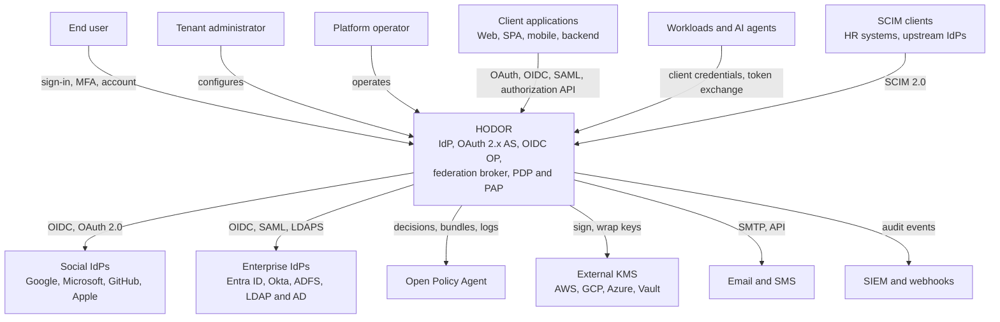
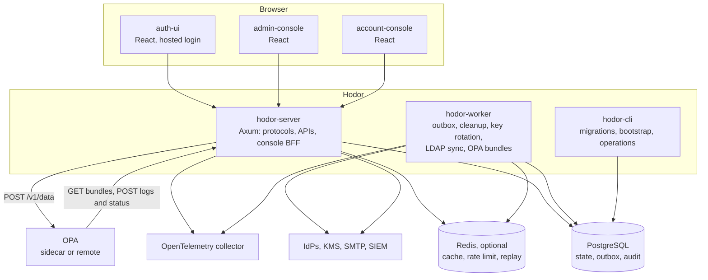
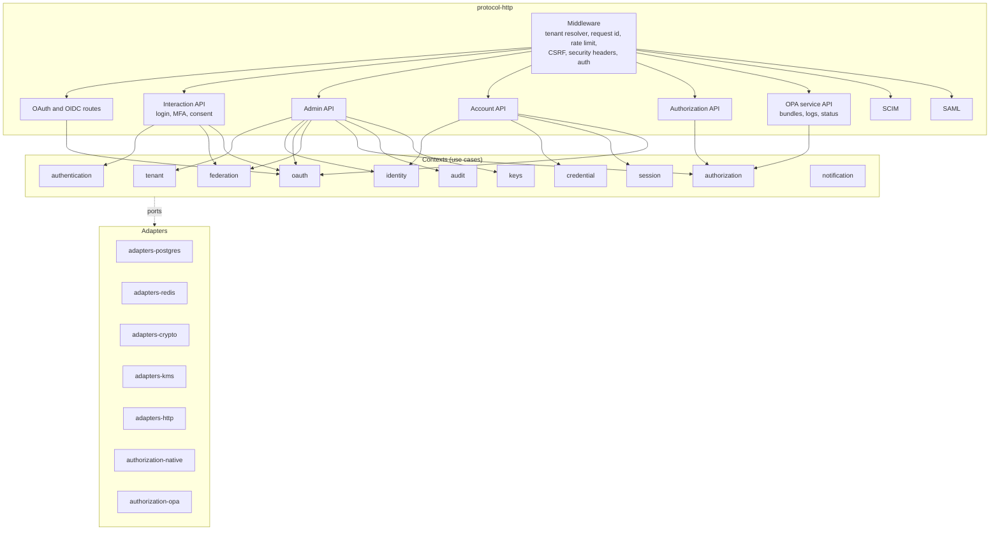
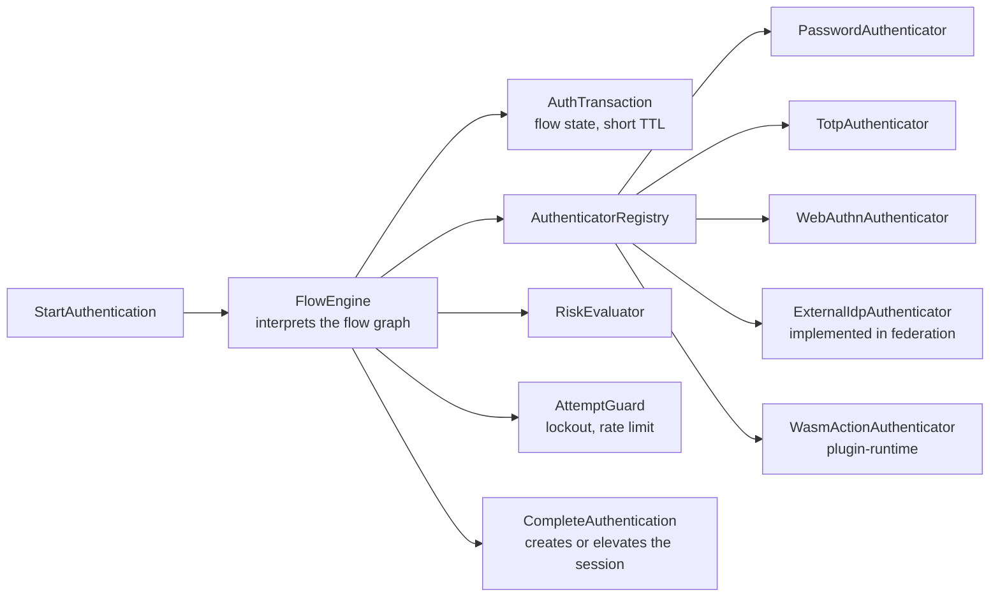
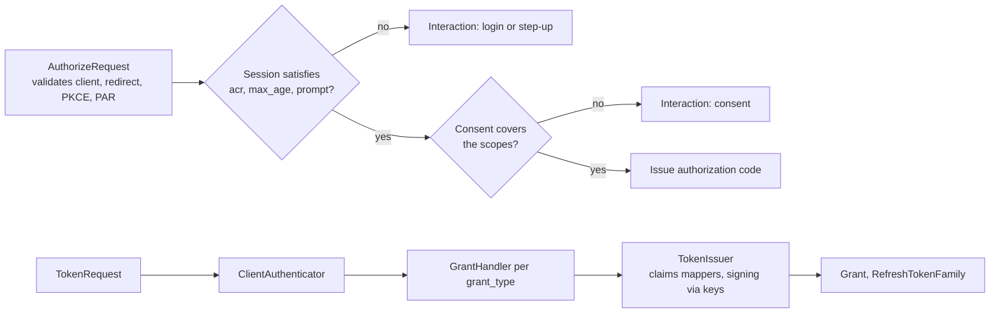

# Architecture overview

Hodor is a **modular monolith**: a Rust workspace in which each bounded context is a crate with its own domain and use cases, and infrastructure enters through ports (traits) implemented in adapter crates. Three binaries share the same crates: `hodor-server` (HTTP), `hodor-worker` (background jobs) and `hodor-cli` (operations).

## Architectural style

Each context crate has three modules and nothing else:

| Module | Contains | May depend on |
|---|---|---|
| `domain` | Aggregates, value objects, events, rules | `kernel` |
| `application` | Use cases, outbound ports (traits), command and query DTOs | `domain`, `kernel`, the public API of upstream contexts |
| `api` (re-export) | Public facade: the use cases and types other crates may use | — |

Rules:

1. The domain does not know Axum, SQLx, Redis or Tokio, and does not use `serde_json::Value` as a rule type.
2. A context sees another only through its `api` facade; each crate's `domain` module is `pub(crate)`.
3. Dependencies between contexts form a fixed acyclic graph, described in [crates.md](crates.md) and checked in CI.
4. There is no generic mapper layer: the Postgres adapter turns rows into aggregates directly; `protocol-http` turns HTTP DTOs into commands.
5. Every port method that touches tenant data takes a `TenantContext`. There is no "global" repository for tenant data.
6. Side effects across contexts go through domain events written to an outbox in the same transaction.

## C4 Level 1: Context

## C4 Level 2: Containers

Decisions embedded in the diagram:

- `hodor-server` serves the three frontends as static assets on the tenant's own origin. `auth-ui` never receives tokens: it talks to a cookie-protected *interaction API*.
- `admin-console` and `account-console` are OIDC clients of Hodor itself through a BFF inside `hodor-server` (session cookie, no token in the browser). See [ADR-0011](../adr/0011-frontends-bff.md).
- OPA **pulls** bundles from Hodor and **pushes** decision logs and status to it: Hodor implements the service APIs OPA expects.
- Redis is optional. Without it, rate limiting and caches are per-node in memory and replay protection uses Postgres.

## C4 Level 3: Components

### `hodor-server`

The composition root (`apps/hodor-server/src/main.rs`) is the only place that knows concrete adapter types. It builds an `AppState` holding one `Arc<dyn Port>` per port and hands it to `protocol-http`.

### `authentication` context

`Authenticator` is the context's SPI: `federation` and `plugin-runtime` implement it, which keeps `authentication` free of dependencies on them.

### `oauth` context

### `authorization` context

See [authorization.md](authorization.md).

## Cross-cutting concerns

| Concern | Where it lives | How |
|---|---|---|
| Tenant identification | `protocol-http` (middleware) | Host or `/t/{slug}` prefix → `TenantContext` in request extensions |
| Transactions | `application` | `UnitOfWork` port; the use case delimits the transaction, the adapter opens it with `SET LOCAL app.tenant_id` |
| Domain events | `kernel` + `adapters-postgres` | `DomainEvent` written to `outbox` in the transaction; `hodor-worker` dispatches |
| Errors | `kernel` | Typed `DomainError` per context; `protocol-http` translates to RFC 9457 or an OAuth error |
| Time and randomness | `kernel` | `Clock` and `RandomSource` ports, replaceable in tests |
| Secrets in memory | `kernel` | `Secret<T>`: redacted `Debug`, zeroized on drop, no `Serialize` |
| Configuration | `apps/*` | Typed struct, validated at startup, injected |
| Observability | `observability` | OTel bootstrap; spans created in `protocol-http` and in use cases |
