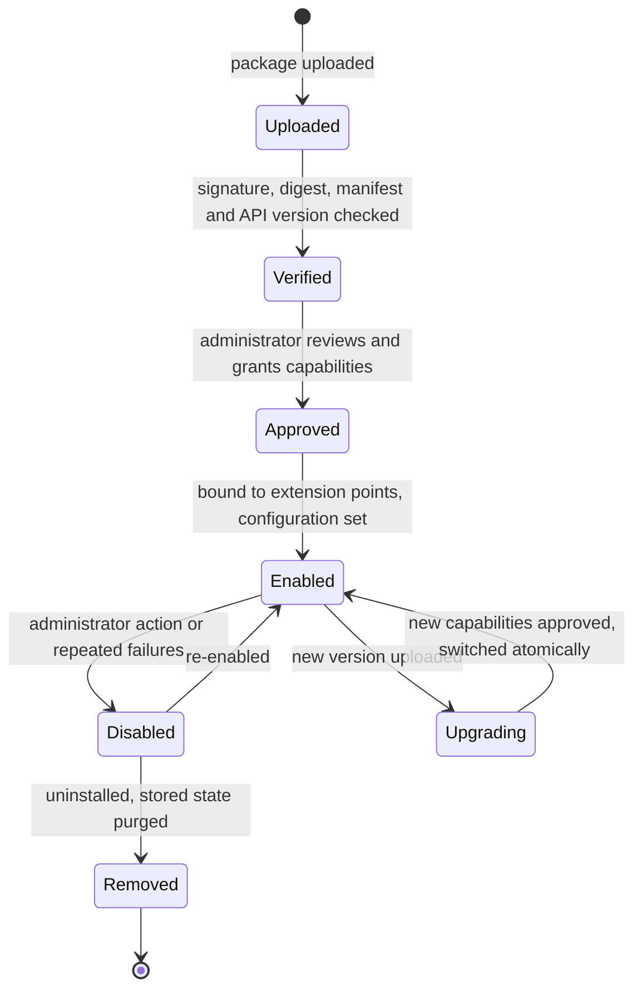

# Plugin architecture

## Approach

Extension happens at three levels, introduced in this order ([ADR-0012](../adr/0012-extension-strategy.md)):

| Level | Mechanism | Trust | Available |
|---|---|---|---|
| 1. Built-in extension points | Rust traits implemented in workspace crates, registered in the composition root | Fully trusted, compiled in | Phase 1 onwards |
| 2. Outbound integration | Signed webhooks over the event stream | Remote, untrusted | Phase 5 |
| 3. Sandboxed plugins | WebAssembly components run by `plugin-runtime` on Wasmtime | Untrusted code, capability-limited | Phase 8 |

Level 1 is the real architecture: every extension point is a port that exists because the product itself needs more than one implementation. Level 3 exposes a *subset* of those ports across a sandbox boundary. Nothing is designed for plugins first.

There is no dynamic loading of native libraries. Rust has no stable ABI, and a native plugin would run with the full authority of the server.

## Extension points

| Extension point | Trait (owner crate) | Built-in implementations | Exposed to WASM |
|---|---|---|---|
| Authentication step | `Authenticator` (`authentication`) | Password, TOTP, WebAuthn, OTP, recovery code, external IdP | Yes, as an *authentication action* |
| Identity provider connector | `IdpConnector` (`federation`) | Generic OIDC, generic OAuth2, Google, Microsoft, GitHub, Apple, … | Later; generic connectors plus mapping cover most needs |
| Credential type | `CredentialVerifier` (`credential`) | Password, TOTP, WebAuthn, … | No (security-critical) |
| Notification channel | `NotificationChannel` (`notification`) | SMTP, SMS providers | Yes |
| Authorization engine | `AuthorizationEngine` (`authorization`) | Native, OPA | No; external engines integrate as adapter crates |
| Policy source | `PolicySource` (`authorization`) | Database, Git sync | No |
| Claims mapper | `ClaimsMapper` (`oauth`) | Attribute, role, group, constant, template | Yes |
| Event handler | `EventHandler` (`kernel`) | Audit writer, webhook dispatcher, cache invalidators | Yes |
| Key provider | `KeyProvider` (`keys`) | Local, cloud KMS, Vault | No |
| Risk signal | `RiskSignal` (`authentication`) | New device, new IP, velocity | Yes |

## Sandboxed plugin model

### Package and manifest

A plugin is a signed archive containing one WebAssembly component and a manifest:

```toml
[plugin]
id = "com.example.hr-claims"
version = "1.2.0"
hodor_api = "^1"                 # version of the WIT package it targets
description = "Adds cost-center claims from the HR system"

[[extension]]
point = "claims-mapper"
export = "map-claims"

[capabilities]
read = ["user.profile", "user.attributes"]   # data the host may hand over
http = ["https://hr.example.com"]            # outbound allow-list
kv = true                                     # per-plugin, per-tenant key-value store
secrets = ["HR_API_TOKEN"]                   # referenced by handle, never read as plaintext

[limits]
timeout_ms = 200
memory_mb = 32
```

### Interface

Interfaces are defined in WIT and versioned as a package (`hodor:plugin@1.x`). Each extension point is a world with typed imports (what the host offers) and exports (what the plugin implements). Host functions offered:

| Import | Purpose | Guard |
|---|---|---|
| `log` | Structured logging | Rate limited, size capped |
| `http-fetch` | Outbound HTTP | Manifest allow-list plus the SSRF-safe client; secrets injected into headers by handle |
| `kv-get` / `kv-set` | Small state | Namespaced by tenant and plugin; quota |
| `get-user-attribute` | Read identity data | Checked against `capabilities.read` and the current tenant |
| `now`, `random` | Time and randomness | Provided by the host |

There is no filesystem, socket, environment or process access.

### Lifecycle



- Installation and capability approval are per tenant. A platform operator can restrict which plugins tenants may install.
- A capability increase in a new version requires a new approval.
- Compiled modules are cached; instances are created per call (or pooled) and never shared across tenants.

### Execution limits and failure policy

| Limit | Enforcement |
|---|---|
| CPU time | Epoch interruption with a per-call deadline |
| Memory | Store limiter |
| Outbound calls | Count and total time per invocation |
| Output size | Capped by the host |

| Extension point | On timeout, trap or error |
|---|---|
| Authentication action | Fail closed: the step fails |
| Claims mapper | Configurable: omit the claims (default) or fail token issuance |
| Risk signal | Treated as "no signal" and logged |
| Event handler | Retried with backoff, then dead-lettered |
| Notification channel | Retried, then falls back to the next configured channel |

Plugin invocations are traced, metered per tenant and plugin, and audited when they change an outcome. A plugin that keeps failing is disabled automatically by a circuit breaker.

### What plugins cannot do

- Set reserved token claims (`iss`, `sub`, `aud`, `exp`, `iat`, `acr`, `amr`, `cnf`, `scope`).
- Mark an authentication as successful on their own: an action returns `continue`, `deny` or `challenge`, and the flow engine decides.
- Read credentials, tokens, keys or other tenants' data.
- Call the Admin API with elevated rights; they hold no credential.

## Compatibility

The WIT package follows semantic versioning. A host supports the current major version and the previous one. Extension traits inside the workspace are internal and can change freely; only the WIT worlds, the webhook envelope and the public HTTP APIs are compatibility surfaces.
