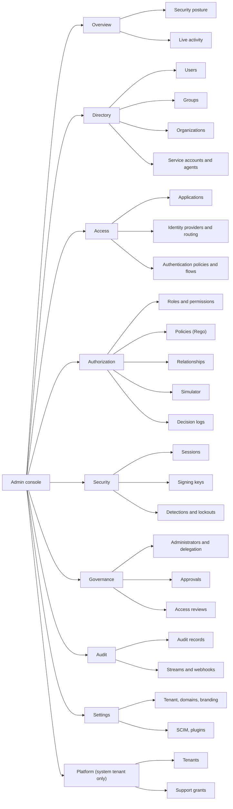
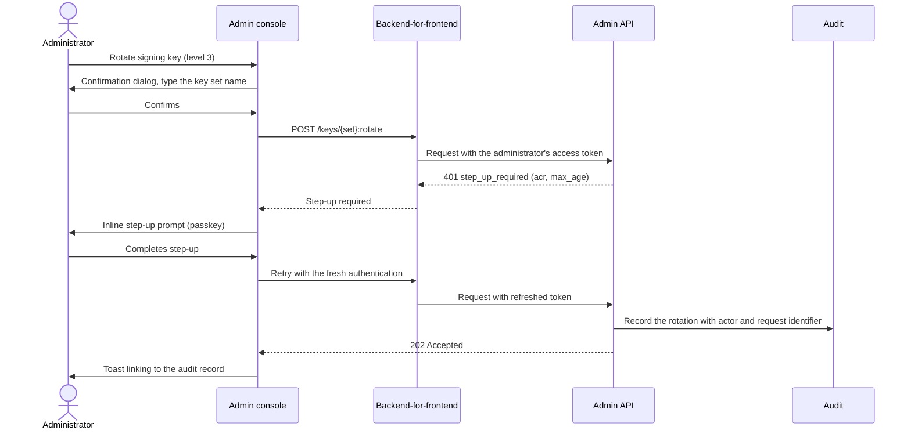

# The control plane: admin console

The admin console is Hodor's control plane: the place where tenant administrators, security engineers and platform operators configure identity, authentication and authorization, and watch what happens. This page defines what the console contains, how it is organized and how it protects itself. Its visual language and shared interaction patterns are in the [design system](design-system.md); the requirements it must meet are in [requirements.md](../product/requirements.md#admin-console-admin-console).

This page is the whole design. What is built of it today, and how, is in [the admin console](../architecture/admin-console.md).

The console is an ordinary OpenID Connect client of Hodor behind a backend-for-frontend, and it uses only the public Admin API ([Decision 0011](../decisions/0011-frontends-bff.md)). Until Hodor issues tokens, the backend-for-frontend recognizes the administrator by their Hodor session instead ([Decision 0019](../decisions/0019-console-on-the-hodor-session.md)). Anything the console can do, an API client or the Terraform provider can do. The console adds no capability; it adds visibility and safety.

## 1. Goals

| Persona | What the console must make easy |
|---|---|
| Tenant administrator | Connect an application or an identity provider in minutes, with secure settings already chosen |
| Security engineer | See the tenant's security posture at a glance, investigate an event down to the request, change policy with a preview and a rollback |
| Platform operator | Manage tenants without seeing their data; grant and audit time-boxed support access |

What it deliberately does not do: show tokens, passwords or secrets after creation; let an administrator act outside the tenant in the address bar; offer an "advanced mode" that hides the safety patterns.

## 2. Information architecture

The navigation is grouped by the question an administrator is asking, not by internal context names. Each entry maps to an Admin API resource ([API specification](../api/api-spec.md#admin-api)) and arrives in the phase shown ([roadmap](../product/roadmap.md#console-delivery)).



| Group | Screen | Admin API | Phase |
|---|---|---|---|
| Overview | Security posture | `/admin/posture`, `/admin/posture/findings` | 2 |
| Overview | Live activity | `/admin/audit-records` (streamed) | 2 |
| Directory | Users | `/admin/users` and sub-resources | 2 |
| Directory | Groups | `/admin/groups` | 2 |
| Directory | Organizations | `/admin/organizations` | 2 |
| Directory | Service accounts and agents | `/admin/service-accounts`, `/admin/agents` | 5 |
| Access | Applications (clients, resource servers, scopes, claim mappers) | `/admin/applications` | 2 |
| Access | Identity providers and routing | `/admin/identity-providers`, `/admin/routing-rules` | 3 |
| Access | Authentication policies and flows | `/admin/auth-flows` | 4 |
| Authorization | Roles and permissions | `/admin/roles`, `/permissions`, `/role-assignments` | 5 |
| Authorization | Policies (Rego editor, versions, bundles) | `/admin/policies`, `/bundles`, `/engine-bindings` | 5 |
| Authorization | Relationships | `/admin/relation-tuples` | 5 (Optional) |
| Authorization | Simulator | `/authorization/simulate` | 5 |
| Authorization | Decision logs | `/admin/decision-logs` | 5 |
| Security | Sessions | `/admin/sessions` | 2 |
| Security | Signing keys | `/admin/keys` | 2 |
| Security | Detections and lockouts | audit records filtered by detection events | 4 |
| Governance | Administrators and delegation | `/admin/role-assignments` (administrative roles) | 2, delegation in 7 |
| Governance | Approvals | approval requests (Epic 27) | 7 |
| Governance | Access reviews | review campaigns (Epic 27) | 7 |
| Audit | Audit records and exports | `/admin/audit-records` | 2 |
| Audit | Streams and webhooks | `/admin/webhooks` | 5 |
| Settings | Tenant, domains, branding | `/admin/tenant` and sub-resources | 2, branding in 4 |
| Settings | SCIM and plugins | `/admin/scim-integrations`, `/admin/plugins` | 6, 8 |
| Platform | Tenants | `/platform/v1/tenants`, `/platform/v1/operations/{id}` | 2 |
| Platform | Support grants | `/platform/v1/support-grants` | 2 |

Screens for a later phase are not shown as disabled placeholders; they appear when the phase delivers them.

### Navigation aids

- **Command palette** (`Ctrl+K` or `⌘K`): jump to any screen, find a user, application or key by name or identifier, and run frequent actions ("Revoke sessions for…"). Actions run through the same dangerous action ladder as buttons.
- **Global search** by identifier: pasting a `UserId`, client identifier, key identifier or request identifier opens the object directly.
- **Tenant-bound tabs**: the tenant slug is part of every console URL. Switching tenant in one tab does not change other tabs, and a link copied from one tenant never opens silently in another.

## 3. Page anatomy

Every screen has the same frame, so that an administrator always knows where to look.

```text
┌─ environment rule (production only) ────────────────────────────────────────┐
│ Scope bar: tenant chip · environment · your roles · session timer · palette │
├──────────────┬──────────────────────────────────────────────────────────────┤
│ Navigation   │ Breadcrumbs                                   Page actions   │
│              │ Page title · provenance line                                 │
│              │ ─────────────────────────────────────────────────────────── │
│              │ Filters and saved views                                      │
│              │ Content (table, form, editor)          │ Side panel (detail) │
└──────────────┴──────────────────────────────────────────────────────────────┘
```

List screens put the most decision-relevant columns first (status, risk, last activity) and offer saved views ("Locked accounts", "Clients with weakened settings", "Keys due for rotation").

## 4. Key screens

### Security posture

The landing screen. It answers "is this tenant configured safely, and is anything wrong right now?" in one view.

- **Posture score** from 0 to 100, computed by the server from the checks below, with its trend over 30 days. The score is a summary; the list of findings is what matters.
- **Findings**, ordered by severity, each with what was found, why it matters, the affected objects and a button that opens the exact setting to fix it. A finding can be accepted as a known risk with a reason and an expiry; accepted findings stay listed, dimmed, and return when the acceptance expires.
- **Live signals**: sign-in success and failure rate, lockouts, step-ups, refresh token reuse detections and authorization denials over the last 24 hours, each as a metric tile with a sparkline.
- **Recent administrative changes**: the last changes by administrators, with links to their audit records.

Checks the server runs (more arrive with each phase):

| Check | Severity when failing | Phase |
|---|---|---|
| An administrator has no phishing-resistant multi-factor authentication (passkey) | High | 2 (finding), enforced in 4 |
| Fewer than two break-glass accounts, or a break-glass account was used | High | 2 |
| An administrator role is held but unused for 30 days (standing privilege) | Medium | 2 |
| A signing key is past its rotation date, or an old key is still published after its overlap period | Medium | 2 |
| A client secret expires within 14 days, or a client has no expiry on its secret | Low | 2 |
| A client uses a weakened setting (for example a long refresh token lifetime) | Medium | 2 |
| Audit delivery to the security event management system is failing | High | 5 |
| A policy binding is configured to fail open | High | 5 |
| An identity provider links accounts automatically by email | Medium | 3 |
| The tenant's password policy is weaker than the recommended baseline | Medium | 1 |
| Session lifetimes exceed the recommended baseline | Low | 1 |

The checks and the score live in the server, not in the console, so that the same posture is available to the API, to alerting and to the Terraform provider.

### Users

A table with status, identifiers (with verification state), multi-factor authentication methods enrolled, last sign-in and risk. The detail panel shows profile, identifiers, credentials (never their values), sessions, linked identities, groups, roles and the user's recent audit trail. Actions follow the ladder: suspend (level 1), reset password (level 1), revoke all sessions (level 2), delete (level 2).

### Applications

Creation is a short guided path that asks what the application is (web application with a backend, single-page application, native, machine to machine) and chooses secure settings for it: Authorization Code with PKCE, exact redirect URIs, refresh token rotation, the right client authentication method. Settings that the product does not allow (implicit grant, password grant) are not offered at all. The client secret, when there is one, is shown once ([design system, section 6.4](design-system.md#64-secrets-and-credentials)).

### Policies and flows

An editor with syntax highlighting and validation for Rego and for flow definitions, a version history, and the change preview: diff, blast radius, simulation and validation ([design system, section 6.3](design-system.md#63-change-preview-diff-blast-radius-simulation)). Publishing to a production-labeled tenant is level 3 on the ladder; rollback is one action from any earlier version.

### Signing keys

The key sets with each version's state (`pending`, `active`, `retiring`, `revoked`), algorithm, creation and planned rotation, shown as a timeline so that the overlap period in the JWKS is visible. Rotate and revoke are level 3.

### Audit records

A fast, filterable table (actor, action, target, result, IP address, request identifier, time) with a detail panel showing the full record and its position in the tenant's hash chain, and a chain-verification indicator. Exports are level 3 because they move personal data out of Hodor.

## 5. How the console protects itself

The console is a privileged tool; most of its protection is in the server, and the console makes it visible. The rules are requirements (`Requirement-Console-…` in [requirements.md](../product/requirements.md#admin-console-admin-console)); this section explains them.



| Protection | What the administrator sees |
|---|---|
| Short administrator sessions, separate from end-user session settings | Session timer in the scope bar; a warning before idle timeout |
| Phishing-resistant multi-factor authentication for administrators | A posture finding until every administrator has a passkey; enforced from Phase 4 |
| Recent authentication for sensitive actions | The inline step-up prompt on level 3 actions |
| Second approver for the most dangerous changes | An approval request card instead of an immediate change (Phase 7) |
| No standing platform access | Support grants with a reason, a scope and an expiry; the warning scope bar while one is in use |
| Break-glass accounts | Listed under Administrators; any use raises a high-severity finding and an alert |
| Optimistic concurrency (`ETag` and `If-Match`) | When two administrators edit the same object, the second sees a conflict with a diff instead of silently overwriting |
| Alerts on administrative activity | Notifications for administrator role grants, key revocations, policy publications and posture regressions |
| Strict Content Security Policy, no framing, no token in the browser | Nothing visible; this is the baseline from [Decision 0011](../decisions/0011-frontends-bff.md) |
