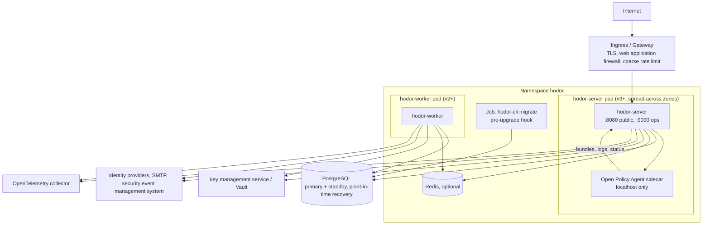

# Deployment architecture

## Artifacts

| Artifact | Contents |
|---|---|
| `hodor` image | One image with the three binaries: `hodor-server` (the entrypoint), `hodor-worker` and `hodor-cli`, run by overriding the command. The built static assets of the frontends are added when they exist. Distroless, non-root, `linux/amd64` and `linux/arm64` |
| `hodor-policy-tools` image | The `opa` binary for the Rego validation job (Phase 5) |
| Helm chart | Deployments, services, ingress, migration job, network policies, PodDisruptionBudgets, horizontal pod autoscaler, optional Open Policy Agent sidecar and Redis |
| Software bill of materials and signatures | CycloneDX software bill of materials and a signature per image |

## Topologies

| Topology | Use | Shape |
|---|---|---|
| Single node | Evaluation, development | Docker Compose in `deploy/docker`: server, worker, PostgreSQL, migrations, VictoriaMetrics |
| Standard high availability | Production | Kubernetes, 3+ server replicas across zones, 2+ workers, managed PostgreSQL with a standby, optional Redis and Open Policy Agent sidecars |
| Dedicated | Regulated or very large tenants | A separate standard deployment per customer |

## Kubernetes reference

| Concern | Setting |
|---|---|
| Replicas | Server: 3 minimum, horizontal pod autoscaler on CPU and request concurrency. Worker: 2 minimum |
| Scheduling | Topology spread across zones; PodDisruptionBudget keeps a majority |
| Probes | `startupz` (migrations compatible, keys loaded), `readyz` (database reachable, not draining), `livez` (process responsive). Readiness does not depend on Redis, Open Policy Agent or external identity providers |
| Shutdown | On SIGTERM: fail readiness, wait for the load balancer, drain in-flight requests, stop; workers finish or release the current job |
| Network policy | Ingress to `:8080` only from the gateway; `:9090` only from monitoring; Open Policy Agent reachable only on localhost; egress restricted to database, Redis, key management service, collector and an egress proxy for identity providers and webhooks |
| Pod security | Non-root, no privilege escalation, all capabilities dropped, read-only filesystem, seccomp default |
| Resources | Memory limit sized for password hashing: `HODOR_PASSWORD_HASH_CONCURRENCY` times `HODOR_PASSWORD_HASH_MEMORY_KIBIBYTES` must fit under the limit, with room for the rest of the server. With the defaults on 4 cores that is 4 × 19 MiB |

## The worker

`hodor-worker` runs background work. Today that is two jobs: delivering outbox events to their handlers ([Decision 0003](../decisions/0003-context-communication.md)), and delivering queued messages to the mail server ([the notification context](../architecture/contexts/notification.md)).

The one handler today is the [audit log](../architecture/contexts/audit.md): every event becomes an audit record. An installation without a running worker loses nothing, but its audit log falls behind until a worker runs.

Both jobs work the same way:

- **Loop**: the worker asks for a batch of pending work and handles it. If the batch had work in it, it asks again at once; if it was empty, it pauses for the poll interval. A database error is logged and followed by a pause, never by an exit: the worker waits for the database to come back.
- **Scaling**: any number of workers can run. Each event or message is locked with `FOR UPDATE SKIP LOCKED` while it is handled, so workers never handle the same one together and need no leader.
- **Stopping**: on SIGTERM the worker finishes the batches it is handling and exits with code 0. Work that is interrupted is rolled back and done by another worker later.
- **Health**: `/livez` and `/readyz` on the operations listener, as for the server. Readiness depends on both database connections. It does not depend on the mail server: a mail server that is down delays messages, and they are retried.

Mail delivery runs only when `HODOR_SMTP_URL` is set. Without it the worker says so once when it starts, and messages wait in the queue until a worker with a mail server is started or they expire.

| Metric | Kind | Labels |
|---|---|---|
| `hodor.outbox.events` | Counter | `outcome`: `delivered`, `failed` |
| `hodor.outbox.passes` | Counter | `outcome`: `ok`, `error` |
| `hodor.notification.messages` | Counter | `outcome`: `sent`, `retrying`, `failed`, `expired` |
| `hodor.notification.passes` | Counter | `outcome`: `ok`, `error` |

A growing count of `retrying` messages means the mail server is refusing or unreachable; the reason for each message is in the `last_error` column of `notification.message`.

## Configuration and secrets

| Kind | Source |
|---|---|
| Static configuration | A file plus environment overrides, validated at startup; the process refuses to start on unknown or invalid keys |
| Bootstrap secrets | Database credentials and the root key reference, from Kubernetes secrets or an external secret store; never in the image or chart values |
| Root key | Wraps the per-tenant data keys. Local mode: a key file mounted from a secret. Production: a key management service or Vault key |
| Tenant configuration | In the database, managed through the Admin API or Terraform; not in files |

Nothing tenant-specific is configured through deployment files, so adding a tenant never requires a rollout.

## Database

- A managed PostgreSQL service or an operator-run cluster with synchronous standby in another zone and point-in-time recovery.
- A connection pooler in transaction mode is supported; the adapter uses `SET LOCAL` inside transactions and no session state, which keeps it compatible.
- Separate pools for the server, the worker and platform (cross-tenant) access, each with its own database role.
- Read replicas are optional and used only for audit search and reporting queries.

## Upgrades

1. The chart runs `hodor-cli migrate` as a pre-upgrade job. Migrations are *expand* only in the release that introduces them.
2. Server and worker roll out; old and new versions run side by side against the expanded schema.
3. The *contract* migration (dropping what the old version needed) ships in the next release.

The server checks the schema version at startup and refuses to run against a schema older than it needs or newer than it understands by more than one release. Rollback within one release is a redeploy of the previous image.

## Backup and disaster recovery

| Item | Approach |
|---|---|
| Database | Continuous write-ahead log archiving and daily base backups; restore rehearsed on a schedule (Requirement-Operations-02) |
| Keys | Local provider: wrapped keys are in the database backup; the root key is backed up separately and offline. Key management service: the provider's own durability |
| Redis | Not backed up; it is rebuildable |
| Policy bundles | Rebuildable from `policy_version`; kept in the database |
| Regional failure | Warm standby region with a replicated database; DNS failover; the same root key reachable from both regions. Active-active across regions is out of scope for v1 |
| Verification | After restore, `hodor-cli doctor` checks schema version, key availability, audit chain integrity and outbox lag |

## Observability

| Signal | Content |
|---|---|
| Metrics | The set in section 20 of the specification, plus outbox lag, job queue depth, hashing queue depth, breaker state per Open Policy Agent binding, key age. Pushed over OTLP to VictoriaMetrics ([Decision 0015](../decisions/0015-observability-stack.md)); no scrape endpoint |
| Traces | One trace per request across server, database, Open Policy Agent and outbound calls; worker jobs linked to the originating request by `correlation_id` |
| Logs | JSON to stdout with `tenant_id`, `request_id`, `trace_id`; no bodies, no secrets |
| Dashboards and alerts | Shipped with the chart: authentication failure spike, token error rate, p99 latency, outbox lag, Open Policy Agent unhealthy, key rotation overdue, certificate expiry, database pool saturation |

## Scaling notes

- The server is stateless; any node serves any request. In-memory caches are bounded and invalidated by events (through Redis pub/sub when present, by short time to live otherwise).
- Workers coordinate through `FOR UPDATE SKIP LOCKED`; there is no leader election. Scheduled jobs (key rotation, cleanup) use a database advisory lock.
- The first bottleneck is password hashing CPU, then database connections. Scale servers for the former, the pooler for the latter.
- Open Policy Agent sidecars scale with the server. Bundle downloads are conditional requests, so thousands of instances are cheap.
