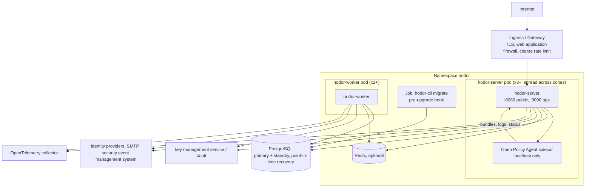

# Deployment architecture

How Hodor is meant to run, and where that is heading. To install it as it is today, follow [installing with Docker](install-with-docker.md) or [installing on Kubernetes](install-on-kubernetes.md); each says what it does not do yet.

## Artifacts

| Artifact | Contents |
|---|---|
| `hodor` image | One image with the three binaries: `hodor-server` (the entrypoint), `hodor-worker` and `hodor-cli`, run by overriding the command. It also holds [the hosted pages](../architecture/hosted-pages.md#how-the-pages-are-served), built into `/usr/share/hodor/auth-ui`, which `HODOR_PAGES_DIRECTORY` points at. The [admin console](../architecture/admin-console.md#how-it-is-served) is built into `/usr/share/hodor/admin-console`, which `HODOR_CONSOLE_DIRECTORY` points at. The account console is added when it exists. Distroless, non-root, `linux/amd64` and `linux/arm64` |
| `hodor-policy-tools` image | The `opa` binary for the Rego validation job (Phase 5) |
| Helm chart | `deploy/install/helm/hodor`: Deployments, service, ingress, migration job, network policy, PodDisruptionBudgets and horizontal pod autoscaler, as [installing on Kubernetes](install-on-kubernetes.md) describes. The optional Open Policy Agent sidecar and Redis come with the phases that use them |
| Compose installation | `deploy/install/docker`: the migrations, the server and the worker on one machine, with PostgreSQL and HTTPS as optional parts, as [installing with Docker](install-with-docker.md) describes |
| Software bill of materials and signatures | CycloneDX software bill of materials and a signature per image |

## Topologies

| Topology | Use | Shape |
|---|---|---|
| Development | Working on Hodor, the demonstrations | Docker Compose in `deploy/docker`: server, worker, PostgreSQL, migrations, VictoriaMetrics, a mail server that delivers nothing and the development identity providers. Its passwords are public |
| Single node | Evaluation, small installations | Docker Compose in `deploy/install/docker`: server, worker, migrations, optional PostgreSQL and HTTPS, every secret from a file of your own |
| Standard high availability | Production | Kubernetes with the chart in `deploy/install/helm/hodor`: 3+ server replicas across zones, 2+ workers, managed PostgreSQL with a standby, optional Redis and Open Policy Agent sidecars |
| Dedicated | Regulated or very large tenants | A separate standard deployment per customer |

## Kubernetes reference

| Concern | Setting |
|---|---|
| Replicas | Server: 3 minimum, horizontal pod autoscaler on CPU and request concurrency. Worker: 2 minimum |
| Scheduling | Topology spread across zones; PodDisruptionBudget keeps a majority |
| Probes | `startupz` (migrations compatible, keys loaded), `readyz` (database reachable, not draining), `livez` (process responsive). Readiness does not depend on Redis, Open Policy Agent or external identity providers |
| Client address | The ingress controller's pod range in `trustedProxies`, with the network policy on, so that limits count each client: [the address of each client](install-on-kubernetes.md#the-address-of-each-client) |
| Shutdown | On SIGTERM: fail readiness, wait for the load balancer, drain in-flight requests, stop; workers finish or release the current job |
| Network policy | Ingress to `:8080` only from the gateway; `:9090` only from monitoring; Open Policy Agent reachable only on localhost; egress restricted to database, Redis, key management service, collector and an egress proxy for identity providers and webhooks |
| Pod security | Non-root, no privilege escalation, all capabilities dropped, read-only filesystem, seccomp default |
| Resources | Memory limit sized for password hashing: `HODOR_PASSWORD_HASH_CONCURRENCY` times `HODOR_PASSWORD_HASH_MEMORY_KIBIBYTES` must fit under the limit, with room for the rest of the server. With the defaults on 4 cores that is 4 × 19 MiB |

## The worker

`hodor-worker` runs background work: delivering outbox events to their handlers ([Decision 0003](../decisions/0003-context-communication.md)), delivering queued messages to the mail server ([the notification context](../architecture/contexts/notification.md)), the cleanup jobs, rotating the tenants' signing keys ([the keys context](../architecture/contexts/keys.md#rotation)), sending webhooks ([the webhooks context](../architecture/contexts/webhooks.md)), and checking, testing and simulating policy versions for Open Policy Agent ([the policy lifecycle](../architecture/contexts/authorization.md#the-policy-lifecycle)).

Two handlers hear every event. The [audit log](../architecture/contexts/audit.md) makes every event an audit record; the [webhooks context](../architecture/contexts/webhooks.md#how-an-event-reaches-an-endpoint) makes one delivery for each endpoint subscribed to the event's type. Both write in the transaction that marks the event dispatched. An installation without a running worker loses nothing, but its audit log and its webhooks fall behind until a worker runs.

Delivering events and messages works the same way:

- **Loop**: the worker asks for a batch of pending work and handles it. If the batch had work in it, it asks again at once; if it was empty, it pauses for the poll interval. A database error is logged and followed by a pause, never by an exit: the worker waits for the database to come back.
- **Scaling**: any number of workers can run. Each event or message is locked with `FOR UPDATE SKIP LOCKED` while it is handled, so workers never handle the same one together and need no leader.
- **Stopping**: on SIGTERM the worker finishes the batches it is handling and exits with code 0. Work that is interrupted is rolled back and done by another worker later.
- **Health**: `/livez` and `/readyz` on the operations listener, as for the server. Readiness depends on both database connections. It does not depend on the mail server: a mail server that is down delays messages, and they are retried.

Mail delivery runs only when `HODOR_SMTP_URL` is set. Without it the worker says so once when it starts, and messages wait in the queue until a worker with a mail server is started or they expire.

| Metric | Kind | Labels |
|---|---|---|
| `hodor.outbox.events` | Counter | `outcome`: `delivered`, `failed` |
| `hodor.outbox.passes` | Counter | `outcome`: `ok`, `error` |
| `hodor.notification.messages` | Counter | `outcome`: `sent`, `retrying`, `failed`, `expired` |
| `hodor.notification.passes` | Counter | `outcome`: `ok`, `error` |

Key rotation runs only when `HODOR_SECRET_KEYS` is set, with the same keys as the server: the worker makes the keys, and the server signs with them. Without it the worker says so once when it starts, and no tenant gets a signing key. Unlike the other jobs, rotation needs a leader: a pass holds a PostgreSQL advisory lock, and a worker that does not get it skips the pass.

| Metric | Kind | Labels |
|---|---|---|
| `hodor.keys.rotation.passes` | Counter | `outcome`: `ok`, `skipped` (another worker held the lock), `error` |
| `hodor.keys.rotation.changes` | Counter | `change`: `created`, `activated`, `retired` |

Policy checks run only when `HODOR_OPEN_POLICY_AGENT_BINARY` is set; the image sets it to the `opa` 1.10.1 binary it carries ([Decision 0026](../decisions/0026-policy-checks-in-a-sandbox.md)). The worker refuses to start with a binary of another version, or of another SHA-256 than `HODOR_OPEN_POLICY_AGENT_BINARY_SHA256` when that is set. Without the binary the worker says so once, versions wait, and none can be published. Like rotation, a pass holds an advisory lock, so only one worker checks at a time. Each run is a child process with an empty environment, a directory of its own and a time limit (`HODOR_POLICY_CHECK_TIME_LIMIT_SECONDS`); its memory is bounded only softly (`HODOR_POLICY_CHECK_MEMORY_MEBIBYTES`), so give the worker container a memory limit, as the chart does, and no route out of its network beyond the database, the mail server and the telemetry collector.

| Metric | Kind | Labels |
|---|---|---|
| `hodor.policy.check.passes` | Counter | `outcome`: `ok`, `skipped`, `error` |
| `hodor.policy.check.done` | Counter | `kind`: `version`, `simulation` |

A growing count of `retrying` messages means the mail server is refusing or unreachable; the reason for each message is in the `last_error` column of `notification.message`.

Webhooks are sent only when `HODOR_SECRET_KEYS` is set, with the same keys as the server, since only they open the secrets deliveries are signed with. Without it the worker says so once, and deliveries wait. Unlike the other loops, the webhook loop sends many deliveries at once (`HODOR_WEBHOOK_CONCURRENCY`) and holds no transaction while an endpoint answers: each delivery is leased for the time limit of an attempt plus one minute, so a worker that stops in the middle of a request leaves it to another after that minute. Any number of workers can run; an endpoint never has more than `HODOR_WEBHOOK_IN_FLIGHT_PER_ENDPOINT` deliveries in flight across all of them. Endpoints are on the internet, chosen by tenants: give the worker a route out to public addresses for them, through the [guarded client's](../security/outbound-http.md) rules, and nothing more. The settings and [bounds](../architecture/contexts/webhooks.md#bounds) are on the context's page.

| Metric | Kind | Labels |
|---|---|---|
| `hodor.webhooks.attempts` | Counter | `outcome`: `delivered`, `retrying`, `set_aside`, `skipped` |
| `hodor.webhooks.passes` | Counter | `outcome`: `ok`, `error` |

A growing count of `set_aside` means an endpoint keeps failing; the deliveries say why (`GET /webhook-deliveries?status=set_aside`).

### Cleanup

Many rows are only useful for a while: a session that ended, a link that was used, a code that expired. The worker removes them, so that the database does not grow forever and holds no more personal data than it needs. Every kind of row below has a **retention**: how long it is kept after it stopped being useful. Then it is removed.

| Kind | Stops being useful when | Retention | What removing it also removes |
|---|---|---|---|
| `sessions` | It was ended, or it expired, idle or absolute | 7 days | — |
| `sign_ins` | The sign-in in progress expired | 1 day | — |
| `verification_tokens` | The registration or recovery link was used, replaced or expired | 7 days | — |
| `email_sign_ins` | The code or the link to sign in by email expired. A used one expires ten minutes after it was made, at the latest | 1 day | — |
| `messages` | It was sent, failed or expired. Its contents were already erased | 30 days | — |
| `webauthn_registrations` | A security key or passkey registration was never finished and expired | 0 | — |
| `authorization_requests` | The request kept while the person signs in expired | 0 | — |
| `authorization_codes` | The code expired | 1 day | — |
| `revoked_grants` | The grant was revoked | 30 days | Its codes, refresh token families and records of access tokens |
| `refresh_token_families` | The family expired or was revoked | 30 days | Its refresh tokens and records of access tokens |
| `client_assertions` | The remembered `jti` of a client assertion expired | 0 | — |
| `consents` | It was withdrawn or expired. The history of consents is kept | 30 days | — |
| `administration_access_tokens` | The access token of the administration interface expired or was revoked | 30 days | — |
| `webhook_deliveries` | The webhook delivery was delivered or set aside | 30 days | — |
| `api_keys` | The API key of a service account or an agent expired or was revoked | 30 days | — |
| `pending_authorizations` | A sign-in that left for an identity provider never came back | 0, fixed | — |
| `access_tokens` | The access token recorded in the register expired | 0, fixed | — |

Removing a row never changes an answer Hodor gives:

- **Nothing that can still be used is removed.** A row is removed only after it stopped being useful, so a retention of 0 removes it at the next pass and no sooner.
- **A row that is gone answers like one that was refused.** A code, a refresh token, a link or a session that is no longer stored is refused as unknown. An access token whose record is gone is [not in force](../architecture/contexts/oauth.md#the-register-of-access-tokens).
- **What is longer means more is remembered.** While a revoked refresh token family is kept, presenting one of its tokens again is recognized as reuse. After that it is simply unknown, and refused all the same.
- **The audit log, the history of consents and the record of decisions are never removed by this job.** The record of decisions has [its own retention](../architecture/contexts/authorization.md#the-record-of-decisions).

A retention is changed with `HODOR_CLEANUP_RETENTION_DAYS`, as `kind=days` pairs separated by commas, such as `sessions=30,messages=90`. A kind it does not name keeps its default. The worker refuses to start with a kind it does not know, a kind given twice, a number that is not a whole number of days from 0 to 3650, or a retention for `pending_authorizations` or `access_tokens`.

Each kind is a job of its own, run like the others: it finds the tenants that have something to remove through the platform connection, then removes at most `HODOR_CLEANUP_BATCH_SIZE` rows in each tenant as the application role. A pass that removed a full batch is followed by another at once. Workers need no leader: the rows a pass removes are locked with `FOR UPDATE SKIP LOCKED`, so two workers never remove the same row and each skips what the other holds.

| Metric | Kind | Labels |
|---|---|---|
| `hodor.cleanup.removed` | Counter | `job`: the kind |
| `hodor.cleanup.passes` | Counter | `job`: the kind; `outcome`: `ok`, `error` |

Rows that are never removed today: the counters of failed attempts, which keep the escalation of lockouts, and an authenticator application enrollment that was never confirmed, of which a person has at most one.

## Configuration and secrets

| Kind | Source |
|---|---|
| Static configuration | A file plus environment overrides, validated at startup; the process refuses to start on unknown or invalid keys |
| Bootstrap secrets | Database credentials and the root key reference, from Kubernetes secrets or an external secret store; never in the image or chart values |
| Root key | Wraps the per-tenant data keys. Local mode: a key file mounted from a secret. Production: a key management service or Vault key |
| Tenant configuration | In the database, managed through the Admin API or Terraform; not in files |

Nothing tenant-specific is configured through deployment files, so adding a tenant never requires a rollout.

## Database

- A managed PostgreSQL service or an operator-run cluster with synchronous standby in another zone and point-in-time recovery.
- A connection pooler in transaction mode is supported; the adapter uses `SET LOCAL` inside transactions and no session state, which keeps it compatible.
- Separate pools for the server, the worker and platform (cross-tenant) access, each with its own database role.
- Read replicas are optional and used only for audit search and reporting queries.

## Upgrades

1. The chart runs `hodor-cli migrate` as a pre-upgrade job. Migrations are *expand* only in the release that introduces them.
2. Server and worker roll out; old and new versions run side by side against the expanded schema.
3. The *contract* migration (dropping what the old version needed) ships in the next release.
4. Some releases ask for a command once the new version runs. The changelog of the release names it, and the installation guides say how to run it.

| Upgrading from | Run once, after the upgrade | Why |
|---|---|---|
| 0.1.0 | `hodor-cli secrets reseal`, with the server's `HODOR_DATABASE_URL` and `HODOR_SECRET_KEYS` | Moves the secrets kept by 0.1.0 under a data key of their tenant, then refuses their old format: [secrets at rest](../security/secrets-at-rest.md#moving-the-secrets-of-an-earlier-version). Until it runs they still open as before |

The server checks the schema version at startup and refuses to run against a schema older than it needs or newer than it understands by more than one release. Rollback within one release is a redeploy of the previous image.

## Backup and disaster recovery

| Item | Approach |
|---|---|
| Database | Continuous write-ahead log archiving and daily base backups; restore rehearsed on a schedule (Requirement-Operations-02) |
| Keys | Local provider: wrapped keys are in the database backup; the root key is backed up separately and offline. Key management service: the provider's own durability |
| Redis | Not backed up; it is rebuildable |
| Policy bundles | Rebuildable from `policy_version`; kept in the database |
| Regional failure | Warm standby region with a replicated database; DNS failover; the same root key reachable from both regions. Active-active across regions is out of scope for v1 |
| Verification | After restore, `hodor-cli doctor` checks schema version, key availability, audit chain integrity and outbox lag |

## Observability

| Signal | Content |
|---|---|
| Metrics | The set in section 20 of the specification, plus outbox lag, job queue depth, hashing queue depth, breaker state per Open Policy Agent binding, key age. Pushed over OTLP to VictoriaMetrics ([Decision 0015](../decisions/0015-observability-stack.md)); no scrape endpoint. Every process names itself with `service.name`, `service.version` and `service.instance.id`, a random identifier made when it starts, so that the series of two replicas never mix; add series up across instances to count for the whole deployment |
| Traces | One trace per request across server, database, Open Policy Agent and outbound calls; worker jobs linked to the originating request by `correlation_id` |
| Logs | JSON to stdout with `tenant_id`, `request_id`, `trace_id`; no bodies, no secrets |
| Dashboards and alerts | Shipped with the chart: authentication failure spike, token error rate, p99 latency, outbox lag, Open Policy Agent unhealthy, key rotation overdue, certificate expiry, database pool saturation |

## Scaling notes

- The server is stateless; any node serves any request. In-memory caches are bounded and invalidated by events (through Redis pub/sub when present, by short time to live otherwise).
- Workers coordinate through `FOR UPDATE SKIP LOCKED`; there is no leader election. Cleanup jobs lock the rows they remove the same way. Key rotation and policy checks need one worker at a time and take a database advisory lock.
- The first bottleneck is password hashing CPU, then database connections. Scale servers for the former, the pooler for the latter.
- Open Policy Agent sidecars scale with the server. Bundle downloads are conditional requests, so thousands of instances are cheap.
