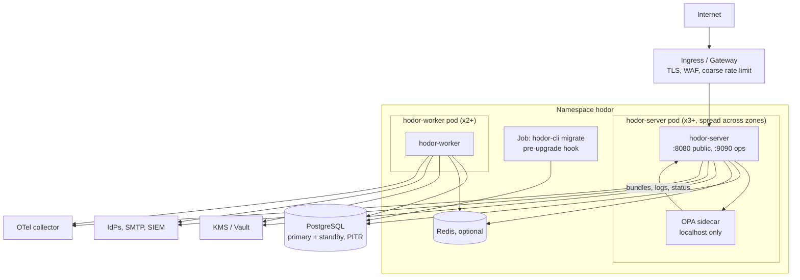

# Deployment architecture

## Artifacts

| Artifact | Contents |
|---|---|
| `hodor` image | One image with the three binaries: `hodor-server` (the entrypoint), `hodor-worker` and `hodor-cli`, run by overriding the command. The built static assets of the frontends are added when they exist. Distroless, non-root, `linux/amd64` and `linux/arm64` |
| `hodor-policy-tools` image | The `opa` binary for the Rego validation job (Phase 5) |
| Helm chart | Deployments, services, ingress, migration job, network policies, PodDisruptionBudgets, HPA, optional OPA sidecar and Redis |
| SBOM and signatures | CycloneDX SBOM and a signature per image |

## Topologies

| Topology | Use | Shape |
|---|---|---|
| Single node | Evaluation, development | Docker Compose in `deploy/docker`: server, worker, PostgreSQL, migrations, VictoriaMetrics |
| Standard HA | Production | Kubernetes, 3+ server replicas across zones, 2+ workers, managed PostgreSQL with a standby, optional Redis and OPA sidecars |
| Dedicated | Regulated or very large tenants | A separate standard deployment per customer |

## Kubernetes reference

| Concern | Setting |
|---|---|
| Replicas | Server: 3 minimum, HPA on CPU and request concurrency. Worker: 2 minimum |
| Scheduling | Topology spread across zones; PodDisruptionBudget keeps a majority |
| Probes | `startupz` (migrations compatible, keys loaded), `readyz` (database reachable, not draining), `livez` (process responsive). Readiness does not depend on Redis, OPA or external IdPs |
| Shutdown | On SIGTERM: fail readiness, wait for the load balancer, drain in-flight requests, stop; workers finish or release the current job |
| Network policy | Ingress to `:8080` only from the gateway; `:9090` only from monitoring; OPA reachable only on localhost; egress restricted to database, Redis, KMS, collector and an egress proxy for IdPs and webhooks |
| Pod security | Non-root, no privilege escalation, all capabilities dropped, read-only filesystem, seccomp default |
| Resources | Memory limit sized for Argon2 concurrency: the hashing semaphore times the memory cost must fit under the limit |

## The worker

`hodor-worker` runs background work. Today that is one job: delivering outbox events to their handlers ([ADR-0003](../adr/0003-context-communication.md)).

- **Loop**: the worker asks for a batch of pending events and handles them. If the batch had work in it, it asks again at once; if it was empty, it pauses for the poll interval. A database error is logged and followed by a pause, never by an exit: the worker waits for the database to come back.
- **Scaling**: any number of workers can run. Events are locked one at a time with `FOR UPDATE SKIP LOCKED`, so workers never handle the same event together and need no leader.
- **Stopping**: on SIGTERM the worker finishes the batch it is handling and exits with code 0. An event whose handling is interrupted is rolled back and delivered by another worker later.
- **Health**: `/livez` and `/readyz` on the operations listener, as for the server. Readiness depends on both database connections.
- **Metrics**: `hodor.outbox.events` (counter, by `outcome`: `delivered`, `failed`) and `hodor.outbox.passes` (counter, by `outcome`: `ok`, `error`).

## Configuration and secrets

| Kind | Source |
|---|---|
| Static configuration | A file plus environment overrides, validated at startup; the process refuses to start on unknown or invalid keys |
| Bootstrap secrets | Database credentials and the root key reference, from Kubernetes secrets or an external secret store; never in the image or chart values |
| Root key | Wraps the per-tenant data keys. Local mode: a key file mounted from a secret. Production: a KMS or Vault key |
| Tenant configuration | In the database, managed through the Admin API or Terraform; not in files |

Nothing tenant-specific is configured through deployment files, so adding a tenant never requires a rollout.

## Database

- A managed PostgreSQL service or an operator-run cluster with synchronous standby in another zone and point-in-time recovery.
- A connection pooler in transaction mode is supported; the adapter uses `SET LOCAL` inside transactions and no session state, which keeps it compatible.
- Separate pools for the server, the worker and platform (cross-tenant) access, each with its own database role.
- Read replicas are optional and used only for audit search and reporting queries.

## Upgrades

1. The chart runs `hodor-cli migrate` as a pre-upgrade job. Migrations are *expand* only in the release that introduces them.
2. Server and worker roll out; old and new versions run side by side against the expanded schema.
3. The *contract* migration (dropping what the old version needed) ships in the next release.

The server checks the schema version at startup and refuses to run against a schema older than it needs or newer than it understands by more than one release. Rollback within one release is a redeploy of the previous image.

## Backup and disaster recovery

| Item | Approach |
|---|---|
| Database | Continuous WAL archiving and daily base backups; restore rehearsed on a schedule (NFR-OPS-02) |
| Keys | Local provider: wrapped keys are in the database backup; the root key is backed up separately and offline. KMS: the provider's own durability |
| Redis | Not backed up; it is rebuildable |
| Policy bundles | Rebuildable from `policy_version`; kept in the database |
| Regional failure | Warm standby region with a replicated database; DNS failover; the same root key reachable from both regions. Active-active across regions is out of scope for v1 |
| Verification | After restore, `hodor-cli doctor` checks schema version, key availability, audit chain integrity and outbox lag |

## Observability

| Signal | Content |
|---|---|
| Metrics | The set in section 20 of the specification, plus outbox lag, job queue depth, hashing queue depth, breaker state per OPA binding, key age. Pushed over OTLP to VictoriaMetrics ([ADR-0015](../adr/0015-observability-stack.md)); no scrape endpoint |
| Traces | One trace per request across server, database, OPA and outbound calls; worker jobs linked to the originating request by `correlation_id` |
| Logs | JSON to stdout with `tenant_id`, `request_id`, `trace_id`; no bodies, no secrets |
| Dashboards and alerts | Shipped with the chart: authentication failure spike, token error rate, p99 latency, outbox lag, OPA unhealthy, key rotation overdue, certificate expiry, database pool saturation |

## Scaling notes

- The server is stateless; any node serves any request. In-memory caches are bounded and invalidated by events (through Redis pub/sub when present, by short TTL otherwise).
- Workers coordinate through `FOR UPDATE SKIP LOCKED`; there is no leader election. Scheduled jobs (key rotation, cleanup) use a database advisory lock.
- The first bottleneck is password hashing CPU, then database connections. Scale servers for the former, the pooler for the latter.
- OPA sidecars scale with the server. Bundle downloads are conditional requests, so thousands of instances are cheap.
