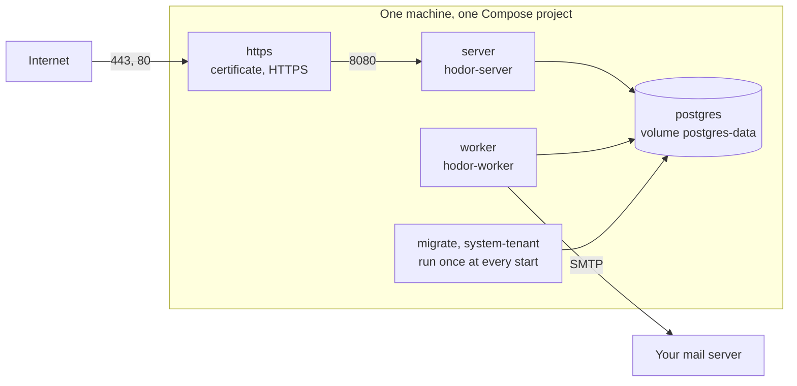

# Installing with Docker

Hodor on one machine, with Docker and nothing else: the server, the worker, the database and HTTPS, started by one command from one file of settings. This page is for someone who wants an installation that stays up. To look at Hodor for ten minutes, the [quick-start](quick-start.md) is shorter; to run it on a cluster, see [installing on Kubernetes](install-on-kubernetes.md).

The files are in `deploy/install/docker/`. They share nothing with the development stack in `deploy/docker/` except the image: no password is written in them, no development identity provider is started, and nothing answers on a public port but the HTTPS server. The Compose project is named `hodor-install`, so the two can stand on one machine without sharing a container or a volume.

> Hodor itself is still being built. [What is not built yet](../product/progress.md#known-gaps-in-what-is-done) applies to every installation, and [the limits of this one](#what-this-installation-does-not-do) are at the end of this page. Read both before real accounts depend on it.

## What is installed



| Service | What it does | Runs |
|---|---|---|
| `postgres` | PostgreSQL 17, with its data in the volume `postgres-data`. Its roles are created by `postgres-roles.sh` the first time it starts | With the profile `database` |
| `migrate` | Applies the database migrations as the owner of the schema, then exits. The only container that knows the owner's password | At every start |
| `system-tenant` | Creates the [system tenant](../architecture/contexts/tenant.md) if it is missing, then exits | At every start |
| `server` | `hodor-server`: the pages people sign in on, the interfaces and the admin console. Published on `127.0.0.1:8080`, for the web server in front and nobody else | Always |
| `worker` | `hodor-worker`: writes the audit log, delivers messages to the mail server, removes what expired | Always |
| `https` | A [Caddy](https://caddyserver.com/) web server on ports 80 and 443. It gets a certificate for the name in `HODOR_PUBLIC_URL`, renews it, and passes requests to `server` | With the profile `https` |
| `cli` | `hodor-cli`, the command-line tool, with the installation's settings | Only when you run it |

The Hodor containers run as a user that is not root, with a read-only file system and no Linux capability. The operations port, which answers health checks without authentication, is not published at all: the health checks run inside each container.

## What you need

| What | Why |
|---|---|
| A machine with Docker Engine and Docker Compose 2.20 or newer | Everything runs in containers |
| A checkout of this repository, at the tag of the version you install | The Compose file and its settings come from it. The [quick-start](quick-start.md#0-get-the-code) says how to get the code |
| A name that points at the machine, such as `login.example.com`, and ports 80 and 443 reachable from the internet | For the profile `https`: the certificate is issued for that name, over those ports |
| A mail server that accepts messages over SMTP | Hodor sends the links that verify an address and recover a password. Without one, the messages wait |
| `openssl` | To make the passwords |

Run every command of this page from the root of the checkout.

## 1. Get the image

From 0.3.0, every release publishes its image, `ghcr.io/ortisun/hodor:<version>`. Set `HODOR_IMAGE` to it in [step 2](#2-write-the-settings), and Compose pulls it when it starts. To check its signature first, see [what a release publishes](../security/supply-chain.md#what-a-release-publishes).

For an earlier version, or for a checkout of `develop`, build the image instead:

```bash
docker build --file deploy/docker/Dockerfile --tag hodor:0.2.0 .
```

The first build takes several minutes. The image holds the three programs, the hosted pages and the admin console.

## 2. Write the settings

Every setting is in one file, `deploy/install/docker/.env`, which git ignores. Start from the example and keep the file to yourself:

```bash
cp deploy/install/docker/.env.example deploy/install/docker/.env
```

```bash
chmod 600 deploy/install/docker/.env
```

Then fill in the five values that have no default. Compose refuses to start while one of them is empty.

| Setting | What to write |
|---|---|
| `HODOR_PUBLIC_URL` | The address people will use: `https://`, the name, no path. For example `https://login.example.com` |
| `HODOR_OWNER_DATABASE_PASSWORD` | A password for the role that owns the schema, used by `migrate` only |
| `HODOR_SERVER_DATABASE_PASSWORD` | A password for the server's role |
| `HODOR_WORKER_DATABASE_PASSWORD` | A password for the worker's two roles |
| `HODOR_SECRET_KEYS` | The key that keeps the secrets of identity providers and the tenants' signing keys encrypted in the database, as `identifier:key`. The server and the worker both read it |

Make each of the three passwords with the command below. They are written into connection addresses, so they must be letters and digits only, which is what this prints:

```bash
openssl rand -hex 24
```

Make the key with the image you built, and write it after an identifier of your choice, such as `2026-11:` followed by what is printed:

```bash
docker run --rm --entrypoint /usr/local/bin/hodor-cli hodor:0.2.0 secrets generate-key
```

Keep a copy of the key outside the machine. What it encrypted cannot be read without it; [secrets at rest](../security/secrets-at-rest.md#root-keys) explains the format and how to change the key later.

For messages to be delivered, also set `HODOR_SMTP_URL` and `HODOR_MAIL_FROM`. The other settings are optional and explained in `.env.example`.

## 3. Start

```bash
docker compose -f deploy/install/docker/compose.yaml up --detach --wait
```

The command returns when the database, the server and the worker are healthy. In order: the database starts and creates its roles, `migrate` applies the migrations, `system-tenant` creates the system tenant, then the server and the worker start, and the HTTPS server asks for its certificate.

See what is running:

```bash
docker compose -f deploy/install/docker/compose.yaml ps
```

Hodor now answers at the address in `HODOR_PUBLIC_URL`. An address without a tenant answers `404`: everything in Hodor belongs to a tenant, and there is none yet.

## 4. Create a tenant and its first administrator

The service `cli` runs the command-line tool with the installation's settings. Create a tenant:

```bash
docker compose -f deploy/install/docker/compose.yaml run --rm cli tenant create --slug acme --name "Acme"
```

Its pages are at `/t/acme/account` under your address. Make someone its first administrator; the command prints an access token for the [administration interface](../api/admin-api.md), once:

```bash
docker compose -f deploy/install/docker/compose.yaml run --rm cli admin bootstrap --tenant acme --email you@example.com
```

[A tenant and its first administrator](../examples/first-tenant-and-administrator.md) continues from here: choosing a password, signing in and opening the admin console. Its commands are written for the development stack; with this installation, `docker compose -f deploy/install/docker/compose.yaml run --rm cli` takes the place of the longer command that starts each of them.

## Choosing the parts

`COMPOSE_PROFILES` in `.env` says which optional parts run. It starts as `database,https`.

### A database of your own

Remove `database` from `COMPOSE_PROFILES`, create the roles and the database as [installing on Kubernetes](install-on-kubernetes.md#2-prepare-the-database) describes, and say where the database is. The passwords are the three of `.env`: the worker's two roles share `HODOR_WORKER_DATABASE_PASSWORD`.

| Setting | Meaning | Default |
|---|---|---|
| `HODOR_DATABASE_ADDRESS` | Host and port | `postgres:5432`, the container |
| `HODOR_DATABASE_NAME` | Name of the database | `hodor` |
| `HODOR_DATABASE_OPTIONS` | What to add to the connection address, such as `?sslmode=verify-full` | Nothing |

The role names are fixed: `hodor_owner`, `hodor_server`, `hodor_worker` and `hodor_worker_platform`.

### A web server of your own

Remove `https` from `COMPOSE_PROFILES` and point your web server at `127.0.0.1:8080`, or at the port in `HODOR_HTTP_PORT`. It must serve HTTPS for the name in `HODOR_PUBLIC_URL`: the session cookie is marked `Secure`, and browsers do not send it over plain HTTP. It must also add the address it received each request from to `X-Forwarded-For`, as nginx does with `proxy_set_header X-Forwarded-For $proxy_add_x_forwarded_for`, so that Hodor knows who is signing in. The next section says why.

### The address of each client

Hodor limits sign-in attempts by the [client address](../api/api-spec.md#the-client-address). Here every request reaches Hodor through a web server, so Hodor reads the address the web server forwards in `X-Forwarded-For`.

The installation trusts that header from every private address: `HODOR_TRUSTED_PROXIES` is `10.0.0.0/8,172.16.0.0/12,192.168.0.0/16` unless `.env` sets it. That is safe here, and only here, because the server's port is published on `127.0.0.1` alone. The only things that can connect to it are the containers of this installation and programs on this machine. The web server of the profile `https` replaces any `X-Forwarded-For` a client sends with the client's own address.

Change it when that is not true:

- If you publish the server's port beyond this machine, set `HODOR_TRUSTED_PROXIES` to the addresses of your web servers alone.
- If a load balancer sits in front of the web server, add its range too. Your web server must then keep the header it receives instead of replacing it.

## Day to day

| Task | How |
|---|---|
| Read the logs | `docker compose -f deploy/install/docker/compose.yaml logs --follow server worker`. They are JSON, one object per line |
| Stop | `docker compose -f deploy/install/docker/compose.yaml down`. The data stays in the volumes. Adding `--volumes` deletes the database and the certificates, for good |
| Change a setting | Edit `.env`, then run the command of [step 3](#3-start) again. Only the containers whose settings changed are replaced |
| Send metrics and traces somewhere | Set `HODOR_OTLP_METRICS_ENDPOINT` and `HODOR_OTLP_TRACES_ENDPOINT`. [Deployment](deployment.md#observability) says what is sent |

### Backing up

Everything Hodor knows is in the database, the audit log included. With the profile `database`, this writes a backup to the file `hodor.dump`:

```bash
docker compose -f deploy/install/docker/compose.yaml exec --no-TTY postgres pg_dump --username hodor_owner --format custom hodor > hodor.dump
```

Keep the backups and the key of `HODOR_SECRET_KEYS` in different places, both outside the machine. A backup is worth what its last restore was worth: try one.

### Upgrading

1. Get the new version of the code. With a published version, its image is `ghcr.io/ortisun/hodor:<version>`; otherwise build its image under a new tag, as in [step 1](#1-get-the-image).
2. Write the new tag in `HODOR_IMAGE`.
3. Run the command of [step 3](#3-start) again. The migrations of the new version are applied first, then the server and the worker are replaced.
4. If [deployment](deployment.md#upgrades) lists a command for the version you upgraded from, run it with the service `cli`. From 0.1.0:

```bash
docker compose -f deploy/install/docker/compose.yaml run --rm cli secrets reseal
```

Upgrade one release at a time: [deployment](deployment.md#upgrades) explains why the migrations allow that and no more.

## What this installation does not do

| Limit | What it means |
|---|---|
| One machine | When the machine is down, Hodor is down. [Installing on Kubernetes](install-on-kubernetes.md) runs several servers |
| No backups on a schedule | The command above is run by you, or by whatever you schedule it with |
| No store for metrics and traces | Hodor sends them where you say; nothing here receives them. The development stack shows one way, with VictoriaMetrics and VictoriaTraces |
