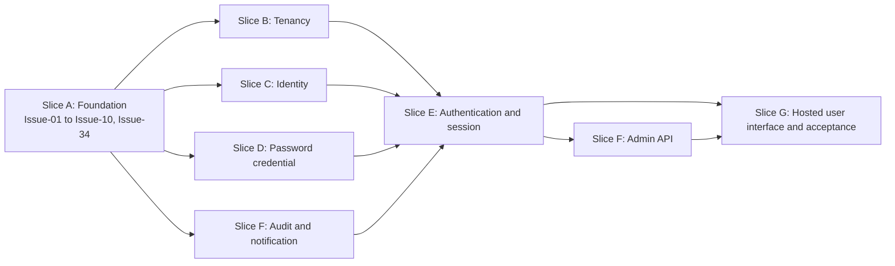

# Epics and development issues

Epics map to roadmap phases. Issues are written in full only for Milestone 1; later epics list their issues at story level and are refined when their phase is planned.

## Epic index

| Epic | Title | Phase | Requirements |
|---|---|---|---|
| Epic 0 | Foundation | 0 | Requirement-Maintainability, Requirement-Observability, Requirement-Security-07/08 |
| Epic 1 | Tenancy | 1 | Requirement-Tenancy-01, 04, 07 |
| Epic 2 | Identity | 1 | Requirement-Identity-01 to 06 |
| Epic 3 | Password credential | 1 | Requirement-Credential-01, 02, 08 |
| Epic 4 | Authentication and session core | 1 | Requirement-Authentication-01 to 04, Requirement-Session-01, 02 |
| Epic 5 | Audit and notification | 1 | Requirement-Audit-01, 02, 05, Requirement-Notification-01 |
| Epic 6 | Admin API and administrative role-based access control | 1 | Requirement-Authorization-11 |
| Epic 7 | Keys | 2 | Requirement-Key-01, 02 |
| Epic 8 | Applications and clients | 2 | Requirement-OAuth-22 |
| Epic 9 | OAuth 2.x core | 2 | Requirement-OAuth-01 to 07, 17 |
| Epic 10 | OpenID Connect | 2 | Requirement-OAuth-08, 10, 11, Requirement-Authentication-10 |
| Epic 11 | Consent | 2 | Requirement-OAuth-09 |
| Epic 12 | Admin console v1 | 2 | — |
| Epic 13 | Federation core | 3 | Requirement-Federation-01, 02, 04, 05, 08 |
| Epic 14 | Social connectors | 3 | Requirement-Federation-03 |
| Epic 15 | Identity linking and routing | 3 | Requirement-Federation-06, 07, 09, Requirement-Identity-07 |
| Epic 16 | Multi-factor authentication and passkeys | 4 | Requirement-Credential-03 to 05, Requirement-Authentication-05 |
| Epic 17 | Flow engine authoring, step-up, risk | 4 | Requirement-Authentication-06 to 09, 11 |
| Epic 18 | Advanced sessions and account console | 4 | Requirement-Session-05, 06, Requirement-Identity-10 |
| Epic 19 | OAuth extensions (pushed authorization requests, DPoP, device, dynamic client registration) | 4 | Requirement-OAuth-12, 13, 15, 19 |
| Epic 20 | Authorization core and native engine | 5 | Requirement-Authorization-01 to 06, 10 |
| Epic 21 | Open Policy Agent integration and policy lifecycle | 5 | Requirement-Authorization-07 to 09 |
| Epic 22 | Workload and agent identity | 5 | Requirement-Workload-01, 02, Requirement-OAuth-16, 18, Requirement-Credential-06 |
| Epic 23 | Webhooks and security event management system | 5 | Requirement-Audit-04 |
| Epic 24 | SAML | 6 | Requirement-SAML-01 |
| Epic 25 | LDAP and Active Directory | 6 | Requirement-LDAP-01 |
| Epic 26 | SCIM | 6 | Requirement-SCIM-01 |
| Epic 27 | Governance | 7 | Requirement-Tenancy-06 |
| Epic 28 | Plugin runtime | 8 | Requirement-Plugin-01 |
| Epic 29 | Software development kits, Terraform, developer portal | 8 | Requirement-Workload-03 |
| Epic 30 | Production readiness | 9 | Requirement-Key-03, Requirement-Operations, Requirement-Performance |

## Milestone 1: Walking skeleton

**Goal**: a user registers, verifies an email, signs in with a password and gets a session in a tenant, with tenant isolation, audit and observability proven. It covers Phase 0 and the thinnest slice of Phase 1. No OAuth, no multi-factor authentication, no console beyond the login pages.

**Demo script**: create two tenants with the command-line tool; register a user in each with the same email; verify by email link; sign in; see the session; fail a login five times and get locked out; show that tenant A's session cookie and admin token are rejected at tenant B; show the audit trail and a trace for the login.

Each issue is small, has an acceptance test, and depends only on the issues named.

### Slice A — Foundation (Epic 0)

Issue-34 was added after planning, when wiring the worker turned out to be a piece of work of its own; it keeps its number out of sequence.

| Identifier | Issue | Acceptance | Depends on |
|---|---|---|---|
| Issue-01 | Workspace skeleton: `Cargo.toml` with shared dependencies and lints, `rust-toolchain.toml`, `deny.toml`, empty `kernel`, three app stubs | `cargo build`, `clippy -D warnings`, `cargo deny check` pass | — |
| Issue-02 | Continuous integration pipeline: format, lint, deny, build, test; caching | A pull request runs all stages | Issue-01 |
| Issue-03 | Architecture test: allowed crate edges and forbidden dependencies from `cargo metadata` | Adding `sqlx` to a context crate fails the test | Issue-01 |
| Issue-04 | `kernel`: typed UUIDv7 identifiers, `TenantContext`, `Clock`, `RandomSource`, `Secret<T>`, `DomainError`, `DomainEvent`, pagination types | Unit tests; `Secret` does not appear in `Debug` output | Issue-01 |
| Issue-05 | `adapters-postgres` base: pool, `UnitOfWork` with `SET LOCAL app.tenant_id`, migration runner in `hodor-cli`, database roles, testcontainers harness | A transaction opened for tenant A cannot read a test row of tenant B; without the setting, zero rows | Issue-04 |
| Issue-06 | Schema lint test over the catalog (tenant column, forced row-level security, composite keys, allow-list) | A table created without row-level security fails the test | Issue-05 |
| Issue-07 | Outbox: table, write API inside `UnitOfWork`, worker dispatcher with `SKIP LOCKED`, idempotent handler registry | An event is delivered once per handler despite a killed worker; two workers do not double-process | Issue-05 |
| Issue-08 | `observability`: tracing, OTLP export, JSON logs, request identifier and tenant on spans | A request produces one trace with a database span | Issue-01 |
| Issue-09 | `protocol-http` base: Axum app, tenant resolver middleware (path prefix), error mapping to RFC 9457, security headers, body limits, health endpoints, graceful shutdown | Unknown tenant returns a uniform 404; problem documents validate; SIGTERM drains | Issue-04, Issue-08 |
| Issue-10 | Container image and Compose file: server, PostgreSQL, migrations, VictoriaMetrics | `docker compose up` gives a healthy server | Issue-09 |
| Issue-34 | Run the outbox dispatcher in `hodor-worker`: configuration, telemetry, polling loop, health endpoints, graceful stop; added to the Compose stack | An event written to the outbox is marked delivered by a running worker; SIGTERM stops it after the current batch with exit code 0 | Issue-07, Issue-09, Issue-10 |

### Slice B — Tenancy (Epic 1)

| Identifier | Issue | Acceptance | Depends on |
|---|---|---|---|
| Issue-11 | `tenant` domain: `Tenant`, slug rules, status transitions, typed `TenantSettings` with defaults | Unit and property tests for transitions and slug validation | Issue-04 |
| Issue-12 | Tenant persistence and platform directory (resolve by slug) | Contract suite on fake and Postgres | Issue-05, Issue-11 |
| Issue-13 | `hodor-cli tenant` commands (create, create-system, list, suspend, reactivate) and the server's tenant resolver over the directory | A created tenant answers on its path; a suspended tenant refuses requests with a distinct error | Issue-09, Issue-12 |

### Slice C — Identity (Epic 2)

| Identifier | Issue | Acceptance | Depends on |
|---|---|---|---|
| Issue-14 | `identity` domain: `User`, lifecycle, `Identifier` with normalization (email, username), invariants | Property tests: normalization idempotent, uniqueness after normalization | Issue-04 |
| Issue-15 | User repository (Postgres + fake) with the tenant-isolation contract cases | Same email registers in two tenants; duplicate in one tenant is rejected | Issue-05, Issue-14 |
| Issue-16 | Use cases: create user, add and verify identifier, suspend, reactivate; events to outbox | Each use case emits its event in the same transaction | Issue-07, Issue-15 |

Groups and organizations are Phase 1 but outside Milestone 1.

### Slice D — Password credential (Epic 3)

| Identifier | Issue | Acceptance | Depends on |
|---|---|---|---|
| Issue-17 | `credential` domain: `PasswordCredential`, policy check, history, `PasswordHasher` port | Unit tests with a fake hasher | Issue-04 |
| Issue-18 | `adapters-crypto`: Argon2id hasher with versioned parameters, bounded blocking pool and semaphore, dummy-hash verification | PHC round trip; rehash on old parameters; saturation returns a typed overload error | Issue-17 |
| Issue-19 | Credential repository and use cases: set, verify, change password | Contract suite; change revokes history beyond depth | Issue-05, Issue-17 |

### Slice E — Authentication and session (Epic 4)

| Identifier | Issue | Acceptance | Depends on |
|---|---|---|---|
| Issue-20 | `session` domain and repository: `SsoSession`, idle and absolute timeouts, revoke; hashed identifier | Property test: no touch sequence passes absolute expiry | Issue-05 |
| Issue-21 | `authentication` domain: `AuthFlow` definition and validation, `AuthTransaction`, `Authenticator` service provider interface, flow interpreter with the built-in `identifier → password` flow | A flow with an unreachable completion fails validation; a transaction cannot skip a required step | Issue-04 |
| Issue-22 | `PasswordAuthenticator` and `AttemptGuard`: login attempts, per-account and per-IP limits, progressive lockout | Lockout after the configured failures; unknown user and wrong password are indistinguishable in response and within timing tolerance | Issue-16, Issue-19, Issue-21 |
| Issue-23 | Complete authentication: create session, rotate identifier, emit events | Session exists with `auth_time`, `acr`, `amr`; transaction consumed once under concurrency | Issue-20, Issue-22 |
| Issue-24 | Interaction API: start, get state, submit step, cancel; session cookie; CSRF token | End-to-end login over HTTP; missing CSRF token rejected; cookie flags asserted | Issue-09, Issue-23 |
| Issue-25 | Registration and email verification flow; password recovery flow; verification tokens | Token single use under concurrency; recovery answers identically for unknown email | Issue-24, Issue-27 |
| Issue-26 | Logout and session listing for the current user | Revoked session is rejected on the next request | Issue-24 |

### Slice F — Audit, notification, admin (Epic 5, Epic 6)

| Identifier | Issue | Acceptance | Depends on |
|---|---|---|---|
| Issue-27 | `notification`: email port, SMTP adapter, template rendering per locale, delivery through a worker job | Verification email captured by a test SMTP server | Issue-07 |
| Issue-28 | `audit`: record model, hash chain per tenant, handler subscribed to all events, append-only grants | Chain verifies; `UPDATE` by the app role fails; canary secret never appears | Issue-07 |
| Issue-29 | Minimal Admin API: users (create, get, list, suspend), sessions (list, revoke), audit (list), guarded by fixed admin roles on the native check | Every route rejects no token, wrong role and another tenant's token; cases generated from the OpenAPI document | Issue-16, Issue-20, Issue-28 |
| Issue-30 | Bootstrap admin: Command-line tool creates the first tenant administrator and issues a short-lived admin API token | Token works only in its tenant | Issue-13, Issue-29 |

The admin token in Issue-30 is a stopgap (an opaque, hashed API key with an admin role); it is replaced by OAuth access tokens in Phase 2.

### Slice G — Hosted user interface and acceptance

| Identifier | Issue | Acceptance | Depends on |
|---|---|---|---|
| Issue-31 | `auth-ui` scaffold served by the server: login, registration, recovery pages driven by the Interaction API; Content Security Policy | Playwright: register, verify, login, logout; no Content Security Policy violations; keyboard-only pass | Issue-24, Issue-25 |
| Issue-32 | Cross-tenant security suite: request replay across tenants, cookie and token cross-use | Suite passes and runs in continuous integration | Issue-29, Issue-31 |
| Issue-33 | Milestone demo script and operator quick-start document | The demo runs from a clean checkout following the document | all |

### Order of work

Slices B, C, D and the first half of F are independent after A and can be done in parallel.

### Explicitly not in Milestone 1

OAuth and OpenID Connect, key management, groups and organizations, multi-factor authentication, federation, Redis, Open Policy Agent, admin and account consoles, custom domains, flow editing.

## Later epics at story level

**Epic 7 Keys** — key set and version model with states; local provider with envelope encryption; scheduled rotation job with advisory lock; JWKS publication with overlap; revoke; admin API.

**Epic 8 Applications and clients** — application and client aggregates; exact redirect URI registry; secrets (create once, hash, rotate, expire); `private_key_jwt` keys; resource servers and scopes; token policy.

**Epic 9 OAuth 2.x core** — authorization request validation; interaction handoff and resume; authorization code issue and redeem; PKCE; client authentication methods; token issuer and JWT access tokens; refresh rotation and reuse detection with retry window; client credentials; revocation; introspection; authorization server metadata; resource indicators; rate limits.

**Epic 10 OpenID Connect** — ID Token; claims by scope; UserInfo; `nonce`, `prompt`, `max_age`, `acr_values`, `login_hint`, `ui_locales`; pairwise subjects; Discovery; logout initiated by the relying party; back-channel logout job; conformance suite in continuous integration.

**Epic 11 Consent** — consent aggregate and history; consent interaction step; first-party skip; revocation cascades to grants.

**Epic 12 Admin console v1** — backend-for-frontend; shell, navigation, role-aware user interface; users; applications and clients; keys; audit.

**Epic 13 Federation core** — `adapters-http` with SSRF guard; provider aggregate and encrypted secrets; OpenID Connect relying party (discovery, JWKS cache, validation); OAuth2 connector; federation state; claim mapping; just-in-time; `ExternalIdpAuthenticator`.

**Epic 14 Social connectors** — Google; Microsoft (issuer templating); GitHub (email API); Apple (form post, client secret JWT); then Facebook, GitLab, LinkedIn.

**Epic 15 Linking and routing** — external identity links; link from account; collision flow; automatic linking policy; unlink rules; routing rules and home realm discovery; provider deactivation; pre-hijacking protection.

**Epic 16 multi-factor authentication and passkeys** — TOTP; WebAuthn registration and assertion; passkey-first login; recovery codes; email and SMS one-time password; magic link; enrollment flows.

**Epic 17 Flow authoring, step-up, risk** — flow API with versions; conditions; validation and simulation; step-up by `acr`; risk signals; trusted devices; adaptive multi-factor authentication policy.

**Epic 18 Sessions and account console** — concurrent limits; device metadata; login history; account console pages; data export; account deletion.

**Epic 19 OAuth extensions** — pushed authorization requests; DPoP with nonce; device authorization grant; dynamic client registration.

**Epic 20 Authorization core and native engine** — request and decision model; engine registry and bindings; subject attribute source; roles, hierarchy, assignments with scopes; access control list; attribute-based access control conditions; decision log; Authorization API; explanation filtering; relationship-based access control tuples and bounded check (stretch).

**Epic 21 Open Policy Agent integration** — adapter with timeout, retry, breaker; bundle builder and signing; bundle, logs and status endpoints; policy and version model; validate and test job; simulation and replay; publish, activation tracking, rollback; capabilities file; dedicated-instance provisioning contract; console pages.

**Epic 22 Workload and agent identity** — service account and agent principals; API keys; token exchange with `act` chain and policy; JWT bearer grant; rich authorization requests; agent audit view.

**Epic 23 Webhooks and security event management system** — endpoints and subscriptions; signed delivery with retry and dead letter; security event management system export formats; security alerts.

**Epic 24 SAML** — spike (Decision 0014); attack corpus; identity provider: metadata, single sign-on, single logout; service provider: metadata, assertion consumer service, single logout; attribute mapping; certificate management; external review.

**Epic 25 LDAP and Active Directory** — connection and bind over LDAPS; authentication; user and group sync jobs; attribute mapping; Active Directory specifics.

**Epic 26 SCIM** — create, read, update and delete for Users and Groups; PATCH; filter parser; pagination; bulk; schema discovery; enterprise extension; deprovisioning policy.

**Epic 27 Governance** — fine-grained admin permissions; delegated administration per organization; access reviews and certification campaigns; approval workflows; quotas; security monitoring.

**Epic 28 Plugin runtime** — WIT worlds; Wasmtime host with limits; manifest, signature and approval; host functions; extension-point bindings; plugin admin API; example plugins.

**Epic 29 software development kits, Terraform, portal** — client software development kits (verification and authorization helpers); Terraform provider over the Admin API; developer portal and docs; Model Context Protocol authorization profile.

**Epic 30 Production readiness** — cloud key management service and Vault providers; Helm chart general availability; high availability and disaster recovery drills; load and chaos campaigns; hardening review; external pentest; conformance publication.
