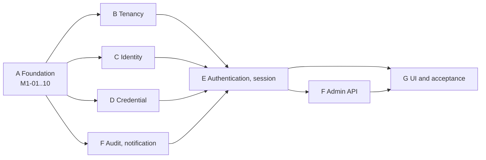

# Epics and development issues

Epics map to roadmap phases. Issues are written in full only for Milestone 1; later epics list their issues at story level and are refined when their phase is planned.

## Epic index

| Epic | Title | Phase | Requirements |
|---|---|---|---|
| E0 | Foundation | 0 | NFR-MNT, NFR-OBS, NFR-SEC-07/08 |
| E1 | Tenancy | 1 | FR-TEN-01, 04, 07 |
| E2 | Identity | 1 | FR-IDN-01 to 06 |
| E3 | Password credential | 1 | FR-CRD-01, 02, 08 |
| E4 | Authentication and session core | 1 | FR-AUT-01 to 04, FR-SES-01, 02 |
| E5 | Audit and notification | 1 | FR-AUD-01, 02, 05, FR-NOT-01 |
| E6 | Admin API and administrative RBAC | 1 | FR-AUZ-11 |
| E7 | Keys | 2 | FR-KEY-01, 02 |
| E8 | Applications and clients | 2 | FR-OAU-22 |
| E9 | OAuth 2.x core | 2 | FR-OAU-01 to 07, 17 |
| E10 | OpenID Connect | 2 | FR-OAU-08, 10, 11, FR-AUT-10 |
| E11 | Consent | 2 | FR-OAU-09 |
| E12 | Admin console v1 | 2 | — |
| E13 | Federation core | 3 | FR-FED-01, 02, 04, 05, 08 |
| E14 | Social connectors | 3 | FR-FED-03 |
| E15 | Identity linking and routing | 3 | FR-FED-06, 07, 09, FR-IDN-07 |
| E16 | MFA and passkeys | 4 | FR-CRD-03 to 05, FR-AUT-05 |
| E17 | Flow engine authoring, step-up, risk | 4 | FR-AUT-06 to 09, 11 |
| E18 | Advanced sessions and account console | 4 | FR-SES-05, 06, FR-IDN-10 |
| E19 | OAuth extensions (PAR, DPoP, device, DCR) | 4 | FR-OAU-12, 13, 15, 19 |
| E20 | Authorization core and native engine | 5 | FR-AUZ-01 to 06, 10 |
| E21 | OPA integration and policy lifecycle | 5 | FR-AUZ-07 to 09 |
| E22 | Workload and agent identity | 5 | FR-WKL-01, 02, FR-OAU-16, 18, FR-CRD-06 |
| E23 | Webhooks and SIEM | 5 | FR-AUD-04 |
| E24 | SAML | 6 | FR-SAM-01 |
| E25 | LDAP and Active Directory | 6 | FR-LDP-01 |
| E26 | SCIM | 6 | FR-SCM-01 |
| E27 | Governance | 7 | FR-TEN-06 |
| E28 | Plugin runtime | 8 | FR-PLG-01 |
| E29 | SDKs, Terraform, developer portal | 8 | FR-WKL-03 |
| E30 | Production readiness | 9 | FR-KEY-03, NFR-OPS, NFR-PRF |

## Milestone 1: Walking skeleton

**Goal**: a user registers, verifies an email, signs in with a password and gets a session in a tenant, with tenant isolation, audit and observability proven. It covers Phase 0 and the thinnest slice of Phase 1. No OAuth, no MFA, no console beyond the login pages.

**Demo script**: create two tenants with the CLI; register a user in each with the same email; verify by email link; sign in; see the session; fail a login five times and get locked out; show that tenant A's session cookie and admin token are rejected at tenant B; show the audit trail and a trace for the login.

Each issue is small, has an acceptance test, and depends only on the issues named.

### Slice A — Foundation (E0)

| ID | Issue | Acceptance | Depends on |
|---|---|---|---|
| M1-01 | Workspace skeleton: `Cargo.toml` with shared dependencies and lints, `rust-toolchain.toml`, `deny.toml`, empty `kernel`, three app stubs | `cargo build`, `clippy -D warnings`, `cargo deny check` pass | — |
| M1-02 | CI pipeline: format, lint, deny, build, test; caching | A pull request runs all stages | M1-01 |
| M1-03 | Architecture test: allowed crate edges and forbidden dependencies from `cargo metadata` | Adding `sqlx` to a context crate fails the test | M1-01 |
| M1-04 | `kernel`: typed UUIDv7 IDs, `TenantContext`, `Clock`, `RandomSource`, `Secret<T>`, `DomainError`, `DomainEvent`, pagination types | Unit tests; `Secret` does not appear in `Debug` output | M1-01 |
| M1-05 | `adapters-postgres` base: pool, `UnitOfWork` with `SET LOCAL app.tenant_id`, migration runner in `hodor-cli`, database roles, testcontainers harness | A transaction opened for tenant A cannot read a test row of tenant B; without the setting, zero rows | M1-04 |
| M1-06 | Schema lint test over the catalog (tenant column, forced RLS, composite keys, allow-list) | A table created without RLS fails the test | M1-05 |
| M1-07 | Outbox: table, write API inside `UnitOfWork`, worker dispatcher with `SKIP LOCKED`, idempotent handler registry | An event is delivered once per handler despite a killed worker; two workers do not double-process | M1-05 |
| M1-08 | `observability`: tracing, OTLP export, JSON logs, request ID and tenant on spans | A request produces one trace with a database span | M1-01 |
| M1-09 | `protocol-http` base: Axum app, tenant resolver middleware (path prefix), error mapping to RFC 9457, security headers, body limits, health endpoints, graceful shutdown | Unknown tenant returns a uniform 404; problem documents validate; SIGTERM drains | M1-04, M1-08 |
| M1-10 | Container image and Compose file: server, worker, PostgreSQL | `docker compose up` gives a healthy server | M1-09 |

### Slice B — Tenancy (E1)

| ID | Issue | Acceptance | Depends on |
|---|---|---|---|
| M1-11 | `tenant` domain: `Tenant`, slug rules, status transitions, typed `TenantSettings` with defaults | Unit and property tests for transitions and slug validation | M1-04 |
| M1-12 | Tenant persistence and platform directory (resolve by slug) | Contract suite on fake and Postgres | M1-05, M1-11 |
| M1-13 | `hodor-cli tenant create/list/suspend` and bootstrap of the `system` tenant | Suspended tenant refuses requests with a distinct error | M1-09, M1-12 |

### Slice C — Identity (E2)

| ID | Issue | Acceptance | Depends on |
|---|---|---|---|
| M1-14 | `identity` domain: `User`, lifecycle, `Identifier` with normalization (email, username), invariants | Property tests: normalization idempotent, uniqueness after normalization | M1-04 |
| M1-15 | User repository (Postgres + fake) with the tenant-isolation contract cases | Same email registers in two tenants; duplicate in one tenant is rejected | M1-05, M1-14 |
| M1-16 | Use cases: create user, add and verify identifier, suspend, reactivate; events to outbox | Each use case emits its event in the same transaction | M1-07, M1-15 |

Groups and organizations are Phase 1 but outside M1.

### Slice D — Password credential (E3)

| ID | Issue | Acceptance | Depends on |
|---|---|---|---|
| M1-17 | `credential` domain: `PasswordCredential`, policy check, history, `PasswordHasher` port | Unit tests with a fake hasher | M1-04 |
| M1-18 | `adapters-crypto`: Argon2id hasher with versioned parameters, bounded blocking pool and semaphore, dummy-hash verification | PHC round trip; rehash on old parameters; saturation returns a typed overload error | M1-17 |
| M1-19 | Credential repository and use cases: set, verify, change password | Contract suite; change revokes history beyond depth | M1-05, M1-17 |

### Slice E — Authentication and session (E4)

| ID | Issue | Acceptance | Depends on |
|---|---|---|---|
| M1-20 | `session` domain and repository: `SsoSession`, idle and absolute timeouts, revoke; hashed ID | Property test: no touch sequence passes absolute expiry | M1-05 |
| M1-21 | `authentication` domain: `AuthFlow` definition and validation, `AuthTransaction`, `Authenticator` SPI, flow interpreter with the built-in `identifier → password` flow | A flow with an unreachable completion fails validation; a transaction cannot skip a required step | M1-04 |
| M1-22 | `PasswordAuthenticator` and `AttemptGuard`: login attempts, per-account and per-IP limits, progressive lockout | Lockout after the configured failures; unknown user and wrong password are indistinguishable in response and within timing tolerance | M1-16, M1-19, M1-21 |
| M1-23 | Complete authentication: create session, rotate ID, emit events | Session exists with `auth_time`, `acr`, `amr`; transaction consumed once under concurrency | M1-20, M1-22 |
| M1-24 | Interaction API: start, get state, submit step, cancel; session cookie; CSRF token | End-to-end login over HTTP; missing CSRF token rejected; cookie flags asserted | M1-09, M1-23 |
| M1-25 | Registration and email verification flow; password recovery flow; verification tokens | Token single use under concurrency; recovery answers identically for unknown email | M1-24, M1-27 |
| M1-26 | Logout and session listing for the current user | Revoked session is rejected on the next request | M1-24 |

### Slice F — Audit, notification, admin (E5, E6)

| ID | Issue | Acceptance | Depends on |
|---|---|---|---|
| M1-27 | `notification`: email port, SMTP adapter, template rendering per locale, delivery through a worker job | Verification email captured by a test SMTP server | M1-07 |
| M1-28 | `audit`: record model, hash chain per tenant, handler subscribed to all events, append-only grants | Chain verifies; `UPDATE` by the app role fails; canary secret never appears | M1-07 |
| M1-29 | Minimal Admin API: users (create, get, list, suspend), sessions (list, revoke), audit (list), guarded by fixed admin roles on the native check | Every route rejects no token, wrong role and another tenant's token; cases generated from the OpenAPI document | M1-16, M1-20, M1-28 |
| M1-30 | Bootstrap admin: CLI creates the first tenant administrator and issues a short-lived admin API token | Token works only in its tenant | M1-13, M1-29 |

The admin token in M1-30 is a stopgap (an opaque, hashed API key with an admin role); it is replaced by OAuth access tokens in Phase 2.

### Slice G — Hosted UI and acceptance

| ID | Issue | Acceptance | Depends on |
|---|---|---|---|
| M1-31 | `auth-ui` scaffold served by the server: login, registration, recovery pages driven by the Interaction API; CSP | Playwright: register, verify, login, logout; no CSP violations; keyboard-only pass | M1-24, M1-25 |
| M1-32 | Cross-tenant security suite: request replay across tenants, cookie and token cross-use | Suite passes and runs in CI | M1-29, M1-31 |
| M1-33 | Milestone demo script and operator quick-start document | The demo runs from a clean checkout following the document | all |

### Order of work

Slices B, C, D and the first half of F are independent after A and can be done in parallel.

### Explicitly not in Milestone 1

OAuth and OIDC, key management, groups and organizations, MFA, federation, Redis, OPA, admin and account consoles, custom domains, flow editing.

## Later epics at story level

**E7 Keys** — key set and version model with states; local provider with envelope encryption; scheduled rotation job with advisory lock; JWKS publication with overlap; revoke; admin API.

**E8 Applications and clients** — application and client aggregates; exact redirect URI registry; secrets (create once, hash, rotate, expire); `private_key_jwt` keys; resource servers and scopes; token policy.

**E9 OAuth 2.x core** — authorization request validation; interaction handoff and resume; authorization code issue and redeem; PKCE; client authentication methods; token issuer and JWT access tokens; refresh rotation and reuse detection with retry window; client credentials; revocation; introspection; AS metadata; resource indicators; rate limits.

**E10 OpenID Connect** — ID Token; claims by scope; UserInfo; `nonce`, `prompt`, `max_age`, `acr_values`, `login_hint`, `ui_locales`; pairwise subjects; Discovery; RP-initiated logout; back-channel logout job; conformance suite in CI.

**E11 Consent** — consent aggregate and history; consent interaction step; first-party skip; revocation cascades to grants.

**E12 Admin console v1** — BFF; shell, navigation, RBAC-aware UI; users; applications and clients; keys; audit.

**E13 Federation core** — `adapters-http` with SSRF guard; provider aggregate and encrypted secrets; OIDC RP (discovery, JWKS cache, validation); OAuth2 connector; federation state; claim mapping; JIT; `ExternalIdpAuthenticator`.

**E14 Social connectors** — Google; Microsoft (issuer templating); GitHub (email API); Apple (form post, client secret JWT); then Facebook, GitLab, LinkedIn.

**E15 Linking and routing** — external identity links; link from account; collision flow; automatic linking policy; unlink rules; routing rules and home realm discovery; provider deactivation; pre-hijacking protection.

**E16 MFA and passkeys** — TOTP; WebAuthn registration and assertion; passkey-first login; recovery codes; email and SMS OTP; magic link; enrollment flows.

**E17 Flow authoring, step-up, risk** — flow API with versions; conditions; validation and simulation; step-up by `acr`; risk signals; trusted devices; adaptive MFA policy.

**E18 Sessions and account console** — concurrent limits; device metadata; login history; account console pages; data export; account deletion.

**E19 OAuth extensions** — PAR; DPoP with nonce; device authorization grant; dynamic client registration.

**E20 Authorization core and native engine** — request and decision model; engine registry and bindings; subject attribute source; roles, hierarchy, assignments with scopes; ACL; ABAC conditions; decision log; Authorization API; explanation filtering; ReBAC tuples and bounded check (stretch).

**E21 OPA integration** — adapter with timeout, retry, breaker; bundle builder and signing; bundle, logs and status endpoints; policy and version model; validate and test job; simulation and replay; publish, activation tracking, rollback; capabilities file; dedicated-instance provisioning contract; console pages.

**E22 Workload and agent identity** — service account and agent principals; API keys; token exchange with `act` chain and policy; JWT bearer grant; rich authorization requests; agent audit view.

**E23 Webhooks and SIEM** — endpoints and subscriptions; signed delivery with retry and dead letter; SIEM export formats; security alerts.

**E24 SAML** — spike (ADR-0014); attack corpus; IdP: metadata, SSO, SLO; SP: metadata, ACS, SLO; attribute mapping; certificate management; external review.

**E25 LDAP and AD** — connection and bind over LDAPS; authentication; user and group sync jobs; attribute mapping; AD specifics.

**E26 SCIM** — Users and Groups CRUD; PATCH; filter parser; pagination; bulk; schema discovery; enterprise extension; deprovisioning policy.

**E27 Governance** — fine-grained admin permissions; delegated administration per organization; access reviews and certification campaigns; approval workflows; quotas; security monitoring.

**E28 Plugin runtime** — WIT worlds; Wasmtime host with limits; manifest, signature and approval; host functions; extension-point bindings; plugin admin API; example plugins.

**E29 SDKs, Terraform, portal** — client SDKs (verification and authorization helpers); Terraform provider over the Admin API; developer portal and docs; MCP authorization profile.

**E30 Production readiness** — cloud KMS and Vault providers; Helm chart GA; HA and DR drills; load and chaos campaigns; hardening review; external pentest; conformance publication.
