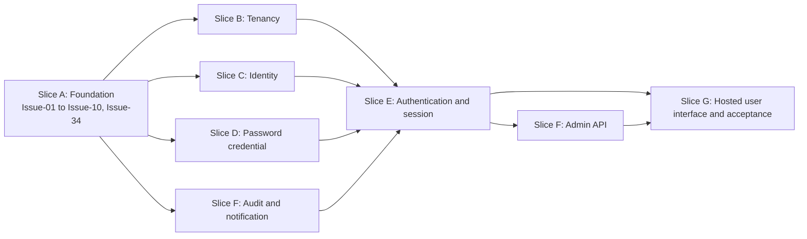

# Epics and development issues

Epics map to roadmap phases. Issues are written in full only for Milestone 1; later epics list their issues at story level and are refined when their phase is planned.

## Epic index

| Epic | Title | Phase | Requirements |
|---|---|---|---|
| Epic 0 | Foundation | 0 | Requirement-Maintainability, Requirement-Observability, Requirement-Security-07/08 |
| Epic 1 | Tenancy | 1 | Requirement-Tenancy-01, 04, 07 |
| Epic 2 | Identity | 1 | Requirement-Identity-01 to 06 |
| Epic 3 | Password credential | 1 | Requirement-Credential-01, 02, 08 |
| Epic 4 | Authentication and session core | 1 | Requirement-Authentication-01 to 04, Requirement-Session-01, 02 |
| Epic 5 | Audit and notification | 1 | Requirement-Audit-01, 02, 05, Requirement-Notification-01 |
| Epic 6 | Admin API and administrative role-based access control | 1 | Requirement-Authorization-11 |
| Epic 7 | Keys | 2 | Requirement-Key-01, 02 |
| Epic 8 | Applications and clients | 2 | Requirement-OAuth-22 |
| Epic 9 | OAuth 2.x core | 2 | Requirement-OAuth-01 to 07, 17 |
| Epic 10 | OpenID Connect | 2 | Requirement-OAuth-08, 10, 11, Requirement-Authentication-10 |
| Epic 11 | Consent | 2 | Requirement-OAuth-09 |
| Epic 12 | Admin console v1 | 2 | — |
| Epic 13 | Federation core | 3 | Requirement-Federation-01, 02, 04, 05, 08 |
| Epic 14 | Social connectors | 3 | Requirement-Federation-03 |
| Epic 15 | Identity linking and routing | 3 | Requirement-Federation-06, 07, 09, Requirement-Identity-07 |
| Epic 16 | Multi-factor authentication and passkeys | 4 | Requirement-Credential-03 to 05, Requirement-Authentication-05 |
| Epic 17 | Flow engine authoring, step-up, risk | 4 | Requirement-Authentication-06 to 09, 11 |
| Epic 18 | Advanced sessions and account console | 4 | Requirement-Session-05, 06, Requirement-Identity-10 |
| Epic 19 | OAuth extensions (pushed authorization requests, DPoP, device, dynamic client registration) | 4 | Requirement-OAuth-12, 13, 15, 19 |
| Epic 20 | Authorization core and native engine | 5 | Requirement-Authorization-01 to 06, 10 |
| Epic 21 | Open Policy Agent integration and policy lifecycle | 5 | Requirement-Authorization-07 to 09 |
| Epic 22 | Workload and agent identity | 5 | Requirement-Workload-01, 02, Requirement-OAuth-16, 18, Requirement-Credential-06 |
| Epic 23 | Webhooks and security event management system | 5 | Requirement-Audit-04 |
| Epic 24 | SAML | 6 | Requirement-SAML-01 |
| Epic 25 | LDAP and Active Directory | 6 | Requirement-LDAP-01 |
| Epic 26 | SCIM | 6 | Requirement-SCIM-01 |
| Epic 27 | Governance | 7 | Requirement-Tenancy-06 |
| Epic 28 | Plugin runtime | 8 | Requirement-Plugin-01 |
| Epic 29 | Software development kits, Terraform, developer portal | 8 | Requirement-Workload-03 |
| Epic 30 | Production readiness | 9 | Requirement-Key-03, Requirement-Operations, Requirement-Performance |

## Milestone 1: Walking skeleton

**Goal**: a user registers, verifies an email, signs in with a password and gets a session in a tenant, with tenant isolation, audit and observability proven. It covers Phase 0 and the thinnest slice of Phase 1. No OAuth, no multi-factor authentication, no console beyond the login pages.

**Demo script**: create two tenants with the command-line tool; register a user in each with the same email; verify by email link; sign in; see the session; fail a login five times and get locked out; show that tenant A's session cookie and admin token are rejected at tenant B; show the audit trail and a trace for the login.

Each issue is small, has an acceptance test, and depends only on the issues named.

### Slice A — Foundation (Epic 0)

Issue-34 was added after planning, when wiring the worker turned out to be a piece of work of its own; it keeps its number out of sequence.

| Identifier | Issue | Acceptance | Depends on |
|---|---|---|---|
| Issue-01 | Workspace skeleton: `Cargo.toml` with shared dependencies and lints, `rust-toolchain.toml`, `deny.toml`, empty `kernel`, three app stubs | `cargo build`, `clippy -D warnings`, `cargo deny check` pass | — |
| Issue-02 | Continuous integration pipeline: format, lint, deny, build, test; caching | A pull request runs all stages | Issue-01 |
| Issue-03 | Architecture test: allowed crate edges and forbidden dependencies from `cargo metadata` | Adding `sqlx` to a context crate fails the test | Issue-01 |
| Issue-04 | `kernel`: typed UUIDv7 identifiers, `TenantContext`, `Clock`, `RandomSource`, `Secret<T>`, `DomainError`, `DomainEvent`, pagination types | Unit tests; `Secret` does not appear in `Debug` output | Issue-01 |
| Issue-05 | `adapters-postgres` base: pool, `UnitOfWork` with `SET LOCAL app.tenant_id`, migration runner in `hodor-cli`, database roles, testcontainers harness | A transaction opened for tenant A cannot read a test row of tenant B; without the setting, zero rows | Issue-04 |
| Issue-06 | Schema lint test over the catalog (tenant column, forced row-level security, composite keys, allow-list) | A table created without row-level security fails the test | Issue-05 |
| Issue-07 | Outbox: table, write API inside `UnitOfWork`, worker dispatcher with `SKIP LOCKED`, idempotent handler registry | An event is delivered once per handler despite a killed worker; two workers do not double-process | Issue-05 |
| Issue-08 | `observability`: tracing, OTLP export, JSON logs, request identifier and tenant on spans | A request produces one trace with a database span | Issue-01 |
| Issue-09 | `protocol-http` base: Axum app, tenant resolver middleware (path prefix), error mapping to RFC 9457, security headers, body limits, health endpoints, graceful shutdown | Unknown tenant returns a uniform 404; problem documents validate; SIGTERM drains | Issue-04, Issue-08 |
| Issue-10 | Container image and Compose file: server, PostgreSQL, migrations, VictoriaMetrics | `docker compose up` gives a healthy server | Issue-09 |
| Issue-34 | Run the outbox dispatcher in `hodor-worker`: configuration, telemetry, polling loop, health endpoints, graceful stop; added to the Compose stack | An event written to the outbox is marked delivered by a running worker; SIGTERM stops it after the current batch with exit code 0 | Issue-07, Issue-09, Issue-10 |

### Slice B — Tenancy (Epic 1)

| Identifier | Issue | Acceptance | Depends on |
|---|---|---|---|
| Issue-11 | `tenant` domain: `Tenant`, slug rules, status transitions, typed `TenantSettings` with defaults | Unit and property tests for transitions and slug validation | Issue-04 |
| Issue-12 | Tenant persistence and platform directory (resolve by slug) | Contract suite on fake and Postgres | Issue-05, Issue-11 |
| Issue-13 | `hodor-cli tenant` commands (create, create-system, list, suspend, reactivate) and the server's tenant resolver over the directory | A created tenant answers on its path; a suspended tenant refuses requests with a distinct error | Issue-09, Issue-12 |

### Slice C — Identity (Epic 2)

| Identifier | Issue | Acceptance | Depends on |
|---|---|---|---|
| Issue-14 | `identity` domain: `User`, lifecycle, `Identifier` with normalization (email, username), invariants | Property tests: normalization idempotent, uniqueness after normalization | Issue-04 |
| Issue-15 | User repository (Postgres + fake) with the tenant-isolation contract cases | Same email registers in two tenants; duplicate in one tenant is rejected | Issue-05, Issue-14 |
| Issue-16 | Use cases: create user, add and verify identifier, suspend, reactivate; events to outbox | Each use case emits its event in the same transaction | Issue-07, Issue-15 |

Groups and organizations are Phase 1 but outside Milestone 1.

### Slice D — Password credential (Epic 3)

| Identifier | Issue | Acceptance | Depends on |
|---|---|---|---|
| Issue-17 | `credential` domain: `PasswordCredential`, policy check, history, `PasswordHasher` port | Unit tests with a fake hasher | Issue-04 |
| Issue-18 | `adapters-crypto`: Argon2id hasher with versioned parameters, bounded blocking pool and semaphore, dummy-hash verification | PHC round pending authorization; rehash on old parameters; saturation returns a typed overload error | Issue-17 |
| Issue-19 | Credential repository and use cases: set, verify, change password | Contract suite; change revokes history beyond depth | Issue-05, Issue-17 |

### Slice E — Authentication and session (Epic 4)

| Identifier | Issue | Acceptance | Depends on |
|---|---|---|---|
| Issue-20 | `session` domain and repository: `SsoSession`, idle and absolute timeouts, revoke; hashed identifier | Property test: no touch sequence passes absolute expiry | Issue-05 |
| Issue-21 | `authentication` domain: `AuthFlow` definition and validation, `AuthTransaction`, `Authenticator` service provider interface, flow interpreter with the built-in `identifier → password` flow | A flow with an unreachable completion fails validation; a transaction cannot skip a required step | Issue-04 |
| Issue-22 | `PasswordAuthenticator` and `AttemptGuard`: login attempts, per-account and per-IP limits, progressive lockout | Lockout after the configured failures; unknown user and wrong password are indistinguishable in response and within timing tolerance | Issue-16, Issue-19, Issue-21 |
| Issue-23 | Complete authentication: create session, rotate identifier, emit events | Session exists with `auth_time`, `acr`, `amr`; transaction consumed once under concurrency | Issue-20, Issue-22 |
| Issue-24 | Interaction API: start, get state, submit step, cancel; session cookie; CSRF token | End-to-end login over HTTP; missing CSRF token rejected; cookie flags asserted | Issue-09, Issue-23 |
| Issue-25 | Registration and email verification flow; password recovery flow; verification tokens | Token single use under concurrency; recovery answers identically for unknown email | Issue-24, Issue-27 |
| Issue-26 | Logout and session listing for the current user | Revoked session is rejected on the next request | Issue-24 |

### Slice F — Audit, notification, admin (Epic 5, Epic 6)

| Identifier | Issue | Acceptance | Depends on |
|---|---|---|---|
| Issue-27 | `notification`: email port, SMTP adapter, template rendering per locale, delivery through a worker job | Verification email captured by a test SMTP server | Issue-07 |
| Issue-28 | `audit`: record model, hash chain per tenant, handler subscribed to all events, append-only grants | Chain verifies; `UPDATE` by the app role fails; canary secret never appears | Issue-07 |
| Issue-29 | Minimal Admin API: users (create, get, list, suspend), sessions (list, revoke), audit (list), guarded by fixed admin roles on the native check | Every route rejects no token, wrong role and another tenant's token; cases generated from the OpenAPI document | Issue-16, Issue-20, Issue-28 |
| Issue-30 | Bootstrap admin: Command-line tool creates the first tenant administrator and issues a short-lived admin API token | Token works only in its tenant | Issue-13, Issue-29 |

The admin token in Issue-30 is a stopgap (an opaque, hashed API key with an admin role); it is replaced by OAuth access tokens in Phase 2.

### Slice G — Hosted user interface and acceptance

| Identifier | Issue | Acceptance | Depends on |
|---|---|---|---|
| Issue-31 | `auth-ui` scaffold served by the server: login, registration, recovery pages driven by the Interaction API; Content Security Policy | Playwright: register, verify, login, logout; no Content Security Policy violations; keyboard-only pass | Issue-24, Issue-25 |
| Issue-32 | Cross-tenant security suite: request replay across tenants, cookie and token cross-use | Suite passes and runs in continuous integration | Issue-29, Issue-31 |
| Issue-33 | Milestone demo script and operator quick-start document | The demo runs from a clean checkout following the document | all |

### Order of work

Slices B, C, D and the first half of F are independent after A and can be done in parallel.

### Explicitly not in Milestone 1

OAuth and OpenID Connect, key management, groups and organizations, multi-factor authentication, federation, Redis, Open Policy Agent, admin and account consoles, custom domains, flow editing.

## Milestone 2: Signing in with external identities

**Goal**: a person signs in to a tenant with an account they already have somewhere else — a social login or any OpenID Connect provider, an LDAP directory, or a SAML identity provider — and ends with the same Hodor session as with a password. No account can be taken over by way of an external identity.

Built before Phase 2 at the project owner's request; [Decision 0017](../decisions/0017-external-identities-before-oauth.md) says what that pulls forward and what stays out.

**Demo script**: add an OpenID Connect provider to a tenant with the command-line tool; sign in through it and be created on first sign-in; sign in again and be recognized; show that an external identity with the email address of an existing local account is not let into that account; show that the provider of one tenant does nothing in another; sign in through an LDAP directory; sign in through a SAML identity provider; show a tampered SAML response refused.

### Slice H — What external identities stand on

| Identifier | Issue | Acceptance | Depends on |
|---|---|---|---|
| Issue-35 | Secrets at rest: a `SecretBox` port in `kernel`; an authenticated-encryption adapter keyed from configuration, every ciphertext bound to its tenant and purpose and carrying the identifier of its key | A ciphertext opens only under its own tenant and purpose; a second configured key opens old ciphertexts while new ones use the first; a flipped bit is refused | — |
| Issue-36 | Outbound HTTP: an `HttpClient` port in `kernel` and `adapters-http`, the one guarded implementation: HTTPS only, the resolved address checked against private, loopback, link-local and metadata ranges and then used for the connection, no redirects, limits on size and time | Requests to each forbidden range are refused, including through a host name that resolves there and through a redirect; an oversized or slow answer is cut | — |
| Issue-37 | A sign-in completed by one external step: a flow may offer an alternative to its first steps; an authenticator may identify and prove in one step | The built-in flow still passes its suite; a flow with an external alternative completes with either path and never with half of each | — |

### Slice I — OpenID Connect and the social logins

| Identifier | Issue | Acceptance | Depends on |
|---|---|---|---|
| Issue-38 | `federation` context: the identity provider with its encrypted secret, the link between a user and an external identity, storage under row-level security, contract suite | A secret is never read back; a link is found by provider and external subject only; tenant isolation cases pass | Issue-35 |
| Issue-39 | OpenID Connect relying party: discovery, key set with caching and refresh on an unknown key, ID token validation (signature, issuer, audience, authorized party, expiry, nonce), PKCE | Every invalid token of the test corpus is refused for the right reason, against a provider run by the test | Issue-36, Issue-38 |
| Issue-40 | Federated sign-in over HTTP: start and callback routes, the state of one pending authorization bound to the browser and the sign-in, creation on first sign-in, the rules against takeover | A whole sign-in against the test provider; a replayed or foreign callback is refused; an external identity never enters an existing account by its email address alone | Issue-37, Issue-39 |
| Issue-41 | Managing providers: administration interface and command-line tool | A provider is created, changed, disabled and listed; its secret is write-only | Issue-38 |
| Issue-42 | The pages: the providers a tenant offers on the sign-in page; the way back from a provider | Browser tests against a provider in the Compose stack, with the policy, accessibility and keyboard checks | Issue-40, Issue-41 |
| Issue-43 | Connectors: Google and Microsoft Entra ID for one organization (OpenID Connect, with a setting for a provider that does not say whether it vouches for an address), GitHub (its own kind, with the email interface). Apple moved out: it needs a private key Hodor signs with, which comes with the key domain of Phase 2 | Each connector's quirks are tested against answers shaped like the provider's; none is verified against the real provider in continuous integration | Issue-40 |

### Slice J — LDAP

| Identifier | Issue | Acceptance | Depends on |
|---|---|---|---|
| Issue-44 | LDAP sign-in: a directory as an identity provider; search then bind over LDAPS, attribute mapping, creation on first sign-in, lockout as for passwords | Sign-in against a directory run by the test; a wrong password, an unknown person and an empty password are refused alike; a filter cannot be injected through the identifier | Issue-38, Issue-40 |
| Issue-45 | LDAP in the pages and in the administration interface | Browser test against a directory in the Compose stack | Issue-44 |

### Slice K — SAML service provider

| Identifier | Issue | Acceptance | Depends on |
|---|---|---|---|
| Issue-46 | The spike of [Decision 0014](../decisions/0014-saml-deferred-with-spike.md): compare the ways to verify XML signatures, and decide | A decision record with the comparison and the choice | — |
| Issue-47 | The SAML attack corpus and the interoperability samples, before the feature code | The corpus exists as tests that fail for lack of an implementation | Issue-46 |
| Issue-48 | SAML service provider: metadata, the request, the assertion consumer, attribute mapping | The whole corpus is refused, each for the right reason; samples from common identity providers are accepted | Issue-40, Issue-47 |
| Issue-49 | SAML in the pages, the administration interface and the demonstration | Browser test against an identity provider in the Compose stack; the demonstration of the milestone passes | Issue-42, Issue-45, Issue-48 |

### Explicitly not in Milestone 2

Hodor as a SAML identity provider, synchronizing users and groups from LDAP, SCIM, routing by email domain, linking and unlinking from an account page, mapping external groups to roles, single logout, and everything of Phase 2.

## Milestone 3: Applications ask Hodor who someone is

**Goal**: an application registered in a tenant signs a person in through Hodor with the authorization code and PKCE, receives an ID token and an access token signed with the tenant's key, refreshes it, and can have it revoked; a service gets a token with its own credentials. Hodor passes the Basic OpenID Provider and Config OpenID Provider profiles of the OpenID conformance suite. Phase 2 of the roadmap, without pairwise subjects, claim mappers and back-channel logout ([Decision 0023](../decisions/0023-what-0.2.0-holds.md)).

**Demo script**: register an application and a client in a tenant with the command-line tool; sign in from an example application and see the consent page; read the ID token and call UserInfo; refresh, then present the old refresh token again and see the whole family revoked; get a token with client credentials; revoke an access token and see introspection say so; rotate the tenant's key and see the old key stay in the key set until its tokens expire; show a code, a token and a client of one tenant refused by another.

### Slice L — Keys (Epic 7)

| Identifier | Issue | Acceptance | Depends on |
|---|---|---|---|
| Issue-50 | `keys` context: key sets per tenant and use, versions with their states, the `KeyProvider` port and the local provider with envelope encryption; storage under row-level security and a contract suite | A version moves only along its states; one version is active per algorithm; a private key is never read back in the clear; tenant isolation cases pass | — |
| Issue-51 | Rotation and publication: a scheduled rotation in the worker under an advisory lock, the key set published with the overlap of retiring versions, revocation; the command-line tool and the administration interface | Two workers rotate once; a retiring version stays published until the longest token it signed has expired; a revoked version leaves at once | Issue-50 |
| Issue-52 | The secrets of Milestone 2 under managed keys: the `SecretBox` keyed from configuration gives way to the key domain, and existing ciphertexts are moved | Every provider secret opens after the move; a ciphertext of the old key is refused once the move is done | Issue-50 |

### Slice M — Applications and clients (Epic 8)

| Identifier | Issue | Acceptance | Depends on |
|---|---|---|---|
| Issue-53 | `oauth` context, its first part: applications, clients with their types, exact redirect addresses, allowed grants and authentication method, secrets shown once and kept as hashes with rotation and expiry, keys for `private_key_jwt`, resource servers with their scopes, the token policy | A public client has no secret and cannot be given one; a redirect address is matched by exact equality only; tenant isolation cases pass | — |
| Issue-54 | Managing applications: the administration interface, the command-line tool and the console pages for applications, clients and resource servers | A client is created, changed, its secret rotated and disabled; a secret is shown once and never again | Issue-53 |

### Slice N — OAuth 2.x core (Epic 9)

| Identifier | Issue | Acceptance | Depends on |
|---|---|---|---|
| Issue-55 | The authorization endpoint: the request checked before anything is shown, PKCE with S256 required, the hand-off to the sign-in and the return to the request, the authorization code kept as a hash and good for one use | Every malformed request of a test corpus is refused for its own reason, and only a request whose redirect address is registered is answered there; a second use of a code revokes the grant | Issue-53 |
| Issue-56 | The token endpoint: the four client authentication methods, the code redeemed with its verifier, JWT access tokens per RFC 9068 signed with the tenant's key, the audience restricted by resource indicators | A wrong verifier, a code of another client and a reused `private_key_jwt` assertion are refused; a token carries only the audiences asked for and allowed | Issue-51, Issue-55 |
| Issue-57 | Refresh tokens and client credentials: rotation on every use, the family revoked on reuse with a short window for a retried request, the client credentials grant | A rotated token presented again revokes the family; the same request retried inside the window gets the same answer | Issue-56 |
| Issue-58 | Revocation, introspection and metadata: RFC 7009 and RFC 7662 with the deny-list of `jti`, the authorization server metadata, limits on the endpoints | A revoked access token is reported inactive; a client cannot introspect or revoke another client's token; the metadata names only what is built | Issue-57 |

### Slice O — OpenID Connect (Epic 10)

| Identifier | Issue | Acceptance | Depends on |
|---|---|---|---|
| Issue-59 | The OpenID Provider: the ID token, claims by scope, UserInfo, `nonce`, `prompt`, `max_age`, `login_hint`, `ui_locales`, `acr` and `amr` from the session, Discovery | An ID token is checked by an independent library; `prompt=none` without a session answers `login_required` | Issue-56 |
| Issue-60 | Logout initiated by the relying party: the end-session endpoint with `id_token_hint` and registered addresses to return to | The session ends; an unregistered return address is refused | Issue-59 |
| Issue-61 | The OpenID conformance suite in continuous integration: Basic OpenID Provider and Config OpenID Provider | Both profiles pass against the image on every pull request | Issue-58, Issue-60 |

### Slice P — Consent and acceptance (Epic 11)

| Identifier | Issue | Acceptance | Depends on |
|---|---|---|---|
| Issue-62 | Consent: what a person agreed to per client and scope, with its history and expiry; revoking it revokes the grants; first-party clients skip it; the consent page in the hosted pages | A scope not agreed to is asked for; revoking a consent revokes its refresh tokens; browser tests with the policy, accessibility and keyboard checks | Issue-55, Issue-57 |
| Issue-63 | Acceptance: the cross-tenant suite extended to codes, tokens, clients and keys; the demonstration of the milestone with an example application | The suite and the demonstration pass in continuous integration against the image | all |

### Explicitly not in Milestone 3

Pairwise subject identifiers, claim mappers per client, back-channel and front-channel logout, opaque access tokens by default, pushed authorization requests, DPoP, the device grant, dynamic client registration, token exchange, Apple as an identity provider, signing in to the admin console with OpenID Connect.

## Milestone 4: Strong authentication

**Goal**: a person proves who they are with more than a password: a code from an authenticator application, a security key, or a passkey alone. A tenant can require a second factor, and an application can ask for a higher assurance in the middle of a session, which asks only for what is missing. Part of Phase 4 of the roadmap ([Decision 0023](../decisions/0023-what-0.2.0-holds.md)).

**Demo script**: enroll an authenticator application and get recovery codes; make the tenant require a second factor and sign in with the code; use a recovery code once and see it refused the second time; register a passkey and sign in with it alone; from the example application of Milestone 3, ask for a higher `acr` during a session and give only the second factor; show the `amr` of each token; show that an administrator can remove a person's factors and that it is in the audit log.

### Slice Q — Factors

| Identifier | Issue | Acceptance | Depends on |
|---|---|---|---|
| Issue-64 | Conditional and optional steps in the flow engine; a tenant's policy that requires a second factor | The built-in flow still passes its suite; with the policy on, no sign-in completes with one factor, and with it off nothing changes | — |
| Issue-65 | TOTP: enrollment with its secret sealed at rest, verification with a window, a code used once refused again, attempts counted with the lockout | A code outside the window, a used code and a code of another person are refused; the secret is never read back | Issue-64 |
| Issue-66 | Recovery codes: generated at enrollment, kept as hashes, each good for one use, generated again on request | A used code is refused even when presented many times at once; generating again invalidates the old set | Issue-65 |
| Issue-67 | WebAuthn as a second factor: registration and assertion, the signature counter and the backup flags, no attestation required; a decision record on the library | A cloned authenticator is caught by its counter; an assertion for another origin or another challenge is refused | Issue-64 |
| Issue-68 | Passkeys: discoverable credentials as the first and only step, sign-in without typing an identifier | A person signs in with a passkey alone in a browser test with a virtual authenticator; a passkey of another tenant is not offered and not accepted | Issue-67 |

### Slice R — Step-up and the person's own factors

| Identifier | Issue | Acceptance | Depends on |
|---|---|---|---|
| Issue-69 | Assurance levels: the tenant's `acr` values mapped to methods, the `amr` kept on the session; step-up from `acr_values` and `max_age`, which completes only the missing steps | A request for a higher `acr` asks for the second factor only; a token never claims an `acr` the session did not reach | Issue-59, Issue-65, Issue-67 |
| Issue-70 | Managing factors: the pages where a person adds and removes their authenticator application, passkeys and recovery codes after proving themselves again; an administrator removes a person's factors through the administration interface and the console | Removing the last factor under a policy that requires one is refused; every change is in the audit log | Issue-66, Issue-68 |
| Issue-71 | Acceptance: browser tests with a virtual authenticator, the cross-tenant suite extended to factors, the demonstration of the milestone | They pass in continuous integration against the image | all |

### Explicitly not in Milestone 4

HOTP, magic links and one-time passwords by email or text message, risk signals, trusted devices, the flow editing interface with versions and simulation, session limits, the account console beyond factors, pushed authorization requests, DPoP, the device grant, dynamic client registration.

## Milestone 5: The authorization engine

**Goal**: an application asks Hodor whether a subject may do something to a resource and gets an answer it can trust: from Hodor's native engine with roles and conditions, or from Open Policy Agent with the tenant's policies, published, simulated and rolled back through Hodor. A failing engine never answers allow. Part of Phase 5 of the roadmap ([Decision 0023](../decisions/0023-what-0.2.0-holds.md)).

**Demo script**: define a resource server's permissions and roles, assign a role to a person and to a client; evaluate from the example application with a token and get allow and deny with their reasons; add a condition and see it change the answer; bind another resource server to Open Policy Agent, publish a policy, simulate a draft against past decisions, publish it, roll it back; stop Open Policy Agent and see deny with an indeterminate reason; read the decision log; show that a token of one tenant cannot evaluate in another.

### Slice S — The native engine

| Identifier | Issue | Acceptance | Depends on |
|---|---|---|---|
| Issue-72 | The engine contract of [Decision 0009](../decisions/0009-authorization-engine-contract.md): the request and the decision, the engine registry and the bindings per resource server, the source of the subject's attributes, indeterminate treated as deny | A request names no tenant of its own; asserted attributes are kept apart from resolved ones; an unbound resource server answers deny | Issue-53 |
| Issue-73 | Native role-based access control: permissions per resource server, roles with hierarchy and composites, assignments to users and clients scoped to the tenant or an application, the closure cached and dropped on change | A role cycle is refused; a revoked assignment stops allowing on the next decision; the fixed roles of the administration interface move onto it unchanged | Issue-72 |
| Issue-74 | Attribute-based access control conditions in Common Expression Language: a spike to choose the interpreter, conditions compiled when published, bounded cost, no input or output | A condition over subject, resource and environment changes the answer; a condition that is too costly is refused when published | Issue-73 |
| Issue-75 | The Authorization API: `evaluate`, `batch` and `simulate`, called with access tokens holding `authz:evaluate` and `authz:simulate`; the explanation only with `authz:explain` | A batch returns one result per request; a caller without `authz:explain` gets the reason code only; a token of another tenant is refused | Issue-58, Issue-74 |
| Issue-76 | The decision log: one format for both engines, per tenant full, sampled or deny only, masking by path, retention | A masked attribute is never stored; a simulated decision is never logged as real | Issue-75 |

### Slice T — Open Policy Agent

| Identifier | Issue | Acceptance | Depends on |
|---|---|---|---|
| Issue-77 | `authorization-opa`: the adapter over the Data API, the decision path from the tenant and the binding, bounded time and retries, a circuit breaker, fail closed by default and fail open only per action and recorded; the capabilities file | Every failure of Open Policy Agent, slow, down, wrong answer, is a deny with an indeterminate reason; the path cannot be steered from the request | Issue-72 |
| Issue-78 | Bundles: the builder and its signature, the bundle endpoint with a credential per instance, the status and decision log endpoints | An instance pulls only its own tenant's bundle; an unsigned or changed bundle is refused by Open Policy Agent | Issue-77 |
| Issue-79 | The policy lifecycle: policies and immutable versions, draft, validation and tests with the `opa` binary in a sandboxed worker job, simulation against recorded decisions, publication, tracking of what each instance runs, rollback | A policy that does not compile or fails its tests is not published; a rollback is what instances run after their next pull | Issue-78 |
| Issue-80 | Managing authorization and acceptance: the administration interface, the command-line tool and the console pages for permissions, roles, assignments, bindings, policies and instances; the cross-tenant suite extended; the demonstration of the milestone | The suite and the demonstration pass in continuous integration against the image, with Open Policy Agent in the stack | all |

### Explicitly not in Milestone 5

Per-resource access control lists, relationship-based access control, assigning roles to groups or organizations, Hodor starting Open Policy Agent instances for tenants, token exchange, service accounts, agents, API keys, webhooks.

### After Milestone 5

0.2.0 is released when Milestone 5 is done, following [the release rules](../development/conventions.md#releases).

## Milestone 6: Hodor runs behind a load balancer and cleans up after itself

**Goal**: Hodor is deployed behind a load balancer and every client still has a limit of its own. Expired rows of every kind are removed without anyone asking. The image and the chart of a release are published, built by actions pinned to a commit. The first part of 0.3.0 ([Decision 0027](../decisions/0027-what-0.3.0-holds.md)).

**Demo script**: put a web server in front of the development stack, trusted as a proxy, and send requests through it as two clients behind a load balancer would. Ask for registrations from one until it is limited, and see the other still answered. Write a false address at the start of the limited client's header and see it still limited. Start a second worker that keeps nothing, sign out, and see the ended session and the delivered messages removed, with the audit chain still intact. At the tag of 0.3.0, pull the published image, check its signature, and install the published chart on a kind cluster.

### Slice U — Behind a load balancer

| Identifier | Issue | Acceptance | Depends on |
|---|---|---|---|
| Issue-81 | The forwarded client address: trusted proxies named by address ranges, the client address read from `Forwarded` or `X-Forwarded-For` only when the connection comes from one of them, taking the nearest address that is not a trusted proxy; used by the attempt guard, the audit log, sessions and every limit; both installation packages configured for the web server in front of Hodor | A forwarded header from an untrusted peer is ignored; behind a trusted proxy two clients have separate lockouts; a chain of trusted proxies yields the first untrusted address; an unreadable header falls back to the connection's address and is counted | — |
| Issue-82 | One cleanup job in the worker for every kind of expired row: sessions, verification tokens, messages, pending WebAuthn registrations, authorization requests, codes and revoked grants, refresh token families, remembered client assertions, access token records, withdrawn and expired consents; a retention per kind, in batches, the rows of a pass locked so that two workers skip each other's, with a metric per kind | A row past its retention is removed and one within it is kept; two workers remove each row once; no audit record and no history row of consents is removed; a tenant's rows are removed inside that tenant | — |

### Slice V — What is shipped

| Identifier | Issue | Acceptance | Depends on |
|---|---|---|---|
| Issue-83 | Continuous integration actions pinned by commit, kept current by Dependabot; the licenses of the pages' dependencies checked against an allowed list, as `cargo deny` checks those of the crates (Threat-General-15) | Continuous integration fails on an action named by tag and on a page dependency under a license that is not allowed | — |
| Issue-84 | The image and the chart published with each release: the image to the GitHub container registry with its software bill of materials and a signature, the chart as an OCI artifact; the installation pages install from them | A release tag publishes both; installing from them on a kind cluster passes the demonstration; the signatures check against the identity of the release workflow | Issue-83 |
| Issue-85 | Acceptance: the demonstration of the milestone, through a web server in front of the development stack; the published image and chart tried by hand at the tag of 0.3.0 | The demonstration passes in continuous integration against the image; the published image's signature checks and the chart installs on kind | all |

### Explicitly not in Milestone 6

A limit on sign-ins started from one network (its cause was fixed where SAML responses arrive), the export of the audit chain's head, traces of database calls, high availability.

## Milestone 7: Groups, organizations and SCIM

**Goal**: people of a tenant are gathered in groups and organizations, and roles are given to a group or scoped to an organization. A token carries the organization a person signed in for. A directory of a business customer provisions users and groups through SCIM, and a person it removes can no longer get in. The second part of 0.3.0 ([Decision 0027](../decisions/0027-what-0.3.0-holds.md)).

**Demo script**: create a group inside another group and see a cycle refused. Create an organization with a department, invite a person by email and accept the invitation. Assign a role to the group and evaluate for a member, then remove the member and see the next decision deny. Sign in from the example application for the organization and read `org_id` in the token. Provision a user and a group from a SCIM client, change them with PATCH, deactivate the user and see their session and refresh tokens end. Show a group, an organization and a SCIM token of one tenant refused by another.

### Slice W — Groups and organizations (Epic 2)

| Identifier | Issue | Acceptance | Depends on |
|---|---|---|---|
| Issue-86 | Groups in the identity context: tenant-level groups whose members are users and other groups, nesting bounded by a tenant setting, cycles refused, the effective groups of a user worked out from what is stored; storage under row-level security and a contract suite; events | A cycle is refused however it is made; nesting past the bound is refused; removing a member changes the effective membership in the same transaction; tenant isolation cases pass | — |
| Issue-87 | Organizations: organizations with a tree of units, a unit of kind department, memberships of users with their units, invitations by email kept as hashes, good for one use and expiring; accepting signs in or registers the person and makes the membership | An invitation is accepted once even when presented many times at once; an expired or withdrawn invitation is refused; a person is a member of several organizations of one tenant and of none in another | Issue-86 |
| Issue-88 | Managing groups and organizations: the administration interface, the command-line tool and the console pages | Every operation in the OpenAPI document is refused without its permission and answered for an administrator; every change is in the audit log | Issue-87 |
| Issue-89 | Roles through groups and organizations: assignments to a group, held by its effective members; roles scoped to an organization, counting in requests made in it; the organization asked for by the client, carried in `org_id`; the `groups` claim by scope | Removing a person from a group stops allowing on the next decision; a token never carries an organization the person is not a member of; a role scoped to one organization does not allow in another | Issue-86, Issue-87 |

### Slice X — SCIM (Epic 26)

| Identifier | Issue | Acceptance | Depends on |
|---|---|---|---|
| Issue-90 | The SCIM server: Users and Groups with the core and enterprise schemas, the discovery endpoints, filters read by a bounded parser, sorting and pagination; called with an access token holding the `scim` scope | Every filter of a test corpus is answered or refused for its own reason; a filter past the bounds is refused; a token of another tenant is refused; a resource of another tenant is answered like one that does not exist | Issue-86 |
| Issue-91 | Changing through SCIM: PATCH, bulk with a bounded number of operations and references between them, versions with entity tags, the tenant's deprovisioning policy, deactivate or delete, which ends the person's sessions and grants | A PATCH on a stale version is refused; a bulk request past the bound is refused whole; a deactivated user's refresh tokens stop working at once | Issue-90 |
| Issue-92 | Acceptance: the cross-tenant suite extended to groups, organizations, invitations and SCIM; the demonstration of the milestone | They pass in continuous integration against the image | all |

### Explicitly not in Milestone 7

Delegated administration per organization, synchronizing groups from LDAP, SCIM as a client that provisions into other systems, a domain per organization for routing sign-ins, assigning roles to organizations as a whole.

## Milestone 8: Workloads, agents and webhooks

**Goal**: a service or an agent has an identity of its own in a tenant, with clients and API keys, and holds roles like a person. An agent acts on a person's behalf through token exchange, and every token and audit record says who acted for whom. A tenant receives Hodor's events at its own endpoints, signed and retried. The third part of 0.3.0 ([Decision 0027](../decisions/0027-what-0.3.0-holds.md)).

**Demo script**: create a service account, give it a client and an API key, and assign it a role. Evaluate with its token and with its key. Create an agent, exchange a person's token for one the agent holds on their behalf, and read the `act` claim and the audit record. See an exchange for a wider scope refused. Register a webhook endpoint, sign in, and see the event arrive signed. Stop the endpoint, see the retries and the dead letter, and deliver it again. Show a key and a webhook of one tenant refused by another.

### Slice Y — Workloads and agents (Epic 22)

| Identifier | Issue | Acceptance | Depends on |
|---|---|---|---|
| Issue-93 | Service accounts and agents: principals of a tenant that are not people, with their lifecycle and owners, holding clients of the client credentials grant and assigned roles like users | A service account cannot sign in through the interaction interface; disabling one stops its tokens at once; tenant isolation cases pass | — |
| Issue-94 | API keys: an identifiable prefix, kept as hashes, with scopes, an expiry, rotation with an overlap, revocation and the time of last use; accepted by the Authorization API and the administration interface | A revoked or expired key is refused; a key is shown once and never again; a key found in a public repository is recognized by its prefix | Issue-93 |
| Issue-95 | Token exchange (RFC 8693): a subject token and an actor token, the `act` chain with a bounded depth, a policy per client of what may be exchanged for which audience, scopes that may only narrow; the chain in the audit log | An exchange for a wider scope or another audience than allowed is refused; a chain past the bound is refused; a token of another tenant is refused as subject and as actor | Issue-93 |

### Slice Z — Webhooks (Epic 23)

| Identifier | Issue | Acceptance | Depends on |
|---|---|---|---|
| Issue-96 | Webhooks: endpoints and subscriptions by event type, events taken from the outbox, signed with a secret shown once and rotated with an overlap, delivered by the worker through the guarded outbound client with growing waits, set aside after a bound and delivered again on request | An endpoint at a private address is refused; a delivery that keeps failing is set aside and the others keep flowing; the signature checks with an independent library | — |
| Issue-97 | Managing workloads and webhooks, and acceptance: the administration interface, the command-line tool and the console pages; the cross-tenant suite extended; the demonstration of the milestone | They pass in continuous integration against the image | all |

### Explicitly not in Milestone 8

The JWT bearer grant, rich authorization requests, workload identity federation from a cloud provider, export to a security event management system, the authorization profile of the Model Context Protocol.

## Milestone 9: What 0.2.0 left out

**Goal**: the parts of Phases 2, 4 and 5 that [Decision 0023](../decisions/0023-what-0.2.0-holds.md) set aside are built. Applications of different sectors cannot tell they share a person. A client gets the claims it is configured for. Applications are told when a person signs out. A person signs in with a code or a link sent by email. A person who has no second factor yet sets one up while signing in. An application grants access to one resource at a time. The last part of 0.3.0 ([Decision 0027](../decisions/0027-what-0.3.0-holds.md)).

**Demo script**: sign in to two example applications of different sectors and compare their `sub`. Add a claim mapper that puts a group into the ID token and read it. Sign out at Hodor and see both applications receive a logout token. Sign in with a code sent by email, then with a link, and see each refused the second time. Turn on the second factor policy and sign in as a person who has none: set up an authenticator application from its QR code during the sign-in and finish. Share one document with a group through an access control list and evaluate for a member and for someone else.

From here on, slices are named rather than lettered.

### Slice OpenID Connect (Epic 10)

| Identifier | Issue | Acceptance | Depends on |
|---|---|---|---|
| Issue-98 | Pairwise subject identifiers: a client's subject type, the sector from its redirect addresses or its sector identifier address fetched through the guarded outbound client; UserInfo, introspection and token exchange answer with the same identifier | Two clients of different sectors get different identifiers for one person; two of one sector get the same; the pairwise profile of the OpenID conformance suite passes | — |
| Issue-99 | Claim mappers per client: claims from attributes, memberships, organizations and constants, checked when saved; names Hodor sets cannot be mapped; a bound on the size of a token | A mapper that names `sub`, `iss` or `acr` is refused; a token past the bound is refused when the mapper is saved, not when it is issued | Issue-89 |
| Issue-100 | Back-channel logout: `sid` in ID tokens, logout tokens signed with the tenant's key and delivered by the worker to the addresses clients register, with retries | Every client with a session receives a logout token when the person signs out; the back-channel logout profile of the OpenID conformance suite passes | — |

### Slice Email, access lists and enrollment (Epics 16, 17 and 20)

| Identifier | Issue | Acceptance | Depends on |
|---|---|---|---|
| Issue-101 | One-time passwords and magic links by email: authenticators of the flow, the code and the link kept as hashes, good for one use and expiring, tied to the browser that asked, counted with the lockout | A code or a link is accepted once even when presented many times at once; a link opened in another browser does not sign that browser in; asking does not tell whether an address belongs to someone | — |
| Issue-102 | Per-resource access control lists in the native engine: entries naming a user, a group, a client or a service account, a permission and one resource of a resource server, evaluated with roles; managed through the administration interface and the command-line tool | An entry allows only on its resource; removing a person from a group named by an entry stops allowing on the next decision; an entry of another tenant is never read | Issue-89 |
| Issue-103 | Enrolling a second factor during a sign-in: under a tenant that requires one, a person who has none sets up an authenticator application, a security key or a passkey after the first factor, gets recovery codes, and the sign-in completes at multi-factor assurance | Under the policy, a person without a factor completes a sign-in only by enrolling one; enrolling is offered only after the first factor was proved; the sign-in cannot be completed by abandoning the enrollment | — |
| Issue-104 | Acceptance: the conformance profiles extended, the cross-tenant suite extended to sectors, mappers, codes, entries and enrollment, the demonstration of the milestone | They pass in continuous integration against the image | all |

### Explicitly not in Milestone 9

One-time passwords by text message, HOTP, front-channel logout, relationship-based access control, rich authorization requests, the JWT bearer grant.

### After Milestone 9

0.3.0 is released when Milestone 9 is done, following [the release rules](../development/conventions.md#releases).

## Later epics at story level

**Epic 7 Keys** — key set and version model with states; local provider with envelope encryption; scheduled rotation job with advisory lock; JWKS publication with overlap; revoke; admin API.

**Epic 8 Applications and clients** — application and client aggregates; exact redirect URI registry; secrets (create once, hash, rotate, expire); `private_key_jwt` keys; resource servers and scopes; token policy.

**Epic 9 OAuth 2.x core** — authorization request validation; interaction handoff and resume; authorization code issue and redeem; PKCE; client authentication methods; token issuer and JWT access tokens; refresh rotation and reuse detection with retry window; client credentials; revocation; introspection; authorization server metadata; resource indicators; rate limits.

**Epic 10 OpenID Connect** — ID Token; claims by scope; UserInfo; `nonce`, `prompt`, `max_age`, `acr_values`, `login_hint`, `ui_locales`; pairwise subjects; Discovery; logout initiated by the relying party; back-channel logout job; conformance suite in continuous integration.

**Epic 11 Consent** — consent aggregate and history; consent interaction step; first-party skip; revocation cascades to grants.

**Epic 12 Admin console v1** — backend-for-frontend; shell, navigation, role-aware user interface; users; applications and clients; keys; audit.

**Epic 13 Federation core** — `adapters-http` with SSRF guard; provider aggregate and encrypted secrets; OpenID Connect relying party (discovery, JWKS cache, validation); OAuth2 connector; federation state; claim mapping; just-in-time; `ExternalIdpAuthenticator`.

**Epic 14 Social connectors** — Google; Microsoft (issuer templating); GitHub (email API); Apple (form post, client secret JWT); then Facebook, GitLab, LinkedIn.

**Epic 15 Linking and routing** — external identity links; link from account; collision flow; automatic linking policy; unlink rules; routing rules and home realm discovery; provider deactivation; pre-hijacking protection.

**Epic 16 multi-factor authentication and passkeys** — TOTP; WebAuthn registration and assertion; passkey-first login; recovery codes; email and SMS one-time password; magic link; enrollment flows.

**Epic 17 Flow authoring, step-up, risk** — flow API with versions; conditions; validation and simulation; step-up by `acr`; risk signals; trusted devices; adaptive multi-factor authentication policy.

**Epic 18 Sessions and account console** — concurrent limits; device metadata; login history; account console pages; data export; account deletion.

**Epic 19 OAuth extensions** — pushed authorization requests; DPoP with nonce; device authorization grant; dynamic client registration.

**Epic 20 Authorization core and native engine** — request and decision model; engine registry and bindings; subject attribute source; roles, hierarchy, assignments with scopes; access control list; attribute-based access control conditions; decision log; Authorization API; explanation filtering; relationship-based access control tuples and bounded check (stretch).

**Epic 21 Open Policy Agent integration** — adapter with timeout, retry, breaker; bundle builder and signing; bundle, logs and status endpoints; policy and version model; validate and test job; simulation and replay; publish, activation tracking, rollback; capabilities file; dedicated-instance provisioning contract; console pages.

**Epic 22 Workload and agent identity** — service account and agent principals; API keys; token exchange with `act` chain and policy; JWT bearer grant; rich authorization requests; agent audit view.

**Epic 23 Webhooks and security event management system** — endpoints and subscriptions; signed delivery with retry and dead letter; security event management system export formats; security alerts.

**Epic 24 SAML** — spike (Decision 0014); attack corpus; identity provider: metadata, single sign-on, single logout; service provider: metadata, assertion consumer service, single logout; attribute mapping; certificate management; external review.

**Epic 25 LDAP and Active Directory** — connection and bind over LDAPS; authentication; user and group sync jobs; attribute mapping; Active Directory specifics.

**Epic 26 SCIM** — create, read, update and delete for Users and Groups; PATCH; filter parser; pagination; bulk; schema discovery; enterprise extension; deprovisioning policy.

**Epic 27 Governance** — fine-grained admin permissions; delegated administration per organization; access reviews and certification campaigns; approval workflows; quotas; security monitoring.

**Epic 28 Plugin runtime** — WIT worlds; Wasmtime host with limits; manifest, signature and approval; host functions; extension-point bindings; plugin admin API; example plugins.

**Epic 29 software development kits, Terraform, portal** — client software development kits (verification and authorization helpers); Terraform provider over the Admin API; developer portal and docs; Model Context Protocol authorization profile.

**Epic 30 Production readiness** — cloud key management service and Vault providers; Helm chart general availability; high availability and disaster recovery drills; load and chaos campaigns; hardening review; external pentest; conformance publication.
