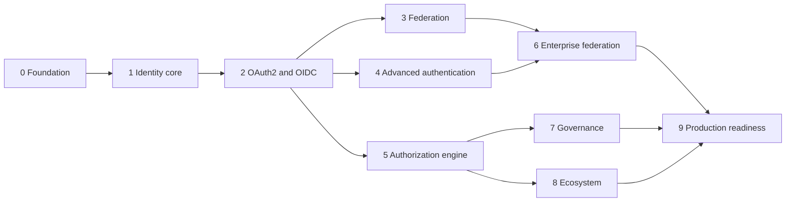

# Product roadmap

The phases follow section 26 of the specification. Four items move earlier because later phases cannot be built safely without them; the moves are listed at the end.

Phases 3, 4 and 5 depend only on Phase 2 and can run in parallel once there are people for it.

## Phases

| Phase | Outcome | Main deliverables | Exit criteria |
|---|---|---|---|
| **0 Foundation** | A workspace where a feature can be built, tested and shipped | Workspace and lints, architecture test, `kernel`, PostgreSQL adapter with RLS harness, outbox, CI, observability bootstrap, container image, docs skeleton | CI green; an empty server deploys with health checks and traces; architecture and tenant-isolation harness tests run |
| **1 Identity core** | A user can register and sign in to a tenant | Tenants, users, identifiers, groups, organizations, password credential, built-in login flow, SSO session, admin RBAC (native, fixed roles), audit, email, minimal `auth-ui` | [Milestone 1](epics.md#milestone-1-walking-skeleton) accepted; cross-tenant suite passes |
| **2 OAuth2 and OIDC** | Third-party apps can log users in | Applications and clients, Authorization Code + PKCE, Client Credentials, refresh rotation, revocation, introspection, JWKS and key rotation (local provider), Discovery, UserInfo, ID Token, consent, RP-initiated and back-channel logout, minimal admin console | OpenID conformance Basic OP and Config OP pass; **Alpha** |
| **3 Social login and federation** | Users sign in with external identities | Outbound HTTP client, generic OIDC RP, generic OAuth2, Google, Microsoft, GitHub, Apple, claim mapping, JIT, linking, routing rules | Interop suite against real and mock providers; linking threat tests pass |
| **4 Advanced authentication** | Strong and adaptive authentication | TOTP, WebAuthn and passkeys, recovery codes, OTP and magic link, flow editing API with validation and simulation, step-up, risk signals, trusted devices, session limits, PAR, DPoP, device grant, account console | Passkey-only login works; step-up by `acr_values` works |
| **5 Authorization engine** | Applications delegate decisions to Holdor | Authorization API, native RBAC, ACL, ABAC, OPA adapter, bundle service, policy lifecycle, decision logs, simulation, token exchange, service accounts and agents, webhooks; native ReBAC as stretch | Latency targets met; OPA failure tests pass; **Beta** |
| **6 Enterprise federation** | Enterprises connect their directories | SAML spike and implementation (IdP and SP), LDAP and AD federation, SCIM server, mTLS client authentication, tenant-to-tenant federation | SAML attack corpus and interop pass; external review of SAML |
| **7 Governance** | Access is reviewable and delegable | Fine-grained and delegated administration, access reviews and certification, approval workflows, quotas, security monitoring and alerts | Segregation-of-duty rules enforced and audited |
| **8 Ecosystem** | Others can build on Holdor | WASM plugin runtime, SDKs, developer portal, Terraform provider, CLI completeness, MCP authorization profile | A third-party plugin runs under limits; Terraform manages a full tenant |
| **9 Production readiness** | Safe to run as critical infrastructure | Cloud KMS and Vault providers, HA and DR drills, hardening, load and chaos campaigns, full conformance, Helm chart GA, external pentest | NFR targets met and published; **GA** |

## Console delivery

The consoles trail their APIs by one phase so that the API is settled first.

| Phase | Admin console | Account console | Hosted auth UI |
|---|---|---|---|
| 1 | — | — | Login, registration, recovery |
| 2 | Users, applications, clients, keys, audit | — | Consent |
| 3 | Identity providers, routing | — | Provider selection, linking |
| 4 | Authentication policies, flows (form-based) | Profile, password, MFA, passkeys, sessions, devices, linked accounts, consents | MFA, passkeys, branding, localization |
| 5 | Roles, policies, Rego editor, simulation, decision logs | — | — |
| 7 | Visual flow editor, access reviews | Data export, account deletion | Custom themes |

## Changes from the specification's roadmap

| Item | Specification | Here | Reason |
|---|---|---|---|
| Session management | Phase 4 | Core in Phase 1, advanced features in Phase 4 | Login without a session is not verifiable, and OAuth in Phase 2 depends on it |
| Authentication flow engine | Phase 4 | Interpreter in Phase 1 with one built-in flow; editing in Phase 4 | Avoids rewriting the login path ([ADR-0013](../adr/0013-auth-flow-as-data.md)) |
| Key management | Phase 9 (KMS integrations) | Key domain and local provider in Phase 2; external KMS in Phase 9 | Token signing and rotation cannot wait |
| Administrative RBAC | Phase 5 / 7 | Fixed built-in admin roles in Phase 1 | The Admin API must be protected from its first endpoint |
| Webhooks | Phase 8 | Phase 5 | First extension mechanism, and needed for SIEM delivery |
| Native ReBAC | Phase 5 | Phase 5 stretch (P2) | Large and separable; OpenFGA adapter is the alternative |

## Sizing

No dates are given: team size is not known. As relative effort, with Phase 1 as the unit: Phase 0 ≈ 0.5, Phase 2 ≈ 1.5, Phase 3 ≈ 1, Phase 4 ≈ 1.5, Phase 5 ≈ 2, Phase 6 ≈ 2 (uncertain until the SAML spike), Phase 7 ≈ 1, Phase 8 ≈ 1.5, Phase 9 ≈ 1.
