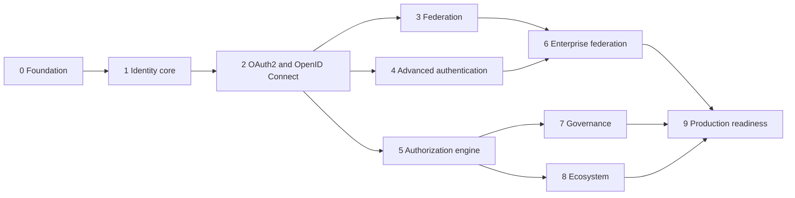

# Product roadmap

The phases follow section 26 of the specification. Four items move earlier because later phases cannot be built safely without them; the moves are listed at the end.

Phases 3, 4 and 5 depend only on Phase 2 and can run in parallel once there are people for it.

## Phases

| Phase | Outcome | Main deliverables | Exit criteria |
|---|---|---|---|
| **0 Foundation** | A workspace where a feature can be built, tested and shipped | Workspace and lints, architecture test, `kernel`, PostgreSQL adapter with row-level security harness, outbox, continuous integration, observability bootstrap, container image, docs skeleton | Continuous integration green; an empty server deploys with health checks and traces; architecture and tenant-isolation harness tests run |
| **1 Identity core** | A user can register and sign in to a tenant | Tenants, users, identifiers, groups, organizations, password credential, built-in login flow, single sign-on session, admin role-based access control (native, fixed roles), audit, email, minimal `auth-ui` | [Milestone 1](epics.md#milestone-1-walking-skeleton) accepted; cross-tenant suite passes |
| **2 OAuth2 and OpenID Connect** | Third-party apps can log users in | Applications and clients, Authorization Code + PKCE, Client Credentials, refresh rotation, revocation, introspection, JWKS and key rotation (local provider), Discovery, UserInfo, ID Token, consent, logout initiated by the relying party and back-channel logout, minimal admin console | OpenID conformance Basic OpenID Provider and Config OpenID Provider pass; **Alpha** |
| **3 Social login and federation** | Users sign in with external identities | Outbound HTTP client, generic OpenID Connect relying party, generic OAuth2, Google, Microsoft, GitHub, Apple, claim mapping, just-in-time, linking, routing rules | Interop suite against real and mock providers; linking threat tests pass |
| **4 Advanced authentication** | Strong and adaptive authentication | TOTP, WebAuthn and passkeys, recovery codes, one-time password and magic link, flow editing API with validation and simulation, step-up, risk signals, trusted devices, session limits, pushed authorization requests, DPoP, device grant, account console | Passkey-only login works; step-up by `acr_values` works |
| **5 Authorization engine** | Applications delegate decisions to Hodor | Authorization API, native role-based access control, access control list, attribute-based access control, Open Policy Agent adapter, bundle service, policy lifecycle, decision logs, simulation, token exchange, service accounts and agents, webhooks; native relationship-based access control as stretch | Latency targets met; Open Policy Agent failure tests pass; **Beta** |
| **6 Enterprise federation** | Enterprises connect their directories | SAML spike and implementation (identity provider and service provider), LDAP and Active Directory federation, SCIM server, mTLS client authentication, tenant-to-tenant federation | SAML attack corpus and interop pass; external review of SAML |
| **7 Governance** | Access is reviewable and delegable | Fine-grained and delegated administration, access reviews and certification, approval workflows, quotas, security monitoring and alerts | Segregation-of-duty rules enforced and audited |
| **8 Ecosystem** | Others can build on Hodor | WebAssembly plugin runtime, software development kits, developer portal, Terraform provider, command-line tool completeness, Model Context Protocol authorization profile | A third-party plugin runs under limits; Terraform manages a full tenant |
| **9 Production readiness** | Safe to run as critical infrastructure | Cloud key management service and Vault providers, high availability and disaster recovery drills, hardening, load and chaos campaigns, full conformance, Helm chart general availability, external pentest | non-functional requirement targets met and published; **General availability** |

## Order of work after Milestone 1

At the project owner's request, signing in with external identities is built before Phase 2: the social logins and OpenID Connect federation of Phase 3, and LDAP sign-in and the service provider side of SAML from Phase 6. This is [Milestone 2](epics.md#milestone-2-signing-in-with-external-identities), and [Decision 0017](../decisions/0017-external-identities-before-oauth.md) records why it is possible and what it pulls forward. The phases above keep their numbers; Phase 2 follows Milestone 2.

0.2.0 holds three parts the project owner asked for: the OAuth server and OpenID Provider, strong authentication with step-up, and the authorization engine with Open Policy Agent. They are Milestones 3, 4 and 5 in [the epics](epics.md#milestone-3-applications-ask-hodor-who-someone-is): all of Phase 2 save three requirements marked Expected, and the parts of Phases 4 and 5 that make each feature whole. [Decision 0023](../decisions/0023-what-0.2.0-holds.md) says what each milestone leaves to its phase.

0.3.0 holds four parts the project owner asked for after 0.2.0. They are Milestones 6 to 9 in [the epics](epics.md#milestone-6-hodor-runs-behind-a-load-balancer-and-cleans-up-after-itself), built in this order:

1. What a deployment behind a load balancer needs.
2. Groups, organizations and SCIM.
3. Service accounts, agents, token exchange and webhooks.
4. The parts of Phases 2, 4 and 5 that 0.2.0 left out.

[Decision 0027](../decisions/0027-what-0.3.0-holds.md) says why and what stays in each phase.

0.4.0 holds three parts the project owner asked for after 0.3.0, so that Hodor works with several service meshes, Linkerd included. They are Milestones 10 to 12 in [the epics](epics.md#milestone-10-workloads-prove-who-they-are-with-their-certificates), built in this order:

1. Workloads prove who they are to Hodor with the certificates and JWT-SVIDs their mesh or SPIRE gave them.
2. Hodor in a service mesh: the mesh's proxies check Hodor's tokens and ask Hodor's decisions, Linkerd through policies written from Hodor's roles, and Hodor runs inside a mesh itself.
3. An optional certificate authority per tenant, which signs the intermediate certificates of the tenant's meshes, with its key in OpenBao.

[Decision 0028](../decisions/0028-what-0.4.0-holds.md) says why, [Decision 0029](../decisions/0029-hodor-in-a-service-mesh.md) how Hodor fits a mesh, and [Decision 0030](../decisions/0030-optional-certificate-authority.md) what the authority may sign.

0.5.0 and 0.6.0 hold what OpenID certification asks of an OpenID Provider, for every profile the OpenID Foundation certifies, as the project owner asked after 0.4.0. 0.5.0 is Milestones 13 to 16 in [the epics](epics.md#milestone-13-requests-that-say-what-they-need), every OpenID Connect and logout profile, built in this order:

1. Requests that say what they need: request objects, pushed authorization requests, the `claims` parameter and the person's standard claims.
2. Answers through the browser: every response type and response mode.
3. Clients that register themselves.
4. Sign-out and session state through the browser, every plan in continuous integration, and the certification of 0.5.0.

0.6.0 is Milestones 17 to 19, FAPI and client-initiated backchannel authentication:

1. The FAPI 2.0 Security Profile, with DPoP.
2. FAPI 2.0 Message Signing and FAPI 1.0 Advanced, with encryption last.
3. Client-initiated backchannel authentication and FAPI-CIBA, and the certification of 0.6.0.

[Decision 0044](../decisions/0044-what-0.5.0-and-0.6.0-hold.md) says why two versions, what is left out and why, and which decisions settle the design. [The conformance page](../operations/conformance.md#the-target) lists, profile by profile, what each requires and where Hodor stands; [how certification is obtained](../operations/certification.md) says what the owner does.

## Console delivery

The consoles trail their APIs by one phase so that the API is settled first.

| Phase | Admin console | Account console | Hosted auth user interface |
|---|---|---|---|
| 1 | — | — | Login, registration, recovery |
| 2 | Security posture, users, applications, clients, keys, sessions, audit, support grants | — | Consent |
| 3 | Identity providers, routing | — | Provider selection, linking |
| 4 | Authentication policies, flows (form-based) | Profile, password, multi-factor authentication, passkeys, sessions, devices, linked accounts, consents | Multi-factor authentication, passkeys, branding, localization |
| 5 | Roles, policies, Rego editor, simulation, decision logs | — | — |
| 7 | Visual flow editor, access reviews | Data export, account deletion | Custom themes |

## Changes from the specification's roadmap

| Item | Specification | Here | Reason |
|---|---|---|---|
| Session management | Phase 4 | Core in Phase 1, advanced features in Phase 4 | Login without a session is not verifiable, and OAuth in Phase 2 depends on it |
| Authentication flow engine | Phase 4 | Interpreter in Phase 1 with one built-in flow; editing in Phase 4 | Avoids rewriting the login path ([Decision 0013](../decisions/0013-auth-flow-as-data.md)) |
| Key management | Phase 9 (key management service integrations) | Key domain and local provider in Phase 2; external key management service in Phase 9 | Token signing and rotation cannot wait |
| Administrative role-based access control | Phase 5 / 7 | Fixed built-in admin roles in Phase 1 | The Admin API must be protected from its first endpoint |
| Webhooks | Phase 8 | Phase 5 | First extension mechanism, and needed for security event management system delivery |
| Native relationship-based access control | Phase 5 | Phase 5 stretch (Optional) | Large and separable; OpenFGA adapter is the alternative |
| Mutual TLS client authentication and certificate-bound tokens | Phase 6 | 0.4.0, Milestone 10, with SPIFFE client authentication and certificates forwarded by trusted proxies | Workloads in a service mesh already hold a certificate; asking them for a second credential is the gap the owner asked to close |
| Envoy external authorization and Linkerd policies | Not in the specification | 0.4.0, Milestone 11 | Meshes enforce at the proxy; Hodor stays the policy decision point ([Decision 0029](../decisions/0029-hodor-in-a-service-mesh.md)) |
| A certificate authority per tenant | Not in the specification | 0.4.0, Milestone 12, Optional and off by default | One root per tenant across its meshes ([Decision 0030](../decisions/0030-optional-certificate-authority.md)) |
| An external key provider | Phase 9 | OpenBao in 0.4.0, Milestone 12; the cloud's key management services stay in Phase 9 | The authority's key must never leave the provider that signs with it; the owner chose OpenBao, and the cloud's services fit the same port |
| Pushed authorization requests, request objects, DPoP and dynamic client registration | Phase 4 | 0.5.0 (Milestones 13 and 15) and 0.6.0 (Milestone 17) | Every certification profile beyond Basic and Config needs them ([Decision 0044](../decisions/0044-what-0.5.0-and-0.6.0-hold.md)) |
| Front-channel logout and session management | Phase 6 | 0.5.0, Milestone 16 | Each is a logout profile of its own ([Decision 0050](../decisions/0050-logout-and-session-state-in-the-browser.md)) |
| The standard claims of a person | Phase 1 | 0.5.0, Milestone 13 | The scopes `profile`, `address` and `phone` are tested by every OpenID Connect plan |
| The implicit grant | A non-goal | 0.5.0, Milestone 14, only for a client an administrator marks | The Implicit, Hybrid and Dynamic profiles need it ([Decision 0046](../decisions/0046-responses-through-the-browser.md)) |
| FAPI 1.0 Advanced, FAPI 2.0 and FAPI-CIBA | A conformance target suggested for Phase 4 by the [competitive analysis](competitive-analysis.md#gaps-to-decide-on) | 0.6.0 | Certified programmes of their own; they stand on mutual TLS from 0.4.0 and on what 0.5.0 builds |
| Full conformance and its publication | Phase 9 | Every plan in continuous integration from 0.5.0, certification asked for at 0.5.0 and 0.6.0 | [Decision 0051](../decisions/0051-conformance-runs-and-certification.md) |

## Sizing

No dates are given: team size is not known. As relative effort, with Phase 1 as the unit: Phase 0 ≈ 0.5, Phase 2 ≈ 1.5, Phase 3 ≈ 1, Phase 4 ≈ 1.5, Phase 5 ≈ 2, Phase 6 ≈ 2 (uncertain until the SAML spike), Phase 7 ≈ 1, Phase 8 ≈ 1.5, Phase 9 ≈ 1.
