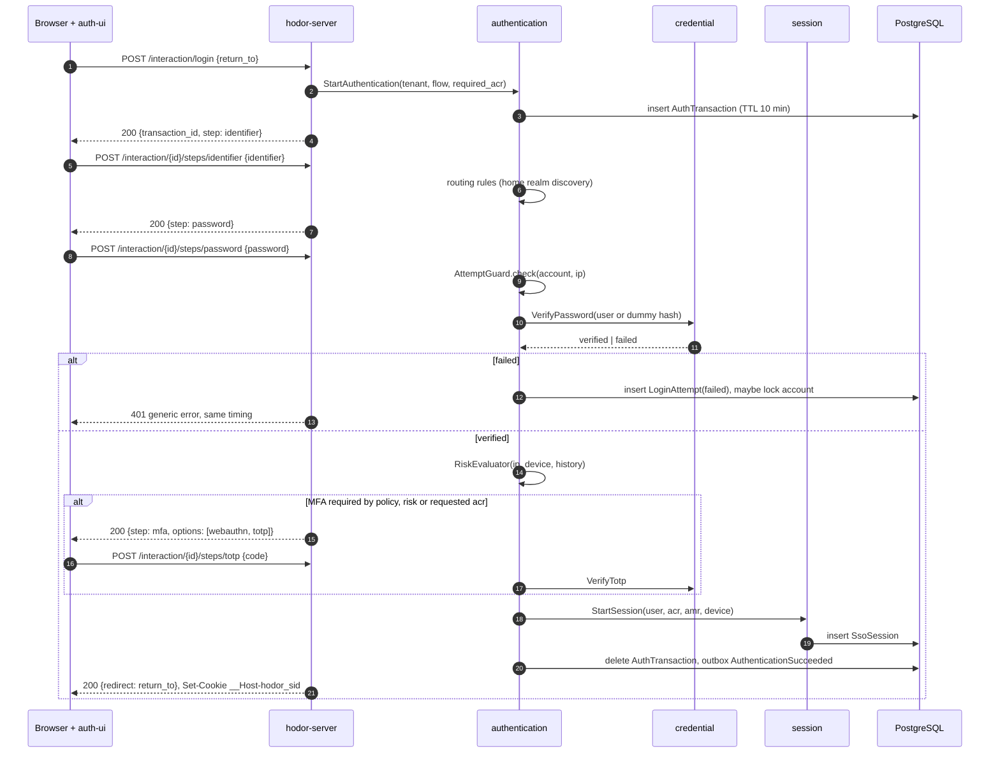
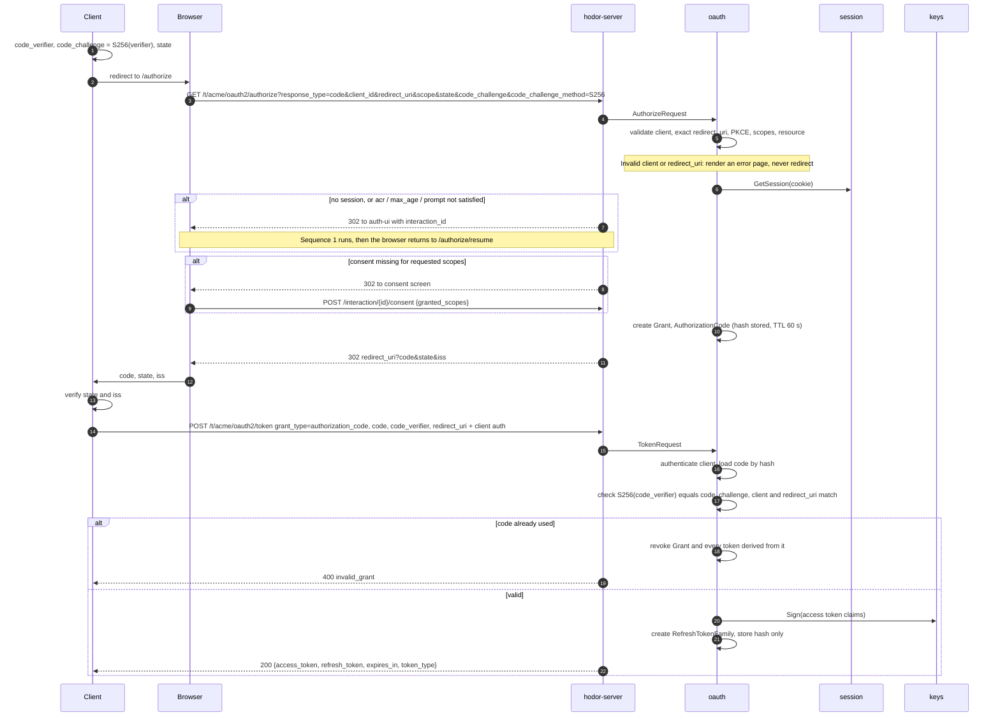
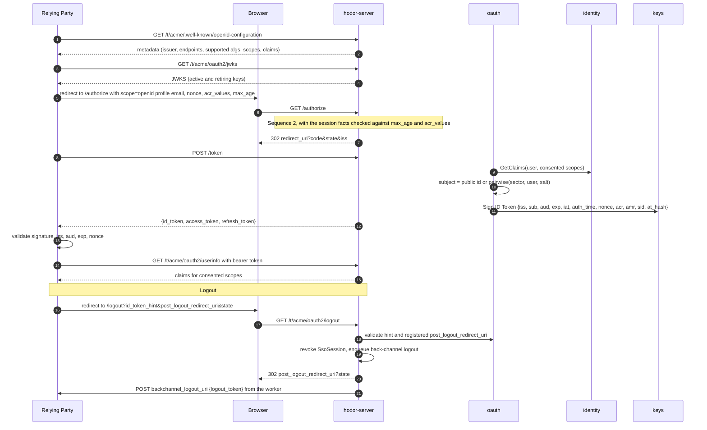
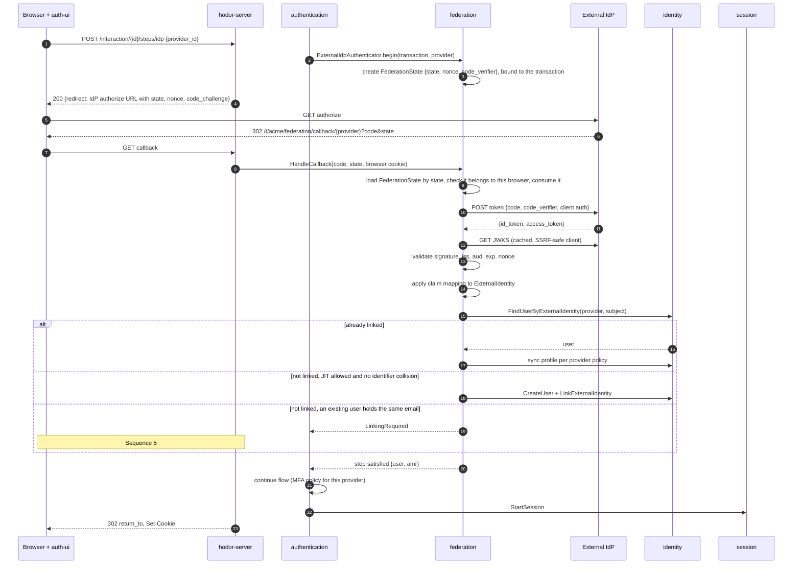
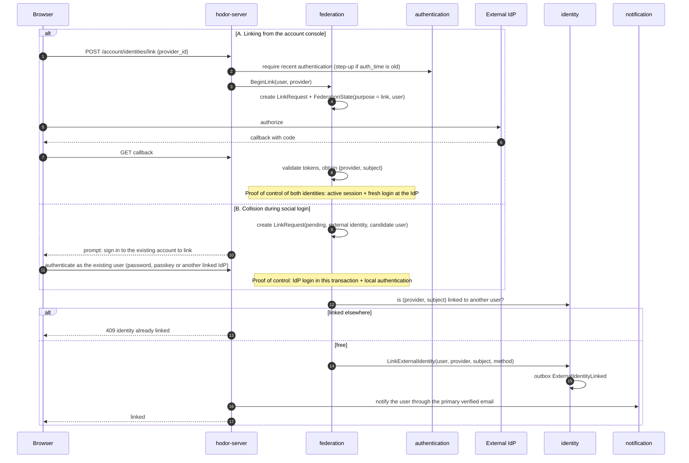
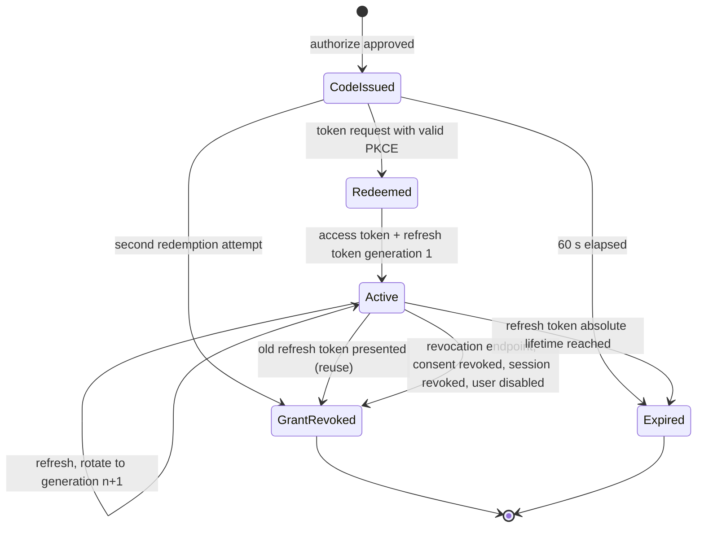
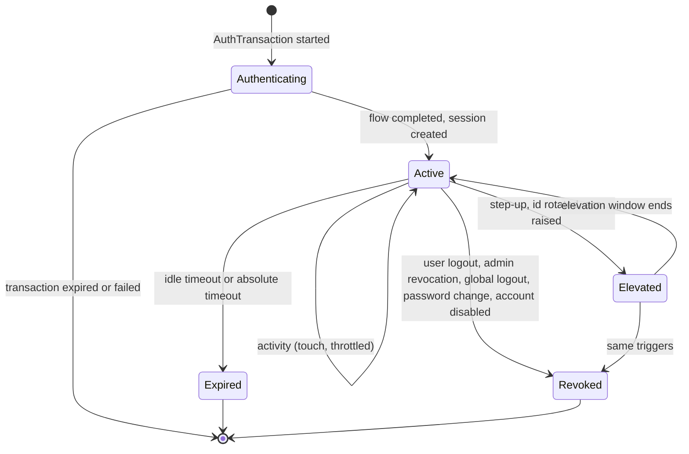

# Protocol sequences and lifecycles

Participants: **UA** is the browser, **UI** is `auth-ui`, **H** is `hodor-server`. Context names in notes say which crate owns the step.

## 1. Local authentication with conditional MFA

Notes:

- When the account does not exist, `credential` verifies against a fixed dummy hash so that timing does not reveal existence (FR-AUT-03).
- `return_to` is an opaque, server-stored reference, never a URL taken from the request.
- The session ID is rotated on every privilege change (login, step-up).

## 2. OAuth 2.0 Authorization Code with PKCE

Security properties enforced here: PKCE S256 only (`plain` rejected), exact redirect URI comparison, `iss` in the authorization response (RFC 9207), single-use codes, and no code or token ever written to logs.

## 3. OpenID Provider

## 4. Social login over OIDC

Connector-specific handling stays inside the connector: Apple returns user data once in a form post, GitHub needs a separate call for verified emails, Microsoft's multi-tenant issuer is templated by `tid`. For generic OAuth 2.0 providers there is no ID Token; identity comes from the configured UserInfo endpoint and its `subject` field mapping.

## 5. Identity linking

Two entry points: a signed-in user links a new provider from the account console, or a social login collides with an existing account.

Automatic linking (no local authentication) happens only when all of these hold: the tenant enabled it for this provider; the provider asserts `email_verified = true`; the provider is marked authoritative for that email domain (for example Entra ID for a verified tenant domain); and the local identifier is verified. Otherwise path B applies. Matching on email alone is never enough.

## 6. Token lifecycle

| Artifact | Format | Storage | Default lifetime | Revocation |
|---|---|---|---|---|
| Authorization code | Opaque, 256-bit random | SHA-256 hash | 60 s, single use | Consumed on use |
| Access token | JWT (RFC 9068) signed by the tenant key; opaque as a per-client option | Not stored (JWT) or hash (opaque) | 5 min | Short lifetime; `jti` deny-list for immediate revocation; introspection reflects the grant state |
| Refresh token | Opaque, 256-bit random | SHA-256 hash, family and generation | 30 days absolute, 14 days idle | Rotation; reuse revokes the family |
| ID token | JWT | Not stored | 5 min | Not revocable; it is a login assertion, not a credential |
| PAR `request_uri` | Opaque reference | Row with TTL | 60 s, single use | Consumed on use |
| Device code | Opaque + short user code | Hash | 10 min | Consumed or expired |

Rules:

- Sessions, access tokens and refresh tokens have independent lifetimes. A refresh token issued with `offline_access` survives session end; one without it is revoked with the session.
- Rotation tolerates one benign retry: the immediately previous generation is accepted for a few seconds and returns the same successor, so a client that lost the response does not trip reuse detection.
- Sender-constrained tokens (DPoP, mTLS) carry `cnf`; bearer refresh tokens for public clients are always rotated.
- Signing keys rotate on a schedule. A key leaves the JWKS only after every token it signed has expired.

## 7. Session lifecycle

| Aspect | Rule |
|---|---|
| Cookie | Opaque 256-bit value, `Secure; HttpOnly; SameSite=Lax`; only its hash is stored. On a tenant's own domain: `__Host-hodor_sid` with `Path=/`. On the shared host: `__Secure-hodor_sid` with `Path=/t/{slug}` (the `__Host-` prefix requires `Path=/`) |
| Scope | One SSO session per browser per tenant. The lookup is tenant-scoped, so a cookie presented to another tenant is not found. Path scoping is not a browser security boundary: tenants on the shared host share an origin, see [multi-tenancy](../architecture/multi-tenancy.md#shared-host-caveat) |
| Idle timeout | Default 30 min; `last_activity` is written at most once a minute |
| Absolute timeout | Default 12 h; never extended |
| Client sessions | Created when a client first receives a code in this session; each has a `sid` used in ID Tokens and logout tokens |
| Revocation effects | `SessionRevoked` event → revoke grants bound to the session (except `offline_access`) → enqueue back-channel logout per client session |
| Password change | Revokes all other sessions of the user |
| Concurrent limit | Evaluated at creation: deny, or revoke the oldest |
| Trusted device | Separate long-lived cookie; lets the flow skip MFA when policy allows; never substitutes for the first factor |
