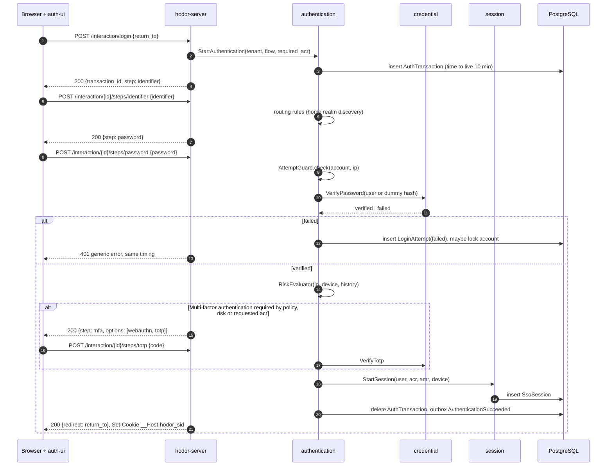
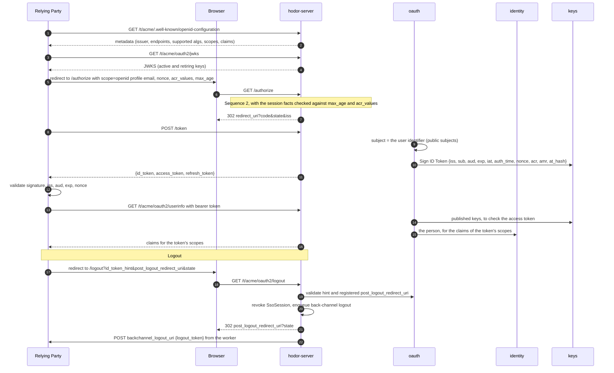
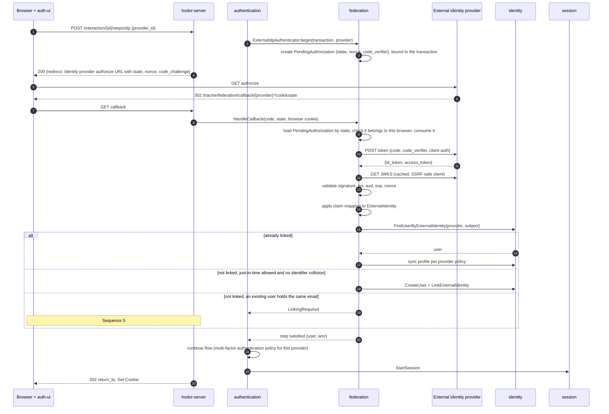
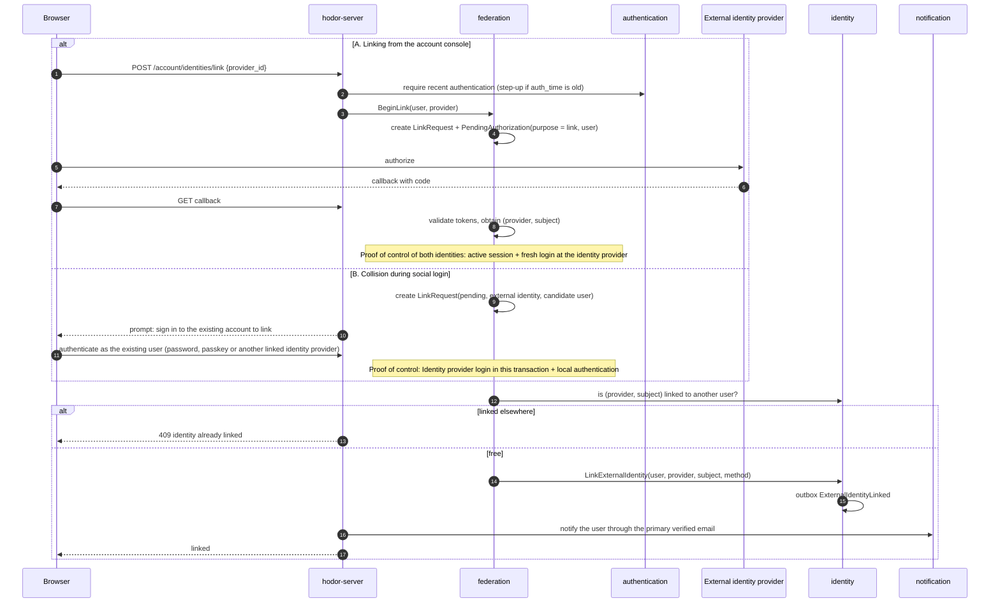
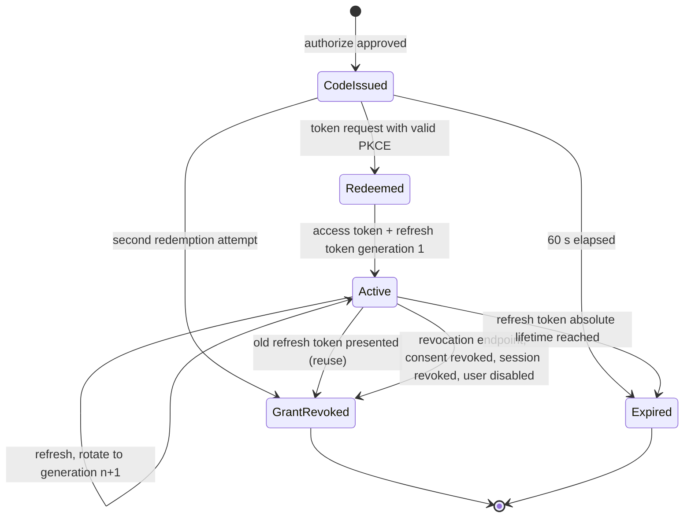
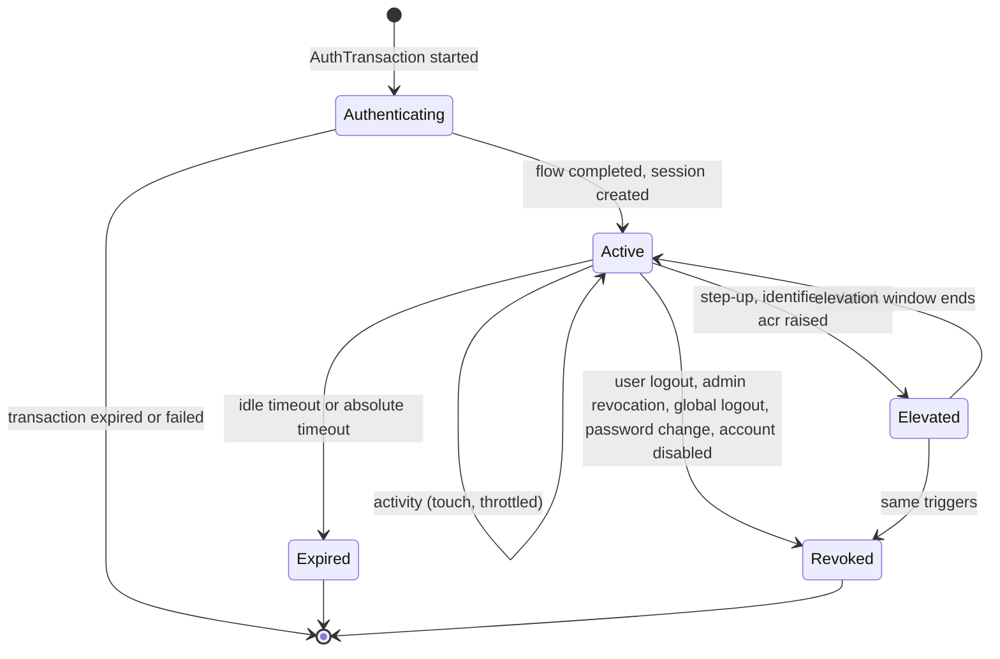

# Protocol sequences and lifecycles

Each diagram names its participants in full. A participant named after a bounded context (authentication, session, OAuth) is that context's crate, running inside `hodor-server`.

## 1. Local authentication with conditional multi-factor authentication



Notes:

- When the account does not exist, `credential` verifies against a fixed dummy hash so that timing does not reveal existence (Requirement-Authentication-03).
- `return_to` is an opaque, server-stored reference, never a URL taken from the request.
- The session identifier is rotated on every privilege change (login, step-up).

## 2. OAuth 2.0 Authorization Code with PKCE

```mermaid
sequenceDiagram
    autonumber
    participant Client as Client
    participant Browser as Browser
    participant Server as hodor-server
    participant OAuth as oauth
    participant Session as session
    participant Keys as keys

    Client->>Client: code_verifier, code_challenge = S256(verifier), state
    Client->>Browser: redirect to /authorize
    Browser->>Server: GET /t/acme/oauth2/authorize?response_type=code&client_id&redirect_uri&scope&state&code_challenge&code_challenge_method=S256
    Server->>OAuth: AuthorizeRequest
    OAuth->>OAuth: validate client, exact redirect_uri, PKCE, scopes, resource
    Note over OAuth: Invalid client or redirect_uri: render an error page, never redirect
    OAuth->>Session: GetSession(cookie)
    alt no session, or acr / max_age / prompt not satisfied
        Server-->>Browser: 302 to /account/sign-in?continue=authorization, with the cookie of the pending request
        Note over Browser,Server: Sequence 1 runs; its answer says continue, and the browser goes to /oauth2/authorize/resume
    end
    alt consent missing for requested scopes
        Server-->>Browser: 302 to consent screen
        Browser->>Server: POST /interaction/{id}/consent {granted_scopes}
    end
    OAuth->>OAuth: create Grant, AuthorizationCode (hash stored, time to live 60 s)
    Server-->>Browser: 302 redirect_uri?code&state&iss
    Browser->>Client: code, state, iss
    Client->>Client: verify state and iss
    Client->>Server: POST /t/acme/oauth2/token grant_type=authorization_code, code, code_verifier, redirect_uri + client auth
    Server->>OAuth: TokenRequest
    OAuth->>OAuth: authenticate client, load code by hash
    OAuth->>OAuth: check S256(code_verifier) equals code_challenge, client and redirect_uri match
    alt code already used
        OAuth->>OAuth: revoke Grant and every token derived from it
        Server-->>Client: 400 invalid_grant
    else valid
        OAuth->>Keys: Sign(access token claims)
        OAuth->>OAuth: create RefreshTokenFamily, store hash only
        Server-->>Client: 200 {access_token, refresh_token, expires_in, token_type}
    end
```

Security properties enforced here: PKCE S256 only (`plain` rejected), exact redirect URI comparison, `iss` in the authorization response (RFC 9207), single-use codes, and no code or token ever written to logs.

## 3. OpenID Provider

Built by Issue-59, without `sid`, which comes with logout (Issue-60). `acr_values` and `max_age` are met by a step-up, built by Issue-69 and drawn below. [The OAuth context](../architecture/contexts/oauth.md#openid-provider) holds the details.



### Step-up

A person signed in with a password, and an application asking for a multi-factor level ([assurance and step-up](../architecture/contexts/oauth.md#assurance-and-step-up)):

```mermaid
sequenceDiagram
    autonumber
    participant Browser as Browser
    participant Server as hodor-server
    participant OAuth as oauth
    participant Authentication as authentication
    participant Session as session

    Browser->>Server: GET /t/acme/oauth2/authorize?acr_values=urn:hodor:acr:mfa (session cookie)
    Server->>OAuth: check the request; the level asked for is multi_factor
    Server->>Authentication: assurance of the session's methods: single factor
    Server->>Authentication: start a step-up of the session, carrying password, demanding multi_factor
    alt the person has no second factor
        Authentication-->>Server: cannot be reached
        Server-->>Browser: 302 redirect_uri?error=unmet_authentication_requirements
    else
        Authentication-->>Server: step-up waiting for the webauthn step
        Server->>OAuth: keep the request pending
        Server-->>Browser: 302 sign-in page, with the sign-in and authorization cookies
        Browser->>Server: the security key's answer, through the interaction interface
        Authentication->>Session: raise the session: webauthn added, multi_factor, new token
        Server-->>Browser: completed, continue to /oauth2/authorize/resume
        Browser->>Server: GET /oauth2/authorize/resume
        Server->>OAuth: issue a code with acr urn:hodor:acr:mfa
        Server-->>Browser: 302 redirect_uri?code&state&iss
    end
```

## 4. Social login over OpenID Connect



Connector-specific handling stays inside the connector: Apple returns user data once in a form post, GitHub needs a separate call for verified emails, Microsoft's multi-tenant issuer is templated by `tid`. For generic OAuth 2.0 providers there is no ID Token; identity comes from the configured UserInfo endpoint and its `subject` field mapping.

## 5. Identity linking

Two entry points: a signed-in user links a new provider from the account console, or a social login collides with an existing account.



Automatic linking (no local authentication) happens only when all of these hold: the tenant enabled it for this provider; the provider asserts `email_verified = true`; the provider is marked authoritative for that email domain (for example Entra ID for a verified tenant domain); and the local identifier is verified. Otherwise path B applies. Matching on email alone is never enough.

## 6. Token lifecycle



| Artifact | Format | Storage | Default lifetime | Revocation |
|---|---|---|---|---|
| Authorization code | Opaque, 256-bit random | SHA-256 hash | 60 s, single use | Consumed on use |
| Access token | JWT (RFC 9068) signed by the tenant key | Not stored; its `jti` is recorded with its client, grant and family ([the register of access tokens](../architecture/contexts/oauth.md#the-register-of-access-tokens)) | 5 min | Short lifetime; the revocation endpoint revokes its record; introspection and UserInfo refuse it once its record, grant or family is revoked |
| Refresh token | Opaque, 256 bits: random for the first of a family, derived from the one before and the family's sealed secret after it | SHA-256 hash, family and generation | 30 days absolute, 7 days idle, from the client's token policy | Rotation; reuse revokes the family and its grant |
| ID token | JWT | Not stored | 5 min | Not revocable; it is a login assertion, not a credential |
| Pushed authorization requests `request_uri` | Opaque reference | Row with time to live | 60 s, single use | Consumed on use |
| Device code | Opaque + short user code | Hash | 10 min | Consumed or expired |

Rules:

- Sessions, access tokens and refresh tokens have independent lifetimes. A refresh token issued with `offline_access` survives session end; one without it is revoked with the session.
- Rotation tolerates one benign retry: the immediately previous generation, presented again by the same client for the same scopes within the retry window (10 seconds by default), returns the same successor, so a client that lost the response does not set off reuse detection. See [refresh tokens](../architecture/contexts/oauth.md#refresh-tokens).
- Sender-constrained tokens (DPoP, mTLS) carry `cnf`; bearer refresh tokens for public clients are always rotated.
- Signing keys rotate on a schedule. A key leaves the JWKS only after every token it signed has expired.

## 7. Session lifecycle



| Aspect | Rule |
|---|---|
| Cookie | Opaque 256-bit value, `Secure; HttpOnly; SameSite=Lax`; only its hash is stored. On a tenant's own domain: `__Host-hodor_sid` with `Path=/`. On the shared host: `__Secure-hodor_sid` with `Path=/t/{slug}` (the `__Host-` prefix requires `Path=/`) |
| Scope | One single sign-on session per browser per tenant. The lookup is tenant-scoped, so a cookie presented to another tenant is not found. Path scoping is not a browser security boundary: tenants on the shared host share an origin, see [multi-tenancy](../architecture/multi-tenancy.md#shared-host-caveat) |
| Idle timeout | Default 30 min; `last_activity` is written at most once a minute |
| Absolute timeout | Default 12 h; never extended |
| Client sessions | Created when a client first receives a code in this session; each has a `sid` used in ID Tokens and logout tokens |
| Revocation effects | `SessionRevoked` event → revoke grants bound to the session (except `offline_access`) → enqueue back-channel logout per client session |
| Password change | Revokes all other sessions of the user |
| Concurrent limit | Evaluated at creation: deny, or revoke the oldest |
| Trusted device | Separate long-lived cookie; lets the flow skip multi-factor authentication when policy allows; never substitutes for the first factor |
