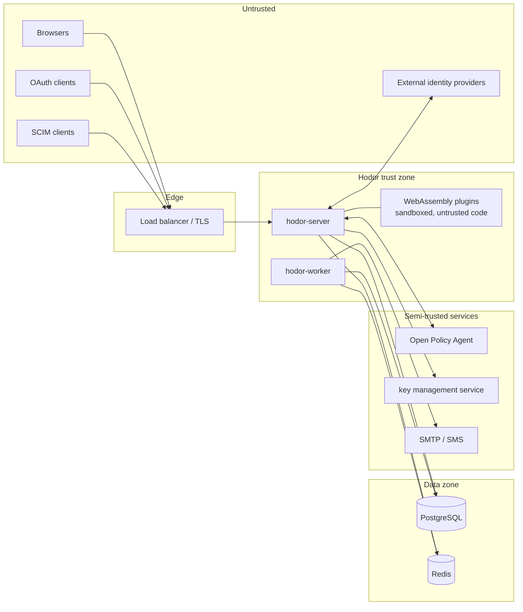

# Threat model

Method: STRIDE per trust boundary, with one focused model for each area the specification names. Each threat has an identifier, the control that addresses it, and the test that proves the control. This document is the baseline; each phase revisits its area before implementation and adds what the design at that point reveals.

## Assets

| Asset | Why it matters |
|---|---|
| Signing keys | Whoever holds them mints tokens for the tenant |
| Credentials (password hashes, TOTP secrets, passkey public keys, client and identity provider secrets) | Account and integration takeover |
| Sessions, authorization codes, refresh tokens | Impersonation |
| Identity data (personal data) | Privacy, regulatory exposure |
| Policies and role assignments | Privilege escalation |
| Audit trail | Detection and non-repudiation |
| Tenant boundary | A breach here multiplies every other one |

## Trust boundaries

Boundaries: internet → edge; edge → application; application → data; application → external identity providers (their responses are untrusted input); application → Open Policy Agent (policy content may be tenant-authored); host → WebAssembly guest; tenant ↔ tenant (logical, crossing every zone); administrator → platform.

## General STRIDE

| Identifier | Category | Threat | Control |
|---|---|---|---|
| Threat-General-01 | Spoofing | Credential stuffing and brute force | Per-account, per-IP and per-pair limits; progressive lockout; breached-password check; multi-factor authentication |
| Threat-General-02 | Spoofing | User enumeration through login, registration or recovery | Uniform responses and timing; dummy hash verification; recovery always answers "if the account exists" |
| Threat-General-03 | Tampering | SQL injection | SQLx bound parameters only; no string-built SQL; lint in continuous integration |
| Threat-General-04 | Tampering | Audit record modification | Append-only table, no `UPDATE`/`DELETE` grant, per-tenant hash chain, periodic anchor exported |
| Threat-General-05 | Repudiation | Administrator denies an action | Every admin API call audited with actor, client, IP and request identifier |
| Threat-General-06 | Information disclosure | Secrets in logs, traces or error messages | `Secret<T>` without `Debug`/`Serialize`; request and response bodies never logged; log scanning test with canary values |
| Threat-General-07 | Information disclosure | Database dump exposes secrets | Passwords Argon2id; tokens stored as hashes; recoverable secrets encrypted with authenticated encryption under per-tenant keys wrapped by the key management service |
| Threat-General-08 | Denial of service | Argon2 exhaustion through login floods | Bounded blocking pool + semaphore; rate limit before hashing; 503 with `Retry-After` |
| Threat-General-09 | Denial of service | Oversized bodies, slow requests, deep JSON | Body size and depth limits, header and read timeouts, concurrency limits per route |
| Threat-General-10 | Elevation of privilege | CSRF on cookie-authenticated endpoints | `SameSite=Lax` + per-session CSRF token on every state-changing interaction and backend-for-frontend route; `Origin` check |
| Threat-General-11 | Elevation of privilege | XSS in hosted user interface | React escaping, no `dangerouslySetInnerHTML`, strict Content Security Policy without inline script, no tenant-supplied HTML, Trusted Types |
| Threat-General-12 | Elevation of privilege | Clickjacking on login and consent | `frame-ancestors 'none'` |
| Threat-General-13 | Tampering | SSRF through configured URLs (JWKS, discovery, webhooks, `request_uri`, logout URIs) | One outbound client: HTTPS only, DNS resolution pinned and checked against private, loopback, link-local and metadata ranges, no redirects by default, size and time limits |
| Threat-General-14 | Spoofing | Session fixation and hijacking | Session identifier rotated at login and step-up; cookie flags; server-side revocation; device binding signal |
| Threat-General-15 | Tampering | Dependency compromise | [The supply chain](supply-chain.md): `cargo deny`, `cargo audit`, lockfile, vendored sources policy, `npm audit` and licenses of npm packages, continuous integration actions pinned by commit, signed releases, software bill of materials |
| Threat-General-16 | Elevation of privilege | Open redirect | Redirect targets are registered values or server-stored references, never request input |
| Threat-General-17 | Spoofing | A client writes a forwarded header to escape the limits on its address, or to put another address in the audit log | Forwarded headers read only from connections of proxies the operator names, one header only, read from the nearest end, the first address that is not a trusted proxy taken; anything unreadable falls back to the connection's address ([the client address](../api/api-spec.md#the-client-address)) |
| Threat-General-18 | Spoofing | A link to sign in, asked for with someone else's address, opened by its owner and signing in the browser of whoever asked; a code or a link guessed, or used twice | The code or the link is good only within the sign-in that asked for it, which only its browser can continue; one conditional update uses it once; attempts counted with the lockout of the address asked about; ten minutes of life; the answer to asking is the same for every address ([the authentication context](../architecture/contexts/authentication.md#signing-in-with-a-code-or-a-link-by-email)) |

## OAuth 2.x

Baseline: RFC 9700 and RFC 6819.

| Identifier | Threat | Control | Test |
|---|---|---|---|
| Threat-OAuth-01 | Authorization code interception | PKCE S256 mandatory for public clients, default for all; code bound to client, redirect URI and challenge; 60 s lifetime | Token request without or with wrong verifier fails |
| Threat-OAuth-02 | Authorization code replay | Single use; second redemption revokes the grant and its tokens | Replay test asserts revocation |
| Threat-OAuth-03 | Redirect URI manipulation | Exact string match; no wildcards; loopback port exception only for native clients (RFC 8252) | Table-driven near-miss URIs |
| Threat-OAuth-04 | Mix-up attack | `iss` in authorization responses (RFC 9207); per-tenant issuer | Response contains `iss` |
| Threat-OAuth-05 | CSRF on the client's redirect URI | PKCE; `state` passed through unchanged; `nonce` for OpenID Connect | — |
| Threat-OAuth-06 | Refresh token theft | Rotation, reuse detection revokes the family; sender constraint via DPoP or mTLS; idle and absolute lifetimes | Reuse test |
| Threat-OAuth-07 | Access token replay at another resource server | Audience restriction (RFC 8707); short lifetime; DPoP | Token with wrong `aud` rejected by introspection policy |
| Threat-OAuth-08 | Client impersonation | `private_key_jwt` or mTLS preferred; secrets hashed, rotated, compared in constant time; `jti` replay cache for assertions | Assertion replay rejected |
| Threat-OAuth-09 | Token leakage through the front channel | No implicit grant, no token in a URL, `Referrer-Policy: no-referrer`, `Cache-Control: no-store` on token responses. From 0.5.0, an access token through the browser only for a client an administrator marks (Threat-OpenID-11) | Metadata lists only `code`; from 0.5.0, an unmarked client is refused every type that returns an access token |
| Threat-OAuth-10 | PKCE downgrade | A code issued with a challenge cannot be redeemed without a verifier; `plain` rejected | — |
| Threat-OAuth-11 | Scope escalation on refresh or exchange | Refreshed scope ⊆ granted scope; token exchange policy per client pair | Property test |
| Threat-OAuth-12 | Malicious dynamic client registration | Disabled by default; initial access token; software statements; registered URIs validated and SSRF-checked | — |
| Threat-OAuth-13 | Device flow phishing | User code entropy and rate limit; verification page shows client and scopes; short lifetime | — |
| Threat-OAuth-14 | JWT algorithm confusion, `none`, key injection through `jku`/`jwk` headers | Algorithm allow-list per key; key selected by `kid` from the server's own store only; header-supplied keys ignored | Fuzzed header corpus |
| Threat-OAuth-15 | DPoP proof replay | `jti` cache for the proof lifetime; server-provided nonce | — |
| Threat-OAuth-16 | Consent bypass or forged consent | Consent bound to the interaction and session; first-party skip only for clients flagged by an administrator | — |

## OpenID Connect

| Identifier | Threat | Control |
|---|---|---|
| Threat-OpenID-01 | ID Token replay or injection into another session | `nonce` bound to the request; `aud`, `azp`, `at_hash` |
| Threat-OpenID-02 | Correlation of users across clients | Pairwise subject identifiers with a per-tenant salt and `sector_identifier_uri` validation |
| Threat-OpenID-03 | Stale authentication accepted | `max_age` and `auth_time` enforced server-side; `prompt=login` forces re-authentication |
| Threat-OpenID-04 | Logout CSRF and post-logout open redirect | `id_token_hint` required for redirect; registered `post_logout_redirect_uri`; confirmation page otherwise |
| Threat-OpenID-05 | Forged back-channel logout | Signed logout token with `events` claim, `jti` replay cache at the relying party; Hodor signs with the tenant key |
| Threat-OpenID-06 | UserInfo over-disclosure | Claims limited to consented scopes and the `claims` request |
| Threat-OpenID-07 | Malicious `request` object or `request_uri` | Request objects must be signed by a registered client key, unless an administrator chose `none` for the client, whose unsigned objects are then held to every check of a request without one; `request_uri` only from pushed authorization requests and the client's registered addresses |

## SAML

| Identifier | Threat | Control |
|---|---|---|
| Threat-SAML-01 | XML signature wrapping | Verify the signature, then read data only from the exact signed element by its resolved reference; reject documents with duplicate identifiers; schema validation first |
| Threat-SAML-02 | XXE and entity expansion | DTDs and external entities disabled in the parser; size and depth limits |
| Threat-SAML-03 | Assertion replay | `InResponseTo` matched to a stored request; `NotOnOrAfter`; assertion identifier cache |
| Threat-SAML-04 | Audience and destination confusion | `AudienceRestriction`, `Destination` and `Recipient` must match this service provider exactly |
| Threat-SAML-05 | Unsigned or partially signed responses | Require a signed assertion (or signed response containing it); no fallback to unsigned |
| Threat-SAML-06 | Weak algorithms | Reject SHA-1 and RSA PKCS#1 v1.5 key transport; allow-list of algorithms |
| Threat-SAML-07 | Comment and canonicalization tricks in NameID | Canonicalize before comparison; treat text nodes with comments as invalid |
| Threat-SAML-08 | RelayState open redirect | RelayState is an opaque server-side reference |
| Threat-SAML-09 | Unsolicited (initiated by the identity provider) responses | Disabled by default; when enabled, restricted to a landing page with no privileged continuation |

SAML is the highest-risk protocol in the plan because of XML Signature. See the [critical review](../architecture/critical-review.md).

## Social login and federation

| Identifier | Threat | Control |
|---|---|---|
| Threat-Federation-01 | Account takeover through automatic linking on an unverified or attacker-controlled email | No linking on email alone; linking needs proof of control of both sides, or an explicit policy with a provider authoritative for the domain and `email_verified` |
| Threat-Federation-02 | Pre-hijacking: attacker registers locally with the victim's email before the victim's first social login | Unverified local identifiers never match; on first federated login to a pre-existing unverified account, the old credentials and sessions are invalidated |
| Threat-Federation-03 | Login CSRF and callback forgery | `state` bound to the browser and the `AuthTransaction`, single use; PKCE toward the identity provider |
| Threat-Federation-04 | Identity provider mix-up | One callback URL per provider; issuer checked against the provider's configuration |
| Threat-Federation-05 | Token substitution from another client of the same identity provider | `aud` and `azp` validation; `nonce` |
| Threat-Federation-06 | Multi-tenant identity provider confusion (for example, any Entra tenant accepted) | Issuer template pinned to allowed tenant identifiers; domain claims not trusted from multi-tenant issuers without verification |
| Threat-Federation-07 | Malicious claim values escalate privilege (groups, roles) | Mappings are explicit allow-lists; mapped roles limited to a configured set per provider |
| Threat-Federation-08 | SSRF through discovery or JWKS URLs | Threat-General-13 |
| Threat-Federation-09 | Provider secret disclosure | Encrypted at rest, write-only in the API, never returned |
| Threat-Federation-10 | A deactivated provider keeps granting access | Deactivation blocks new logins and, by policy, revokes sessions established through it |
| Threat-Federation-11 | Identifier recycling at the identity provider (email reassigned) | Link on the immutable `sub`, never on email |

## Open Policy Agent

| Identifier | Threat | Control |
|---|---|---|
| Threat-PolicyAgent-01 | Tenant A's Rego reads tenant B's data in a shared Open Policy Agent | Tenant-authored Rego only in a dedicated Open Policy Agent; shared Open Policy Agent runs platform-authored policy only |
| Threat-PolicyAgent-02 | SSRF or exfiltration through `http.send` and similar built-ins | Capabilities file removes them; checked at validation and enforced at run time |
| Threat-PolicyAgent-03 | Policy injection through the decision path | The path is derived from tenant and binding, never from request input |
| Threat-PolicyAgent-04 | Bundle tampering or rollback | Signed bundles; monotonic revision; Open Policy Agent verifies the signature; per-instance bundle credentials |
| Threat-PolicyAgent-05 | Open Policy Agent unavailable → access granted | Fail-closed default; `fail_open` only explicit, per action, audited |
| Threat-PolicyAgent-06 | Stale policy keeps answering after a publish | Revision tracking from status reports; lagging instances yield `Indeterminate` |
| Threat-PolicyAgent-07 | Sensitive attributes leak into decision logs | Mask rules by path; log sampling and retention per tenant |
| Threat-PolicyAgent-08 | Expensive policy as denial of service | Decision timeout; bundle size and rule-count quotas; evaluation metrics per tenant |
| Threat-PolicyAgent-09 | Unauthenticated Open Policy Agent API | Token or mTLS; network policy restricts access to Hodor |
| Threat-PolicyAgent-10 | Decision cache returns a stale allow | Cache off by default; keyed by revision; short time to live; flushed on publish |

## SCIM

A SCIM client writes a tenant's people and groups: the [provisioning context](../architecture/contexts/provisioning.md).

| Identifier | Threat | Control |
|---|---|---|
| Threat-Provisioning-01 | A SCIM client of one tenant reads or writes another tenant's users or groups | The token is checked against the tenant's own issuer and keys; every read and write is inside the tenant of the URL under row-level security; another tenant's identifiers are answered as ones that do not exist, and refused as members |
| Threat-Provisioning-02 | A revoked or stolen SCIM token keeps working | The register of access tokens is read on every request, so a revoked token is refused at once; tokens are short-lived; the scope `scim` is given only to clients a tenant registers for it |
| Threat-Provisioning-03 | An email address set through SCIM is taken as verified, so a SCIM client can give a person an address nobody proved they control, and with it messages sent there and a way to be found at sign-in | Accepted, and the tenant's choice: SCIM is the tenant's own system of record speaking, and opening it is a resource server and a client the tenant's administrator registers. Every address set is recorded with the client as actor. An address another user of the tenant has is refused, so SCIM cannot take over an existing account by its address |
| Threat-Provisioning-04 | A filter as denial of service: very long, deeply nested, or with many comparisons | The parser refuses more than 1000 characters before reading, and more than 10 levels or 20 comparisons while reading; filterable attributes are a fixed set; pages hold at most 200 resources |
| Threat-Provisioning-05 | SQL injection through a filter | A filter is compiled into SQL whose every value is a bound parameter and whose every attribute is one of a fixed set of expressions; nothing of the filter's text reaches the statement |
| Threat-Provisioning-06 | A large request as denial of service | Bodies are limited to 64 kibibytes; a group takes at most 1000 members in one request; each text attribute at most 256 characters |
| Threat-Provisioning-07 | What SCIM keeps of a person leaks through events or the audit log | Events carry identifiers only, never a department, a name or an address |
| Threat-Provisioning-08 | A bulk request or a `PATCH` as denial of service | A bulk request holds at most 100 operations in at most one mebibyte, refused whole past either; a `PATCH` at most 100 operations; each value filter of a path keeps the bounds of filters |
| Threat-Provisioning-09 | A person who left keeps access after their directory deprovisioned them | Deprovisioning ends every session and revokes every grant of the person in the same transaction; refresh tokens and sessions also check, at use, that the person may still sign in |
| Threat-Provisioning-10 | A SCIM client overwrites a change it never saw | Versions with `If-Match`: a change for a stale version is refused with `412`; a user's own optimistic lock refuses the second of two changes made at the same moment |

## Multi-tenancy

| Identifier | Threat | Control |
|---|---|---|
| Threat-Tenancy-01 | A query without a tenant filter returns another tenant's rows | Forced row-level security + mandatory `TenantContext` in ports + composite foreign keys |
| Threat-Tenancy-02 | Tenant taken from request input | Resolved from host or path only; credentials validated within that tenant |
| Threat-Tenancy-03 | Token or session from tenant A accepted at tenant B | Per-tenant issuer and keys; tenant-scoped lookups |
| Threat-Tenancy-04 | Cache key collision | Single key builder requiring `TenantContext` |
| Threat-Tenancy-05 | Platform administrator abuses standing access | No standing access; audited time-boxed support grants; separate platform role |
| Threat-Tenancy-06 | Noisy neighbor | Per-tenant rate limits, quotas and worker fairness |
| Threat-Tenancy-07 | Custom domain takeover | DNS verification, periodic re-verification, domain released on failure |
| Threat-Tenancy-08 | Background job runs with the wrong tenant | Jobs carry `tenant_id`; handlers receive a rebuilt `TenantContext`; no ambient tenant |
| Threat-Tenancy-09 | Shared-origin attacks between path-based tenants | No tenant-supplied HTML or scripts; dedicated hosts recommended |
| Threat-Tenancy-10 | Data remains after tenant deletion | Purge job with verification query; crypto-shredding of the tenant key |

## Plugin system

| Identifier | Threat | Control |
|---|---|---|
| Threat-Plugin-01 | Plugin escapes the sandbox | Wasmtime with no ambient authority: no filesystem, network or clock unless granted; component model with typed host functions |
| Threat-Plugin-02 | Plugin exhausts CPU or memory | Fuel or epoch interruption, memory limit, per-call deadline |
| Threat-Plugin-03 | Plugin reads data beyond its purpose | Capability manifest approved by an administrator; host functions check capabilities and tenant on every call |
| Threat-Plugin-04 | Plugin exfiltrates secrets | Secrets never cross the boundary; plugins receive handles, and outbound HTTP goes through the host's SSRF-safe client with an allow-list |
| Threat-Plugin-05 | Malicious or tampered plugin package | Signed packages, digest pinning, per-tenant installation approval |
| Threat-Plugin-06 | Plugin failure breaks authentication | Per-extension-point failure policy; authentication actions fail closed |
| Threat-Plugin-07 | Claims mapper injects privileged claims | Reserved claims (`iss`, `sub`, `aud`, `exp`, `acr`, `amr`, …) cannot be set by mappers |

## Authorization engine

| Identifier | Threat | Control |
|---|---|---|
| Threat-Authorization-01 | Policy enforcement point asserts roles or attributes it should not | Asserted attributes kept separate from resolved ones and untrusted by default |
| Threat-Authorization-02 | Any authenticated client queries decisions about any subject | `authz:evaluate` scope per namespace; callers limited to their own resource server |
| Threat-Authorization-03 | Explanations reveal policy internals or sensitive attributes | Stable reason codes by default; detail only with `authz:explain` |
| Threat-Authorization-04 | Stale role cache grants revoked access | Event-driven invalidation plus a short time to live upper bound |
| Threat-Authorization-05 | Role hierarchy cycle or explosion | Cycle check on write; bounded expansion |
| Threat-Authorization-06 | Relationship-based access control traversal as denial of service | Depth and fan-out limits; `Indeterminate` on limit |
| Threat-Authorization-07 | `Indeterminate` treated as allow by a policy enforcement point | Software development kits expose a boolean `allowed`; documentation and conformance tests for policy enforcement points |
| Threat-Authorization-08 | Self-escalation by an administrator | A principal cannot grant permissions it does not hold; segregation-of-duty rules on role assignment |
| Threat-Authorization-09 | Simulation used to probe production data | Separate scope; simulation is audited; no real decision record |

## Webhooks

| Identifier | Threat | Control |
|---|---|---|
| Threat-Webhooks-01 | An endpoint registered at a private address, or a name that resolves to one later, makes the worker call inside the network | The address is checked when it is registered and again by the guarded client at every attempt, on the resolution it connects with; HTTPS only; redirects not followed ([outbound HTTP](outbound-http.md)) |
| Threat-Webhooks-02 | A tenant receives another tenant's events | Deliveries are made in the event's tenant from that tenant's endpoints, under row-level security; the body names the tenant |
| Threat-Webhooks-03 | A forged or replayed request is taken for one of Hodor's | Standard Webhooks signature over the identifier, the timestamp and the body, with a secret per endpoint; receivers refuse an old timestamp |
| Threat-Webhooks-04 | The signing secret leaks from the database or from the interface | Sealed with the tenant's data key; shown once, never read back; rotated with an overlap |
| Threat-Webhooks-05 | An event carries personal data or a secret to a third party | Only the types of a reviewed catalog are published, and events carry identifiers by the rule of every context |
| Threat-Webhooks-06 | A slow or dead endpoint exhausts the worker or holds up other tenants | No transaction is held during a request; a time limit per attempt; at most a few deliveries in flight per endpoint; deliveries set aside after a bound |
| Threat-Webhooks-07 | A tenant makes Hodor send a flood of requests | At most 20 endpoints; one delivery per endpoint and event; a bound on attempts and growing waits |

## Service meshes and certificates

Planned for 0.4.0 ([Decision 0028](../decisions/0028-what-0.4.0-holds.md)). The controls are what the issues of Milestones 10 to 12 must build and test.

| Identifier | Threat | Control |
|---|---|---|
| Threat-Mesh-01 | A client sends its own `Client-Cert`, `X-Forwarded-Client-Cert` or `l5d-client-id` and is taken for the workload it names | Only the one header the operator names in `HODOR_CLIENT_IDENTITY_HEADER` is read, none by default; only on a connection from an address of `HODOR_TRUSTED_PROXIES`; only its nearest element, the one the proxy Hodor is connected to added; an element that does not read is no identity ([the caller's identity from a proxy](../api/api-spec.md#the-callers-identity-from-a-proxy)). Built in Issue-107 |
| Threat-Mesh-02 | A workload of one tenant's trust domain authenticates as a client of another tenant | Trust domains belong to a tenant and are found by name in the request's tenant alone; each client is bound to one exact SPIFFE identifier or Linkerd identity; a forwarded certificate must chain to the bundle of its identity's own trust domain; the cross-tenant suite covers assertions, certificates and bundles |
| Threat-Mesh-13 | A certificate forwarded by a trusted proxy is taken without its authority, or through an authority a bundle names wrongly | Every signature of the path is checked up to an authority of the trust domain's bundle, with each certificate's validity, name constraints and the leaf's `clientAuth` usage; only an `x509-svid` element whose certificate is an authority holding the element's key is an authority; the proxy is relied on without a check only for a trust domain an administrator marks as checked by the mesh, and names forwarded without a certificate are refused for any other ([an identity forwarded by a proxy](../architecture/contexts/oauth.md#an-identity-forwarded-by-a-proxy)) |
| Threat-Mesh-03 | A trust bundle is replaced by an attacker, through its bundle endpoint or the network | Bundle endpoints reached through the guarded outbound client over HTTPS only; a bundle that does not read keeps the previous one; every change of a bundle is audited |
| Threat-Mesh-04 | A JWT-SVID is replayed at Hodor or at another audience | `aud` must be exactly the tenant's issuer, as the draft says, so an assertion for another tenant or another server is refused; the assertion is remembered by the hash of its header and claims until it expires, since `jti` may be absent and an ECDSA signature can be rewritten, and refused a second time; it lives at most an hour ahead ([Decision 0055](../decisions/0055-spiffe-jwt-client-authentication.md)) |
| Threat-Mesh-05 | A certificate-bound access token is used without its certificate | `cnf` checked wherever Hodor accepts an access token: UserInfo, the Authorization API, the SCIM server and token exchange; the administration interface accepts no OAuth access token, bound or not; introspection returns `cnf` so that resource servers can check it, and does not compare it with its own caller's certificate, which is the resource server's ([Decision 0057](../decisions/0057-certificate-bound-access-tokens.md)); a public client's refresh tokens bound to the certificate too. Built in Issue-108 |
| Threat-Mesh-06 | A mesh lets requests through when `hodor-ext-authz` or Hodor cannot answer | The adapter answers denied on every failure; the guides set the proxy's own failure mode to deny; failing open stays a choice per action of the binding, in Hodor |
| Threat-Mesh-07 | A compromised `hodor-ext-authz` asks about any subject | Its clients hold only `authz:evaluate`, each for one application; it is reachable only from the mesh's proxies; its decisions are recorded with the client that asked |
| Threat-Mesh-08 | Hodor behind a sidecar trusts the sidecar's address, and since every caller arrives from it and the sidecar passes `X-Forwarded-For` unchanged, any workload writes its own forwarded address | The forwarded address is read from the local proxy only when the caller's mesh identity is a named ingress gateway; until that is built, the sidecar's address is either never named, with Hodor's port left out of the sidecar's inbound interception, or named with `HODOR_FORWARDED_HEADER=none`, so that only its identity header is read and every caller shares the sidecar's address |
| Threat-Mesh-09 | The key of a tenant's certificate authority is stolen and used to make any workload of that tenant trusted | The authority is off unless turned on; it is refused on the local key provider outside development; the key is made and used in OpenBao, or later a cloud key management service, and never exported; Hodor's policy in OpenBao allows signing only; name constraints limit what it can sign to the tenant's trust domains; every signature audited |
| Threat-Mesh-12 | `hodor-cert-manager-issuer` signs a request nobody approved, or a workload's own certificate | It sends only approved requests for an authority; its client holds only the signing scope; Hodor checks every request again, whoever sends it |
| Threat-Mesh-10 | An administrator has an intermediate signed for another tenant's trust domain, or one that can sign further authorities | The request is checked before signing: only the tenant's own trust domains, name constraints copied in, a path length of zero, a lifetime bound |
| Threat-Mesh-11 | An intermediate that should be withdrawn stays trusted | Withdrawing one removes it from the tenant's published bundle and from Hodor's own trust at once; intermediates are short-lived so that a mesh that keeps a copy loses it soon |

## OpenID certification profiles

Planned for 0.5.0 and 0.6.0 ([Decision 0044](../decisions/0044-what-0.5.0-and-0.6.0-hold.md)). The controls are what the issues of Milestones 13 to 19 must build and test; they refine Threat-OAuth-09, Threat-OAuth-12, Threat-OAuth-15 and Threat-OpenID-07 above.

| Identifier | Threat | Control |
|---|---|---|
| Threat-OpenID-08 | A request object signed by another client, of another tenant, or replayed later | Checked with the keys of the client it names, in the tenant the address names; `iss` and `client_id` must be that client; `exp`, `nbf` and `jti` required and bounded for a client of a security profile ([Decision 0045](../decisions/0045-request-objects-and-pushed-requests.md)) |
| Threat-OpenID-09 | `request_uri` makes Hodor fetch an address inside its network | Fetched only when it starts with an address the client registered, through the guarded outbound client, at most 16 kibibytes within 5 seconds, no redirect followed |
| Threat-OpenID-10 | A pushed request's reference is stolen and used by someone else | Kept only as a hash; used once; bound to its client and tenant; lives 60 seconds by default and under 600; bound to the browser that resumes it as any pending request is |
| Threat-OpenID-11 | An access token returned through the browser leaks through its history, logs or another script of the page | Only for a client an administrator marks, shown as a finding of the security posture; the token lives five minutes at most, carries only the scopes the mark allows, never comes with a refresh token, and never goes to a client of a security profile ([Decision 0046](../decisions/0046-responses-through-the-browser.md)) |
| Threat-OpenID-12 | A code or an ID token from another session is injected into the client's answer | `nonce` required for every type that returns an ID token; `c_hash`, `at_hash` and `s_hash` tie the parts of an answer together; `iss` in every answer |
| Threat-OpenID-13 | The `form_post` page is used to run script or to post to an address of the attacker's choosing | It posts only to the registered redirect address of a checked request; every value is encoded; its content security policy allows only its own submitting script; `Cache-Control: no-store` |
| Threat-OpenID-14 | The `claims` parameter reads a claim the person never consented to give | A claim is given only when a consented scope covers it; `claims` chooses where, never widens what ([Decision 0047](../decisions/0047-claims-and-the-person-s-claims.md)) |
| Threat-OpenID-15 | Anyone registers clients in a tenant, to phish its people or to make Hodor call addresses | Registration off unless the tenant turns it on; a policy bounds every registration; initial access tokens kept as hashes, expiring and counted; software statements only from issuers the tenant trusts; a registered client is never first party, so consent is always asked; registrations limited per tenant and address; every one audited ([Decision 0049](../decisions/0049-dynamic-client-registration.md)) |
| Threat-OpenID-16 | A registration access token is stolen and used to change a client's redirect addresses | Kept as a hash, replaced at every change so that an old one stops working, good for its own registration only; every change audited |
| Threat-OpenID-17 | A client's `jwks_uri` is used to reach inside the network, or to swap the client's keys unnoticed | Fetched through the guarded outbound client, no redirect; fetched again for an unknown `kid` at most once a minute; a change of keys is recorded |
| Threat-OpenID-18 | The front-channel logout page is made to load an attacker's address, or the `check_session_iframe` is framed to learn something | The page's addresses are the server's list for that session, never taken from the browser, and its content security policy allows only them; the iframe holds and answers nothing but whether the state changed ([Decision 0050](../decisions/0050-logout-and-session-state-in-the-browser.md)) |
| Threat-OpenID-19 | The browser state, readable by script and sent in frames of other sites, is used to follow or impersonate a person | It is 32 random bytes that grant nothing, replaced at every change of session or person; off unless the tenant turns session management on; the session cookie stays `HttpOnly` and `SameSite=Lax` |
| Threat-OpenID-20 | A DPoP proof is replayed, or nonces are computed ahead | `jti` remembered for the proof's life in one conditional insert; `iat` within 60 seconds; `htm` and `htu` against `HODOR_PUBLIC_URL`; nonces from a sealed secret of the tenant, valid for two five-minute windows ([Decision 0053](../decisions/0053-dpop.md)) |
| Threat-OpenID-21 | A client of a security profile is made to skip a rule, by a request that leaves out what the profile demands | The profile is read from the client at every request, not only when it is saved; each rule has a test that sends a request breaking it ([Decision 0052](../decisions/0052-security-profiles.md)) |
| Threat-OpenID-22 | A refresh token of a FAPI 2.0 client, not rotated, is stolen and used | It works only with the client's authentication and with the key or certificate it is bound to |
| Threat-OpenID-23 | A client assertion made for another server is accepted, because its `aud` names an address the attacker chose (audience injection) | Under FAPI 2.0 only the tenant's issuer, as a string, is accepted as `aud`; for other clients the issuer or the token endpoint, never anything else |
| Threat-OpenID-24 | A client floods a person with backchannel authentication requests until one is approved by mistake, or learns who has an account | A binding message shown with every request; limits per client and person; approval only after a sign-in that reaches the request's level; an unknown person and one who may not sign in answered alike ([Decision 0054](../decisions/0054-backchannel-authentication.md)) |
| Threat-OpenID-25 | A tenant's authentication device service, or something posing as it, approves requests nobody approved | It reports through an operation that needs a permission of its own, in its tenant only; the assurance it may claim is bounded by the tenant; every answer is audited; Hodor itself serves no address that approves without a person |
| Threat-OpenID-26 | A ping or push notification address leads inside the network | Checked as a back-channel logout address is, when set and at every attempt, through the guarded outbound client |
| Threat-OpenID-27 | An encrypted request object is crafted to learn the tenant's key, by padding errors or points off the curve | One error and no difference in time for every failure; `RSA1_5` never offered; the curve's points checked by `aws-lc-rs`; a corpus of malformed objects in the tests ([Decision 0048](../decisions/0048-encryption.md)) |
| Threat-OpenID-28 | The logs of a certification, which the Foundation publishes, hold credentials that still work | The certification deployment holds nothing real; its script disables the clients and revokes the keys before the logs are published, and the deployment is reset afterwards ([Decision 0051](../decisions/0051-conformance-runs-and-certification.md)) |

## Residual risks

| Risk | Status |
|---|---|
| Compromise of a node's memory exposes local signing keys | Reduced by keys held in a key management service (Phase 9); accepted for the local provider |
| SMS one-time password interception (SIM swap) | Inherent; SMS is offered as low assurance and excluded from high `acr` |
| Phishing of passwords and TOTP | Reduced by passkeys; not eliminated while phishable factors are enabled |
| Compromised upstream identity provider | Limited by claim allow-lists and per-provider multi-factor authentication policy; cannot be eliminated |
| Whoever holds the first factor of a person who never set up a second one binds a factor of their own while signing in, under a policy that requires one ([enrolling during a sign-in](../architecture/contexts/authentication.md#enrolling-a-second-factor-during-a-sign-in)) | Inherent in trust on first use; the enrollment is in the audit log, and a tenant that cannot accept it has its people enroll before turning the policy on ([Decision 0039](../decisions/0039-enrolling-during-a-sign-in.md)) |
| An access token returned through the browser to a client an administrator marked leaks before it expires | Accepted per client by the administrator who marks it, bounded to five minutes and shown on the security posture ([Decision 0046](../decisions/0046-responses-through-the-browser.md)) |
| Front-channel logout and session management fail in browsers that block cookies of other sites in frames, so an application is not told | Inherent in the specifications; back-channel logout is recommended to applications that must be told ([Decision 0050](../decisions/0050-logout-and-session-state-in-the-browser.md)) |
