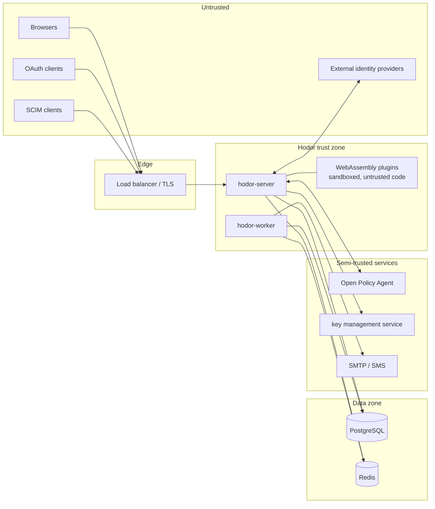

# Threat model

Method: STRIDE per trust boundary, with one focused model for each area the specification names. Each threat has an identifier, the control that addresses it, and the test that proves the control. This document is the baseline; each phase revisits its area before implementation and adds what the design at that point reveals.

## Assets

| Asset | Why it matters |
|---|---|
| Signing keys | Whoever holds them mints tokens for the tenant |
| Credentials (password hashes, TOTP secrets, passkey public keys, client and identity provider secrets) | Account and integration takeover |
| Sessions, authorization codes, refresh tokens | Impersonation |
| Identity data (personal data) | Privacy, regulatory exposure |
| Policies and role assignments | Privilege escalation |
| Audit trail | Detection and non-repudiation |
| Tenant boundary | A breach here multiplies every other one |

## Trust boundaries

Boundaries: internet → edge; edge → application; application → data; application → external identity providers (their responses are untrusted input); application → Open Policy Agent (policy content may be tenant-authored); host → WebAssembly guest; tenant ↔ tenant (logical, crossing every zone); administrator → platform.

## General STRIDE

| Identifier | Category | Threat | Control |
|---|---|---|---|
| Threat-General-01 | Spoofing | Credential stuffing and brute force | Per-account, per-IP and per-pair limits; progressive lockout; breached-password check; multi-factor authentication |
| Threat-General-02 | Spoofing | User enumeration through login, registration or recovery | Uniform responses and timing; dummy hash verification; recovery always answers "if the account exists" |
| Threat-General-03 | Tampering | SQL injection | SQLx bound parameters only; no string-built SQL; lint in continuous integration |
| Threat-General-04 | Tampering | Audit record modification | Append-only table, no `UPDATE`/`DELETE` grant, per-tenant hash chain, periodic anchor exported |
| Threat-General-05 | Repudiation | Administrator denies an action | Every admin API call audited with actor, client, IP and request identifier |
| Threat-General-06 | Information disclosure | Secrets in logs, traces or error messages | `Secret<T>` without `Debug`/`Serialize`; request and response bodies never logged; log scanning test with canary values |
| Threat-General-07 | Information disclosure | Database dump exposes secrets | Passwords Argon2id; tokens stored as hashes; recoverable secrets encrypted with authenticated encryption under per-tenant keys wrapped by the key management service |
| Threat-General-08 | Denial of service | Argon2 exhaustion through login floods | Bounded blocking pool + semaphore; rate limit before hashing; 503 with `Retry-After` |
| Threat-General-09 | Denial of service | Oversized bodies, slow requests, deep JSON | Body size and depth limits, header and read timeouts, concurrency limits per route |
| Threat-General-10 | Elevation of privilege | CSRF on cookie-authenticated endpoints | `SameSite=Lax` + per-session CSRF token on every state-changing interaction and backend-for-frontend route; `Origin` check |
| Threat-General-11 | Elevation of privilege | XSS in hosted user interface | React escaping, no `dangerouslySetInnerHTML`, strict Content Security Policy without inline script, no tenant-supplied HTML, Trusted Types |
| Threat-General-12 | Elevation of privilege | Clickjacking on login and consent | `frame-ancestors 'none'` |
| Threat-General-13 | Tampering | SSRF through configured URLs (JWKS, discovery, webhooks, `request_uri`, logout URIs) | One outbound client: HTTPS only, DNS resolution pinned and checked against private, loopback, link-local and metadata ranges, no redirects by default, size and time limits |
| Threat-General-14 | Spoofing | Session fixation and hijacking | Session identifier rotated at login and step-up; cookie flags; server-side revocation; device binding signal |
| Threat-General-15 | Tampering | Dependency compromise | `cargo deny`, `cargo audit`, lockfile, vendored sources policy, pinned continuous integration actions, signed releases, software bill of materials |
| Threat-General-16 | Elevation of privilege | Open redirect | Redirect targets are registered values or server-stored references, never request input |

## OAuth 2.x

Baseline: RFC 9700 and RFC 6819.

| Identifier | Threat | Control | Test |
|---|---|---|---|
| Threat-OAuth-01 | Authorization code interception | PKCE S256 mandatory for public clients, default for all; code bound to client, redirect URI and challenge; 60 s lifetime | Token request without or with wrong verifier fails |
| Threat-OAuth-02 | Authorization code replay | Single use; second redemption revokes the grant and its tokens | Replay test asserts revocation |
| Threat-OAuth-03 | Redirect URI manipulation | Exact string match; no wildcards; loopback port exception only for native clients (RFC 8252) | Table-driven near-miss URIs |
| Threat-OAuth-04 | Mix-up attack | `iss` in authorization responses (RFC 9207); per-tenant issuer | Response contains `iss` |
| Threat-OAuth-05 | CSRF on the client's redirect URI | PKCE; `state` passed through unchanged; `nonce` for OpenID Connect | — |
| Threat-OAuth-06 | Refresh token theft | Rotation, reuse detection revokes the family; sender constraint via DPoP or mTLS; idle and absolute lifetimes | Reuse test |
| Threat-OAuth-07 | Access token replay at another resource server | Audience restriction (RFC 8707); short lifetime; DPoP | Token with wrong `aud` rejected by introspection policy |
| Threat-OAuth-08 | Client impersonation | `private_key_jwt` or mTLS preferred; secrets hashed, rotated, compared in constant time; `jti` replay cache for assertions | Assertion replay rejected |
| Threat-OAuth-09 | Token leakage through the front channel | No implicit grant, no token in a URL, `Referrer-Policy: no-referrer`, `Cache-Control: no-store` on token responses | Metadata lists only `code` |
| Threat-OAuth-10 | PKCE downgrade | A code issued with a challenge cannot be redeemed without a verifier; `plain` rejected | — |
| Threat-OAuth-11 | Scope escalation on refresh or exchange | Refreshed scope ⊆ granted scope; token exchange policy per client pair | Property test |
| Threat-OAuth-12 | Malicious dynamic client registration | Disabled by default; initial access token; software statements; registered URIs validated and SSRF-checked | — |
| Threat-OAuth-13 | Device flow phishing | User code entropy and rate limit; verification page shows client and scopes; short lifetime | — |
| Threat-OAuth-14 | JWT algorithm confusion, `none`, key injection through `jku`/`jwk` headers | Algorithm allow-list per key; key selected by `kid` from the server's own store only; header-supplied keys ignored | Fuzzed header corpus |
| Threat-OAuth-15 | DPoP proof replay | `jti` cache for the proof lifetime; server-provided nonce | — |
| Threat-OAuth-16 | Consent bypass or forged consent | Consent bound to the interaction and session; first-party skip only for clients flagged by an administrator | — |

## OpenID Connect

| Identifier | Threat | Control |
|---|---|---|
| Threat-OpenID-01 | ID Token replay or injection into another session | `nonce` bound to the request; `aud`, `azp`, `at_hash` |
| Threat-OpenID-02 | Correlation of users across clients | Pairwise subject identifiers with a per-tenant salt and `sector_identifier_uri` validation |
| Threat-OpenID-03 | Stale authentication accepted | `max_age` and `auth_time` enforced server-side; `prompt=login` forces re-authentication |
| Threat-OpenID-04 | Logout CSRF and post-logout open redirect | `id_token_hint` required for redirect; registered `post_logout_redirect_uri`; confirmation page otherwise |
| Threat-OpenID-05 | Forged back-channel logout | Signed logout token with `events` claim, `jti` replay cache at the relying party; Hodor signs with the tenant key |
| Threat-OpenID-06 | UserInfo over-disclosure | Claims limited to consented scopes and the `claims` request |
| Threat-OpenID-07 | Malicious `request` object or `request_uri` | Request objects must be signed by a registered client key; `request_uri` only from pushed authorization requests |

## SAML

| Identifier | Threat | Control |
|---|---|---|
| Threat-SAML-01 | XML signature wrapping | Verify the signature, then read data only from the exact signed element by its resolved reference; reject documents with duplicate identifiers; schema validation first |
| Threat-SAML-02 | XXE and entity expansion | DTDs and external entities disabled in the parser; size and depth limits |
| Threat-SAML-03 | Assertion replay | `InResponseTo` matched to a stored request; `NotOnOrAfter`; assertion identifier cache |
| Threat-SAML-04 | Audience and destination confusion | `AudienceRestriction`, `Destination` and `Recipient` must match this service provider exactly |
| Threat-SAML-05 | Unsigned or partially signed responses | Require a signed assertion (or signed response containing it); no fallback to unsigned |
| Threat-SAML-06 | Weak algorithms | Reject SHA-1 and RSA PKCS#1 v1.5 key transport; allow-list of algorithms |
| Threat-SAML-07 | Comment and canonicalization tricks in NameID | Canonicalize before comparison; treat text nodes with comments as invalid |
| Threat-SAML-08 | RelayState open redirect | RelayState is an opaque server-side reference |
| Threat-SAML-09 | Unsolicited (initiated by the identity provider) responses | Disabled by default; when enabled, restricted to a landing page with no privileged continuation |

SAML is the highest-risk protocol in the plan because of XML Signature. See the [critical review](../architecture/critical-review.md).

## Social login and federation

| Identifier | Threat | Control |
|---|---|---|
| Threat-Federation-01 | Account takeover through automatic linking on an unverified or attacker-controlled email | No linking on email alone; linking needs proof of control of both sides, or an explicit policy with a provider authoritative for the domain and `email_verified` |
| Threat-Federation-02 | Pre-hijacking: attacker registers locally with the victim's email before the victim's first social login | Unverified local identifiers never match; on first federated login to a pre-existing unverified account, the old credentials and sessions are invalidated |
| Threat-Federation-03 | Login CSRF and callback forgery | `state` bound to the browser and the `AuthTransaction`, single use; PKCE toward the identity provider |
| Threat-Federation-04 | Identity provider mix-up | One callback URL per provider; issuer checked against the provider's configuration |
| Threat-Federation-05 | Token substitution from another client of the same identity provider | `aud` and `azp` validation; `nonce` |
| Threat-Federation-06 | Multi-tenant identity provider confusion (for example, any Entra tenant accepted) | Issuer template pinned to allowed tenant identifiers; domain claims not trusted from multi-tenant issuers without verification |
| Threat-Federation-07 | Malicious claim values escalate privilege (groups, roles) | Mappings are explicit allow-lists; mapped roles limited to a configured set per provider |
| Threat-Federation-08 | SSRF through discovery or JWKS URLs | Threat-General-13 |
| Threat-Federation-09 | Provider secret disclosure | Encrypted at rest, write-only in the API, never returned |
| Threat-Federation-10 | A deactivated provider keeps granting access | Deactivation blocks new logins and, by policy, revokes sessions established through it |
| Threat-Federation-11 | Identifier recycling at the identity provider (email reassigned) | Link on the immutable `sub`, never on email |

## Open Policy Agent

| Identifier | Threat | Control |
|---|---|---|
| Threat-PolicyAgent-01 | Tenant A's Rego reads tenant B's data in a shared Open Policy Agent | Tenant-authored Rego only in a dedicated Open Policy Agent; shared Open Policy Agent runs platform-authored policy only |
| Threat-PolicyAgent-02 | SSRF or exfiltration through `http.send` and similar built-ins | Capabilities file removes them; checked at validation and enforced at run time |
| Threat-PolicyAgent-03 | Policy injection through the decision path | The path is derived from tenant and binding, never from request input |
| Threat-PolicyAgent-04 | Bundle tampering or rollback | Signed bundles; monotonic revision; Open Policy Agent verifies the signature; per-instance bundle credentials |
| Threat-PolicyAgent-05 | Open Policy Agent unavailable → access granted | Fail-closed default; `fail_open` only explicit, per action, audited |
| Threat-PolicyAgent-06 | Stale policy keeps answering after a publish | Revision tracking from status reports; lagging instances yield `Indeterminate` |
| Threat-PolicyAgent-07 | Sensitive attributes leak into decision logs | Mask rules by path; log sampling and retention per tenant |
| Threat-PolicyAgent-08 | Expensive policy as denial of service | Decision timeout; bundle size and rule-count quotas; evaluation metrics per tenant |
| Threat-PolicyAgent-09 | Unauthenticated Open Policy Agent API | Token or mTLS; network policy restricts access to Hodor |
| Threat-PolicyAgent-10 | Decision cache returns a stale allow | Cache off by default; keyed by revision; short time to live; flushed on publish |

## Multi-tenancy

| Identifier | Threat | Control |
|---|---|---|
| Threat-Tenancy-01 | A query without a tenant filter returns another tenant's rows | Forced row-level security + mandatory `TenantContext` in ports + composite foreign keys |
| Threat-Tenancy-02 | Tenant taken from request input | Resolved from host or path only; credentials validated within that tenant |
| Threat-Tenancy-03 | Token or session from tenant A accepted at tenant B | Per-tenant issuer and keys; tenant-scoped lookups |
| Threat-Tenancy-04 | Cache key collision | Single key builder requiring `TenantContext` |
| Threat-Tenancy-05 | Platform administrator abuses standing access | No standing access; audited time-boxed support grants; separate platform role |
| Threat-Tenancy-06 | Noisy neighbor | Per-tenant rate limits, quotas and worker fairness |
| Threat-Tenancy-07 | Custom domain takeover | DNS verification, periodic re-verification, domain released on failure |
| Threat-Tenancy-08 | Background job runs with the wrong tenant | Jobs carry `tenant_id`; handlers receive a rebuilt `TenantContext`; no ambient tenant |
| Threat-Tenancy-09 | Shared-origin attacks between path-based tenants | No tenant-supplied HTML or scripts; dedicated hosts recommended |
| Threat-Tenancy-10 | Data remains after tenant deletion | Purge job with verification query; crypto-shredding of the tenant key |

## Plugin system

| Identifier | Threat | Control |
|---|---|---|
| Threat-Plugin-01 | Plugin escapes the sandbox | Wasmtime with no ambient authority: no filesystem, network or clock unless granted; component model with typed host functions |
| Threat-Plugin-02 | Plugin exhausts CPU or memory | Fuel or epoch interruption, memory limit, per-call deadline |
| Threat-Plugin-03 | Plugin reads data beyond its purpose | Capability manifest approved by an administrator; host functions check capabilities and tenant on every call |
| Threat-Plugin-04 | Plugin exfiltrates secrets | Secrets never cross the boundary; plugins receive handles, and outbound HTTP goes through the host's SSRF-safe client with an allow-list |
| Threat-Plugin-05 | Malicious or tampered plugin package | Signed packages, digest pinning, per-tenant installation approval |
| Threat-Plugin-06 | Plugin failure breaks authentication | Per-extension-point failure policy; authentication actions fail closed |
| Threat-Plugin-07 | Claims mapper injects privileged claims | Reserved claims (`iss`, `sub`, `aud`, `exp`, `acr`, `amr`, …) cannot be set by mappers |

## Authorization engine

| Identifier | Threat | Control |
|---|---|---|
| Threat-Authorization-01 | Policy enforcement point asserts roles or attributes it should not | Asserted attributes kept separate from resolved ones and untrusted by default |
| Threat-Authorization-02 | Any authenticated client queries decisions about any subject | `authz:evaluate` scope per namespace; callers limited to their own resource server |
| Threat-Authorization-03 | Explanations reveal policy internals or sensitive attributes | Stable reason codes by default; detail only with `authz:explain` |
| Threat-Authorization-04 | Stale role cache grants revoked access | Event-driven invalidation plus a short time to live upper bound |
| Threat-Authorization-05 | Role hierarchy cycle or explosion | Cycle check on write; bounded expansion |
| Threat-Authorization-06 | Relationship-based access control traversal as denial of service | Depth and fan-out limits; `Indeterminate` on limit |
| Threat-Authorization-07 | `Indeterminate` treated as allow by a policy enforcement point | Software development kits expose a boolean `allowed`; documentation and conformance tests for policy enforcement points |
| Threat-Authorization-08 | Self-escalation by an administrator | A principal cannot grant permissions it does not hold; segregation-of-duty rules on role assignment |
| Threat-Authorization-09 | Simulation used to probe production data | Separate scope; simulation is audited; no real decision record |

## Residual risks

| Risk | Status |
|---|---|
| Compromise of a node's memory exposes local signing keys | Reduced by keys held in a key management service (Phase 9); accepted for the local provider |
| SMS one-time password interception (SIM swap) | Inherent; SMS is offered as low assurance and excluded from high `acr` |
| Phishing of passwords and TOTP | Reduced by passkeys; not eliminated while phishable factors are enabled |
| Compromised upstream identity provider | Limited by claim allow-lists and per-provider multi-factor authentication policy; cannot be eliminated |
